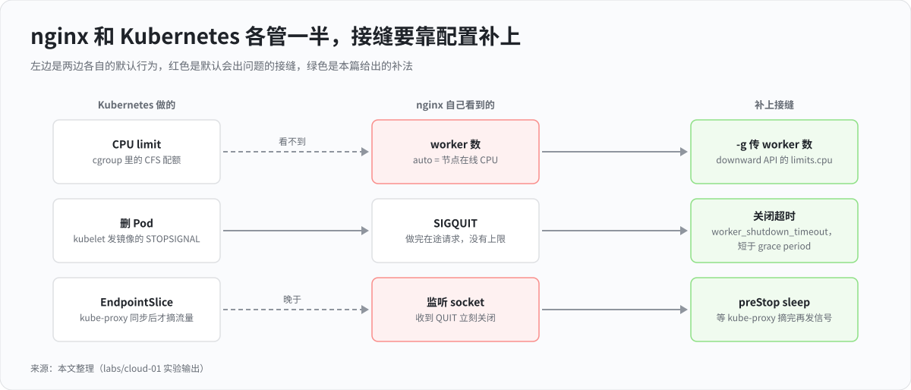
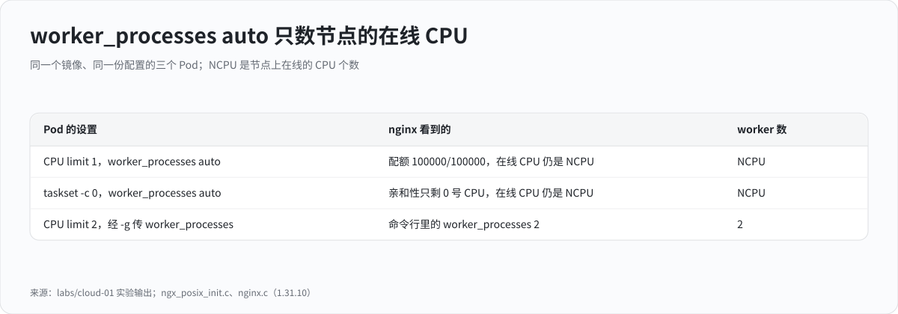
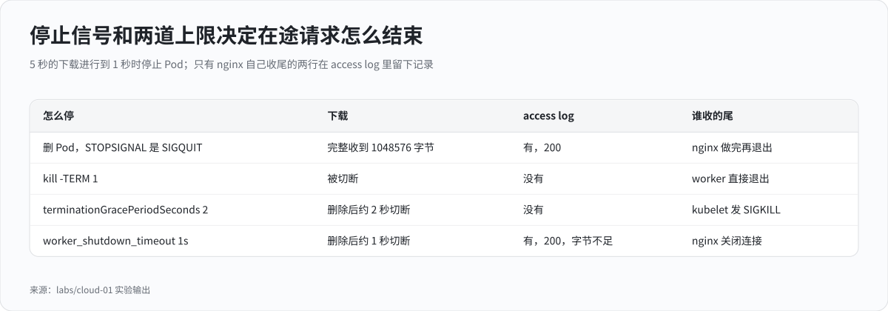
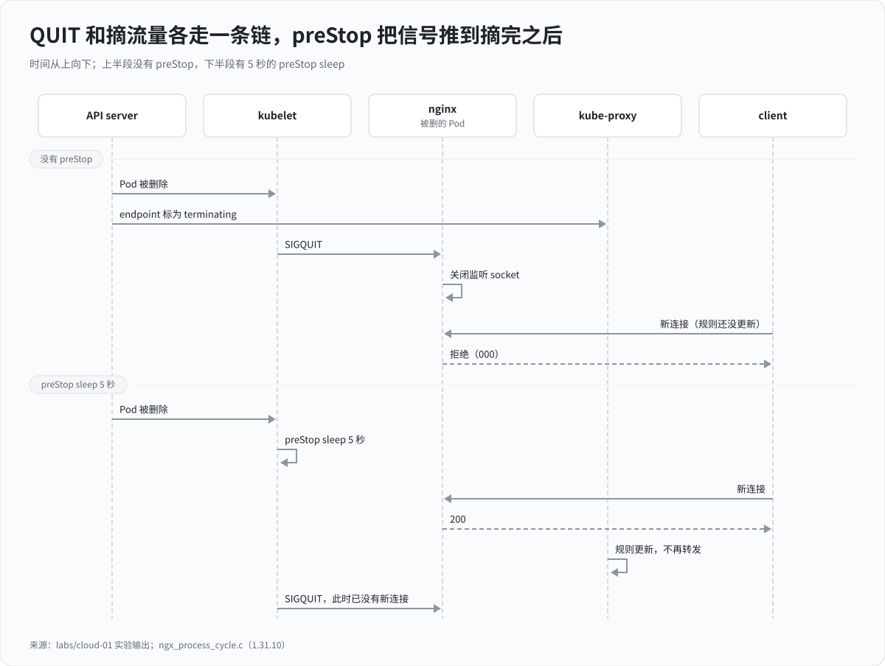
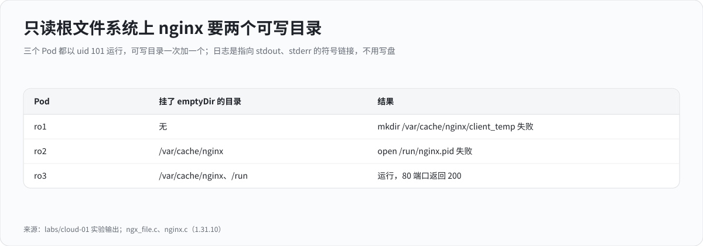

# 云原生篇 01｜容器里的 nginx：worker 数、停止信号和下线时序都要自己对齐

> **一句话结论**：nginx 不知道自己在容器里。`worker_processes auto` 数的是节点上在线的 CPU，Pod 的 CPU limit 和亲和性都不算，limit 为 1 的 Pod 在 8 核节点上照样起 8 个 worker；要按 limit 起 worker，就用 downward API 把 limit 经 `-g` 传给 nginx。删 Pod 时 kubelet 发镜像里的 STOPSIGNAL，官方镜像是 SIGQUIT，在途请求能做完；但 nginx 收到 QUIT 会立刻关掉监听端口，而 kube-proxy 摘掉这个 Pod 要晚一点，这段时间差里发来的新连接会被拒绝，滚动发布因此丢请求，preStop 里 sleep 几秒就能补上。以 uid 101 跑在只读根文件系统上时，nginx 启动要写的只有 `*_temp` 目录和 pid 文件，日志走 stdout/stderr 不用写。
>
> 适用版本：nginx 1.31.10（mainline，2026-11-23），Kubernetes v1.37.0。「版本差异」：本篇用到的 CPU 计数、信号处理、`worker_shutdown_timeout` 定时器和临时目录创建在 1.30.8 里相同，`ngx_process_cycle.c` 在两个版本之间的差别只有 control API 的分支（运维篇 03）。实验：[`labs/cloud-01`](../labs/cloud-01/)，在 kind 集群里起 Pod，从集群内的 client Pod 发请求；环境见 README 的「云原生篇的实验环境」。

## 导读

| 你想知道 | 看哪一节 |
|---|---|
| Pod 限了 1 个 CPU，为什么 `ps` 里有一排 worker | §1 |
| 怎么让 worker 数跟着 CPU limit 走 | §2 |
| 删 Pod 时正在下载的请求会怎样 | §3 |
| 优雅退出最多等多久，`worker_shutdown_timeout` 该设多少 | §4 |
| 滚动发布为什么会丢请求，preStop 为什么能补上 | §5 |
| 非 root、只读根文件系统要给 nginx 留哪些可写目录 | §6 |

[运维篇 03](../ops/03-processes-signals.md) 讲了 master 和 worker 在本机怎么响应信号。容器把同一套机制放进了另一个环境：CPU 由 cgroup 分配，信号由 kubelet 发，流量由 kube-proxy 转发。下图是一个 Pod 从创建到删除的过程中，nginx 自己看到的和 Kubernetes 做的分别是什么，判断是：两边各管一半，接缝要靠配置补上。



## 1. worker_processes auto 数的是节点上在线的 CPU，CPU limit 和亲和性都不算

`worker_processes auto` 的处理很短：取全局变量 `ngx_ncpu`（[`nginx.c` 第 1637–1639 行](https://github.com/nginx/nginx/blob/release-1.31.10/src/core/nginx.c#L1637)）。

```c
// src/core/nginx.c:1624-1649
ngx_set_worker_processes(ngx_conf_t *cf, ngx_command_t *cmd, void *conf)
{
    ngx_str_t        *value;
    ngx_core_conf_t  *ccf;

    ccf = (ngx_core_conf_t *) conf;

    if (ccf->worker_processes != NGX_CONF_UNSET) {
        return "is duplicate";
    }

    value = cf->args->elts;

    if (ngx_strcmp(value[1].data, "auto") == 0) {
        ccf->worker_processes = ngx_ncpu;
        return NGX_CONF_OK;
    }

    ccf->worker_processes = ngx_atoi(value[1].data, value[1].len);

    if (ccf->worker_processes == NGX_ERROR) {
        return "invalid value";
    }

    return NGX_CONF_OK;
}
```

`ngx_ncpu` 在 Linux 上只来自一处，[`ngx_posix_init.c` 第 63 行](https://github.com/nginx/nginx/blob/release-1.31.10/src/os/unix/ngx_posix_init.c#L63) 调用 `sysconf(_SC_NPROCESSORS_ONLN)`：

```c
// src/os/unix/ngx_posix_init.c:61-69
#if (NGX_HAVE_SC_NPROCESSORS_ONLN)
    if (ngx_ncpu == 0) {
        ngx_ncpu = sysconf(_SC_NPROCESSORS_ONLN);
    }
#endif

    if (ngx_ncpu < 1) {
        ngx_ncpu = 1;
    }
```

glibc 回答这个问题时读的是 `/sys/devices/system/cpu/online`，也就是整台机器上线了几个 CPU。Pod 的 CPU limit 在 cgroup 里是一个 CFS 配额（每 100 ms 能用多少 CPU 时间），不改变机器有几个 CPU；进程的亲和性（`taskset`、kubelet 的 static CPU 管理策略都是通过它实现）也不在这个数里。实验在一个 8 核节点上起了一个 limit 为 1 的 Pod：

```text
# labs/cloud-01 ## worker_processes auto under a CPU limit
CFS quota and period (us): 100000 100000
CPUs online in the pod: NCPU
worker processes: NCPU
ok - a limit of 1 CPU still gives one worker per CPU of the node
```

配额是 100000/100000 微秒，正好一个 CPU，worker 数却等于节点的 CPU 数（输出里把这个数换成了 `NCPU`，不同机器不一样）。再用 `taskset -c 0` 启动 nginx，让 master 只能在 0 号 CPU 上运行：

```text
# labs/cloud-01 ## worker_processes auto under taskset
Cpus_allowed_list of PID 1: 0
worker processes: NCPU
ok - the affinity mask is not counted either
```

亲和性掩码只剩 0 号 CPU，worker 还是一排。多出来的 worker 不会让 Pod 多用 CPU，配额照样卡在 1 个 CPU，代价在别处：每个 worker 启动时都按 `worker_connections` 分配自己的连接和事件数组，到上游的 keepalive 连接也是每个 worker 各缓存一份（运维篇 06），这些都随 worker 数成倍增加；配额内抢时间片的进程多了，CFS 节流（throttling）也更容易发生。节点越大，这个倍数越大。



**小结**：`auto` 在容器里等于“节点有几个 CPU”，和 Pod 的 limit 无关，换到更大的节点上，worker 数会悄悄变多。worker 数要和 limit 对齐，只能从外面告诉 nginx，下一节看两种做法。

## 2. 让 worker 数跟着 CPU limit 走：用 downward API 经 -g 传进去

Kubernetes 能把容器自己的 limit 通过 downward API 放进环境变量，并在 `command` 里展开 `$(变量名)`，不需要 shell。nginx 的 `-g` 参数先于配置文件解析（[运维篇 01](../ops/01-install.md) §5），于是可以把 worker 数放在命令行里：

```yaml
# lab: labs/cloud-01/k8s/cpu.yaml
# tuned: the CPU limit passed to nginx through the downward API; Kubernetes expands
# $(CPU_LIMIT) in the command, no shell involved. tuned.conf has no worker_processes.
apiVersion: v1
kind: Pod
metadata:
  name: tuned
  labels: {app: tuned}
spec:
  containers:
    - name: nginx
      image: nginx-devops/nginx:1.31.10
      command: ["nginx", "-g", "daemon off; worker_processes $(CPU_LIMIT);"]
      env:
        - name: CPU_LIMIT
          valueFrom:
            resourceFieldRef: {resource: limits.cpu, divisor: "1"}
      resources:
        requests: {cpu: 100m}
        limits: {cpu: "2"}
      volumeMounts:
        - {name: conf, mountPath: /etc/nginx/nginx.conf, subPath: tuned.conf}
```

`divisor: "1"` 让 limit 以整数个 CPU 给出。`tuned.conf` 和 `nginx.conf` 的差别只是没有写 `worker_processes`，因为同一条指令出现两次时，第二次会在 [`ngx_set_worker_processes`](https://github.com/nginx/nginx/blob/release-1.31.10/src/core/nginx.c#L1624) 的开头被拒绝（上一节摘录的 `"is duplicate"`），master 起不来。实验里 limit 是 2：

```text
# labs/cloud-01 ## worker_processes from the downward API
nginx: master process nginx -g daemon off; worker_processes 2;
worker processes: 2
ok - limits.cpu 2 passed with -g gives two workers
```

另一种做法是 nginx 官方镜像自带的入口脚本 `30-tune-worker-processes.sh`：设置环境变量 `NGINX_ENTRYPOINT_WORKER_PROCESSES_AUTOTUNE` 后，它在启动前读 cgroup v1 和 v2 的配额与 cpuset，取在线 CPU、cpuset、配额（向上取整）里最小的那个，用 `sed -i` 改写 `/etc/nginx/nginx.conf` 里的 `worker_processes`。它要求配置文件可写：脚本先 `touch` 一下，失败就打印错误后跳过。配置来自 ConfigMap 时，卷是只读挂载的，自动调整不会生效，这时只能用上面的 `-g`。本仓库的实验镜像不带这套入口脚本，这一段是读脚本源码得到的。

**小结**：用 downward API 把 limit 传给 `-g "worker_processes N;"`，配置文件里不写这条；官方镜像的自动调整要求 nginx.conf 可写，配置挂在 ConfigMap 上时不起作用。worker 数定下来，接下来看 Pod 被删时这些 worker 怎么退出。

## 3. 删 Pod 时 kubelet 发的是镜像里的 STOPSIGNAL：官方镜像是 SIGQUIT，在途请求能做完

删除一个 Pod，kubelet 先跑 preStop（如果有），再让容器运行时给容器的 1 号进程发停止信号，信号取自镜像的 `STOPSIGNAL`，没写就是 SIGTERM。nginx 官方镜像写的是 `STOPSIGNAL SIGQUIT`，本仓库的实验镜像照搬了这一行。nginx 以 `daemon off` 运行时 master 就是 1 号进程，它收到的信号决定了在途请求的命运。[`ngx_signal_handler`](https://github.com/nginx/nginx/blob/release-1.31.10/src/os/unix/ngx_process.c#L319) 在 master 里把 QUIT 和 TERM 分到两个标志：

```c
// src/os/unix/ngx_process.c:340-356
    switch (ngx_process) {

    case NGX_PROCESS_MASTER:
    case NGX_PROCESS_SINGLE:
        switch (signo) {

        case ngx_signal_value(NGX_SHUTDOWN_SIGNAL):
            ngx_quit = 1;
            action = ", shutting down";
            break;

        case ngx_signal_value(NGX_TERMINATE_SIGNAL):
        case SIGINT:
            ngx_terminate = 1;
            action = ", exiting";
            break;

```

`ngx_quit` 时 master 把 QUIT 转给 worker 并关掉自己的监听 socket；worker 收到后关闭监听 socket 和空闲的 keepalive 连接，正在处理的请求继续做完，做完才退出：

```c
// src/os/unix/ngx_process_cycle.c:758-771
        if (ngx_quit) {
            ngx_quit = 0;
            ngx_log_error(NGX_LOG_NOTICE, cycle->log, 0,
                          "gracefully shutting down");
            ngx_setproctitle("worker process is shutting down");

            if (!ngx_exiting) {
                ngx_exiting = 1;
                ngx_set_shutdown_timer(cycle);
                ngx_close_listening_sockets(cycle);
                ngx_close_idle_connections(cycle);
                ngx_event_process_posted(cycle, &ngx_posted_events);
            }
        }
```

实验从 client Pod 下载一个以 200 KB/s 限速的 1 MB 文件（约 5 秒），开始 1 秒后删除 Pod，同时用 `kubectl logs -f` 收集 nginx 的日志：

```text
# labs/cloud-01 ## deleting a pod sends the image's STOPSIGNAL
[notice] signal 3 (SIGQUIT) received, shutting down
[notice] gracefully shutting down
"GET /big/f.bin HTTP/1.1" 200 1048576
download: complete
ok - SIGQUIT lets the download finish
```

日志里 SIGQUIT 后面没有 `received from <pid>`：信号来自容器运行时，发送者不在这个 PID 命名空间里，内核报给 nginx 的发送者 pid 是 0，nginx 就省掉了这一段。下载完整收到了 1048576 字节，access log 在最后记下了这次请求，之后 Pod 才真正消失。换成 TERM 是另一回事。Kubernetes 1.37 默认不能按 Pod 改停止信号（字段 `lifecycle.stopSignal` 依赖的特性开关还是 alpha，默认关闭），实验用 `kill -TERM 1` 模拟一个 STOPSIGNAL 为 SIGTERM 的镜像：

```text
# labs/cloud-01 ## SIGTERM instead
[notice] signal 15 (SIGTERM) received from N, exiting
[notice] exiting
download: cut
kubernetes_feature_enabled{name="ContainerStopSignals",stage="ALPHA"} 0
ok - SIGTERM cuts it; a per-pod stop signal is an alpha feature, off by default
```

`ngx_terminate` 让 worker 直接退出，连接被关掉，下载只收到一部分，access log 里也没有这次请求。自己构建镜像时如果基础镜像不是官方 nginx 镜像，或者用 `CMD` 之外的方式包了一层启动脚本，就要确认停止信号确实是 SIGQUIT，并且送到了 nginx master：shell 脚本做 1 号进程时，不 `exec nginx` 的话，信号会停在 shell 那里。

master 做 1 号进程还有一个职责：回收僵尸进程。它在 SIGCHLD 里用 `waitpid(-1, ...)` 收集退出的子进程（[`ngx_process_get_status`](https://github.com/nginx/nginx/blob/release-1.31.10/src/os/unix/ngx_process.c#L471)），`-1` 表示任何子进程都收，所以不需要再加一个 init 进程。

**小结**：官方镜像用 SIGQUIT，kubelet 照用，在途请求能做完；SIGTERM 会把它们切断，自制镜像要检查 `STOPSIGNAL` 和启动脚本。QUIT 会等所有请求做完，可它也不会无限等下去，下一节看两道上限。

## 4. 优雅退出有两道上限：grace period 到了是 SIGKILL，worker_shutdown_timeout 让 nginx 先自己收尾

kubelet 发出停止信号后，最多等 `terminationGracePeriodSeconds`（默认 30 秒，preStop 的时间也算在里面），到时还没退出就发 SIGKILL。长连接（WebSocket、gRPC 流、大文件下载）很容易超过 30 秒。nginx 自己也有一个上限 `worker_shutdown_timeout`（1.11.11 起），默认 0，即不设上限。设置后，worker 开始优雅退出时启动一个定时器（[`ngx_set_shutdown_timer`](https://github.com/nginx/nginx/blob/release-1.31.10/src/core/ngx_cycle.c#L1437)），到时把所有还开着的连接标记为关闭：

```c
// src/core/ngx_cycle.c:1455-1483
ngx_shutdown_timer_handler(ngx_event_t *ev)
{
    ngx_uint_t         i;
    ngx_cycle_t       *cycle;
    ngx_connection_t  *c;

    cycle = ev->data;

    c = cycle->connections;

    for (i = 0; i < cycle->connection_n; i++) {

        if (c[i].fd == (ngx_socket_t) -1
            || c[i].read == NULL
            || c[i].read->accept
            || c[i].read->channel
            || c[i].read->resolver)
        {
            continue;
        }

        ngx_log_debug1(NGX_LOG_DEBUG_CORE, ev->log, 0,
                       "*%uA shutdown timeout", c[i].number);

        c[i].close = 1;
        c[i].error = 1;

        c[i].read->handler(c[i].read);
    }
```

实验同时起两个 Pod：一个 grace period 为 2 秒，一个用默认的 30 秒但配置了 `worker_shutdown_timeout 1s`，都在 5 秒的下载进行到 1 秒时删除：

```nginx
# lab: labs/cloud-01/conf/wst.conf
worker_processes auto;
worker_shutdown_timeout 1s;
error_log /var/log/nginx/error.log notice;
```

```text
# labs/cloud-01 ## the grace period and worker_shutdown_timeout
terminationGracePeriodSeconds 2: download cut about 2 s after the deletion
worker_shutdown_timeout 1s: download cut about 1 s after the deletion
access log of grace: none
access log of wst: 200 partial
ok - SIGKILL after the grace period cuts the download unlogged; worker_shutdown_timeout cuts it first and logs it
```

两次下载都被切断，结束时间分别在删除后约 2 秒和约 1 秒。区别在于是谁动的手：SIGKILL 由内核直接终止 master 和 worker，nginx 来不及做任何收尾，access log 里没有这次请求；`worker_shutdown_timeout` 是 nginx 在事件循环里关闭连接，请求走正常的结束流程，access log 里有一行，状态码是 200，字节数不足 1048576。排查“下载到一半断了”时，access log 里有没有这一行，能区分是 nginx 自己关的还是被 SIGKILL 的。



**小结**：把 `worker_shutdown_timeout` 设得比 `terminationGracePeriodSeconds` 减去 preStop 时间更短，让 nginx 在被 SIGKILL 之前自己关掉剩下的连接；要留住更长的连接，就同时调大 grace period。到这里在途请求都有了着落，下一节看删除期间新来的请求。

## 5. QUIT 立刻关掉监听端口，摘流量却要等 kube-proxy：preStop 的 sleep 补上这段时间差

删除 Pod 这一个动作会触发两条互不等待的链路：kubelet 发停止信号；EndpointSlice 控制器把这个 Pod 标为 terminating，各节点的 kube-proxy 再据此更新转发规则。nginx 收到 QUIT 后第一件事就是关闭监听 socket（上一节的 `ngx_close_listening_sockets`），master 和 worker 都关掉以后，内核对新来的 SYN 直接回 RST。只要 kube-proxy 的规则还没更新完，经 Service 发来的新连接就会被拒绝。

实验用一个 Service 选中两个 Pod：`bare` 没有 preStop，`sleepy` 配了 5 秒的 preStop sleep。两个 Pod 上各有一个下载在进行，删除 1.5 秒后直接向两个 Pod 的 IP 发新请求：

```yaml
# lab: labs/cloud-01/k8s/prestop.yaml
  name: sleepy
  labels: {app: ep}
spec:
  restartPolicy: Never
  containers:
    - name: nginx
      image: nginx-devops/nginx:1.31.10
      lifecycle:
        preStop:
          sleep: {seconds: 5}
```

```text
# labs/cloud-01 ## a terminating pod with and without preStop
new request to bare (no preStop): 000
new request to sleepy (preStop sleep 5): 200
endpoint bare: ready=false serving=true terminating=true
endpoint sleepy: ready=false serving=true terminating=true
downloads in flight: bare complete, sleepy complete
ok - without preStop the pod refuses new connections at once; with it, it still answers
```

此时两个 endpoint 都已标成 `ready=false terminating=true`。`serving=true` 是因为这两个 Pod 没配 readiness probe，Kubernetes 并不知道 `bare` 已经不接新连接。EndpointSlice 改了，各节点的转发规则要等 kube-proxy 同步后才变，删除的那一刻规则里还有这两个 Pod。`bare` 已经拒绝新连接（`000` 是 curl 连不上时的状态码），`sleepy` 还在 preStop 的 sleep 里，nginx 没收到信号，照常回 200。两个 Pod 上正在进行的下载都完整收到了。

把这段时间差放到滚动发布里：一个两副本的 Deployment，两个 client 每 20 ms 各向它的 ClusterIP 发一个请求，同时 `kubectl rollout restart`，先不带 preStop，再打上 5 秒 sleep 的补丁重来一次。curl 的退出码 7 表示连接被拒绝，输出数的就是这一类：

```text
# labs/cloud-01 ## a rolling restart under load
requests: more than 400, connection refused: some
with preStop sleep 5: requests: more than 400, connection refused: 0
ok - without preStop the restart sends requests to closed sockets, with it none
```

不带 preStop 时每次都有请求撞上已经关闭的监听 socket，个数取决于信号和规则更新之间差了多久，所以输出只记“有没有”；带上 preStop 后一个都没有。不带 preStop 的几次运行里还各有几个请求超时（curl 退出码 28），它们没有被断言，留在 `out/run/plain.txt` 里，推测是旧 Pod 已经退出、规则里还有它的地址，SYN 无人应答。sleep 的长度要盖住 kube-proxy 的同步延迟，大集群里可以更长，它和下载时间一起算进 grace period。kubelet 1.37 支持 `preStop.sleep`，镜像里不需要有 `sleep` 命令。



**小结**：nginx 的优雅退出只照顾已经建立的连接，新连接在监听 socket 关闭后就被拒绝；给 Pod 加一个比 kube-proxy 同步更长的 preStop sleep，滚动发布时就不会再有连接撞上关闭的端口。信号和时序对齐之后，最后一个问题是 nginx 在受限的文件系统里能不能启动。

## 6. 非 root、只读根文件系统：nginx 启动要写的是 *_temp 目录和 pid 文件

集群的安全基线常要求容器以非 root 用户运行、根文件系统只读。nginx 以 root 启动时，master 用 root 绑定端口、创建目录，worker 再切换到 `user` 指令指定的用户；以非 root 启动时，`user` 指令不起作用（[`nginx.c` 第 1361 行](https://github.com/nginx/nginx/blob/release-1.31.10/src/core/nginx.c#L1361) 检查 `geteuid()`，非 root 时打一条警告后忽略），master 和 worker 都是同一个用户。启动时要写文件系统的地方有三处：

- `ngx_init_cycle` 里的 [`ngx_create_paths`](https://github.com/nginx/nginx/blob/release-1.31.10/src/core/ngx_cycle.c#L356) 为每个 `*_temp_path`（官方镜像的布局在 `/var/cache/nginx/` 下）`mkdir`，已经存在就跳过；
- `main()` 里的 [`ngx_create_pidfile`](https://github.com/nginx/nginx/blob/release-1.31.10/src/core/nginx.c#L382) 写 pid 文件（`/run/nginx.pid`）；
- 打开 `error_log` 和 `access_log`。官方镜像把这两个文件做成了指向 `/dev/stdout`、`/dev/stderr` 的符号链接，打开的是容器的标准输出，不需要写盘。

```c
// src/core/ngx_file.c:598-621
ngx_create_paths(ngx_cycle_t *cycle, ngx_uid_t user)
{
    ngx_err_t         err;
    ngx_uint_t        i;
    ngx_path_t      **path;

    path = cycle->paths.elts;
    for (i = 0; i < cycle->paths.nelts; i++) {

        if (ngx_create_dir(path[i]->name.data, 0700) == NGX_FILE_ERROR) {
            err = ngx_errno;
            if (err != NGX_EEXIST) {
                ngx_log_error(NGX_LOG_EMERG, cycle->log, err,
                              ngx_create_dir_n " \"%s\" failed",
                              path[i]->name.data);
                return NGX_ERROR;
            }
        }

        if (user == (ngx_uid_t) NGX_CONF_UNSET_UINT) {
            continue;
        }

#if !(NGX_WIN32)
```

非 root 启动时 `ccf->user` 没有被设置（默认用户只在 `geteuid() == 0` 时才填进去），`ngx_create_paths` 建完目录就继续，不再 `chown`，所以 emptyDir 只要对 uid 101 可写即可。

实验以 uid 101 在只读根文件系统上起三个 Pod，可写目录一次加一个：

```yaml
# lab: labs/cloud-01/k8s/ro.yaml
  name: ro3
  labels: {app: ro}
spec:
  restartPolicy: Never
  securityContext: {runAsUser: 101, runAsGroup: 101, runAsNonRoot: true}
  containers:
    - name: nginx
      image: nginx-devops/nginx:1.31.10
      securityContext: {readOnlyRootFilesystem: true, allowPrivilegeEscalation: false}
      volumeMounts:
        - {name: conf, mountPath: /etc/nginx/nginx.conf, subPath: nginx.conf}
        - {name: cache, mountPath: /var/cache/nginx}
        - {name: run, mountPath: /run}
```

```text
# labs/cloud-01 ## non-root on a read-only root filesystem
ro1: Failed
  [emerg] mkdir() "/var/cache/nginx/client_temp" failed (30: Read-only file system)
ro2: Failed
  [emerg] open() "/run/nginx.pid" failed (30: Read-only file system)
ro3: Running
  nginx master process: 1
  nginx worker process: NCPU
  ip_unprivileged_port_start: 0
  request on port 80: 200
ok - uid 101 needs writable temp paths and pid directory, nothing else; port 80 works
```

`ro1` 停在第一个临时目录，`ro2` 有了 `/var/cache/nginx` 的 emptyDir 后停在 pid 文件，`ro3` 再加上 `/run` 就起来了，master 和 worker 都以 `nginx`（uid 101）运行。非 root 进程能监听 80 端口，是因为 Pod 的网络命名空间里 `net.ipv4.ip_unprivileged_port_start` 是 0，本实验的集群用的是 containerd 2.3.4；运行时不这样设时，要改监听 8080 之类的高端口，或者给 nginx 加 `NET_BIND_SERVICE` 能力。



**小结**：只读根文件系统上给 `/var/cache/nginx`（或 `*_temp_path` 指向的目录）和 pid 文件所在目录各挂一个 emptyDir，日志写 stdout/stderr，nginx 就能以非 root 运行。用 `proxy_cache_path` 时缓存目录也要可写，并且要算进 emptyDir 的大小限制。

## 已知局限与待核实

- 实验在 cgroup v1 主机（Linux 4.19）上的 kind 集群里运行，Kubernetes v1.37.0、containerd 2.3.4。cgroup v2 下 CPU 配额的文件是 `cpu.max`，实验脚本两种都读，但只在 v1 上跑过；`worker_processes auto` 的结论来自源码，不依赖 cgroup 版本。
- glibc 用 `/sys/devices/system/cpu/online` 回答 `_SC_NPROCESSORS_ONLN` 是按 glibc 的实现描述的，实验只验证了结果（亲和性不影响 worker 数）。musl（Alpine 镜像）的实现不同，没有验证。
- §2 官方镜像的自动调整脚本只读了源码（nginx/docker-nginx 仓库的 `mainline/debian/30-tune-worker-processes.sh`），没有运行。
- §3 发送者 pid 为 0 的解释是按信号的投递规则推断的，实验只看到了日志里没有 `received from`。
- §6 Pod 里 `ip_unprivileged_port_start` 为 0 是实验观察到的，归因于容器运行时的默认设置是推断，没有在别的运行时上对照。
- §5 被拒绝的个数与集群规模、kube-proxy 模式和同步间隔有关，实验只断言“有”和“没有”；5 秒的 sleep 在这个三节点集群里足够，大集群需要自己测。超时的请求没有断言，原因是推测。
- §6 多写一条 `proxy_cache_path` 或 `client_body_temp_path` 指向别处时，可写目录相应变化，实验只覆盖了镜像的默认布局。
- 多余 worker 带来的 CFS 节流和延迟抖动是一般性的说明，本篇没有测量。

## 修订记录

- 2026-11-26：新写。覆盖 `worker_processes auto` 与 CPU limit、亲和性，downward API 经 `-g` 传 worker 数，镜像 STOPSIGNAL 与 QUIT/TERM，grace period 与 `worker_shutdown_timeout`，监听 socket 关闭与 preStop，非 root 只读根文件系统，均附 `labs/cloud-01` 实验。
