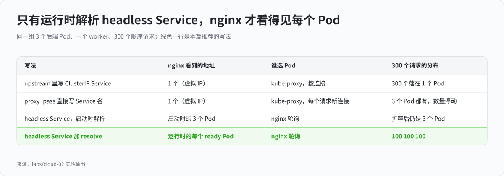
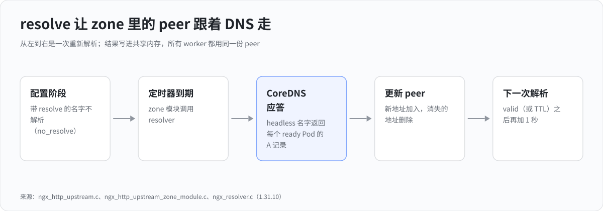
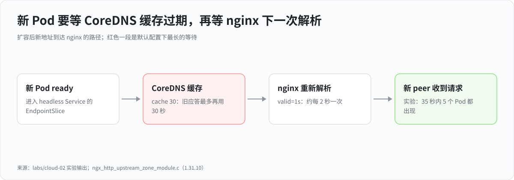
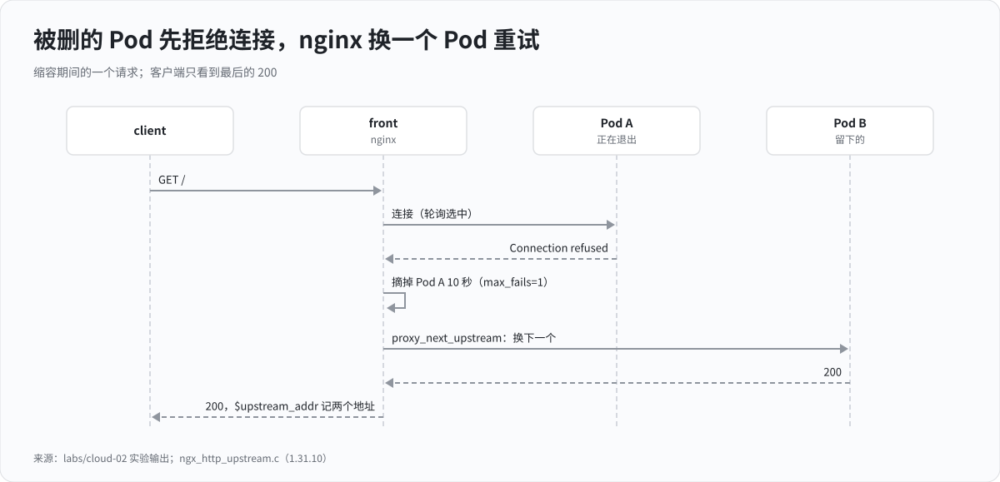

# 云原生篇 02｜服务发现与动态上游：让 nginx 看见每个 Pod，用 headless Service 加 resolve

> **一句话结论**：把 ClusterIP Service 写成 upstream 里的一个 server，nginx 眼里只有一个地址，选 Pod 的是 kube-proxy，而 kube-proxy 按连接分流；1.29.7 起 upstream 块默认保持连接，一个 worker 的 300 个请求全落在同一个 Pod 上。用 headless Service 加 `server ... resolve`，nginx 在运行时拿到每个 Pod 的地址，轮询精确到 100/100/100，扩容后新 Pod 自动加入，缩容时被停掉的 Pod 拒绝连接、由 `proxy_next_upstream` 换到别的 Pod，客户端一个错误也看不到。新地址多久生效，上限是 CoreDNS 的 30 秒缓存，`resolver valid=` 只能缩短 nginx 自己这一侧。nginx 的 resolver 不用 search 域，`resolve` 的名字必须写全。
>
> 适用版本：nginx 1.31.10（mainline，2026-11-23），Kubernetes v1.37.0。「版本差异」：`server ... resolve`（1.27.3）和 upstream 默认 keepalive（1.29.7）在 1.30.8 里都有，本篇的结论两个版本相同。实验：[`labs/cloud-02`](../labs/cloud-02/)，一个单 worker 的 `front` Pod 用五种写法代理同一组返回自己 Pod 名的后端，后端由一个 Deployment 和两个 Service（普通的和 headless 的）提供。

## 导读

| 你想知道 | 看哪一节 |
|---|---|
| 代理到 Service 名，为什么流量全打到一个 Pod 上 | §1 |
| headless Service 和 `resolve` 怎么配，nginx 怎么拿到 Pod 地址 | §2 |
| 扩容后新 Pod 多久能收到流量 | §3 |
| 缩容时正在用的 Pod 消失，会不会报错 | §4 |
| `resolve` 写了短名字为什么返回 502 | §5 |

[运维篇 07](../ops/07-load-balancing.md) §8 讲了 `zone` 和 `resolve` 的配置要求。这一篇把它放进 Kubernetes：同一组 Pod，可以通过普通 Service 的虚拟 IP 访问，也可以通过 headless Service 的 DNS 名拿到每个 Pod 的地址。实验的 `front` 用五个端口代表五种写法：

```nginx
# lab: labs/cloud-02/conf/front.conf
    # nginx's own resolver: no search domains, names must be fully qualified
    resolver kube-dns.kube-system.svc.cluster.local valid=1s ipv6=off;

    # the ClusterIP Service as one server, resolved once at startup; upstream blocks
    # keep connections to the backend by default (1.29.7)
    upstream clusterip {
        server backend.lab-cloud-02.svc.cluster.local;
    }

    # the headless Service resolved at run time: one peer per ready pod
    upstream headless {
        zone headless 64k;
        server backend-headless.lab-cloud-02.svc.cluster.local resolve;
    }

    # the headless Service resolved once at startup
    upstream startup {
        server backend-headless.lab-cloud-02.svc.cluster.local;
    }

    # a short name, as a pod's /etc/resolv.conf would complete it
    upstream short {
        zone short 64k;
        server backend-headless resolve;
    }
```

下图把这几种写法按“nginx 看到几个地址、谁来选 Pod”排在一起，判断是：只有运行时解析 headless Service，nginx 才看得见每个 Pod，它的负载均衡才在起作用。



## 1. ClusterIP 当成一个 server 时，kube-proxy 按连接分流：默认 keepalive 让流量粘在一个 Pod 上

普通 Service 的 DNS 名解析到一个虚拟 IP（ClusterIP）。kube-proxy 在每个节点上为它写 DNAT 规则，新连接的第一个包经过规则时随机选一个 Pod，之后这条连接上的所有包都发往同一个 Pod。把这个名字写进 upstream 块，nginx 在启动时解析出一个地址，upstream 里就只有一个 peer。1.29.7 起 upstream 块默认带 `keepalive 32 local`（[运维篇 06](../ops/06-reverse-proxy.md) §5），单个 worker 顺序发出的请求复用同一条连接：

```text
# labs/cloud-02 ## a ClusterIP Service as one upstream server
upstream block, keepalive by default: 300
ok - every request rides the same kept-alive connection to one pod
```

300 个请求全部由一个 Pod 回答。把同一个名字直接写在 `proxy_pass` 里，nginx 生成的隐式 upstream 不挂 keepalive，每个请求一条新连接，kube-proxy 每次重新选：

```text
# labs/cloud-02 ## a ClusterIP Service in proxy_pass
pods that answered: 3
each pod answered at least 50 of 300: yes
ok - a new connection per request lets kube-proxy spread them
```

三个 Pod 都收到了请求，各自的数量随 kube-proxy 的随机选择浮动。真实环境里 nginx 有多个 worker，并发的客户端连接也多，到后端的连接不止一条，keepalive 下的分布会比实验平均一些，但“一条连接一个 Pod”不变：长连接期间扩容出来的 Pod 收不到这些连接上的请求，负载不均和 Pod 重启后的流量倾斜都来自这里。关掉 keepalive 能让分布变匀，代价是每个请求一次 TCP 握手，到后端的连接数和 TIME_WAIT 都会上去。

**小结**：ClusterIP 在 nginx 眼里是一个地址，负载均衡交给了 kube-proxy，而 kube-proxy 只在建连接时做选择，默认 keepalive 让它几乎不起作用。要让 nginx 的轮询、`least_conn`、重试作用到每个 Pod 上，nginx 得拿到 Pod 的地址，这是下一节的 headless Service。

## 2. headless Service 加 resolve：nginx 在运行时拿到每个 Pod 的地址，轮询回到 nginx 手里

headless Service（`clusterIP: None`）没有虚拟 IP，它的 DNS 名直接解析出每个 ready Pod 的 IP：

```yaml
# lab: labs/cloud-02/k8s/backend.yaml
  name: backend-headless
spec:
  clusterIP: None
```

`server` 带 `resolve` 参数时，[`ngx_http_upstream_server`](https://github.com/nginx/nginx/blob/release-1.31.10/src/http/ngx_http_upstream.c#L6523) 在解析配置时不做 DNS 查询：

```c
// src/http/ngx_http_upstream.c:6703-6716

#if (NGX_HTTP_UPSTREAM_ZONE)
    if (resolve) {
        /* resolve at run time */
        u.no_resolve = 1;
    }

    if (us->service.len && !resolve) {
        ngx_conf_log_error(NGX_LOG_EMERG, cf, 0,
                           "service upstream \"%V\" requires "
                           "\"resolve\" parameter",
                           &u.url);
        return NGX_CONF_ERROR;
    }
```

名字留给 upstream 的 zone 模块，每个 worker 启动后由一个定时器调用 `resolver` 指令配置的 DNS 服务器去解析，每个 A 记录变成一个 peer，存在共享内存里。实验的 `front` 只有一个 worker，三个 Pod 地址的轮询是精确的：

```text
# labs/cloud-02 ## a headless Service with resolve
upstream with zone and resolve: 100 100 100
ok - nginx sees every pod and round robin is exact
```

100/100/100。这时 upstream 的各项能力都作用在 Pod 上：`max_fails` 摘除的是某一个 Pod，`least_conn` 比较的是各个 Pod 的连接数，keepalive 连接按 Pod 分别缓存。三个前提缺一不可：upstream 要有 `zone`（运维篇 07 §8 的实验里，没有 zone 的配置被拒绝），`http` 里要有 `resolver`，后端名要是 headless Service。同一个 headless 名字不加 `resolve`，nginx 在启动时用系统解析器解析一次，得到当时的三个地址（`upstream startup`），之后不再更新，下一节会看到它的后果。



**小结**：headless Service 加 `resolve` 让 upstream 里的 peer 就是 Pod，nginx 的负载均衡和失败摘除都直接作用在 Pod 上。peer 是运行时解析出来的，Pod 增减之后 peer 什么时候跟着变，取决于多久重新解析一次。

## 3. 扩容后多久能用上新 Pod：nginx 每 valid+1 秒重解析一次，上限是 CoreDNS 的缓存

解析结果到手后，zone 模块按结果的有效期安排下一次解析，[`ngx_http_upstream_zone_resolve_handler`](https://github.com/nginx/nginx/blob/release-1.31.10/src/http/modules/ngx_http_upstream_zone_module.c#L771) 的最后几行：

```c
// src/http/modules/ngx_http_upstream_zone_module.c:1021-1034
    host->valid = ctx->valid;

    ngx_http_upstream_rr_peers_unlock(peers);

    while (++i < ctx->naddrs) {
        ngx_http_upstream_zone_unmark_addr(&ctx->addrs[i]);
    }

    timer = (ngx_msec_t) 1000 * (ctx->valid > now ? ctx->valid - now + 1 : 1);

    ngx_resolve_name_done(ctx);

    ngx_add_timer(event, timer);
}
```

有效期由 resolver 计算：配置了 `valid=` 就用它，否则用 DNS 应答里的 TTL（[`ngx_resolver.c` 第 2458 行](https://github.com/nginx/nginx/blob/release-1.31.10/src/core/ngx_resolver.c#L2458)）：

```c
// src/core/ngx_resolver.c:2458-2459
        rn->valid = ngx_time() + (r->valid ? r->valid : (time_t) rn->ttl);
        rn->expire = ngx_time() + r->expire;
```

实验配置了 `valid=1s`，nginx 大约每 2 秒问一次 DNS。但回答它的 CoreDNS 也有缓存，kind 集群（和 kubeadm 部署的集群）默认的 Corefile 给集群内的记录 30 秒 TTL，并缓存应答最多 30 秒。实验把 Deployment 从 3 个副本扩到 5 个，等新 Pod 全部 ready 后，每半秒向 `front` 发 10 个请求，直到 5 个 Pod 都出现：

```text
# labs/cloud-02 ## scaling out to 5 pods
CoreDNS Corefile: ttl 30
CoreDNS Corefile: cache 30 {
resolve: all 5 pods answered within 35 s of becoming ready: yes
resolved at startup: pods answering: 3
ClusterIP with keepalive: pods answering: 1
ok - run-time resolution picks up the new pods; startup resolution and the kept connection do not
```

运行时解析的 upstream 在 35 秒内看到了全部 5 个 Pod，具体用了多久取决于扩容时 CoreDNS 缓存里那条应答还剩多久过期，每次运行都不一样，所以输出只断言上限。启动时解析的 `startup` 一直是原来的 3 个 Pod，只有 reload 才会重新解析；ClusterIP 那条 keepalive 连接还是只通向一个 Pod。

所以 `valid=` 不是越小越好：它只决定 nginx 多久问一次，CoreDNS 的缓存决定问到的是不是新的。要更快，就得同时缩短 CoreDNS 的缓存时间，代价是 CoreDNS 的查询量随所有客户端一起上升。实际部署里，新 Pod 晚几十秒收到流量通常没有影响，Deployment 的滚动发布本来就要等新 Pod ready、旧 Pod 下线，真正要关心的是下一节的反方向：Pod 已经没了，DNS 里还有它。



**小结**：扩容的生效时间是 CoreDNS 缓存加上 nginx 的 `valid`，前者默认 30 秒，是大头；不写 `resolve` 的名字永远停在启动时的地址。DNS 的延迟在缩容时同样存在，此时 nginx 手里会有已经消失的 Pod 地址。

## 4. 缩容时 Pod 先拒绝连接再从 DNS 消失：proxy_next_upstream 把这段时间兜住

Pod 被删除后，nginx 会在两类时刻撞上它：Pod 还在退出，监听 socket 已关，连接被拒绝（云原生篇 01 §5）；Pod 已经没了，地址还在 DNS 缓存里，连接无人应答。两种情况都是连接阶段的错误，`proxy_next_upstream` 的默认值 `error timeout` 覆盖它们，nginx 换下一个 peer 重试，同时按 `max_fails=1 fail_timeout=10s`（默认值，[`ngx_http_upstream.c` 第 6548 行](https://github.com/nginx/nginx/blob/release-1.31.10/src/http/ngx_http_upstream.c#L6548)）把这个 peer 摘掉 10 秒。实验在两个 client 每 20 ms 各发一个请求的压力下把副本数从 5 缩到 2，`front` 的 location 里把连接超时设成了 1 秒：

```nginx
# lab: labs/cloud-02/conf/front.conf
    server {
        listen 8083;
        location / {
            proxy_pass http://headless;
            proxy_connect_timeout 1s;
        }
    }
```

```text
# labs/cloud-02 ## scaling in to 2 pods under load
client: more than 400 answered 200, 0 failed
requests that nginx retried on another pod: some
[error] connect() failed (111: Connection refused) while connecting to upstream
[warn] upstream server temporarily disabled while connecting to upstream
35 s later: 150 150
ok - no client errors while pods go away; afterwards round robin over the 2 left
```

客户端一个失败都没有，每个请求都拿到了 200；`front` 的 error log 里每个被拒绝的连接各有一条 `Connection refused` 和一条 `temporarily disabled`，对应的请求在 access log 里的 `$upstream_addr` 是两个地址（一次失败、一次成功）。35 秒后 DNS 里只剩 2 个 Pod，轮询变成 150/150。

这次实验的 error log 里只有 `Connection refused`，没有连接超时。如果 nginx 在 Pod 消失之后仍向它的地址发连接，并且没有任何一方回 RST，请求会卡在 `proxy_connect_timeout` 上，默认 60 秒；在容器平台上，把它设成 1 到 2 秒更合适，失败的那次尝试很快就转到下一个 Pod。POST 这类非幂等请求，nginx 只在请求还没发给后端时重试（运维篇 07 §4），连接阶段的失败正好满足这一条。



**小结**：缩容期间，nginx 靠默认的 `proxy_next_upstream error timeout` 和 `max_fails` 把失效的 Pod 绕过去，客户端看不到错误；把 `proxy_connect_timeout` 调短，地址失效的情况也不会让请求卡住。这一切的前提是名字解析得出来，下一节是一个解析不出来的常见写法。

## 5. nginx 的 resolver 不认 search 域：resolve 的名字要写全

Pod 里的 `/etc/resolv.conf` 带着 search 域（`<命名空间>.svc.cluster.local` 等），curl、getaddrinfo 查 `backend-headless` 时会自动补全。nginx 有两套解析：配置阶段对不带 `resolve` 的名字调用系统的 getaddrinfo，会补全；运行时的 `resolver` 是 nginx 自己实现的 DNS 客户端，名字原样发出，不读 `resolv.conf`。`upstream short` 写的是短名字加 `resolve`：

```text
# labs/cloud-02 ## a short name with resolve
request: 502
[error] backend-headless could not be resolved (3: Host not found)
ok - the resolver does not apply search domains
```

`backend-headless` 作为一个顶级域名去查，CoreDNS 回答不存在（`3: Host not found`），upstream 里没有 peer，请求得到 502。zone 模块把“名字不存在”当作一个没有地址的正常结果（[`ngx_http_upstream_zone_module.c` 第 824 行](https://github.com/nginx/nginx/blob/release-1.31.10/src/http/modules/ngx_http_upstream_zone_module.c#L824) 只对其他错误改用 `resolver_timeout` 作重试间隔），和成功的结果一样安排下一次查询，所以 error log 会反复报这一行，Pod 里一直没有可用的 peer。启动时 nginx 不会报错，`nginx -t` 也通过，因为配置阶段根本不解析带 `resolve` 的名字。同理，`resolver` 指令本身写的 `kube-dns.kube-system.svc.cluster.local` 是在配置阶段用 getaddrinfo 解析的，写短名字也行，但为了一致，实验里也写了全名。

**小结**：`resolve` 的名字写成 `<服务名>.<命名空间>.svc.cluster.local`，`resolver` 写 kube-dns 的 Service 名或 IP，再加 `ipv6=off`（集群没有 IPv6 时省掉 AAAA 查询）。至此，nginx 对接 Kubernetes 服务发现的写法是：headless Service、FQDN、`zone` 加 `resolve`、短的连接超时。

## 已知局限与待核实

- 实验在 kind（Kubernetes v1.37.0，kube-proxy 默认模式）上运行。kube-proxy 的 IPVS、nftables 模式或其他 CNI 的 Service 实现，“按连接选 Pod”的结论应当相同，没有验证。
- §3 的 CoreDNS 配置（`ttl 30`、`cache 30`）是 kind 集群的默认值，托管集群可能不同，用 `kubectl -n kube-system get configmap coredns -o yaml` 查看。扩容后看到新 Pod 的具体秒数没有记录，实验只断言不超过 35 秒。
- §4 “地址失效后连接无人应答”的情况在实验里没有出现，`proxy_connect_timeout` 的建议是按源码默认值（60 秒）推出的。
- §5 关于 getaddrinfo 使用 search 域是 glibc 的行为，实验通过 Pod 能用短名字访问 Service 间接验证。
- 本篇没有覆盖 `service=` 参数（按 SRV 记录取端口）和 Pod 的就绪探针与 DNS 的关系（只有 ready 的 Pod 进入 headless 的 DNS 结果，这是 Kubernetes 的默认行为，实验没有单独验证）。

## 修订记录

- 2026-11-26：新写。覆盖 ClusterIP 作为单个 server 与默认 keepalive 的分流、隐式 upstream、headless Service 加 `resolve`、重解析间隔与 CoreDNS 缓存、扩缩容时的行为与 `proxy_next_upstream`、resolver 不用 search 域，均附 `labs/cloud-02` 实验。
