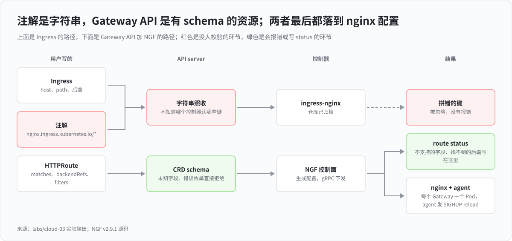
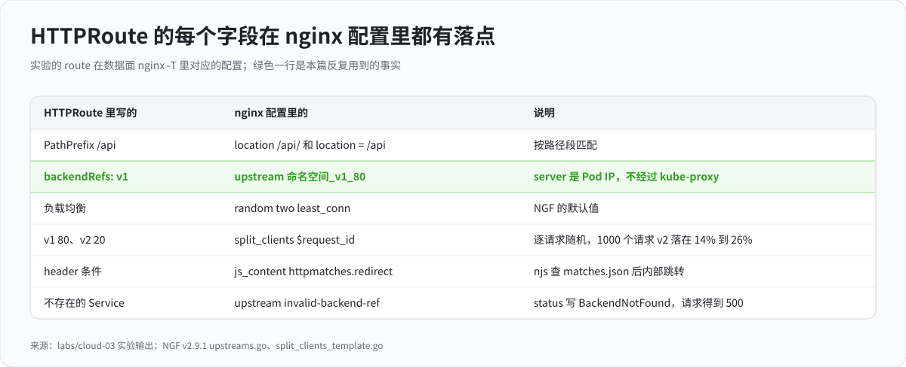
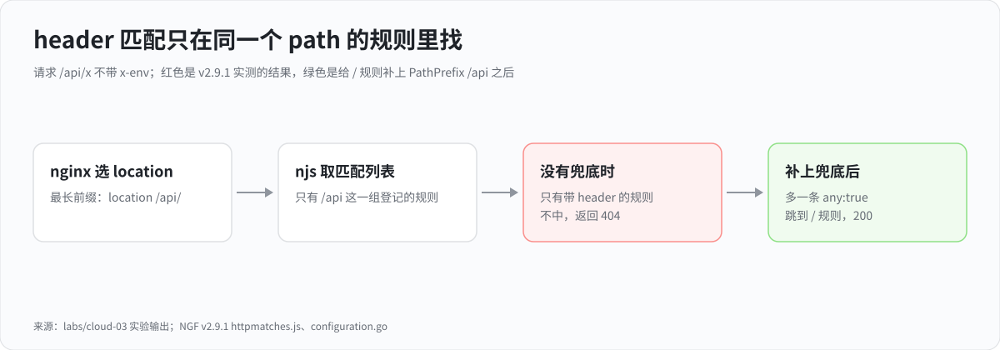
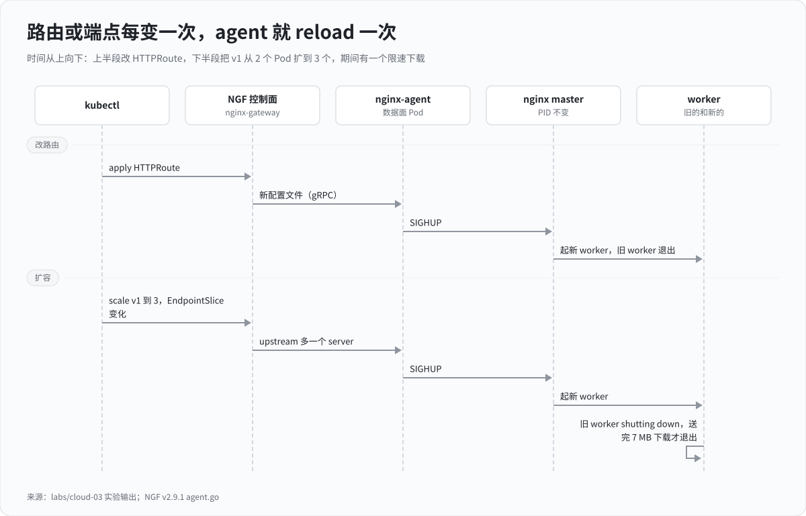
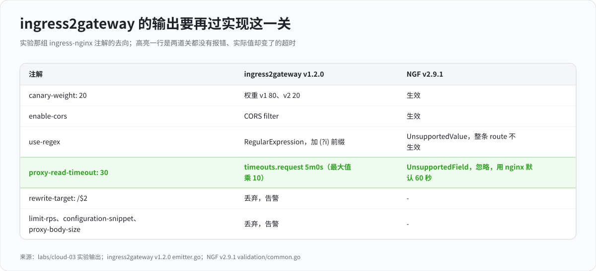

# 云原生篇 03｜从 Ingress 到 Gateway API：注解换成了有 schema 的字段，路由的每次变化仍是一次 reload

> **一句话结论**：Ingress 的扩展全靠注解，注解是字符串，拼错了 API server 照收不误；Gateway API 的 HTTPRoute 是带 schema 的资源，字段拼错、枚举值写错在 `kubectl apply` 时就被拒绝，后端不存在写进 status。NGINX Gateway Fabric（NGF）v2.9.1 给每个 Gateway 起一个数据面 Pod，里面是 nginx 1.31.10 加 nginx-agent。HTTPRoute 在数据面里落成普通的 nginx 配置：upstream 直接列 Pod IP，权重是 `split_clients`，header 匹配由 njs 在 location 里做。按 path 建 location 带来一个实测差异：同一 path 下的 header 匹配不上时返回 404，不会回退到别的 path 的规则。开源 nginx 没有改 upstream 的 API，路由变化和 Pod 增减都会让 agent 发一次 SIGHUP。ingress2gateway v1.2.0 能把常见注解转成 Gateway API 字段，转不了的只打告警，退出码仍是 0；转换结果交给 NGF 后，正则路径被整条拒绝，超时被忽略，这些都只写在 route 的 status 里。
>
> 适用版本：nginx 1.31.10（mainline，2026-11-23，NGF v2.9.1 数据面镜像自带），Kubernetes v1.37.0，Gateway API v1.7.0，NGF v2.9.1，ingress2gateway v1.2.0。「版本差异」：本篇的行为来自 NGF 和 ingress2gateway，与 nginx 的 1.30.8 / 1.31.10 差异无关。实验：[`labs/cloud-03`](../labs/cloud-03/)，`tools/cloud_addons.sh` 安装 Gateway API CRD、NGF 和 ingress2gateway；后端是两个返回自己 Pod 名的 Deployment `v1`（2 个 Pod）和 `v2`（1 个 Pod）。

## 导读

| 你想知道 | 看哪一节 |
|---|---|
| ingress-nginx 归档了，Ingress 的注解有什么问题 | §1 |
| Gateway API 的三种资源各归谁，NGF 的数据面里跑着什么 | §2 |
| 一条 HTTPRoute 在 nginx.conf 里变成了什么 | §3 |
| header 匹配为什么会返回 404 | §4 |
| 改路由、扩缩容时 nginx 会不会 reload，在途请求怎么办 | §5 |
| ingress2gateway 能转哪些注解，转不了的会怎样 | §6 |
| 转换结果为什么部署上去不生效，迁移按什么顺序做 | §7 |

GitHub 上的 kubernetes/ingress-nginx 仓库在 2026 年 3 月归档，不再接受修改。依赖它的集群迟早要换一个入口控制器，Gateway API 是 Kubernetes 社区给出的后继接口。这一篇用 NGF 做实现：它出自 nginx 的维护方，数据面就是 nginx，前两篇讲的 worker 数、信号和服务发现在这里都能对上。



## 1. Ingress 的扩展全在注解里，注解拼错了 API server 照收不误

Ingress 资源本身只描述 host、path 和后端 Service。重写、超时、限流、CORS、金丝雀这些能力，每个控制器各自定义注解来表达，ingress-nginx 的注解以 `nginx.ingress.kubernetes.io/` 开头。注解是 `metadata.annotations` 里的字符串键值对，API server 不知道哪个控制器认哪些键，也就无从校验。实验把 `rewrite-target` 拼成 `rewrite-targt`，同时用两份 HTTPRoute 分别拼错一个字段名、写错一个枚举值：

```text
# labs/cloud-03 ## what the API server checks
Ingress typo stored with annotations:  nginx.ingress.kubernetes.io/rewrite-targt=/ 
HTTPRoute in version "v1" cannot be handled as a HTTPRoute: strict decoding error: unknown field "spec.rules[0].backendRef"
spec.rules[0].matches[0].path.type: Unsupported value: "Prefix": supported values: "Exact", "PathPrefix", "RegularExpression"
ok - a misspelled annotation is stored; a misspelled field and a wrong enum value are rejected
```

Ingress 原样存进了 etcd。控制器只读它认识的键，拼错的键等于没写，重写不会发生，也没有任何地方报错。HTTPRoute 是 CRD，带结构化的 schema：kubectl 默认开启严格字段校验，`backendRef` 这个未知字段让请求被 API server 拒绝；`path.type` 是枚举，Ingress 的写法 `Prefix` 不在 `Exact`、`PathPrefix`、`RegularExpression` 里，同样被拒。错误在 `kubectl apply` 时出现，CI 里的 `kubectl apply --dry-run=server` 就能拦住。

**小结**：注解把配置变成了无人校验的字符串，错误只能在流量上发现。Gateway API 把这些能力做成了字段，schema 能挡住拼写错误；字段写对了之后，实现支不支持、后端在不在，由控制器写进 status，下一节开始看 NGF 怎么做。

## 2. Gateway API 按角色拆成三种资源，NGF 给每个 Gateway 起一个 nginx 加 agent 的 Pod

Gateway API 把一个入口拆开：GatewayClass 指定由哪个控制器实现（`tools/cloud_addons.sh` 装好 NGF 后集群里有一个名为 `nginx` 的 GatewayClass），Gateway 声明监听的端口和协议，HTTPRoute 声明路由规则并通过 `parentRefs` 挂到 Gateway 上。三者可以归不同的人管：平台团队维护 GatewayClass 和 Gateway，应用团队在自己的命名空间里写 HTTPRoute。实验的 Gateway 只有一个 HTTP 监听：

```yaml
# lab: labs/cloud-03/k8s/gateway.yaml
kind: Gateway
metadata:
  name: gw
spec:
  gatewayClassName: nginx
  listeners:
    - name: http
      port: 80
      protocol: HTTP
```

NGF 的控制面运行在 `nginx-gateway` 命名空间，它看到这个 Gateway 后，在 Gateway 所在的命名空间里创建 Deployment 和 Service `gw-nginx`：

```text
# labs/cloud-03 ## a Gateway gets its own data plane
provisioned for gw: deployment.apps/gw-nginx service/gw-nginx 
image: ghcr.io/nginx/nginx-gateway-fabric/nginx:2.9.1
nginx version: nginx/1.31.10
{entrypoint.sh} /bin/bash /agent/entrypoint.sh
nginx: master process /usr/sbin/nginx -g daemon off;
nginx-agent
workers: 8, online CPUs of the node: the same
SIGHUP sent by the agent: yes
ok - one pod runs nginx 1.31.10 and nginx-agent, and the agent reloads nginx
```

数据面 Pod 的主容器里除 worker 外有三个进程：入口脚本、nginx master 和 nginx-agent。agent 通过 gRPC 连接控制面，收到新配置后写文件，再给 master 发 SIGHUP，error log 里的发送方 PID 就是 agent。NGF 生成的 `main.conf` 写的是 `worker_processes auto`，数据面在 8 核节点上起了 8 个 worker，和[云原生篇 01](01-containers.md) §1 的结论一致：CPU limit 不会让这个数变小。NGF 的 NginxProxy 资源有 `workerProcesses` 字段（[`nginxproxy_types.go`](https://github.com/nginx/nginx-gateway-fabric/blob/v2.9.1/apis/v1alpha2/nginxproxy_types.go#L111-L118)），本篇没有验证。

**小结**：每个 Gateway 对应一个独立的 nginx Deployment，配置由控制面生成、agent 落盘并 reload。排查时 `kubectl exec deploy/<gateway>-nginx -c nginx -- nginx -T` 能看到完整配置，下一节就用它看 HTTPRoute 变成了什么。

## 3. HTTPRoute 在 nginx 里是 location、upstream 和 split_clients，upstream 直接列 Pod IP

实验的 HTTPRoute 有三条规则：`/api` 带 header `x-env: canary` 时去 v2，`/` 按 80/20 分给 v1 和 v2，`/missing` 指向一个不存在的 Service：

```yaml
# lab: labs/cloud-03/k8s/route.yaml
# Three rules: a header match on /api, an 80/20 split on /, and a backend that does not exist.
apiVersion: gateway.networking.k8s.io/v1
kind: HTTPRoute
metadata:
  name: shop
spec:
  parentRefs:
    - name: gw
  rules:
    - matches:
        - path: {type: PathPrefix, value: /api}
          headers:
            - {name: x-env, value: canary}
      backendRefs:
        - {name: v2, port: 80}
    - matches:
        - path: {type: PathPrefix, value: /}
      backendRefs:
        - {name: v1, port: 80, weight: 80}
        - {name: v2, port: 80, weight: 20}
    - matches:
        - path: {type: PathPrefix, value: /missing}
      backendRefs:
        - {name: nosuch, port: 80}
```

数据面的 `nginx -T` 里对应的部分：

```text
# labs/cloud-03 ## an HTTPRoute in nginx.conf
locations:
  location /
  location /_ngf-internal-rule1-route0
  location /api/
  location /missing/
  location /stub_status
  location = /api
  location = /missing
upstreams: invalid-backend-ref lab-cloud-03_v1_80 lab-cloud-03_v2_80 
upstream lab-cloud-03_v1_80: random two least_conn; zone lab-cloud-03_v1_80 ...; 
its servers are the v1 pod IPs: yes
split_clients $request_id $group_... {
    80.00% lab-cloud-03_v1_80;
    20.00% lab-cloud-03_v2_80;
}
Accepted=True Accepted: The Route is accepted
ResolvedRefs=False BackendNotFound: spec.rules[2].backendRefs[0].name: Not found: "nosuch"
GET /missing: 500
ok - upstream servers are pod IPs; weights are split_clients; a missing backend is a status and a 500
```

几处对应关系：

- `PathPrefix /api` 生成 `location /api/` 和 `location = /api` 两个 location，前缀匹配按路径段进行，`/apix` 不会被匹配到。
- 每个后端 Service 是一个 upstream，名字是“命名空间_Service_端口”，server 是 EndpointSlice 里的 Pod IP，请求不经过 Service 的 ClusterIP 和 kube-proxy。这和[云原生篇 02](02-service-discovery.md) §2 用 headless Service 加 `resolve` 得到的效果相同，只是地址由控制面写进配置，不靠 DNS。负载均衡方法默认是 `random two least_conn`：

```go
// nginx-gateway-fabric v2.9.1: internal/controller/nginx/config/upstreams.go:27-28
	// default load balancing method.
	defaultLBMethod = "random two least_conn"
```

- 同一条规则里的两个带权重的后端变成 `split_clients`，键是 `$request_id`：

```go
// nginx-gateway-fabric v2.9.1: internal/controller/nginx/config/split_clients_template.go:3-5
const splitClientsTemplateText = `
{{ range $sc := . }}
split_clients $request_id ${{ $sc.VariableName }} {
```

- 指向不存在的 Service 时，route 的 status 出现 `ResolvedRefs=False`，原因 `BackendNotFound`，这条规则的请求被送到 `invalid-backend-ref` upstream，它的 server 是一个返回 500 的 unix socket。

`split_clients` 对键做 MurmurHash2，按哈希值落在哪个区间选结果：

```c
// src/http/modules/ngx_http_split_clients_module.c:86-100

    if (ngx_http_complex_value(r, &ctx->value, &val) != NGX_OK) {
        return NGX_OK;
    }

    hash = ngx_murmur_hash2(val.data, val.len);

    part = ctx->parts.elts;

    for (i = 0; i < ctx->parts.nelts; i++) {

        ngx_log_debug2(NGX_LOG_DEBUG_HTTP, r->connection->log, 0,
                       "http split: %uD %uD", hash, part[i].percent);

        if (hash < part[i].percent || part[i].percent == 0) {
```

`$request_id` 是每个请求用 `RAND_bytes` 新生成的 16 字节随机数（[`ngx_http_variable_request_id`](https://github.com/nginx/nginx/blob/release-1.31.10/src/http/ngx_http_variables.c#L2298)），所以分流是逐请求随机的，同一个客户端的连续请求也会落到不同版本。1000 个请求的结果：

```text
# labs/cloud-03 ## 80/20 weights over 1000 requests
answers: 1000, from: v1 v2
v2 share between 14 % and 26 %: yes
ok - split_clients on $request_id keeps close to 80/20
```

v2 的占比落在 14% 到 26% 之间（实验只断言这个区间，按二项分布约是 ±4.7 个标准差）。需要同一个用户固定落在一个版本时，权重做不到，要用 header 或 cookie 匹配把用户分组。



**小结**：HTTPRoute 最终是 nginx 的 location、upstream 和 split_clients，[运维篇 04](../ops/04-routing.md) 讲的 location 匹配和[运维篇 07](../ops/07-load-balancing.md) 讲的负载均衡在这里照样适用。路径和权重 nginx 原生就能表达，header 匹配不能，NGF 用 njs 补上了，下一节看它带来的一个差异。

## 4. header 匹配由 njs 在 location 里做：同一 path 下匹配不上就是 404，不回退到别的 path

nginx 的 location 只按 URI 选，header 条件要在选中 location 之后再判断。NGF 的做法是：外层 location 设置 `$match_key` 并执行 `js_content httpmatches.redirect`，njs 从 `matches.json` 取出这个 location 登记的匹配列表，逐个测试，命中就内部跳转到对应的 `/_ngf-internal-rule…` location，全都不中返回 404：

```js
// nginx-gateway-fabric v2.9.1: internal/controller/nginx/modules/src/httpmatches.js:51-64
function redirectForMatchList(r, matchList) {
	let match;
	try {
		match = findWinningMatch(r, matchList);
	} catch (e) {
		r.error(e.message);
		r.return(HTTP_CODES.internalServerError);
		return;
	}

	if (!match) {
		r.return(HTTP_CODES.notFound);
		return;
	}
```

登记到哪个列表，取决于规则的 path。控制面按“host + path + path 类型”给规则分组，一组生成一组 location：

```go
// nginx-gateway-fabric v2.9.1: internal/controller/state/dataplane/configuration.go:1775-1781
	path := getPath(match.Path)
	key := pathAndType{
		path:     path,
		pathType: *match.Path.Type,
	}

	hostRule, exists := hpr.rulesPerHost[hostname][key]
```

于是 `/api` 这一组只有带 header 的那条规则，`PathPrefix /` 的规则在另一组。请求 `/api/x` 不带 header 时，nginx 按最长前缀选中 `location /api/`，njs 在这一组里找不到匹配：

```text
# labs/cloud-03 ## a header match does not fall back to another path
/api/x without x-env: 404
/api/x with x-env: canary: v2 200
/other without x-env: 200
matches.json: {"1_1":[{"redirectPath":"/_ngf-internal-rule1-route0","headers":["x-env:Exact:canary"]}]}
with PathPrefix /api added to the / rule:
matches.json: {"1_1":[{"redirectPath":"/_ngf-internal-rule1-route0","headers":["x-env:Exact:canary"]},{"redirectPath":"/_ngf-internal-rule1-route1","any":true}]}
/api/x without x-env: 200
/api/x with x-env: canary: v2 200
ok - without a rule registered under /api the request gets 404; with one it is routed
```

不带 header 的 `/api/x` 返回 404，`/other` 正常。按 Gateway API 规范，这个请求应当由 `PathPrefix /` 的规则处理。把 `PathPrefix /api` 也写进 `/` 那条规则的 `matches` 后，`/api` 组里多了一条 `"any":true` 的匹配，不带 header 的 `/api/x` 也返回 200：

```yaml
# lab: labs/cloud-03/k8s/route-fallback.yaml
    # the / rule, also registered under /api
    - matches:
        - path: {type: PathPrefix, value: /api}
        - path: {type: PathPrefix, value: /}
      backendRefs:
        - {name: v1, port: 80, weight: 80}
        - {name: v2, port: 80, weight: 20}
```

这个差异只在 v2.9.1 上实测过，没有找到 NGF 对应的 issue 或文档说明；规则数量多时，靠人眼很难发现哪些 path 缺了回退。



**小结**：带 header、query 或 method 条件的规则，要确认同一个 path 下有不带条件的兜底规则。上线前用一张“请求 × 期望后端”的表把每个 path 带和不带条件各打一遍，比读配置可靠。

## 5. 路由变化和 Pod 增减都是一次 reload，旧 worker 要等长请求做完

nginx 开源版没有在运行时修改 upstream server 的 API（NGINX Plus 有）。NGF 给 agent 下发 upstream 变更的函数只对 Plus 生效：

```go
// nginx-gateway-fabric v2.9.1: internal/controller/nginx/agent/agent.go:132-140
// UpdateUpstreamServers sends an APIRequest to the agent to update upstream servers using the NGINX Plus API.
// Only applicable when using NGINX Plus.
func (n *NginxUpdaterImpl) UpdateUpstreamServers(
	deployment *Deployment,
	conf dataplane.Configuration,
) {
	if !n.plus {
		return
	}
```

所以在开源 nginx 上，无论是改 HTTPRoute 还是 Deployment 扩缩容带来的 EndpointSlice 变化，控制面都重新生成配置文件，agent 写盘后发 SIGHUP。实验先把 route 改回去，再在一个限速下载进行中把 v1 从 2 个 Pod 扩到 3 个：

```text
# labs/cloud-03 ## a route change is a reload
SIGHUP: +1, master PID unchanged: yes, workers all new: yes
ok - the agent reloads nginx for a route change
```

```text
# labs/cloud-03 ## an endpoint change is a reload too
the new pod in the upstream within 10 s of being ready: yes
SIGHUP: +1, master PID unchanged: yes
an old worker still serving the download: yes
worker_shutdown_timeout in the generated config: 0
download: 200, all 7 MB
ok - scaling v1 reloads nginx; the download in flight finishes on the old worker
```

两次变化各一次 SIGHUP，master 不变，worker 全部换新，这是[运维篇 03](../ops/03-processes-signals.md) 讲的 reload 流程。新 Pod 就绪后 10 秒内进了 upstream。下载由旧 worker 继续送完，7 MB 一个字节不少；生成的配置里没有 `worker_shutdown_timeout`，旧 worker 会一直等到它的最后一个连接结束。

这带来两个运维上的后果。一是 reload 的频率跟着集群的变化走：滚动发布一个 10 副本的 Deployment，每个 Pod 的就绪和摘除都可能触发一次 reload。二是 WebSocket、gRPC 流、大文件下载这类长连接会把旧 worker 留很久，频繁 reload 时旧 worker 叠加，内存和连接数一起上涨。用 `ps` 数 `worker process is shutting down` 的进程数，可以看到积压。限制旧 worker 寿命要设 `worker_shutdown_timeout`（[云原生篇 01](01-containers.md) §4）。NGF 的 SnippetsFilter 和 SnippetsPolicy 可以往 `main` 上下文注入配置（[`snippetsfilter_types.go`](https://github.com/nginx/nginx-gateway-fabric/blob/v2.9.1/apis/v1alpha1/snippetsfilter_types.go#L96)），本篇没有验证用它设置这个指令。



**小结**：NGF 加开源 nginx 的组合里，reload 是常态。观测上要盯 SIGHUP 次数和 shutting down 的 worker 数，配置上要决定长连接最多等多久。

## 6. ingress2gateway 转得了结构，转不了 nginx 特有的行为，退出码仍是 0

ingress2gateway 读取 Ingress（从集群或文件），按 provider 解释注解，输出 Gateway 和 HTTPRoute。实验的输入是一个典型的 ingress-nginx 应用：正则路径加捕获组重写、CORS、读超时、请求体大小、限流、一段 `configuration-snippet`，另有一个 20% 的金丝雀 Ingress：

```yaml
# lab: labs/cloud-03/k8s/ingress-nginx.yaml
  annotations:
    nginx.ingress.kubernetes.io/rewrite-target: /$2
    nginx.ingress.kubernetes.io/use-regex: "true"
    nginx.ingress.kubernetes.io/ssl-redirect: "false"
    nginx.ingress.kubernetes.io/proxy-body-size: 8m
    nginx.ingress.kubernetes.io/proxy-read-timeout: "30"
    nginx.ingress.kubernetes.io/enable-cors: "true"
    nginx.ingress.kubernetes.io/limit-rps: "10"
    nginx.ingress.kubernetes.io/configuration-snippet: |
      more_set_headers "X-Shop: 1";
```

转换的输出：

```text
# labs/cloud-03 ## ingress2gateway on an ingress-nginx Ingress
exit code: 0
warnings:
  Failed to apply [].shop.metadata.annotations."nginx.ingress.kubernetes.io/proxy-body-size" from /shop: Most Gateway API implementations have reasonable body size and buffering defaults
  Failed to apply metadata.annotations."nginx.ingress.kubernetes.io/rewrite-target" from rewrite-target from Ingress /shop: Path rewrites with capture group references are not supported
  Gateway API does not support configuring URL normalization (RFC 3986, Section 6). Please check if this matters for your use case and consult implementation-specific details.
  Ingress NGINX serves TLS traffic for host "shop.example.com" with a self-signed certificate. This behavior will not be translated and the host will not be accessible via HTTPS.
  Unsupported annotation nginx.ingress.kubernetes.io/configuration-snippet
  Unsupported annotation nginx.ingress.kubernetes.io/limit-rps
  Using case-insensitive regex path matches. You may want to change this.
  ingress-nginx only supports TCP-level timeouts; i2gw has made a best-effort translation to Gateway API timeouts.request. Please verify that this meets your needs. See documentation: https://gateway-api.sigs.k8s.io/guides/http-timeouts/
rule 0: match RegularExpression (?i)/api(/|$)(.*).*; backends v1; filters CORS; timeouts.request 5m0s
rule 1: match RegularExpression (?i)/.*; backends v1 80, v2 20; filters CORS; timeouts.request 5m0s
ok - exit code 0 while 4 annotations are dropped
```

逐项看：

| 注解 | 结果 |
|---|---|
| `canary` + `canary-weight: "20"` | 并进主规则，v1 权重 80、v2 权重 20 |
| `enable-cors` | CORS filter，带 ingress-nginx 的默认允许头和方法 |
| `use-regex` | 这个 host 的所有 path 都变成 `RegularExpression`，并加上 `(?i)` 前缀，因为 ingress-nginx 的正则 location 不区分大小写 |
| `proxy-read-timeout: "30"` | `timeouts.request: 5m0s` |
| `rewrite-target: /$2` | 丢弃：不支持带捕获组的重写 |
| `limit-rps`、`configuration-snippet`、`proxy-body-size` | 丢弃，只有告警 |

超时一项值得细看。ingress-nginx 的三个超时是 TCP 层面的单次读写超时，Gateway API 的 `timeouts.request` 是整个请求的时限，两者语义不同。ingress2gateway 取 connect、read、send 三者的最大值乘以 10：

```go
// ingress2gateway v1.2.0: pkg/i2gw/emitters/common_emitter/emitter.go:125-129
			}
			maxTimeout, ok := maxParsedDuration(timeouts.Connect, timeouts.Read, timeouts.Write)
			if ok {
				requestTimeout := gatewayv1.Duration((maxTimeout * time.Duration(tcpTimeoutMultiplier)).String())
				rule.Timeouts.Request = &requestTimeout
```

`tcpTimeoutMultiplier` 定义为 10（同一文件第 33 行），30 秒的读超时变成了 5 分钟的请求时限。



**小结**：退出码 0 只说明工具跑完了。告警列出的每一项都要有人决定替代方案：重写改成 `URLRewrite` filter 或改应用路径；限流、请求体大小、超时、snippet 在 NGF 里分别有 RateLimitPolicy、ClientSettingsPolicy、ProxySettingsPolicy、SnippetsFilter 这些扩展资源（定义在 NGF 的 `apis/v1alpha1`，本篇没有逐个验证）。这些决定做完，转换结果还要过实现这一关。

## 7. 转换结果要看 status：NGF 整条拒绝了正则路径，忽略了超时

把 ingress2gateway 的输出原样 apply，Gateway 被 NGF 接受，HTTPRoute 却没有生效：

```text
# labs/cloud-03 ## applying the conversion
Accepted=False UnsupportedValue: All rules are invalid: ...
ResolvedRefs=True ResolvedRefs: All references are resolved
invalid paths: (?i)/api(/|$)(.*).* (?i)/.* 
GET /api/x with Host shop.example.com: 404
```

`Accepted=False`，原因 `UnsupportedValue`：两条规则的 path 都以 `(?i)` 开头，NGF 要求正则 path 也以 `/` 开头且不含空白和 `{`、`}`、`;`：

```go
// nginx-gateway-fabric v2.9.1: internal/controller/nginx/config/validation/common.go:14-20
const (
	pathFmt    = `/[^\s{};]*`
	pathErrMsg = "must start with / and must not include any whitespace character, `{`, `}` or `;`"
)

var (
	pathRegexp   = regexp2.MustCompile("^"+pathFmt+"$", regexp2.None)
```

所有规则都无效，这个 host 的请求全部 404。`kubectl apply` 的退出码是 0，只有 route 的 status 说明了原因。把两条规则改成 `PathPrefix /api` 和 `PathPrefix /` 再 apply：

```text
# labs/cloud-03 ## applying the conversion
with the paths as PathPrefix:
Accepted=True UnsupportedField: The following unsupported parameters were ignored: [spec.rules[0].timeouts: Forbidden: Timeouts, spec.rules[1].timeouts: Forbidden: Timeouts]
ResolvedRefs=True ResolvedRefs: All references are resolved
HTTP/1.1 200 OK
Access-Control-Allow-Origin: https://a.example
```

route 被接受了，但 `Accepted` 的原因是 `UnsupportedField`：NGF v2.9.1 不实现 HTTPRoute 的 `timeouts`，两条规则的超时被忽略，数据面用的是 nginx 自己的默认值（`proxy_read_timeout` 60 秒），要设超时得改用 ProxySettingsPolicy。CORS filter 生效了，响应带上了 `Access-Control-Allow-Origin`。原来的 30 秒读超时，经过转换变成 5 分钟，再经过 NGF 变成 60 秒。

迁移按这个顺序做，每一步都有可检查的产出：

1. 盘点注解：`kubectl get ingress -A -o json` 汇总所有 `nginx.ingress.kubernetes.io/` 键，标出 snippet、限流、认证这类没有标准字段的。
2. 转换并处理告警：ingress2gateway 的每条告警对应一个人工决定，记在迁移清单里。
3. 在新 Gateway 上并行部署：读每个 route 的 `Accepted` 和 `ResolvedRefs`，原因不是 `Accepted`、`ResolvedRefs` 的都要看 message。
4. 用请求矩阵对比新旧入口：每个 host、path、header 组合打一遍，比较后端和响应头（§4 的 404 就是这样发现的）。
5. 切流量：先切 DNS 或外部负载均衡的一小部分权重，观察错误率和 reload 次数，再全切。

**小结**：Gateway API 的实现各自声明支持哪些字段，不支持的写进 status 而不是报错。迁移的验收标准是 status 里没有意外的原因、请求矩阵和旧入口一致，而不是工具和 kubectl 的退出码。

## 已知局限与待核实

- 实验在 kind（Kubernetes v1.37.0）上，用 NGF v2.9.1 的默认 Helm 参数加 `nginx.service.type=ClusterIP` 安装，数据面是开源 nginx；NGINX Plus 数据面的 upstream API 路径（§5）只按源码描述，没有运行。
- §4 的 404 只在 v2.9.1 上验证；没有向上游报告，也没有核对 Gateway API conformance 是否覆盖这种组合。
- §5 没有测 reload 的耗时和对 QPS 的影响，也没有统计滚动发布时的实际 reload 次数；“每个 Pod 的就绪和摘除都可能触发一次 reload”是按“EndpointSlice 变化即重新生成配置”推断的，控制面可能合并相近的变化。
- §2 的 NginxProxy `workerProcesses`、§5 的 SnippetsPolicy、§6 和 §7 提到的各种 Policy 只按 NGF 源码里的类型定义列出，没有在实验里使用。
- 本篇只用了 HTTP 监听；TLS 监听和证书在云原生篇 05，GRPCRoute、TLSRoute、TCPRoute 没有覆盖。
- ingress2gateway 的结论只针对 ingress-nginx provider 和文中这组注解；它支持的其他 provider 和 emitter（envoy-gateway、kgateway 等）没有试。

## 修订记录

- 2026-11-26：新写。覆盖注解与 schema 校验、NGF 数据面的组成、HTTPRoute 到 nginx 配置的映射、header 匹配不跨 path 回退、路由与端点变化触发 reload、ingress2gateway 的转换与丢弃、NGF 对转换结果的拒绝与忽略，均附 `labs/cloud-03` 实验。
