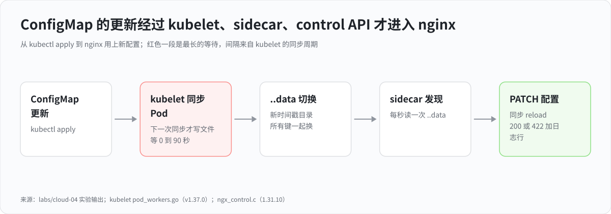
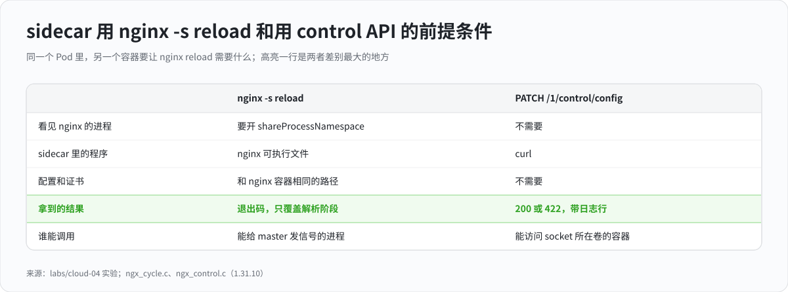
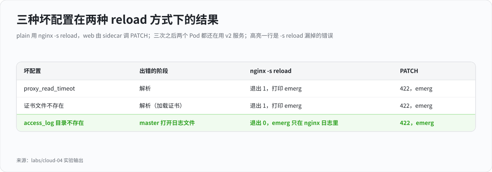
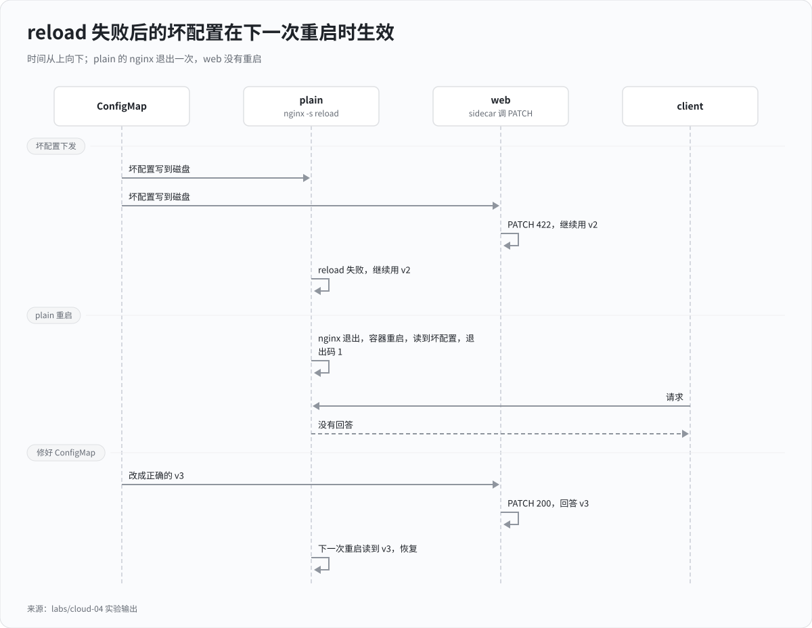

# 云原生篇 04｜配置下发：ConfigMap 的更新最多等 90 秒才落到 Pod 里，reload 的成败用 control API 拿回来

> **一句话结论**：ConfigMap 挂成目录时，kubelet 在下一次同步这个 Pod 时才换文件，两次同步相隔 60 到 90 秒，一次更新要等 0 到 90 秒；同一个键用 subPath 挂成单个文件，永远不会更新。文件换了，nginx 不会自己重读，`GET /1/control/config` 返回的仍是旧配置。sidecar 通过 unix socket 调 `PATCH /1/control/config`，reload 同步完成，成功得到 200，配置有错得到 422 和那一行 emerg，老配置继续服务。`nginx -s reload` 只能拦住解析阶段的错误：指令拼错、证书缺失时退出 1，日志目录不存在时却退出 0，失败只在 nginx 自己的日志里。无论用哪种方式，reload 失败后磁盘上留着的都是坏配置，容器一重启 nginx 就起不来，所以坏配置要在进 ConfigMap 之前拦住。
>
> 适用版本：nginx 1.31.10（mainline，2026-11-23），Kubernetes v1.37.0。「版本差异」：control API（`--with-control-api` 编译、`-l` 参数）是 1.31.5 新增的，1.30.8 没有，本篇 §3、§4 的做法在 1.30.8 上只能退回到 `nginx -s reload`；ConfigMap 的行为与 nginx 版本无关。实验：[`labs/cloud-04`](../labs/cloud-04/)，两个 Pod 挂同一个 ConfigMap `web-conf`：`plain` 只有 nginx，`web` 多一个调用 control API 的 sidecar；每个版本的配置让 nginx 回答自己的版本名。

## 导读

| 你想知道 | 看哪一节 |
|---|---|
| ConfigMap 挂进 Pod 后文件长什么样 | §1 |
| 改了 ConfigMap，Pod 里的文件多久变，subPath 为什么不变 | §2 |
| 文件变了 nginx 为什么还是旧行为，怎么确认它在跑哪份配置 | §3 |
| sidecar 怎么触发 reload，为什么用 control API | §4 |
| 坏配置下发时，`nginx -s reload` 和 control API 各报什么 | §5 |
| reload 失败之后还有什么风险，坏配置应该在哪里拦 | §6 |

[运维篇 03](../ops/03-processes-signals.md) 讲了 reload 的过程和 1.31.5 的 control API，那里的配置文件就在 nginx 所在的机器上。Kubernetes 里配置通常放在 ConfigMap，由 kubelet 写进 Pod；nginx 的进程模型没有变，变的是“文件什么时候变”和“谁来触发 reload”。实验的两个 Pod 都用 `-c` 指向挂载目录里的配置，用 `-l` 打开 control API：

```yaml
# lab: labs/cloud-04/k8s/pods.yaml
      command: [nginx, -c, /etc/nginx/live/nginx.conf, -g, daemon off;, -l, unix:/run/ctl/nginx.sock]
      volumeMounts:
        - {name: conf, mountPath: /etc/nginx/live}
        - {name: conf, mountPath: /etc/nginx/subpath.conf, subPath: nginx.conf}
        - {name: ctl, mountPath: /run/ctl}
```



## 1. ConfigMap 挂成目录：文件是指向 ..data 的符号链接，一次更新是一次原子切换

kubelet 把 ConfigMap 写进一个带时间戳的隐藏目录，再用两层符号链接把它暴露出来：

```text
# labs/cloud-04 ## a ConfigMap mounted as a directory
..data -> ..<timestamp>
nginx.conf -> ..data/nginx.conf
files nginx loaded, from GET /1/control/config: "name":"/etc/nginx/live/nginx.conf" 
answers: plain v1, web v1
ok - nginx runs the file the ConfigMap's ..data link points to
```

`nginx.conf` 指向 `..data/nginx.conf`，`..data` 指向当前的时间戳目录。更新时 kubelet 写一个新的时间戳目录，再把 `..data` 换过去，ConfigMap 里有多个键时它们一起切换，不会出现一半新一半旧。这对 nginx 有两个含义：`include` 同一个 ConfigMap 里的多个文件是安全的；监听文件变化的程序不能盯着 `nginx.conf` 本身的 inode，要盯 `..data` 这个链接，§4 的 sidecar 就是这样做的。

`GET /1/control/config` 列出了 nginx 加载过的文件名，这里只有 `/etc/nginx/live/nginx.conf` 一个。§3 还会用这个接口比较运行中的配置和磁盘上的文件。

**小结**：目录挂载下，ConfigMap 的每次更新在 Pod 里是一次 `..data` 链接的切换。剩下的问题是切换什么时候发生。

## 2. 更新要等 kubelet 下一次同步这个 Pod，最长约 90 秒；subPath 挂的文件永远不更新

实验把 ConfigMap 改成 v2，然后每半秒读一次 `plain` 里的文件，直到看到 v2：

```text
# labs/cloud-04 ## an update reaches the directory mount, not the subPath mount
directory mount of plain shows v2 within 120 s: yes
subPath mount of plain: v1
ok - kubelet updates the directory at its next sync; the subPath file stays
```

kubelet 不是在 ConfigMap 变化时立刻改文件，而是在周期性同步这个 Pod 时顺带刷新它的卷。每次同步完，下一次排在 `syncFrequency`（默认 1 分钟，[`defaults.go`](https://github.com/kubernetes/kubernetes/blob/v1.37.0/pkg/kubelet/apis/config/v1beta1/defaults.go#L76-L77)）加上最多 50% 的随机抖动之后：

```go
// kubernetes v1.37.0: pkg/kubelet/pod_workers.go:1529-1531
	case syncErr == nil:
		// No error; requeue at the regular resync interval.
		p.workQueue.Enqueue(podUID, wait.Jitter(p.resyncInterval, workerResyncIntervalJitterFactor))
```

`workerResyncIntervalJitterFactor` 是 0.5（[同一文件第 327 行](https://github.com/kubernetes/kubernetes/blob/v1.37.0/pkg/kubelet/pod_workers.go#L327)），两次同步相隔 60 到 90 秒，ConfigMap 的更新落在这段间隔的哪个位置，就要等剩下的那部分，0 到 90 秒不等。实验在 Pod 刚启动、刚同步过之后就改 ConfigMap，所以几乎要等满一个间隔：这个环境里五次运行分别等了 67、68、74、82、84 秒。这些秒数每次都不同，没有写进 `expected.txt`，实验只断言 120 秒以内。

同一个键用 `subPath` 挂成 `/etc/nginx/subpath.conf`，Pod 启动时做一次 bind mount，之后 kubelet 不再碰它，一直是 v1。[云原生篇 01](01-containers.md) 和 [02](02-service-discovery.md) 的实验都用 subPath 挂 nginx.conf，那是有意的：那些配置在 Pod 的生命周期里不变。

改一下 Pod 的 annotation 会让 kubelet 立刻同步这个 Pod：手动试了一次，0.4 秒文件就变了。实验后面几步都先改 annotation，省掉每次最长 90 秒的等待。生产上一般不需要这样做，只要知道“改完 ConfigMap 到 Pod 里看到新文件”最长要 90 秒左右，而且每个 Pod 到达的时间不同，发布流程的等待和检查要按这个量级设计。

**小结**：要热更新就挂目录，不要用 subPath；更新到达 Pod 要 0 到 90 秒，不同 Pod 到达的时间也不同。到达之后，还要有人让 nginx 读它。

## 3. 文件变了，nginx 还在跑旧配置：control API 能看出两者不一致

nginx 只在启动和 reload 时读配置文件。`plain` 的文件已经是 v2，nginx 仍然回答 v1：

```text
# labs/cloud-04 ## nginx keeps running the old config
plain: file v2, running v1, answers v1
PATCH /1/control/config: 200
plain: file v2, running v2, answers v2
ok - the new file is used only after a reload
```

“running”一栏来自 `GET /1/control/config`。开了 control API 后，nginx 解析每个文件时把它的内容留一份在内存里，和 `nginx -T` 用的是同一份数据：

```c
// src/core/ngx_conf_file.c:222-233
        if (ngx_dump_config
#if (NGX_CONTROL_API)
            || ngx_control_api_enabled
#endif
#if (NGX_DEBUG)
            || 1
#endif
           )
        {
            if (ngx_conf_add_dump(cf, filename) != NGX_OK) {
                goto failed;
            }
```

`GET` 返回的是这份内存里的内容，不是重新读磁盘，所以它就是 nginx 正在跑的配置：

```c
// src/os/unix/ngx_control.c:927-944
    dump = ngx_cycle->config_dump.elts;

    for (i = 0; i < ngx_cycle->config_dump.nelts; i++) {

        item.key = dump[i].name;
        item.value.data = dump[i].buffer->pos;
        item.value.len = dump[i].buffer->last - dump[i].buffer->pos;

        obj = ngx_data_obj_handler((uintptr_t) ngx_control_config_fields,
                                   r->pool, &item);
        if (obj == NULL) {
            return NGX_ERROR;
        }

        ngx_data_add_item(list, NULL, obj);
    }

    return ngx_control_send_json(r, NGX_CTRL_OK, list);
```

把它和磁盘上的文件比一比，就能发现“ConfigMap 已更新但没生效”的 Pod。`PATCH` 之后两者一致，回答变成 v2。

**小结**：Pod 里的配置有三个版本：ConfigMap 里的、磁盘上的、nginx 内存里的。前两个由 kubelet 同步，后两个要靠 reload 同步，control API 让第三个可以直接查询。

## 4. sidecar 通过 unix socket 调 PATCH：不用共享进程命名空间，也不用在 sidecar 里装 nginx

`web` 的 sidecar 每秒读一次 `..data` 链接，变了就调一次 PATCH，把状态码和响应体打到自己的标准输出：

```bash
# lab: labs/cloud-04/conf/reload.sh
dir=/etc/nginx/live
sock=/run/ctl/nginx.sock
last=$(readlink "$dir/..data")
while sleep 1; do
    now=$(readlink "$dir/..data")
    [ "$now" = "$last" ] && continue
    last=$now
    code=$(curl -s --unix-socket "$sock" -X PATCH -o /tmp/patch.json -w '%{http_code}' \
        http://localhost/1/control/config)
    printf 'reload: %s %s\n' "$code" "$(cat /tmp/patch.json)"
done
```

它和 nginx 容器共享两个卷：ConfigMap 的目录（只用来看 `..data`）和放 control API socket 的 emptyDir：

```yaml
# lab: labs/cloud-04/k8s/pods.yaml
    - name: reloader
      image: nginx-devops/nginx:1.31.10
      command: [sh, /reloader/reload.sh]
      volumeMounts:
        - {name: conf, mountPath: /etc/nginx/live}
        - {name: ctl, mountPath: /run/ctl}
        - {name: reloader, mountPath: /reloader}
```

ConfigMap 更新到达 `web` 之后：

```text
# labs/cloud-04 ## a sidecar that reloads through the control API
reloader: reload: 200 {"logs":[]}
web answers: v2
ok - the sidecar's PATCH loads v2 into web
```

PATCH 返回 200，`logs` 为空，`web` 开始回答 v2，nginx 容器本身没有被任何人 exec 过。

换成 `nginx -s reload` 做同样的事，sidecar 要满足三个条件：Pod 开 `shareProcessNamespace` 才能给另一个容器里的 master 发信号；sidecar 里要有 nginx 可执行文件；它还要看到和 nginx 容器完全一样的配置文件和证书路径，因为 `-s reload` 会先把配置完整解析一遍（下一节）。control API 只需要一个共享的 socket 文件，sidecar 用 curl 就够了。socket 放在 emptyDir 里，只有挂了这个卷的容器能访问；如果改用 `-l 127.0.0.1:端口`，Pod 里的所有容器共享网络命名空间，都能连上这个没有认证的接口。



**小结**：control API 把“触发 reload”变成一次本地 HTTP 调用，sidecar 不需要 nginx 的二进制、配置视图和进程可见性。它的另一个好处是返回值，下一节看坏配置时这个返回值的作用。

## 5. 三种坏配置：nginx -s reload 只拦得住解析阶段的错误，PATCH 都能报出来

实验依次下发三份有问题的配置，它们如果生效，nginx 会回答 v3。每次 `plain` 用 `nginx -s reload`，`web` 由 sidecar 调 PATCH。第一份把 `proxy_read_timeout` 拼成了 `proxy_read_timeot`：

```text
# labs/cloud-04 ## a misspelled directive
plain, nginx -s reload: exit 1
  [emerg] unknown directive "proxy_read_timeot" in /etc/nginx/live/nginx.conf:13
web, reload: 422 {"logs":["[emerg] unknown directive \"proxy_read_timeot\" in /etc/nginx/live/nginx.conf:13\n"]}
answers: plain v2, web v2
ok - both ways refuse it; the old config keeps serving
```

第二份加了一个 TLS 监听，证书来自一个没有挂进来的 Secret：

```text
# labs/cloud-04 ## a certificate that is not there
plain, nginx -s reload: exit 1
  [emerg] cannot load certificate "/etc/nginx/certs/tls.crt": BIO_new_file() failed (SSL: error:80000002:system library::No such file or directory:calling fopen(/etc/nginx/certs/tls.crt, r) error:10000080:BIO routines::no such file)
web, reload: 422 {"logs":["[emerg] cannot load certificate \"/etc/nginx/certs/tls.crt\": BIO_new_file() failed (SSL: error:80000002:system library::No such file or directory:calling fopen(/etc/nginx/certs/tls.crt, r) error:10000080:BIO routines::no such file)\n"]}
answers: plain v2, web v2
ok - the signaller loads certificates too, so both ways refuse it
```

两种方式都拒绝了，两个 Pod 都还回答 v2。`nginx -s reload` 能拦住它们，是因为发信号的进程（signaller）先用同一个 `ngx_init_cycle` 把配置完整解析一遍，指令和证书都在解析阶段处理（证书由 `ngx_http_ssl_merge_srv_conf` 加载，[第 832 行](https://github.com/nginx/nginx/blob/release-1.31.10/src/http/modules/ngx_http_ssl_module.c#L832)）。但 signaller 在核心模块初始化完就返回：

```c
// src/core/ngx_cycle.c:316-318
    if (ngx_process == NGX_PROCESS_SIGNALLER) {
        return cycle;
    }
```

之后才是写 pid 文件、打开日志文件、创建共享内存、监听端口，这些只有 master 真正 reload 时才做。第三份配置的 `access_log` 写在一个不存在的目录（`nginx` 拼成了 `ngnix`）：

```text
# labs/cloud-04 ## a log directory that does not exist
plain, nginx -s reload: exit 0
  [notice] signal process started
plain, nginx's own log:
  [emerg] open() "/var/log/ngnix/access.log" failed (2: No such file or directory)
web, reload: 422 {"logs":["[emerg] open() \"/var/log/ngnix/access.log\" failed (2: No such file or directory)\n"]}
answers: plain v2, web v2
ok - nginx -s reload exits 0 while the reload fails; PATCH reports it
```

`nginx -s reload` 退出 0，打印的只有 `signal process started`；reload 实际失败了，emerg 只出现在 nginx 自己的日志里（容器的标准错误）。失败发生在 master 打开日志文件这一步：

```c
// src/core/ngx_cycle.c:385-399
        file[i].fd = ngx_open_file(file[i].name.data,
                                   NGX_FILE_APPEND,
                                   NGX_FILE_CREATE_OR_OPEN,
                                   NGX_FILE_DEFAULT_ACCESS);

        ngx_log_debug3(NGX_LOG_DEBUG_CORE, log, 0,
                       "log: %p %d \"%s\"",
                       &file[i], file[i].fd, file[i].name.data);

        if (file[i].fd == NGX_INVALID_FILE) {
            ngx_log_error(NGX_LOG_EMERG, log, ngx_errno,
                          ngx_open_file_n " \"%s\" failed",
                          file[i].name.data);
            goto failed;
        }
```

PATCH 在 master 里调用同一个 `ngx_init_cycle`，失败时返回 422，并把这次加载产生的日志行放进响应体（[运维篇 03](../ops/03-processes-signals.md) §7 有这段代码），所以三种错误它都报了出来。端口被占用、共享内存区冲突也属于 signaller 之后的步骤，按源码同样是 `-s reload` 退出 0、PATCH 返回 422，实验没有构造。



**小结**：用 `nginx -s reload` 的发布脚本，退出码 0 不代表 reload 成功；要么再去日志里找 emerg，要么换成 PATCH，用状态码判断。

## 6. reload 失败之后，磁盘上的坏配置等着下一次重启

上一节的三次失败，nginx 都继续跑着 v2，看起来没有损失。但 ConfigMap 和磁盘上的文件已经是坏配置了。让 `plain` 的 nginx 退出一次（`nginx -s stop`，相当于进程崩溃、OOM 或节点重启后的容器重建），kubelet 重启容器，nginx 从磁盘读配置：

```text
# labs/cloud-04 ## a restart after a failed reload
plain: file bad-log, running v2
plain after nginx -s stop: last exit code 1
  [emerg] open() "/var/log/ngnix/access.log" failed (2: No such file or directory)
answers: plain none, web v2
ok - nginx starts from the bad file and fails; web, not restarted, still serves v2
```

新启动的 nginx 在打开日志文件时失败，退出码 1，容器进入重启退避，`plain` 不再回答。`web` 没有重启，仍然用内存里的 v2 服务。把 ConfigMap 改成正确的 v3：

```text
# labs/cloud-04 ## a good config after the failures
web, reload: 200
answers: plain v3, web v3
ok - the sidecar loads v3; plain starts again once its file is good
```

sidecar 的 PATCH 返回 200，`web` 回答 v3；`plain` 在下一次重启时读到好配置，恢复服务。

所以热 reload 的失败是延迟爆发的：所有 Pod 同时收到坏配置，同时拒绝，同时“看起来正常”，之后哪个 Pod 先重启哪个先坏。对照之下，用 Deployment 滚动更新来下发配置（比如把配置的哈希写进 Pod 模板的 annotation），坏配置会让第一个新 Pod 起不来，滚动停住，旧 Pod 继续服务；这一点是按 Deployment 的滚动规则推断的，本篇没有实验。

建议的做法有三条：

1. 坏配置在进 ConfigMap 之前拦住：CI 里用同一个镜像跑 `nginx -t`。`-t` 会走到打开日志文件和创建 pid 文件这一步，但 Secret 和目录要和 Pod 里一致，否则测试的不是同一份环境，本篇没有验证这种做法能覆盖哪些错误。
2. sidecar 拿到 422 时要让人知道：打日志之外，可以把失败写成一个指标或者让 sidecar 的就绪探针失败，具体做法本篇没有实现。
3. 定期比较 `GET /1/control/config` 和磁盘上的文件，不一致就说明有一次 reload 没有成功，或者还没有触发。



**小结**：reload 拒绝坏配置只保护了当下。要么在坏配置进入 ConfigMap 前拦住，要么改用滚动更新，让坏配置在第一个 Pod 上就暴露出来。

## 已知局限与待核实

- 实验在 kind（Kubernetes v1.37.0）上，kubelet 用默认的 `syncFrequency` 和 ConfigMap 变化检测策略；托管集群可能调过这些参数。§2 的 67 到 84 秒是 Pod 刚同步过就改 ConfigMap 的情形，五次测量都落在源码给出的 60 到 90 秒之间；其他时机下的更短等待没有单独测量。
- §2 “改 annotation 会触发立刻同步”只手动测过一次（0.4 秒），实验后续步骤依赖它但没有单独断言耗时。
- §5 端口占用和共享内存冲突两种情况按源码推断，没有构造。
- §6 关于滚动更新、CI 里 `nginx -t`、就绪探针的建议没有实验。
- 本篇没有覆盖 Secret 挂载的证书更新（云原生篇 05），也没有覆盖 inotify 方式的监听：sidecar 用的是每秒轮询，最多多一秒延迟。

## 修订记录

- 2026-11-26：新写。覆盖 ConfigMap 目录挂载的链接结构、更新延迟与 subPath、control API 查看运行中的配置、sidecar 通过 unix socket 调 PATCH、三种坏配置下 `nginx -s reload` 与 PATCH 的结果、reload 失败后重启的后果，均附 `labs/cloud-04` 实验。
