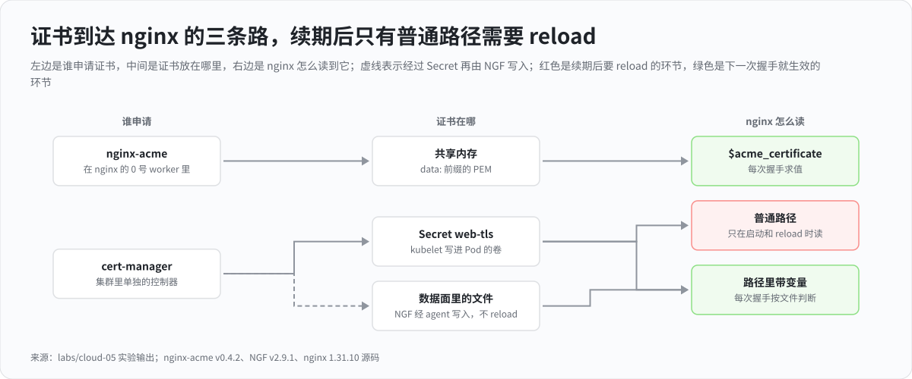
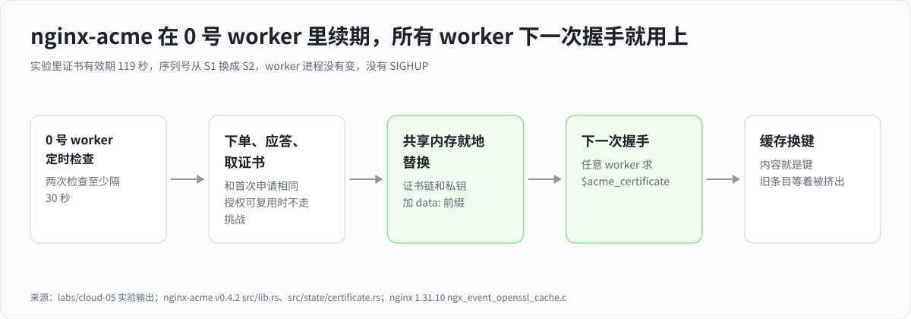
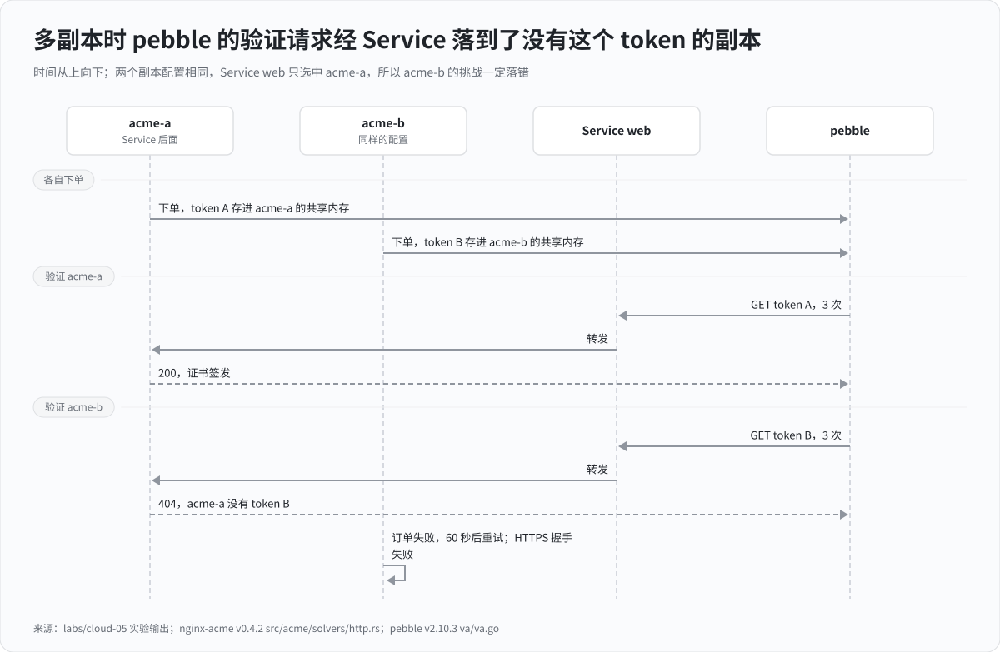
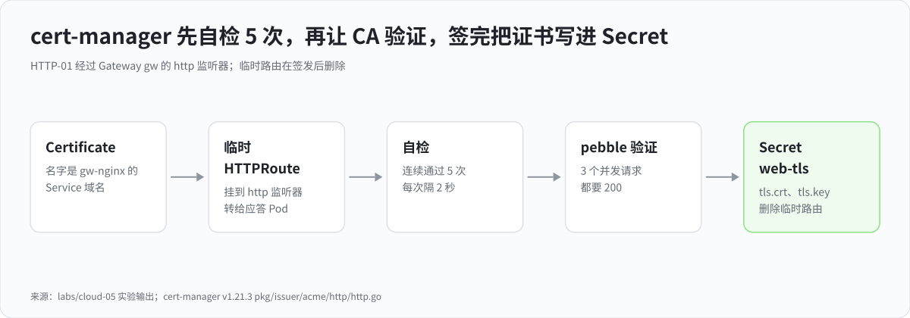
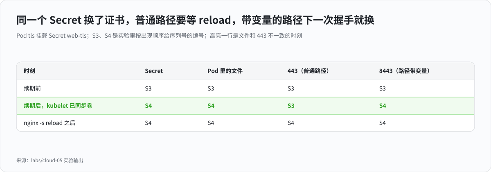
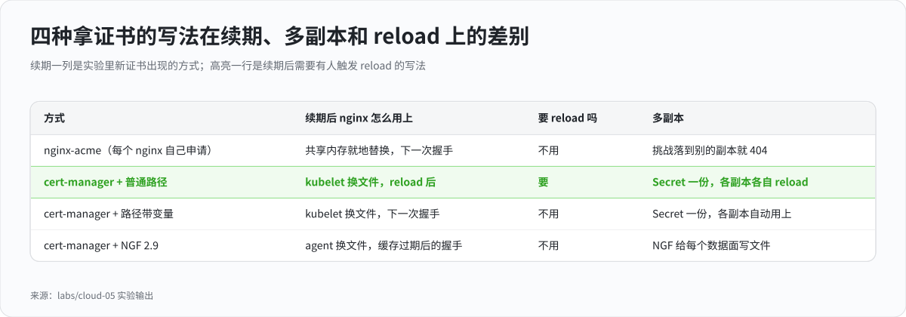

# 云原生篇 05｜证书自动化：换证书可以不 reload，但 nginx-acme 的 HTTP-01 只有发起它的那个副本答得上

> **一句话结论**：nginx 拿到新证书有三条路。nginx-acme 把证书和私钥存在共享内存里，`$acme_certificate` 在下一次握手就返回续期后的证书；`ssl_certificate` 的路径里带变量时，nginx 每次握手按路径取文件，文件换了就读到新的，NGF 2.9 就是这样做的，它在路径前拼一个恒为空串的 `$dynamic_cert_prefix`；路径是普通字符串时，证书只在启动和 reload 时读一次。前两条路续期都不用 reload。nginx-acme 的局限在多副本：每个副本各自注册账号、各自下单，挑战的 token 只存在发起它的那个副本里，CA 的验证请求经 Service 落到别的副本就是 404，那个副本拿不到证书，TLS 握手直接失败。多副本场景把签发交给 cert-manager，它把证书写进 Secret，各个 nginx 再按上面后两条路读文件。
>
> 适用版本：nginx 1.31.10（mainline，2026-11-23），nginx-acme 0.4.2，cert-manager v1.21.3，NGINX Gateway Fabric（NGF）2.9.1，pebble 2.10.3，Kubernetes v1.37.0。「版本差异」：证书路径里的变量从 1.15.9 起支持，`data:` 前缀（直接把 PEM 放进变量）从 1.15.10 起，`ssl_certificate_cache` 从 1.27.4 起，1.30.8 都有；nginx-acme 的 README 要求 nginx 1.22 或更新的源码。NGF 从 2.9.0 起 Secret 更新不再 reload（[CHANGELOG](https://github.com/nginx/nginx-gateway-fabric/blob/v2.9.1/CHANGELOG.md#L58-L58)）。实验：[`labs/cloud-05`](../labs/cloud-05/)，集群里跑 Let's Encrypt 的测试 CA pebble，两个 nginx-acme 副本、一个挂 Secret 的 nginx、一个 NGF Gateway。

## 导读

| 你想知道 | 看哪一节 |
|---|---|
| nginx-acme 怎么装进镜像，为什么要和 nginx 用同一套编译参数 | §1 |
| nginx-acme 怎么申请证书，HTTP-01 由谁应答 | §2 |
| 续期之后 nginx 要不要 reload | §3 |
| 多副本跑 nginx-acme 会出什么问题 | §4 |
| cert-manager 怎么通过 Gateway 完成 HTTP-01，产物是什么 | §5 |
| Secret 更新后挂载它的 nginx 什么时候用上新证书 | §6 |
| NGF 怎么做到换证书不 reload | §7 |

[运维篇 08](../ops/08-tls-http2-http3.md) §5 讲了证书路径里写变量之后 nginx 的行为：每次握手读文件，`ssl_certificate_cache` 把读到的证书留 60 秒，过期后比较 inode 和 mtime。本篇在 Kubernetes 里用这个机制，把证书从哪里来、续期后谁让 nginx 用上新证书这两件事拆开看。

实验用 pebble 当 CA。它是 Let's Encrypt 写的 ACME 测试服务器，实现了 RFC 8555 的协议，专门给客户端做测试，默认带着三种随机性：验证前随机睡一会儿、随机拒绝 5% 的合法 nonce、50% 的概率复用已经验证过的授权。实验把前两种关掉，授权复用开到 100%，这样同一个账号续期时不再走挑战，§7 才能把 Secret 的变化和路由的变化分开。pebble 另配了一个 120 秒的证书档位 `short`，让 nginx-acme 的续期在实验时间内发生：

```yaml
# lab: labs/cloud-05/k8s/pebble.yaml
      env:
        - name: PEBBLE_VA_NOSLEEP
          value: "1"
        - name: PEBBLE_WFE_NONCEREJECT
          value: "0"
        - name: PEBBLE_AUTHZREUSE
          value: "100"
```



## 1. nginx-acme 是 Rust 写的动态模块，要用基础镜像的 configure 参数编译才加载得进去

nginx-acme 用 ngx-rust 写成，编译产物是一个普通的 nginx 动态模块 `ngx_http_acme_module.so`。动态模块和加载它的 nginx 必须来自同一份源码、同样的 configure 参数，否则 nginx 报“module ... is not binary compatible”拒绝加载（[ngx_module.c 第 179 行](https://github.com/nginx/nginx/blob/release-1.31.10/src/core/ngx_module.c#L179-L179)）。实验镜像的做法是从基础镜像里拷出 nginx 二进制，用它的 `nginx -V` 取 configure 参数，再加上 `--add-dynamic-module` 编译：

```dockerfile
# lab: labs/cloud-images/nginx-acme/Dockerfile
COPY --from=base /usr/sbin/nginx /usr/sbin/nginx
RUN eval ./configure "$(nginx -V 2>&1 | sed -n 's/^configure arguments: //p')" \
        --add-dynamic-module=/src/nginx-acme \
    && make -j"$(nproc)" modules
```

编译环境要有 Rust 工具链（[README](https://github.com/nginx/nginx-acme/blob/v0.4.2/README.md#L33-L40) 要求 1.81 或更新）和 libclang，后者给 bindgen 用，bindgen 从 nginx 的头文件生成 Rust 绑定，所以模块是按这份 nginx 源码的结构体布局编译的。cargo 构建时会从 crates.io 拉依赖，构建机要能访问外网。运行镜像只多了一个 `.so` 文件：

```text
# labs/cloud-05 ## an image with the module
configure arguments of the module image and the base image: same
ngx_http_acme_module.so
load_module /usr/lib/nginx/modules/ngx_http_acme_module.so;
acme-a: 0 emerg lines, 1 worker started
ok - nginx loads the module built against its own configure arguments
```

配置第一行用绝对路径 `load_module`。写成相对路径时，nginx 把它补成编译时 prefix 下的路径（[nginx.c 第 1671 行](https://github.com/nginx/nginx/blob/release-1.31.10/src/core/nginx.c#L1671-L1671) 的 `ngx_conf_full_name(cf->cycle, &file, 0)`），这个镜像的 prefix 是 `/etc/nginx`，而模块装在 `/usr/lib/nginx/modules`，相对路径找不到文件。

**小结**：nginx-acme 的安装方式和 C 写的动态模块一样，关键是编译参数要和运行的 nginx 一致。装好之后，它在 nginx 里面完成整个 ACME 流程。

## 2. 证书申请在 nginx 里面完成：HTTP-01 挑战由模块自己应答，证书存在共享内存里

acme-a 的配置声明一个 ACME 签发方（`acme_issuer`），在 HTTPS 的 `server` 里用 `acme_certificate` 指向它，证书和私钥取自模块提供的两个变量：

```nginx
# lab: labs/cloud-05/conf/acme.conf
events {}

http {
    access_log /dev/stdout;

    # nginx-acme talks to the ACME server through the resolver of the http block
    resolver kube-dns.kube-system.svc.cluster.local valid=10s;

    acme_issuer pebble {
        uri https://pebble.lab-cloud-05.svc.cluster.local:14000/dir;
        ssl_trusted_certificate /etc/pebble-ca/ca.crt;
        state_path /var/cache/nginx/acme-pebble;
        accept_terms_of_service;
        profile short;
    }

    server {
        listen 443 ssl;
        server_name web.lab-cloud-05.svc.cluster.local;

        acme_certificate pebble;
        ssl_certificate $acme_certificate;
        ssl_certificate_key $acme_certificate_key;
        ssl_certificate_cache max=2;

        return 200 "$hostname\n";
    }

    # HTTP-01: the module answers /.well-known/acme-challenge/ on port 80 itself
    server {
        listen 80;
        location / {
            return 404;
        }
    }
}
```

`resolver` 是必需的，模块通过它解析 ACME 服务器的地址。`state_path` 是在重启之间保存模块数据的目录，里面有账号密钥、已签发的证书和私钥，README 的说法是它能让启动时少发一些请求、避免触发 CA 的频率限制。实验把它放在容器的可写层里，容器重启或 Pod 重建后就没了，生产上应该放到卷上。80 端口的 `server` 只需要存在：模块在请求处理阶段先看路径是不是 `/.well-known/acme-challenge/`，是就从共享内存里查 token：

```rust
// nginx-acme v0.4.2: src/acme/solvers/http.rs:97-111
    let Some(amsh) = amcf.data else {
        return Status::NGX_DECLINED;
    };

    let Some(token) = r.path().as_bytes().strip_prefix(b"/.well-known/acme-challenge/") else {
        return Status::NGX_DECLINED;
    };

    let token = NgxStr::from_bytes(token);

    let key_auth = if let Some(resp) = amsh.http_01_state.read().get(token) {
        resp.try_clone_in(r.pool())
    } else {
        ngx_log_debug_http!(r, "acme/http-01: no challenge registered for {token}");
        return Status::NGX_DECLINED;
```

查不到返回 `NGX_DECLINED`，请求继续走 `location /`，得到 404。acme-a 启动后申请到了证书：

```text
# labs/cloud-05 ## a certificate over HTTP-01
pebble's requests answered by acme-a: 3, for 1 token
"GET /.well-known/acme-challenge/<token> 200
[info] certificate issued, renewal scheduled at <time>, acme issuer: "pebble", order: "web.lab-cloud-05.svc.cluster.local-592cb5d89f283fb8"
acme-a serves S1, issuer: Pebble Intermediate CA, NotAfter - NotBefore: 119 s
ok - pebble asks three times and acme-a answers each; the certificate lives 120 s minus one
```

pebble 对同一个 token 发了三次请求。它的验证模块同时起三个验证，任意一个失败整个挑战就失败（`concurrentValidations` 是 3，[va.go 第 47 行](https://github.com/letsencrypt/pebble/blob/v2.10.3/va/va.go#L47-L47)）：

```go
// pebble v2.10.3: va/va.go:273-283
	results := make(chan *core.ValidationRecord, concurrentValidations)

	// Start a number of go routines to perform concurrent validations
	for i := 0; i < concurrentValidations; i++ {
		go va.performValidation(task, results)
	}

	err := va.firstError(results)
	// If one of the results was an error, the challenge fails
	if err != nil {
		va.setAuthzInvalid(authz, chal, err)
```

证书有效期 119 秒，比档位里写的 120 秒少一秒，pebble 计算 NotAfter 时减了 1 秒（[ca.go 第 301 行](https://github.com/letsencrypt/pebble/blob/v2.10.3/ca/ca.go#L301-L301)）。签发者是 pebble 每次启动随机生成的中间 CA，名字末尾的随机串在输出里去掉了。

**小结**：nginx-acme 在 nginx 进程里完成账号注册、下单、应答挑战和取证书，证书放进共享内存，由变量交给 `ssl_certificate`。这张证书只活 119 秒，接下来看续期时 nginx 要做什么。

## 3. 续期不用 reload：模块就地改写共享内存，下一次握手读到的就是新证书

实验记下 acme-a 的 worker 进程，然后每半秒握手一次，直到证书序列号变化：

```text
# labs/cloud-05 ## a renewal without a reload
workers of acme-a before: 1
acme-a serves S2 now
[info] certificate issued, renewal scheduled at <time>
[info] certificate issued, renewal scheduled at <time>
same worker processes: yes, SIGHUP received: 0
ok - the module replaces the certificate in shared memory; no process restarts
```

日志里第二条“certificate issued”就是续期，序列号从 S1 变成 S2（实验把每个序列号按出现顺序编号），worker 还是原来那个，nginx 没有收到过 SIGHUP。续期的循环只在 0 号 worker 里运行，模块的进程初始化函数对其他 worker 直接返回：

```rust
// nginx-acme v0.4.2: src/lib.rs:156-158
extern "C" fn ngx_http_acme_init_worker(cycle: *mut ngx_cycle_t) -> ngx_int_t {
    if !matches!(ngx_process(), NgxProcess::Single | NgxProcess::Worker(0)) {
        return Status::NGX_OK.into();
```

新证书到手后，模块把共享内存里的证书链和私钥就地替换，前面加上 `data:` 前缀：

```rust
// nginx-acme v0.4.2: src/state/certificate.rs:219-235
        // update the stored data in-place

        self.chain.clear();
        self.chain.extend(SSL_VARIABLE_PREFIX);
        self.chain.extend(chain);

        self.pkey.clear();
        self.pkey.extend(SSL_VARIABLE_PREFIX);
        self.pkey.extend(pkey);

        self.error = None;
        // The identifier that we had for the previous keypair is no longer valid.
        self.identifier = None;
        self.renewal_window = renewal_window_from_validity(&valid, 2);
        self.valid = valid;

        Ok(self.schedule_renewal())
```

`$acme_certificate` 每次求值都从共享内存里取当前内容（[variables.rs 第 36 到 65 行](https://github.com/nginx/nginx-acme/blob/v0.4.2/src/variables.rs#L36-L65)），nginx 在握手时求这个变量的值（[运维篇 08](../ops/08-tls-http2-http3.md) §5 的 `ngx_http_ssl_certificate`），所以所有 worker 在续期后的下一次握手都拿到新证书。`data:` 开头的值以内容本身作缓存的键，`ssl_certificate_cache` 命中时不做任何过期检查：

```c
// src/event/ngx_event_openssl_cache.c:336-345
    hash = ngx_murmur_hash2(id.data, id.len);

    cn = ngx_ssl_cache_lookup(cache, type, &id, hash);

    if (cn != NULL) {
        ngx_queue_remove(&cn->queue);

        if (id.type == NGX_SSL_CACHE_DATA) {
            goto found;
        }
```

内容变了就是一个新键，旧条目留在缓存里，直到超过 `max` 被挤出去，所以示例配置写 `max=2`，能同时放下新旧两份。



什么时候续期，看 CA 有没有给建议。证书刚签下来时，模块按有效期排一个时间：有效期超过 10 天的在 2/3 处，不到 10 天的在一半处，前后各加 2% 的随机偏移（[certificate.rs 第 382 到 396 行](https://github.com/nginx/nginx-acme/blob/v0.4.2/src/state/certificate.rs#L382-L396)）。CA 支持 ACME 续期信息（ARI，RFC 9773）时，模块再去问 CA 建议的续期窗口，在窗口里随机挑一个时刻。pebble 给的窗口是“到期前 1/3 处前后各 24 小时”，再截到证书有效期以内（[types.go 第 260 到 273 行](https://github.com/letsencrypt/pebble/blob/v2.10.3/core/types.go#L260-L273)），120 秒的证书截完就是整个有效期，所以实验里续期可能发生在 119 秒里的任何时刻，主循环两次检查之间至少隔 30 秒。

**小结**：nginx-acme 的续期不涉及文件、不涉及 reload，证书在共享内存里替换，所有 worker 在下一次握手用上。这建立在一个前提上：只有这一个 nginx 实例负责这个名字。

## 4. 多副本时每个副本各自下单，CA 的验证请求落到别的副本就是 404

acme-b 和 acme-a 的配置完全相同，但 Service `web` 只选中 acme-a。证书里的名字 `web.lab-cloud-05.svc.cluster.local` 解析到这个 Service，所以 pebble 验证 acme-b 的挑战时，请求一定落到 acme-a 上：

```yaml
# lab: labs/cloud-05/k8s/acme.yaml
# Two replicas of the same nginx-acme config. The Service "web", the name both order a
# certificate for, selects only acme-a: pebble's HTTP-01 request for acme-b's order goes to
# acme-a, as it does with probability (n-1)/n in a Deployment of n replicas.
```

```yaml
# lab: labs/cloud-05/k8s/acme.yaml
  name: web
spec:
  selector:
    serve: "yes"
```

在真实的 Deployment 里，n 个副本都在 Service 后面，验证请求落到哪个副本由 kube-proxy 随机决定，落到发起者的概率是 1/n；pebble 的三个验证请求都要落对，按这个概率推算是 (1/n)³，n=2 时是 1/8。实验把“落错”固定下来，以便每次运行结果相同：

```text
# labs/cloud-05 ## a second replica's challenge goes to the first
[warn] urn:ietf:params:acme:error:unauthorized: Non-200 status code from HTTP: http://web.lab-cloud-05.svc.cluster.local:80/.well-known/acme-challenge/<token> returned 404 while updating certificate
requests for that token in the log of acme-a: 3 x 404, of acme-b: 0
curl to acme-b over TLS: exit 35
[error] cannot load certificate "/etc/nginx/conf/": PEM_read_bio_X509_AUX() failed (SSL: error:0480006C:PEM routines::no start line:Expecting: TRUSTED CERTIFICATE) while SSL handshaking
ok - pebble's three requests for acme-b's token reach acme-a and get 404; acme-b has no certificate
```

acme-b 的 token 在 acme-a 的日志里出现了三次，三次都是 404，acme-b 自己的日志里一次也没有。原因在模块登记挑战的地方：token 和应答内容写进本实例的共享内存，别的 nginx 实例看不到。

```rust
// nginx-acme v0.4.2: src/acme/solvers/http.rs:71-77
        key_authorization.try_reserve_exact(challenge.token.len() + ctx.thumbprint.len() + 1)?;
        // write to a preallocated buffer of a sufficient size should succeed
        let _ = key_authorization.append_within_capacity(challenge.token.as_bytes());
        let _ = key_authorization.append_within_capacity(b".");
        let _ = key_authorization.append_within_capacity(ctx.thumbprint);
        let token = NgxString::try_from_bytes_in(&challenge.token, alloc)?;
        self.0.write().try_insert(token, key_authorization)?;
```

挑战失败后，模块按 60 秒、600 秒、6000 秒的间隔重试，各加 2% 的抖动：

```rust
// nginx-acme v0.4.2: src/state/certificate.rs:283-292
    pub fn set_error(&mut self, err: &dyn StdError) -> Timestamp {
        fn next_attempt(fails: usize, max: u64) -> Timestamp {
            let interval = Duration::from_secs(match fails {
                0 => 60,
                1 => 600,
                2 => 6000,
                _ => max,
            });
            Timestamp::now() + jitter(interval, 2)
        }
```

在拿到证书之前，acme-b 的 `$acme_certificate` 是“not found”，`ssl_certificate` 求值得到空串，空串按相对路径补上配置目录前缀，变成 `/etc/nginx/conf/`，加载失败，握手中止，curl 退出码 35（SSL 连接错误）。也就是说，没拿到证书的副本不会退回某张默认证书，这个 `server` 上的 TLS 连接全部失败。



还有两个多副本的副作用由源码可以推出，实验没有单独验证：每个副本用自己的账号各申请一张证书，同一个名字的证书数量随副本数增加，正式 CA 对同一组名字的签发次数有限额；`state_path` 在每个 Pod 里各有一份，Pod 重建后要重新申请。

**小结**：nginx-acme 适合一个名字只由一个 nginx 实例负责的场景，比如单机、单副本，或者能把 `/.well-known/acme-challenge/` 固定转给同一个副本的部署（这种转发本篇没有实验）。多副本的 Deployment 需要一个集中申请证书、再分发给各副本的角色，cert-manager 就是这个角色。

## 5. cert-manager 把签发移出 nginx：HTTP-01 走 Gateway 上的临时路由，产物是一个 Secret

cert-manager 的 `Issuer` 指向同一个 pebble，HTTP-01 的应答方式选 `gatewayHTTPRoute`：签发时它在 Gateway `gw` 的 http 监听器上临时挂一条 HTTPRoute，把 `/.well-known/acme-challenge/<token>` 转给它自己起的应答 Pod。`Certificate` 申请的名字是 NGF 为 `gw` 建的数据面 Service：

```yaml
# lab: labs/cloud-05/k8s/cert.yaml
spec:
  acme:
    server: https://pebble.lab-cloud-05.svc.cluster.local:14000/dir
    caBundle: CA_BUNDLE
    privateKeySecretRef:
      name: pebble-account
    solvers:
      - http01:
          gatewayHTTPRoute:
            parentRefs:
              - kind: Gateway
                name: gw
                sectionName: http
---
apiVersion: cert-manager.io/v1
kind: Certificate
metadata:
  name: web-tls
spec:
  secretName: web-tls
  dnsNames:
    - gw-nginx.lab-cloud-05.svc.cluster.local
  issuerRef:
    kind: Issuer
    name: pebble
```

`caBundle` 是 pebble 服务端证书的 CA，由实验脚本用 openssl 现场生成后填进去。cert-manager 要在安装时打开 Gateway API 支持（`config.gatewayAPI.enabled`，见 [`tools/cloud_addons.sh`](../tools/cloud_addons.sh)），否则 `gatewayHTTPRoute` 不起作用。

```text
# labs/cloud-05 ## cert-manager orders through the Gateway
Certificate web-tls: Ready=True, revision 1
requests for the challenge in the log of gw-nginx, answered 200:
  LetsEncrypt-Pebble-VA: 3 x 200
  cert-manager-challenges: 5 x 200
HTTPRoutes left: httproute.gateway.networking.k8s.io/app 
Secret web-tls: type kubernetes.io/tls, keys tls.crt tls.key 
Secret holds S3, the Gateway serves S3
ok - cert-manager checks five times itself, pebble three times; the HTTPS listener serves the Secret
```

gw-nginx 的日志里，同一个 token 先被 cert-manager 自己成功访问了 5 次（输出只统计 200，路由生效之前的 404 没有计入），然后才是 pebble 的 3 次。cert-manager 在通知 CA 之前先做自检，要连续通过 5 次、每次间隔 2 秒，确认路由已经生效：

```go
// cert-manager v1.21.3: pkg/issuer/acme/http/http.go:172-181
	for i := range s.requiredPasses {
		err := s.testReachability(ctx, url, ch.Spec.Key, s.HTTP01SolverNameservers, s.Context.RESTConfig.UserAgent)
		if err != nil {
			return err
		}
		log.V(logf.DebugLevel).Info("reachability test passed, re-checking in 2s time")

		if i != s.requiredPasses-1 {
			// sleep for 2s between checks
			time.Sleep(time.Second * 2)
```



签发完成后临时路由被删掉，只剩实验自己的 `app`。Secret `web-tls` 的类型是 `kubernetes.io/tls`，只有 `tls.crt` 和 `tls.key` 两个键，Gateway 的 HTTPS 监听器通过 `certificateRefs` 引用它，已经在用它服务（S3）。

cert-manager 默认在证书有效期的 2/3 处续期（[renewaltime.go 第 141 到 142 行](https://github.com/cert-manager/cert-manager/blob/v1.21.3/pkg/util/pki/renewaltime.go#L141-L142)），pebble 默认档位是 90 天，相当于到期前 30 天续期。每次续期默认同时换私钥，`Certificate` 没写 `privateKey.rotationPolicy` 时取 `Always`（[defaults.go 第 57 到 60 行](https://github.com/cert-manager/cert-manager/blob/v1.21.3/internal/apis/certmanager/v1/defaults.go#L57-L60)）。

**小结**：cert-manager 负责申请和续期，结果落在一个 Secret 里，和 nginx 的副本数无关。Secret 变了之后，每个读它的 nginx 能不能用上，取决于证书路径怎么写。

## 6. Secret 换了，普通路径的 nginx 要 reload；路径里带变量的不用

Pod `tls` 把 Secret `web-tls` 挂成目录 `/etc/tls`，两个 `server` 读同一对文件，一个写普通路径，一个在路径里放一个变量：

```nginx
# lab: labs/cloud-05/conf/tls.conf

http {
    # a plain path: the files are read when the config is loaded, and again at the next reload
    server {
        listen 443 ssl;
        ssl_certificate /etc/tls/tls.crt;
        ssl_certificate_key /etc/tls/tls.key;
        return 200 "static\n";
    }

    # a variable in the path: the files are read at every handshake
    map $server_port $tls_dir {
        default /etc/tls;
    }

    server {
        listen 8443 ssl;
        ssl_certificate $tls_dir/tls.crt;
        ssl_certificate_key $tls_dir/tls.key;
        return 200 "variable\n";
    }
}
```

`map $server_port $tls_dir` 对任何端口都返回 `/etc/tls`，作用只是让路径里有一个变量。实验仿照 `cmctl renew` 的做法，给 `Certificate` 的 status 加一个 `Issuing` 条件，触发一次续期：

```text
# labs/cloud-05 ## a renewal changes the Secret, not what nginx serves
tls serves on 443 (plain path) S3, on 8443 (variable path) S3
Secret holds S4, revision 2, private key replaced: yes
file in the pod: S4, 443: S3, 8443: S4
ok - the plain path keeps the certificate it loaded; the variable path reads the new file
after nginx -s reload, 443: S4
ok - a reload loads the new file
```

Secret 换成了 S4，私钥也换了。Secret 的卷和 ConfigMap 一样由 kubelet 在同步 Pod 时刷新，正常要等 0 到 90 秒（[云原生篇 04](04-config-delivery.md) §2），实验用改 annotation 的办法让它立刻同步。文件换成 S4 之后，443 还是 S3：普通路径的证书在加载配置时读进 `SSL_CTX`，之后不再看文件。8443 已经是 S4：路径里有变量，nginx 在每次握手时求出路径，这个 `server` 没配 `ssl_certificate_cache`，每次都重新读文件。`nginx -s reload` 之后 443 也换成了 S4。



两种写法的代价不同：

| 写法 | 新证书何时生效 | 代价 |
|---|---|---|
| 普通路径 | reload 之后 | 要有人在文件变化后触发 reload，比如 [云原生篇 04](04-config-delivery.md) §4 那样的 sidecar，盯住 Secret 卷的 `..data` |
| 路径带变量，不配缓存 | 下一次握手 | 每次握手都读一遍证书和私钥文件 |
| 路径带变量，`ssl_certificate_cache` | 条目超过 `valid`（默认 60 秒）后的下一次握手 | 最多晚 60 秒；条目过期后要 stat 一次文件 |

用变量还有一处没有实验验证的风险：证书和私钥是分两次读的，如果 kubelet 恰好在两次读之间切换 `..data`，这次握手拿到的证书和私钥不匹配，握手失败。`..data` 的切换是原子的，这个窗口很小，但它存在。

**小结**：cert-manager 只负责把 Secret 更新好，让 nginx 用上新证书是挂载方这一侧的事。普通路径需要 reload，路径带变量不需要，代价是每次握手或每 60 秒碰一次文件。NGF 选的是后者。

## 7. NGF 2.9 换证书也不 reload：Secret 的变化只改文件，路径前面拼着一个恒为空串的变量

同一次续期，Gateway 这一侧：

```text
# labs/cloud-05 ## the Gateway picks it up without a reload
gw-nginx serves S4, SIGHUPs since the renewal: 0
ssl_certificate $dynamic_cert_prefix/etc/nginx/secrets/ssl_keypair_lab-cloud-05_web-tls.pem;
ssl_certificate_cache max=2;
ssl_certificate_key $dynamic_cert_prefix/etc/nginx/secrets/ssl_keypair_lab-cloud-05_web-tls.pem;
ok - NGF only rewrites the file; the variable in the path makes nginx read it again
```

从续期到 gw-nginx 用上 S4，数据面的 nginx 没有收到 SIGHUP。NGF 生成的配置里，证书路径前面拼了 `$dynamic_cert_prefix`，这个变量来自一个对任何 `$host` 都返回空串的 `map`：

```go
// nginx-gateway-fabric v2.9.1: internal/controller/nginx/config/maps.go:39-45
		{
			Source:   "$host",
			Variable: "$dynamic_cert_prefix",
			Parameters: []shared.MapParameter{
				{Value: "default", Result: `""`},
			},
		},
```

它和 §6 的 `$tls_dir` 是同一个办法，路径里有了变量，证书就改成握手时读。NGF 控制面这边，Secret 的变化只改动证书文件，nginx 配置文件的哈希不变，于是发给 nginx-agent 的是 ContentUpdateRequest，只写文件，不 reload：

```go
// nginx-gateway-fabric v2.9.1: internal/controller/nginx/agent/deployment.go:574-588
	// If config files haven't changed and we have a previous config file hash,
	// use ContentUpdateRequest to avoid a reload.
	if appliedConfigVersion != "" && d.configFileHash != "" &&
		d.configFileHash == newConfigFileHash {
		return &broadcast.NginxAgentMessage{
			Type:          broadcast.ContentUpdateRequest,
			FileOverviews: fileOverviews,
			ConfigVersion: d.configVersion,
		}
	}

	return &broadcast.NginxAgentMessage{
		Type:          broadcast.ConfigApplyRequest,
		FileOverviews: fileOverviews,
		ConfigVersion: d.configVersion,
```

配置里还有 `ssl_certificate_cache max=2`，新证书最晚在缓存条目过期（60 秒）后生效。这个环境里几次运行从 Secret 变化到 Gateway 用上新证书都在 4 到 5 秒，因为前一次握手已经过去一分多钟，条目早就过期，下一次握手直接去比较文件；这个秒数每次不同，没有写进 `expected.txt`。证书和私钥写在同一个文件 `ssl_keypair_<namespace>_<name>.pem` 里，两条指令指向它。

[云原生篇 03](03-gateway-api.md) §5 测过，NGF 在路由变化、端点变化时都要 reload；证书是 2.9.0 起少数不用 reload 的变化之一。



**小结**：在 Kubernetes 里，推荐的组合是 cert-manager 负责签发，nginx 侧用带变量的路径或者 NGF 读 Secret，续期全程不需要 reload；nginx-acme 留给单实例的场景。

## 已知局限与待核实

- 实验的 CA 是 pebble，证书只有 119 秒，授权复用开到 100%。正式 CA 的有效期、ARI 窗口、授权复用策略和签发限额都不同，§3 的续期时刻、§7 的“续期不走挑战”在正式 CA 上不一定成立；正式 CA 续期时如果要重新挑战，NGF 会因为 cert-manager 的临时路由 reload 两次（路由加上、删除），这是按云原生篇 03 的结论推断的。
- §4 的“落错副本”是用只选中 acme-a 的 Service 固定下来的；(1/n)³ 是按 kube-proxy 随机选择推算的，没有统计实测。正式 CA 的验证请求数和判定规则本篇没有核实。
- §4 多副本各自申请带来的签发限额问题、`state_path` 在 Pod 重建后丢失，都是推断，没有实验。
- §6 证书和私钥分两次读可能不匹配的窗口没有构造出来。
- §7 Secret 变化到 Gateway 生效的 4 到 5 秒是几次运行的观察值，上限按 `ssl_certificate_cache` 的 60 秒推断。
- nginx-acme 的 `tls-alpn-01` 挑战、`external_account_key`、`profile` 之外的签发方选项都没有实验。

## 修订记录

- 2026-11-26：新写。覆盖 nginx-acme 动态模块的构建、HTTP-01 签发与共享内存里的续期、多副本下挑战落错副本、cert-manager 通过 Gateway 的 HTTPRoute 完成 HTTP-01、Secret 更新后普通路径与变量路径的差别、NGF 2.9 不 reload 换证书，均附 `labs/cloud-05` 实验。
