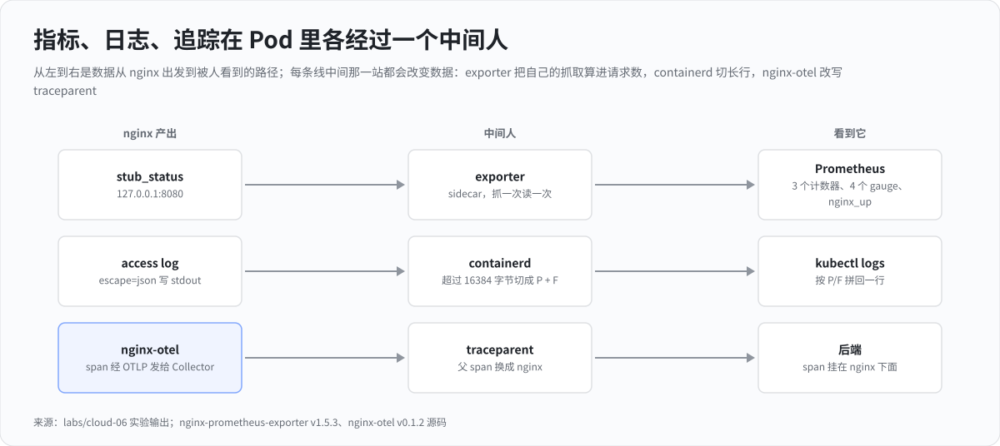
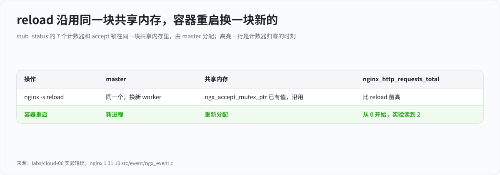
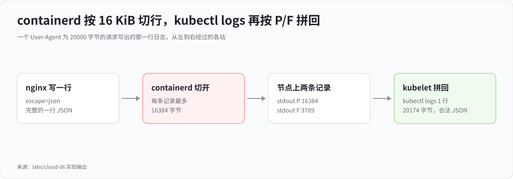
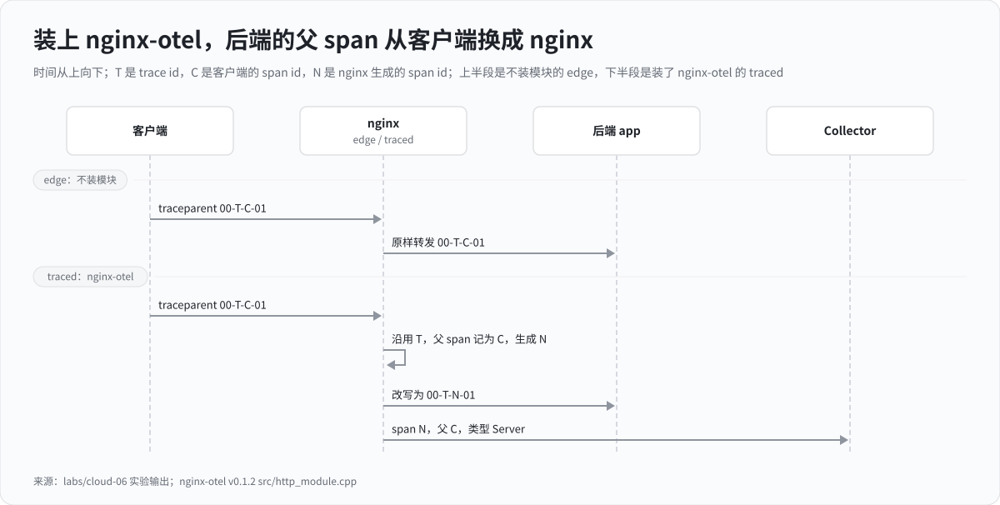

# 云原生篇 06｜可观测：指标的计数器跟着 master 走，一次请求靠 request id 和 traceparent 串起来

> **一句话结论**：在 Kubernetes 里看 nginx，指标、日志、追踪各有一个容易踩的点。指标：nginx-prometheus-exporter 把 `stub_status` 的 7 个数变成 3 个计数器和 4 个 gauge，计数器存在 master 启动时映射一次的共享内存里，reload 不归零，容器重启归零，exporter 每抓一次自己也算一个请求。日志：access log 用 `escape=json` 写到 stdout，一行超过 16 KiB 时 containerd 在节点上把它拆成两条记录，`kubectl logs` 会拼回去，直接读节点文件的采集器要自己拼。追踪：不装模块时 nginx 原样转发 `traceparent`，在调用链里看不到 nginx；装上 nginx-otel 后，nginx 保留 trace id，自己生成一个 span，把请求头里的父 span 换成自己的，再交给后端。
>
> 适用版本：nginx 1.31.10（mainline，2026-11-23），nginx-prometheus-exporter 1.5.3，nginx-otel 0.1.2，OpenTelemetry Collector 0.166.0，Kubernetes v1.37.0（kind 节点上的 containerd）。「版本差异」：`$request_id` 从 1.11.0 起就有，1.31.2 起改用 SipHash-2-4 生成；control API 是 1.31.5 新增的，1.30.8 没有，§8 在 1.30.8 上只能用 `ps` 看进程标题。实验：[`labs/cloud-06`](../labs/cloud-06/)，Pod `edge` 里是 nginx 加 exporter sidecar，`edge` 代理到 Pod `app`；`traced` 是装了 nginx-otel 的 nginx，span 发给集群里的 Collector。

## 导读

| 你想知道 | 看哪一节 |
|---|---|
| exporter 给出哪些指标，类型是什么 | §1 |
| `nginx_http_requests_total` 为什么比业务请求多 | §2 |
| reload 和重启对计数器有什么影响 | §3 |
| JSON 日志写到 stdout 之后，长行会怎样 | §4 |
| 怎么用 request id 把两跳代理的日志对上 | §5 |
| 不装追踪模块时 `traceparent` 怎么走 | §6 |
| nginx-otel 给调用链加了什么 | §7 |
| reload 后旧 worker 还在服务，怎么看出来 | §8 |

[运维篇 11](../ops/11-logging-monitoring.md) 讲了单机上的日志和监控：§1 的 `escape=json`，§5 的 `stub_status` 7 个计数器各在哪里加减。本篇把同样的东西放进 Pod，看 exporter、容器运行时和追踪模块各自又加了什么。



## 1. exporter 把 stub_status 的 7 个数变成 3 个计数器和 4 个 gauge，另加一个 nginx_up

exporter 作为 sidecar 和 nginx 在同一个 Pod 里，经回环地址读 `stub_status`：

```yaml
# lab: labs/cloud-06/k8s/pods.yaml
    - name: exporter
      image: nginx/nginx-prometheus-exporter:1.5.3
      args: ["--nginx.scrape-uri=http://127.0.0.1:8080/stub_status"]
      ports:
        - containerPort: 9113
```

nginx 这一侧只在 `127.0.0.1:8080` 上开 `stub_status`，Pod 外面访问不到：

```nginx
# lab: labs/cloud-06/conf/edge.conf
    server {
        listen 127.0.0.1:8080;
        access_log off;

        location = /stub_status {
            stub_status;
        }
    }
```

exporter 每次被抓取都去读一次 `stub_status`，读到的 7 个数逐个转成指标：

```go
// nginx-prometheus-exporter v1.5.3: collector/nginx.go:53-77
	stats, err := c.nginxClient.GetStubStats()
	if err != nil {
		c.upMetric.Set(nginxDown)
		ch <- c.upMetric
		c.logger.Error("error getting stats", "uri", c.nginxClient.GetAPIEndpoint(), "error", err)
		return
	}

	c.upMetric.Set(nginxUp)
	ch <- c.upMetric

	ch <- prometheus.MustNewConstMetric(c.metrics["connections_active"],
		prometheus.GaugeValue, float64(stats.Connections.Active))
	ch <- prometheus.MustNewConstMetric(c.metrics["connections_accepted"],
		prometheus.CounterValue, float64(stats.Connections.Accepted))
	ch <- prometheus.MustNewConstMetric(c.metrics["connections_handled"],
		prometheus.CounterValue, float64(stats.Connections.Handled))
	ch <- prometheus.MustNewConstMetric(c.metrics["connections_reading"],
		prometheus.GaugeValue, float64(stats.Connections.Reading))
	ch <- prometheus.MustNewConstMetric(c.metrics["connections_writing"],
		prometheus.GaugeValue, float64(stats.Connections.Writing))
	ch <- prometheus.MustNewConstMetric(c.metrics["connections_waiting"],
		prometheus.GaugeValue, float64(stats.Connections.Waiting))
	ch <- prometheus.MustNewConstMetric(c.metrics["http_requests_total"],
		prometheus.CounterValue, float64(stats.Requests))
```

```text
# labs/cloud-06 ## the metrics the exporter makes from stub_status
# TYPE nginx_connections_accepted counter
# TYPE nginx_connections_active gauge
# TYPE nginx_connections_handled counter
# TYPE nginx_connections_reading gauge
# TYPE nginx_connections_waiting gauge
# TYPE nginx_connections_writing gauge
# TYPE nginx_http_requests_total counter
# TYPE nginx_up gauge
nginx_up 1
ok - seven stub_status numbers become three counters and four gauges, plus nginx_up
```

accepted、handled、requests 是只增不减的计数器，active、reading、writing、waiting 是当前值，类型和 [运维篇 11](../ops/11-logging-monitoring.md) §5 的说明一一对应。`nginx_up` 是 exporter 自己的指标：读 `stub_status` 失败时它是 0，其余 7 个指标这一轮都不输出（第 54 到 58 行直接返回）。告警规则如果只写 `rate(nginx_http_requests_total[5m]) == 0`，nginx 挂掉时这条序列是缺失的，表达式没有结果，也就不会触发，要另配一条 `nginx_up == 0`。

**小结**：exporter 不做计算，只把 `stub_status` 的读数换成 Prometheus 的格式。读不到时它报 `nginx_up 0`，其他指标整轮缺失。

## 2. 每次抓取也是一个请求，nginx_http_requests_total 比业务请求多

在两次抓取之间发 10 个请求，计数器涨了 11：

```text
# labs/cloud-06 ## every scrape is a request too
nginx_http_requests_total went up by 11 for 10 requests
ok - the exporter's GET /stub_status is counted with the others
```

多出来的 1 是 exporter 的那次 `GET /stub_status`。请求计数在 nginx 分配请求结构时就加 1（[ngx_http_request.c 第 563 行](https://github.com/nginx/nginx/blob/release-1.31.10/src/http/ngx_http_request.c#L563-L563)），不看 location，也不看 `access_log off`。Prometheus 的默认抓取间隔是 1 分钟，常见配置是 15 秒，多出来的量在繁忙的入口上可以忽略；在一个几乎没有流量的 Pod 上，`rate(nginx_http_requests_total[5m])` 不会是 0，用它判断“没有流量”要减去抓取频率。

**小结**：`nginx_http_requests_total` 包括 exporter 自己的请求，这是 `stub_status` 的计数规则，与 exporter 无关。

## 3. reload 不动计数器，容器重启从 0 开始

```text
# labs/cloud-06 ## a reload keeps the counters, a restart starts them from zero
after nginx -s reload: higher than before
after the nginx container restarted: 2 (the two scrapes since the restart)
ok - the counters live in shared memory the master maps once; a new master starts at 0
```

这 7 个计数器和 accept 锁放在同一块共享内存里。master 第一次初始化事件模块时分配它，reload 时 `ngx_accept_mutex_ptr` 已经有值，直接返回，新 worker 继承的还是同一块内存：

```c
// src/event/ngx_event.c:537-543
    if (ccf->master == 0) {
        return NGX_OK;
    }

    if (ngx_accept_mutex_ptr) {
        return NGX_OK;
    }
```

```c
// src/event/ngx_event.c:600-608
#if (NGX_STAT_STUB)

    ngx_stat_accepted = (ngx_atomic_t *) (shared + 3 * cl);
    ngx_stat_handled = (ngx_atomic_t *) (shared + 4 * cl);
    ngx_stat_requests = (ngx_atomic_t *) (shared + 5 * cl);
    ngx_stat_active = (ngx_atomic_t *) (shared + 6 * cl);
    ngx_stat_reading = (ngx_atomic_t *) (shared + 7 * cl);
    ngx_stat_writing = (ngx_atomic_t *) (shared + 8 * cl);
    ngx_stat_waiting = (ngx_atomic_t *) (shared + 9 * cl);
```

容器重启是一个新 master，计数器从 0 开始。重启后的读数是 2，就是 exporter 在等 `nginx_up` 变回 1 和后面那次读取时发的两个请求。Prometheus 的 `rate()` 和 `increase()` 把计数器变小当成一次重置来处理，所以重启不会让速率出现负值，但重启前最后一次抓取之后到重启之间的请求会丢掉。容器里 nginx 是 1 号进程，`nginx -s stop` 之后容器退出、kubelet 重启它，这是 [云原生篇 01](01-containers.md) 讲过的行为。



**小结**：计数器的生命周期是 master 的生命周期。看到 `nginx_http_requests_total` 掉回很小的数，说明容器重启过，不是 reload。

## 4. JSON 日志写到 stdout，超过 16 KiB 的一行在节点上被拆成两条记录

edge 的 access log 是一行一个 JSON 对象，直接写到 `/dev/stdout`：

```nginx
# lab: labs/cloud-06/conf/edge.conf
    log_format json escape=json
        '{"hop":"edge","request_id":"$rid","uri":"$request_uri","status":$status,'
        '"request_time":$request_time,"upstream_status":"$upstream_status",'
        '"upstream_response_time":"$upstream_response_time",'
        '"traceparent":"$http_traceparent","user_agent":"$http_user_agent"}';

    access_log /dev/stdout json;
```

`escape=json` 保证 `$http_user_agent` 这类客户端能控制的字段写进去仍是合法 JSON，原理见 [运维篇 11](../ops/11-logging-monitoring.md) §1。容器的 stdout 由 containerd 写进节点上的日志文件，每条记录是“时间 流 标记 内容”，标记 `F` 表示一行完整，`P` 表示这一行还没完、下一条接着。实验发了一个短请求和一个 User-Agent 为 20000 字节的请求：

```text
# labs/cloud-06 ## JSON lines on stdout, and the runtime's 16 KiB records
containerd on the node: max_container_log_line_size = 16384
records of the short line: stdout F 185;
records of the long line: stdout P 16384;stdout F 3789;
kubectl logs, the long line: 1 line, 20174 bytes, valid JSON: yes
ok - a line over 16384 bytes is stored as a partial record plus the rest; kubectl logs joins them
```

kind 节点上 containerd 的 `max_container_log_line_size` 是 16384，超过的行被切成一条 16384 字节的 `P` 记录和一条装剩余 3789 字节的 `F` 记录。kubelet 读这个文件回答 `kubectl logs` 时按标记拼回一行（16384 加 3789，再加换行符，正是输出里的 20174 字节），拼出来的还是合法 JSON。直接读 `/var/log/pods` 下文件的日志采集器要按同样的规则拼接，否则这条日志会变成两段都不合法的 JSON。

这一步把 `large_client_header_buffers` 调到了 `4 32k`，默认的 8k 会让 20000 字节的请求头直接得到 400，日志里也就没有这么长的行。生产上长行一般来自很长的 URI、Cookie 或 Referer。



**小结**：nginx 写的是完整的一行，拆分发生在容器运行时。采集链路要认识 `P` 标记，或者在 `log_format` 里控制每个字段的长度。

## 5. 一个 request id 跨两跳：边缘没有就生成，有就沿用，用请求头传给后端

```nginx
# lab: labs/cloud-06/conf/edge.conf
    # keep a request id that came with the request, make one otherwise
    map $http_x_request_id $rid {
        ""      $request_id;
        default $http_x_request_id;
    }
```

`$request_id` 是 nginx 为每个请求生成的 32 位十六进制数。`map` 让 edge 先看请求里有没有 `X-Request-ID`，有就沿用，没有才用自己生成的；`proxy_set_header X-Request-ID $rid` 把它传给 app，app 的日志格式里记 `$http_x_request_id`：

```text
# labs/cloud-06 ## a request id across two hops
edge made a 32-hex-digit id, the app logged the same one
with X-Request-ID from the client: edge from-client-42, app from-client-42
ok - the edge's id reaches the app; an id from the client is kept
```

两跳的日志按 `request_id` 一 join 就能对上。客户端带来的 id 被原样沿用，好处是上游系统（比如前面还有一层负载均衡）生成的 id 能贯穿到底；代价是客户端可以随便填，这个字段只能用来关联日志，不能用来做鉴权或去重。

**小结**：request id 不需要任何模块，一个 `map` 加一个 `proxy_set_header`。它把日志串起来，但不记录每一跳花了多少时间、谁是谁的上一跳，那是追踪要做的事。

## 6. 没有追踪模块时，nginx 原样转发 traceparent，调用链里没有它

W3C Trace Context 用请求头 `traceparent` 传递调用链信息，格式是 `00-<32 位 trace id>-<16 位父 span id>-<标志>`。edge 没有装任何追踪模块：

```text
# labs/cloud-06 ## a traceparent passes through untouched
client sent: 00-4bf92f3577b34da6a3ce929d0e0e4736-00f067aa0ba902b7-01
edge logged: 00-4bf92f3577b34da6a3ce929d0e0e4736-00f067aa0ba902b7-01
app got:     00-4bf92f3577b34da6a3ce929d0e0e4736-00f067aa0ba902b7-01
ok - without a tracing module nginx forwards the header as it came; no span for nginx
```

`proxy_pass` 默认把客户端的请求头都转给后端，`traceparent` 也不例外。后端如果接入了追踪，它的 span 会直接挂在客户端的 span 下面，中间这一跳 nginx 用了多少时间，在调用链上看不到。

**小结**：不装模块，nginx 对追踪是透明的。它不会破坏调用链，也不会出现在调用链里。

## 7. nginx-otel 给 nginx 加一个 span，并把请求头里的父 span 换成自己

nginx-otel 是 nginx 官方的 OpenTelemetry 模块，C++ 写成，用 gRPC 把 span 以 OTLP 发出去。它和 nginx-acme 一样按基础镜像的 configure 参数编译成动态模块：

```dockerfile
# lab: labs/cloud-images/nginx-otel/Dockerfile
COPY --from=base /usr/sbin/nginx /usr/sbin/nginx
RUN eval ./configure "$(nginx -V 2>&1 | sed -n 's/^configure arguments: //p')" \
        --add-dynamic-module=/src/nginx-otel \
```

编译时 CMake 会拉取 gRPC 和 opentelemetry-cpp 的源码一起编，构建机要能访问 GitHub。gRPC 用的是系统的 c-ares（[CMakeLists.txt](https://github.com/nginxinc/nginx-otel/blob/v0.1.2/CMakeLists.txt#L39-L39)），运行镜像要装它的动态库，否则 `load_module` 时报找不到 `libcares.so`。

traced 的配置：

```nginx
# lab: labs/cloud-06/conf/traced.conf
load_module /usr/lib/nginx/modules/ngx_otel_module.so;

error_log stderr notice;

events {}

http {
    otel_exporter {
        endpoint collector.lab-cloud-06.svc.cluster.local:4317;
        interval 1s;
    }

    otel_service_name edge;
    otel_trace on;
    otel_trace_context propagate;

    log_format trace escape=json
        '{"hop":"traced","trace_id":"$otel_trace_id","span_id":"$otel_span_id",'
        '"parent_id":"$otel_parent_id","traceparent":"$http_traceparent"}';

    access_log /dev/stdout trace;

    server {
        listen 80;

        location / {
            proxy_pass http://app.lab-cloud-06.svc.cluster.local;
        }
    }
}
```

`otel_trace on` 为每个请求生成 span，`otel_trace_context propagate` 表示既从请求里读 `traceparent`，也把新的写回去。同一个 `traceparent` 发给 traced：

```text
# labs/cloud-06 ## with nginx-otel: a span for nginx, and nginx as the app's parent
traced logged: trace_id 4bf92f3577b34da6a3ce929d0e0e4736, parent_id 00f067aa0ba902b7, span_id <16 hex digits>
app got:       00-4bf92f3577b34da6a3ce929d0e0e4736-<span_id of traced>-01
the collector, service.name: Str(edge):
    Trace ID       : 4bf92f3577b34da6a3ce929d0e0e4736
    Parent ID      : 00f067aa0ba902b7
    ID             : <span_id of traced>
    Name           : /
    Kind           : Server
    -> http.method: Str(GET)
    -> http.route: Str(/)
    -> http.status_code: Int(200)
ok - the trace id is kept, the client's span becomes nginx's parent, nginx's span the app's
```

模块在请求开始时从 `traceparent` 取出父级的 trace id 和 span id，沿用 trace id，生成自己的 span id：

```cpp
// nginx-otel v0.1.2: src/http_module.cpp:346-351
    auto lcf = getLocationConf(r);
    if (lcf->traceContext & Propagation::Extract) {
        ctx->parent = extract(r);
    }

    ctx->current = TraceContext::generate(false, ctx->parent);
```

然后按 `propagate` 里的 inject 改写请求头，后端收到的父 span 变成了 nginx：

```cpp
// nginx-otel v0.1.2: src/http_module.cpp:388-390
    if (lcf->traceContext & Propagation::Inject) {
        rc = inject(r, ctx->current);
    }
```

不带 `traceparent` 的请求，nginx 就是调用链的起点：

```text
# labs/cloud-06 ## with nginx-otel and no traceparent: nginx starts the trace
traced logged: trace_id <new, 32 hex digits>, parent_id ""
app got:       00-<trace_id of traced>-<span_id of traced>-01
ok - a request without a context gets a new trace id; the app is its first child
```

每个请求只有一个 span，类型是 Server，名字默认是 location 的名字；转发给后端这一步没有单独的 Client span，后端的 span 直接挂在 nginx 的这个 span 下面。span 先进内存里的批次，按 `interval` 发出去，实验设成 1 秒。



**小结**：nginx-otel 让 nginx 在调用链里占一个节点，trace id 不变，父子关系改成“客户端 → nginx → 后端”。要不要采样由 `otel_trace` 决定，可以写成变量。

## 8. reload 后旧 worker 还在送完手上的下载，control API 把它标成 exiting

指标和日志都看不到 reload 的过渡期。app 上的 `/slow` 以 256 KB/s 送一个约 2 MB 的文件，下载进行中对 edge 做 reload：

```text
# labs/cloud-06 ## after a reload, the old worker stays until its download ends
processes after the reload: worker process exiting=false, worker process exiting=true
once the download finished: 1 worker, 0 exiting
ok - GET /1/control/processes shows the old worker as exiting while it still serves
```

`GET /1/control/processes` 列出每个 worker，旧 worker 的 `exiting` 是 true，它不再接新连接，只把手上的请求做完。下载结束后它退出，只剩新 worker。[云原生篇 04](04-config-delivery.md) 用 control API 下发配置，这里用它看进程：reload 频繁时，还有多少旧 worker 没退出，从这个接口一数就知道。

**小结**：exporter 的 7 个数分不出新旧 worker，control API 能。reload 之后旧 worker 迟迟不退，多半是有长连接或大下载还没结束。

## 已知局限与待核实

- 实验在 kind 单机集群上做，containerd 的 `max_container_log_line_size` 取的是 kind 节点的配置（16384），托管集群的节点可能改过这个值；CRI-O 的拆分规则本篇没有实验。
- §2 的“多 1 个”依赖实验里只有一个 exporter 在抓；多个 Prometheus 同时抓同一个 Pod 时，多出来的量按抓取次数累加，这是推断。
- §3 关于 `rate()` 处理计数器重置的描述来自 Prometheus 的文档定义，本篇没有搭 Prometheus 验证。
- §4 没有实验日志采集器（Fluent Bit、Vector 等）对 `P` 记录的处理，“要自己拼”是按 CRI 日志格式推断的。
- §7 用的 nginx-otel 0.1.2 发布于 2025-03-15，之后主干还有提交（最近一次在 2026-06），但没有新的发布；实验只验证了 1.31.10 上能编译、能导出 span，没有压测它对吞吐的影响，也没有试 `otel_span_attr`、`otel_trace` 写成变量做采样。
- exporter 的 `build_info` 指标报的版本是 `0.0.0-SNAPSHOT`，实验输出里滤掉了它；这是镜像构建方式的问题还是上游发布的问题，没有核实。

## 修订记录

- 2026-11-26：新写。覆盖 nginx-prometheus-exporter 的指标与抓取计数、计数器在 reload 与重启时的行为、JSON 日志在 containerd 里的 16 KiB 拆分、request id 跨两跳、traceparent 透传与 nginx-otel 的 span、control API 看 reload 过渡期的旧 worker，均附 `labs/cloud-06` 实验。
