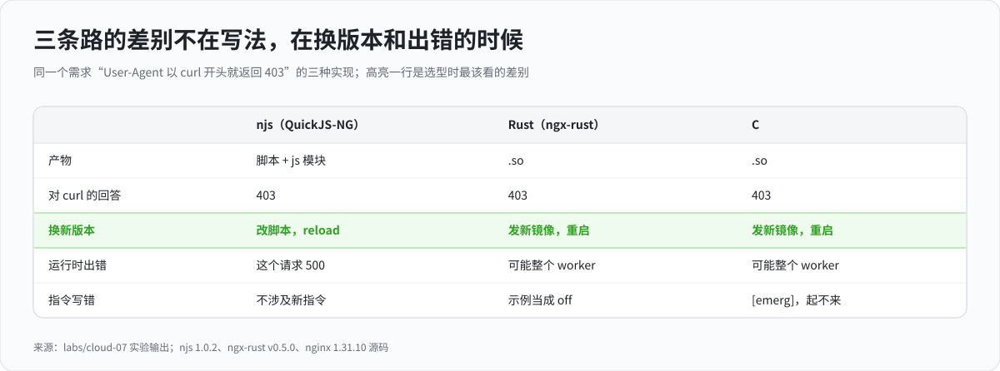
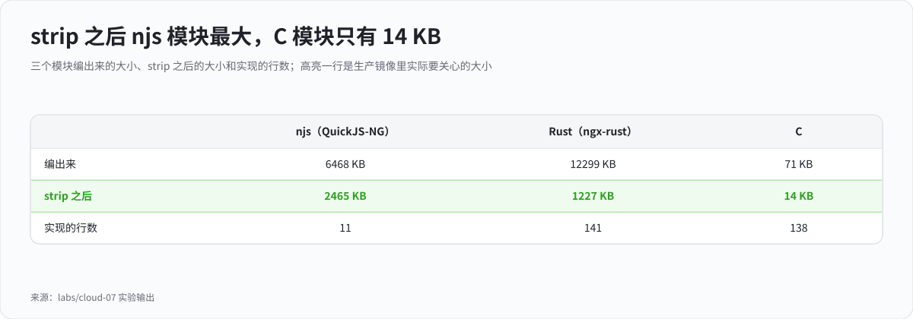
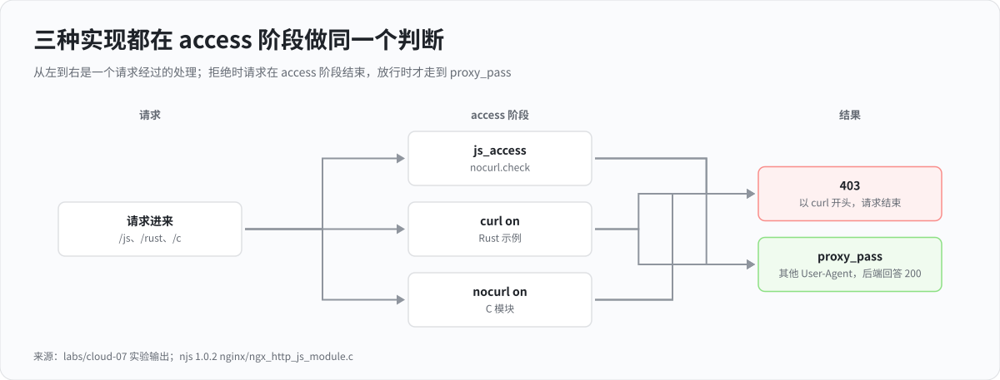
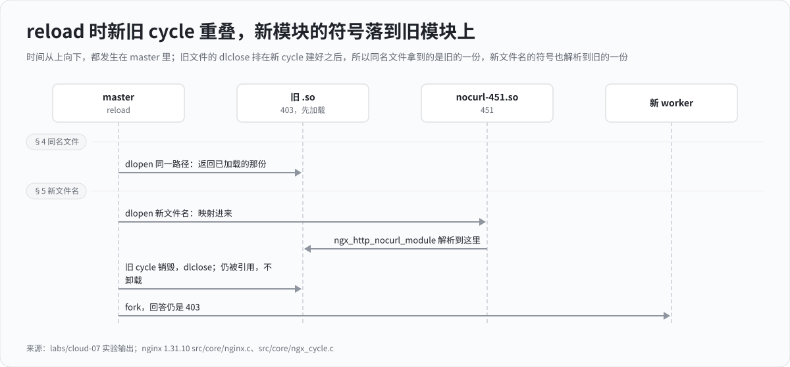
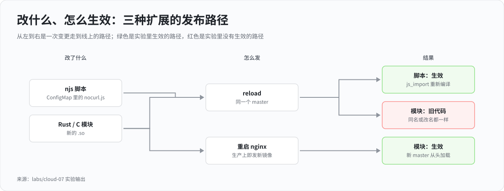
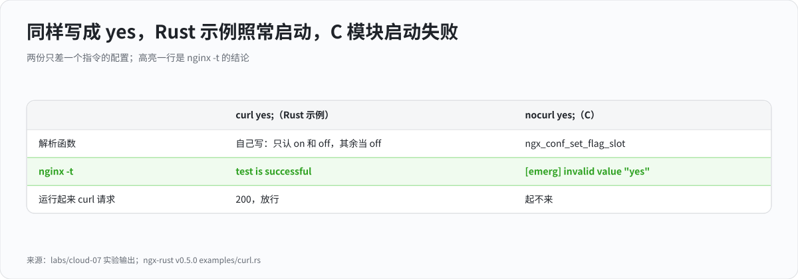

# 云原生篇 07｜扩展网关的三条路：njs 的脚本 reload 就换，Rust 和 C 模块换版本要重启 nginx

> **一句话结论**：同一个需求“User-Agent 以 curl 开头就返回 403”，用 njs、Rust（ngx-rust）、C 各写一遍，装进同一个 nginx，三者的回答完全一样，差别在换版本和出错的时候。njs 的脚本在加载配置时编译，改了文件 reload 就生效；Rust 和 C 写的是动态模块，`load_module` 在 master 里 `dlopen`，旧配置的句柄要等新配置加载完才关，同名文件换了内容 reload 后跑的还是旧代码，换个文件名也一样，因为新模块里对模块结构体的引用绑定到了先加载的那一份，只有重启 nginx 才换得了代码，在 Kubernetes 里就是滚动发布新镜像。出错时，njs 脚本抛异常只让这个请求得到 500；ngx-rust 的示例把写错的指令值当成 off 悄悄接受，C 用 nginx 自带的 `ngx_conf_set_flag_slot` 会在启动时报错。
>
> 适用版本：nginx 1.31.10（mainline，2026-11-23），njs 1.0.2（QuickJS-NG 0.18.0 引擎），ngx-rust 0.5.0，Kubernetes v1.37.0。「版本差异」：`js_access` 是 njs 0.9.9 新增的，njs 1.0.1 修过它的一个访问控制绕过问题；njs 从 1.0.0 起推荐 QuickJS 引擎，自带的 njs 引擎标为弃用。实验：[`labs/cloud-07`](../labs/cloud-07/)，一个 Pod 里的 nginx 同时加载三个模块，`/js`、`/rust`、`/c` 三个 location 各用一个。

## 导读

| 你想知道 | 看哪一节 |
|---|---|
| 三个模块怎么编进同一个镜像，各有多大 | §1 |
| 同一个需求三种写法长什么样，结果一不一样 | §2 |
| njs 脚本改了怎么生效 | §3 |
| 换一个 `.so` 文件再 reload 会怎样 | §4 |
| 换个文件名再 reload 呢 | §5 |
| 动态模块的新版本什么时候才真正跑起来 | §6 |
| 脚本或模块出错时各是什么后果 | §7 |
| 指令写错了，各自怎么报 | §8 |

[开发篇 10](../dev/10-write-a-module.md) 讲了 C 模块怎么写；[云原生篇 05](05-certificates.md) 和 [云原生篇 06](06-observability.md) 已经按“基础镜像的 configure 参数加 `--add-dynamic-module`”的办法编过 Rust 写的 nginx-acme 和 C++ 写的 nginx-otel。本篇把三种扩展方式放在一起比：写起来、换版本、出错时各是什么样。



## 1. 三个模块按同一套 configure 参数编进一个镜像，njs 用 QuickJS-NG

```dockerfile
# lab: labs/cloud-images/nginx-ext/Dockerfile
RUN export NJS_LIBXSLT=NO \
    && eval ./configure "$(nginx -V 2>&1 | sed -n 's/^configure arguments: //p')" \
        --add-dynamic-module=/src/njs/nginx \
        --add-dynamic-module=/src/ngx-rust/examples \
        --add-dynamic-module=/src/nocurl \
    && make -j"$(nproc)" modules \
    && mkdir -p /out/modules /out/src \
    && cp objs/ngx_http_js_module.so objs/ngx_http_curl_module.so \
        objs/ngx_http_nocurl_module.so /out/modules/ \
    && cp /src/ngx-rust/examples/curl.rs /src/nocurl/ngx_http_nocurl_module.c /out/src/ \
    && sed -i 's/return NGX_HTTP_FORBIDDEN;/return 451;/' /src/nocurl/ngx_http_nocurl_module.c \
    && make -j"$(nproc)" modules \
    && cp objs/ngx_http_nocurl_module.so /out/modules/nocurl-451.so \
    && for f in /out/modules/*.so; do \
           strip -o /tmp/stripped.so "$f" \
           && echo "$(basename "$f") $(stat -c %s "$f") $(stat -c %s /tmp/stripped.so)"; \
       done > /out/src/sizes.txt
```

njs 1.0.2 有两个 JavaScript 引擎：自带的 njs 引擎和 QuickJS。configure 时找到 QuickJS 的库才会编进 QuickJS 支持（[nginx/config](https://github.com/nginx/njs/blob/1.0.2/nginx/config#L70-L90) 依次试 pkg-config 和 `-lqjs`），实验先把 QuickJS-NG 0.18.0 编成静态库装好。配置里写 `js_engine qjs;` 才用它，不写还是 njs 引擎。`NJS_LIBXSLT=NO` 去掉了需要 libxml2 和 libxslt 的 XML 模块。ngx-rust 的 `examples/config` 一次声明了全部示例模块，实验只拷出 `curl` 这一个；`nocurl` 是本仓库按 curl 示例写的 C 版本。接着把 C 模块的 403 改成 451 再编一遍，存成 `nocurl-451.so`，§4 到 §6 用它当“新版本”。最后记下每个模块编出来和 strip 之后的大小。

```text
# labs/cloud-07 ## three modules in one image
module                      as built   stripped
ngx_http_curl_module.so       12299 KB    1227 KB
ngx_http_js_module.so          6468 KB    2465 KB
ngx_http_nocurl_module.so        71 KB      14 KB
nocurl-451.so                    71 KB      14 KB
lines: nocurl.js 11, curl.rs 141, ngx_http_nocurl_module.c 138
ok - the njs module was built with QuickJS-NG, and all three load
```

编出来的 Rust 模块最大，12299 KB，njs 模块 6468 KB，C 模块 71 KB。Rust 模块大，因为 ngx-rust 的构建脚本给 release 配置写了 `strip = "none"`（[examples/auto/rust](https://github.com/nginx/ngx-rust/blob/v0.5.0/examples/auto/rust#L181-L183)），符号全留着。strip 之后 njs 模块 2465 KB 最大，QuickJS 引擎整个链接在里面；Rust 模块 1227 KB，C 模块 14 KB。镜像大小在意的话，Rust 模块要自己 strip。



行数差得多：njs 脚本 11 行，Rust 141 行，C 138 行。多出来的是模块定义：指令表、模块上下文、创建和合并配置的函数、把处理函数挂到 access 阶段的初始化，脚本不需要这些，它直接引用 njs 模块已经定义好的 `js_access` 指令。

**小结**：三种扩展最后都是一个 `.so`，构建方式相同：拿运行镜像的 `nginx -V` 参数编译。njs 多一个引擎的选择，用 QuickJS 要在编译时带上它的库，在配置里写 `js_engine qjs`。

## 2. 同一个需求的三种写法，在 access 阶段给出同样的回答

njs 用 `js_access` 在 access 阶段调用一个函数，函数里调 `r.return(403)` 就拒绝，不调就放行：

```js
// labs/cloud-07/conf/nocurl.js:1-11
// The check of the ngx-rust "curl" example, for js_access: 403 when the
// User-Agent starts with "curl"; returning without a response lets the request go on.
function check(r) {
    const ua = r.headersIn['User-Agent'] || '';

    if (ua.startsWith('curl')) {
        r.return(403);
    }
}

export default { check };
```

Rust 示例用 ngx-rust 提供的宏定义处理函数，返回 `FORBIDDEN` 或 `NGX_DECLINED`：

```rust
// ngx-rust v0.5.0: examples/curl.rs:93-111
http_request_handler!(curl_access_handler, |request: &mut http::Request| {
    let co = Module::location_conf(request).expect("module config is none");

    ngx_log_debug_http!(request, "curl module enabled: {}", co.enable);

    match co.enable {
        true => {
            if request
                .user_agent()
                .is_some_and(|ua| ua.as_bytes().starts_with(b"curl"))
            {
                http::HTTPStatus::FORBIDDEN.into()
            } else {
                core::Status::NGX_DECLINED
            }
        }
        false => core::Status::NGX_DECLINED,
    }
});
```

C 版本做的是同一件事：

```c
// labs/cloud-images/nginx-ext/nocurl/ngx_http_nocurl_module.c:70-91
ngx_http_nocurl_handler(ngx_http_request_t *r)
{
    ngx_table_elt_t             *ua;
    ngx_http_nocurl_loc_conf_t  *nlcf;

    nlcf = ngx_http_get_module_loc_conf(r, ngx_http_nocurl_module);

    if (!nlcf->enable) {
        return NGX_DECLINED;
    }

    ua = r->headers_in.user_agent;

    if (ua != NULL
        && ua->value.len >= sizeof("curl") - 1
        && ngx_strncmp(ua->value.data, "curl", sizeof("curl") - 1) == 0)
    {
        return NGX_HTTP_FORBIDDEN;
    }

    return NGX_DECLINED;
}
```

```nginx
# lab: labs/cloud-07/conf/nginx.conf
    server {
        listen 80;

        location /js {
            js_access nocurl.check;
            proxy_pass http://127.0.0.1:8081;
        }

        location /rust {
            curl on;
            proxy_pass http://127.0.0.1:8081;
        }

        location /c {
            nocurl on;
            proxy_pass http://127.0.0.1:8081;
        }

        location /buggy {
            js_access buggy.check;
            proxy_pass http://127.0.0.1:8081;
        }
    }

    # the backend: a request that got through the access phase ends here
    server {
        listen 127.0.0.1:8081;
        return 200 "passed\n";
```

```text
# labs/cloud-07 ## the same answers from all three
/js: curl/8.14.1 -> 403, Mozilla/5.0 -> 200, Wget/1.25 -> 200
/rust: curl/8.14.1 -> 403, Mozilla/5.0 -> 200, Wget/1.25 -> 200
/c: curl/8.14.1 -> 403, Mozilla/5.0 -> 200, Wget/1.25 -> 200
ok - 403 for curl, the backend's 200 for the others, in each
```



三个 location 对三种 User-Agent 的回答一致：curl 得到 403，其他的都由后端回答 200。njs 的 `js_access` 返回后，nginx 看响应头有没有发出：发了就结束请求，没发就按 `ctx->status`（初值 `NGX_OK`）让 access 阶段继续（[ngx_http_js_module.c 第 1622 到 1647 行](https://github.com/nginx/njs/blob/1.0.2/nginx/ngx_http_js_module.c#L1622-L1647)）。

**小结**：对这种只读请求头、给一个是否放行的逻辑，三种写法的结果没有区别。选哪一种，看的是后面几节的维护代价。

## 3. njs 脚本在加载配置时编译，改了文件要 reload 才生效

把 ConfigMap 里的 `nocurl.js` 换成也拒绝 `Wget` 的版本，等文件到了 Pod 里，先不 reload 发一次请求，再 reload：

```text
# labs/cloud-07 ## a changed script takes effect at the next reload
nocurl.js in the pod now refuses Wget too; before the reload /js -> 200
after the reload: /js -> 403, /c -> 200
ok - js_import compiles the file when the config is loaded, not per request
```

`js_import` 在解析配置时读文件、编译成字节码，请求来了执行的是编译好的代码，所以文件换了不 reload 就没有变化。reload 之后新 worker 用的是新配置里重新编译的脚本。和 [云原生篇 04](04-config-delivery.md) 的配置下发一样，脚本也走“ConfigMap 更新、sidecar 或人工 reload”的路径，reload 失败的处理方式也相同。

**小结**：njs 脚本等同于配置的一部分，发布方式和 nginx 配置相同，不需要重新构建镜像。

## 4. 同一个路径换了 .so 再 reload，跑的还是旧代码

在 Pod 里用 `mv` 把 451 版本盖到 `ngx_http_nocurl_module.so` 上，然后 reload：

```text
# labs/cloud-07 ## a new .so under the same path: the reload keeps the old code
ngx_http_nocurl_module.so is the 451 build now: yes
after the reload: new worker yes, /c -> 403
mapped by the master: ngx_http_curl_module.so;ngx_http_js_module.so;ngx_http_nocurl_module.so (deleted);
ok - dlopen() of a file name the master has open returns the copy it has
```

`load_module` 在 master 里调用 `dlopen`：

```c
// src/core/nginx.c:1680-1689
    handle = ngx_dlopen(file.data);
    if (handle == NULL) {
        ngx_conf_log_error(NGX_LOG_EMERG, cf, 0,
                           ngx_dlopen_n " \"%s\" failed (%s)",
                           file.data, ngx_dlerror());
        return NGX_CONF_ERROR;
    }

    cln->handler = ngx_unload_module;
    cln->data = handle;
```

reload 时 master 先按新配置建一个新 cycle，新 cycle 的 `load_module` 再次 `dlopen` 同一个路径；旧 cycle 的内存池（连同它登记的 `dlclose`）要等新 cycle 建好之后才销毁：

```c
// src/core/ngx_cycle.c:783-788
    if (ngx_process == NGX_PROCESS_MASTER || ngx_is_init_cycle(old_cycle)) {

        ngx_destroy_pool(old_cycle->pool);
        cycle->old_cycle = NULL;

        return cycle;
```

`dlopen` 遇到一个已经加载过的文件名，直接返回已有的那一份，不会再去读文件。master 的 `/proc/1/maps` 里那一行带着 `(deleted)`，映射的还是已经被 `mv` 替换掉的旧文件；新 worker 从 master fork 出来，跑的也就是旧代码。

**小结**：动态模块的代码在 master 第一次加载时就定下来了，同一个路径换文件再 reload 换不掉。

## 5. 换个文件名也一样：新模块里的符号绑定到了先加载的那一份

把 `load_module` 改成指向 `nocurl-451.so`，这是 master 从没打开过的文件：

```text
# labs/cloud-07 ## another file name: loaded, and still the old code
load_module /usr/lib/nginx/modules/nocurl-451.so, after the reload: /c -> 403
mapped by the master: ngx_http_curl_module.so;ngx_http_js_module.so;ngx_http_nocurl_module.so (deleted);nocurl-451.so;
ok - the new file is mapped, but its ngx_http_nocurl_module binds to the one loaded first
```

master 的映射里多了 `nocurl-451.so`，旧文件仍然在，回答还是 403。原因在符号绑定：nginx 用 `RTLD_GLOBAL` 加载模块，两个 `.so` 都导出同名的全局变量 `ngx_http_nocurl_module`。新文件里的模块表 `ngx_modules` 和处理函数里对这个变量的引用，在 `dlopen` 时按全局作用域解析，先找到的是旧文件里那一份，于是新 cycle 注册的还是旧模块结构体，里面指向旧的处理函数。旧文件也因为被新文件引用，在旧 cycle `dlclose` 之后仍然留在内存里。



**小结**：换文件名也不能让 reload 换掉一个已经加载过的模块。这一点对 Rust 写的模块一样成立，它们导出的也是同名的 `ngx_module_t` 变量。

## 6. 重启 nginx 才换得掉代码：在 Kubernetes 里就是发新镜像

让 nginx 退出，容器重启后 master 是一个新进程：

```text
# labs/cloud-07 ## a restart runs the new code
restarted container: /c -> 451, /js Wget -> 403
mapped by the master: ngx_http_curl_module.so;ngx_http_js_module.so;nocurl-451.so;
ok - a new master loads every module from scratch
```

新 master 从头加载每个模块，映射里只有配置写的 `nocurl-451.so`，`/c` 返回了 451。§3 改过的 njs 脚本还在 ConfigMap 里，所以 `/js` 对 Wget 仍是 403。

在 Kubernetes 里，这意味着动态模块的升级走的是镜像发布：把新模块编进新镜像，用 Deployment 滚动替换 Pod。nginx 的二进制升级（USR2 起一个新 master）也能换代码，但在容器里 master 是 1 号进程，旧 master 一退出容器就结束了（[云原生篇 01](01-containers.md)），这条路用不上。njs 脚本则可以留在 ConfigMap 里，按 §3 的方式 reload。



**小结**：Rust 和 C 模块的版本跟着镜像走，njs 脚本的版本可以跟着配置走。需要频繁改的逻辑放 njs，发布成本低一个量级。

## 7. njs 脚本抛异常，这个请求得到 500，worker 照常工作

`throw.js` 调用了一个不存在的方法：

```js
// labs/cloud-07/conf/throw.js:1-6
// A check with a bug: it calls a method that does not exist.
function check(r) {
    r.headersIn['User-Agent'].startswith('curl');
}

export default { check };
```

```text
# labs/cloud-07 ## an exception in njs ends the request with 500
/buggy -> 500
[error] js call exception: TypeError: not a function
same worker afterwards: yes, /js -> 403
ok - the call fails, the access handler returns 500, the worker goes on
```

QuickJS 执行出错时，njs 记一条 `js call exception` 错误日志并返回 `NGX_ERROR`，`js_access` 的处理函数把它转成 500：

```c
// njs 1.0.2: nginx/ngx_http_js_module.c:1571-1576
    rc = ctx->engine->call((ngx_js_ctx_t *) ctx, &jlcf->access, &ctx->args[0],
                           1);

    if (rc == NGX_ERROR) {
        return NGX_HTTP_INTERNAL_SERVER_ERROR;
    }
```

这是脚本运行在虚拟机里的好处：越界、类型错误都被引擎接住，影响范围是一个请求。Rust 和 C 模块直接运行在 worker 进程里，处理函数里一次空指针解引用会让整个 worker 崩溃，worker 上的所有连接一起断掉，master 再拉起一个新的；Rust 的安全子集能排除大部分这类错误，但 ngx-rust 和 nginx 之间的绑定仍要经过 `unsafe` 代码。这一点本篇没有构造崩溃来实验。

**小结**：njs 的错误被关在一个请求里，模块的错误是整个 worker 的事。

## 8. 指令写错了：ngx-rust 的示例当成 off 接受，C 用 nginx 的解析函数会拒绝

```text
# labs/cloud-07 ## how each module parses its directive
== typo-rust.conf: curl yes;
the configuration file /tmp/typo-rust.conf syntax is ok
configuration file /tmp/typo-rust.conf test is successful
== typo-c.conf: nocurl yes;
[emerg] invalid value "yes" in "nocurl" directive, it must be "on" or "off" in /tmp/typo-c.conf:14
configuration file /tmp/typo-c.conf test failed
typo-rust.conf running: curl/8.14.1 -> 200
ok - the Rust example takes any other value as off; ngx_conf_set_flag_slot rejects it
```

`curl yes` 通过了 `nginx -t`，运行起来 curl 请求得到 200，放行了。示例的解析函数先把开关设成 false，只有值是 on 或 off 时才改，别的值不报错：

```rust
// ngx-rust v0.5.0: examples/curl.rs:129-137

        // set default value optionally
        conf.enable = false;

        if val.len() == 2 && val.eq_ignore_ascii_case("on") {
            conf.enable = true;
        } else if val.len() == 3 && val.eq_ignore_ascii_case("off") {
            conf.enable = false;
        }
```

C 版本的指令用 nginx 自带的 `ngx_conf_set_flag_slot` 解析，它只认 on 和 off，其他值是 `[emerg]`。这不是 Rust 语言的问题，是示例代码的写法；但它说明自己写的模块要自己做配置校验，nginx 提供的 `ngx_conf_set_*_slot` 系列函数在 C 里拿来就用，在 ngx-rust 里要自己找对应的封装或者自己写。



NGF 用的是 njs：HTTPRoute 里的 header 和参数匹配由 `httpmatches.js` 在 location 里完成，[云原生篇 03](03-gateway-api.md) §4 看过它的行为。这是“nginx 配置表达不了、又要随路由一起变”的逻辑，正好落在 njs 擅长的范围里。

**小结**：三种方式里，C 模块能直接复用 nginx 的配置解析和校验，Rust 模块要靠 ngx-rust 的封装或自己写，njs 不涉及新指令，只用 `js_*` 指令引用函数。

## 已知局限与待核实

- 实验只比较了一个只读请求头的需求，没有比较三种实现的吞吐和延迟。
- §5 的解释（新文件里的 `ngx_http_nocurl_module` 绑定到先加载的那一份）是按 glibc 的符号解析规则推断的，实验看到的是结果（新文件已映射、回答仍是 403），没有用 `LD_DEBUG=bindings` 逐个核对绑定；用 musl 的镜像（如 Alpine）结果可能不同，本篇没有试。
- §7 没有构造 Rust 或 C 模块的崩溃；“worker 崩溃后 master 重新拉起”见 [运维篇 03](../ops/03-processes-signals.md) §5，没有在本实验里重复。
- ngx-rust 0.5.0 仍是 0.x 版本，API 可能变化；`curl` 示例的解析写法是示例代码，不代表 ngx-rust 的推荐做法。
- njs 引擎（非 QuickJS）没有实验；njs 1.0 起它已标为弃用。

## 修订记录

- 2026-11-26：新写。覆盖 njs（QuickJS-NG）、ngx-rust、C 三种扩展的构建、同一需求的三种实现、njs 脚本 reload 生效、动态模块同名与改名替换后 reload 仍是旧代码、重启才换代码、njs 异常的影响范围、指令解析的差别，均附 `labs/cloud-07` 实验。
