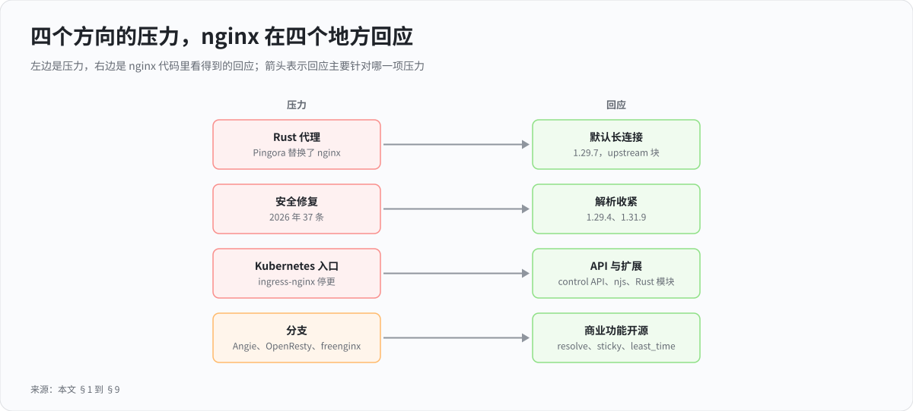
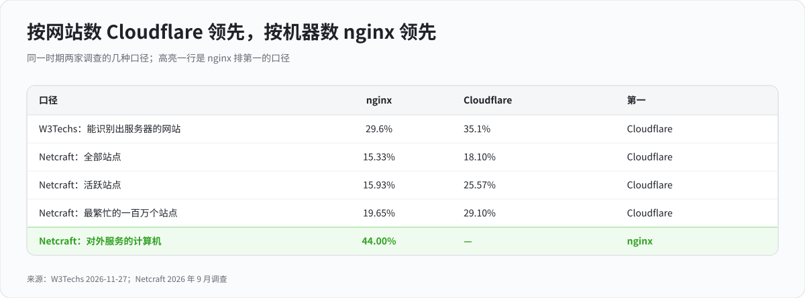
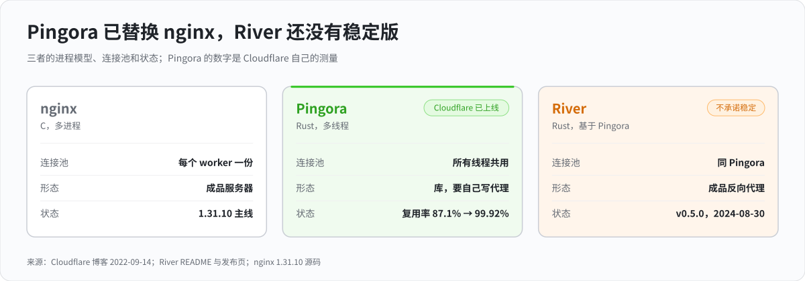
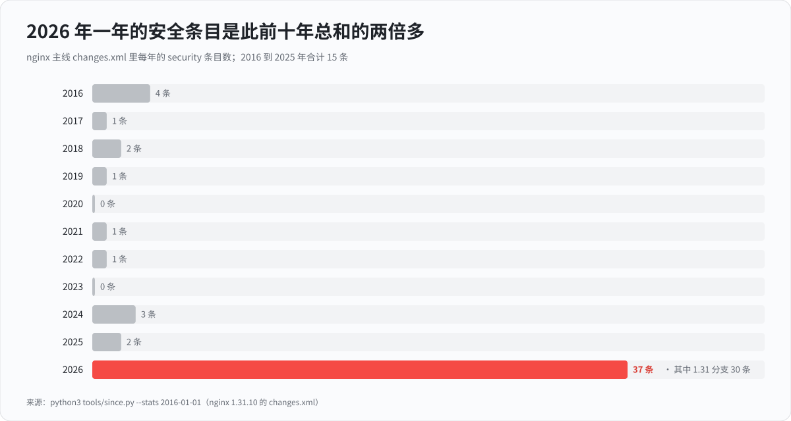
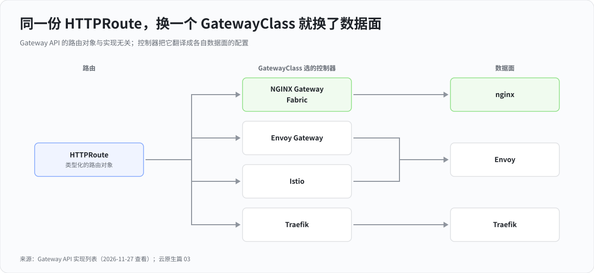
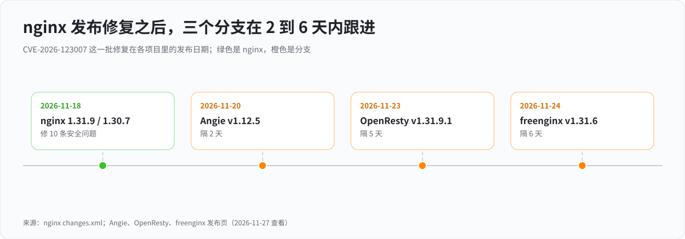
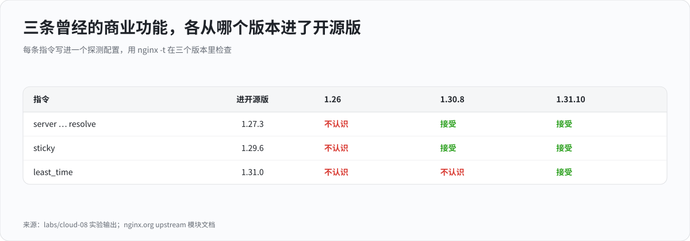
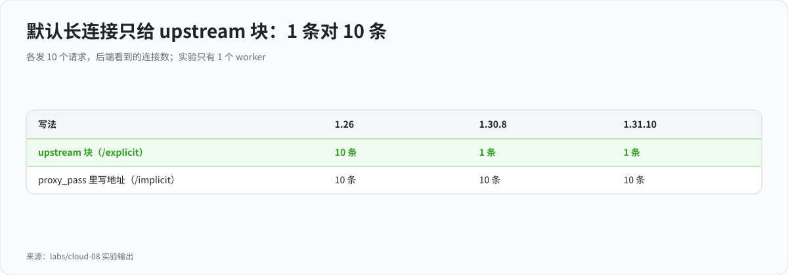
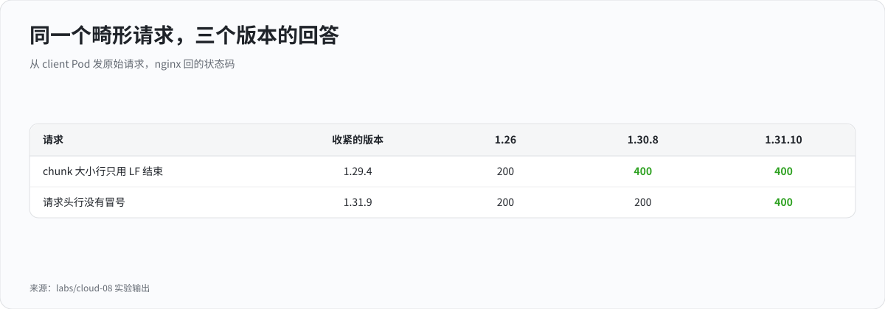

# 云原生篇 08｜nginx 的竞品与压力：Rust 代理、安全修复和 Kubernetes 入口三面施压，开源版在补商业功能、收紧解析

> **一句话结论**：2026 年 nginx 面对四个方向的压力。边缘这一层，Cloudflare 按网站数的份额已经超过 nginx，它连向源站的代理早在 2022 年就从 nginx 换成了 Rust 写的 Pingora，理由之一是 nginx 的连接池按 worker 分开；安全上，nginx 主线 2026 年的变更记录里有 37 条安全修复，此前十年加起来 15 条，2024-11 以来的 39 条里 28 条是内存错误；Kubernetes 里，ingress-nginx 在 2026 年 3 月停止维护，Gateway API 让 nginx 和 Envoy 等实现用同一套路由对象竞争；分支 Angie、OpenResty、freenginx 各自移植修复，比 nginx 晚 2 到 6 天。nginx 的回应在代码里看得到：曾经只在商业版里的 `resolve`、`sticky`、`least_time` 进了开源版，1.30 稳定分支已经有前两个；1.29.7 起 upstream 块默认保持到后端的长连接；请求解析一再收紧，同一个畸形请求，1.26 回 200，1.31.10 回 400；配置和扩展往 control API、njs 的 QuickJS 引擎和 Rust 模块上走。
>
> 适用版本：nginx 1.31.10（mainline，2026-11-23）和 1.30.8（stable，2026-11-23），对照 1.26 稳定分支的官方镜像（具体版本号见 §6 的实验输出），Kubernetes v1.37.0。份额、分支发布日期和 Gateway API 实现列表是 2026-11-27 查看的。「版本差异」：1.30 稳定分支从 1.29.x 分出（1.30.0 于 2026-04-14 发布），带着 1.29 的新功能，没有 1.31 的。实验：[`labs/cloud-08`](../labs/cloud-08/)，三个 Pod 分别跑三个版本，挂同一份配置。

## 导读

| 你想知道 | 看哪一节 |
|---|---|
| nginx 的份额到底是涨是跌 | §1 |
| Pingora 和 River 这些 Rust 代理针对的是 nginx 的什么 | §2 |
| 这两年的安全修复有多少，是什么类型 | §3 |
| ingress-nginx 停更以后，Kubernetes 入口的格局 | §4 |
| Angie、OpenResty、freenginx 跟进修复要多久 | §5 |
| 哪些商业版功能进了开源版，从哪个版本起 | §6 |
| 到后端的长连接默认打开以后有什么不同 | §7 |
| 解析收紧会让哪些请求从 200 变成 400 | §8 |
| 配置下发和扩展方式的变化 | §9 |

前七章讲的是把 nginx 跑进 Kubernetes 的做法。本篇把视角拉远一点：nginx 现在和谁竞争，压力落在哪里，nginx 自己的代码在往哪个方向改。外部的事实来自各项目的公开页面，链接放在第一次提到的地方；nginx 的部分来自 1.31.10 的源码和 `changes.xml`，能实验的都放进了 `labs/cloud-08`。



## 1. 按网站数 Cloudflare 排第一，按对外服务的机器数 nginx 仍占 44.00%

W3Techs 2026-11-27 的[网页服务器统计](https://w3techs.com/technologies/overview/web_server)里，Cloudflare Server 占 35.1%，nginx 29.6%，Apache 20.3%，LiteSpeed 13.0%，分母是“能识别出服务器的网站”。Netcraft 2026 年 9 月的[调查](https://www.netcraft.com/blog/september-2026-web-server-survey)按几种口径分别统计：全部站点里 nginx 占 15.33%，Cloudflare 18.10%；活跃站点里是 15.93% 对 25.57%；最繁忙的一百万个站点里是 19.65% 对 29.10%；按对外提供 Web 服务的计算机数，nginx 占 44.00%，排第一。



这些调查都从外面探测网站。一个站点放在 Cloudflare 后面，探测到的是 Cloudflare 的服务器，源站跑的是什么看不到。所以“Cloudflare 第一”说的是对外的那一跳：越来越多的站点把它交给了 CDN。按机器数，自己直接对外服务的机器里 nginx 仍然最多。对 nginx 来说，压力在于边缘这一层的流量交给了 CDN，而份额最大的 Cloudflare 早在 2022 年就把连向源站的代理从 nginx 换掉了（§2）。

**小结**：说 nginx 份额时要先说口径。按网站数它排在 Cloudflare 后面，按对外服务的机器数它排第一；边缘这一跳正在流向 CDN。

## 2. Rust 写的代理针对的是 nginx 按 worker 分开的连接池，Pingora 已经上线，River 还停在 v0.5.0

Cloudflare 2022-09-14 的[博客](https://blog.cloudflare.com/how-we-built-pingora-the-proxy-that-connects-cloudflare-to-the-internet)说明了它把连向源站的代理从 nginx 换成自研 Pingora 的原因。头一条是连接复用：nginx 的每个 worker 有自己的连接池，请求落到哪个 worker，就只能复用那个 worker 手里的连接，worker 越多，池子分得越碎。Pingora 用多线程，所有线程共用一个连接池。博客给的数字：一个大客户的连接复用率从 87.1% 升到 99.92%，到源站的新建连接少了 160 倍；整个服务比原来少用约 70% 的 CPU 和 67% 的内存，每天处理超过 1 万亿个请求。这些都是 Cloudflare 自己的测量。另外两条理由是 nginx 不方便做的功能（比如失败重试时改请求头）和 C 代码的内存安全。

nginx 的长连接缓存确实是每个 worker 一份。`keepalive` 的缓存项在加载配置时由 master 分配，worker fork 出来以后各用各的副本：

```c
// src/http/modules/ngx_http_upstream_keepalive_module.c:561-575
        /* allocate cache items and add to free queue */

        cached = ngx_pcalloc(cf->pool,
                 sizeof(ngx_http_upstream_keepalive_cache_t) * kcf->max_cached);
        if (cached == NULL) {
            return NGX_CONF_ERROR;
        }

        ngx_queue_init(&kcf->cache);
        ngx_queue_init(&kcf->free);

        for (j = 0; j < kcf->max_cached; j++) {
            ngx_queue_insert_head(&kcf->free, &cached[j].queue);
            cached[j].conf = kcf;
        }
```

Pingora 是一个 [Rust 库](https://github.com/cloudflare/pingora)，用它要自己写代理程序。想要一个配置即用的成品，ISRG 的 Prossimo 项目在 2024-02-28 [发布](https://www.memorysafety.org/blog/introducing-river/)了基于 Pingora 的反向代理 [River](https://github.com/memorysafety/river)，合作方有 Cloudflare、Shopify 和 Chainguard，目标写的是替换“不安全的旧互联网基础设施”。但 River 的[最新版本](https://github.com/memorysafety/river/releases)仍是 2024-08-30 的 v0.5.0，README 写着“Until further notice, there is no expectation of stability”。所以 Rust 代理对 nginx 的现实压力，来自 Cloudflare 这样有能力自己写代理的大型服务商；对一般运维团队，还没有一个能直接替换 nginx 的 Rust 成品。



**小结**：Pingora 换掉 nginx 的头一条理由是按 worker 分开的连接池，第二条是内存安全。它是一个库，River 这样的成品还没有稳定版本。

## 3. 安全修复集中爆发在 2026 年：主线变更记录里有 37 条，七成是内存错误

`changes.xml` 是 nginx 源码里的变更记录，每条带类型。本仓库的 `tools/since.py --stats` 按日期统计它：

```text
$ python3 tools/since.py --stats 2024-11-01
23 releases, 1.27.3 to 1.31.10
branch  releases      bugfix      change     feature    security  workaround
1.27           3          10           5           6           1           1
1.29           9          30          10          19           8           0
1.31          11          40          17          15          30           0
all           23          80          32          40          39           1
security: 39, memory errors: 28, other: 11
security by year: 2024 0, 2025 2, 2026 37
```

2024-11 以来主线发了 23 个版本，安全条目 39 条，其中 30 条在 1.31 分支。按描述里的词归类（溢出、越界读、释放后使用、未初始化内存、崩溃），28 条是内存错误，其余 11 条是证书校验绕过、数据注入、死循环这类逻辑问题。把起点改到 2016 年再看逐年分布：2016 到 2025 年逐年是 4、1、2、1、0、1、1、0、3、2 条，十年一共 15 条；2026 年一年 37 条。



最受关注的是 CVE-2026-123007：HTTP/2 的流量控制窗口溢出，nginx 的[安全公告](https://nginx.org/en/security_advisories.html)把它定为 Critical，受影响的版本从 HTTP/2 模块出现的 1.9.5 一直到 1.31.8，2026-11-18 发布的 1.31.9 和 1.30.7 修复。同一天这两个版本一共修了 10 条安全问题，五天后的 1.31.10 和 1.30.8 又修了 `ssl_early_data` 引起的 CPU 耗尽（CVE-2026-132779）。致谢里出现最多的是几家安全研究机构，1.29.7 有一条写的是 Calif.io in collaboration with Claude and Anthropic Research：用工具和模型系统地读 C 代码找漏洞，已经找到了 nginx 头上。

这些问题在运维上的含义是：nginx 的升级节奏要跟上安全版本。用 `nginx -V` 看版本和编进去的模块，再对照安全公告的受影响范围，判断要不要升级。

**小结**：nginx 在 2026 年进入了密集修安全问题的阶段，主因是 C 代码里的内存错误，这正是 Rust 代理拿来做文章的地方。

## 4. Kubernetes 入口换了接口：ingress-nginx 在 2026 年 3 月停更，Gateway API 让各家实现用同一套路由对象竞争

Kubernetes 安全响应委员会 2025-11-11 [宣布](https://kubernetes.io/blog/2025/11/11/ingress-nginx-retirement/) ingress-nginx 尽力维护到 2026 年 3 月，之后不再发布版本，也不再修安全漏洞。ingress-nginx 用注解扩展 Ingress，注解只有 ingress-nginx 认识，换一个控制器就要重写。[云原生篇 03](03-gateway-api.md) 讲过替代它的 Gateway API：路由写成类型化的 HTTPRoute，由 GatewayClass 选择哪个控制器来实现。

Gateway API 的[实现列表](https://gateway-api.sigs.k8s.io/implementations/)在 2026-11-27 列了二十多个实现，NGINX Gateway Fabric（NGF）、Envoy Gateway、Istio、Cilium、Traefik、kgateway 都标为一致性测试通过。对 nginx 来说，这意味着两件事：一是 ingress-nginx 这个入口没有了，二是迁移到 Gateway API 的团队面对的是一张同类的表，NGF 要和数据面是 Envoy 的几个实现直接比。



NGF 也在跟着 AI 网关的需求走：它实现了 Gateway API 的推理扩展，2.9.0 把原来用 njs 写的 Endpoint Picker 模块换成了原生的 Rust 模块（[CHANGELOG](https://github.com/nginx/nginx-gateway-fabric/blob/v2.9.1/CHANGELOG.md#L56-L56)）。

**小结**：Kubernetes 入口这一层，nginx 从“默认的 ingress-nginx”变成了 Gateway API 的若干实现之一，竞争对手主要是以 Envoy 为数据面的实现。

## 5. 分支各自移植修复：nginx 发布 1.31.9 之后，Angie 隔 2 天，OpenResty 隔 5 天，freenginx 隔 6 天

nginx 之外还有几个基于同一份代码的分支。它们和 nginx 共用大部分 C 代码，所以也共用漏洞，修复要等各自移植。以 CVE-2026-123007 这一批为例，nginx 在 2026-11-18 发布 1.31.9 和 1.30.7：

- [Angie](https://en.angie.software/news/releases/) 在 2026-11-20 发布 v1.12.5，修了这一批里的 8 个 nginx 漏洞，外加一个它自己的 HTTP/3 代理问题；1.31.10 修的 CVE-2026-132779，它在 2026-11-26 的 v1.12.6 里修。
- [OpenResty](https://openresty.org/en/download.html) 在 2026-11-23 发布 v1.31.9.1，版本号前三段就是它用的 nginx 核心版本。
- [freenginx](https://freenginx.org) 在 2026-11-24 发布 v1.31.6 和 v1.30.3，它的版本号和 nginx 不对应，它的[安全公告](https://freenginx.org/en/security_advisories.html)里这个漏洞影响 v1.9.5 到 v1.31.5。



用分支的理由各不相同：OpenResty 带 Lua；Angie 是前 nginx 开发者做的分支，[功能列表](https://en.angie.software/angie/)里有 REST API、Prometheus 格式的统计、ACME 和会话保持；freenginx 说自己是“保持 nginx 自由、开放开发的努力”。代价是安全修复有时间差，用分支就要盯两份公告：nginx 的和分支自己的。

**小结**：分支没有让 nginx 的代码更安全，它们和 nginx 共享漏洞，修复晚几天到。选分支要把这个时间差算进去。

## 6. 回应之一：商业版的功能进了开源版，1.30 稳定分支已经有 resolve 和 sticky

nginx.org 的 [upstream 模块文档](https://nginx.org/en/docs/http/ngx_http_upstream_module.html#resolve)写着：`server` 的 `resolve` 参数在 1.27.3 之前只在商业订阅里有，`sticky` 是 1.29.6 之前，`least_time` 是 1.31.0 之前。实验用同一份配置起三个版本：

```nginx
# lab: labs/cloud-08/conf/nginx.conf
    # an explicit upstream block
    upstream backend {
        server 127.0.0.1:8081;
    }

    server {
        listen 80;

        location = /ready {
            return 200 "ready\n";
        }

        location /explicit {
            proxy_pass http://backend;
        }

        # an address in proxy_pass: an implicit upstream
        location /implicit {
            proxy_pass http://127.0.0.1:8082;
        }
    }
```

```text
# labs/cloud-08 ## three versions, one config
v126: nginx/1.26.3
v130: nginx/1.30.8
v131: nginx/1.31.10
ok - the same config loads in all three
```

再把三条指令各写进一个探测配置，用 `nginx -t` 检查，接受的显示 accepted，不接受的显示报错原文：

```nginx
# lab: labs/cloud-08/conf/probe-resolve.conf
events {}

http {
    resolver 127.0.0.1;

    upstream u {
        zone u 64k;
        server localhost:8081 resolve;
    }
}
```

```text
# labs/cloud-08 ## directives that used to be commercial
                         1.26.3                             1.30.8                             1.31.10
resolve                  invalid parameter "resolve"        accepted                           accepted
sticky                   unknown directive "sticky"         accepted                           accepted
least_time               unknown directive "least_time"     unknown directive "least_time"     accepted
ok - resolve (1.27.3) and sticky (1.29.6) are in 1.30, least_time (1.31.0) only in 1.31
```

1.26 不认识这三个指令。1.30.8 有 `resolve` 和 `sticky`，因为 1.30 稳定分支是从 1.29.x 分出来的；`least_time` 是 1.31.0 才进开源版的，只有 1.31.10 有。`sticky` 和 `least_time` 是默认编译的模块，`--without-http_upstream_sticky_module` 才会去掉前者。



`resolve` 让 upstream 里的域名在运行时重新解析，[云原生篇 02](02-service-discovery.md) 用它对接 headless Service；`sticky` 是会话保持，以前开源版只能用 `hash` 或 `ip_hash` 近似；`least_time` 按响应时间选后端。这三条正好补在 Kubernetes 场景里最常用的地方，会话保持也在 §5 里 Angie 的功能列表上。

**小结**：要在稳定分支上用 `resolve` 和 `sticky`，从 1.26 升到 1.30 就有；要 `least_time` 得上 1.31 主线。

## 7. 回应之二：upstream 块默认保持到后端的长连接，写在 proxy_pass 里的地址不算

1.29.7 起 upstream 块的 `keepalive` 默认打开，`proxy_http_version` 默认改成 1.1，默认不再发送 `Connection` 头。keepalive 模块在初始化时遍历所有 upstream，跳过隐式的：

```c
// src/http/modules/ngx_http_upstream_keepalive_module.c:534-555
    for (i = 0; i < umcf->upstreams.nelts; i++) {

        /* skip implicit upstreams */
        if (uscfp[i]->srv_conf == NULL) {
            continue;
        }

        kcf = ngx_http_conf_upstream_srv_conf(uscfp[i],
                                            ngx_http_upstream_keepalive_module);

        if (kcf->max_cached == 0) {
            continue;
        }

        ngx_conf_init_msec_value(kcf->time, 3600000);
        ngx_conf_init_msec_value(kcf->timeout, 60000);
        ngx_conf_init_uint_value(kcf->requests, 1000);

        if (kcf->max_cached == NGX_CONF_UNSET_UINT) {
            kcf->local = 1;
            kcf->max_cached = 32;
        }
```

`proxy_pass` 后面直接写地址时，nginx 也会建一个 upstream，但它没有 `srv_conf`，被第一个 `if` 跳过。显式的 upstream 块没写 `keepalive` 时，`max_cached` 是未设置的值，于是设成 32，并打开 `local`（只复用本 upstream 的连接）。实验里 `/explicit` 走 upstream 块，`/implicit` 把地址写在 `proxy_pass` 里，后端用 `$connection` 记下每个请求来自哪条连接，各发 10 个请求：

```text
# labs/cloud-08 ## keepalive to backends is on by default, for an upstream block
v126: upstream block: 10 requests, 10 connections; address in proxy_pass: 10 requests, 10 connections
v130: upstream block: 10 requests, 1 connection; address in proxy_pass: 10 requests, 10 connections
v131: upstream block: 10 requests, 1 connection; address in proxy_pass: 10 requests, 10 connections
ok - 1.29.7 made keepalive the default for upstream blocks only
```

1.26 对两种写法都是 10 个请求 10 条连接。1.30.8 和 1.31.10 对 upstream 块只用了 1 条连接，对 `proxy_pass` 里的地址仍是 10 条。实验的配置没写 `worker_processes`，只有 1 个 worker；按 §2 的源码，多个 worker 时每个 worker 各有一份缓存，连接数至少是 worker 数，这正是 Pingora 博客说的连接池分散。



升级到 1.30 以后，后端看到的连接数会明显下降，而 `proxy_pass http://地址` 的写法不受影响。想让它也复用连接，把地址放进一个 upstream 块。

**小结**：1.29.7 把长连接设成默认，减少了到后端的建连，但只覆盖 upstream 块，也没有改变按 worker 分开的缓存。

## 8. 回应之三：解析一再收紧，以前能过的畸形请求在新版本里是 400

不严格的解析是请求走私的来源：前后两级代理对同一个请求的边界理解不同，攻击者就能在一个请求里夹带另一个。1.29.4 起，chunked 请求体里只用 LF 结束的行算错误；1.31.9 起，没有冒号的请求头行被拒绝。实验从 client Pod 用 bash 的 `/dev/tcp` 发原始请求。先是 chunk 大小那一行只用 LF 结束：

```text
# labs/cloud-08 ## a chunk size line ended by a bare LF
v126: HTTP/1.1 200 OK
v130: HTTP/1.1 400 Bad Request
v131: HTTP/1.1 400 Bad Request
ok - rejected since 1.29.4, so in 1.30 as well
```

1.31.10 的 `ngx_http_parse_chunked` 里，chunk 大小后面只接受 CR、分号、空格和制表符，LF 直接进 `invalid`：

```c
// src/http/ngx_http_parse.c:2294-2305
            switch (ch) {
            case CR:
                state = sw_chunk_extension_almost_done;
                break;
            case ';':
            case ' ':
            case '\t':
                state = sw_chunk_extension;
                break;
            default:
                goto invalid;
            }
```

再是一行没有冒号的请求头 `X-No-Colon`：

```text
# labs/cloud-08 ## a header line without a colon
v126: HTTP/1.1 200 OK
v130: HTTP/1.1 200 OK
v131: HTTP/1.1 400 Bad Request
ok - rejected since 1.31.9; the 1.30 branch still takes it as a header with an empty value
```

1.30.8 的头名解析遇到 CR 或 LF 就把这一行当成一个值为空的请求头，所以回 200。1.31.9 起这两个分支没有了，头名里出现 0x20 及以下的字节就返回无效头：

```c
// src/http/ngx_http_parse.c:1002-1005
            if (ch <= 0x20 || ch == 0x7f) {
                r->header_end = p;
                return NGX_HTTP_PARSE_INVALID_HEADER;
            }
```



1.29.4 还把请求行、`Host` 头和 HTTP/2 的 `:authority` 里主机和端口的校验改成按 RFC 3986，1.31.0 起 HTTP/2 和 HTTP/3 请求带 `Connection`、`Transfer-Encoding` 等头会被拒绝，1.31.9 起 chunked 请求体的分帧开销过大也会被拒绝。升级时要留意 400 是否增多：这类错误在 error log 里是 info 级的“client sent invalid ...”，默认级别看不到，见 [运维篇 13](../ops/13-troubleshooting.md) §1。

**小结**：每一次收紧都让 nginx 更难被夹带，也让写得不规范的客户端在升级后开始收到 400。一个请求在 1.26 回 200、在 1.31.10 回 400，是有意的变化。

## 9. 回应之四：配置下发和扩展往 API、JavaScript 和 Rust 上走

剩下的变化集中在“nginx 怎么被程序控制、怎么被扩展”。1.27.4 加了 `ssl_certificate_cache`，证书路径里带变量时不必每次握手都读文件（[运维篇 08](../ops/08-tls-http2-http3.md) §5）；1.31.5 一次加了 control API、`ngx_http_json_module` 和谓词 location。前面几章分别实验过这一组：

| 变化 | 版本 | 本系列 |
|---|---|---|
| control API：reload 有同步的成败回执，能导出当前配置 | 1.31.5 | [云原生篇 04](04-config-delivery.md) |
| nginx-acme：Rust 写的模块，在 nginx 里签发和续期证书 | nginx-acme v0.4.2 | [云原生篇 05](05-certificates.md) |
| nginx-otel：C++ 写的模块，给请求生成 span | nginx-otel v0.1.2 | [云原生篇 06](06-observability.md) |
| njs 换用 QuickJS 引擎；ngx-rust 用 Rust 写模块 | njs v1.0.2，ngx-rust v0.5.0 | [云原生篇 07](07-extensions.md) |

方向很一致：配置要能被程序下发并拿到回执，扩展要能用比 C 更安全的语言写。NGF 把推理扩展里的模块从 njs 换成 Rust（§4），nginx 官方的 [nginx-mcp-js](https://github.com/nginx/nginx-mcp-js) 用 njs 和 JSON 模块观察和路由 MCP 的 JSON-RPC 请求，都是这条路上的例子。它们也是 nginx 回应 Pingora 和 Envoy 的方式：核心还是 C，新增的逻辑尽量放进 JavaScript 和 Rust。

**小结**：nginx 没有用 Rust 重写自己，它在 C 的核心外面加 API 和更安全的扩展语言。对使用者，这意味着新功能更多以模块和脚本的形式出现，升级时要连同模块一起考虑（[云原生篇 07](07-extensions.md) §6）。

## 已知局限与待核实

- 份额数字来自第三方调查，口径和抽样由调查方决定，不同调查之间不能直接比较。“CDN 后面看不到源站”是按探测方式做的推断，调查方没有逐条说明识别方法。
- Pingora 的 CPU、内存和连接复用数字是 Cloudflare 自己的测量，本篇没有复现；Pingora 现在的规模也没有核实到比 2022 年更新的公开数字。
- §3 的“内存错误”是 `tools/since.py` 按描述里的关键词归的类，可能有误分；只统计主线的 `changes.xml`，稳定分支移植的同一修复不重复计。
- §5 只看了 Angie、OpenResty、freenginx 三个分支，发布日期取自各自的发布页；Tengine 等其他分支没有查。各分支修复了哪些条目，本篇只核对了公告，没有核对代码。
- Gateway API 的实现列表会变化，“二十多个”是 2026-11-27 查看时的数目，两次读取的计数不一致（21 和 22），所以没写确数；“一致性测试通过”以列表页的标注为准。
- §7 的实验只有 1 个 worker，多 worker 时的连接数是按源码推断的，没有实验。
- §8 只实验了两种畸形请求；1.30 稳定分支对无冒号头行的处理只看了 1.30.8。

## 修订记录

- 2026-11-27：新写。覆盖份额的两种口径、Pingora 与 River、2024-11 以来的安全条目统计与 CVE-2026-123007、ingress-nginx 停更与 Gateway API、分支跟进修复的时间差、开源版补上的三条商业功能、upstream 默认长连接、解析收紧，以及 control API 与扩展方式的变化；实验见 `labs/cloud-08`，统计见 `tools/since.py --stats`。
