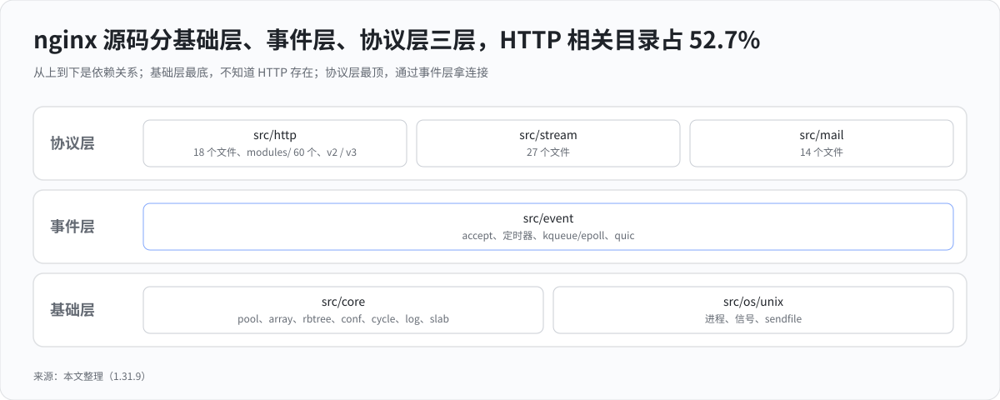
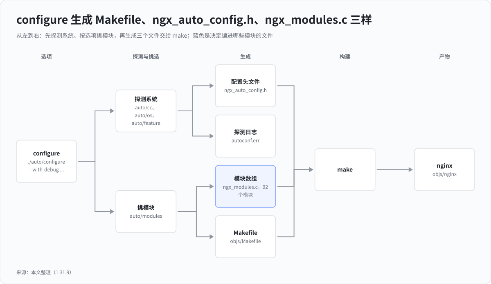
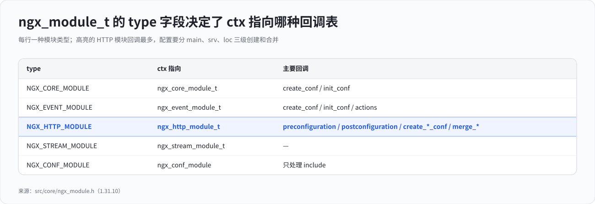
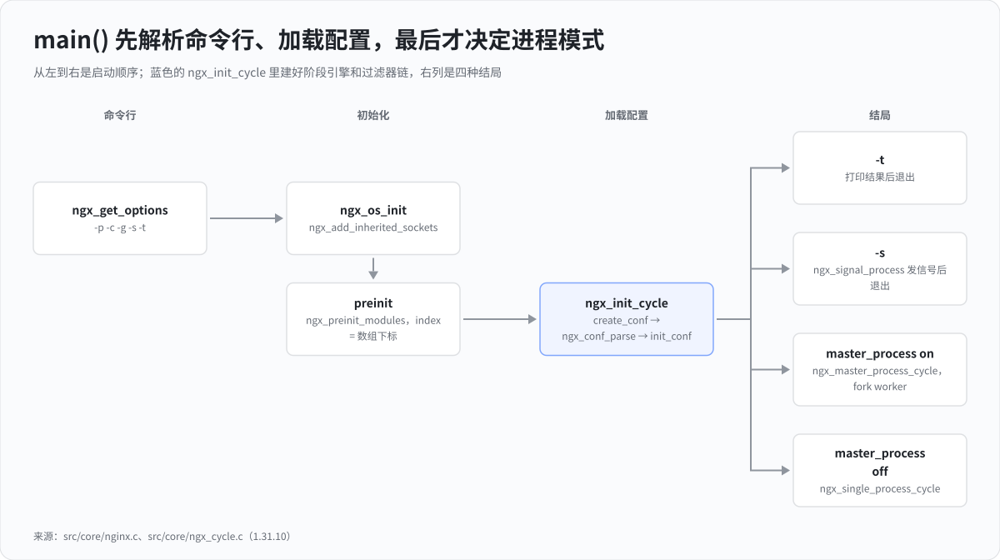
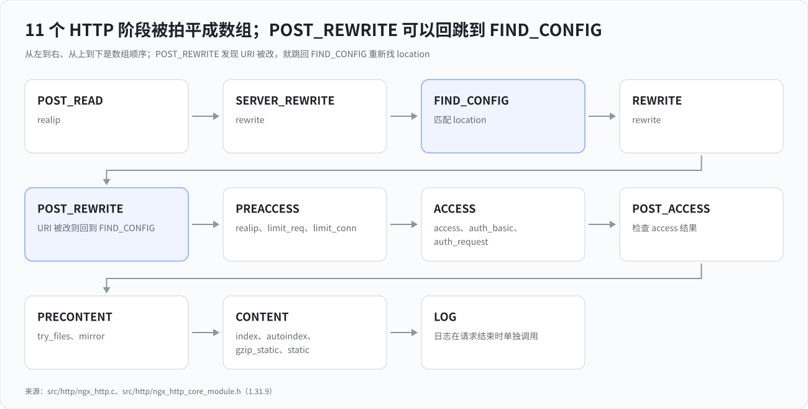
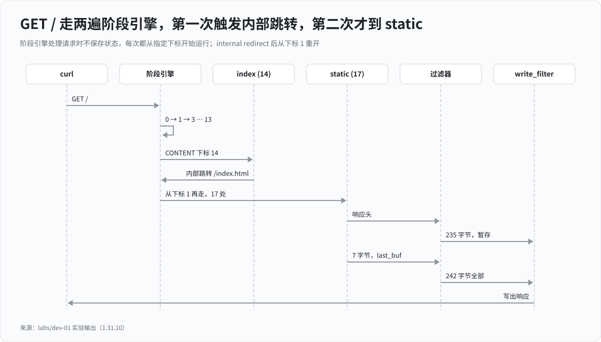
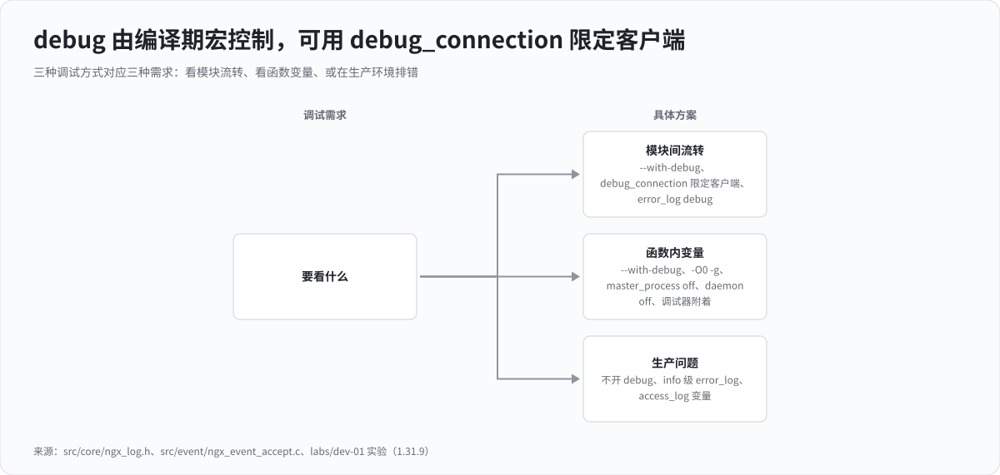

# 开发篇 01｜源码地图、构建与调试：模块在 ngx_modules[] 里的位置决定了它什么时候运行

> **一句话结论**：nginx 的源码分三层：`src/core` 是与协议无关的基础设施，`src/event` 是事件循环，`src/http`、`src/stream`、`src/mail` 是协议实现。按 `.c` 行数算，HTTP 相关的四个目录占 52.7%。`configure` 生成三样要看的东西：`objs/Makefile`、`objs/ngx_auto_config.h` 里的宏、`objs/ngx_modules.c` 里的模块数组。模块在这个数组里的位置，决定了它的 `index`、初始化顺序、它在每个 HTTP 阶段里的位置，以及它在过滤器链里的位置。带 `--with-debug` 编译后，一个 `GET /` 的 debug 日志里，`phase: N` 的每一个 N 都能和由模块数组推出来的阶段引擎下标逐个对上。
>
> 适用版本：nginx 1.31.9（mainline，2026-11-18）。「版本差异」：`main()` 里的 `ngx_control_preinit()` 和 `-l` 参数属于 1.31.5 新增的 control API，1.30.7 没有；`ngx_http_json_module.c`、`ngx_http_tunnel_module.c`、`ngx_http_upstream_least_time_module.c` 三个文件只在 1.31.9 的源码树里。`ngx_module_t` 的结构体、`ngx_module.c`、`ngx_http_init_phase_handlers` 和 `auto/modules` 里的过滤器顺序注释，两个版本逐字相同（`diff` 无输出）。实验：[`labs/dev-01`](../labs/dev-01/)，用的是 `tools/build.sh` 编出来的 nginx（`--with-debug`，`-O0 -g`）。

## 导读

| 你想知道 | 看哪一节 |
|---|---|
| 源码目录怎么分，先读哪里 | §1 |
| `configure` 生成了什么，`--with-debug` 变成了什么 | §2 |
| 一个模块在 C 里长什么样，有几种类型 | §3 |
| 模块的顺序从哪来，过滤器为什么按这个顺序执行 | §4 |
| `main()` 从启动到进入进程循环做了哪几步 | §5 |
| HTTP 的 11 个阶段怎么变成一个数组 | §6 |
| 一个请求的 debug 日志怎么读 | §7 |
| 只给一个客户端开 debug，调试器怎么附着 | §8 |

源码路径都相对于 nginx 源码根目录（实验里是 `.nginx-src/release-1.31.9`）。实验在 macOS arm64 上运行，单 worker。

## 1. 源码分核心、事件、协议三层，HTTP 相关目录占 .c 代码的一半多

实验第一步按目录统计 `.c` 文件数和行数：

```text
# labs/dev-01 ## the source tree
src/core        43 .c files  30829 lines
src/event       10 .c files  15201 lines
src/event/modules   8 .c files   4686 lines
src/event/quic  16 .c files  16157 lines
src/http        18 .c files  38579 lines
src/http/modules  60 .c files  70961 lines
src/http/v2      5 .c files   7831 lines
src/http/v3      8 .c files   6926 lines
src/stream      27 .c files  24747 lines
src/mail        14 .c files  10264 lines
src/os/unix     36 .c files   9507 lines
ok - http and its modules are the largest part
```

把表里 11 个目录加起来是 235688 行。`src/http`、`src/http/modules`、`src/http/v2`、`src/http/v3` 四个目录共 124297 行，占 52.7%；只算 `src/http` 和 `src/http/modules` 也有 109540 行，占 46.5%。这个口径只数 `.c`，不含头文件和 `src/os/win32`，比例是近似值，但足够说明重心在哪里。

各层的职责：

- `src/core`：内存池、数组、链表、红黑树、字符串、配置解析、cycle（一次配置加载产生的全部运行时状态）、日志、共享内存和 slab 分配器。这一层不知道 HTTP 的存在。
- `src/event`：事件模块的公共部分（`ngx_event.c`、`ngx_event_accept.c`、定时器），`modules/` 下是 kqueue、epoll、poll、select 等具体实现，`quic/` 是 HTTP/3 用的 QUIC 传输层。
- `src/os/unix`：系统调用的封装，进程管理（`ngx_process_cycle.c`，运维篇 03 的 master/worker 就在这里）、`sendfile`、信号。
- `src/http`：HTTP 框架本身，包括请求解析、阶段引擎、upstream 框架、核心的几个过滤器；`modules/` 下 60 个文件是挂在框架上的功能模块，`proxy`、`static`、`limit_req` 都在这里。
- `src/stream`、`src/mail`：TCP/UDP 代理和邮件代理，结构和 `src/http` 平行。`src/stream` 是 27 个 `.c` 文件、24747 行，约为 HTTP 四个目录的五分之一。



第一次读源码，建议的顺序是 `src/core/nginx.c` 的 `main()`（§5），然后是 `src/core/ngx_module.h`（§3），然后是 `src/http/ngx_http.c` 和 `ngx_http_core_module.c` 里与阶段相关的函数（§6）。这三处读懂了，`src/http/modules` 下任何一个模块都能按“它在哪个阶段注册了什么 handler、挂了哪个过滤器”去读。

**小结**：基础层不依赖上层，协议层通过事件层拿到连接。读一个 HTTP 模块之前，先找到它的 `ngx_module_t` 和 `postconfiguration`，就知道它挂在框架的哪个位置。

## 2. configure 的产物里要看三样：Makefile、ngx_auto_config.h 和 ngx_modules.c

`./auto/configure` 是一组 shell 脚本，它探测编译器和系统特性，根据 `--with-*` / `--without-*` 选出模块，然后把结果写进 `objs/`：

```text
# labs/dev-01 ## what configure generated
Makefile addon autoconf.err nginx.8 ngx_auto_config.h ngx_auto_headers.h ngx_modules.c
#define NGX_COMPAT  1
#define NGX_CONTROL_API  1
#define NGX_DEBUG  1
#define NGX_HAVE_KQUEUE  1
#define NGX_HTTP_V2  1
#define NGX_PREFIX  "$ROOT/.nginx/"
ok - --with-debug becomes NGX_DEBUG in ngx_auto_config.h
```

（列表里去掉了 `src/` 目录、编译出的二进制和 `.o` 文件。`$ROOT` 是仓库根目录。）

- `Makefile`：每个 `.c` 一条编译规则，`CFLAGS` 里带着 `--with-cc-opt` 给的参数。实验用的 `-O0 -g` 让调试器能看到所有局部变量；生产构建默认是 `-O`。
- `ngx_auto_config.h`：选项和探测结果都变成宏。`--with-debug` 变成 `NGX_DEBUG 1`，在 darwin 上探测到 kqueue 得到 `NGX_HAVE_KQUEUE 1`，Linux 上对应的是 `NGX_HAVE_EPOLL`。源码里大量的 `#if (NGX_DEBUG)`、`#if (NGX_HTTP_V2)` 都看这个文件。`--prefix` 也在这里，所以 `nginx -h` 能打印默认路径（运维篇 01 的最后一步）。
- `ngx_modules.c`：模块数组和名字数组，§4 专门讲。
- `autoconf.err`：每个探测的测试程序和编译器输出。`configure` 说某个特性“not found”时，原因在这个文件里。



改了 `configure` 参数就要重新跑 `configure`；只改了 `.c` 文件时直接 `make` 即可。本仓库的 `tools/build.sh` 把源码 clone 到 `.nginx-src/release-1.31.9`，安装到 `.nginx/`，`modules/` 下的教程模块以 `--add-dynamic-module` 编成 `.so`（开发篇 10 用）。

**小结**：遇到“这段代码到底编没编进去”的问题，先查 `objs/ngx_auto_config.h` 里对应的宏，再查 `objs/ngx_modules.c` 里有没有这个模块。

## 3. 每个模块是一个 ngx_module_t，type 决定了 ctx 指向哪种结构

nginx 里所有功能都以模块的形式存在，连解析 `events {}`、`http {}` 这些块的代码也是模块。模块的公共结构是 `ngx_module_s`：

```c
// src/core/ngx_module.h:222-259
struct ngx_module_s {
    ngx_uint_t            ctx_index;
    ngx_uint_t            index;

    char                 *name;

    ngx_uint_t            spare0;
    ngx_uint_t            spare1;

    ngx_uint_t            version;
    const char           *signature;

    void                 *ctx;
    ngx_command_t        *commands;
    ngx_uint_t            type;

    ngx_int_t           (*init_master)(ngx_log_t *log);

    ngx_int_t           (*init_module)(ngx_cycle_t *cycle);

    ngx_int_t           (*init_process)(ngx_cycle_t *cycle);
    ngx_int_t           (*init_thread)(ngx_cycle_t *cycle);
    void                (*exit_thread)(ngx_cycle_t *cycle);
    void                (*exit_process)(ngx_cycle_t *cycle);

    void                (*exit_master)(ngx_cycle_t *cycle);

    uintptr_t             spare_hook0;
    uintptr_t             spare_hook1;
    uintptr_t             spare_hook2;
    uintptr_t             spare_hook3;
    uintptr_t             spare_hook4;
    uintptr_t             spare_hook5;
    uintptr_t             spare_hook6;
    uintptr_t             spare_hook7;
};
```

字段分四组：

- 编号：`index` 是模块在全局数组里的位置，`ctx_index` 是它在同类模块里的位置。HTTP 模块的配置结构存在 `ctx[ctx_index]`，`ngx_http_get_module_loc_conf(r, module)` 就是按 `ctx_index` 取的。
- 兼容性：`version` 和 `signature`。动态模块加载时，nginx 拿 `.so` 里的签名和自己的比较，不一致就拒绝加载。签名由影响结构体布局的编译选项拼成，开发篇 10 再展开。
- 行为：`ctx` 指向类型相关的回调表，`commands` 是这个模块认识的指令数组，`type` 说明 `ctx` 该按哪种结构解释。
- 进程生命周期回调：`init_module` 在 master 里、配置加载完成后调用；`init_process` 在每个 worker 启动时调用，事件模块就是在这里初始化 kqueue/epoll 的。

模块定义时，前 7 个字段和后 8 个备用字段都用宏填充：

```c
// src/core/ngx_module.h:216-220
#define NGX_MODULE_V1                                                         \
    NGX_MODULE_UNSET_INDEX, NGX_MODULE_UNSET_INDEX,                           \
    NULL, 0, 0, nginx_version, NGX_MODULE_SIGNATURE

#define NGX_MODULE_V1_PADDING  0, 0, 0, 0, 0, 0, 0, 0
```

实验遍历 `ngx_modules[]` 里的每个模块，在源码里找到它的定义，读出 `type` 字段：

```text
# labs/dev-01 ## module types
NGX_HTTP_MODULE      59
NGX_STREAM_MODULE    20
NGX_CORE_MODULE      10
NGX_EVENT_MODULE     2
NGX_CONF_MODULE      1
ok - five types are built; mail modules exist in src/mail but need --with-mail
```

这次构建一共 92 个模块，分属五种类型。我在动手前写的假设是六种，漏算了 `src/mail` 默认不编译，要加 `--with-mail` 才会出现 `NGX_MAIL_MODULE`（记录在实验的 `HYPOTHESES.md` 第 4 条）。2 个事件模块是 `ngx_event_core_module` 和 `ngx_kqueue_module`；`ngx_events_module` 负责解析 `events {}` 块，它的类型是 `NGX_CORE_MODULE`。HTTP 也一样：`ngx_http_module` 是解析 `http {}` 的核心模块，`ngx_http_core_module` 及以下才是 `NGX_HTTP_MODULE`。



**小结**：读一个模块，先在文件开头找到它的 `ngx_module_t` 定义，看 `type`、`ctx` 和 `commands`；`ctx` 里非空的回调就是它介入框架的全部入口。

## 4. 模块的顺序来自 ngx_modules[]：index 是数组下标，过滤器按数组倒序执行

`objs/ngx_modules.c` 是 `configure` 生成的，内容是一个以 `NULL` 结尾的指针数组。启动时 `ngx_preinit_modules` 把数组下标写进每个模块的 `index`：

```c
// src/core/ngx_module.c:26-39
ngx_preinit_modules(void)
{
    ngx_uint_t  i;

    for (i = 0; ngx_modules[i]; i++) {
        ngx_modules[i]->index = i;
        ngx_modules[i]->name = ngx_module_names[i];
    }

    ngx_modules_n = i;
    ngx_max_module = ngx_modules_n + NGX_MAX_DYNAMIC_MODULES;

    return NGX_OK;
}
```

`ngx_max_module` 比静态模块数多出 `NGX_MAX_DYNAMIC_MODULES`，这些空位留给 `load_module` 加载的动态模块，所以 `cycle->conf_ctx` 这类按 `index` 分配的数组不用在加载动态模块时重新分配。

实验读出的数组：

```text
# labs/dev-01 ## the module list
modules: 92
ok - 92 modules in this build
first: ngx_core_module ngx_errlog_module ngx_conf_module ngx_openssl_module ngx_openssl_cache_module ngx_quic_module
http filters, in array order:
  ngx_http_write_filter_module
  ngx_http_header_filter_module
  ngx_http_chunked_filter_module
  ngx_http_v2_filter_module
  ngx_http_v3_filter_module
  ngx_http_range_header_filter_module
  ngx_http_gzip_filter_module
  ngx_http_postpone_filter_module
  ngx_http_ssi_filter_module
  ngx_http_charset_filter_module
  ngx_http_gunzip_filter_module
  ngx_http_userid_filter_module
  ngx_http_headers_filter_module
  ngx_http_copy_filter_module
  ngx_http_range_body_filter_module
  ngx_http_not_modified_filter_module
positions in the auto/modules comment: 1 2 3 4 5 6 7 8 9 10 15 16 17 18 19 20
ok - the array keeps the filter order written in auto/modules
```

开头三个是 `core`、`errlog`、`conf`，它们必须最先初始化，因为后面所有模块的配置解析都要用到它们。16 个过滤器的顺序和 `auto/modules` 里那段 “the filter order is important” 注释完全一致；位置 11 到 14 是 xslt、image、sub、addition 四个过滤器，这次没有编译，所以跳过了。

过滤器在数组里的位置会反过来变成执行顺序，原因在注册方式。每个过滤器在 `postconfiguration` 里做同一件事，把自己插到链表头上：

```c
// src/http/modules/ngx_http_headers_filter_module.c:759-768
static ngx_int_t
ngx_http_headers_filter_init(ngx_conf_t *cf)
{
    ngx_http_next_header_filter = ngx_http_top_header_filter;
    ngx_http_top_header_filter = ngx_http_headers_filter;

    ngx_http_next_body_filter = ngx_http_top_body_filter;
    ngx_http_top_body_filter = ngx_http_trailers_filter;

    return NGX_OK;
```

`ngx_http_block` 按数组顺序调用每个 HTTP 模块的 `postconfiguration`：

```c
// src/http/ngx_http.c:303-315
    for (m = 0; cf->cycle->modules[m]; m++) {
        if (cf->cycle->modules[m]->type != NGX_HTTP_MODULE) {
            continue;
        }

        module = cf->cycle->modules[m]->ctx;

        if (module->postconfiguration) {
            if (module->postconfiguration(cf) != NGX_OK) {
                return NGX_CONF_ERROR;
            }
        }
    }
```

于是越靠后注册的过滤器越靠近链表头，越先执行。`write_filter` 排在第一个，是最后一个执行的，它负责把数据真正写到 socket。`header_filter` 排第二，它注册时直接把自己设成链表头，不保存 next，因为它把响应头拼成字节后就调 `ngx_http_write_filter`，不再往下传：

```c
// src/http/ngx_http_header_filter_module.c:734-740
static ngx_int_t
ngx_http_header_filter_init(ngx_conf_t *cf)
{
    ngx_http_top_header_filter = ngx_http_header_filter;
    ngx_http_top_early_hints_filter = ngx_http_early_hints_filter;

    return NGX_OK;
```

![过滤器在 ngx_modules[] 里越靠后，执行时越早](../figures/dev-01/04.svg)

图里省略了 v2、v3、range、ssi、charset、gunzip、userid 几个过滤器。响应头链和响应体链是两条独立的链表，同一个模块可以只挂其中一条：`copy_filter` 只处理响应体，`not_modified_filter` 只处理响应头。

**小结**：要知道自己写的过滤器在谁前面执行，看它在 `objs/ngx_modules.c` 里排在谁后面。动态过滤器模块的 `config` 里没写 `ngx_module_order` 时，`auto/module` 第 23 到 28 行把它排在 `copy_filter` 前面，执行时它就在 copy 之后、gzip 和 chunked 之前，拿到的是还没压缩、没分块的响应体。

## 5. main() 依次做三件事：解析命令行，用配置建出 cycle，进入进程循环

`src/core/nginx.c` 的 `main()` 有 200 多行，按顺序是这几步（行号是 1.31.9 的）：

| 行 | 调用 | 作用 |
|---|---|---|
| 215 | `ngx_get_options` | 解析 `-p -c -e -g -t -s -l` 等参数 |
| 229、238 | `ngx_time_init`、`ngx_log_init` | 缓存时间，打开 `-e` 指定的错误日志 |
| 270 | `ngx_os_init` | 页大小、CPU 数、文件描述符上限 |
| 288 | `ngx_add_inherited_sockets` | 二进制升级时，从环境变量 `NGINX` 取回老 master 传下来的监听 socket |
| 296 | `ngx_preinit_modules` | §4 的编号 |
| 300 | `ngx_init_cycle` | 解析配置、建出全部运行时状态 |
| 337 | `ngx_signal_process` | `-s` 时到这里就发信号退出 |
| 357、382 | `ngx_daemon`、`ngx_create_pidfile` | 转后台、写 pid 文件 |
| 400、403 | 进程循环 | single 或 master |

1.31.9 在第 296 行之前多了 control API 的初始化：

```c
// src/core/nginx.c:292-300
#if (NGX_CONTROL_API)
    ngx_control_preinit();
#endif

    if (ngx_preinit_modules() != NGX_OK) {
        return 1;
    }

    cycle = ngx_init_cycle(&init_cycle);
```

真正的工作在 `ngx_init_cycle` 里。它按模块数组建配置：先让每个核心模块用 `create_conf` 分配自己的配置结构，然后 `ngx_conf_parse` 读配置文件，遇到指令就交给声明了这个指令的模块，最后再让每个核心模块用 `init_conf` 补默认值：

```c
// src/core/ngx_cycle.c:233-248
    for (i = 0; cycle->modules[i]; i++) {
        if (cycle->modules[i]->type != NGX_CORE_MODULE) {
            continue;
        }

        module = cycle->modules[i]->ctx;

        if (module->create_conf) {
            rv = module->create_conf(cycle);
            if (rv == NULL) {
                ngx_destroy_pool(pool);
                return NULL;
            }
            cycle->conf_ctx[cycle->modules[i]->index] = rv;
        }
    }
```

```c
// src/core/ngx_cycle.c:286-295
    if (ngx_conf_parse(&conf, &cycle->conf_file) != NGX_CONF_OK) {
        environ = senv;
        ngx_destroy_cycle_pools(&conf);
        return NULL;
    }

    if (ngx_test_config && !ngx_quiet_mode) {
        ngx_log_stderr(0, "the configuration file %s syntax is ok",
                       cycle->conf_file.data);
    }
```

`http {}` 本身是 `ngx_http_module` 的一条指令，它的处理函数 `ngx_http_block` 会递归解析整个 `http {}` 块，并在块结束时调用 §4 的 `postconfiguration` 和 §6 的 `ngx_http_init_phase_handlers`。所以 HTTP 的阶段引擎和过滤器链都是在 `ngx_conf_parse` 返回之前建好的。`nginx -t` 打印的 “syntax is ok” 就在上面这段代码里，它之后 `-t` 还会创建 pid 文件（第 322 到 326 行，运维篇 01 里 `-t` 留下的空 pid 文件就来自这里）、分配共享内存、打开监听 socket（第 632 行），任何一步失败都会报错，这就是 “syntax is ok” 之后还可能出现 “test failed” 的原因。

`ngx_init_cycle` 之后是进程循环的分叉：

```c
// src/core/nginx.c:399-406
    if (ngx_process == NGX_PROCESS_SINGLE) {
        ngx_single_process_cycle(cycle);

    } else {
        ngx_master_process_cycle(cycle);
    }

    return 0;
```



reload 时 master 会再调一次 `ngx_init_cycle`，传入的是当前的 cycle，这就是运维篇 03 里“新配置先在 master 里初始化，成功后才启动新 worker”在源码里的位置。

**小结**：`main()` 只负责编排，模块相关的事都发生在 `ngx_init_cycle` 里，而且始终按 `cycle->modules[]` 的顺序进行。想在启动阶段插一段逻辑，选 `init_module`（master 里，每次加载配置一次）或 `init_process`（每个 worker 一次）。

## 6. HTTP 的阶段引擎是一个扁平数组，handler 在阶段内按注册的倒序排列

HTTP 请求的处理分 11 个阶段：

```c
// src/http/ngx_http_core_module.h:111-129
    NGX_HTTP_POST_READ_PHASE = 0,

    NGX_HTTP_SERVER_REWRITE_PHASE,

    NGX_HTTP_FIND_CONFIG_PHASE,
    NGX_HTTP_REWRITE_PHASE,
    NGX_HTTP_POST_REWRITE_PHASE,

    NGX_HTTP_PREACCESS_PHASE,

    NGX_HTTP_ACCESS_PHASE,
    NGX_HTTP_POST_ACCESS_PHASE,

    NGX_HTTP_PRECONTENT_PHASE,

    NGX_HTTP_CONTENT_PHASE,

    NGX_HTTP_LOG_PHASE
} ngx_http_phases;
```

模块在 `postconfiguration` 里往 `cmcf->phases[某阶段].handlers` 数组里追加自己的 handler。全部模块注册完以后，`ngx_http_init_phase_handlers` 把这些按阶段分开的数组拍平成一个 `ngx_http_phase_handler_t` 数组，每个元素有三个字段：`checker`（这一阶段的框架函数）、`handler`（模块函数）、`next`（下一阶段第一个元素的下标）。关键是下面这段：

```c
// src/http/ngx_http.c:500-558
        case NGX_HTTP_FIND_CONFIG_PHASE:
            find_config_index = n;

            ph->checker = ngx_http_core_find_config_phase;
            n++;
            ph++;

            continue;
/* ... */
        case NGX_HTTP_POST_REWRITE_PHASE:
            if (use_rewrite) {
                ph->checker = ngx_http_core_post_rewrite_phase;
                ph->next = find_config_index;
                n++;
                ph++;
            }

            continue;
/* ... */
        n += cmcf->phases[i].handlers.nelts;

        for (j = cmcf->phases[i].handlers.nelts - 1; j >= 0; j--) {
            ph->checker = checker;
            ph->handler = h[j];
            ph->next = n;
            ph++;
        }
```

三点值得注意：

- `FIND_CONFIG`、`POST_REWRITE`、`POST_ACCESS` 三个阶段不接受模块注册，框架自己放一个元素。`POST_REWRITE` 的 `next` 指回 `FIND_CONFIG`，所以 `rewrite ... last` 改了 URI 以后能重新匹配 location。
- `LOG` 阶段不在数组里（循环条件是 `i < NGX_HTTP_LOG_PHASE`），它在请求结束时由 `ngx_http_log_request` 单独调用。
- 阶段内的 handler 从 `nelts - 1` 往 0 填，也就是后注册的先执行。注册顺序又是 `ngx_modules[]` 顺序，所以同一阶段里，数组中靠后的模块先运行。

实验按这个规则，从 `objs/ngx_modules.c` 和各模块源码里的 `cmcf->phases[...]` 推出了整个数组：

```text
# labs/dev-01 ## the phase engine, rebuilt from the module list
 0 POST_READ       realip
 1 SERVER_REWRITE  rewrite
 2 FIND_CONFIG     (core checker)
 3 REWRITE         rewrite
 4 POST_REWRITE    (core checker)
 5 PREACCESS       realip
 6 PREACCESS       limit_req
 7 PREACCESS       limit_conn
 8 ACCESS          access
 9 ACCESS          auth_basic
10 ACCESS          auth_request
11 POST_ACCESS     (core checker)
12 PRECONTENT      try_files
13 PRECONTENT      mirror
14 CONTENT         index
15 CONTENT         autoindex
16 CONTENT         gzip_static
17 CONTENT         static
```

18 个元素。PRECONTENT 阶段是 12 和 13（try_files、mirror），CONTENT 阶段在模块数组里的注册顺序是 static、gzip_static、autoindex、index，倒过来以后 index 排在第一个（下标 14），static 排最后（下标 17）。这个顺序是有意的：请求目录时 index 先尝试 `index.html`，找不到才轮到 autoindex 列目录，最后由 static 处理普通文件。ACCESS 阶段同理，`access`（allow/deny）在 `auth_basic` 前面执行。

驱动这个数组的是一个很短的循环。每个 checker 调用自己的 handler，根据返回值决定把 `r->phase_handler` 加一（同阶段下一个）、跳到 `ph->next`（下一阶段），还是返回 `NGX_OK` 让出 worker（等待事件或请求已结束）：

```c
// src/http/ngx_http_core_module.c:894-912
ngx_http_core_run_phases(ngx_http_request_t *r)
{
    ngx_int_t                   rc;
    ngx_http_phase_handler_t   *ph;
    ngx_http_core_main_conf_t  *cmcf;

    cmcf = ngx_http_get_module_main_conf(r, ngx_http_core_module);

    ph = cmcf->phase_engine.handlers;

    while (ph[r->phase_handler].checker) {

        rc = ph[r->phase_handler].checker(r, &ph[r->phase_handler]);

        if (rc == NGX_OK) {
            return;
        }
    }
}
```



还有一个例外：location 里配置了 `proxy_pass`、`fastcgi_pass`、`stub_status` 这类指令时，它们把处理函数存进 location 配置的 `clcf->handler`；location 匹配完成后，`ngx_http_update_location_config`（第 1432 行）把它复制到 `r->content_handler`，CONTENT 阶段的 checker 一进来就直接调用它，下标 14 到 17 的 handler 都不会运行：

```c
// src/http/ngx_http_core_module.c:1309-1316
    if (r->content_handler) {
        r->write_event_handler = ngx_http_request_empty_handler;
        ngx_http_finalize_request(r, r->content_handler(r));
        return NGX_OK;
    }

    ngx_log_debug1(NGX_LOG_DEBUG_HTTP, r->connection->log, 0,
                   "content phase: %ui", r->phase_handler);
```

**小结**：一个 HTTP 模块的执行时机由两件事决定：它注册在哪个阶段，以及它在 `ngx_modules[]` 里的位置。数组下标是在启动时算好的，请求处理时只是 `phase_handler` 在数组上前进或跳转。

## 7. 一个 GET / 的 debug 日志：阶段走了两遍，响应头在 write filter 里等响应体

`labs/dev-01/conf/nginx.conf` 只有一个 `root html;` 的 server，`html/` 下是 7 字节的 `index.html`：

```nginx
# lab: labs/dev-01/conf/nginx.conf
http {
    error_log logs/debug.log debug;
    access_log off;

    server {
        listen 127.0.0.1:19020;
        root   html;
    }
}
```

一个 `curl /` 产生 101 行 debug 日志。实验只保留与阶段和过滤器有关的行，并去掉了时间戳、pid 和指针：

```text
# labs/dev-01 ## the debug log of one request
debug lines for one GET /: 101
*1 accept: 127.0.0.1:PORT fd:3
*1 http request line: "GET / HTTP/1.1"
*1 http header done
*1 generic phase: 0
*1 rewrite phase: 1
*1 rewrite phase: 3
*1 post rewrite phase: 4
*1 generic phase: 5
*1 generic phase: 6
*1 generic phase: 7
*1 access phase: 8
*1 access phase: 9
*1 access phase: 10
*1 post access phase: 11
*1 generic phase: 12
*1 generic phase: 13
*1 content phase: 14
*1 internal redirect: "/index.html?"
*1 rewrite phase: 1
...
*1 content phase: 14
*1 content phase: 15
*1 content phase: 16
*1 content phase: 17
*1 http write filter: l:0 f:0 s:234
*1 http output filter "/index.html?"
*1 http copy filter: "/index.html?"
*1 http postpone filter "/index.html?" PTR
*1 http write filter: l:1 f:0 s:241
*1 http finalize request: 0, "/index.html?" a:1, c:2
*1 http finalize request: -4, "/index.html?" a:1, c:1
*1 set http keepalive handler
*1 http close request
ok - the phases run twice: index turns / into an internal redirect to /index.html
```

对照 §6 的数组逐行读：

- 第一遍从下标 0 开始，0、1、3 到 14 都出现了，唯独没有 2。`FIND_CONFIG` 的 checker 不打 “phase: N” 这样的日志；配置里有 location 时它会打 `test location` 行，这个 server 没写 location，所以什么也没打。实验专门比对了日志里的下标和推出来的数组：

```text
# labs/dev-01 ## the phase engine, rebuilt from the module list
indexes in the debug log: 0 1 3 4 5 6 7 8 9 10 11 12 13 14 15 16 17
ok - the debug log shows every handler index of the rebuilt engine except find-config
```

- 0 到 13 的模块在这个配置下都没有事做，逐个放行。下标 14 是 index 模块。URI 是 `/`，它找到 `html/index.html`，调用 `ngx_http_internal_redirect` 把 URI 换成 `/index.html`，于是有了 `internal redirect: "/index.html?"`。
- 第二遍从下标 1 开始，没有 0。内部跳转后 `ngx_http_handler` 把 `r->phase_handler` 设成 `server_rewrite_index`（`ngx_http_core_module.c` 第 878 行），`POST_READ` 阶段只在请求刚读完头时运行一次。
- 第二遍走到 CONTENT 时，14（index）、15（autoindex）、16（gzip_static）都因为 URI 不以 `/` 结尾、或者没开 `gzip_static`，返回 `NGX_DECLINED`，直到 17（static）打开文件并发送。
- 之后是过滤器。第一行 `http write filter: l:0 f:0 s:234` 来自 header_filter：它把 234 字节的响应头交给 write filter。`l:0`（不是最后一块）、`f:0`（不要求 flush），而且 234 字节小于 `postpone_output` 的默认值 1460，于是 write filter 把它留在 `r->out` 里，直接返回：

```c
// src/http/ngx_http_write_filter_module.c:213-220
    /*
     * avoid the output if there are no last buf, no flush point,
     * there are the incoming bufs and the size of all bufs
     * is smaller than "postpone_output" directive
     */

    if (!last && !flush && in && size < (off_t) clcf->postpone_output) {
        return NGX_OK;
```

- 响应体从 `http output filter` 进入，依次经过 copy filter、postpone filter（§4 的执行顺序），最后到 write filter：`l:1`，`s:241`，正好是 234 字节的头加 7 字节的体。这一次带着 last 标记，write filter 才把头和体一起写出去。
- `finalize request: -4` 里的 -4 是 `NGX_DONE`，然后连接进入 keepalive，等待下一个请求。



**小结**：读 debug 日志时，把 “phase: N” 的 N 当作阶段引擎数组的下标，就能确定每一行是哪个模块打的；出现 `internal redirect` 就说明阶段要从 1 再走一遍。写过滤器时要记得，响应头在 write filter 里可能被暂存，直到响应体到达或攒够 `postpone_output`。

## 8. debug 日志在编译期开关，debug_connection 只改单个连接的日志级别

没有 `--with-debug` 时，`ngx_log_debug0` 到 `ngx_log_debug8` 这些宏被定义成空，调用点在预处理阶段就消失了，日志级别设成 `debug` 也不会多出一行：

```c
// src/core/ngx_log.h:216-222
#else /* !NGX_DEBUG */

#define ngx_log_debug0(level, log, err, fmt)
#define ngx_log_debug1(level, log, err, fmt, arg1)
#define ngx_log_debug2(level, log, err, fmt, arg1, arg2)
#define ngx_log_debug3(level, log, err, fmt, arg1, arg2, arg3)
#define ngx_log_debug4(level, log, err, fmt, arg1, arg2, arg3, arg4)
```

编进去以后，每个 debug 调用点都要先检查一次 `log_level` 的位，这是额外的分支开销；这一点开销有多大，本篇没有测。开了 `--with-debug` 的二进制，可以用 `debug_connection` 只对特定客户端打 debug：

```nginx
# lab: labs/dev-01/conf/debug-connection.conf
error_log logs/dc.log info;

events {
    worker_connections 64;
    debug_connection   127.0.0.1;
}
```

它的实现是在 accept 一个连接时，检查客户端地址是否落在列表里，命中就把这个连接自己的 `log_level` 改成全开。别的连接还用 `error_log` 配置的 info 级别：

```c
// src/event/ngx_event_accept.c:526-564
    cidr = ecf->debug_connection.elts;
    for (i = 0; i < ecf->debug_connection.nelts; i++) {
        if (cidr[i].family != (ngx_uint_t) c->sockaddr->sa_family) {
/* ... */
        c->log->log_level = NGX_LOG_DEBUG_CONNECTION|NGX_LOG_DEBUG_ALL;
        break;
```

实验对同一个 server 分别从 `127.0.0.1` 和 `[::1]` 各发一个请求：

```text
# labs/dev-01 ## debug_connection
127.0.0.1 (*1) debug lines > 50: yes
[::1] (*2) debug lines: 0
*1 accept: 127.0.0.1:PORT fd:3
ok - only the listed address gets debug lines; the error_log level stays info for the rest
```

`*1` 的 debug 行数超过 50，`*2` 是 0。地址族也要匹配：只写 `127.0.0.1` 时，从 IPv6 进来的本机请求不会命中。

用调试器跟代码时，master 加多个 worker 很麻烦：请求落在哪个 worker 不确定，断点要设在 worker 上，还要先找到它的 pid。`master_process off` 加 `daemon off` 让 `main()` 走 §5 的 `ngx_single_process_cycle` 分支，一个前台进程既读配置又处理请求：

```nginx
# lab: labs/dev-01/conf/single.conf
daemon         off;
master_process off;
```

```text
# labs/dev-01 ## one process for a debugger
GET / -> dev-01
children of the nginx process: 0
ok - master_process off: one process serves requests, nothing is forked
```

这样启动后，可以在调试器里直接运行 nginx，或附着这一个进程，在 `ngx_http_core_run_phases`、`ngx_http_static_handler` 之类的函数上设断点。single 模式只用于开发：它不支持 reload 时的 worker 交接，1.31.9 里 control API 在这个模式下也不可用（`nginx.c` 会打一条 `control API unavailable in single process mode` 的 warn）。



**小结**：debug 日志靠编译期宏和连接级的 `log_level` 两道开关控制，调试器靠单进程模式降低附着成本。两者都只适合开发和复现，不要带到生产配置里。

## 已知局限与待核实

- 实验只在 macOS（kqueue）上运行。Linux 上 `ngx_auto_config.h` 会出现 `NGX_HAVE_EPOLL` 而不是 `NGX_HAVE_KQUEUE`，事件模块也换成 `ngx_epoll_module`；模块总数是否仍是 92 没有在 Linux 上核实。
- §1 的比例只统计了表中 11 个目录的 `.c` 文件，不含 `.h`、`src/os/win32`、`src/misc` 等，是近似口径。
- §8 用调试器附着单进程的做法没有在实验里自动化验证，实验只验证了 `master_process off` 时没有子进程、请求能被正常处理。lldb/gdb 的具体命令请以各自文档为准。
- §6 的阶段数组是按本仓库的构建选项推出来的；加了 `--with-http_sub_module`、第三方模块或去掉某些默认模块时，下标会变化，要按同样的规则重新推。
- `ngx_module.h` 里 1.31.9 去掉了 `NGX_HAVE_IOCP` 分支下的签名定义，变更日志里没有对应条目，本篇没有展开它的影响。

## 修订记录

- 2026-11-21：基于 nginx 1.31.9 源码新写，替换掉一版自动生成、未经实验核对的草稿。覆盖源码分层、`configure` 产物、`ngx_module_t` 与模块类型、`ngx_modules[]` 顺序与过滤器链、`main()` 与 `ngx_init_cycle`、阶段引擎的构造与驱动、一个请求的 debug 日志逐行解读、`debug_connection` 与单进程调试，均附 `labs/dev-01` 实验。
