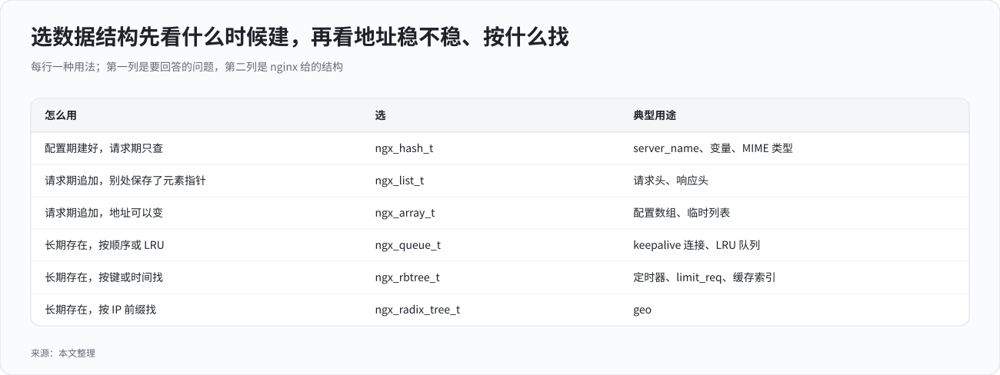
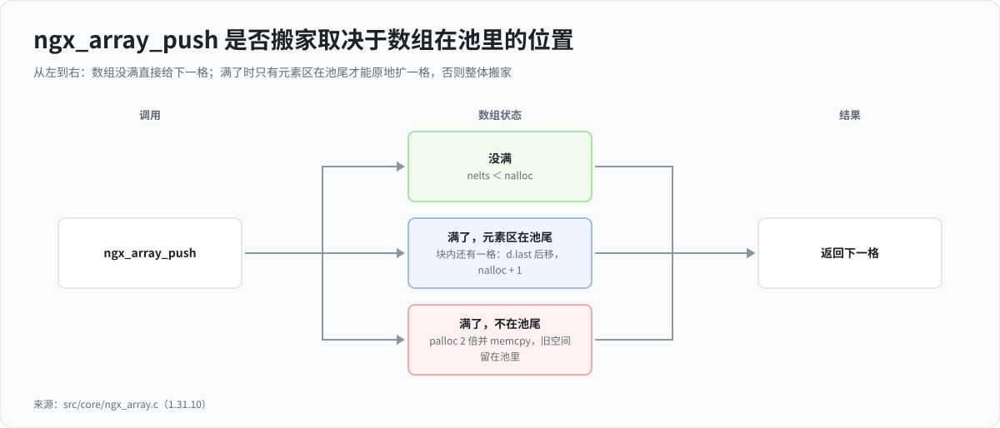
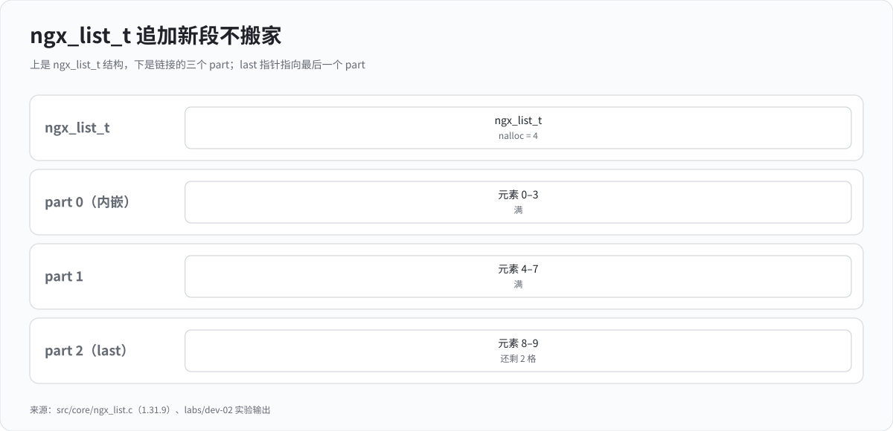
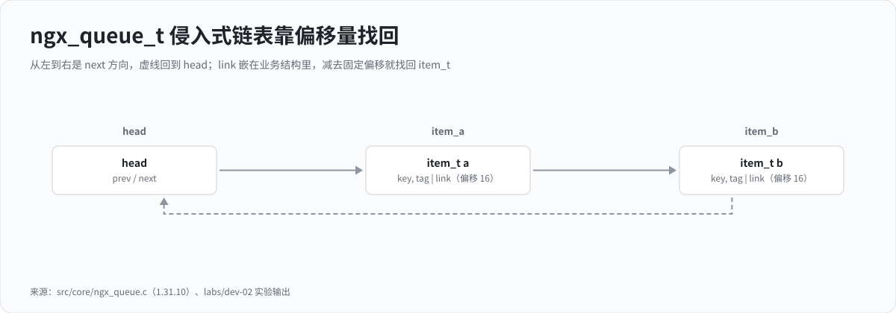
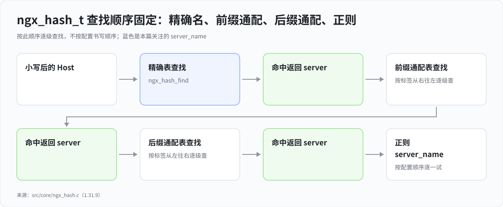
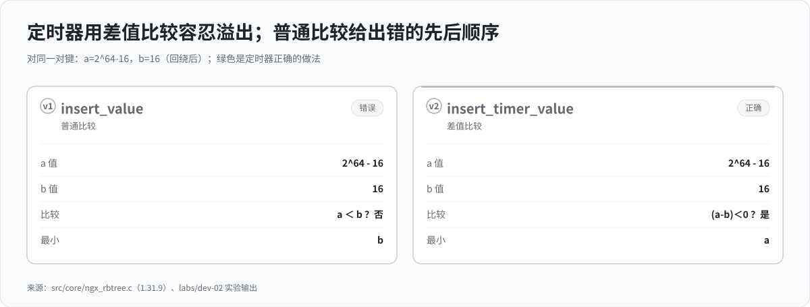
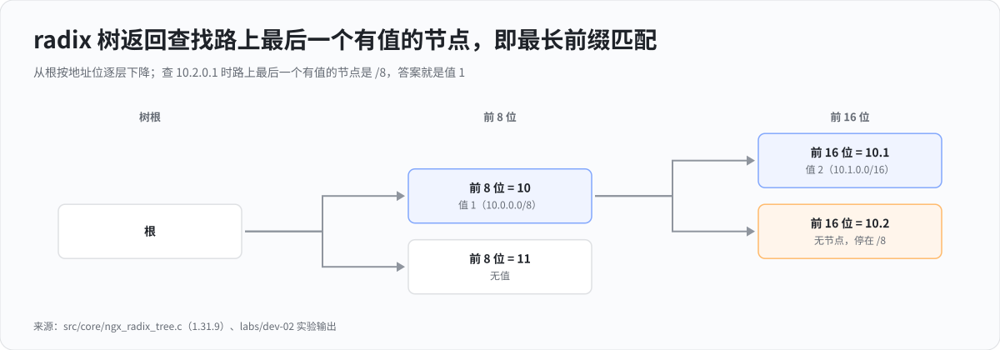

# 开发篇 02｜基础数据结构：每一种都为“配置期建好、请求期只读”或“从内存池分配、整体释放”而设计

> **一句话结论**：nginx 的基础结构都假定内存来自内存池、用完整池释放，所以它们几乎没有“删除元素”和“缩容”的接口。`ngx_str_t` 是长度加指针，切片不复制也不以 NUL 结尾；`ngx_array_t` 满了以后，若自己正好是池里最后一次分配就原地加一格，否则翻倍复制，旧内存不归还；`ngx_list_t` 只追加新段，元素地址永不变化，请求头和响应头都用它；`ngx_queue_t` 是嵌入业务结构的双链表，`ngx_queue_sort` 是稳定的归并排序；`ngx_hash_t` 在配置期一次建好、之后只读，桶的大小限制了单个键的长度，通配名按标签反转后存进另一张哈希，查找顺序是精确、前缀通配、后缀通配；`ngx_rbtree_t` 的节点嵌在业务结构里，键相等时往右放，定时器用的插入函数按有符号差值比较，所以计数器回绕也不会乱序；`ngx_radix_tree_t` 按位走到底，返回最后一个有值的节点，只有 geo 模块在用。
>
> 适用版本：nginx 1.31.9（mainline，2026-11-18）。本篇涉及的 `src/core` 文件（`ngx_string.h`、`ngx_array.*`、`ngx_list.*`、`ngx_queue.*`、`ngx_hash.*`、`ngx_rbtree.*`、`ngx_radix_tree.c`）在 1.30.7 和 1.31.9 之间逐字节相同，没有「版本差异」条目。实验：[`labs/dev-02`](../labs/dev-02/)。实验程序 `ds.c` 直接调用这些结构的 API，由 [`labs/ctest.sh`](../labs/ctest.sh) 链接到本仓库构建出的 nginx 目标文件上（除 `nginx.o` 外全部链接，`nginx.c` 重新编译并改名 `main`），所以测的就是 1.31.9 的实现，不是重写的模型。

## 导读

| 你想知道 | 看哪一节 |
|---|---|
| 为什么 nginx 的字符串到处是 `%V` 和 `len` | §1 |
| `ngx_array_push` 什么时候会搬家 | §2 |
| 请求头为什么用链表而不是数组 | §3 |
| 怎么在一个结构体里挂多个链表，排序稳不稳定 | §4 |
| `server_name` 太长为什么报 `server_names_hash_bucket_size`，通配名怎么查 | §5 |
| 定时器、限流、缓存为什么都用红黑树，定时器怎么处理回绕 | §6 |
| geo 模块的 CIDR 匹配 | §7 |
| 这些结构分别被多少地方用到 | §8 |

[开发篇 01](01-source-map.md) 讲了源码的分层和模块的组织，这一篇往下走一层，看所有模块共用的几种基础结构。它们有一个共同的前提：内存几乎都从 `ngx_pool_t` 分配（池的实现见开发篇 03），一个请求或一轮配置结束时整池释放。下图的判断是：选哪种结构，先看它的生命周期是“配置期建一次”还是“请求期随用随加”：



## 1. ngx_str_t 是长度加指针：切片不复制，也没有结尾的 NUL

```c
// src/core/ngx_string.h:16-19
typedef struct {
    size_t      len;
    u_char     *data;
} ngx_str_t;
```

```c
// src/core/ngx_string.h:40-41
#define ngx_string(str)     { sizeof(str) - 1, (u_char *) str }
#define ngx_null_string     { 0, NULL }
```

`ngx_string` 用 `sizeof - 1` 算长度，所以只能用于字面量。HTTP 解析器把请求行、请求头切成一个个 `ngx_str_t` 时，`data` 都指向读缓冲区里的原始字节，不复制，也不在末尾补 `\0`。实验把 `"Example.COM:8080"` 在冒号处切成两段，用 nginx 自己的 `ngx_snprintf` 的 `%V` 打印（`%V` 接受 `ngx_str_t *`），再用 `ngx_atoi` 按长度解析端口：

```text
# labs/dev-02 ## ngx_str_t
sizeof(ngx_str_t)=16, ngx_string("Example.COM:8080").len=16
name=[Example.COM] port=[8080] port as int=8080
ngx_strlow: example.com; the byte after name in the original: ':'
ok - 16 bytes (a length and a pointer); slices share the bytes, nothing is NUL-terminated
```

`name` 后面紧跟的字节是原字符串里的 `:`，不是 `\0`。所以 nginx 代码里几乎看不到 `strlen`、`strcmp`，对应的是 `ngx_strncmp(a, b, len)`、`ngx_strlow(dst, src, len)` 这类带长度的函数；把 `ngx_str_t` 的 `data` 直接传给要求 C 字符串的系统调用（如 `open`）之前，必须先复制一份并补 `\0`，`ngx_http_map_uri_to_path` 拼文件路径时就是这样做的。

**小结**：`ngx_str_t` 让解析几乎零复制，代价是每个使用者都要自己带着长度；读源码时看到 `.len` 和 `%V`，就知道这里是一段不以 NUL 结尾的切片。

## 2. ngx_array_t 在池尾时原地加一格，否则翻倍复制，旧空间不归还

```c
// src/core/ngx_array.h:16-22
typedef struct {
    void        *elts;
    ngx_uint_t   nelts;
    size_t       size;
    ngx_uint_t   nalloc;
    ngx_pool_t  *pool;
} ngx_array_t;
```

扩容逻辑全在 [`ngx_array_push`](https://github.com/nginx/nginx/blob/release-1.31.9/src/core/ngx_array.c#L48) 里：

```c
// src/core/ngx_array.c:47-91
void *
ngx_array_push(ngx_array_t *a)
{
    void        *elt, *new;
    size_t       size;
    ngx_pool_t  *p;

    if (a->nelts == a->nalloc) {

        /* the array is full */

        size = a->size * a->nalloc;

        p = a->pool;

        if ((u_char *) a->elts + size == p->d.last
            && p->d.last + a->size <= p->d.end)
        {
            /*
             * the array allocation is the last in the pool
             * and there is space for new allocation
             */

            p->d.last += a->size;
            a->nalloc++;

        } else {
            /* allocate a new array */

            new = ngx_palloc(p, 2 * size);
            if (new == NULL) {
                return NULL;
            }

            ngx_memcpy(new, a->elts, size);
            a->elts = new;
            a->nalloc *= 2;
        }
    }

    elt = (u_char *) a->elts + a->size * a->nelts;
    a->nelts++;

    return elt;
}
```

满了以后先看两个条件：元素区的末尾正好是池当前块的 `d.last`（数组是池里最后一次分配），并且块里还放得下一个元素。都满足就把 `d.last` 往后推一个元素、`nalloc` 加 1，不搬家；否则从池里分配两倍大小，`memcpy` 过去，旧空间留在池里，直到整池释放。实验建一个初始容量 2 的数组，先连推 5 个，再在池里插一次别的分配，接着推：

```text
# labs/dev-02 ## ngx_array_t grows in place, then doubles
push 0: nelts=1 nalloc=2 moved=no
push 1: nelts=2 nalloc=2 moved=no
push 2: nelts=3 nalloc=3 moved=no
push 3: nelts=4 nalloc=4 moved=no
push 4: nelts=5 nalloc=5 moved=no
push 5: nelts=6 nalloc=10 moved=yes
push 6: nelts=7 nalloc=10 moved=yes
ok - 2, 2, 3, 4, 5 in place; after another allocation 5 -> 10 with a copy
```

前 5 次都没有搬家，容量 2、2、3、4、5 地涨；中间插了一次 8 字节的分配后，数组不再是池尾，第 6 次推入翻倍到 10 并搬家。这带来两条使用规则：一是不要在 push 之后继续使用之前拿到的元素指针，搬家后它指向的是旧空间；二是一个请求里反复往数组里推大量元素、中间又穿插别的分配，会在池里留下多份旧副本，内存只在请求结束时回收。

下图是 push 时的判断顺序，判断是：是否搬家取决于数组在池里的位置，而不只是容量：



**小结**：`ngx_array_t` 适合“配置期一次性填好”或“元素少、生命周期短”的场景；需要长期保存元素地址时不要用它，用下一节的 `ngx_list_t`。

## 3. ngx_list_t 只追加新段：元素地址永不变化，请求头和响应头都存在这里

```c
// src/core/ngx_list.h:18-31
struct ngx_list_part_s {
    void             *elts;
    ngx_uint_t        nelts;
    ngx_list_part_t  *next;
};


typedef struct {
    ngx_list_part_t  *last;
    ngx_list_part_t   part;
    size_t            size;
    ngx_uint_t        nalloc;
    ngx_pool_t       *pool;
} ngx_list_t;
```

链表由若干段组成，每段固定 `nalloc` 个元素；[`ngx_list_push`](https://github.com/nginx/nginx/blob/release-1.31.9/src/core/ngx_list.c#L31) 在最后一段满了时新分配一段挂上，已有的元素从不移动：

```c
// src/core/ngx_list.c:31-63
ngx_list_push(ngx_list_t *l)
{
    void             *elt;
    ngx_list_part_t  *last;

    last = l->last;

    if (last->nelts == l->nalloc) {

        /* the last part is full, allocate a new list part */

        last = ngx_palloc(l->pool, sizeof(ngx_list_part_t));
        if (last == NULL) {
            return NULL;
        }

        last->elts = ngx_palloc(l->pool, l->nalloc * l->size);
        if (last->elts == NULL) {
            return NULL;
        }

        last->nelts = 0;
        last->next = NULL;

        l->last->next = last;
        l->last = last;
    }

    elt = (char *) last->elts + l->size * last->nelts;
    last->nelts++;

    return elt;
}
```

```text
# labs/dev-02 ## ngx_list_t adds parts and never moves elements
part 0: nelts=4 first=0
part 1: nelts=4 first=4
part 2: nelts=2 first=8
element 2 is still at the same address: yes
ok - 10 elements in parts of 4: 4 + 4 + 2
```

10 个元素、每段 4 个，分成 4、4、2 三段，第 3 个元素（下标 2）在全部推完之后地址没变。下图是这次实验结束时链表的形状，判断是：新元素只会进 `last` 指向的段，前面的段一旦写满就不再动：


这正是请求头选它的原因：`ngx_http_process_request_headers` 每解析出一行头，就往 `r->headers_in.headers`（每段 20 个）里推一个 `ngx_table_elt_t`，同时把 Host、Cookie 这类常用头的指针存进 `r->headers_in.host` 等字段；如果用数组，扩容搬家会让这些指针失效。代价是遍历要两层循环（先段后元素），按名字查找是线性的，所以常用头才要单独存指针。

```c
// src/http/ngx_http_request.c:1219-1222
            if (ngx_list_init(&r->headers_in.headers, r->pool, 20,
                              sizeof(ngx_table_elt_t))
                != NGX_OK)
            {
```

**小结**：`ngx_list_t` 用“遍历麻烦”换“地址稳定”；凡是别处会保存元素指针的集合，nginx 都用它。

## 4. ngx_queue_t 嵌在业务结构里；ngx_queue_sort 是稳定的归并排序

```c
// src/core/ngx_queue.h:16-21
typedef struct ngx_queue_s  ngx_queue_t;

struct ngx_queue_s {
    ngx_queue_t  *prev;
    ngx_queue_t  *next;
};
```

`ngx_queue_t` 只有两个指针，不带数据。用法是把它作为成员放进业务结构，再用 `ngx_queue_data` 按成员偏移量从链表节点倒推出外层结构：

```c
// src/core/ngx_queue.h:106-107
#define ngx_queue_data(q, type, link)                                         \
    (type *) ((u_char *) q - offsetof(type, link))
```

这种“侵入式”链表的好处是插入删除不需要额外分配，一个结构里放几个 `ngx_queue_t` 成员就能同时挂在几条链上（例如 limit_req 的节点同时在红黑树和 LRU 队列里，见[开发篇 08](08-limit-req.md)）。排序用 [`ngx_queue_sort`](https://github.com/nginx/nginx/blob/release-1.31.9/src/core/ngx_queue.c#L55)：找中点、拆成两半、递归排序、合并：

```c
// src/core/ngx_queue.c:54-106
void
ngx_queue_sort(ngx_queue_t *queue,
    ngx_int_t (*cmp)(const ngx_queue_t *, const ngx_queue_t *))
{
    ngx_queue_t  *q, tail;

    q = ngx_queue_head(queue);

    if (q == ngx_queue_last(queue)) {
        return;
    }

    q = ngx_queue_middle(queue);

    ngx_queue_split(queue, q, &tail);

    ngx_queue_sort(queue, cmp);
    ngx_queue_sort(&tail, cmp);

    ngx_queue_merge(queue, &tail, cmp);
}


static void
ngx_queue_merge(ngx_queue_t *queue, ngx_queue_t *tail,
    ngx_int_t (*cmp)(const ngx_queue_t *, const ngx_queue_t *))
{
    ngx_queue_t  *q1, *q2;

    q1 = ngx_queue_head(queue);
    q2 = ngx_queue_head(tail);

    for ( ;; ) {
        if (q1 == ngx_queue_sentinel(queue)) {
            ngx_queue_add(queue, tail);
            break;
        }

        if (q2 == ngx_queue_sentinel(tail)) {
            break;
        }

        if (cmp(q1, q2) <= 0) {
            q1 = ngx_queue_next(q1);
            continue;
        }

        ngx_queue_remove(q2);
        ngx_queue_insert_before(q1, q2);

        q2 = ngx_queue_head(tail);
    }
}
```

合并时 `cmp(q1, q2) <= 0` 就保留左边的元素，相等的键不会被右半边的元素插到前面，所以排序是稳定的。实验给 5 个元素打上键和插入顺序的标记：

```text
# labs/dev-02 ## ngx_queue_t and ngx_queue_sort
sorted: 1b 1e 2d 3a 3c
middle: 2d, offsetof(item_t, link)=16
ok - a stable merge sort: equal keys keep their insertion order
```

键为 1 的 `b` 和 `e`、键为 3 的 `a` 和 `c` 都保持了插入顺序。`offsetof(item_t, link)=16` 是 `ngx_queue_data` 每次要减掉的偏移。nginx 用 `ngx_queue_sort` 给 location 列表排序（`ngx_http_init_locations`），稳定性保证了同类 location 之间保持配置里的书写顺序，正则 location 按书写顺序匹配（见[运维篇 04](../ops/04-routing.md)）依赖的就是这一点。

下图是侵入式链表的内存布局，判断是：链表只连接成员，外层结构靠固定偏移量找回：



**小结**：`ngx_queue_t` 不分配内存、不拥有数据，适合 LRU、空闲连接池这类频繁摘挂的场景；需要排序时它是稳定的归并排序。

## 5. ngx_hash_t 在配置期一次建好：桶大小限制单个键的长度，通配名反转标签后另存一张表

`ngx_hash_t` 是一个桶数组，每个桶里连续存放若干个 `ngx_hash_elt_t`（值指针、2 字节长度、名字），以一个空指针结尾：

```c
// src/core/ngx_hash.h:16-26
typedef struct {
    void             *value;
    u_short           len;
    u_char            name[1];
} ngx_hash_elt_t;


typedef struct {
    ngx_hash_elt_t  **buckets;
    ngx_uint_t        size;
} ngx_hash_t;
```

它只在配置解析时由 [`ngx_hash_init`](https://github.com/nginx/nginx/blob/release-1.31.9/src/core/ngx_hash.c#L252) 建一次，之后只读，所以可以把元素紧凑地排在一起、不留增删的余地。每个元素占 `NGX_HASH_ELT_SIZE` 字节，建表前先检查每个键能否单独放进一个桶：

```c
// src/core/ngx_hash.c:248-289
#define NGX_HASH_ELT_SIZE(name)                                               \
    (sizeof(void *) + ngx_align((name)->key.len + 2, sizeof(void *)))

ngx_int_t
ngx_hash_init(ngx_hash_init_t *hinit, ngx_hash_key_t *names, ngx_uint_t nelts)
{
    u_char          *elts;
    size_t           len;
    u_short         *test;
    ngx_uint_t       i, n, key, size, start, bucket_size;
    ngx_hash_elt_t  *elt, **buckets;

    if (hinit->max_size == 0) {
        ngx_log_error(NGX_LOG_EMERG, hinit->pool->log, 0,
                      "could not build %s, you should "
                      "increase %s_max_size: %i",
                      hinit->name, hinit->name, hinit->max_size);
        return NGX_ERROR;
    }

    if (hinit->bucket_size > 65536 - ngx_cacheline_size) {
        ngx_log_error(NGX_LOG_EMERG, hinit->pool->log, 0,
                      "could not build %s, too large "
                      "%s_bucket_size: %i",
                      hinit->name, hinit->name, hinit->bucket_size);
        return NGX_ERROR;
    }

    for (n = 0; n < nelts; n++) {
        if (names[n].key.data == NULL) {
            continue;
        }

        if (hinit->bucket_size < NGX_HASH_ELT_SIZE(&names[n]) + sizeof(void *))
        {
            ngx_log_error(NGX_LOG_EMERG, hinit->pool->log, 0,
                          "could not build %s, you should "
                          "increase %s_bucket_size: %i",
                          hinit->name, hinit->name, hinit->bucket_size);
            return NGX_ERROR;
        }
    }
```

然后从一个估算的起点开始，逐个尝试桶数 `size`，找第一个让所有桶都放得下的值；试到 `max_size` 还找不到时只记一条 warn（`could not build optimal ...`），忽略桶大小继续建表，不算错误：

```c
// src/core/ngx_hash.c:296-345
    bucket_size = hinit->bucket_size - sizeof(void *);

    start = nelts / (bucket_size / (2 * sizeof(void *)));
    start = start ? start : 1;

    if (hinit->max_size > 10000 && nelts && hinit->max_size / nelts < 100) {
        start = hinit->max_size - 1000;
    }

    for (size = start; size <= hinit->max_size; size++) {

        ngx_memzero(test, size * sizeof(u_short));

        for (n = 0; n < nelts; n++) {
            if (names[n].key.data == NULL) {
                continue;
            }

            key = names[n].key_hash % size;
            len = test[key] + NGX_HASH_ELT_SIZE(&names[n]);

#if 0
            ngx_log_error(NGX_LOG_ALERT, hinit->pool->log, 0,
                          "%ui: %ui %uz \"%V\"",
                          size, key, len, &names[n].key);
#endif

            if (len > bucket_size) {
                goto next;
            }

            test[key] = (u_short) len;
        }

        goto found;

    next:

        continue;
    }

    size = hinit->max_size;

    ngx_log_error(NGX_LOG_WARN, hinit->pool->log, 0,
                  "could not build optimal %s, you should increase "
                  "either %s_max_size: %i or %s_bucket_size: %i; "
                  "ignoring %s_bucket_size",
                  hinit->name, hinit->name, hinit->max_size,
                  hinit->name, hinit->bucket_size, hinit->name);

```

实验用 7 个名字建一张和 `server_name` 一样的组合哈希：4 个精确名、2 个前缀通配（`*.example.com`、`.example.org`）、1 个后缀通配（`www.example.*`），实验程序把桶大小设成 64 字节：

```text
# labs/dev-02 ## ngx_hash_t: exact names and wildcards
exact keys: 4, head wildcards: 2, tail wildcards: 1
head key stored as "com.example."
head key stored as "org.example"
tail key stored as "www.example"
exact hash: bucket_size=64, size=3
  example.com          key_hash=86041043537016573 bucket=0 elt_size=24
  www.example.com      key_hash=13179151057643344166 bucket=2 elt_size=32
  api.example.com      key_hash=1893068368080376105 bucket=1 elt_size=32
  static.example.com   key_hash=5729247516191491965 bucket=0 elt_size=32
find example.com            -> example.com
find www.example.com        -> www.example.com
find a.example.com          -> *.example.com
find a.b.example.com        -> *.example.com
find example.org            -> .example.org
find x.example.org          -> .example.org
find www.example.net        -> www.example.*
find EXAMPLE.com            -> not found
ok - the hash size matches the search in ngx_hash_init
ok - exact first, then *.name (any depth), .name (bare and any depth), name.*; no case folding on lookup
```

逐项看：

- **桶数**。起点是 `4 / ((64 - 8) / 16) = 1`；1 个桶时 4 个元素共 120 字节，超过 56；2 个桶时 `example.com`、`api.example.com`、`static.example.com` 的哈希值都是奇数，落进同一个桶，共 88 字节，仍然超；3 个桶时最满的桶 56 字节，正好放下。run.sh 用 Python 按同样的循环重算了一遍，结果一致。
- **通配名的存法**。[`ngx_hash_add_key`](https://github.com/nginx/nginx/blob/release-1.31.9/src/core/ngx_hash.c#L738) 把 `*.example.com` 的标签反转成 `com.example.`，末尾的点表示“只匹配子域”；`.example.org` 存成 `org.example`，没有末尾的点，表示裸域名和子域都匹配；后缀通配 `www.example.*` 去掉 `.*` 存进另一张表。它还会就地把键转成小写，所以实验程序要先复制一份可写的字符串，不能直接传字面量。
- **查找顺序**。[`ngx_hash_find_combined`](https://github.com/nginx/nginx/blob/release-1.31.9/src/core/ngx_hash.c#L211) 依次查精确表、前缀通配表、后缀通配表，先命中的为准；前缀通配表是逐级的：先用最后一个标签 `com` 查到下一级哈希，再用 `example` 查，查到的值的低两位编码了“是否允许裸域名”“是否还有下一级”，所以哈希里存的值指针必须 4 字节对齐。
- **大小写**。`EXAMPLE.com` 查不到，`ngx_hash_find` 逐字节比较，不做大小写转换；HTTP 在查 `server_name` 之前，由 `ngx_http_validate_host` 把 Host 转成小写。

前缀通配查找里关于低两位的注释原文如下：

```c
// src/core/ngx_hash.c:90-99
        /*
         * the 2 low bits of value have the special meaning:
         *     00 - value is data pointer for both "example.com"
         *          and "*.example.com";
         *     01 - value is data pointer for "*.example.com" only;
         *     10 - value is pointer to wildcard hash allowing
         *          both "example.com" and "*.example.com";
         *     11 - value is pointer to wildcard hash allowing
         *          "*.example.com" only.
         */
```

单个键能有多长，由桶大小决定：一个元素是 `8 + align(len + 2, 8)` 字节，桶里还要留 8 字节的结束标记。`server_names_hash_bucket_size` 的默认值是 `ngx_cacheline_size`，并且会向上对齐到它；这个值在运行时取自系统：Linux 上是 `sysconf(_SC_LEVEL1_DCACHE_LINESIZE)`，x86 上通常是 64，macOS 上是 `hw.cachelinesize`，本机（Apple Silicon）是 128。128 字节的桶满足 `8 + align(len + 2, 8) + 8 <= 128` 的最长名字是 110 字节：

```text
# labs/dev-02 ## server_names_hash_bucket_size limits the length of one name
name111-single: configuration file $LAB/conf/name111-single.conf test is successful
name110: configuration file $LAB/conf/name110.conf test is successful
name111: [emerg] could not build server_names_hash, you should increase server_names_hash_bucket_size: 128
ok - alone, any length passes; next to another server, 110 bytes fit a 128-byte bucket and 111 do not
```

第一行是一个反直觉的现象：同一个地址上只有一个 server 时，111 字节的名字也能通过。原因是 HTTP 只为“同一地址上不止一个 server”（或默认 server 的正则名带捕获）的情况建名字哈希，只有一个 server 时它就是默认 server，不需要查名字：

```c
// src/http/ngx_http.c:1564-1582
        /*
         * check whether all name-based servers have the same
         * configuration as a default server for given address:port
         */

        addr = port[p].addrs.elts;
        for (a = 0; a < port[p].addrs.nelts; a++) {

            if (addr[a].servers.nelts > 1
#if (NGX_PCRE)
                || addr[a].default_server->captures
#endif
               )
            {
                if (ngx_http_server_names(cf, cmcf, &addr[a]) != NGX_OK) {
                    return NGX_ERROR;
                }
            }
        }
```

所以“加了一个新 server 之后 `nginx -t` 突然报 `could not build server_names_hash`”是正常的，报错的往往是原来那个长名字，不是新加的。按 64 字节的桶算，最长是 46 字节；同一份配置从 Apple Silicon 的开发机搬到 x86 的 Linux 上，可能因此通不过 `nginx -t`。

下图是组合哈希的查找顺序，判断是：精确名永远优先，通配名按“前缀、后缀”的固定顺序，和配置里的书写顺序无关：



**小结**：`ngx_hash_t` 用“建表慢、只读”换“查找快、内存紧凑”；遇到 `could not build ... hash` 的 emerg，是某个键单独放不进一个桶，要调 `_bucket_size`；`could not build optimal` 的 warn 是桶数不够，调 `_max_size`。

## 6. ngx_rbtree_t 的节点嵌在业务结构里：相等的键往右放，定时器按差值比较

```c
// src/core/ngx_rbtree.h:16-41
typedef ngx_uint_t  ngx_rbtree_key_t;
typedef ngx_int_t   ngx_rbtree_key_int_t;


typedef struct ngx_rbtree_node_s  ngx_rbtree_node_t;

struct ngx_rbtree_node_s {
    ngx_rbtree_key_t       key;
    ngx_rbtree_node_t     *left;
    ngx_rbtree_node_t     *right;
    ngx_rbtree_node_t     *parent;
    u_char                 color;
    u_char                 data;
};


typedef struct ngx_rbtree_s  ngx_rbtree_t;

typedef void (*ngx_rbtree_insert_pt) (ngx_rbtree_node_t *root,
    ngx_rbtree_node_t *node, ngx_rbtree_node_t *sentinel);

struct ngx_rbtree_s {
    ngx_rbtree_node_t     *root;
    ngx_rbtree_node_t     *sentinel;
    ngx_rbtree_insert_pt   insert;
};
```

和 `ngx_queue_t` 一样，红黑树节点也嵌在业务结构里。定时器节点是 `ngx_event_t` 的 `timer` 成员，到期时用 `ngx_rbtree_data(node, ngx_event_t, timer)` 按偏移量倒推出事件；limit_req 更省，它的节点结构从 `color` 字段开始叠放（`(ngx_http_limit_req_node_t *) &node->color`），把节点末尾的 `color`、`data` 两个字节也用上。树本身只负责平衡，“往哪边插”由创建时传入的 `insert` 函数决定。通用的 `ngx_rbtree_insert_value` 只比较 `key`，相等时往右：

```c
// src/core/ngx_rbtree.c:96-119
void
ngx_rbtree_insert_value(ngx_rbtree_node_t *temp, ngx_rbtree_node_t *node,
    ngx_rbtree_node_t *sentinel)
{
    ngx_rbtree_node_t  **p;

    for ( ;; ) {

        p = (node->key < temp->key) ? &temp->left : &temp->right;

        if (*p == sentinel) {
            break;
        }

        temp = *p;
    }

    *p = node;
    node->parent = temp;
    node->left = sentinel;
    node->right = sentinel;
    ngx_rbt_red(node);
}

```

实验插入 10 个键（其中 20 出现 3 次），中序遍历后检查红黑树的规则：

```text
# labs/dev-02 ## ngx_rbtree_t
in order: 10e 20b 20d 20h 30j 50a 60f 70c 80g 90i
root is black: yes, red nodes with a red child or unequal black heights: 0, black height: 3
ok - sorted in order, equal keys in insertion order, the red-black rules hold
```

三个 20 按插入顺序 `b`、`d`、`h` 排列：相等的键总往右插，旋转又不改变中序顺序，所以中序遍历保留了插入顺序。根是黑色、没有红节点带红孩子、每条路径的黑节点数相同（3），说明插入后的旋转和变色符合红黑树的定义。需要按字符串查找的模块（limit_req、缓存、resolver）用自己的 insert 函数：`key` 存字符串的哈希值，哈希相等时再比较字符串本身。

定时器树用的是另一个插入函数，比较的是有符号差值：

```c
// src/core/ngx_rbtree.c:122-153
ngx_rbtree_insert_timer_value(ngx_rbtree_node_t *temp, ngx_rbtree_node_t *node,
    ngx_rbtree_node_t *sentinel)
{
    ngx_rbtree_node_t  **p;

    for ( ;; ) {

        /*
         * Timer values
         * 1) are spread in small range, usually several minutes,
         * 2) and overflow each 49 days, if milliseconds are stored in 32 bits.
         * The comparison takes into account that overflow.
         */

        /*  node->key < temp->key */

        p = ((ngx_rbtree_key_int_t) (node->key - temp->key) < 0)
            ? &temp->left : &temp->right;

        if (*p == sentinel) {
            break;
        }

        temp = *p;
    }

    *p = node;
    node->parent = temp;
    node->left = sentinel;
    node->right = sentinel;
    ngx_rbt_red(node);
}
```

注释说得很清楚：定时器的值集中在几分钟的范围内，用差值比较可以容忍计数器溢出。下图是两种比较对同一对键的判断，判断是：差值比较只看两个键离得多近，不看绝对大小：



实验插入两个键，一个在 2^64 回绕前 16，一个在回绕后 16：

```text
# labs/dev-02 ## the timer tree survives a wrap-around
insert_value:       min is b (16)
insert_timer_value: min is a (2^64-16)
ok - insert_timer_value compares signed differences
```

普通比较认为 16 更小；差值比较算出 a - b = -32，认为回绕前的那个先到期，后者才是定时器需要的语义。64 位平台上毫秒计数回绕一次要约 5.8 亿年（2^64 毫秒），这段代码主要是为 32 位平台准备的，注释里的 49 天就是 2^32 毫秒。

**小结**：红黑树在 nginx 里是“带自定义比较的有序索引”：定时器按到期时间、限流按 key 的哈希、缓存按键的 MD5；读到一个新模块的 rbtree，先找它的 insert 函数，就知道它按什么排序。

## 7. ngx_radix_tree_t 按位走到底，返回最后一个有值的节点

基数树按 IP 地址的二进制位从高到低分叉，每个节点可能带一个值。[`ngx_radix32tree_find`](https://github.com/nginx/nginx/blob/release-1.31.9/src/core/ngx_radix_tree.c#L237) 一路往下走，记住经过的最后一个有值的节点，这就是最长前缀匹配：

```c
// src/core/ngx_radix_tree.c:236-263
uintptr_t
ngx_radix32tree_find(ngx_radix_tree_t *tree, uint32_t key)
{
    uint32_t           bit;
    uintptr_t          value;
    ngx_radix_node_t  *node;

    bit = 0x80000000;
    value = NGX_RADIX_NO_VALUE;
    node = tree->root;

    while (node) {
        if (node->value != NGX_RADIX_NO_VALUE) {
            value = node->value;
        }

        if (key & bit) {
            node = node->right;

        } else {
            node = node->left;
        }

        bit >>= 1;
    }

    return value;
}
```

实验插入 `10.0.0.0/8 → 1` 和 `10.1.0.0/16 → 2`，再重复插入一次 `10.0.0.0/8`：

```text
# labs/dev-02 ## ngx_radix_tree_t
insert 10.0.0.0/8 again: NGX_BUSY
find 10.1.2.3      -> 2
find 10.2.0.1      -> 1
find 11.0.0.1      -> no value
find 10.1.255.255  -> 2
ok - longest prefix wins; an existing prefix is not replaced
```

下图是两次插入之后树上的路径，判断是：查找沿地址位一直走到底，答案是路上最后一个有值的节点，而不是第一个：



`10.1.x.x` 都走到 /16 的节点，取到 2；`10.2.0.1` 只经过 /8 的节点，取到 1；`11.0.0.1` 一路没有遇到有值的节点。重复插入同一个前缀返回 `NGX_BUSY`，不覆盖原值；geo 模块收到 `NGX_BUSY` 后记一条 warn（`duplicate network ..., old value: ...`），删掉旧节点再插入新值，所以配置里同一网段写两次，后写的生效。查找最多走 32 步（IPv6 是 128 步），步数和条目数量无关。

**小结**：基数树只做一件事：IP 前缀的最长匹配；它的查找步数只取决于地址位数。

## 8. 用量：数组最多，基数树只有 geo 在用

最后数一下每种结构的核心函数在源码里被多少个文件调用：

```text
# labs/dev-02 ## where each structure is used
ngx_array_push            88 files
ngx_list_push             31 files
ngx_queue_insert_tail     13 files
ngx_hash_find             17 files
ngx_rbtree_insert         19 files
ngx_radix32tree_find       4 files
radix tree users: http/modules/ngx_http_geo_module.c stream/ngx_stream_geo_module.c 
ok - the radix tree is used only by the geo modules
```

`ngx_array_push` 出现在 88 个文件里，几乎每个模块解析配置时都会用到；`ngx_list_push` 主要出现在构造请求头、响应头的地方；`ngx_hash_find` 的 17 个文件对应变量、请求头处理函数表、MIME 类型、各代理模块的 `hide_headers` 表这些“配置期建表、请求期查表”的场景（`server_name` 和 `map` 走 `ngx_hash_find_combined`，不在这 17 个里）；红黑树的 19 个文件里有定时器、resolver、`open_file_cache`、limit_req、limit_conn、proxy 缓存、sticky、SSL 会话缓存、UDP 会话和 QUIC；基数树只有 HTTP 和 stream 的 geo 模块。

| 结构 | 增长方式 | 删除 | 典型用户 |
|---|---|---|---|
| `ngx_str_t` | 不增长，切片 | 无 | 所有解析出来的字段 |
| `ngx_array_t` | 池尾原地 +1，否则翻倍复制 | 无 | 配置里的指令数组、location 列表 |
| `ngx_list_t` | 追加新段 | 无（只能整表丢弃） | `headers_in.headers`、`headers_out.headers` |
| `ngx_queue_t` | 不分配，挂在业务结构上 | O(1) 摘除 | keepalive 连接池、各类 LRU |
| `ngx_hash_t` | 配置期一次建好 | 无 | `server_name`、变量、`types`、`map` |
| `ngx_rbtree_t` | 不分配，节点嵌在业务结构里 | O(log n) | 定时器、limit_req、缓存索引 |
| `ngx_radix_tree_t` | 按位分配节点 | 有 | geo |

**小结**：str、array、list、hash 没有删除单个元素的接口，它们活在池里，随池整体释放；queue 和 rbtree 自己不分配内存，节点的内存由使用者管理，跨进程共享的那些（limit_req、缓存索引）来自共享内存的 slab；radix 把删掉的节点挂到自己的空闲链表上复用。下一篇讲池和 slab。

## 已知局限与待核实

- 实验程序把 `ngx_cacheline_size` 设成编译期的 `NGX_CPU_CACHE_LINE`（64），所以 §5 的组合哈希用的是 64 字节的桶；nginx 进程本身在 macOS 上取 `hw.cachelinesize`（128），这两个值不同是有意的，用来同时演示两种桶大小。
- §5 中 Linux x86 上默认桶为 64 字节、最长名字 46 字节，是按 `ngx_posix_init.c` 的代码和公式推出的，没有在 Linux 上跑 `nginx -t`。
- `ngx_hash_find_wc_tail`、多级前缀通配（如 `*.a.example.com` 与 `*.example.com` 同时存在）的查找只读了源码，实验只覆盖了一级。
- 红黑树只验证了插入；`ngx_rbtree_delete` 的旋转没有实验。基数树的 IPv6 版本（`ngx_radix128tree_*`）和删除没有实验。
- §8 的数字是对 `src/` 下 `.c` 和 `.h` 文件的 `grep -l`，包括定义这些函数的文件本身，只表示量级。

## 修订记录

- 2026-11-21：基于 nginx 1.31.9 源码新写，替代 2018 年版 `dev/03.md`（基本数据类型与 buf/chain；buf/chain 移到开发篇 03）。覆盖 `ngx_str_t`、`ngx_array_t` 的原地扩容与翻倍、`ngx_list_t` 的分段、`ngx_queue_t` 与稳定归并排序、`ngx_hash_t` 的建表、通配名存储与桶大小限制、`ngx_rbtree_t` 的插入函数与定时器比较、`ngx_radix_tree_t` 的最长前缀匹配；实验程序 `labs/dev-02/ds.c` 链接 1.31.9 的目标文件直接调用这些 API。
