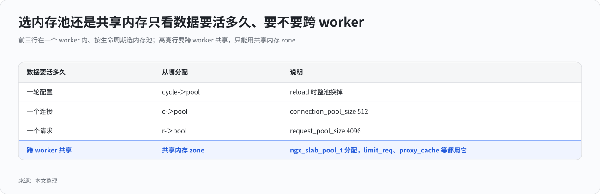
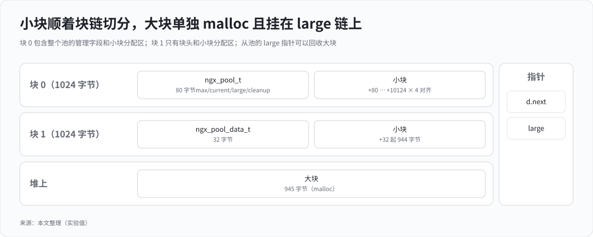
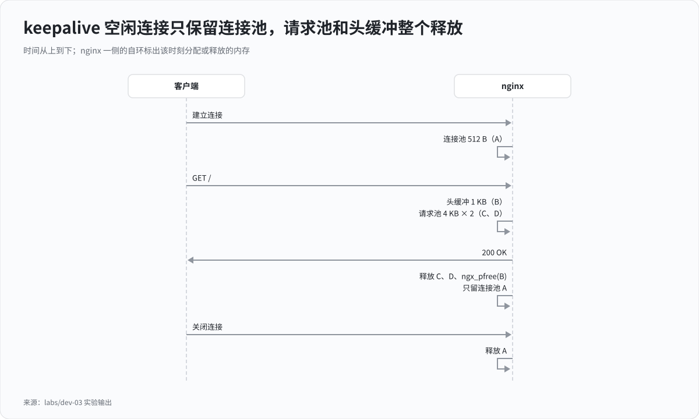
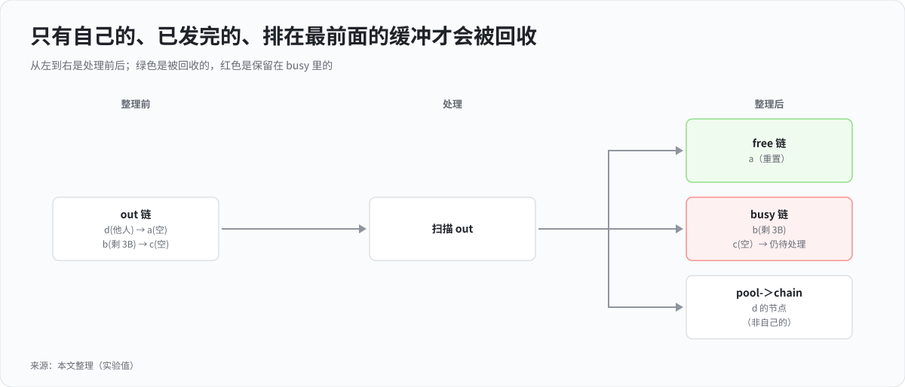
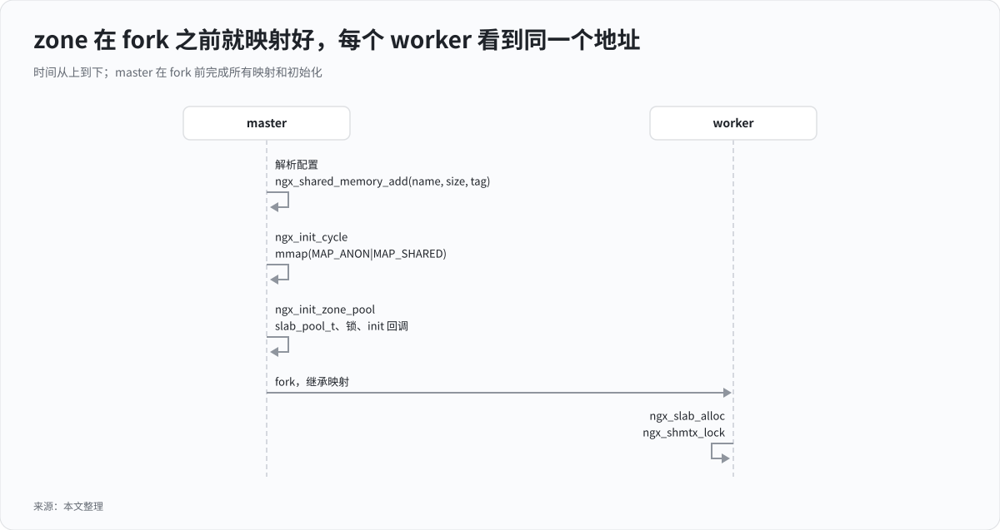
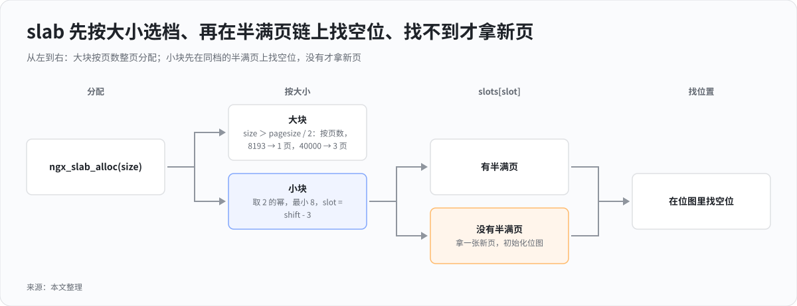
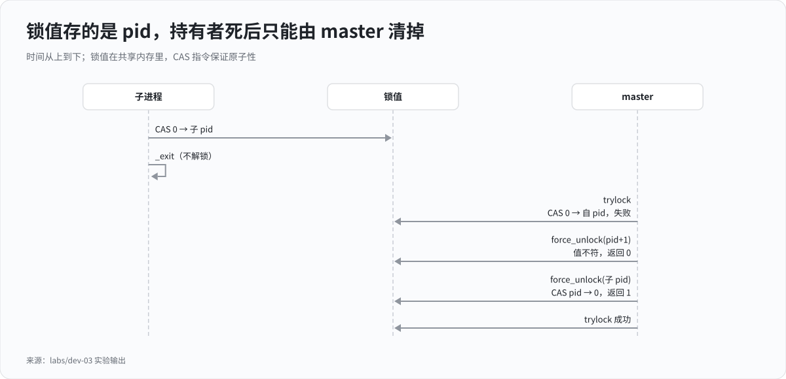

# 开发篇 03｜内存池、缓冲区与共享内存：请求内存随池一起释放，跨进程状态放进 slab 管理的共享内存

> **一句话结论**：nginx 的内存分两类，生命周期不同，管理方式也不同。第一类跟着连接、请求或一轮配置走，从 `ngx_pool_t` 分配，用完整池释放：小块在池的块链上顺序切分，不能单独归还；超过 `max` 的大块直接 `malloc`，挂在 `large` 链上，可以用 `ngx_pfree` 提前还；一个块累计 5 次以上没能满足分配，`current` 就跳过它。一个默认配置下的请求用 512 字节的连接池和 4096 字节的请求池，本机实验里请求池长到了两块。`ngx_buf_t` 只描述一段数据在内存或文件里的位置，过滤器靠 `tag` 和 `ngx_chain_update_chains` 回收自己的缓冲。第二类是跨进程的状态（限流计数、缓存索引、SSL 会话），放在 master 启动时映射好的共享内存 zone 里，由 slab 分配器按 2 的幂分档；分档的边界取决于页大小，本机 16 KB 页上 256 字节以内按位图切分，8 KB 以上整页分配。zone 用名字标识，同名必须同模块、同大小。zone 的锁是一个存着持有者 pid 的整数，worker 异常退出时 master 用这个 pid 替它解锁。
>
> 适用版本：nginx 1.31.10（mainline，2026-11-23）。本篇涉及的 `ngx_palloc.*`、`ngx_buf.*`、`ngx_slab.*`、`ngx_shmtx.*`、`os/unix/ngx_shmem.c` 在 1.30.8 和 1.31.10 之间逐字节相同；`ngx_cycle.c` 只有 `conf_param` 复制的一处改动，和共享内存无关，没有「版本差异」条目。实验：[`labs/dev-03`](../labs/dev-03/)。前七步由 `mem.c` 直接调用这些 API，和[开发篇 02](02-data-structures.md) 一样通过 [`labs/ctest.sh`](../labs/ctest.sh) 链接到本仓库构建出的 nginx 目标文件上；后两步用 nginx 本身的 debug 日志和 `nginx -t`。实验机是 macOS arm64：页大小 16 KB，`NGX_ALIGNMENT` 是 16，文中凡是和这两个值有关的数字都只适用于本机，Linux x86-64 上的对应值是按源码推算的。

## 导读

| 你想知道 | 看哪一节 |
|---|---|
| `ngx_palloc` 和 `ngx_pnalloc` 的区别，内存池怎么扩 | §1、§2 |
| `ngx_pfree` 能释放什么，cleanup 什么时候执行 | §3 |
| 一个请求到底用了多少内存，keepalive 空闲时还占多少 | §4 |
| `ngx_buf_t` 的那一堆标志位 | §5 |
| 过滤器怎么复用缓冲区 | §6 |
| `limit_req_zone` 这类 zone 是怎么建出来的，为什么会报 “already declared” | §7 |
| zone 里一个 84 字节的节点实际占多少 | §8 |
| worker 崩溃时持有的锁怎么办 | §9 |

[开发篇 02](02-data-structures.md) 的数组、链表、哈希都从内存池分配，并且都没有删除接口，因为池只能整体释放。这一篇讲池本身，以及池管不了的那部分：多个 worker 要共享的状态。下图是两类内存的分工，判断是：选哪一种只看数据要活多久、要不要跨进程：



## 1. ngx_pool_t 只在销毁时整体释放：小块顺着块链切分，大块单独 malloc

池由若干个等大的块串成，第一个块的头部除了 `ngx_pool_data_t`，还带着整个池的管理字段：

```c
// src/core/ngx_palloc.h:48-65

typedef struct {
    u_char               *last;
    u_char               *end;
    ngx_pool_t           *next;
    ngx_uint_t            failed;
} ngx_pool_data_t;


struct ngx_pool_s {
    ngx_pool_data_t       d;
    size_t                max;
    ngx_pool_t           *current;
    ngx_chain_t          *chain;
    ngx_pool_large_t     *large;
    ngx_pool_cleanup_t   *cleanup;
    ngx_log_t            *log;
};
```

`max` 是“小块”的上限，[`ngx_create_pool`](https://github.com/nginx/nginx/blob/release-1.31.10/src/core/ngx_palloc.c#L19) 把它设成块大小减去头部，再和 `NGX_MAX_ALLOC_FROM_POOL`（`ngx_pagesize - 1`）取小：

```c
// src/core/ngx_palloc.c:18-43
ngx_pool_t *
ngx_create_pool(size_t size, ngx_log_t *log)
{
    ngx_pool_t  *p;

    p = ngx_memalign(NGX_POOL_ALIGNMENT, size, log);
    if (p == NULL) {
        return NULL;
    }

    p->d.last = (u_char *) p + sizeof(ngx_pool_t);
    p->d.end = (u_char *) p + size;
    p->d.next = NULL;
    p->d.failed = 0;

    size = size - sizeof(ngx_pool_t);
    p->max = (size < NGX_MAX_ALLOC_FROM_POOL) ? size : NGX_MAX_ALLOC_FROM_POOL;

    p->current = p;
    p->chain = NULL;
    p->large = NULL;
    p->cleanup = NULL;
    p->log = log;

    return p;
}
```

分配只看大小：不超过 `max` 走 `ngx_palloc_small`，从 `current` 指向的块开始，在每个块的 `d.last` 处切一段；超过就走 `ngx_palloc_large`。`ngx_palloc` 先把 `d.last` 对齐到 `NGX_ALIGNMENT`，`ngx_pnalloc` 不对齐，用于字符串这类不需要对齐的数据：

```c
// src/core/ngx_palloc.c:148-174
static ngx_inline void *
ngx_palloc_small(ngx_pool_t *pool, size_t size, ngx_uint_t align)
{
    u_char      *m;
    ngx_pool_t  *p;

    p = pool->current;

    do {
        m = p->d.last;

        if (align) {
            m = ngx_align_ptr(m, NGX_ALIGNMENT);
        }

        if ((size_t) (p->d.end - m) >= size) {
            p->d.last = m + size;

            return m;
        }

        p = p->d.next;

    } while (p);

    return ngx_palloc_block(pool, size);
}
```

实验建一个 1024 字节的池，依次做几次分配：

```text
# labs/dev-03 ## ngx_pool_t: small allocations, a new block, large allocations
sizeof(ngx_pool_t)=80, sizeof(ngx_pool_data_t)=32, ngx_pagesize=16384
ngx_create_pool(1024): max=944 (1024 - sizeof(ngx_pool_t))
ngx_palloc(1) at +80, ngx_palloc(1) at +96, ngx_pnalloc(1) at +97, ngx_pnalloc(1) at +98
ngx_palloc(900): blocks=1, at +112
ngx_palloc(944) (= max): blocks=2, at +32 in the new block, from the heap: no
ngx_palloc(945) (> max): blocks=2, from the heap: yes
ngx_pfree(945-byte block)=NGX_OK, ngx_pfree(small)=NGX_DECLINED
ok - palloc aligns to NGX_ALIGNMENT (16 here), pnalloc does not; a new block keeps only ngx_pool_data_t (32 bytes); above max goes to malloc
```

逐行看：

- `ngx_pool_t` 占 80 字节，所以 `max = 1024 - 80 = 944`，第一次分配从 +80 开始。
- 第二次 `ngx_palloc(1)` 在 +96，不是 +81：本机 `NGX_ALIGNMENT` 是 16。`ngx_config.h` 里的默认值是 `sizeof(uintptr_t)`（8），但 `auto/os/conf` 为 aarch64/arm64 定义了 16，x86-64 上没有这一项，仍是 8。两次 `ngx_pnalloc(1)` 紧挨着落在 +97、+98。
- 900 字节对齐到 +112 后仍放得下（112 + 900 = 1012），没有新块；944 字节放不下，池新建第二块，分配从新块的 +32 开始：新块只有 32 字节的 `ngx_pool_data_t`，没有第一块的管理字段。
- 945 字节超过 `max`，直接从堆上分配；`ngx_pfree` 能释放它，释放不了小块。

`max` 的上限 `ngx_pagesize - 1` 让同一个池在不同机器上的行为不同。`NGX_DEFAULT_POOL_SIZE` 是 16 KB，用它建的池在 4 KB 页的 Linux 上，超过 4095 字节就算大块；在本机 16 KB 页上，上限是 16384 - 80 = 16304 字节。

下图是实验结束时池的样子，判断是：小块只能随块整体释放，大块各自独立，可以提前还：



**小结**：内存池用“不能单独释放小块”换来了极快的分配（移动一个指针）和不会泄漏（整池一起还）；写模块时，生命周期等于请求的东西从 `r->pool` 分配，不用操心释放。

## 2. 新块的大小和第一块相同；一个块失败超过 4 次，current 就跳过它

[`ngx_palloc_block`](https://github.com/nginx/nginx/blob/release-1.31.10/src/core/ngx_palloc.c#L178) 新建的块和第一块一样大，挂到链尾。它还顺带给从 `current` 到链尾的每个块的 `failed` 加 1，某个块的 `failed` 已经大于 4 时，把 `current` 移到它后面：

```c
// src/core/ngx_palloc.c:177-210
static void *
ngx_palloc_block(ngx_pool_t *pool, size_t size)
{
    u_char      *m;
    size_t       psize;
    ngx_pool_t  *p, *new;

    psize = (size_t) (pool->d.end - (u_char *) pool);

    m = ngx_memalign(NGX_POOL_ALIGNMENT, psize, pool->log);
    if (m == NULL) {
        return NULL;
    }

    new = (ngx_pool_t *) m;

    new->d.end = m + psize;
    new->d.next = NULL;
    new->d.failed = 0;

    m += sizeof(ngx_pool_data_t);
    m = ngx_align_ptr(m, NGX_ALIGNMENT);
    new->d.last = m + size;

    for (p = pool->current; p->d.next; p = p->d.next) {
        if (p->d.failed++ > 4) {
            pool->current = p->d.next;
        }
    }

    p->d.next = new;

    return m;
}
```

这样，一个快满的块不会每次都被重新检查一遍。实验每次分配 600 字节，1024 字节的块只放得下一个，所以每次分配都要建新块：

```text
# labs/dev-03 ## pool->current moves past a block that failed more than 4 times
ngx_palloc(600) #1  blocks=1  current=block 0, block 0 failed=0
ngx_palloc(600) #2  blocks=2  current=block 0, block 0 failed=0
ngx_palloc(600) #3  blocks=3  current=block 0, block 0 failed=1
ngx_palloc(600) #4  blocks=4  current=block 0, block 0 failed=2
ngx_palloc(600) #5  blocks=5  current=block 0, block 0 failed=3
ngx_palloc(600) #6  blocks=6  current=block 0, block 0 failed=4
ngx_palloc(600) #7  blocks=7  current=block 0, block 0 failed=5
ngx_palloc(600) #8  blocks=8  current=block 1, block 0 failed=6
ngx_palloc(600) #9  blocks=9  current=block 2, block 0 failed=6
ngx_palloc(600) #10 blocks=10 current=block 3, block 0 failed=6
ok - current leaves block 0 at the 8th 600-byte allocation, then moves one block per allocation
```

块 0 从第 3 次分配开始每次失败一次（第 2 次分配时链上只有块 0，循环没有执行）；第 7 次分配后 `failed` 到 5，第 8 次分配时 `5 > 4` 成立，`current` 移到块 1。此后每个块都已经失败过 5 次以上，`current` 每次分配前进一块。被跳过的块里剩下的空间不会再被使用，直到池销毁。

**小结**：`failed` 计数让小块分配的查找长度有上限，代价是被跳过的块里的剩余空间浪费掉；块要失败 6 次才会被跳过，§4 里一个简单请求的请求池只有两块，碰不到这个机制。

## 3. ngx_pfree 只释放大块；cleanup 在销毁时倒序执行

大块的管理节点本身是从池里分配的小块。[`ngx_palloc_large`](https://github.com/nginx/nginx/blob/release-1.31.10/src/core/ngx_palloc.c#L214) 先在 `large` 链上找一个 `alloc` 为空的节点复用，但最多只看前 5 个：

```c
// src/core/ngx_palloc.c:213-249
static void *
ngx_palloc_large(ngx_pool_t *pool, size_t size)
{
    void              *p;
    ngx_uint_t         n;
    ngx_pool_large_t  *large;

    p = ngx_alloc(size, pool->log);
    if (p == NULL) {
        return NULL;
    }

    n = 0;

    for (large = pool->large; large; large = large->next) {
        if (large->alloc == NULL) {
            large->alloc = p;
            return p;
        }

        if (n++ > 3) {
            break;
        }
    }

    large = ngx_palloc_small(pool, sizeof(ngx_pool_large_t), 1);
    if (large == NULL) {
        ngx_free(p);
        return NULL;
    }

    large->alloc = p;
    large->next = pool->large;
    pool->large = large;

    return p;
}
```

新节点插在链头，所以链上是“最新的在前”。实验分配 6 个大块，分别释放最旧和最新的一个，再分配：

```text
# labs/dev-03 ## large allocations: ngx_pfree only helps near the head of the list
6 large allocations: 6 list nodes (the newest first)
free the oldest (6th on the list), allocate again: 7 nodes
free the newest (1st on the list), allocate again: 7 nodes
ok - a freed slot is reused only within the first 5 list nodes (n++ > 3)
```

释放最旧的那个（链上第 6 个）之后再分配，扫描在第 5 个节点停下，没看到空位，又建了第 7 个节点；释放最新的那个，空位在链头，被直接复用。`ngx_pfree` 主要用在 keepalive 连接上（§4），那里的大块数量很少，这个上限不会碰到。

池销毁时，[`ngx_destroy_pool`](https://github.com/nginx/nginx/blob/release-1.31.10/src/core/ngx_palloc.c#L47) 先执行 cleanup 链，再释放大块，最后释放所有块。`ngx_pool_cleanup_add` 把新的 cleanup 插在链头：

```text
# labs/dev-03 ## cleanup handlers run in reverse order
add cleanup a
add cleanup b
add cleanup c
cleanup c
cleanup b
cleanup a
ok - LIFO
```

先注册的后执行，和 C++ 析构的顺序一样：后创建的资源可能依赖先创建的资源，先清理后者是安全的。nginx 用 cleanup 关闭池生命周期内打开的文件（`ngx_pool_cleanup_file`）、删除临时文件（`ngx_pool_delete_file`），配置池上还挂着释放 SSL 上下文这类全局资源的 cleanup；`src/` 下有 50 处调用 `ngx_pool_cleanup_add`（§7 末尾实验的统计）。

**小结**：要在请求结束时释放池外资源（文件描述符、第三方库的句柄），就注册一个 cleanup；不要指望 `ngx_pfree`，它只认大块。

## 4. 一个请求用两个池：连接池 512 字节，请求池 4096 字节；keepalive 时先还请求池和头缓冲

连接建立时，`ngx_event_accept` 用 `listen` 的 `pool_size`（即 `connection_pool_size`）建连接池；请求开始时，[`ngx_http_alloc_request`](https://github.com/nginx/nginx/blob/release-1.31.10/src/http/ngx_http_request.c#L571) 用 `request_pool_size` 建请求池。两者的默认值：

```c
// src/http/ngx_http_core_module.c:3622-3625
    ngx_conf_merge_size_value(conf->connection_pool_size,
                              prev->connection_pool_size, 64 * sizeof(void *));
    ngx_conf_merge_size_value(conf->request_pool_size,
                              prev->request_pool_size, 4096);
```

`64 * sizeof(void *)` 在 64 位上是 512。实验打开 debug 日志，发一个请求，把日志里的分配和释放行挑出来（地址按出现顺序换成 A、B、C）：

```text
# labs/dev-03 ## the pools of one request
posix_memalign: A:512 @16
accept
malloc: B:1024
posix_memalign: C:4096 @16
posix_memalign: D:4096 @16
set http keepalive handler
free: C, unused: 0
free: D, unused: 2816
free: B
close http connection
free: NULL
free: A, unused: 64
ok - a 512-byte connection pool, the 1024-byte header buffer from malloc, a 4096-byte request pool
with request_pool_size 16k:
posix_memalign: A:512 @16
accept
malloc: B:1024
posix_memalign: C:16384 @16
set http keepalive handler
free: C, unused: 11040
free: B
close http connection
free: NULL
free: A, unused: 64
ok - with request_pool_size 16k the request needs one block
```

按时间顺序：

1. `posix_memalign: A:512`：accept 时建连接池，此时连接还没有自己的 log，所以这一行没有 `*1` 前缀。
2. `malloc: B:1024`：读请求头的缓冲区，大小是 `client_header_buffer_size` 的默认值 1k。连接池的 `max` 是 512 - 80 = 432，1024 字节是大块，直接 `malloc`。
3. 两次 `posix_memalign: …:4096`：请求池，一块不够，又长了一块。
4. 响应发完，进入 keepalive：请求池的两块被释放（第二块还剩 2816 字节没用），头缓冲 B 被 `ngx_pfree` 提前还掉。
5. 客户端关闭连接后，连接池释放，`free: NULL` 是 B 原来所在的 `large` 节点，`alloc` 已被置空。

第 4 步是 `ngx_http_set_keepalive` 有意做的，空闲的 keepalive 连接只保留连接池：

```c
// src/http/ngx_http_request.c:3463-3484
    /*
     * To keep a memory footprint as small as possible for an idle keepalive
     * connection we try to free c->buffer's memory if it was allocated outside
     * the c->pool.  The large header buffers are always allocated outside the
     * c->pool and are freed too.
     */

    b = c->buffer;

    if (ngx_pfree(c->pool, b->start) == NGX_OK) {

        /*
         * the special note for ngx_http_keepalive_handler() that
         * c->buffer's memory was freed
         */

        b->pos = NULL;

    } else {
        b->pos = b->start;
        b->last = b->start;
    }
```

同一个请求发到 `request_pool_size 16k` 的 server 上，请求池只要一块，剩 11040 字节。两次结果能互相印证：16384 - 80 - 11040 = 5264，4096 字节的池里两块合计用掉 (4096 - 80) + (4096 - 32 - 2816) = 5264，都是 5264 字节。也就是说，一个 `return 200` 的请求在本机用了约 5 KB 的请求池（包括 `ngx_http_request_t` 本身、每个模块的 ctx 指针数组和变量数组）。

下图是这个连接上的内存时间线，判断是：空闲 keepalive 连接的内存只剩连接池那 512 字节：



**小结**：每个活跃请求的内存成本大约是“请求池用量 + 头缓冲 + body 缓冲”，空闲 keepalive 连接只占连接池；调大 `request_pool_size` 能减少块数，但对总用量影响不大。

## 5. ngx_buf_t 描述一段数据在哪里，而不拥有这段数据

```c
// src/core/ngx_buf.h:20-56
struct ngx_buf_s {
    u_char          *pos;
    u_char          *last;
    off_t            file_pos;
    off_t            file_last;

    u_char          *start;         /* start of buffer */
    u_char          *end;           /* end of buffer */
    ngx_buf_tag_t    tag;
    ngx_file_t      *file;
    ngx_buf_t       *shadow;


    /* the buf's content could be changed */
    unsigned         temporary:1;

    /*
     * the buf's content is in a memory cache or in a read only memory
     * and must not be changed
     */
    unsigned         memory:1;

    /* the buf's content is mmap()ed and must not be changed */
    unsigned         mmap:1;

    unsigned         recycled:1;
    unsigned         in_file:1;
    unsigned         flush:1;
    unsigned         sync:1;
    unsigned         last_buf:1;
    unsigned         last_in_chain:1;

    unsigned         last_shadow:1;
    unsigned         temp_file:1;

    /* STUB */ int   num;
};
```

一个 `ngx_buf_t` 可以指向内存（`pos`..`last`，在 `start`..`end` 这块空间里），也可以指向文件（`file_pos`..`file_last`），或者两者都是（同一段数据既在内存里也在文件里，发送时按是否开启 sendfile 选一份）。三个“在内存里”的标志区别在于能不能改：`temporary` 可以改，`memory` 是只读（例如配置里的字符串），`mmap` 是映射的文件。`last_buf`、`flush`、`sync` 是控制标记，可以出现在不带任何数据的 buf 上。判断大小和类型都有宏：

```c
// src/core/ngx_buf.h:123-136


#define ngx_buf_in_memory(b)       ((b)->temporary || (b)->memory || (b)->mmap)
#define ngx_buf_in_memory_only(b)  (ngx_buf_in_memory(b) && !(b)->in_file)

#define ngx_buf_special(b)                                                   \
    (((b)->flush || (b)->last_buf || (b)->sync)                              \
     && !ngx_buf_in_memory(b) && !(b)->in_file)

#define ngx_buf_sync_only(b)                                                 \
    ((b)->sync && !ngx_buf_in_memory(b)                                      \
     && !(b)->in_file && !(b)->flush && !(b)->last_buf)

#define ngx_buf_size(b)                                                      \
```

```text
# labs/dev-03 ## ngx_buf_t and ngx_chain_t
ngx_free_chain then ngx_alloc_chain_link returns the same link: yes
temp buf: temporary=1, ngx_buf_size=10, room left=90
file buf: in_memory=0, ngx_buf_size=4096
last_buf only: ngx_buf_special=1, ngx_buf_size=0
```

一个只带 `last_buf` 的 buf 大小为 0，`ngx_buf_special` 为真：过滤器链用它表示“响应结束了”。`ngx_chain_t` 只是把 buf 串起来的链表节点，节点释放时不进堆，而是挂到 `pool->chain` 上，下次 `ngx_alloc_chain_link` 直接取回，所以第一行的两次分配得到同一个节点。

**小结**：buf 是“视图”，不是“容器”；读 nginx 的过滤器代码时，先看 buf 的哪几个标志被置位，就知道数据在内存、文件里，还是只是一个结束标记。

## 6. ngx_chain_update_chains 按 tag 回收缓冲：只收自己的，遇到没发完的就停

过滤器（gzip、chunked、proxy 等）发送数据时维护三条链：`out` 是这次要发的，`busy` 是发出去但下游还没消费完的，`free` 是可以复用的空缓冲。每次调用下游之后，用 [`ngx_chain_update_chains`](https://github.com/nginx/nginx/blob/release-1.31.10/src/core/ngx_buf.c#L185) 整理：

```c
// src/core/ngx_buf.c:184-223
void
ngx_chain_update_chains(ngx_pool_t *p, ngx_chain_t **free, ngx_chain_t **busy,
    ngx_chain_t **out, ngx_buf_tag_t tag)
{
    ngx_chain_t  *cl;

    if (*out) {
        if (*busy == NULL) {
            *busy = *out;

        } else {
            for (cl = *busy; cl->next; cl = cl->next) { /* void */ }

            cl->next = *out;
        }

        *out = NULL;
    }

    while (*busy) {
        cl = *busy;

        if (cl->buf->tag != tag) {
            *busy = cl->next;
            ngx_free_chain(p, cl);
            continue;
        }

        if (ngx_buf_size(cl->buf) != 0) {
            break;
        }

        cl->buf->pos = cl->buf->start;
        cl->buf->last = cl->buf->start;

        *busy = cl->next;
        cl->next = *free;
        *free = cl;
    }
}
```

实验构造 `out = d → a → b → c`：`d` 属于另一个模块（tag 不同），`a`、`c` 已经发完，`b` 还剩 3 字节：

```text
# labs/dev-03 ## ngx_buf_t and ngx_chain_t
after ngx_chain_update_chains free: a
busy: b c
d's link went to pool->chain: yes; a's buffer was reset: yes
```

`d` 不是自己的缓冲，只回收它的链表节点；`a` 发完了，重置 `pos`、`last` 后进 `free`；`b` 没发完，循环停下，所以已经发完的 `c` 也留在 `busy` 里。缓冲按顺序发送，前面的没发完，后面的不可能被下游消费，这样判断是安全的，也省了遍历。`src/` 下有 17 个文件提到它（含定义它的 `ngx_buf.c`、`ngx_buf.h`，统计见 §7 末尾），包括 `ngx_output_chain.c`、`ngx_event_pipe.c`、各代理模块和 HTTP/2、HTTP/3 的发送路径。

下图是这次整理前后三条链的变化，判断是：只有“自己的、已发完的、排在最前面的”缓冲会被回收：



**小结**：`tag` 是缓冲的所有权标记；写过滤器时，自己分配的 buf 一定要设 `tag`，否则 `ngx_chain_update_chains` 会把它当成别人的，只回收节点，缓冲本身得不到复用。

## 7. 共享内存 zone 由 master 在解析配置后映射，fork 之后各 worker 共用；名字是唯一标识

模块在解析配置时调用 [`ngx_shared_memory_add`](https://github.com/nginx/nginx/blob/release-1.31.10/src/core/ngx_cycle.c#L1306) 登记一个 zone：名字、大小、tag（通常是模块结构的地址）。`src/` 下有 14 个模块这样登记 zone：

```text
# labs/dev-03 ## where the APIs are used
files calling ngx_chain_update_chains: 17
calls of ngx_pool_cleanup_add: 50
modules adding shared zones: ngx_http_fastcgi_module ngx_http_file_cache ngx_http_limit_conn_module ngx_http_limit_req_module ngx_http_proxy_module ngx_http_scgi_module ngx_http_ssl_module ngx_http_upstream_sticky_module ngx_http_upstream_zone_module ngx_http_uwsgi_module ngx_mail_ssl_module ngx_stream_limit_conn_module ngx_stream_ssl_module ngx_stream_upstream_zone_module 
ok - limit_req and limit_conn, the caches, the SSL session caches and the upstream zones use shared memory
```

同名的 zone 只能有一个主人、一个大小：

```c
// src/core/ngx_cycle.c:1336-1352
        if (tag != shm_zone[i].tag) {
            ngx_conf_log_error(NGX_LOG_EMERG, cf, 0,
                            "the shared memory zone \"%V\" is "
                            "already declared for a different use",
                            &shm_zone[i].shm.name);
            return NULL;
        }

        if (shm_zone[i].shm.size == 0) {
            shm_zone[i].shm.size = size;
        }

        if (size && size != shm_zone[i].shm.size) {
            ngx_conf_log_error(NGX_LOG_EMERG, cf, 0,
                            "the size %uz of shared memory zone \"%V\" "
                            "conflicts with already declared size %uz",
                            size, &shm_zone[i].shm.name, shm_zone[i].shm.size);
```

配置解析完成后，`ngx_init_cycle` 逐个映射 zone（Unix 上是 `mmap(MAP_ANON|MAP_SHARED)`），在开头放一个 `ngx_slab_pool_t`，再调用模块的 `init` 回调。这一切发生在 master 里，worker 是之后 fork 出来的，继承了同一段映射，所以各 worker 看到的地址相同，zone 里可以直接存指针：

```c
// src/core/ngx_cycle.c:965-1028
static ngx_int_t
ngx_init_zone_pool(ngx_cycle_t *cycle, ngx_shm_zone_t *zn)
{
    u_char           *file;
    ngx_slab_pool_t  *sp;

    sp = (ngx_slab_pool_t *) zn->shm.addr;

    if (zn->shm.exists) {

        if (sp == sp->addr) {
            return NGX_OK;
        }

#if (NGX_WIN32)

        /* remap at the required address */

        if (ngx_shm_remap(&zn->shm, sp->addr) != NGX_OK) {
            return NGX_ERROR;
        }

        sp = (ngx_slab_pool_t *) zn->shm.addr;

        if (sp == sp->addr) {
            return NGX_OK;
        }

#endif

        ngx_log_error(NGX_LOG_EMERG, cycle->log, 0,
                      "shared zone \"%V\" has no equal addresses: %p vs %p",
                      &zn->shm.name, sp->addr, sp);
        return NGX_ERROR;
    }

    sp->end = zn->shm.addr + zn->shm.size;
    sp->min_shift = 3;
    sp->addr = zn->shm.addr;

#if (NGX_HAVE_ATOMIC_OPS)

    file = NULL;

#else

    file = ngx_pnalloc(cycle->pool,
                       cycle->lock_file.len + zn->shm.name.len + 1);
    if (file == NULL) {
        return NGX_ERROR;
    }

    (void) ngx_sprintf(file, "%V%V%Z", &cycle->lock_file, &zn->shm.name);

#endif

    if (ngx_shmtx_create(&sp->mutex, &sp->lock, file) != NGX_OK) {
        return NGX_ERROR;
    }

    ngx_slab_init(sp);

    return NGX_OK;
}
```

实验用四份配置跑 `nginx -t`：

```text
# labs/dev-03 ## shared zones are matched by name, then by owner and size
zone-tag: [emerg] the shared memory zone "one" is already declared for a different use in $LAB/conf/zone-tag.conf:6
zone-size: configuration file $LAB/conf/zone-size.conf test is successful
zone-size2: [emerg] the size 524288 of shared memory zone "shared" conflicts with already declared size 262144 in $LAB/conf/zone-size2.conf:11
zone-missing: [emerg] zero size shared memory zone "two"
ok - a name has one owner and one size; a zone used before its declaration is fine, a zone never declared is not
```

- `zone-tag`：`limit_req_zone` 和 `limit_conn_zone` 用了同一个名字 `one`，tag 不同。
- `zone-size`：`limit_req zone=one` 写在 `limit_req_zone` 之前。`limit_req` 先以大小 0 登记，后面的声明把大小补上，所以能通过。
- `zone-size2`：两个 `upstream` 块的 `zone shared` 大小不同。
- `zone-missing`：只引用、从未声明。这个错误不在解析阶段报，`nginx -t` 先打印了 “syntax is ok”，到 `ngx_init_cycle` 映射 zone 时才发现大小是 0，报错信息里也没有文件和行号。

下图是一个 zone 从登记到被 worker 使用的过程，判断是：zone 在 fork 之前就已映射好，所以每个 worker 看到的是同一段内存、同一个地址：



reload 时，新 cycle 按名字在旧 cycle 里找 zone，tag 和大小都相同才直接复用旧映射，否则映射一块新的；`upstream` 的 zone 设置了 `noreuse`，每次都新建，但会把旧数据交给 `init` 回调。复用规则和 limit_req 的实测见[开发篇 08 §8](08-limit-req.md)。

**小结**：zone 的名字在整个配置里是全局的，`http{}` 和 `stream{}` 之间也一样；一个名字只能给一个模块用，大小改了就等于一块新 zone。

## 8. slab 按 2 的幂分档，页大小决定档位边界

zone 里的分配由 slab 分配器完成。它把 zone 切成页，每页只放一种大小的块，大小从 8 字节（`min_shift = 3`）起按 2 的幂分档。三个边界在启动时由页大小算出：

```c
// src/core/ngx_slab.c:85-95
void
ngx_slab_sizes_init(void)
{
    ngx_uint_t  n;

    ngx_slab_max_size = ngx_pagesize / 2;
    ngx_slab_exact_size = ngx_pagesize / (8 * sizeof(uintptr_t));
    for (n = ngx_slab_exact_size; n >>= 1; ngx_slab_exact_shift++) {
        /* void */
    }
}
```

`ngx_slab_exact_size` 是“一个 `uintptr_t` 的 64 位正好能标记一页里所有块”的大小。本机 16 KB 页上是 16384 / 64 = 256 字节；4 KB 页上是 64 字节。按块大小分三种页：

| 类型 | 块大小（16 KB 页） | 占用位图在哪里 |
|---|---|---|
| small | 8 – 128 | 页内开头的若干块 |
| exact | 256 | `page->slab` 这一个字 |
| big | 512 – 8192 | `page->slab` 的高 32 位 |
| 整页 | 8193 以上 | 不需要位图，按页数分配 |

实验在 1 MB 的 zone 上依次分配不同大小：

```text
# labs/dev-03 ## ngx_slab_pool_t on a 1 MB zone
1 MB zone: sizeof(ngx_slab_pool_t)=144, slots=11, pages=63, first page at +16384
alloc     1 -> small slot 0 (8-byte chunks), 2016 per page, new page: yes
alloc     8 -> small slot 0 (8-byte chunks), 2016 per page, new page: no
alloc     9 -> small slot 1 (16-byte chunks), 1016 per page, new page: yes
alloc   100 -> small slot 4 (128-byte chunks), 127 per page, new page: yes
alloc   128 -> small slot 4 (128-byte chunks), 127 per page, new page: no
alloc   129 -> exact slot 5 (256-byte chunks), 64 per page, new page: yes
alloc   256 -> exact slot 5 (256-byte chunks), 64 per page, new page: no
alloc   257 -> big   slot 6 (512-byte chunks), 32 per page, new page: yes
alloc  8192 -> big   slot 10 (8192-byte chunks), 2 per page, new page: yes
alloc  8193 -> pages 1 page(s)
alloc 40000 -> pages 3 page(s)
3 x 2 pages: free pages 53 -> 47, after freeing them: 53
[crit] ngx_slab_alloc() failed: no memory
then whole pages until it fails: 53 more; stats for 8-byte chunks: reqs=2 used=2 fails=0
ok - the page count matches ngx_slab_init
ok - small below pagesize/64, exact at pagesize/64, big up to pagesize/2, whole pages above
```

- 1 MB 的 zone 去掉头部、11 个分档的链表头和统计、每页一个 `ngx_slab_page_t` 之后，剩 63 页，第一页从 +16384 开始。run.sh 按 `ngx_slab_init` 的算法重算了一遍，结果一致；同样的算法在 4 KB 页上得到 254 页（9 个分档），这个数没有在 Linux 上验证。
- 1 字节和 8 字节落在同一档，9 字节进 16 字节档：浪费最多接近一半。8 字节档每页 2048 块，前 32 块放位图，实际可用 2016 块；128 字节档每页 128 块，第一块放位图，可用 127 块。[开发篇 08](08-limit-req.md) 里 limit_req 的 84 字节节点落在的就是这一档。
- 8193 字节要一整页（16 KB），40000 字节要 3 页。zone 里存大对象时，大小刚过 8 KB 的会浪费将近一半。
- 释放的页回到空闲链，`pfree` 恢复到 53。分配不到时 `ngx_slab_alloc` 返回 NULL 并记一条 `[crit] ngx_slab_alloc() failed: no memory`；limit_req 这类模块会关掉这条日志（`log_nomem = 0`），自己淘汰旧节点后重试。

下图是一次分配的路径，判断是：先按大小选档，再在该档的“半满页”链上找空位，找不到才拿新页：



**小结**：估算 zone 容量时，先把对象大小取到 2 的幂，再按本机页大小算每页能放几个；同一份配置在 4 KB 页和 16 KB 页的机器上，zone 的最小值、档位边界和容量都不同。

## 9. ngx_shmtx_t 的锁值是持有者的 pid：worker 崩溃时 master 能替它解锁

每个 zone 的 `ngx_slab_pool_t` 里有一把 `ngx_shmtx_t`。在支持原子操作的平台上，锁就是共享内存里的一个整数，加锁是把它从 0 原子地换成自己的 pid：

```c
// src/core/ngx_shmtx.c:62-66
ngx_uint_t
ngx_shmtx_trylock(ngx_shmtx_t *mtx)
{
    return (*mtx->lock == 0 && ngx_atomic_cmp_set(mtx->lock, 0, ngx_pid));
}
```

`ngx_shmtx_lock` 拿不到锁时，先自旋（次数按 1、2、4…翻倍，到 `spin` 为止，默认 2048），再等待：有 POSIX 信号量就睡在信号量上，否则 `sched_yield` 后重试。configure 检测信号量时实际运行 `sem_init(&sem, 1, 0)`，macOS 不支持进程间的未命名信号量，所以本机没有；Linux glibc 支持（本篇未在 Linux 上验证）。

实验先让 4 个进程各做 10 万次加锁自增，再让一个子进程加锁后直接退出：

```text
# labs/dev-03 ## ngx_shmtx_t: the lock word holds the owner's pid
spin=2048, ngx_ncpu=>1, posix semaphore: no
4 processes x 100000 locked increments: 400000
a child locked it and exited: lock word == child pid: yes, trylock: 0
ngx_shmtx_force_unlock(other pid): 0, ngx_shmtx_force_unlock(child pid): 1, trylock: 1
ok - no lost increments; a dead owner's lock is released only by its own pid
```

下图是锁值在实验里的变化，判断是：只要锁值里存的是 pid，持有者死后它也不会自己变回 0，只能由知道这个 pid 的 master 清掉：



40 万次自增一次不少。子进程退出后，锁值仍是它的 pid，`trylock` 失败；`ngx_shmtx_force_unlock` 只在锁值等于给定 pid 时清零：

```c
// src/core/ngx_shmtx.c:149-161
ngx_uint_t
ngx_shmtx_force_unlock(ngx_shmtx_t *mtx, ngx_pid_t pid)
{
    ngx_log_debug0(NGX_LOG_DEBUG_CORE, ngx_cycle->log, 0,
                   "shmtx forced unlock");

    if (ngx_atomic_cmp_set(mtx->lock, pid, 0)) {
        ngx_shmtx_wakeup(mtx);
        return 1;
    }

    return 0;
}
```

master 收到 `SIGCHLD` 后在 `ngx_process_get_status` 里回收子进程，每回收一个（不论是否正常退出）都用它的 pid 调用 `ngx_unlock_mutexes`，把 accept 锁和所有 zone 的锁中属于它的那把解开；zone 的锁确实被它持有时，记一条 alert：

```c
// src/os/unix/ngx_process.c:586-608
    part = (ngx_list_part_t *) &ngx_cycle->shared_memory.part;
    shm_zone = part->elts;

    for (i = 0; /* void */ ; i++) {

        if (i >= part->nelts) {
            if (part->next == NULL) {
                break;
            }
            part = part->next;
            shm_zone = part->elts;
            i = 0;
        }

        sp = (ngx_slab_pool_t *) shm_zone[i].shm.addr;

        if (ngx_shmtx_force_unlock(&sp->mutex, pid)) {
            ngx_log_error(NGX_LOG_ALERT, ngx_cycle->log, 0,
                          "shared memory zone \"%V\" was locked by %P",
                          &shm_zone[i].shm.name, pid);
        }
    }
}
```

锁解开了，但 zone 里的数据可能停在修改到一半的状态，nginx 不做修复。如果 error.log 里出现 `shared memory zone "…" was locked by <pid>`，说明这个 zone 的内容可能不一致，稳妥的做法是查清 worker 崩溃的原因，并考虑改名重建这个 zone。

**小结**：用 pid 当锁值，让“谁持有锁”这件事在进程死后仍然可查；这是 master 能在不重启的情况下继续服务的前提之一，但它只解锁，不修复数据。

## 已知局限与待核实

- 所有实验只在 macOS arm64（16 KB 页、`NGX_ALIGNMENT` 16、无 POSIX 信号量）上跑过。文中 Linux x86-64 的值（8 字节对齐、4 KB 页上 exact 档 64 字节、1 MB zone 254 页、有信号量）都是按源码和 configure 脚本推算的。
- §4 的 5264 字节只对这个 `return 200` 的请求、这个模块组合成立；模块越多，每个请求的 ctx 数组越大。
- §9 没有真正让一个 worker 在持锁时崩溃，`ngx_unlock_mutexes` 的调用路径只读了源码；实验用的是同一个 `ngx_shmtx_force_unlock`。
- slab 的页合并（释放相邻空闲页时合并成更大的空闲段）只验证了“释放后 `pfree` 恢复”，没有构造碎片场景。
- `ngx_shmtx` 在没有原子操作的平台上退化为文件锁（`lock_file`），本篇没有涉及。

## 修订记录

- 2026-11-21：基于 nginx 1.31.9 源码新写，替代 2018 年版 `dev/01.md`（内存池与内存管理）。覆盖内存池的小块、大块、`current` 跳块与 cleanup，一个请求的连接池与请求池，`ngx_buf_t` 与 `ngx_chain_update_chains`，共享内存 zone 的登记与映射，slab 分档，`ngx_shmtx` 与崩溃解锁；实验程序 `labs/dev-03/mem.c` 链接 1.31.9 的目标文件直接调用这些 API。
- 2026-11-26：基线升到 nginx 1.31.10 / 1.30.8（2026-11-23 发布），重跑实验并更新输出，源码摘录与行号链接复核无漂移。
