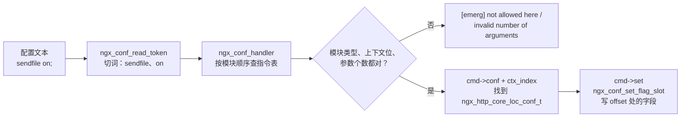
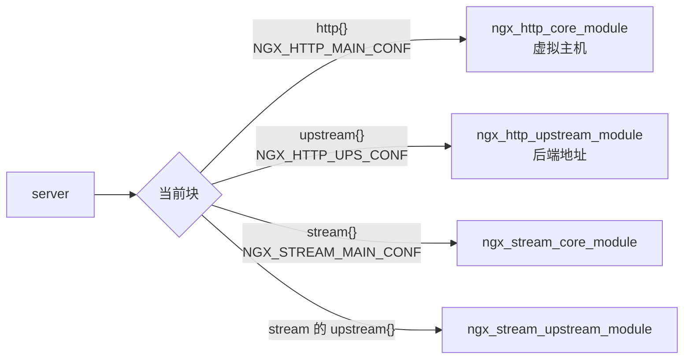
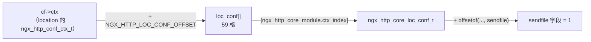
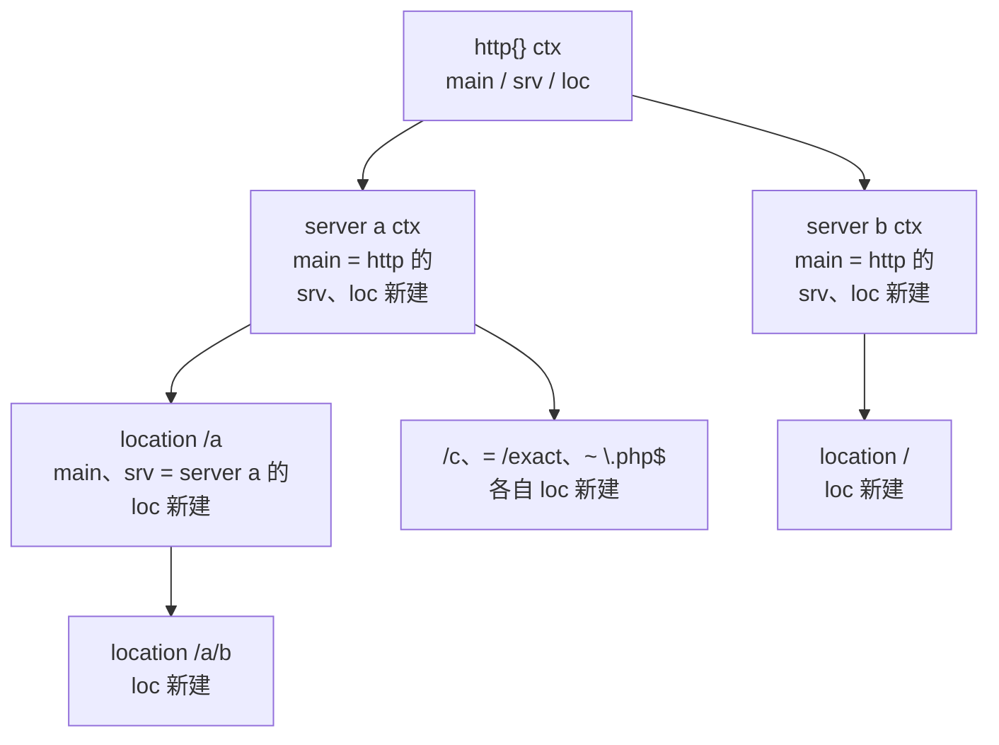
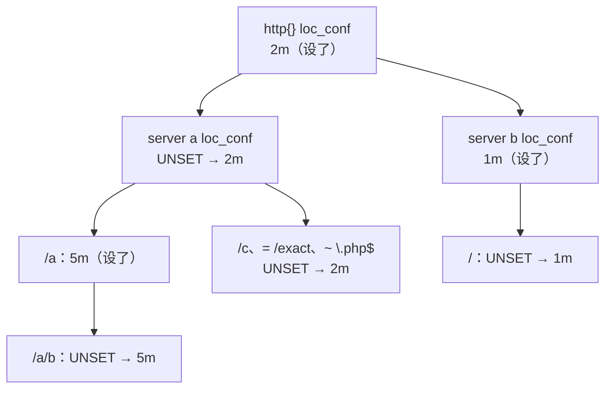
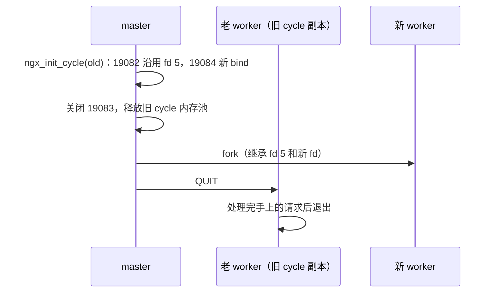

# 开发篇 04｜配置解析：一条指令先被切成词，再按上下文交给某个模块，写进 main、srv、loc 三级结构里的一格

> **一句话结论**：nginx 的配置解析分三步。`ngx_conf_read_token` 把文件切成词：`#` 只在词首才是注释，`\n`、`\t` 在任何词里都会被展开，`$` 后面的 `{` 不结束词。`ngx_conf_handler` 按模块顺序线性扫描所有指令表（本仓库构建共 675 条，89 个名字被不止一个模块定义），用“当前上下文”这一位挑出唯一的接收者，再按指令的偏移量和模块的 `ctx_index` 算出写进哪个结构体。`http{}` 为每个 HTTP 模块建 main、srv、loc 三个数组，`server{}` 共用 main、新建 srv 和 loc，`location{}` 共用 main 和 srv、只新建 loc；解析完后逐个模块自上而下合并，子级没设的值取父级。几乎所有错误都带文件和行号，唯有未知变量是在整个 `http{}` 解析完才检查的，报错里没有位置。`-g` 是一段先于配置文件解析的配置，所以它和文件里写了同一条指令时，被报“重复”的是文件那一行。reload 时新 cycle 按地址接管旧的监听 socket，地址不变的端口用的是同一个文件描述符。
>
> 适用版本：nginx 1.31.9（mainline，2026-11-18）。「版本差异」两处，都不影响本篇的结论：`ngx_conf_file.c` 在 1.31.9 里多了 `ngx_conf_check_size_nonzero` 这个后置检查（`client_header_buffer_size` 等 17 条指令用它拒绝 0 值）和 control API 开启时保留配置副本的分支；`ngx_http_core_location` 多了 predicate location（`location $var`，1.31.5 起，见[运维篇 04](../ops/04-routing.md) §5）的解析分支。本篇引用的其余代码两个版本逐字相同。实验：[`labs/dev-04`](../labs/dev-04/)，`cf.c` 链接本仓库构建的目标文件（同[开发篇 02](02-data-structures.md)），直接读指令表和 `ngx_init_cycle` 建出的结构。

## 导读

| 你想知道 | 看哪一节 |
|---|---|
| 引号、反斜杠、`#`、`${}` 在配置里怎么算 | §1 |
| nginx 怎么知道一条指令归哪个模块 | §2 |
| 每种 `[emerg]` 是哪一步报的，为什么有的没有行号 | §3 |
| `-g` 能做什么、不能做什么 | §4 |
| 指令的值最后写到了哪里 | §5 |
| `http`、`server`、`location` 三级配置在内存里的关系 | §6 |
| 继承是怎么实现的 | §7 |
| reload 时端口为什么不会断 | §8 |

[开发篇 01](01-source-map.md) §5 讲了 `main()` 调用 `ngx_init_cycle`、`ngx_init_cycle` 依次调用核心模块的 `create_conf`、`ngx_conf_parse`、`init_conf`。这一篇进到 `ngx_conf_parse` 里面。下图是一条指令从文本到结构体字段的路径，判断是：解析器本身不认识任何指令，它只负责切词和分派，指令的含义全在各模块的 `set` 函数里：



## 1. 配置文件先被切成词：引号、转义、#、${ 的规则都在 ngx_conf_read_token 里

[`ngx_conf_read_token`](https://github.com/nginx/nginx/blob/release-1.31.9/src/core/ngx_conf_file.c#L509) 是一个逐字节的状态机，一次读出一条指令的全部词，遇到 `;` 返回 `NGX_OK`，遇到 `{` 返回 `NGX_CONF_BLOCK_START`，遇到 `}` 返回 `NGX_CONF_BLOCK_DONE`。词首的字符决定了这个词怎么读：

```c
// src/core/ngx_conf_file.c:673-726
            switch (ch) {

            case ';':
            case '{':
                if (cf->args->nelts == 0) {
                    ngx_conf_log_error(NGX_LOG_EMERG, cf, 0,
                                       "unexpected \"%c\"", ch);
                    return NGX_ERROR;
                }

                if (ch == '{') {
                    return NGX_CONF_BLOCK_START;
                }

                return NGX_OK;

            case '}':
                if (cf->args->nelts != 0) {
                    ngx_conf_log_error(NGX_LOG_EMERG, cf, 0,
                                       "unexpected \"}\"");
                    return NGX_ERROR;
                }

                return NGX_CONF_BLOCK_DONE;

            case '#':
                sharp_comment = 1;
                continue;

            case '\\':
                quoted = 1;
                last_space = 0;
                continue;

            case '"':
                start++;
                d_quoted = 1;
                last_space = 0;
                continue;

            case '\'':
                start++;
                s_quoted = 1;
                last_space = 0;
                continue;

            case '$':
                variable = 1;
                last_space = 0;
                continue;

            default:
                last_space = 0;
            }
```

词中间的规则是另一段：

```c
// src/core/ngx_conf_file.c:728-764
        } else {
            if (ch == '{' && variable) {
                continue;
            }

            variable = 0;

            if (ch == '\\') {
                quoted = 1;
                continue;
            }

            if (ch == '$') {
                variable = 1;
                continue;
            }

            if (d_quoted) {
                if (ch == '"') {
                    d_quoted = 0;
                    need_space = 1;
                    found = 1;
                }

            } else if (s_quoted) {
                if (ch == '\'') {
                    s_quoted = 0;
                    need_space = 1;
                    found = 1;
                }

            } else if (ch == ' ' || ch == '\t' || ch == CR || ch == LF
                       || ch == ';' || ch == '{')
            {
                last_space = 1;
                found = 1;
            }
```

词结束后复制出来时处理转义：

```c
// src/core/ngx_conf_file.c:777-807
                for (dst = word->data, src = start, len = 0;
                     src < b->pos - 1;
                     len++)
                {
                    if (*src == '\\') {
                        switch (src[1]) {
                        case '"':
                        case '\'':
                        case '\\':
                            src++;
                            break;

                        case 't':
                            *dst++ = '\t';
                            src += 2;
                            continue;

                        case 'r':
                            *dst++ = '\r';
                            src += 2;
                            continue;

                        case 'n':
                            *dst++ = '\n';
                            src += 2;
                            continue;
                        }

                    }
                    *dst++ = *src++;
                }
```

实验用四个 location 验证这几条规则，每个都 `return 200` 一个特别写法的字符串：

```nginx
# lab: labs/dev-04/conf/nginx.conf
        location /hash { return 200 a#b; }  # "#" starts a comment only at the start of a word
        location /escape { return 200 "1\n2\t3"; }
        location /variable { return 200 ${host}-x; }
        location /brace{ return 200 "no space before {"; }
```

```text
# labs/dev-04 ## the tokenizer
/hash     a#b
/escape    1 \n 2 \t 3 (od -c)
/variable 127.0.0.1-x
/brace    no space before {
ok - "#" inside a word is kept; \n and \t are expanded; "{" after "$" stays in the word; "{" ends a word
```

- `a#b` 原样返回：`#` 只在 `last_space` 为真（新词开始）时才进入注释状态，词中间的 `#` 是普通字符。行尾的 `# "#" starts…` 前面有空格，是注释。
- `"1\n2\t3"` 返回了真正的换行和制表符。转义在把词复制出来时处理，不区分是否在引号里，所以不加引号的 `1\n2` 也会被展开；除了 `\n`、`\t`、`\r`，反斜杠只对 `"`、`'`、`\` 起转义作用，其他字符前的反斜杠原样保留（正则里的 `\.` 因此能直接写）。
- `${host}-x` 没加引号也是一个词：`$` 之后的 `{` 不结束词。`${name}` 是脚本引擎的写法，用于变量名后面紧跟字母的场合。
- `location /brace{` 中间没有空格也能用：`{` 结束当前词并开始块。

**小结**：分词只认空白、`;`、`{`、`}`、引号和反斜杠，其他字符都属于词；看不懂一条配置为什么这样解析时，按这几条规则手动切一遍词就够了。

## 2. 每条指令在所有模块的指令表里线性查找；同名指令靠上下文位区分

[`ngx_conf_handler`](https://github.com/nginx/nginx/blob/release-1.31.9/src/core/ngx_conf_file.c#L362) 没有哈希表，它按 `cycle->modules[]` 的顺序遍历每个模块的 `commands[]`，名字相同后再做三项检查：模块类型是否等于当前的 `cf->module_type`（`http{}` 里是 `NGX_HTTP_MODULE`），指令的 `type` 是否包含当前上下文的位（`cf->cmd_type`），参数个数是否符合：

```c
// src/core/ngx_conf_file.c:371-401

    found = 0;

    for (i = 0; cf->cycle->modules[i]; i++) {

        cmd = cf->cycle->modules[i]->commands;
        if (cmd == NULL) {
            continue;
        }

        for ( /* void */ ; cmd->name.len; cmd++) {

            if (name->len != cmd->name.len) {
                continue;
            }

            if (ngx_strcmp(name->data, cmd->name.data) != 0) {
                continue;
            }

            found = 1;

            if (cf->cycle->modules[i]->type != NGX_CONF_MODULE
                && cf->cycle->modules[i]->type != cf->module_type)
            {
                continue;
            }

            /* is the directive's location right ? */

            if (!(cmd->type & cf->cmd_type)) {
```

`found = 1` 写在类型检查之前，所以“名字存在、但这里不能用”和“名字根本不存在”报的是两种错误（§3）。实验列出本仓库构建的全部静态模块的指令表：

```text
# labs/dev-04 ## every module's directives in one table
92 static modules, 675 directives
"server" is defined by 4 modules: ngx_http_core_module ngx_http_upstream_module ngx_stream_core_module ngx_stream_upstream_module
"listen" is defined by 2 modules: ngx_http_core_module ngx_stream_core_module
89 names are defined by more than one module
ok - server belongs to the http, upstream, stream and stream upstream modules
```

675 条指令，每条指令都可能被线性比较一遍，但这只发生在启动和 reload 时，一份几百行的配置也只是几十万次字符串比较。`server` 有 4 个模块定义：在 `http{}` 里，`cf->cmd_type` 是 `NGX_HTTP_MAIN_CONF`，只有 `ngx_http_core_module` 的 `server` 带这一位；在 `upstream{}` 里是 `NGX_HTTP_UPS_CONF`，归 `ngx_http_upstream_module`；`stream{}` 里的两个同理。89 个名字共享，`listen` 这类 HTTP 和 stream 各有一套的指令都在其中。

下图是 `server` 在不同块里的去向，判断是：同一个名字归谁，由“它出现在哪个块里”唯一决定：



**小结**：指令名不是全局唯一的，“指令 + 所在块”才唯一；写模块时给指令取名不必避开别的模块，只要上下文位不重叠。

## 3. 错误分三层：分词、分派、set 函数；未知变量检查得最晚，没有行号

实验准备了 9 份各错一处的配置，逐个跑 `nginx -t`：

```text
# labs/dev-04 ## what the parser and the dispatcher reject
args       [emerg] invalid number of arguments in "sendfile" directive in $LAB/conf/bad/args.conf:4
brace      [emerg] unexpected "}" in $LAB/conf/bad/brace.conf:4
context    [emerg] "worker_processes" directive is not allowed here in $LAB/conf/bad/context.conf:4
duplicate  [emerg] "sendfile" directive is duplicate in $LAB/conf/bad/duplicate.conf:4
eof        [emerg] unexpected end of file, expecting "}" in $LAB/conf/bad/eof.conf:5
quote      [emerg] unexpected "b" in $LAB/conf/bad/quote.conf:4
semicolon  [emerg] directive "sendfile" is not terminated by ";" in $LAB/conf/bad/semicolon.conf:4
unknown    [emerg] unknown directive "colour" in $LAB/conf/bad/unknown.conf:4
variable   [emerg] unknown "no_such_variable" variable
ok - every error carries file:line except the unknown variable
```

按报错的位置分：

| 报错 | 哪一步 | 源码 |
|---|---|---|
| `unexpected "b"`、`unexpected "}"`、`unexpected end of file` | 分词，或 `ngx_conf_parse` 判断块是否闭合 | `ngx_conf_read_token`、`ngx_conf_parse` |
| `unknown directive`、`is not allowed here`、`invalid number of arguments`、`is not terminated by ";"` | 分派 | `ngx_conf_handler` |
| `is duplicate` | 模块的 set 函数 | `ngx_conf_set_flag_slot` 等 |
| `unknown "…" variable` | `http{}` 解析完之后 | `ngx_http_variables_init_vars` |

`is duplicate` 来自 set 函数对 `NGX_CONF_UNSET` 的检查：字段在 `create_loc_conf` 里被初始化成 `NGX_CONF_UNSET`（-1），第一次设置后就不再是它：

```c
// src/core/ngx_conf_file.c:1032-1044
ngx_conf_set_flag_slot(ngx_conf_t *cf, ngx_command_t *cmd, void *conf)
{
    char  *p = conf;

    ngx_str_t        *value;
    ngx_flag_t       *fp;
    ngx_conf_post_t  *post;

    fp = (ngx_flag_t *) (p + cmd->offset);

    if (*fp != NGX_CONF_UNSET) {
        return "is duplicate";
    }
```

未知变量没有行号，因为变量在解析时只登记名字，[`ngx_http_variables_init_vars`](https://github.com/nginx/nginx/blob/release-1.31.9/src/http/ngx_http_variables.c#L2790) 等所有模块都注册完自己的变量之后才逐个核对；这时已经不知道是哪一行引用的了。遇到这个错误，只能按变量名在配置里搜索。

下图把这些错误放在解析的时间线上，判断是：越晚发现的错误，离出错的那一行越远：


**小结**：带文件和行号的错误在解析当下就被发现；不带的（未知变量、共享内存大小为 0、端口被占）都发生在解析之后的初始化阶段，要按名字去配置里找。

## 4. -g 是一段先于配置文件解析的配置，只能写 main 级别的单行指令

`-g` 的内容存进 `cycle->conf_param`，`ngx_init_cycle` 在解析配置文件之前先解析它：

```c
// src/core/ngx_cycle.c:280-290
    if (ngx_conf_param(&conf) != NGX_CONF_OK) {
        environ = senv;
        ngx_destroy_cycle_pools(&conf);
        return NULL;
    }

    if (ngx_conf_parse(&conf, &cycle->conf_file) != NGX_CONF_OK) {
        environ = senv;
        ngx_destroy_cycle_pools(&conf);
        return NULL;
    }
```

[`ngx_conf_param`](https://github.com/nginx/nginx/blob/release-1.31.9/src/core/ngx_conf_file.c#L66) 把这段字符串包装成一个 `fd` 为 `NGX_INVALID_FILE` 的“文件”交给 `ngx_conf_parse`，后者据此进入 `parse_param` 状态：遇到 `{` 报错，读到结尾还没有 `;` 报 “unexpected end of parameter”，报错位置写成 “in command line”。

```text
# labs/dev-04 ## -g is parsed before the configuration file
-g twice:       [emerg] "worker_processes" directive is duplicate in command line
-g with block:  [emerg] block directives are not supported in -g option in command line
-g without ;:   [emerg] unexpected end of parameter, expecting ";" in command line
-g and file:    [emerg] "worker_processes" directive is duplicate in $LAB/conf/nginx.conf:2
ok - a directive in -g and in the file: the file's line is the duplicate
```

最后一行最值得注意：`-g 'worker_processes 2;'` 和文件里的 `worker_processes 1;` 冲突时，报错指向文件第 2 行。`-g` 先被解析，字段已经不是 `NGX_CONF_UNSET`，文件里那一行反而成了“重复”。所以 `-g` 不能覆盖配置文件里已经写了的指令，只能补充没写的；运维篇里 `-g "pid …;"` 能用，是因为实验配置里刻意不写 `pid`。

**小结**：把 `-g` 当成“配置文件开头多出来的几行 main 级指令”来理解，它的全部限制都能推出来。

## 5. 指令的值写进哪个结构体，由指令声明的 conf 偏移和模块的 ctx_index 决定

每条指令是一个 `ngx_command_t`：

```c
// src/core/ngx_conf_file.h:77-84
struct ngx_command_s {
    ngx_str_t             name;
    ngx_uint_t            type;
    char               *(*set)(ngx_conf_t *cf, ngx_command_t *cmd, void *conf);
    ngx_uint_t            conf;
    ngx_uint_t            offset;
    void                 *post;
};
```

以 `sendfile` 为例：

```c
// src/http/ngx_http_core_module.c:404-410
    { ngx_string("sendfile"),
      NGX_HTTP_MAIN_CONF|NGX_HTTP_SRV_CONF|NGX_HTTP_LOC_CONF|NGX_HTTP_LIF_CONF
                        |NGX_CONF_FLAG,
      ngx_conf_set_flag_slot,
      NGX_HTTP_LOC_CONF_OFFSET,
      offsetof(ngx_http_core_loc_conf_t, sendfile),
      NULL },
```

`conf` 字段是 `NGX_HTTP_LOC_CONF_OFFSET`，即 `loc_conf` 在 `ngx_http_conf_ctx_t` 里的偏移：

```c
// src/http/ngx_http_config.h:17-21
typedef struct {
    void        **main_conf;
    void        **srv_conf;
    void        **loc_conf;
} ngx_http_conf_ctx_t;
```

```c
// src/http/ngx_http_config.h:50-52
#define NGX_HTTP_MAIN_CONF_OFFSET  offsetof(ngx_http_conf_ctx_t, main_conf)
#define NGX_HTTP_SRV_CONF_OFFSET   offsetof(ngx_http_conf_ctx_t, srv_conf)
#define NGX_HTTP_LOC_CONF_OFFSET   offsetof(ngx_http_conf_ctx_t, loc_conf)
```

`ngx_conf_handler` 用这个偏移从当前块的 ctx 里取出 `loc_conf` 数组，再用模块的 `ctx_index` 取出这个模块在本块的配置结构，交给 `set`：

```c
// src/core/ngx_conf_file.c:453-467
            conf = NULL;

            if (cmd->type & NGX_DIRECT_CONF) {
                conf = ((void **) cf->ctx)[cf->cycle->modules[i]->index];

            } else if (cmd->type & NGX_MAIN_CONF) {
                conf = &(((void **) cf->ctx)[cf->cycle->modules[i]->index]);

            } else if (cf->ctx) {
                confp = *(void **) ((char *) cf->ctx + cmd->conf);

                if (confp) {
                    conf = confp[cf->cycle->modules[i]->ctx_index];
                }
            }
```

`set` 再用 `offset`（`offsetof(ngx_http_core_loc_conf_t, sendfile)`）找到具体字段。核心模块（`worker_processes` 这类）用的是 `NGX_DIRECT_CONF` 或 `NGX_MAIN_CONF`：前者直接拿 `conf_ctx[index]` 里已经建好的结构，后者把这一格的地址交给 `set`，由 `set` 自己分配（`http`、`events`、`stream` 这些块指令就是这样建出自己的 ctx 的）。

下图是 `sendfile on;` 写在某个 location 里时，从 ctx 到字段的指针链，判断是：同一个模块在每个块里都有自己的一份配置结构，指令只写当前块的那一份：



**小结**：一条指令能写在哪些块，看 `type` 里的上下文位；它的值存在哪一级，看 `conf` 是哪一个 `NGX_HTTP_*_CONF_OFFSET`。两者不必一致：`sendfile` 能写在 `http{}`、`server{}` 里，值却总是存在那一级的 loc_conf 里，成为下级 location 的父值。

## 6. http{} 为每个模块建三个数组：server 共用 main，location 共用 main 和 srv

[`ngx_http_block`](https://github.com/nginx/nginx/blob/release-1.31.9/src/http/ngx_http.c#L123) 建出 `http{}` 这一级的 ctx，为每个 HTTP 模块调用三个 create 回调：

```c
// src/http/ngx_http.c:189-217
    for (m = 0; cf->cycle->modules[m]; m++) {
        if (cf->cycle->modules[m]->type != NGX_HTTP_MODULE) {
            continue;
        }

        module = cf->cycle->modules[m]->ctx;
        mi = cf->cycle->modules[m]->ctx_index;

        if (module->create_main_conf) {
            ctx->main_conf[mi] = module->create_main_conf(cf);
            if (ctx->main_conf[mi] == NULL) {
                return NGX_CONF_ERROR;
            }
        }

        if (module->create_srv_conf) {
            ctx->srv_conf[mi] = module->create_srv_conf(cf);
            if (ctx->srv_conf[mi] == NULL) {
                return NGX_CONF_ERROR;
            }
        }

        if (module->create_loc_conf) {
            ctx->loc_conf[mi] = module->create_loc_conf(cf);
            if (ctx->loc_conf[mi] == NULL) {
                return NGX_CONF_ERROR;
            }
        }
    }
```

`server{}`（[`ngx_http_core_server`](https://github.com/nginx/nginx/blob/release-1.31.9/src/http/ngx_http_core_module.c#L3016)）复制 main_conf 指针，自己新建 srv_conf 和 loc_conf：

```c
// src/http/ngx_http_core_module.c:3036-3051
    http_ctx = cf->ctx;
    ctx->main_conf = http_ctx->main_conf;

    /* the server{}'s srv_conf */

    ctx->srv_conf = ngx_pcalloc(cf->pool, sizeof(void *) * ngx_http_max_module);
    if (ctx->srv_conf == NULL) {
        return NGX_CONF_ERROR;
    }

    /* the server{}'s loc_conf */

    ctx->loc_conf = ngx_pcalloc(cf->pool, sizeof(void *) * ngx_http_max_module);
    if (ctx->loc_conf == NULL) {
        return NGX_CONF_ERROR;
    }
```

`location{}`（[`ngx_http_core_location`](https://github.com/nginx/nginx/blob/release-1.31.9/src/http/ngx_http_core_module.c#L3161)）复制 main 和 srv，只新建 loc：

```c
// src/http/ngx_http_core_module.c:3179-3186
    pctx = cf->ctx;
    ctx->main_conf = pctx->main_conf;
    ctx->srv_conf = pctx->srv_conf;

    ctx->loc_conf = ngx_pcalloc(cf->pool, sizeof(void *) * ngx_http_max_module);
    if (ctx->loc_conf == NULL) {
        return NGX_CONF_ERROR;
    }
```

实验用一份两个 server、六个 location 的配置：

```nginx
# lab: labs/dev-04/conf/tree.conf
http {
    client_max_body_size 2m;

    server {
        listen 127.0.0.1:19080;
        server_name a;

        location /a {
            client_max_body_size 5m;

            location /a/b { }
        }

        location /c { }
        location = /exact { }
        location ~ \.php$ { }
    }

    server {
        listen 127.0.0.1:19080;
        server_name b;
        client_max_body_size 1m;

        location / { }
    }
}
```

`cf.c` 按 `main()` 的步骤调用 `ngx_init_cycle` 加载它（`main()` 在 `-t` 时提前返回，来不及把新 cycle 存进全局变量 `ngx_cycle`，所以实验程序自己做了这几步），然后从 `ngx_cycle->conf_ctx` 出发遍历：

```text
# labs/dev-04 ## the http{} tree after ngx_init_cycle
ngx_http_max_module=59, servers=2
http{}    client_max_body_size=2048k (http-level loc_conf)
server a: main_conf shared with http{}: yes, own srv_conf: yes, client_max_body_size=2048k
```

两个 server 的 `main_conf` 指针都和 `http{}` 的相同，`srv_conf` 都是自己的。本仓库构建有 59 个 HTTP 模块，所以每个 ctx 的三个数组各有 59 格；这份配置共有 9 个 loc_conf 数组（1 个 `http{}`、2 个 `server{}`、6 个 `location{}`），每个有 `create_loc_conf` 的模块被调用了 9 次。location 越多，配置占的内存就按“location 数 × 模块数”增长，这也是 `if` 写多了会让配置变大的原因：每个 `if` 都是一个隐式的 location（见[运维篇 02 §7](../ops/02-config.md)）。

下图是这份配置的 ctx 关系，判断是：上下级之间共享的是指针，不是副本：



**小结**：main 级配置全局一份，srv 级每个 server 一份，loc 级每个块一份；模块在 location 的 handler 里拿到的 `srv_conf`，就是所在 server 的那一份。

## 7. 合并是逐模块、自上而下的：子级没设的值取父级，父级也没设才用默认值

整个 `http{}` 解析完后，`ngx_http_block` 对每个模块调用 `ngx_http_merge_servers`：每个 server 的 srv_conf 和 `http{}` 的合并，server 那一级的 loc_conf 和 `http{}` 的合并，再递归合并 server 下的每个 location：

```c
// src/http/ngx_http.c:563-622
static char *
ngx_http_merge_servers(ngx_conf_t *cf, ngx_http_core_main_conf_t *cmcf,
    ngx_http_module_t *module, ngx_uint_t ctx_index)
{
    char                        *rv;
    ngx_uint_t                   s;
    ngx_http_conf_ctx_t         *ctx, saved;
    ngx_http_core_loc_conf_t    *clcf;
    ngx_http_core_srv_conf_t   **cscfp;

    cscfp = cmcf->servers.elts;
    ctx = (ngx_http_conf_ctx_t *) cf->ctx;
    saved = *ctx;
    rv = NGX_CONF_OK;

    for (s = 0; s < cmcf->servers.nelts; s++) {

        /* merge the server{}s' srv_conf's */

        ctx->srv_conf = cscfp[s]->ctx->srv_conf;

        if (module->merge_srv_conf) {
            rv = module->merge_srv_conf(cf, saved.srv_conf[ctx_index],
                                        cscfp[s]->ctx->srv_conf[ctx_index]);
            if (rv != NGX_CONF_OK) {
                goto failed;
            }
        }

        if (module->merge_loc_conf) {

            /* merge the server{}'s loc_conf */

            ctx->loc_conf = cscfp[s]->ctx->loc_conf;

            rv = module->merge_loc_conf(cf, saved.loc_conf[ctx_index],
                                        cscfp[s]->ctx->loc_conf[ctx_index]);
            if (rv != NGX_CONF_OK) {
                goto failed;
            }

            /* merge the locations{}' loc_conf's */

            clcf = cscfp[s]->ctx->loc_conf[ngx_http_core_module.ctx_index];

            rv = ngx_http_merge_locations(cf, clcf->locations,
                                          cscfp[s]->ctx->loc_conf,
                                          module, ctx_index);
            if (rv != NGX_CONF_OK) {
                goto failed;
            }
        }
    }

failed:

    *ctx = saved;

    return rv;
}
```

```c
// src/http/ngx_http.c:625-667
static char *
ngx_http_merge_locations(ngx_conf_t *cf, ngx_queue_t *locations,
    void **loc_conf, ngx_http_module_t *module, ngx_uint_t ctx_index)
{
    char                       *rv;
    ngx_queue_t                *q;
    ngx_http_conf_ctx_t        *ctx, saved;
    ngx_http_core_loc_conf_t   *clcf;
    ngx_http_location_queue_t  *lq;

    if (locations == NULL) {
        return NGX_CONF_OK;
    }

    ctx = (ngx_http_conf_ctx_t *) cf->ctx;
    saved = *ctx;

    for (q = ngx_queue_head(locations);
         q != ngx_queue_sentinel(locations);
         q = ngx_queue_next(q))
    {
        lq = (ngx_http_location_queue_t *) q;

        clcf = lq->exact ? lq->exact : lq->inclusive;
        ctx->loc_conf = clcf->loc_conf;

        rv = module->merge_loc_conf(cf, loc_conf[ctx_index],
                                    clcf->loc_conf[ctx_index]);
        if (rv != NGX_CONF_OK) {
            return rv;
        }

        rv = ngx_http_merge_locations(cf, clcf->locations, clcf->loc_conf,
                                      module, ctx_index);
        if (rv != NGX_CONF_OK) {
            return rv;
        }
    }

    *ctx = saved;

    return NGX_CONF_OK;
}
```

模块的 `merge_loc_conf` 里，每个字段用 `ngx_conf_merge_*_value` 合并：

```c
// src/core/ngx_conf_file.h:209-212
#define ngx_conf_merge_value(conf, prev, default)                            \
    if (conf == NGX_CONF_UNSET) {                                            \
        conf = (prev == NGX_CONF_UNSET) ? default : prev;                    \
    }
```

实验遍历的结果：

```text
# labs/dev-04 ## the http{} tree after ngx_init_cycle
  a         location /a           client_max_body_size=5120k parent=server
  a         location /a/b         client_max_body_size=5120k parent=/a
  a         location /c           client_max_body_size=2048k parent=server
  a         location = /exact     client_max_body_size=2048k parent=server
  a         location ~ \.php$     client_max_body_size=2048k parent=server
server b: main_conf shared with http{}: yes, own srv_conf: yes, client_max_body_size=1024k
  b         location /            client_max_body_size=1024k parent=server
loc_conf arrays: 1 http + 2 server + 6 location = 9, each with 59 slots
```

- `/a` 自己设了 5m；`/a/b` 嵌在 `/a` 里，父级是 `/a`，取 5m。
- `/c`、`= /exact`、`~ \.php$` 都没设，父级是 server a 的 loc_conf，它自己也没设、取了 `http{}` 的 2m。
- server b 在 `server{}` 里设了 1m。`client_max_body_size` 是 loc 级指令，写在 `server{}` 里就存进 server b 的 loc_conf，它下面的 `/` 取 1m。

下图是 core 模块合并 `client_max_body_size` 时值的流向，判断是：每个块只看自己的直接父级，不会跨级去找：



有两点容易误会。第一，合并的外层循环是模块，不是 server：先把所有 server 的 core 模块合并完，再合并下一个模块。所以一个模块的 merge 函数里看不到其他模块合并后的值，只能看到自己的。第二，`http{}` 这一级的 loc_conf 本身从不合并，没设的字段在那里一直是 `NGX_CONF_UNSET`，默认值是在子级合并时填进去的。

**小结**：继承就是“UNSET 取父值”这一条规则加上自上而下的递归；运维篇 02 讲的数组指令整组覆盖，是各模块的 merge 函数对数组字段也套用了同一条规则：子级的数组不为空，就不看父级。

## 8. reload 时新 cycle 按地址接管监听 socket；master 建好新 cycle 后立即释放旧的

reload 时 master 用新配置再调用一次 `ngx_init_cycle`，旧 cycle 作为参数传入。新配置里的每个监听地址，先在旧 cycle 里找地址相同的 socket，找到就直接用它的 fd，不重新 `bind`：

```c
// src/core/ngx_cycle.c:535-548
                if (ngx_cmp_sockaddr(nls[n].sockaddr, nls[n].socklen,
                                     ls[i].sockaddr, ls[i].socklen, 1)
                    == NGX_OK)
                {
                    nls[n].fd = ls[i].fd;
                    nls[n].previous = &ls[i];

                    if (ls[i].protocol != nls[n].protocol) {
                        nls[n].change_protocol = 1;

                    } else {
                        nls[n].inherited = ls[i].inherited;
                        ls[i].remain = 1;
                    }
```

没人接管的旧 socket 随后被关闭。实验从监听 19082、19083 的配置 reload 到监听 19082、19084 的配置，用 `lsof` 看 master 持有的监听 fd：

```text
# labs/dev-04 ## reload keeps a listening socket whose address is unchanged
before:
127.0.0.1:19082 fd 5
127.0.0.1:19083 fd 6
after:
127.0.0.1:19082 fd 5
127.0.0.1:19084 fd 9
ok - 19082 keeps its fd, 19083 is closed, 19084 is new
```

19082 前后都是 fd 5，内核里的监听队列没有断过，已经在队列里排着的连接也不会丢；19083 被关闭；19084 是新 `bind` 的。这正是 reload 不中断服务的底层原因：新 worker 从 master 继承同一个 fd，master 先启动新 worker、再通知老 worker 关闭监听并退出（[运维篇 03](../ops/03-processes-signals.md) §2），任何时刻都有进程在这个 socket 上 accept。

新 cycle 建好后，master 立即释放旧 cycle 的内存池：

```c
// src/core/ngx_cycle.c:783-788
    if (ngx_process == NGX_PROCESS_MASTER || ngx_is_init_cycle(old_cycle)) {

        ngx_destroy_pool(old_cycle->pool);
        cycle->old_cycle = NULL;

        return cycle;
```

master 自己不处理连接，旧配置对它已经没有用；老 worker 是在 reload 之前 fork 出来的，各自有一份旧 cycle 的副本，直到退出。

下图是 reload 前后 socket 和 cycle 的交接，判断是：端口不断，靠的是同一个 fd 在新旧 cycle 之间传递：



**小结**：reload 失败（新配置初始化出错）时，`ngx_init_cycle` 返回 NULL，旧 cycle 原封不动，这是运维篇 03 里“新配置有错时老 worker 照常服务”的源码依据；成功时，端口按地址交接，地址不变就不重新 bind。

## 已知局限与待核实

- 实验只在 macOS arm64 上跑过；静态模块数、指令数、HTTP 模块数（92、675、59）取决于本仓库的 configure 参数，官方包或别的构建会不同。
- `cf.c` 的 `tree` 子命令照抄了 `main()` 在 `ngx_init_cycle` 之前的步骤，没有处理继承的 socket 和 control API 的初始化；对 `-t` 场景足够，不代表真实启动。
- §2 “几十万次字符串比较”是按指令数和配置行数估算的量级，没有计时。
- `cf.c` 只遍历了普通前缀和正则 location，没有遍历 predicate location（`predicate_locations`），实验配置里也没有写。
- §8 只看了 TCP 监听 socket；UNIX 域 socket、`reuseport` 在 reload 时的处理（`add_reuseport`）和协议变化（`change_protocol`）只读了源码。

## 修订记录

- 2026-11-21：基于 nginx 1.31.9 源码新写。覆盖分词规则、指令分派与同名指令、错误分层、`-g`、指令写入位置、三级 ctx、合并顺序和 reload 时的监听 socket 交接；实验程序 `labs/dev-04/cf.c` 链接 1.31.9 的目标文件，直接读取 `ngx_init_cycle` 建出的结构。
