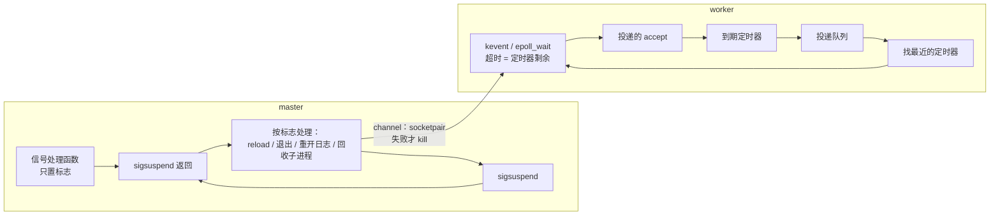
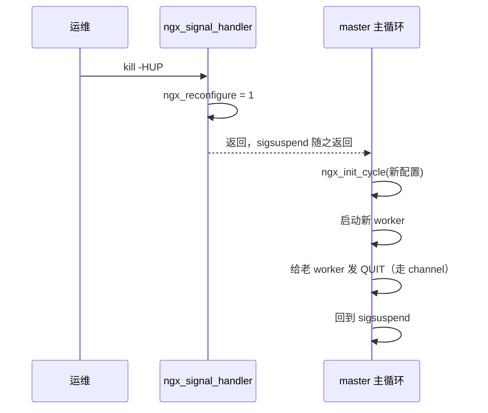
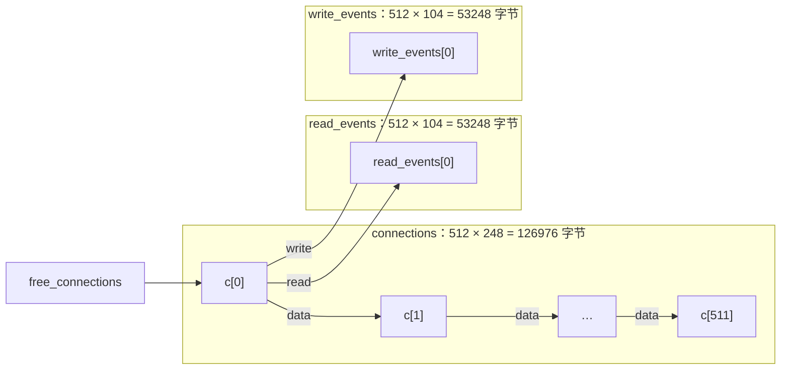
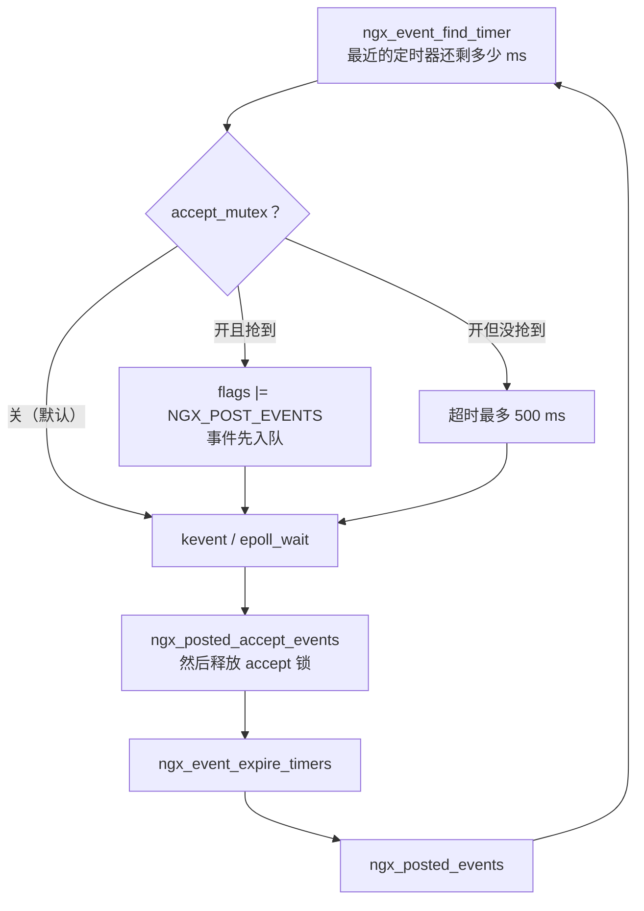
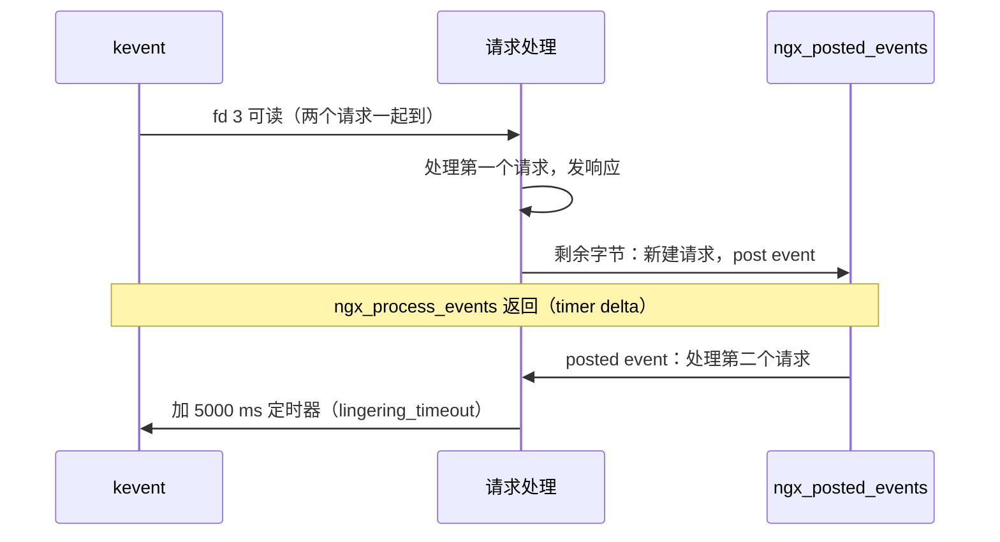
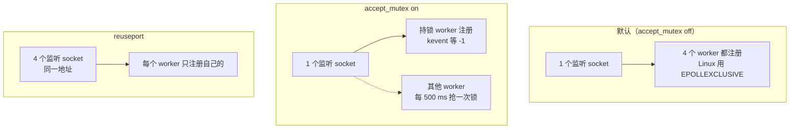

# 开发篇 05｜进程与事件循环：master 只等信号，worker 在一个循环里轮流处理网络事件、定时器和投递队列

> **一句话结论**：master 的信号处理函数只置一个标志，主循环在 `sigsuspend` 里睡着，醒来按标志做事；它给 worker 下命令先写 channel（一对 socketpair），写失败才用 `kill`。worker 启动时一次分配 `worker_connections` 个连接和两倍数量的事件结构，之后只在一个循环里转：算出最近的定时器还剩多久，把它作为 `kevent`/`epoll_wait` 的超时，回来后依次处理新连接、到期定时器和投递队列。nginx 没有每秒一次的时钟滴答，空闲 worker 会一直睡到下一个定时器到期；流水线请求、`keepalive` 后的下一个请求都是通过投递队列在同一轮末尾接着处理的。多个 worker 分连接有三种方式：默认大家都监听同一个 socket；`accept_mutex` 让一个 worker 独占监听，持有者带着锁睡在 `kevent` 里；`reuseport` 让每个 worker 有自己的 socket。
>
> 适用版本：nginx 1.31.9（mainline，2026-11-18）。「版本差异」：1.31.9 的源码树里没有了 `ngx_iocp_module.c`/`.h`（1.30.7 还有），`ngx_event.c`、`ngx_event_accept.c` 里的 IOCP 分支也一并删掉，`CHANGES` 里没有对应条目，不影响 Unix 平台；master 主循环多了 control API 的 `ngx_sigio` 分支（1.31.5 起，见[运维篇 03](../ops/03-processes-signals.md) §7）。本篇引用的定时器、投递队列、epoll、channel 代码两个版本逐字相同。实验：[`labs/dev-05`](../labs/dev-05/)，在 macOS 上读一个 worker 的 debug 日志（事件方法是 kqueue），`ev.c` 链接本仓库构建的目标文件打印结构体大小。

## 导读

| 你想知道 | 看哪一节 |
|---|---|
| `nginx -s reload` 之后 master 里发生了什么 | §1 |
| master 怎么通知 worker | §2 |
| `worker_connections` 占多少内存，什么时候分配 | §3 |
| worker 的一轮循环做哪几件事、按什么顺序 | §4 |
| 超时是怎么实现的，worker 空闲时在干什么 | §5 |
| 流水线请求、“推迟到本轮末尾”的事件 | §6 |
| debug 日志里 `fl:0005`、`fl:0025` 是什么，边沿触发要注意什么 | §7 |
| 多个 worker 怎么分连接，`accept_mutex` 和 `reuseport` 的区别 | §8 |

[运维篇 03](../ops/03-processes-signals.md) 从外面看了进程模型：master 管进程、worker 处理请求、reload 新老交替。这一篇进到两个循环里面。下图是两类进程各自的循环和它们之间唯一的通道，判断是：master 和 worker 都是单线程地睡在一个系统调用上，被信号或事件唤醒后才做事：



## 1. master 只在 sigsuspend 里等：信号处理函数置标志，主循环醒来再做事

`ngx_master_process_cycle` 一开始就把它关心的信号全部阻塞：

```c
// src/os/unix/ngx_process_cycle.c:87-102
    sigemptyset(&set);
    sigaddset(&set, SIGCHLD);
    sigaddset(&set, SIGALRM);
    sigaddset(&set, SIGIO);
    sigaddset(&set, SIGINT);
    sigaddset(&set, ngx_signal_value(NGX_RECONFIGURE_SIGNAL));
    sigaddset(&set, ngx_signal_value(NGX_REOPEN_SIGNAL));
    sigaddset(&set, ngx_signal_value(NGX_NOACCEPT_SIGNAL));
    sigaddset(&set, ngx_signal_value(NGX_TERMINATE_SIGNAL));
    sigaddset(&set, ngx_signal_value(NGX_SHUTDOWN_SIGNAL));
    sigaddset(&set, ngx_signal_value(NGX_CHANGEBIN_SIGNAL));

    if (sigprocmask(SIG_BLOCK, &set, NULL) == -1) {
        ngx_log_error(NGX_LOG_ALERT, cycle->log, ngx_errno,
                      "sigprocmask() failed");
    }
```

阻塞之后，这些信号到达时只挂起，不打断 master 正在执行的代码。主循环每一轮在 `sigsuspend` 里临时解除阻塞并睡下，有信号才返回：

```c
// src/os/unix/ngx_process_cycle.c:161-173
        ngx_log_debug0(NGX_LOG_DEBUG_EVENT, cycle->log, 0, "sigsuspend");

        sigsuspend(&set);

        ngx_time_update();

        ngx_log_debug1(NGX_LOG_DEBUG_EVENT, cycle->log, 0,
                       "wake up, sigio %i", sigio);

        if (ngx_reap) {
            ngx_reap = 0;
            ngx_log_debug0(NGX_LOG_DEBUG_EVENT, cycle->log, 0, "reap children");

```

信号处理函数 [`ngx_signal_handler`](https://github.com/nginx/nginx/blob/release-1.31.9/src/os/unix/ngx_process.c#L319) 对 master 只做一件事，把信号翻译成全局标志：

```c
// src/os/unix/ngx_process.c:342-372
    case NGX_PROCESS_MASTER:
    case NGX_PROCESS_SINGLE:
        switch (signo) {

        case ngx_signal_value(NGX_SHUTDOWN_SIGNAL):
            ngx_quit = 1;
            action = ", shutting down";
            break;

        case ngx_signal_value(NGX_TERMINATE_SIGNAL):
        case SIGINT:
            ngx_terminate = 1;
            action = ", exiting";
            break;

        case ngx_signal_value(NGX_NOACCEPT_SIGNAL):
            if (ngx_daemonized) {
                ngx_noaccept = 1;
                action = ", stop accepting connections";
            }
            break;

        case ngx_signal_value(NGX_RECONFIGURE_SIGNAL):
            ngx_reconfigure = 1;
            action = ", reconfiguring";
            break;

        case ngx_signal_value(NGX_REOPEN_SIGNAL):
            ngx_reopen = 1;
            action = ", reopening logs";
            break;
```

真正的工作在 `sigsuspend` 返回后的主循环里做：`ngx_reconfigure` 走 `ngx_init_cycle`（[开发篇 04](04-startup-config.md) §8），`ngx_reopen` 重开日志，`ngx_reap` 回收退出的子进程。这样安排的原因是信号处理函数里只能调用异步信号安全的函数，`malloc`、写日志、解析配置都不行；阻塞信号再配合 `sigsuspend`，保证标志在主循环检查之前不会丢，也不会在两次检查之间漏掉。

`TERM`（快速退出）的处理能看出主循环的节奏：

```c
// src/os/unix/ngx_process_cycle.c:203-223
        if (ngx_terminate) {
            if (delay == 0) {
                delay = 50;
            }

            if (sigio) {
                sigio--;
                continue;
            }

            sigio = ccf->worker_processes + 2 /* cache processes */;

            if (delay > 1000) {
                ngx_signal_worker_processes(cycle, SIGKILL);
            } else {
                ngx_signal_worker_processes(cycle,
                                       ngx_signal_value(NGX_TERMINATE_SIGNAL));
            }

            continue;
        }
```

第一次进来 `delay` 设成 50 ms，给所有 worker 发 `TERM`；循环开头用 `setitimer` 定一个 `delay` 毫秒的闹钟，每次 `SIGALRM` 把 `delay` 翻倍并重发。`delay` 超过 1000 时改发 `SIGKILL`。按 50、100、200、400、800 ms 累加推算，worker 不响应 `TERM` 时大约 1.55 秒后被强杀；这个时间是从源码推算的，本篇没有实测。

下图是一次 `kill -HUP` 在 master 里的路径，判断是：信号处理函数和主循环之间只隔着一个标志位：



**小结**：master 不处理连接，也没有事件循环，只在 `sigsuspend` 上等信号；`TERM` 的升级节奏是 50 ms 起、逐次翻倍，`delay` 超过 1000 改发 `SIGKILL`。

## 2. master 给 worker 下命令先写 channel，kill 只是后备

`ngx_signal_worker_processes` 先把信号翻译成 channel 命令：

```c
// src/os/unix/ngx_process_cycle.c:468-484
    switch (signo) {

    case ngx_signal_value(NGX_SHUTDOWN_SIGNAL):
        ch.command = NGX_CMD_QUIT;
        break;

    case ngx_signal_value(NGX_TERMINATE_SIGNAL):
        ch.command = NGX_CMD_TERMINATE;
        break;

    case ngx_signal_value(NGX_REOPEN_SIGNAL):
        ch.command = NGX_CMD_REOPEN;
        break;

    default:
        ch.command = 0;
    }
```

命令值定义在 [`ngx_process_cycle.h`](https://github.com/nginx/nginx/blob/release-1.31.9/src/os/unix/ngx_process_cycle.h#L16)：`NGX_CMD_OPEN_CHANNEL` 1、`NGX_CMD_CLOSE_CHANNEL` 2、`NGX_CMD_QUIT` 3、`NGX_CMD_TERMINATE` 4、`NGX_CMD_REOPEN` 5。然后对每个 worker 先写 channel，写成功就跳过 `kill`：

```c
// src/os/unix/ngx_process_cycle.c:518-545
        if (ch.command) {
            if (ngx_write_channel(ngx_processes[i].channel[0],
                                  &ch, sizeof(ngx_channel_t), cycle->log)
                == NGX_OK)
            {
                if (signo != ngx_signal_value(NGX_REOPEN_SIGNAL)) {
                    ngx_processes[i].exiting = 1;
                }

                continue;
            }
        }

        ngx_log_debug2(NGX_LOG_DEBUG_CORE, cycle->log, 0,
                       "kill (%P, %d)", ngx_processes[i].pid, signo);

        if (kill(ngx_processes[i].pid, signo) == -1) {
            err = ngx_errno;
            ngx_log_error(NGX_LOG_ALERT, cycle->log, err,
                          "kill(%P, %d) failed", ngx_processes[i].pid, signo);

            if (err == NGX_ESRCH) {
                ngx_processes[i].exited = 1;
                ngx_processes[i].exiting = 0;
                ngx_reap = 1;
            }

            continue;
```

channel 是 `ngx_spawn_process` 在 fork 之前建的一对 socketpair，worker 那一端在 `ngx_worker_process_init` 里注册成普通的读事件，所以命令和网络事件走同一个 `kevent`。worker 收到后也只是置标志：

```c
// src/os/unix/ngx_process_cycle.c:1086-1101
        ngx_log_debug1(NGX_LOG_DEBUG_CORE, ev->log, 0,
                       "channel command: %ui", ch.command);

        switch (ch.command) {

        case NGX_CMD_QUIT:
            ngx_quit = 1;
            break;

        case NGX_CMD_TERMINATE:
            ngx_terminate = 1;
            break;

        case NGX_CMD_REOPEN:
            ngx_reopen = 1;
            break;
```

标志在 [`ngx_worker_process_cycle`](https://github.com/nginx/nginx/blob/release-1.31.9/src/os/unix/ngx_process_cycle.c#L729) 处理完这一轮事件后检查（§4）。实验给 master 发 `USR1`，在 worker 的日志里看到它收到的命令：

```text
# labs/dev-05 ## the master talks to workers over the channel
channel command: 5
ok - USR1 becomes channel command 5 (NGX_CMD_REOPEN)
```

用 channel 而不用信号，好处是命令进了 worker 的事件循环，和处理连接是同一个线程、同一个时机，不会在处理请求的半途被打断。`kill` 只在 channel 写失败时用，例如 worker 已经卡住、socketpair 的缓冲区写满。

**小结**：`QUIT`、`TERM`、`USR1` 三种信号对应 channel 命令 3、4、5；`SIGKILL` 这类没有对应命令的信号，以及 channel 写失败时，才直接 `kill`。

## 3. worker 启动时一次分配全部连接和事件：每个连接 248 + 2 × 104 字节

[`ngx_event_process_init`](https://github.com/nginx/nginx/blob/release-1.31.9/src/event/ngx_event.c#L632) 是事件模块的 `init_process`，每个 worker fork 之后调用一次。它按 `worker_connections`（默认值见 [`DEFAULT_CONNECTIONS`](https://github.com/nginx/nginx/blob/release-1.31.9/src/event/ngx_event.c#L13)，512）一次分配三个数组：

```c
// src/event/ngx_event.c:750-796
    cycle->connections =
        ngx_alloc(sizeof(ngx_connection_t) * cycle->connection_n, cycle->log);
    if (cycle->connections == NULL) {
        return NGX_ERROR;
    }

    c = cycle->connections;

    cycle->read_events = ngx_alloc(sizeof(ngx_event_t) * cycle->connection_n,
                                   cycle->log);
    if (cycle->read_events == NULL) {
        return NGX_ERROR;
    }

    rev = cycle->read_events;
    for (i = 0; i < cycle->connection_n; i++) {
        rev[i].closed = 1;
        rev[i].instance = 1;
    }

    cycle->write_events = ngx_alloc(sizeof(ngx_event_t) * cycle->connection_n,
                                    cycle->log);
    if (cycle->write_events == NULL) {
        return NGX_ERROR;
    }

    wev = cycle->write_events;
    for (i = 0; i < cycle->connection_n; i++) {
        wev[i].closed = 1;
    }

    i = cycle->connection_n;
    next = NULL;

    do {
        i--;

        c[i].data = next;
        c[i].read = &cycle->read_events[i];
        c[i].write = &cycle->write_events[i];
        c[i].fd = (ngx_socket_t) -1;

        next = &c[i];
    } while (i);

    cycle->free_connections = next;
    cycle->free_connection_n = cycle->connection_n;
```

连接数组用 `data` 指针从 `c[0]` 到 `c[511]` 串成空闲链表，`ngx_get_connection` 从表头取、`ngx_free_connection` 放回表头；第 `i` 个连接固定配第 `i` 个读事件和写事件，运行中不再为连接调用 `malloc`。实验打印结构体大小，和 worker 启动时 debug 日志里的三次 `malloc` 对上：

```text
# labs/dev-05 ## worker startup
malloc 126976
malloc 53248
malloc 53248
kevent set event: 5: ft:-1 fl:0005
kevent set event: 6: ft:-1 fl:0005
kevent set event: 7: ft:-1 fl:0005
worker cycle
sizeof(ngx_connection_t)=248, sizeof(ngx_event_t)=104
x 512 connections: 126976 and 53248 bytes
ok - connections and events are allocated up front: 512 x sizeof
```

本仓库构建在 arm64 上 `ngx_connection_t` 是 248 字节、`ngx_event_t` 是 104 字节，512 个连接分别是 126976 和 53248 字节（读、写事件各一次），合计 233472 字节。按此推算，`worker_connections 10000` 每个 worker 先占约 4.56 MB，与实际连接数无关；结构体大小随编译选项（如是否启用 QUIC、SSL）变化，别的构建要自己量。

下图是三个数组的关系，判断是：连接和它的两个事件靠同一个下标绑定，空闲链表只串连接：



日志里紧接着的三行 `kevent set event: 5/6/7 ... fl:0005` 是两个监听 socket（19100、19101）和 channel 的注册，`fl` 的含义在 §7。

**小结**：`worker_connections` 是一个预分配上限，不是“按需增长到多少”；连接、读事件、写事件三个数组下标一一对应，启动时就付清内存。

## 4. 事件循环的一轮：找最近的定时器，等内核，先处理新连接，再处理到期定时器和投递队列

worker 的外层循环只做两件事：调用 `ngx_process_events_and_timers`，然后检查 §2 那些标志：

```c
// src/os/unix/ngx_process_cycle.c:740-778
    for ( ;; ) {

        if (ngx_exiting) {
            if (ngx_event_no_timers_left() == NGX_OK) {
                ngx_log_error(NGX_LOG_NOTICE, cycle->log, 0, "exiting");
                ngx_worker_process_exit(cycle);
            }
        }

        ngx_log_debug0(NGX_LOG_DEBUG_EVENT, cycle->log, 0, "worker cycle");

        ngx_process_events_and_timers(cycle);

        if (ngx_terminate) {
            ngx_log_error(NGX_LOG_NOTICE, cycle->log, 0, "exiting");
            ngx_worker_process_exit(cycle);
        }

        if (ngx_quit) {
            ngx_quit = 0;
            ngx_log_error(NGX_LOG_NOTICE, cycle->log, 0,
                          "gracefully shutting down");
            ngx_setproctitle("worker process is shutting down");

            if (!ngx_exiting) {
                ngx_exiting = 1;
                ngx_set_shutdown_timer(cycle);
                ngx_close_listening_sockets(cycle);
                ngx_close_idle_connections(cycle);
                ngx_event_process_posted(cycle, &ngx_posted_events);
            }
        }

        if (ngx_reopen) {
            ngx_reopen = 0;
            ngx_log_error(NGX_LOG_NOTICE, cycle->log, 0, "reopening logs");
            ngx_reopen_files(cycle, -1);
        }
    }
```

`ngx_exiting` 是优雅退出：监听已经关闭，等所有定时器都清空（`ngx_event_no_timers_left`）才退出，空闲的 keepalive 连接在开始退出时就被 `ngx_close_idle_connections` 关掉，但一个没传完的下载或还在等 upstream 的请求会让老 worker 一直活着，这是运维篇 03 里 `worker_shutdown_timeout` 存在的原因。

一轮的全部内容在 `ngx_process_events_and_timers`：

```c
// src/event/ngx_event.c:195-264
ngx_process_events_and_timers(ngx_cycle_t *cycle)
{
    ngx_uint_t  flags;
    ngx_msec_t  timer, delta;

    if (ngx_timer_resolution) {
        timer = NGX_TIMER_INFINITE;
        flags = 0;

    } else {
        timer = ngx_event_find_timer();
        flags = NGX_UPDATE_TIME;

#if (NGX_WIN32)

        /* handle signals from master in case of network inactivity */

        if (timer == NGX_TIMER_INFINITE || timer > 500) {
            timer = 500;
        }

#endif
    }

    if (ngx_use_accept_mutex) {
        if (ngx_accept_disabled > 0) {
            ngx_accept_disabled--;

        } else {
            if (ngx_trylock_accept_mutex(cycle) == NGX_ERROR) {
                return;
            }

            if (ngx_accept_mutex_held) {
                flags |= NGX_POST_EVENTS;

            } else {
                if (timer == NGX_TIMER_INFINITE
                    || timer > ngx_accept_mutex_delay)
                {
                    timer = ngx_accept_mutex_delay;
                }
            }
        }
    }

    if (!ngx_queue_empty(&ngx_posted_next_events)) {
        ngx_event_move_posted_next(cycle);
        timer = 0;
    }

    delta = ngx_current_msec;

    (void) ngx_process_events(cycle, timer, flags);

    delta = ngx_current_msec - delta;

    ngx_log_debug1(NGX_LOG_DEBUG_EVENT, cycle->log, 0,
                   "timer delta: %M", delta);

    ngx_event_process_posted(cycle, &ngx_posted_accept_events);

    if (ngx_accept_mutex_held) {
        ngx_shmtx_unlock(&ngx_accept_mutex);
    }

    ngx_event_expire_timers();

    ngx_event_process_posted(cycle, &ngx_posted_events);
}
```

顺序是固定的：

1. `ngx_event_find_timer` 算出最近的定时器还剩多少毫秒，作为等待超时；
2. 开了 `accept_mutex` 时先抢锁（§8）；
3. `ngx_process_events` 就是当前事件模块的 `process_events`，在 macOS 上是 `kevent`，Linux 上是 `epoll_wait`；
4. 先处理投递的 accept 事件，然后释放 accept 锁；
5. `ngx_event_expire_timers` 处理到期的定时器；
6. 处理普通的投递队列。

实验向 19100 发一个请求，下面是同一个 worker 从 accept 到连接关闭的全部事件循环日志：

```text
# labs/dev-05 ## one request through the event loop
kevent events: 1
kevent: 5: ft:-1 fl:0005 d:1
accept on 127.0.0.1:19100, ready: 1
accept: 127.0.0.1 fd:3
event timer add: 3: 60000
kevent set event: 3: ft:-1 fl:0025
timer delta
worker cycle
kevent timer: 60000, changes: 1
kevent events: 1
kevent: 3: ft:-1 fl:0025 d:71
http wait request handler
event timer del: 3
set http keepalive handler
event timer add: 3: 75000
timer delta
worker cycle
kevent timer: 75000, changes: 0
kevent events: 1
kevent: 3: ft:-1 fl:8025 d:0
http keepalive handler
close http connection: 3
event timer del: 3
timer delta
worker cycle
kevent timer: -1, changes: 0
ok - kevent waits for the nearest timer: 60000 ms after accept, 75000 ms in keepalive, forever after close
```

一共四轮。第一轮监听 socket（fd 5）可读，accept 出 fd 3，给它加 `client_header_timeout` 的 60000 ms 定时器，并登记读事件。第二轮的 `kevent` 超时就是 60000，`changes: 1` 是上一轮登记的那个读事件这时才交给内核（§7）；请求读完，删掉 60000 的定时器，响应发完转入 keepalive，加 `keepalive_timeout` 的 75000 ms 定时器。第三轮等 75000，curl 关闭连接，`fl:8025` 里的 `EV_EOF` 让 keepalive 处理函数关闭连接并删掉定时器。第四轮红黑树空了，`kevent timer: -1` 表示无限等待。

下图把一轮循环画成固定的流水线，判断是：网络事件、定时器、投递事件三类工作在同一个线程里按固定顺序处理，没有抢占：



**小结**：一个 worker 里任何处理函数阻塞，整轮都停下，这一 worker 上的其他连接都跟着等；这是 nginx 要求模块不做阻塞调用、磁盘读写必要时交给线程池的根本原因。

## 5. 定时器是一棵红黑树：kevent 的超时就是最近一个定时器还剩多久

所有超时（`client_header_timeout`、`keepalive_timeout`、`proxy_read_timeout`、`limit_req` 的延迟……）都是 `ngx_event_t` 里的一个红黑树节点，键是到期时刻的毫秒数。找最近的定时器就是取最小节点：

```c
// src/event/ngx_event_timer.c:32-50
ngx_msec_t
ngx_event_find_timer(void)
{
    ngx_msec_int_t      timer;
    ngx_rbtree_node_t  *node, *root, *sentinel;

    if (ngx_event_timer_rbtree.root == &ngx_event_timer_sentinel) {
        return NGX_TIMER_INFINITE;
    }

    root = ngx_event_timer_rbtree.root;
    sentinel = ngx_event_timer_rbtree.sentinel;

    node = ngx_rbtree_min(root, sentinel);

    timer = (ngx_msec_int_t) (node->key - ngx_current_msec);

    return (ngx_msec_t) (timer > 0 ? timer : 0);
}
```

处理到期定时器是反复取最小节点，到期就删掉、置 `timedout`、调用事件的处理函数：

```c
// src/event/ngx_event_timer.c:53-96
void
ngx_event_expire_timers(void)
{
    ngx_event_t        *ev;
    ngx_rbtree_node_t  *node, *root, *sentinel;

    sentinel = ngx_event_timer_rbtree.sentinel;

    for ( ;; ) {
        root = ngx_event_timer_rbtree.root;

        if (root == sentinel) {
            return;
        }

        node = ngx_rbtree_min(root, sentinel);

        /* node->key > ngx_current_msec */

        if ((ngx_msec_int_t) (node->key - ngx_current_msec) > 0) {
            return;
        }

        ev = ngx_rbtree_data(node, ngx_event_t, timer);

        ngx_log_debug2(NGX_LOG_DEBUG_EVENT, ev->log, 0,
                       "event timer del: %d: %M",
                       ngx_event_ident(ev->data), ev->timer.key);

        ngx_rbtree_delete(&ngx_event_timer_rbtree, &ev->timer);

#if (NGX_DEBUG)
        ev->timer.left = NULL;
        ev->timer.right = NULL;
        ev->timer.parent = NULL;
#endif

        ev->timer_set = 0;

        ev->timedout = 1;

        ev->handler(ev);
    }
}
```

处理函数不区分“数据来了”还是“超时了”，它自己检查 `ev->timedout`。实验把 19101 的 `client_header_timeout` 设成 1s，客户端连上后什么都不发：

```text
# labs/dev-05 ## a timer fires
closed by the server without a response: True, after >= 1 s: True
kevent events: 1
kevent: 6: ft:-1 fl:0005 d:1
accept on 127.0.0.1:19101, ready: 1
accept: 127.0.0.1 fd:3
event timer add: 3: 1000
kevent set event: 3: ft:-1 fl:0025
timer delta
worker cycle
kevent timer: 1000, changes: 1
kevent events: 0
timer delta
event timer del: 3
http wait request handler
client timed out (ETIMEDOUT) while waiting for request, client: 127.0.0.1, server: 127.0.0.1:19101
close http connection: 3
worker cycle
kevent timer: -1, changes: 0
ok - kevent returns 0 events after 1000 ms, the expired timer runs the read handler
```

`kevent timer: 1000` 之后返回 0 个事件，`ngx_event_expire_timers` 删除定时器，调用的仍是 `ngx_http_wait_request_handler`，它看到 `timedout` 就记 `client timed out` 并关闭连接。客户端那一侧在 1 秒后看到连接被关闭，没有收到任何响应。

加定时器有一个省事的处理：

```c
// src/event/ngx_event_timer.h:51-87
ngx_event_add_timer(ngx_event_t *ev, ngx_msec_t timer)
{
    ngx_msec_t      key;
    ngx_msec_int_t  diff;

    key = ngx_current_msec + timer;

    if (ev->timer_set) {

        /*
         * Use a previous timer value if difference between it and a new
         * value is less than NGX_TIMER_LAZY_DELAY milliseconds: this allows
         * to minimize the rbtree operations for fast connections.
         */

        diff = (ngx_msec_int_t) (key - ev->timer.key);

        if (ngx_abs(diff) < NGX_TIMER_LAZY_DELAY) {
            ngx_log_debug3(NGX_LOG_DEBUG_EVENT, ev->log, 0,
                           "event timer: %d, old: %M, new: %M",
                            ngx_event_ident(ev->data), ev->timer.key, key);
            return;
        }

        ngx_del_timer(ev);
    }

    ev->timer.key = key;

    ngx_log_debug3(NGX_LOG_DEBUG_EVENT, ev->log, 0,
                   "event timer add: %d: %M:%M",
                    ngx_event_ident(ev->data), timer, ev->timer.key);

    ngx_rbtree_insert(&ngx_event_timer_rbtree, &ev->timer);

    ev->timer_set = 1;
}
```

同一个事件重新设置定时器时，新旧到期时刻相差不到 [`NGX_TIMER_LAZY_DELAY`](https://github.com/nginx/nginx/blob/release-1.31.9/src/event/ngx_event_timer.h#L19)（300 ms）就沿用旧的，不动红黑树。一条持续收发数据的快连接每次读写都会“刷新”超时，这个处理让它大部分时候不用删除再插入。代价是实际触发时刻和配置值最多相差不到 300 ms。

如果配置了 `timer_resolution`，第一步不再查红黑树，等待超时设为无限，改由周期性的时钟把 worker 叫醒、更新时间、再检查到期定时器：支持内核定时器事件的方法（kqueue 的 `EVFILT_TIMER`）直接用它，其余方法用 `setitimer`（`ngx_event.c` 第 200–203 行、第 696–719 行）。没配时，时间只在每次 `kevent` 返回后更新一次（`NGX_UPDATE_TIME`）。

下图是一个空闲 worker 的时间线，判断是：worker 睡多久完全由红黑树里最小的那个键决定：


**小结**：nginx 的超时精度是毫秒级的“到点才醒”，没有每秒一次的扫描；定时器多少只影响红黑树的高度，空闲 worker 不消耗 CPU。

## 6. 投递队列把事件推迟到本轮末尾：流水线请求就是这样接着处理的

`ngx_post_event` 把事件挂到一个队列尾部，并用 `posted` 位防止重复挂：

```c
// src/event/ngx_event_posted.h:17-28
#define ngx_post_event(ev, q)                                                 \
                                                                              \
    if (!(ev)->posted) {                                                      \
        (ev)->posted = 1;                                                     \
        ngx_queue_insert_tail(q, &(ev)->queue);                               \
                                                                              \
        ngx_log_debug1(NGX_LOG_DEBUG_CORE, (ev)->log, 0, "post event %p", ev);\
                                                                              \
    } else  {                                                                 \
        ngx_log_debug1(NGX_LOG_DEBUG_CORE, (ev)->log, 0,                      \
                       "update posted event %p", ev);                         \
    }
```

`ngx_event_process_posted` 从队头逐个取出、摘下、调用处理函数，处理函数里再投递的事件也会在这次循环里被处理：

```c
// src/event/ngx_event_posted.c:18-35
void
ngx_event_process_posted(ngx_cycle_t *cycle, ngx_queue_t *posted)
{
    ngx_queue_t  *q;
    ngx_event_t  *ev;

    while (!ngx_queue_empty(posted)) {

        q = ngx_queue_head(posted);
        ev = ngx_queue_data(q, ngx_event_t, queue);

        ngx_log_debug1(NGX_LOG_DEBUG_EVENT, cycle->log, 0,
                      "posted event %p", ev);

        ngx_delete_posted_event(ev);

        ev->handler(ev);
    }
```

一共三个队列：`ngx_posted_accept_events` 只在持有 accept 锁时使用（§8）；`ngx_posted_events` 在本轮末尾处理；`ngx_posted_next_events` 留到下一轮，并让下一轮的 `kevent` 超时为 0（`ngx_event.c` 第 241–244 行），用于“这次已经写到单次发送上限、数据还没写完，先让别的连接跑一轮”这类场景（`ngx_http_write_filter_module.c` 第 334–336 行）。

流水线请求是最直接的例子。一个响应发完后，`ngx_http_set_keepalive` 检查缓冲区里是否还有没处理的字节：

```c
// src/http/ngx_http_request.c:3434-3460
    if (b->pos < b->last) {

        ngx_log_debug0(NGX_LOG_DEBUG_HTTP, c->log, 0, "pipelined request");

        c->log->action = "reading client pipelined request line";

        r = ngx_http_create_request(c);
        if (r == NULL) {
            ngx_http_close_connection(c);
            return;
        }

        r->pipeline = 1;

        c->data = r;

        c->sent = 0;
        c->destroyed = 0;
        c->pipeline = 1;

        if (rev->timer_set) {
            ngx_del_timer(rev);
        }

        rev->handler = ngx_http_process_request_line;
        ngx_post_event(rev, &ngx_posted_events);
        return;
```

有就为它新建请求，把读事件的处理函数换成 `ngx_http_process_request_line`，再投递到 `ngx_posted_events`。它不能直接等下一次 `kevent`：数据已经在用户态缓冲区里了，内核不会再报这个 socket 可读，边沿触发下更不会（§7）。实验在一次写入里发两个请求：

```text
# labs/dev-05 ## pipelined requests go through the posted queue
responses in one connection: 2
kevent events: 1
kevent: 5: ft:-1 fl:0005 d:1
accept on 127.0.0.1:19100, ready: 1
accept: 127.0.0.1 fd:3
event timer add: 3: 60000
kevent set event: 3: ft:-1 fl:0025
timer delta
worker cycle
kevent timer: 60000, changes: 1
kevent events: 1
kevent: 3: ft:-1 fl:0025 d:75
http wait request handler
event timer del: 3
set http keepalive handler
pipelined request
post event
timer delta
posted event
delete posted event
event timer add: 3: 5000
worker cycle
kevent timer: 5000, changes: 0
kevent events: 1
kevent: 3: ft:-1 fl:8025 d:0
close http connection: 3
event timer del: 3
timer delta
worker cycle
kevent timer: -1, changes: 0
ok - the second request is posted and runs at the end of the same loop iteration
```

`pipelined request`、`post event` 之后，`timer delta` 表明 `ngx_process_events` 已经返回，紧接着 `posted event` 处理第二个请求，中间没有再进 `kevent`。两个响应在同一个连接上返回。第二个请求带了 `Connection: close`，nginx 这时进入延迟关闭：`lingering_close` 默认 `on` 时，流水线连接满足关闭前继续读一会儿的条件（`ngx_http_request.c` 第 3063–3071 行），于是加了一个 `lingering_timeout` 的 5000 ms 定时器，下一轮 `kevent` 就等 5000，直到 curl 一侧关闭。

下图是这一轮的时序，判断是：投递队列让“已经在内存里的工作”不必再经过内核：



**小结**：凡是“数据已在用户态、内核不会再通知”的继续处理，都要靠投递队列；写模块时如果在处理函数里读了一部分就返回，需要自己投递或保证还会有事件到来，否则连接会停在那里直到超时。

## 7. kqueue 把注册攒成一批随下一次 kevent 提交；监听 socket 水平触发，客户端 socket 边沿触发

kqueue 模块注册事件时不立即调用 `kevent`，只是写进 `change_list`：

```c
// src/event/modules/ngx_kqueue_module.c:402-436
ngx_kqueue_set_event(ngx_event_t *ev, ngx_int_t filter, ngx_uint_t flags)
{
    struct kevent     *kev;
    struct timespec    ts;
    ngx_connection_t  *c;

    c = ev->data;

    ngx_log_debug3(NGX_LOG_DEBUG_EVENT, ev->log, 0,
                   "kevent set event: %d: ft:%i fl:%04Xi",
                   c->fd, filter, flags);

    if (nchanges >= max_changes) {
        ngx_log_error(NGX_LOG_WARN, ev->log, 0,
                      "kqueue change list is filled up");

        ts.tv_sec = 0;
        ts.tv_nsec = 0;

        if (kevent(ngx_kqueue, change_list, (int) nchanges, NULL, 0, &ts)
            == -1)
        {
            ngx_log_error(NGX_LOG_ALERT, ev->log, ngx_errno, "kevent() failed");
            return NGX_ERROR;
        }

        nchanges = 0;
    }

    kev = &change_list[nchanges];

    kev->ident = c->fd;
    kev->filter = (short) filter;
    kev->flags = (u_short) flags;
    kev->udata = NGX_KQUEUE_UDATA_T ((uintptr_t) ev | ev->instance);
```

列表满了（`kqueue_changes`，默认 512）才单独提交一次，正常情况下随下一次 `kevent` 等待一起交给内核。这就是 §4 日志里 accept 那一轮登记、下一轮 `changes: 1` 的原因，也省掉了每个连接一次的系统调用。epoll 没有批量接口，[`ngx_epoll_add_event`](https://github.com/nginx/nginx/blob/release-1.31.9/src/event/modules/ngx_epoll_module.c#L579) 每次直接调用 `epoll_ctl`。

日志里的 `fl` 是 kevent 的标志：`0x0001` 是 `EV_ADD`，`0x0004` 是 `EV_ENABLE`，`0x0020` 是 `EV_CLEAR`，返回时的 `0x8000` 是 `EV_EOF`。

| 日志 | 含义 | 谁注册的 |
|---|---|---|
| `fl:0005` | `EV_ADD` + `EV_ENABLE`，水平触发 | 监听 socket、channel：`ngx_add_event(rev, NGX_READ_EVENT, 0)` |
| `fl:0025` | 再加 `EV_CLEAR`，边沿触发 | 客户端 socket：`ngx_handle_read_event` 传 `NGX_CLEAR_EVENT` |
| `fl:8025` | 返回时带 `EV_EOF` | 对端关闭 |

客户端 socket 用边沿触发，见 `ngx_handle_read_event`：

```c
// src/event/ngx_event.c:282-292
    if (ngx_event_flags & NGX_USE_CLEAR_EVENT) {

        /* kqueue, epoll */

        if (!rev->active && !rev->ready) {
            if (ngx_add_event(rev, NGX_READ_EVENT, NGX_CLEAR_EVENT)
                == NGX_ERROR)
            {
                return NGX_ERROR;
            }
        }
```

`NGX_CLEAR_EVENT` 在 kqueue 下是 `EV_CLEAR`，在 epoll 下是 `EPOLLET`（[`ngx_event.h`](https://github.com/nginx/nginx/blob/release-1.31.9/src/event/ngx_event.h#L331)）。边沿触发下内核只在状态变化时通知一次，处理函数必须读到 `EAGAIN` 或确认读完；kqueue 返回时的 `data` 字段（日志里的 `d:71`）是可读字节数，nginx 存进 `ev->available`，用它判断是否读完。

`kevent` 返回的每个事件带着注册时的 `udata`：事件结构的指针，最低位借来存 `instance` 位。处理时先检查它：

```c
// src/event/modules/ngx_kqueue_module.c:605-625
        ev = (ngx_event_t *) event_list[i].udata;

        switch (event_list[i].filter) {

        case EVFILT_READ:
        case EVFILT_WRITE:

            instance = (uintptr_t) ev & 1;
            ev = (ngx_event_t *) ((uintptr_t) ev & (uintptr_t) ~1);

            if (ev->closed || ev->instance != instance) {

                /*
                 * the stale event from a file descriptor
                 * that was just closed in this iteration
                 */

                ngx_log_debug1(NGX_LOG_DEBUG_EVENT, cycle->log, 0,
                               "kevent: stale event %p", ev);
                continue;
            }
```

同一轮返回了多个事件时，前一个事件的处理函数可能已经关闭了某个连接，这个连接结构甚至又被新 accept 的连接复用。复用时 `instance` 位会翻转，于是旧事件和新连接的位对不上，被当成“过期事件”丢掉。连接和事件结构是预分配、反复复用的（§3），所以需要这一位；epoll 模块用同样的办法，把 `instance` 放进 `ee.data.ptr` 的最低位（`ngx_epoll_module.c` 第 621 行）。

开了 `accept_mutex` 并持有锁时，事件不立即处理，按是不是 accept 事件分别投递：

```c
// src/event/modules/ngx_kqueue_module.c:669-678
        if (flags & NGX_POST_EVENTS) {
            queue = ev->accept ? &ngx_posted_accept_events
                               : &ngx_posted_events;

            ngx_post_event(ev, queue);

            continue;
        }

        ev->handler(ev);
```

**小结**：同一个读事件，监听 socket 水平触发、客户端 socket 边沿触发；kqueue 的注册比 epoll 多一轮延迟但少系统调用；`instance` 位是预分配结构复用带来的必要补丁。

## 8. 多个 worker 怎么分连接：默认都监听，accept_mutex 让一个独占，reuseport 让内核按 socket 分

是否使用 accept 锁由三个条件一起决定：

```c
// src/event/ngx_event.c:645-652
    if (ccf->master && ccf->worker_processes > 1 && ecf->accept_mutex) {
        ngx_use_accept_mutex = 1;
        ngx_accept_mutex_held = 0;
        ngx_accept_mutex_delay = ecf->accept_mutex_delay;

    } else {
        ngx_use_accept_mutex = 0;
    }
```

master 模式、多于一个 worker、`accept_mutex on`。`accept_mutex` 从 1.11.3 起默认关闭（`CHANGES`：“now the "accept_mutex" directive is turned off by default”），同一版本起 Linux 上的监听 socket 用 `EPOLLEXCLUSIVE` 注册（`ngx_event.c` 第 891–904 行），由内核只唤醒一个等待者。默认配置下所有 worker 都把同一个监听 socket 注册进自己的事件循环，谁先 accept 到算谁的。

开了 `accept_mutex` 时，监听 socket 在启动时不注册，每一轮由抢到锁的 worker 加进来：

```c
// src/event/ngx_event_accept.c:326-361
ngx_int_t
ngx_trylock_accept_mutex(ngx_cycle_t *cycle)
{
    if (ngx_shmtx_trylock(&ngx_accept_mutex)) {

        ngx_log_debug0(NGX_LOG_DEBUG_EVENT, cycle->log, 0,
                       "accept mutex locked");

        if (ngx_accept_mutex_held && ngx_accept_events == 0) {
            return NGX_OK;
        }

        if (ngx_enable_accept_events(cycle) == NGX_ERROR) {
            ngx_shmtx_unlock(&ngx_accept_mutex);
            return NGX_ERROR;
        }

        ngx_accept_events = 0;
        ngx_accept_mutex_held = 1;

        return NGX_OK;
    }

    ngx_log_debug1(NGX_LOG_DEBUG_EVENT, cycle->log, 0,
                   "accept mutex lock failed: %ui", ngx_accept_mutex_held);

    if (ngx_accept_mutex_held) {
        if (ngx_disable_accept_events(cycle, 0) == NGX_ERROR) {
            return NGX_ERROR;
        }

        ngx_accept_mutex_held = 0;
    }

    return NGX_OK;
}
```

抢到锁的 worker 在 §4 的流程里给 `ngx_process_events` 加上 `NGX_POST_EVENTS`，等待期间一直持有锁，返回后先处理投递的 accept 事件、再释放锁；没抢到的 worker 把等待超时压到 `accept_mutex_delay`（默认 500 ms）。实验开两个 worker、`accept_mutex on`，发 3 个请求后等服务器重新空闲，看每个 worker 最后一次抢锁的结果和最后一次 `kevent` 的超时：

```text
# labs/dev-05 ## accept_mutex: one worker listens, the others retry every 500 ms
last attempt: lock failed  then kevent timer: 500
last attempt: locked       then kevent timer: -1
ok - the holder sleeps until a connection arrives, the other wakes every 500 ms
```

持锁的 worker 没有定时器，`kevent timer: -1`，带着锁一直睡到有连接；另一个每 500 ms 醒一次、抢锁失败、再睡。这是 `accept_mutex` 在空闲时的代价：一个 worker 拿走所有新连接，其他 worker 只是空转；有连接到来时，持锁者处理完 accept 事件才释放锁，下一轮谁抢到取决于谁先调用 `ngx_shmtx_trylock`，源码里没有轮转。实验第一版统计的是每个 worker 出现过的全部超时值，连跑几次后有一次看到同一个 worker 既有 -1 又有 500，就是连接到来时锁换了手；所以脚本改成只看空闲后的最后状态。

`accept_mutex` 打开时还有一个负载调节，在 accept 之后：

```c
// src/event/ngx_event_accept.c:139-140
        ngx_accept_disabled = ngx_cycle->connection_n / 8
                              - ngx_cycle->free_connection_n;
```

`ngx_accept_disabled` 等于连接总数的 1/8 减去空闲连接数，空闲连接少于 1/8（512 个连接时少于 64 个）时为正，这个 worker 在随后的若干轮里不去抢锁。这个判断写在 `if (ngx_use_accept_mutex)` 里面（`ngx_event.c` 第 219–221 行），`accept_mutex` 关闭时它不起作用。

`reuseport`（1.9.1 起）从 socket 层面分开：master 解析配置时为这个监听地址给每个 worker 复制一项，各自 `bind`：

```c
// src/core/ngx_connection.c:99-131
ngx_clone_listening(ngx_cycle_t *cycle, ngx_listening_t *ls)
{
#if (NGX_HAVE_REUSEPORT)

    ngx_int_t         n;
    ngx_core_conf_t  *ccf;
    ngx_listening_t   ols;

    if (!ls->reuseport || ls->worker != 0) {
        return NGX_OK;
    }

    ols = *ls;

    ccf = (ngx_core_conf_t *) ngx_get_conf(cycle->conf_ctx, ngx_core_module);

    for (n = 1; n < ccf->worker_processes; n++) {

        /* create a socket for each worker process */

        ls = ngx_array_push(&cycle->listening);
        if (ls == NULL) {
            return NGX_ERROR;
        }

        *ls = ols;
        ls->worker = n;
    }

#endif

    return NGX_OK;
}
```

每个 worker 在 `ngx_event_process_init` 里只注册属于自己的那一个：

```c
// src/event/ngx_event.c:803-806
#if (NGX_HAVE_REUSEPORT)
        if (ls[i].reuseport && ls[i].worker != ngx_worker) {
            continue;
        }
```

实验开 4 个 worker，一个地址带 `reuseport`、一个不带，数 master 持有的监听 socket：

```text
# labs/dev-05 ## reuseport gives every worker its own listening socket
127.0.0.1:19102: 4 socket(s) in the master
127.0.0.1:19103: 1 socket(s) in the master
ok - four sockets for the reuseport listener, one for the shared one
```

带 `reuseport` 的地址在 master 里有 4 个 socket，连接由内核在这 4 个 socket 之间分配，worker 之间不再竞争；不带的只有 1 个，由所有 worker 共享。

下图对比三种方式，判断是：分连接这件事，默认交给内核的唤醒策略，`accept_mutex` 收回到用户态的锁，`reuseport` 推给内核的哈希：



**小结**：默认配置下所有 worker 等在同一个监听 socket 上，Linux 靠 `EPOLLEXCLUSIVE` 让内核只唤醒其中一个；`accept_mutex` 适合连接很少、想让少数 worker 处理的场景，空闲时其余 worker 每 500 ms 空转一次；`reuseport` 让每个 worker 有独立的监听队列，代价是某个 worker 卡住时，分到它那个 socket 上的连接只能等。

## 已知局限与待核实

- 实验只在 macOS arm64 的 kqueue 上跑过；epoll 部分（逐次 `epoll_ctl`、`EPOLLET`、`EPOLLEXCLUSIVE`）只读了源码，没有在 Linux 上验证。
- §1 `TERM` 升级到 `SIGKILL` 的约 1.55 秒是按 `delay` 翻倍推算的，没有实测；SIGCHLD 也会唤醒主循环并消耗 `sigio` 计数，实际时间可能不同。
- §3 的结构体大小取决于本仓库的 configure 参数和平台，官方包或 Linux x86_64 构建会不同。
- §8 只数了 `reuseport` 的 socket 个数，没有测连接在这些 socket 之间怎么分配；macOS 上 `SO_REUSEPORT` 的分配行为与 Linux 不同，不能拿这里的实验代表 Linux。
- 线程池（`aio threads`）完成通知走的是 `ngx_notify` 和投递队列，本篇没有展开。

## 修订记录

- 2026-11-21：基于 nginx 1.31.9 源码新写。覆盖 master 的信号与 `sigsuspend` 主循环、channel 命令、worker 的预分配、事件循环一轮的顺序、定时器红黑树与 300 ms 懒更新、投递队列与流水线请求、kqueue 批量注册与触发方式、`instance` 位，以及 `accept_mutex`、`ngx_accept_disabled` 和 `reuseport`；实验 `labs/dev-05` 读 worker 的 debug 日志。
