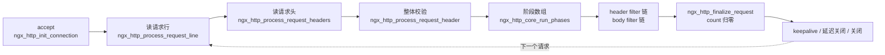
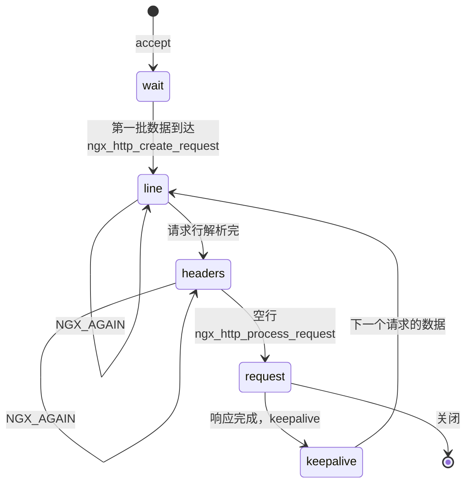
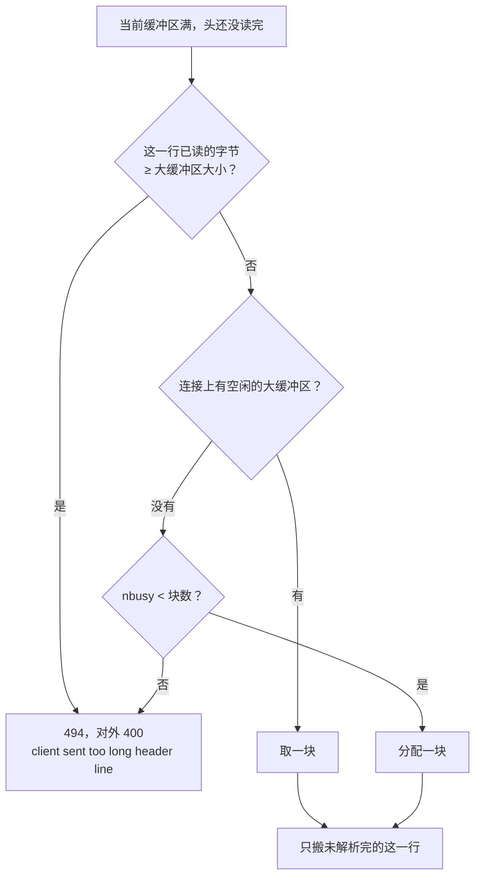
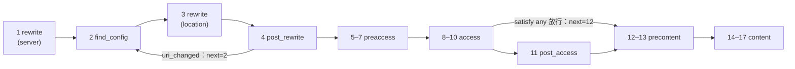
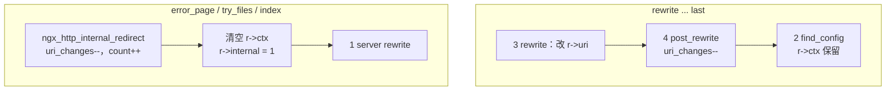
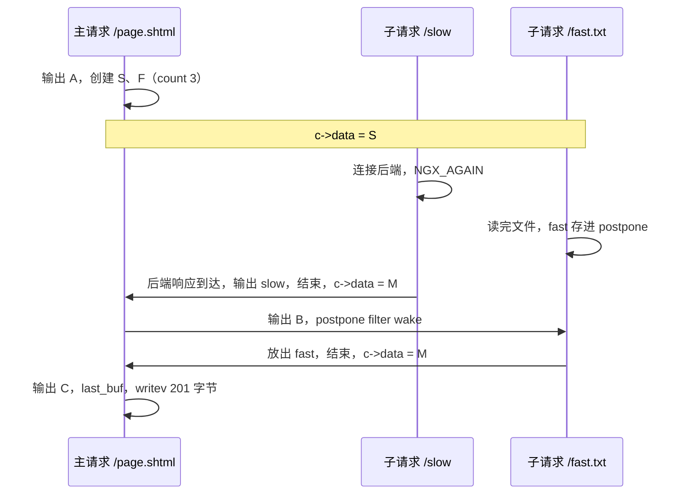
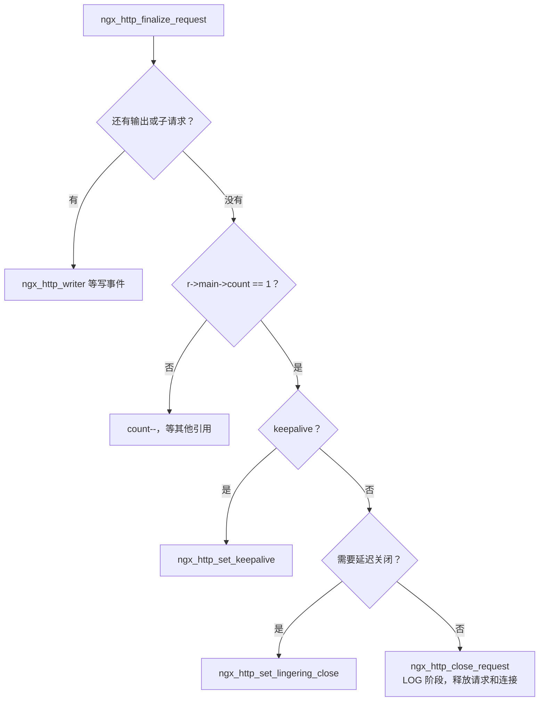

# 开发篇 06｜HTTP 请求的一生：读处理函数换三次，阶段数组走一遍，引用计数归零才算结束

> **一句话结论**：一个 HTTP/1.1 请求在连接上先后由 `ngx_http_wait_request_handler`、`ngx_http_process_request_line`、`ngx_http_process_request_headers` 读取，数据不够就返回、等下一个读事件再进来；请求头放在 1k 的缓冲区里，一行放不下才搬进 `large_client_header_buffers`，单行超过一块就是 400。请求头读完后先做整体校验，所有 400 都发生在进入阶段之前。之后请求交给阶段数组：从内存里读出来的 18 个元素和[开发篇 01](01-source-map.md) §6 由模块数组推出的完全一致，各阶段的 checker 对同一个返回值有不同的解释，`rewrite ... last` 回到 FIND_CONFIG（下标 2），内部跳转回到 SERVER_REWRITE（下标 1），两者共用 10 次的上限。响应经过 header 和 body 两条过滤器链，小响应在 write filter 里攒到最后一块才发。子请求与主请求共用连接，postpone 过滤器按顺序放行输出；请求是否结束看 `r->main->count`，归零才释放，然后按配置走 keepalive、延迟关闭或直接关闭。
>
> 适用版本：nginx 1.31.9（mainline，2026-11-18）。「版本差异」：没有冒号的请求头行从 1.31.9 起被拒绝（1.30.7 把它当作值为空的头）；HTTP/2、HTTP/3 请求带 `Connection`、`Proxy-Connection` 等逐跳头时被拒绝（1.31.0 起）；`client_body_early_read`（1.31.5 起）让请求体在进入阶段之前读取；带请求体的 `CONNECT` 被拒绝。阶段引擎、过滤器、子请求和结束流程的代码两个版本相同。实验：[`labs/dev-06`](../labs/dev-06/)，`ph.c` 链接本仓库构建的目标文件读取阶段数组，其余步骤读一个 worker 的 debug 日志。

## 导读

| 你想知道 | 看哪一节 |
|---|---|
| 请求分几次到达时 nginx 怎么接着读 | §1 |
| `client_header_buffer_size` 和 `large_client_header_buffers` 怎么配合 | §2 |
| 哪些 400 在进入阶段之前就返回了 | §3 |
| 阶段数组的真实内容，每个 checker 怎么解释返回值 | §4 |
| `rewrite last`、`error_page` 跳转后从哪里重新开始 | §5 |
| 响应经过哪些过滤器，什么时候真正写到 socket | §6 |
| 子请求的输出为什么不会乱序 | §7 |
| 请求什么时候算结束，之后连接去哪里 | §8 |

[开发篇 05](05-process-event-loop.md) 讲了 worker 的事件循环；这一篇跟着一个请求从第一个字节走到连接关闭。下图是全程的主干，判断是：请求处理分三段，读请求和发响应是事件驱动的，中间的阶段数组是一次同步遍历，任何一步返回“还没完成”都会让出 worker：



## 1. 一个请求在连接上换三次读处理函数，数据不够就返回等下一个事件

连接建立后，读事件的处理函数是 `ngx_http_wait_request_handler`（[`ngx_http_request.c` 第 329 行](https://github.com/nginx/nginx/blob/release-1.31.9/src/http/ngx_http_request.c#L329)），它只负责等第一批数据、分配请求头缓冲区（[开发篇 03](03-memory.md) §4）。数据到了就建请求，把处理函数换成读请求行：

```c
// src/http/ngx_http_request.c:527-535
    c->data = ngx_http_create_request(c);
    if (c->data == NULL) {
        ngx_http_close_connection(c);
        return;
    }

    rev->handler = ngx_http_process_request_line;
    ngx_http_process_request_line(rev);
}
```

`ngx_http_process_request_line` 是一个“读一点、解析一点”的循环：

```c
// src/http/ngx_http_request.c:1137-1150
    rc = NGX_AGAIN;

    for ( ;; ) {

        if (rc == NGX_AGAIN) {
            n = ngx_http_read_request_header(r);

            if (n == NGX_AGAIN || n == NGX_ERROR) {
                break;
            }
        }

        rc = ngx_http_parse_request_line(r, r->header_in);

```

解析器 `ngx_http_parse_request_line` 是一个状态机，状态存在 `r->state` 里；数据不够时返回 `NGX_AGAIN`，循环再去读，读不到（`n == NGX_AGAIN`）就跳出，函数返回，worker 去处理别的连接。下一个读事件到来时，同一个函数从保存的状态接着解析。请求行解析完，处理函数换成读请求头（[第 1229 行](https://github.com/nginx/nginx/blob/release-1.31.9/src/http/ngx_http_request.c#L1229)），请求头也是同样的循环。请求头全部读完，`ngx_http_process_request` 做最后一次切换：

```c
// src/http/ngx_http_request.c:2209-2218
    c->read->handler = ngx_http_request_handler;
    c->write->handler = ngx_http_request_handler;
    r->read_event_handler = ngx_http_block_reading;

    if (ngx_http_read_early_body(r) != NGX_OK) {
        return;
    }

    ngx_http_handler(r);
}
```

从这以后连接的读、写事件都进 `ngx_http_request_handler`，它再按事件方向调用请求上的 `r->read_event_handler` 或 `r->write_event_handler`。`ngx_http_handler` 把写事件处理函数设成 `ngx_http_core_run_phases`：

```c
// src/http/ngx_http_core_module.c:885-890
    r->gzip_vary = 0;
#endif

    r->write_event_handler = ngx_http_core_run_phases;
    ngx_http_core_run_phases(r);
}
```

所以阶段处理中途让出（例如等 upstream、等 `limit_req` 的延迟）之后，写事件一来就回到阶段数组上次停下的位置。实验把一个请求分三次写，每次间隔 0.2 秒：`GET /a.txt HT`、`TP/1.1` 加 `Host`、`Connection: close` 加空行：

```text
# labs/dev-06 ## a request that arrives in three pieces
HTTP/1.1 200 OK
http wait request handler
http process request line
http process request line
http request line: "GET /a.txt HTTP/1.1"
http process request header line
http header: "Host: x"
http process request header line
http header: "Connection: close"
http header done
ok - the request line handler runs twice, the header handler twice
```

读请求行的函数进了两次：第一次只有半个协议名，返回 `NGX_AGAIN`；读请求头的函数也进了两次，每次解析出当时已有的完整头行。

下图是连接上读处理函数的切换，判断是：每个状态都可以在数据不够时退出，下一个读事件从同一个状态继续：



**小结**：请求的读取没有专门的线程或协程，靠的是“状态存在请求结构里 + 读处理函数在连接上切换”；写模块时，任何返回 `NGX_AGAIN` 的地方都要保证有事件把请求叫回来。

## 2. 请求头先放进 1k 缓冲区，一行放不下才搬进 large_client_header_buffers

请求头缓冲区默认 1k（`client_header_buffer_size`），`large_client_header_buffers` 默认 4 块、每块 8k（[`ngx_http_core_module.c` 第 3628–3632 行](https://github.com/nginx/nginx/blob/release-1.31.9/src/http/ngx_http_core_module.c#L3628)）。当前缓冲区写满而请求头还没读完时，`ngx_http_alloc_large_header_buffer` 先检查正在解析的这一行有没有超过一块大缓冲区：

```c
// src/http/ngx_http_request.c:1679-1690
    old = request_line ? r->request_start : r->header_name_start;

    cscf = ngx_http_get_module_srv_conf(r, ngx_http_core_module);

    if (r->state != 0
        && (size_t) (r->header_in->pos - old)
                                     >= cscf->large_client_header_buffers.size)
    {
        return NGX_DECLINED;
    }

    hc = r->http_connection;
```

没超过就从连接上取一块空闲的大缓冲区，没有空闲的、已用块数又没到上限就新分配一块，否则也是拒绝：

```c
// src/http/ngx_http_request.c:1692-1727
    if (hc->free) {
        cl = hc->free;
        hc->free = cl->next;

        b = cl->buf;

        ngx_log_debug2(NGX_LOG_DEBUG_HTTP, r->connection->log, 0,
                       "http large header free: %p %uz",
                       b->pos, b->end - b->last);

    } else if (hc->nbusy < cscf->large_client_header_buffers.num) {

        b = ngx_create_temp_buf(r->connection->pool,
                                cscf->large_client_header_buffers.size);
        if (b == NULL) {
            return NGX_ERROR;
        }

        cl = ngx_alloc_chain_link(r->connection->pool);
        if (cl == NULL) {
            return NGX_ERROR;
        }

        cl->buf = b;

        ngx_log_debug2(NGX_LOG_DEBUG_HTTP, r->connection->log, 0,
                       "http large header alloc: %p %uz",
                       b->pos, b->end - b->last);

    } else {
        return NGX_DECLINED;
    }

    cl->next = hc->busy;
    hc->busy = cl;
    hc->nbusy++;
```

然后只把没解析完的那一行搬过去，已经解析好的头行留在原缓冲区里，因为 `headers_in` 里的字符串直接指向它们。实验把缓冲区设成 1k 和 2 块 4k，先发一行 2000 字节的头，再发一行 5000 字节的头：

```text
# labs/dev-06 ## header buffers: 1k first, then one 4k large buffer per line
long-2k: HTTP/1.1 200 OK
long-5k: HTTP/1.1 400 Bad Request
http alloc large header buffer
http large header alloc: 4096
http large header copy: 994
http alloc large header buffer
http large header alloc: 4096
http large header copy: 994
http alloc large header buffer
client sent too long header line: "X-Long: aaaaaaaa..."
ok - the 2000-byte line moves to a 4k buffer, the 5000-byte line is 400
```

第一个请求的请求行和 `Host` 共 30 字节，1024 字节的缓冲区满时 `X-Long` 这一行已经读进来 994 字节，于是分配一块 4096 字节的大缓冲区，把这 994 字节搬过去，接着读完。第二个请求同样搬进一块 4k，读满后再次申请时这一行已经有 4096 字节，第 1683–1688 行返回 `NGX_DECLINED`，结果是 494（`NGX_HTTP_REQUEST_HEADER_TOO_LARGE`），对客户端和 access log 都显示为 400（[运维篇 13](../ops/13-troubleshooting.md) §2）。

几个推论，都直接来自上面两段代码：限制的是单行长度和块数，不是请求头总长；块数用完（`hc->nbusy` 到上限）时报的也是同一个错误；大缓冲区挂在连接上（`hc->busy`、`hc->free`），keepalive 的下一个请求可以复用，空闲的 keepalive 连接会释放它们以减少内存占用（`ngx_http_set_keepalive` 第 3463 行起的注释）。

下图是一行请求头放不下时的判断顺序，判断是：先比单行长度，再看有没有可用的块：



**小结**：遇到“Request Header Or Cookie Too Large”，先看 error.log 的 info 行是 `too long header line` 还是 `too large request`：前者调大 `large_client_header_buffers` 的块大小，后者调块数。

## 3. 每行请求头先查 headers_in 哈希，读完再整体校验：这些 400 都在进入阶段之前

每解析出一行，`ngx_http_process_request_headers` 先检查头行数，再把它追加到 `headers_in.headers` 链表，然后用小写名字查 `headers_in_hash`：

```c
// src/http/ngx_http_request.c:1501-1546
            /* a header line has been parsed successfully */

            if (r->headers_in.count++ >= cscf->max_headers) {
                r->lingering_close = 1;
                ngx_log_error(NGX_LOG_INFO, c->log, 0,
                              "client sent too many header lines");
                ngx_http_finalize_request(r,
                                          NGX_HTTP_REQUEST_HEADER_TOO_LARGE);
                break;
            }

            h = ngx_list_push(&r->headers_in.headers);
            if (h == NULL) {
                ngx_http_close_request(r, NGX_HTTP_INTERNAL_SERVER_ERROR);
                break;
            }

            h->hash = r->header_hash;

            h->key.len = r->header_name_end - r->header_name_start;
            h->key.data = r->header_name_start;
            h->key.data[h->key.len] = '\0';

            h->value.len = r->header_end - r->header_start;
            h->value.data = r->header_start;
            h->value.data[h->value.len] = '\0';

            h->lowcase_key = ngx_pnalloc(r->pool, h->key.len);
            if (h->lowcase_key == NULL) {
                ngx_http_close_request(r, NGX_HTTP_INTERNAL_SERVER_ERROR);
                break;
            }

            if (h->key.len == r->lowcase_index) {
                ngx_memcpy(h->lowcase_key, r->lowcase_header, h->key.len);

            } else {
                ngx_strlow(h->lowcase_key, h->key.data, h->key.len);
            }

            hh = ngx_hash_find(&cmcf->headers_in_hash, h->hash,
                               h->lowcase_key, h->key.len);

            if (hh && hh->handler(r, h, hh->offset) != NGX_OK) {
                break;
            }
```

哈希表来自 [`ngx_http_headers_in[]`](https://github.com/nginx/nginx/blob/release-1.31.9/src/http/ngx_http_request.c#L80)（`Host`、`Connection`、`If-Modified-Since` 等），每项带一个处理函数和一个偏移：`Host` 由 `ngx_http_process_host` 校验并决定虚拟主机，其余的只是把指针存进 `r->headers_in` 的对应字段，模块以后直接读字段，不用再遍历链表。`max_headers`（1.29.8 起，默认 1000，[第 3640 行](https://github.com/nginx/nginx/blob/release-1.31.9/src/http/ngx_http_core_module.c#L3640)）限制的是头行数。

空行之后，`ngx_http_process_request_header` 做跨头的校验，例如 HTTP/1.1 必须有 `Host`，`Content-Length` 和 `Transfer-Encoding: chunked` 不能同时出现：

```c
// src/http/ngx_http_request.c:2064-2077
        if (r->headers_in.transfer_encoding->value.len == 7
            && ngx_strncasecmp(r->headers_in.transfer_encoding->value.data,
                               (u_char *) "chunked", 7) == 0)
        {
            if (r->headers_in.content_length) {
                ngx_log_error(NGX_LOG_INFO, r->connection->log, 0,
                              "client sent \"Content-Length\" and "
                              "\"Transfer-Encoding\" headers "
                              "at the same time");
                ngx_http_finalize_request(r, NGX_HTTP_BAD_REQUEST);
                return NGX_ERROR;
            }

            r->headers_in.chunked = 1;
```

实验发四个各有一处问题的请求：11 行头（上限设为 10）、一行没有冒号的头、HTTP/1.1 没有 `Host`、同时带 `Content-Length` 和 `Transfer-Encoding`：

```text
# labs/dev-06 ## checks while reading headers and after the last one
many: HTTP/1.1 400 Bad Request
nocolon: HTTP/1.1 400 Bad Request
nohost: HTTP/1.1 400 Bad Request
cl-te: HTTP/1.1 400 Bad Request
client sent too many header lines
client sent invalid header line: "X-No-Colon\x0d..."
client sent HTTP/1.1 request without "Host" header
client sent "Content-Length" and "Transfer-Encoding" headers at the same time
ok - all four are 400
```

四个都是 400，原因各在 error.log 的 info 级别里。没有冒号的头行在 1.31.9 里由解析器直接判为无效：1.30.7 的 `ngx_http_parse_header_line` 在头名后遇到 `CR`/`LF` 时把它当作值为空的头（1.30.7 `ngx_http_parse.c` 第 978–992 行），1.31.9 删掉了这两个分支，`CHANGES` 记为“now header lines without a colon are rejected”。这个函数也用来解析 upstream 的响应头，所以后端发出没有冒号的头行时同样会被拒绝；后一点是读代码得出的推论，本篇没有用后端验证。

**小结**：请求行和请求头阶段的拒绝都发生在 `ngx_http_handler` 之前，阶段数组里的模块（包括 `limit_req`、`access`）看不到这些请求，access log 里的 400 只能从 error.log 的 info 行找原因。

## 4. 阶段数组从内存里读出来与开发篇 01 推算的一致；同一个返回值由各阶段的 checker 解释

`ph.c` 用和 `nginx -t` 相同的步骤加载实验配置，然后遍历 `cmcf->phase_engine.handlers`，打印每个元素的 checker、`next` 和 handler（handler 是各模块的 static 函数，用 `nm` 从地址反查名字）：

```text
# labs/dev-06 ## the phase engine read from memory
server_rewrite_index=1 location_rewrite_index=3
 0 generic      next=1  ngx_http_realip_handler
 1 rewrite      next=2  ngx_http_rewrite_handler
 2 find_config  next=0  -
 3 rewrite      next=4  ngx_http_rewrite_handler
 4 post_rewrite next=2  -
 5 generic      next=8  ngx_http_realip_handler
 6 generic      next=8  ngx_http_limit_req_handler
 7 generic      next=8  ngx_http_limit_conn_handler
 8 access       next=12 ngx_http_access_handler
 9 access       next=12 ngx_http_auth_basic_handler
10 access       next=12 ngx_http_auth_request_handler
11 post_access  next=12 -
12 generic      next=14 ngx_http_try_files_handler
13 generic      next=14 ngx_http_mirror_handler
14 content      next=18 ngx_http_index_handler
15 content      next=18 ngx_http_autoindex_handler
16 content      next=18 ngx_http_gzip_static_handler
17 content      next=18 ngx_http_static_handler
top header filter=ngx_http_not_modified_header_filter
top body filter=ngx_http_range_body_filter
ok - 18 entries, post_rewrite goes back to find_config, access handlers jump over post_access
```

18 个元素、顺序和开发篇 01 §6 由 `ngx_modules[]` 推出的表一致。`next` 是“跳到下一阶段”时的目标：同一阶段的元素 `next` 相同；POST_REWRITE（下标 4）的 `next` 是 2，指回 FIND_CONFIG；ACCESS 阶段三个元素的 `next` 是 12，越过了 POST_ACCESS（下标 11）。CONTENT 阶段（下标 14–17）的 `next` 是 18，即结尾那个 checker 为 NULL 的元素。两条过滤器链的链头是模块数组里最后注册的过滤器：header 链是 `not_modified`，body 链是 `range_body`。

handler 只返回一个值，怎么走由 checker 决定。REWRITE 阶段的 checker：

```c
// src/http/ngx_http_core_module.c:952-976
ngx_int_t
ngx_http_core_rewrite_phase(ngx_http_request_t *r, ngx_http_phase_handler_t *ph)
{
    ngx_int_t  rc;

    ngx_log_debug1(NGX_LOG_DEBUG_HTTP, r->connection->log, 0,
                   "rewrite phase: %ui", r->phase_handler);

    rc = ph->handler(r);

    if (rc == NGX_DECLINED) {
        r->phase_handler++;
        return NGX_AGAIN;
    }

    if (rc == NGX_DONE) {
        return NGX_OK;
    }

    /* NGX_OK, NGX_AGAIN, NGX_ERROR, NGX_HTTP_...  */

    ngx_http_finalize_request(r, rc);

    return NGX_OK;
}
```

四种 checker 对返回值的解释：

| checker | `NGX_DECLINED` | `NGX_OK` | `NGX_AGAIN` / `NGX_DONE` | 其他（错误、状态码） |
|---|---|---|---|---|
| generic（POST_READ、PREACCESS、PRECONTENT） | 同阶段下一个 | 跳到 `next` | 让出，等事件 | 结束请求 |
| rewrite（SERVER_REWRITE、REWRITE） | 同阶段下一个 | 结束请求 | `NGX_DONE` 让出；`NGX_AGAIN` 结束请求 | 结束请求 |
| access | 同阶段下一个 | `satisfy all` 时同阶段下一个；`satisfy any` 时跳到 `next` | 让出 | `satisfy any` 时 403/401 先记下、继续下一个；其余结束请求 |
| content | 同阶段下一个；最后一个也拒绝时 404 或 403 | 结束请求 | 结束请求（由 finalize 处理） | 结束请求 |

`satisfy any` 跳到 `next`（12）正是为了越过 POST_ACCESS：POST_ACCESS 的工作是检查 `r->access_code` 里记下的拒绝，有一个模块放行就不必再检查。access 阶段的这段逻辑：

```c
// src/http/ngx_http_core_module.c:1144-1180
    clcf = ngx_http_get_module_loc_conf(r, ngx_http_core_module);

    if (clcf->satisfy == NGX_HTTP_SATISFY_ALL) {

        if (rc == NGX_OK) {
            r->phase_handler++;
            return NGX_AGAIN;
        }

    } else {
        if (rc == NGX_OK) {
            r->access_code = 0;

            h = ngx_http_proxy_auth(r) ? r->headers_out.proxy_authenticate
                                       : r->headers_out.www_authenticate;

            for ( /* void */ ; h; h = h->next) {
                h->hash = 0;
            }

            r->phase_handler = ph->next;
            return NGX_AGAIN;
        }

        if (rc == NGX_HTTP_FORBIDDEN
            || rc == NGX_HTTP_UNAUTHORIZED
            || rc == NGX_HTTP_PROXY_AUTH_REQUIRED)
        {
            if (r->access_code != NGX_HTTP_UNAUTHORIZED
                && r->access_code != NGX_HTTP_PROXY_AUTH_REQUIRED)
            {
                r->access_code = rc;
            }

            r->phase_handler++;
            return NGX_AGAIN;
        }
```

实验请求 `deny all` 的 location，debug 日志的最后一个阶段行是 access 阶段的第一个元素：

```text
# labs/dev-06 ## deny ends the request in the access phase
403
access phase: 8
access forbidden by rule
http finalize request: 403, "/deny?" a:1, c:1
http finalize request: 0, "/deny?" a:1, c:1
ok - the last phase line is access phase: 8, then 403
```

`satisfy` 默认是 `all`，`ngx_http_access_handler` 返回 403，checker 直接结束请求，下标 9 以后的元素都没有运行。

下图是阶段数组上的三种跳转，判断是：除了顺序前进，只有 POST_REWRITE、`satisfy any` 和 `next` 三种跳转，都由启动时算好的下标决定：



**小结**：写阶段处理函数时，先确定注册在哪个阶段，再按那个阶段的 checker 选返回值；同样返回 `NGX_OK`，在 PREACCESS 是“这一阶段我说了算，进下一阶段”，在 REWRITE 和 CONTENT 是“请求结束了”。

## 5. rewrite last 回到 FIND_CONFIG，内部跳转回到 SERVER_REWRITE，两者共用 10 次上限

`rewrite ... last` 只是改了 `r->uri` 并置 `uri_changed`，真正回头的是 POST_REWRITE 的 checker：

```c
// src/http/ngx_http_core_module.c:1074-1115
ngx_int_t
ngx_http_core_post_rewrite_phase(ngx_http_request_t *r,
    ngx_http_phase_handler_t *ph)
{
    ngx_http_core_srv_conf_t  *cscf;

    ngx_log_debug1(NGX_LOG_DEBUG_HTTP, r->connection->log, 0,
                   "post rewrite phase: %ui", r->phase_handler);

    if (!r->uri_changed) {
        r->phase_handler++;
        return NGX_AGAIN;
    }

    ngx_log_debug1(NGX_LOG_DEBUG_HTTP, r->connection->log, 0,
                   "uri changes: %d", r->uri_changes);

    /*
     * gcc before 3.3 compiles the broken code for
     *     if (r->uri_changes-- == 0)
     * if the r->uri_changes is defined as
     *     unsigned  uri_changes:4
     */

    r->uri_changes--;

    if (r->uri_changes == 0) {
        ngx_log_error(NGX_LOG_ERR, r->connection->log, 0,
                      "rewrite or internal redirection cycle "
                      "while processing \"%V\"", &r->uri);

        ngx_http_finalize_request(r, NGX_HTTP_INTERNAL_SERVER_ERROR);
        return NGX_OK;
    }

    r->phase_handler = ph->next;

    cscf = ngx_http_get_module_srv_conf(r, ngx_http_core_module);
    r->loc_conf = cscf->ctx->loc_conf;

    return NGX_AGAIN;
}
```

它把 `phase_handler` 设成 `next`（2），并把 `r->loc_conf` 恢复成 server 级的配置，location 重新匹配。实验请求 `/r/a.txt`，`rewrite ^/r/(.*)$ /static/$1 last`：

```text
# labs/dev-06 ## rewrite ... last goes back to find_config
200
generic phase: 0
rewrite phase: 1
using configuration "/r/"
rewrite phase: 3
rewritten data: "/static/a.txt"
post rewrite phase: 4
uri changes: 11
using configuration "/static/"
rewrite phase: 3
post rewrite phase: 4
generic phase: 5
generic phase: 6
generic phase: 7
access phase: 8
access phase: 9
access phase: 10
post access phase: 11
generic phase: 12
generic phase: 13
content phase: 14
content phase: 15
content phase: 16
content phase: 17
ok - after the rewrite the phases continue at find_config (2), then rewrite (3) again
```

`using configuration "/r/"` 之后，下标 3 的 rewrite 改写 URI，下标 4 打印 `uri changes: 11`，接着是新一轮匹配 `using configuration "/static/"`，然后再次经过下标 3、4，这次 URI 没变，继续往下。server 级的 rewrite（下标 1）没有再运行。

`uri_changes` 的初值是 `NGX_HTTP_MAX_URI_CHANGES + 1`（11，[`ngx_http_request.h` 第 12 行](https://github.com/nginx/nginx/blob/release-1.31.9/src/http/ngx_http_request.h#L12)），每次改写后减一，减到 0 就是 500。实验让一个 location 每次都改写到自己：

```text
# labs/dev-06 ## ten URI changes at most
500
uri changes: 11 uri changes: 10 uri changes: 9 uri changes: 8 uri changes: 7 uri changes: 6 uri changes: 5 uri changes: 4 uri changes: 3 uri changes: 2 uri changes: 1
rewrite or internal redirection cycle
ok - 11 rewrites, the 11th is rejected with 500
```

`uri changes` 从 11 打到 1，第 11 次改写后减到 0，报 `rewrite or internal redirection cycle`。也就是说，一个请求最多经过 10 次改写后重新匹配 location。

`error_page`、`try_files` 的回退、`index` 走的是另一条路，`ngx_http_internal_redirect`：

```c
// src/http/ngx_http_core_module.c:2619-2671
ngx_int_t
ngx_http_internal_redirect(ngx_http_request_t *r,
    ngx_str_t *uri, ngx_str_t *args)
{
    ngx_http_core_srv_conf_t  *cscf;

    r->uri_changes--;

    if (r->uri_changes == 0) {
        ngx_log_error(NGX_LOG_ERR, r->connection->log, 0,
                      "rewrite or internal redirection cycle "
                      "while internally redirecting to \"%V\"", uri);

        r->main->count++;
        ngx_http_finalize_request(r, NGX_HTTP_INTERNAL_SERVER_ERROR);
        return NGX_DONE;
    }

    r->uri = *uri;

    if (args) {
        r->args = *args;

    } else {
        ngx_str_null(&r->args);
    }

    ngx_log_debug2(NGX_LOG_DEBUG_HTTP, r->connection->log, 0,
                   "internal redirect: \"%V?%V\"", uri, &r->args);

    ngx_http_set_exten(r);

    /* clear the modules contexts */
    ngx_memzero(r->ctx, sizeof(void *) * ngx_http_max_module);

    cscf = ngx_http_get_module_srv_conf(r, ngx_http_core_module);
    r->loc_conf = cscf->ctx->loc_conf;

    ngx_http_update_location_config(r);

#if (NGX_HTTP_CACHE)
    r->cache = NULL;
#endif

    r->internal = 1;
    r->valid_unparsed_uri = 0;
    r->add_uri_to_alias = 0;
    r->main->count++;

    ngx_http_handler(r);

    return NGX_DONE;
}
```

它同样消耗 `uri_changes`，但清空了所有模块的请求上下文（`r->ctx`），置 `r->internal`，再调用 `ngx_http_handler`，后者对内部请求把 `phase_handler` 设成 `server_rewrite_index`（1），所以 server 级的 rewrite 会重新执行，POST_READ（下标 0，`realip`）不会。实验请求一个不存在的文件，`error_page 404 /a.txt`：

```text
# labs/dev-06 ## an internal redirect starts again at server rewrite
404
internal redirect: "/a.txt?"
rewrite phase: 1
http finalize request: 404, "/missing?" a:1, c:1
http finalize request: 0, "/a.txt?" a:1, c:2
http request count:2 blk:0
http finalize request: -4, "/a.txt?" a:1, c:1
ok - error_page restarts at index 1 and holds one more reference
```

跳转后的第一个阶段行是 `rewrite phase: 1`。`c:2` 是引用计数：`ngx_http_internal_redirect` 给 `r->main->count` 加一，返回 `NGX_DONE`。跳转后的请求结束时 count 是 2，`ngx_http_finalize_connection` 只减一；404 那次 finalize 随后收到 `NGX_DONE`（-4），这时 count 是 1，才进入连接的善后（§8）。状态码仍是 404，因为 `error_page` 没有写 `=`，响应用的是 `/a.txt` 的内容、原来的状态码。

下图对比两种回头方式，判断是：`rewrite last` 只重新选 location，内部跳转相当于把请求从 server 级重新送一遍：



**小结**：两种回头共用 `uri_changes`，所以“`rewrite last` 和 `error_page` 互相跳”的配置也会在 10 次后报 500；模块如果在请求上下文里存了状态，内部跳转后要重新建，`rewrite last` 则不会丢。

## 6. 响应先过 header filter 链再过 body filter 链，小响应在 write filter 里攒到最后一块

content handler 发响应只调用两个函数：

```c
// src/http/ngx_http_core_module.c:1904-1921
ngx_http_send_header(ngx_http_request_t *r)
{
    if (r->post_action) {
        return NGX_OK;
    }

    if (r->header_sent) {
        ngx_log_error(NGX_LOG_ALERT, r->connection->log, 0,
                      "header already sent");
        return NGX_ERROR;
    }

    if (r->err_status) {
        r->headers_out.status = r->err_status;
        r->headers_out.status_line.len = 0;
    }

    return ngx_http_top_header_filter(r);
```

```c
// src/http/ngx_http_core_module.c:1957-1974
ngx_http_output_filter(ngx_http_request_t *r, ngx_chain_t *in)
{
    ngx_int_t          rc;
    ngx_connection_t  *c;

    c = r->connection;

    ngx_log_debug2(NGX_LOG_DEBUG_HTTP, c->log, 0,
                   "http output filter \"%V?%V\"", &r->uri, &r->args);

    rc = ngx_http_top_body_filter(r, in);

    if (rc == NGX_ERROR) {
        /* NGX_ERROR may be returned by any filter */
        c->error = 1;
    }

    return rc;
```

`ngx_http_top_header_filter` 和 `ngx_http_top_body_filter` 是两条单向链的链头。每个过滤器模块在 `postconfiguration` 里把自己插到链头，并把原来的链头存进本文件的 static 变量，以 postpone 过滤器为例：

```c
// src/http/ngx_http_postpone_filter_module.c:252-259
static ngx_int_t
ngx_http_postpone_filter_init(ngx_conf_t *cf)
{
    ngx_http_next_body_filter = ngx_http_top_body_filter;
    ngx_http_top_body_filter = ngx_http_postpone_filter;

    return NGX_OK;
}
```

注册按 `ngx_modules[]` 的顺序进行，所以数组里越靠后的过滤器越先执行（开发篇 01 §4）；§4 读出的链头 `not_modified`、`range_body` 就是数组里最后两个过滤器模块。header 链的最后一环是 `ngx_http_header_filter`，它把状态行和所有响应头拼成一个缓冲区，交给 write filter；body 链的最后一环就是 write filter 本身。

write filter 不是每次都写 socket：

```c
// src/http/ngx_http_write_filter_module.c:212-221

    /*
     * avoid the output if there are no last buf, no flush point,
     * there are the incoming bufs and the size of all bufs
     * is smaller than "postpone_output" directive
     */

    if (!last && !flush && in && size < (off_t) clcf->postpone_output) {
        return NGX_OK;
    }
```

没有 `last_buf`、没有 `flush`、累计不到 `postpone_output`（默认 1460，[`ngx_http_core_module.c` 第 3980 行](https://github.com/nginx/nginx/blob/release-1.31.9/src/http/ngx_http_core_module.c#L3980)）时直接返回。所以响应头不会单独发出，而是和第一批响应体一起写；§7 的 SSI 页面经过 7 次 write filter 调用，累计到 201 字节，只在最后一块到来时调用了一次 `writev`。

**小结**：过滤器链的顺序是编译时（模块数组）决定的，不随配置改变；响应什么时候真正离开 nginx，由 write filter 的三个条件决定：最后一块、flush、累计超过 `postpone_output`。

## 7. 子请求共用主请求的连接，postpone 过滤器保证输出按顺序

SSI 的 `include virtual`、`auth_request`、`mirror` 都通过 `ngx_http_subrequest` 创建子请求。子请求共用连接、主请求的内存池，`sr->main` 指向主请求；关键是下面两处：

```c
// src/http/ngx_http_core_module.c:2560-2575
        pr->request = sr;
        pr->out = NULL;
        pr->next = NULL;

        if (c->data == r && r->postponed == NULL) {
            c->data = sr;
        }

        if (r->postponed) {
            for (p = r->postponed; p->next; p = p->next) { /* void */ }
            p->next = pr;

        } else {
            r->postponed = pr;
        }
    }
```

```c
// src/http/ngx_http_core_module.c:2588-2592
    sr->start_msec = tp->msec;

    r->main->count++;

    *psr = sr;
```

`c->data` 表示“当前可以往连接上写的请求”。父请求还没有挂起的子请求时，第一个子请求成为 `c->data`；每个子请求都在父请求的 `postponed` 链表里占一个位置；`r->main->count` 加一。子请求不立即运行，而是用 `ngx_http_post_request` 挂进主请求的 `posted_requests`，由 `ngx_http_run_posted_requests` 在本次事件处理的末尾依次调用。

不是 `c->data` 的请求产生的输出，由 postpone 过滤器先存起来：

```c
// src/http/ngx_http_postpone_filter_module.c:65-77
    if (r->subrequest_in_memory) {
        return ngx_http_postpone_filter_in_memory(r, in);
    }

    if (r != c->data) {

        if (in) {
            if (ngx_http_postpone_filter_add(r, in) != NGX_OK) {
                return NGX_ERROR;
            }

            return NGX_OK;
        }
```

轮到它时（前一个请求结束、`c->data` 交回父请求），父请求的 postpone 过滤器按 `postponed` 链表的顺序把存下的输出放行，遇到还没完成的子请求就把 `c->data` 交给它并停下：

```c
// src/http/ngx_http_postpone_filter_module.c:97-131
    if (in) {
        if (ngx_http_postpone_filter_add(r, in) != NGX_OK) {
            return NGX_ERROR;
        }
    }

    do {
        pr = r->postponed;

        if (pr->request) {

            ngx_log_debug2(NGX_LOG_DEBUG_HTTP, c->log, 0,
                           "http postpone filter wake \"%V?%V\"",
                           &pr->request->uri, &pr->request->args);

            r->postponed = pr->next;

            c->data = pr->request;

            return ngx_http_post_request(pr->request, NULL);
        }

        if (pr->out == NULL) {
            ngx_log_error(NGX_LOG_ALERT, c->log, 0,
                          "http postpone filter NULL output");

        } else {
            ngx_log_debug2(NGX_LOG_DEBUG_HTTP, c->log, 0,
                           "http postpone filter output \"%V?%V\"",
                           &r->uri, &r->args);

            if (ngx_http_next_body_filter(r->main, pr->out) == NGX_ERROR) {
                return NGX_ERROR;
            }
        }
```

实验页面是 `A`、`include /slow`（`proxy_pass` 到同一 nginx 的另一个 server）、`B`、`include /fast.txt`（静态文件）、`C`：

```text
# labs/dev-06 ## subrequests: SSI include, the postpone filter and the reference count
A slow B fast C
http chunk: 2
http subrequest "/slow?"
http subrequest "/fast.txt?"
http finalize request: 0, "/page.shtml?" a:0, c:3
http posted request: "/slow?"
http upstream connect: -2
http finalize request: -4, "/slow?" a:1, c:4
http posted request: "/fast.txt?"
http finalize request: 0, "/fast.txt?" a:0, c:3
writev: 78 of 78
http chunk: 5
http chunk: 0
http finalize request: 0, "/slow?" a:1, c:3
http wake parent request: "/page.shtml?"
http posted request: "/page.shtml?"
http postpone filter output "/page.shtml?"
http chunk: 2
http postpone filter wake "/fast.txt?"
http posted request: "/fast.txt?"
http postpone filter output "/fast.txt?"
http chunk: 5
http finalize request: 0, "/fast.txt?" a:1, c:2
http wake parent request: "/page.shtml?"
http posted request: "/page.shtml?"
http postpone filter output "/page.shtml?"
http chunk: 2
writev: 201 of 201
http finalize request: 0, "/page.shtml?" a:1, c:1
ok - two subrequests, three references, one writev to the client
```

按时间顺序读：

1. 主请求输出 `A`（`http chunk: 2`，SSI 的响应没有长度，用 chunked 编码），创建两个子请求，count 到 3；主请求这一轮结束时 `a:0`，因为 `c->data` 已经是 `/slow`。
2. `/slow` 先运行，连接后端返回 `NGX_AGAIN`（-2），finalize 收到 `NGX_DONE`；`/fast.txt` 接着运行，读完文件就结束了，但它不是 `c->data`，`fast` 被 postpone 过滤器存在内存里（`a:0, c:3`）。
3. 后端的响应到达（`writev: 78 of 78` 是发给后端的请求，记在客户端连接的日志里），`/slow` 输出 `slow` 并结束，`http wake parent request` 把 `c->data` 交回主请求。
4. 主请求继续 SSI 输出 `B`，postpone 过滤器遇到 `/fast.txt`，`postpone filter wake` 让它把存下的 `fast` 放出去，它结束后再交回主请求输出 `C`。
5. 整个响应只在最后一块到来时写了一次：`writev: 201 of 201`。

客户端收到的顺序是 `A slow B fast C`，与 `/fast.txt` 先完成无关。

下图是这次请求里 `c->data` 的交接，判断是：同一时刻只有一个请求能写连接，其余的输出在内存里排队：



**小结**：子请求是“同一个连接上的多个请求”，没有并行写；先完成的子请求只是先把输出准备好。`NGX_HTTP_MAX_SUBREQUESTS`（50）限制嵌套深度，`r->main->count` 不能超过 65535 − 1000（第 2448 行），两者防的都是配置写出的无限子请求。

## 8. 请求结束看引用计数：count 归零才释放，之后按配置走 keepalive、延迟关闭或关闭

`ngx_http_finalize_request` 是所有出口的汇合点，它的第一个参数决定走哪条路：`NGX_DONE` 直接进 `ngx_http_finalize_connection`；`NGX_DECLINED` 回到阶段数组；错误、408、499 终止请求；`>= 300` 的状态码和 201、204 先生成特殊响应（错误页、`error_page`）再 finalize；子请求结束时唤醒父请求；主请求还有未发完的数据（`r->buffered`、`c->buffered`）或未完成的子请求（`r->postponed`）时，换成 `ngx_http_writer` 等写事件。都没有了才进入连接的善后：

```c
// src/http/ngx_http_request.c:3017-3075
    clcf = ngx_http_get_module_loc_conf(r, ngx_http_core_module);

    if (r->main->count != 1) {

        if (r->discard_body) {
            r->read_event_handler = ngx_http_discarded_request_body_handler;
            ngx_add_timer(r->connection->read, clcf->lingering_timeout);

            if (r->lingering_time == 0) {
                r->lingering_time = ngx_time()
                                      + (time_t) (clcf->lingering_time / 1000);
            }
        }

        ngx_http_close_request(r, 0);
        return;
    }

    r = r->main;

    if (r->connection->read->eof) {
        ngx_http_close_request(r, 0);
        return;
    }

    if (r->reading_body) {
        r->keepalive = 0;
        r->lingering_close = 1;
    }

    if (r->keepalive
        && clcf->keepalive_min_timeout > 0)
    {
        ngx_http_set_keepalive(r);
        return;
    }

    if (!ngx_terminate
         && !ngx_exiting
         && r->keepalive
         && clcf->keepalive_timeout > 0)
    {
        ngx_http_set_keepalive(r);
        return;
    }

    if (clcf->lingering_close == NGX_HTTP_LINGERING_ALWAYS
        || (clcf->lingering_close == NGX_HTTP_LINGERING_ON
            && (r->lingering_close
                || r->header_in->pos < r->header_in->last
                || r->connection->read->ready
                || r->connection->pipeline)))
    {
        ngx_http_set_lingering_close(r->connection);
        return;
    }

    ngx_http_close_request(r, 0);
}
```

`r->main->count` 是主请求的引用计数。读请求体、内部跳转、每个子请求、upstream 的某些阶段都会加一，各自结束时由 `ngx_http_close_request` 减一，减到 0 才释放请求、关闭或复用连接：

```c
// src/http/ngx_http_request.c:3948-3966
ngx_http_close_request(ngx_http_request_t *r, ngx_int_t rc)
{
    ngx_connection_t  *c;

    r = r->main;
    c = r->connection;

    ngx_log_debug2(NGX_LOG_DEBUG_HTTP, c->log, 0,
                   "http request count:%d blk:%d", r->count, r->blocked);

    if (r->count == 0) {
        ngx_log_error(NGX_LOG_ALERT, c->log, 0, "http request count is zero");
    }

    r->count--;

    if (r->count || r->blocked) {
        return;
    }
```

§5 的 `error_page` 是最小的例子：跳转加到 2，跳转后的请求结束时减回 1，原来那次 finalize 才进入连接的善后。§7 的子请求页面最高到了 4（`/slow` 连接后端时）。count 不为 1 时 `ngx_http_finalize_connection` 只减一就返回，所以一个请求结束的标志是最后一次减到 0，不是某次 `http finalize request: 0`。

count 归零之前，连接的去向按顺序判断：

1. `keepalive_min_timeout`（1.27.4 起）大于 0 时，即使 worker 正在退出也进入 keepalive，保证连接至少空闲这么久才关；
2. worker 没有在退出、请求允许 keepalive、`keepalive_timeout` 大于 0：`ngx_http_set_keepalive`；
3. 需要延迟关闭（`lingering_close always`，或默认的 `on` 且还有没读完的数据、流水线请求）：`ngx_http_set_lingering_close`，§2 的 5000 字节请求就走了这里（日志里的 `lingering read`）；
4. 其余直接关闭。

下图是请求结束到连接去向的判断，判断是：引用计数决定请求是否结束，配置和连接状态决定连接是否留下：



LOG 阶段不在阶段数组里，`ngx_http_free_request` 调用 `ngx_http_log_request` 执行它（日志里的 `http log handler`），所以 access log 写在请求释放时，keepalive 的连接也是每个请求结束各写一行。

**小结**：给请求“加一个引用”的模块必须保证在每条路径上都减回来，少减一次连接就永远不会释放，多减一次 nginx 会记 `http request count is zero` 的 alert；这是写异步模块最容易出错的地方。

## 已知局限与待核实

- 实验只覆盖 HTTP/1.1 明文；HTTP/2、HTTP/3 的请求由各自的模块解析，`ngx_http_finalize_connection` 对它们直接关闭流（第 3003–3015 行），本篇没有展开。
- §3 “后端发出没有冒号的头行会被拒绝”是读代码的推论，没有用后端验证；1.30.7 的行为只读了源码。
- 请求体（`ngx_http_read_client_request_body`、`client_body_early_read`）只在版本说明里提到，没有实验。
- `ph.c` 用 `nm` 把函数地址翻译成名字，依赖本仓库构建保留了符号表；strip 过的二进制不能这样做。
- §8 列出的加引用计数的场景来自对 `count++` 的搜索，没有逐一用实验验证。

## 修订记录

- 2026-11-21：基于 nginx 1.31.9 源码新写。覆盖读处理函数的切换、请求头缓冲区与大缓冲区、请求头校验和 1.31.x 的新拒绝规则、从内存读取的阶段数组与 checker 返回值约定、`rewrite last` 与内部跳转、过滤器链与 write filter 的缓冲、子请求与 postpone 过滤器、引用计数与连接去向；实验 `labs/dev-06`。
