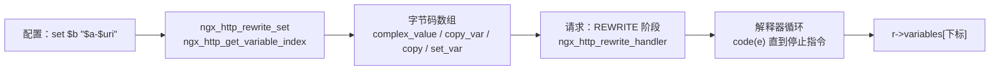
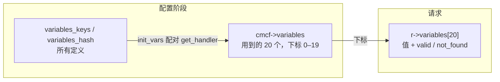
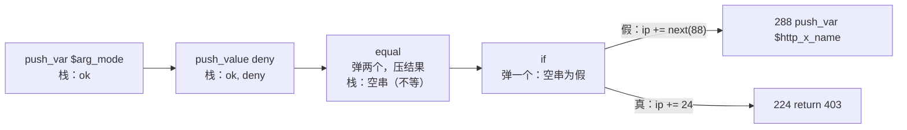
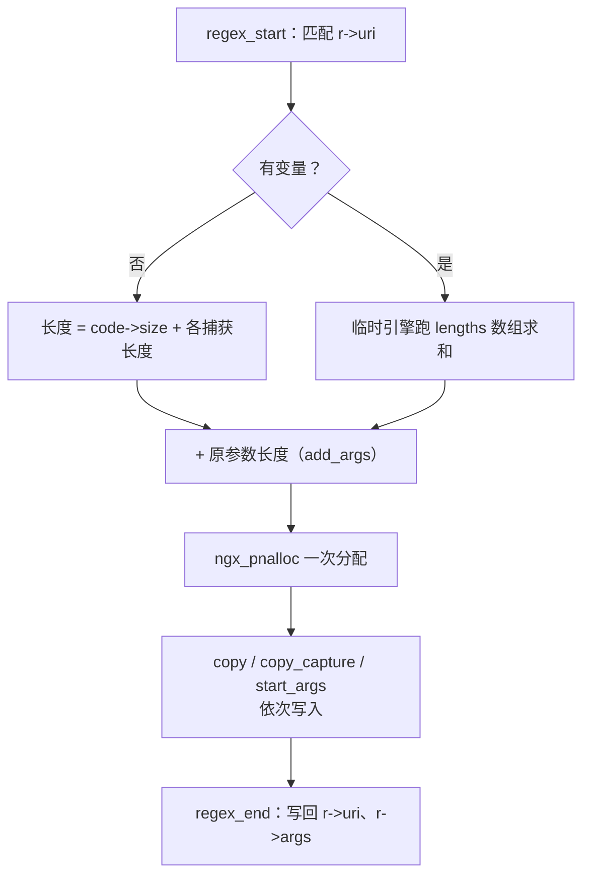
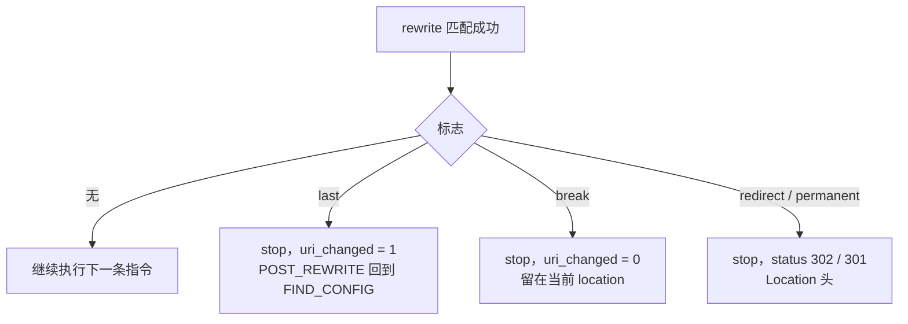
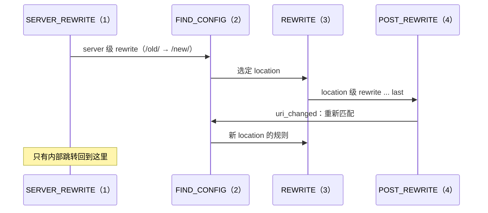

# 开发篇 07｜变量与脚本引擎：rewrite 模块把指令编成一段字节码，请求来了在一个栈上执行

> **一句话结论**：配置里用到的每个变量在解析时就分到一个下标，请求里的 `r->variables[下标]` 存它的值；取值默认有缓存，只有标了 `NOCACHEABLE` 的（`$uri`、`$args`、`$arg_*` 等）每次重新计算，所以在 rewrite 阶段读一个响应头变量，会让 access log 里这个变量变成 `-`。rewrite 模块把一个 location 里的 `rewrite`、`set`、`if`、`return`、`break` 按顺序编进同一个字节码数组，执行时是一个带值栈的解释器：`if` 的条件把结果压栈、`if` 指令弹栈判断，`if` 体就编在数组里，条件为假时用 `next` 跳过。`rewrite` 的替换串分两遍处理，先算长度、再一次分配并拷贝。`last` 和 `break` 都是在这条 `rewrite` 后面插一个停止指令，区别只在是否置 `uri_changed`：前者让 POST_REWRITE 重新匹配 location，后者留在当前 location。
>
> 适用版本：nginx 1.31.9（mainline，2026-11-18）。「版本差异」：`ngx_http_script.[ch]` 和 `ngx_http_rewrite_module.c` 与 1.30.7 逐字相同；`ngx_http_variables.c` 只有 `$request_id` 的生成方式不同，1.31.2 起用 SipHash-2-4 对计数器取值（`CHANGES`：“now the $request_id variable uses SipHash-2-4”），1.30.7 每个请求调用一次 `RAND_bytes`。实验：[`labs/dev-07`](../labs/dev-07/)，`rw.c` 链接本仓库构建的目标文件，把每个 location 的字节码和已编号的变量打印出来；其余步骤读 `rewrite_log` 和 debug 日志。

## 导读

| 你想知道 | 看哪一节 |
|---|---|
| `$foo` 在请求里是怎么找到值的 | §1 |
| 为什么有的变量“取早了”值就不对 | §2 |
| `rewrite`、`set`、`if` 编译成了什么 | §3 |
| 替换串里的 `$1`、参数是怎么拼出来的 | §4 |
| `last`、`break`、`redirect` 在字节码里的区别 | §5 |
| `if` 怎么实现，为什么 `if` 里能写 `rewrite` 以外的指令 | §6 |
| `set` 能写哪些变量，没 `set` 过的变量读出来是什么 | §7 |
| server 级和 location 级的 rewrite 各在什么时候执行 | §8 |

[运维篇 02](../ops/02-config.md) §6、§7 从配置的角度讲了“变量在请求时求值”和 `if` 的陷阱，[开发篇 06](06-http-request.md) §5 讲了 `rewrite last` 在阶段数组上怎么回头。这一篇看 rewrite 模块内部。下图是一条指令从配置到执行的路径，判断是：nginx 在启动时完成所有的“编译”，请求里只剩按字节码执行：



## 1. 变量在配置时就编好号：用到的变量进 cmcf->variables，请求里按下标存值

变量的定义是一个 `ngx_http_variable_t`：名字、取值函数、可选的写入函数、一个给取值函数用的参数，以及标志位：

```c
// src/http/ngx_http_variables.h:29-44
#define NGX_HTTP_VAR_CHANGEABLE   1
#define NGX_HTTP_VAR_NOCACHEABLE  2
#define NGX_HTTP_VAR_INDEXED      4
#define NGX_HTTP_VAR_NOHASH       8
#define NGX_HTTP_VAR_WEAK         16
#define NGX_HTTP_VAR_PREFIX       32


struct ngx_http_variable_s {
    ngx_str_t                     name;   /* must be first to build the hash */
    ngx_http_set_variable_pt      set_handler;
    ngx_http_get_variable_pt      get_handler;
    uintptr_t                     data;
    ngx_uint_t                    flags;
    ngx_uint_t                    index;
};
```

定义和使用是分开登记的。模块用 `ngx_http_add_variable` 定义变量（进 `variables_keys`，最后建成哈希表）；配置里每出现一次 `$name`，解析它的模块调用 [`ngx_http_get_variable_index`](https://github.com/nginx/nginx/blob/release-1.31.9/src/http/ngx_http_variables.c#L559)，在 `cmcf->variables` 里找到或追加一项，返回下标，字节码里存的就是这个下标。整个 `http{}` 解析完后，[`ngx_http_variables_init_vars`](https://github.com/nginx/nginx/blob/release-1.31.9/src/http/ngx_http_variables.c#L2790) 把每个用到的变量和定义配对：先按全名找，找不到再按前缀（`http_`、`arg_`、`cookie_`、`sent_http_` 等）取最长匹配，都找不到就是 [开发篇 04](04-startup-config.md) §3 里那条没有行号的 `unknown "..." variable`。

实验打印本配置的已编号变量：

```text
# labs/dev-07 ## variables are indexed at configuration time
20 indexed variables, 9 prefix variables
   0 $uid_reset                changeable
   1 $request                 
   2 $uri                      nocacheable
   3 $args                     changeable nocacheable
   4 $sent_http_content_type  
   5 $a                        changeable
   6 $b                        changeable
   7 $arg_mode                 nocacheable prefix
   8 $http_x_name              prefix
   9 $c                        changeable
  10 $u1                       changeable
  11 $u2                       changeable
  12 $early                    changeable
  13 $proxy_internal_body_length nocacheable
  14 $proxy_internal_chunked   nocacheable
  15 $host                    
  16 $is_request_port         
  17 $request_port            
  18 $content_length          
  19 $grpc_internal_trailers   nocacheable
ok - set adds changeable variables; $uri is nocacheable, $sent_http_content_type is not
```

20 个变量占下标 0–19，其中 `$a`、`$b`、`$c`、`$u1`、`$u2`、`$early` 来自 `set`，`$request`、`$uri`、`$args`、`$sent_http_content_type` 来自 `log_format` 和 `return`，`$arg_mode`、`$http_x_name` 来自 `if`，其余是 `userid`、`proxy`、`grpc` 等模块在初始化时为自己登记的。前缀变量（`$arg_mode`、`$http_x_name`）配对后带上了前缀定义的标志。没有被用到的变量（`ngx_http_core_variables[]` 里的大部分）不占下标，请求里也不会为它们分配槽位。

请求创建时按 `cmcf->variables.nelts` 分配 `r->variables` 数组，每个元素是一个 `ngx_http_variable_value_t`（长度、指针和 `valid`、`not_found`、`no_cacheable` 几个标志位）。下图是三者的关系，判断是：名字只在配置阶段用，请求里只有下标：



**小结**：写模块时，变量要在配置阶段用 `ngx_http_get_variable_index` 换成下标，请求里用下标取值；运行时按名字查（`ngx_http_get_variable`）要走哈希，只在名字到请求时才知道的场合用。

## 2. 取值有缓存：NOCACHEABLE 的变量每次重算，其余的一个请求只算一次

按下标取值的函数先看缓存：

```c
// src/http/ngx_http_variables.c:618-665
ngx_http_variable_value_t *
ngx_http_get_indexed_variable(ngx_http_request_t *r, ngx_uint_t index)
{
    ngx_http_variable_t        *v;
    ngx_http_core_main_conf_t  *cmcf;

    cmcf = ngx_http_get_module_main_conf(r, ngx_http_core_module);

    if (cmcf->variables.nelts <= index) {
        ngx_log_error(NGX_LOG_ALERT, r->connection->log, 0,
                      "unknown variable index: %ui", index);
        return NULL;
    }

    if (r->variables[index].not_found || r->variables[index].valid) {
        return &r->variables[index];
    }

    v = cmcf->variables.elts;

    if (ngx_http_variable_depth == 0) {
        ngx_log_error(NGX_LOG_ERR, r->connection->log, 0,
                      "cycle while evaluating variable \"%V\"",
                      &v[index].name);
        return NULL;
    }

    ngx_http_variable_depth--;

    if (v[index].get_handler(r, &r->variables[index], v[index].data)
        == NGX_OK)
    {
        ngx_http_variable_depth++;

        if (v[index].flags & NGX_HTTP_VAR_NOCACHEABLE) {
            r->variables[index].no_cacheable = 1;
        }

        return &r->variables[index];
    }

    ngx_http_variable_depth++;

    r->variables[index].valid = 0;
    r->variables[index].not_found = 1;

    return NULL;
}
```

`valid` 或 `not_found` 任一为真就直接返回，取值函数只在第一次调用。另一个入口 `ngx_http_get_flushed_variable` 多做一步：如果上次的值带着 `no_cacheable`，先清掉再重算：

```c
// src/http/ngx_http_variables.c:668-685
ngx_http_variable_value_t *
ngx_http_get_flushed_variable(ngx_http_request_t *r, ngx_uint_t index)
{
    ngx_http_variable_value_t  *v;

    v = &r->variables[index];

    if (v->valid || v->not_found) {
        if (!v->no_cacheable) {
            return v;
        }

        v->valid = 0;
        v->not_found = 0;
    }

    return ngx_http_get_indexed_variable(r, index);
}
```

脚本引擎读变量时会先刷新不可缓存的变量：`push_var` 直接用后者，`copy_var` 在没有预先刷新时也用后者（`ngx_http_script.c` 第 985–990 行）；access log 用的是前者（`ngx_http_log_module.c` 第 1022 行等）。`no_cacheable` 来自定义里的 `NGX_HTTP_VAR_NOCACHEABLE`，§1 的输出里 `$uri`、`$args`、`$arg_mode` 有，`$sent_http_content_type` 没有。实验用两个 location 对比：

```text
# labs/dev-07 ## nocacheable variables are read again, cacheable ones are not
/flush/ -> 200 u1=/flush/ u2=/flushed
/cache/ -> 200 early=[]
/nocache/ -> 200 ok
"GET /flush/ HTTP/1.1" 200 uri=/flushed args=- ct=text/plain
"GET /cache/ HTTP/1.1" 200 uri=/cache/ args=- ct=-
"GET /nocache/ HTTP/1.1" 200 uri=/nocache/ args=- ct=text/plain
ok - u2 sees the new URI; the log of /cache/ has no content type
```

`/flush/` 先 `set $u1 $uri`，再 `rewrite ^ /flushed`（不带标志），再 `set $u2 $uri`：`$uri` 不缓存，`u2` 读到的是改写后的值。`/cache/` 在 rewrite 阶段 `set $early $sent_http_content_type`：这时还没有响应头，取值函数返回“找不到”，`not_found` 被记下；响应发出后 access log 再取 `$sent_http_content_type`，直接拿到缓存的“找不到”，打印 `-`。对照的 `/nocache/` 没有提前读，日志里是 `text/plain`。

**小结**：响应相关的变量（`$sent_http_*`、`$upstream_*` 中可缓存的那些）不要在 rewrite 阶段读，否则后面所有读它的地方都拿到同一个过早的值；自己定义的变量如果值会在请求中变化，定义时要标 `NGX_HTTP_VAR_NOCACHEABLE`。

## 3. rewrite 模块把一个 location 的指令编进同一个字节码数组，执行时是一个栈机

rewrite 模块的 location 配置只有一个字节码数组 `codes`，`rewrite`、`set`、`if`、`return`、`break` 在解析时按出现顺序往里追加指令。每条指令以一个函数指针开头，后面跟它自己的参数；执行时的状态是一个 `ngx_http_script_engine_t`：

```c
// src/http/ngx_http_script.h:17-37
typedef struct {
    u_char                     *ip;
    u_char                     *pos;
    u_char                     *end;
    ngx_http_variable_value_t  *sp;

    ngx_str_t                   buf;
    ngx_str_t                   line;

    /* the start of the rewritten arguments */
    u_char                     *args;

    unsigned                    flushed:1;
    unsigned                    skip:1;
    unsigned                    quote:1;
    unsigned                    is_args:1;
    unsigned                    log:1;

    ngx_int_t                   status;
    ngx_http_request_t         *request;
} ngx_http_script_engine_t;
```

`ip` 指向当前指令，`sp` 是值栈的栈顶，`pos`/`end` 是正在拼接的输出缓冲区。REWRITE 阶段的处理函数分配引擎和栈，然后就是一个循环：

```c
// src/http/modules/ngx_http_rewrite_module.c:161-183
    e = ngx_pcalloc(r->pool, sizeof(ngx_http_script_engine_t));
    if (e == NULL) {
        return NGX_HTTP_INTERNAL_SERVER_ERROR;
    }

    e->sp = ngx_pcalloc(r->pool,
                        rlcf->stack_size * sizeof(ngx_http_variable_value_t));
    if (e->sp == NULL) {
        return NGX_HTTP_INTERNAL_SERVER_ERROR;
    }

    e->ip = rlcf->codes->elts;
    e->request = r;
    e->quote = 1;
    e->log = rlcf->log;
    e->status = NGX_DECLINED;

    while (*(uintptr_t *) e->ip) {
        code = *(ngx_http_script_code_pt *) e->ip;
        code(e);
    }

    return e->status;
```

每条指令执行完自己把 `ip` 向前推，遇到值为 NULL 的指令（停止指令）循环结束；`e->status` 的初值是 `NGX_DECLINED`，没有指令改它时，阶段数组继续往下走。`rw.c` 按每种指令的结构体大小遍历数组，把 `/set/` 的字节码打印出来（左列是字节偏移）：

```text
# labs/dev-07 ## the code arrays built at configuration time
/set/: 528 bytes of codes, stack 10
     0  push_value "x"
    32  set_var $a
    48  complex_value
    64  copy_var $a
    80  copy "-"
   104  copy_var $uri
   120  complex_value_end
   128  set_var $b
   144  push_var $arg_mode
   160  push_value "deny"
   192  equal
   200  if next=+88 (switches to the if{} location)
   224  return 403 ""
   288  push_var $http_x_name
   304  regex_start "^(\w+)$" next=+72 test
   376  if next=+80 (switches to the if{} location)
   400  complex_value
   416  copy_capture $1
   432  complex_value_end
   440  set_var $c
   456  return 200 "a=$a b=$b c=$c\n" (with variables)
   520  stop
```

`set $a "x"` 是两条：`push_value` 把常量压栈，`set_var` 弹栈写进 `r->variables[5]`。`set $b "$a-$uri"` 带变量，编成 `complex_value` … `complex_value_end` 一段：中间的 `copy_var`、`copy` 把各部分拼进一块缓冲区，结束时把结果压栈，再由 `set_var` 写入。`if ($arg_mode = "deny")` 是 `push_var`、`push_value`、`equal`、`if` 四条。实验请求 `/set/z?mode=ok`，debug 日志按执行顺序记下了每条指令：

```text
# labs/dev-07 ## set and if run on a value stack
/set/z?mode=ok -> 200 a=x b=x-/set/z c=Bob
http script regex: "^/old/(.*)$"
"^/old/(.*)$" does not match "/set/z"
http script value: "x"
http script set $a
http script complex value
http script var: "x"
http script copy: "-"
http script var: "/set/z"
http script complex value end
http script set $b
http script var
http script var: "ok"
http script value: "deny"
http script equal
http script equal: no
http script if
http script if: false
http script var
http script var: "Bob"
http script regex: "^(\w+)$"
"^(\w+)$" matches "Bob"
http script if
http script complex value
http script capture: "Bob"
http script complex value end
http script set $c
http script copy: "a="
http script var: "x"
http script copy: " b="
http script var: "x-/set/z"
http script copy: " c="
http script var: "Bob"
ok - the first if is false, the regex if captures Bob
```

下图是 `if ($arg_mode = "deny")` 执行时栈的变化，判断是：比较和判断是两条独立的指令，中间只靠栈传递结果：



**小结**：rewrite 模块的指令在请求里不再解析文本，执行代价是若干次函数指针调用；同一个 location 里的指令严格按书写顺序执行，这也是 `set` 写在 `if` 前后效果不同的原因。

## 4. 替换串分两遍处理：先算出长度，一次分配，再由拷贝指令填进去

一条 `rewrite` 编成 `regex_start`、替换串的拷贝指令、`regex_end` 三部分。`regex_start` 匹配成功后，先算出结果有多长：

```c
// src/http/ngx_http_script.c:1192-1237
    if (code->lengths == NULL) {
        e->buf.len = code->size;

        cap = r->captures;
        p = r->captures_data;

        for (n = 2; n < r->ncaptures; n += 2) {
            e->buf.len += cap[n + 1] - cap[n];

            if (code->uri) {
                if (r->quoted_uri || r->plus_in_uri) {
                    e->buf.len += 2 * ngx_escape_uri(NULL, &p[cap[n]],
                                                     cap[n + 1] - cap[n],
                                                     NGX_ESCAPE_ARGS);
                }
            }
        }

    } else {
        ngx_memzero(&le, sizeof(ngx_http_script_engine_t));

        le.ip = code->lengths->elts;
        le.line = e->line;
        le.request = r;
        le.quote = code->redirect;

        len = 0;

        while (*(uintptr_t *) le.ip) {
            lcode = *(ngx_http_script_len_code_pt *) le.ip;
            len += lcode(&le);
        }

        e->buf.len = len;
    }

    if (code->add_args && r->args.len) {
        e->buf.len += r->args.len + 1;
    }

    e->buf.data = ngx_pnalloc(r->pool, e->buf.len);
    if (e->buf.data == NULL) {
        e->ip = ngx_http_script_exit;
        e->status = NGX_HTTP_INTERNAL_SERVER_ERROR;
        return;
    }
```

替换串里没有变量时（只有常量和 `$1` 这类捕获），长度是编译时算好的常量部分 `code->size` 加上各个捕获的实际长度；有变量时，另有一个只算长度的指令数组 `code->lengths`，在一个临时引擎里跑一遍求和。长度确定后从请求池分配一次，之后的 `copy`、`copy_capture` 指令只是往 `e->pos` 处拷贝。拷贝指令把常量文本直接存在指令后面，按指针宽度对齐：

```c
// src/http/ngx_http_script.c:903-927
ngx_http_script_copy_code(ngx_http_script_engine_t *e)
{
    u_char                       *p;
    ngx_http_script_copy_code_t  *code;

    code = (ngx_http_script_copy_code_t *) e->ip;

    p = e->pos;

    if (!e->skip) {

        if (ngx_http_script_check_length(e, code->len) != NGX_OK) {
            return;
        }

        e->pos = ngx_copy(p, e->ip + sizeof(ngx_http_script_copy_code_t),
                          code->len);
    }

    e->ip += sizeof(ngx_http_script_copy_code_t)
          + ((code->len + sizeof(uintptr_t) - 1) & ~(sizeof(uintptr_t) - 1));

    ngx_log_debug2(NGX_LOG_DEBUG_HTTP, e->request->connection->log, 0,
                   "http script copy: \"%*s\"", e->pos - p, p);
}
```

所以 §3 的输出里 `copy "-"` 占 24 字节（16 字节结构体加 1 字节文本，对齐到 8）。参数的处理在编译时决定：替换串里有 `?` 时，后半段由 `start_args` 指令开头，写进 `r->args`；`add_args` 表示把原请求的参数接在后面，替换串以 `?` 结尾时不设这个标志。实验：

```text
# labs/dev-07 ## arguments: appended unless the replacement ends with ?
/args/a?q=1 -> 200 new uri=/new/a args=x=1&q=1
/noargs/a?q=1 -> 200 new uri=/new/a args=x=1
ok - x=1&q=1, then x=1 only
```

`/args/` 的替换串是 `/new/$1?x=1`，结果是 `x=1&q=1`；`/noargs/` 是 `/new/$1?x=1?`，原参数被丢掉。两者的字节码只差 `regex_start` 上的 `add_args` 标志：

```text
# labs/dev-07 ## the code arrays built at configuration time
/args/: 168 bytes of codes, stack 10
     0  regex_start "^/args/(.*)$" next=+160 uri add_args
    72  copy "/new/"
    96  copy_capture $1
   112  start_args
   120  copy "x=1"
   144  regex_end
   160  stop
```

下图是一次 `rewrite` 的两遍处理，判断是：拼接结果从不需要扩容，代价是变量要被求值两次（长度一次、内容一次），缓存让第二次不再调用取值函数：



**小结**：替换串只在匹配成功后才求长度和拷贝，不匹配时 `regex_start` 用 `next` 一次跳过整段；想丢掉原参数，在替换串末尾加 `?`，这是编译时的标志，不是运行时的判断。

## 5. last 和 break 都是在 regex_end 后面插一个停止指令，区别只在 uri_changed

`rewrite` 的第三个参数在编译时处理：

```c
// src/http/modules/ngx_http_rewrite_module.c:363-386
    if (cf->args->nelts == 4) {
        if (ngx_strcmp(value[3].data, "last") == 0) {
            last = 1;

        } else if (ngx_strcmp(value[3].data, "break") == 0) {
            regex->break_cycle = 1;
            last = 1;

        } else if (ngx_strcmp(value[3].data, "redirect") == 0) {
            regex->status = NGX_HTTP_MOVED_TEMPORARILY;
            regex->redirect = 1;
            last = 1;

        } else if (ngx_strcmp(value[3].data, "permanent") == 0) {
            regex->status = NGX_HTTP_MOVED_PERMANENTLY;
            regex->redirect = 1;
            last = 1;

        } else {
            ngx_conf_log_error(NGX_LOG_EMERG, cf, 0,
                               "invalid parameter \"%V\"", &value[3]);
            return NGX_CONF_ERROR;
        }
    }
```

`last`、`break`、`redirect`、`permanent`（以及替换串以 `http://`、`https://`、`$scheme` 开头）都把 `last` 置 1，于是 `regex_end` 之后多一条停止指令：

```c
// src/http/modules/ngx_http_rewrite_module.c:425-437
    if (last) {
        code = ngx_http_script_add_code(lcf->codes, sizeof(uintptr_t), &regex);
        if (code == NULL) {
            return NGX_CONF_ERROR;
        }

        *code = NULL;
    }

    regex->next = (u_char *) lcf->codes->elts + lcf->codes->nelts
                                              - (u_char *) regex;

    return NGX_CONF_OK;
```

`regex->next` 是“不匹配时跳到哪里”，指向这条 `rewrite` 的全部指令之后。`/chain/` 和 `/brk/` 的字节码：

```text
# labs/dev-07 ## the code arrays built at configuration time
/chain/: 384 bytes of codes, stack 10
     0  regex_start "^/chain/(.*)$" next=+128 uri add_args
    72  copy "/step1/"
    96  copy_capture $1
   112  regex_end
   128  regex_start "^/step1/(.*)$" next=+136 uri add_args
   200  copy "/step2/"
   224  copy_capture $1
   240  regex_end
   256  stop
   264  regex_start "^" next=+112 uri add_args
   336  copy "/never"
   360  regex_end
   376  stop
/brk/: 208 bytes of codes, stack 10
     0  regex_start "^/brk/(.*)$" next=+136 uri break add_args
    72  copy "/files/"
    96  copy_capture $1
   112  regex_end
   128  stop
   136  return 403 ""
   200  stop
```

`/chain/` 的第二条 `rewrite` 带 `last`，偏移 256 处是停止指令，第三条 `rewrite`（264 起）只有在第二条不匹配时才会被执行到。`/brk/` 的 `regex_start` 带 `break` 标志，`return 403` 在停止指令之后，匹配成功时永远到不了。

运行时的区别在 `regex_start` 里：

```c
// src/http/ngx_http_script.c:1179-1190
    if (code->uri) {
        r->internal = 1;
        r->valid_unparsed_uri = 0;

        if (code->break_cycle) {
            r->valid_location = 0;
            r->uri_changed = 0;

        } else {
            r->uri_changed = 1;
        }
    }
```

`last` 置 `r->uri_changed`，POST_REWRITE 看到它就跳回 FIND_CONFIG 重新匹配 location（开发篇 06 §5）；`break` 把它清零，请求留在当前 location，用改写后的 URI 继续后面的阶段。`redirect`、`permanent` 设置了 `code->status`，`regex_end` 生成 `Location` 头，处理函数返回 302 或 301。实验依次请求四个 location：

```text
# labs/dev-07 ## rewrite flags: none, last, break, redirect
/old/a -> 200 new uri=/new/a args=
/chain/a -> 200 step2 uri=/step2/a
/brk/a.txt -> 200 file a
/redir/a -> 301 <html>
"^/old/(.*)$" matches "/old/a"
rewritten data: "/new/a", args: ""
"^/old/(.*)$" does not match "/chain/a"
"^/chain/(.*)$" matches "/chain/a"
rewritten data: "/step1/a", args: ""
"^/step1/(.*)$" matches "/step1/a"
rewritten data: "/step2/a", args: ""
"^/old/(.*)$" does not match "/brk/a.txt"
"^/brk/(.*)$" matches "/brk/a.txt"
rewritten data: "/files/a.txt", args: ""
"^/old/(.*)$" does not match "/redir/a"
"^/redir/(.*)$" matches "/redir/a"
rewritten redirect: "http://example.test/a"
ok - /old/ -> /new/, /chain/ -> /step2/ (two rewrites, the third skipped), /brk/ keeps the location, 301
```

`/old/a` 被 server 级的 `rewrite`（不带标志）改成 `/new/a`，之后才匹配 location。`/chain/a` 经过两次改写到 `/step2/a`，第三条没有执行。`/brk/a.txt` 改成 `/files/a.txt` 后留在 `location /brk/`，由它继承的 `root html` 返回了 `html/files/a.txt`。`/redir/a` 得到 301。

下图对比四种写法执行后的去向，判断是：停止指令只结束本 location 的字节码，后面去哪由 `uri_changed` 和 `status` 决定：



**小结**：location 里不带标志的 `rewrite` 改了 URI 但不停止，后面的指令照常执行，执行完如果 URI 变过，仍会重新匹配 location；想“改完就停在这里”用 `break`，想“改完重新选 location”用 `last`。

## 6. if 的条件压栈、if 指令弹栈；if 体编在同一个数组里，条件为真时切换到 if{} 的配置

`if` 的编译做了两件事。第一件，像 `location` 一样为 `if{}` 建一套完整的 location 配置，挂到当前 location 下（`noname`，不能被 URI 匹配到）。第二件，把块里的 rewrite 模块指令编进父级的同一个数组：

```c
// src/http/modules/ngx_http_rewrite_module.c:604-641
    /* the inner directives must be compiled to the same code array */

    nlcf = ctx->loc_conf[ngx_http_rewrite_module.ctx_index];
    nlcf->codes = lcf->codes;


    save = *cf;
    cf->ctx = ctx;

    if (cf->cmd_type == NGX_HTTP_SRV_CONF) {
        if_code->loc_conf = NULL;
        cf->cmd_type = NGX_HTTP_SIF_CONF;

    } else {
        if_code->loc_conf = ctx->loc_conf;
        cf->cmd_type = NGX_HTTP_LIF_CONF;
    }

    rv = ngx_conf_parse(cf, NULL);

    *cf = save;

    if (rv != NGX_CONF_OK) {
        return rv;
    }


    if (elts != lcf->codes->elts) {
        if_code = (ngx_http_script_if_code_t *)
                   ((u_char *) if_code + ((u_char *) lcf->codes->elts - elts));
    }

    if_code->next = (u_char *) lcf->codes->elts + lcf->codes->nelts
                                                - (u_char *) if_code;

    /* the code array belong to parent block */

    nlcf->codes = NULL;
```

`if_code->loc_conf` 指向这套配置，`if_code->next` 是块内全部指令的长度。执行时：

```c
// src/http/ngx_http_script.c:1608-1633
ngx_http_script_if_code(ngx_http_script_engine_t *e)
{
    ngx_http_script_if_code_t  *code;

    code = (ngx_http_script_if_code_t *) e->ip;

    ngx_log_debug0(NGX_LOG_DEBUG_HTTP, e->request->connection->log, 0,
                   "http script if");

    e->sp--;

    if (e->sp->len && (e->sp->len != 1 || e->sp->data[0] != '0')) {
        if (code->loc_conf) {
            e->request->loc_conf = code->loc_conf;
            ngx_http_update_location_config(e->request);
        }

        e->ip += sizeof(ngx_http_script_if_code_t);
        return;
    }

    ngx_log_debug0(NGX_LOG_DEBUG_HTTP, e->request->connection->log, 0,
                   "http script if: false");

    e->ip += code->next;
}
```

条件为真时，请求的 `loc_conf` 被换成 `if{}` 的那一套，并调用 `ngx_http_update_location_config`，所以 `if` 块里写的 `add_header`、`proxy_pass` 等其他模块的指令随之生效；条件为假时跳过块内的指令。§3 的字节码里，偏移 200 的 `if next=+88` 跳到 288，越过了块内偏移 224 的 `return 403`；偏移 376 的 `if next=+80` 越过 400–455 的 `set $c $1`。正则条件 `$http_x_name ~* ^(\w+)$` 编成 `push_var` 加一条带 `test` 标志的 `regex_start`：带 `test` 时它只把匹配结果压栈，不改 URI。

`if{}` 的配置在合并阶段以父 location 为上级（[开发篇 04](04-startup-config.md) §7）。块里出现的数组型指令会整组覆盖父级，这就是运维篇 02 §7 里“`if` 里写一条 `add_header`，外面的 `add_header` 全部失效”的源码原因。

**小结**：`if` 里只有 rewrite 模块的指令在字节码里按顺序执行，其他模块的指令是“条件为真时换一套 location 配置”；后者在请求的后续阶段生效，与 `if` 在 location 里的位置无关。

## 7. set 写的是 r->variables 里的槽位：只能写可写的变量，没 set 过的变量读出来是空并告警

`set` 先定义变量，再取下标：

```c
// src/http/modules/ngx_http_rewrite_module.c:918-932
    v = ngx_http_add_variable(cf, &value[1],
                              NGX_HTTP_VAR_CHANGEABLE|NGX_HTTP_VAR_WEAK);
    if (v == NULL) {
        return NGX_CONF_ERROR;
    }

    index = ngx_http_get_variable_index(cf, &value[1]);
    if (index == NGX_ERROR) {
        return NGX_CONF_ERROR;
    }

    if (v->get_handler == NULL) {
        v->get_handler = ngx_http_rewrite_var;
        v->data = index;
    }
```

`ngx_http_add_variable` 发现同名变量已存在且没有 `NGX_HTTP_VAR_CHANGEABLE` 时报错（[`ngx_http_variables.c` 第 455–459 行](https://github.com/nginx/nginx/blob/release-1.31.9/src/http/ngx_http_variables.c#L455)），所以 `$uri`、`$host` 这类内置变量不能 `set`：

```text
# labs/dev-07 ## set cannot overwrite a built-in variable
[emerg] the duplicate "uri" variable in $LAB/conf/bad-set.conf:8
configuration file $LAB/conf/bad-set.conf test failed
```

`$args` 带 `CHANGEABLE` 且有写入函数，`set $args ...` 编成 `set_var_handler`，经 `ngx_http_variable_set_args` 改写 `r->args`；`set` 自己定义的变量没有写入函数，编成 `set_var`，直接写槽位：

```c
// src/http/ngx_http_script.c:1915-1926
ngx_http_script_set_var_code(ngx_http_script_engine_t *e)
{
    ngx_http_request_t          *r;
    ngx_http_script_var_code_t  *code;

    code = (ngx_http_script_var_code_t *) e->ip;

    e->ip += sizeof(ngx_http_script_var_code_t);

    r = e->request;

    e->sp--;
```

写入时把 `valid` 置 1、`no_cacheable` 清零，之后同一请求里任何地方读这个变量都拿到这个值。`set` 还给变量装了一个取值函数 `ngx_http_rewrite_var`，只在槽位从未被写过时调用：

```text
# labs/dev-07 ## an unset variable is empty and logged
/set/z?mode=ok -> 200 a=x b=x-/set/z c=
[warn] using uninitialized "c" variable
/set/z?mode=deny -> 403 <html>
```

不带 `X-Name` 头时 `if` 为假，`set $c $1` 没有执行，`return` 里读 `$c`，取值函数返回空值并记一条 warn；`uninitialized_variable_warn off` 可以关掉这条日志。

**小结**：`set` 定义的变量对整个 `http{}` 可见（下标是全局的），但值只在执行过这条 `set` 的请求里有；在一个 location 里 `set`、在另一个 location 里读，读到的是空串加一条 warn。

## 8. server 级和 location 级用同一个处理函数：server 级规则每个请求跑一次，location 级规则在每次选定 location 后跑

rewrite 模块在两个阶段注册了同一个处理函数：

```c
// src/http/modules/ngx_http_rewrite_module.c:272-295
ngx_http_rewrite_init(ngx_conf_t *cf)
{
    ngx_http_handler_pt        *h;
    ngx_http_core_main_conf_t  *cmcf;

    cmcf = ngx_http_conf_get_module_main_conf(cf, ngx_http_core_module);

    h = ngx_array_push(&cmcf->phases[NGX_HTTP_SERVER_REWRITE_PHASE].handlers);
    if (h == NULL) {
        return NGX_ERROR;
    }

    *h = ngx_http_rewrite_handler;

    h = ngx_array_push(&cmcf->phases[NGX_HTTP_REWRITE_PHASE].handlers);
    if (h == NULL) {
        return NGX_ERROR;
    }

    *h = ngx_http_rewrite_handler;

    return NGX_OK;
}

```

SERVER_REWRITE（下标 1）执行时 `r->loc_conf` 还是 server 级的配置，取到的是 server 块里那些 `rewrite`；REWRITE（下标 3）在选定 location 之后，取到的是 location 里的。处理函数开头有一个判断：

```c
// src/http/modules/ngx_http_rewrite_module.c:146-153
    cmcf = ngx_http_get_module_main_conf(r, ngx_http_core_module);
    cscf = ngx_http_get_module_srv_conf(r, ngx_http_core_module);
    index = cmcf->phase_engine.location_rewrite_index;

    if (r->phase_handler == index && r->loc_conf == cscf->ctx->loc_conf) {
        /* skipping location rewrite phase for server null location */
        return NGX_DECLINED;
    }
```

请求没有匹配到任何 location 时（`loc_conf` 仍是 server 级），REWRITE 阶段跳过，避免 server 级规则执行两次。`rewrite last` 之后 POST_REWRITE 跳回的是 FIND_CONFIG（下标 2），不是 SERVER_REWRITE，所以 server 级规则不会因为 `last` 再跑；§5 的 `rewrite_log` 里，`/chain/a` 只有一行 `"^/old/(.*)$" does not match`，后面两次改写都没有再检查它。内部跳转（`error_page`、`try_files`、`index`）从 SERVER_REWRITE 开始，server 级规则会再执行一次（开发篇 06 §5）。

`rewrite_log on` 把 `regex_start` 的匹配结果和 `regex_end` 的改写结果以 notice 级写进 error.log（第 1115–1119 行、第 1149–1152 行）；debug 日志打开时这两行无论 `rewrite_log` 是否打开都会出现，这是 §5 输出里每条规则都有记录的原因。

下图是一个请求经过两层规则的时机，判断是：server 级规则在 location 匹配之前，只有内部跳转会让它再执行：



**小结**：对所有 location 都适用的改写放在 server 级，它在每个请求里只执行一次；需要依赖 location 的改写放进 location，配合 `last` 时注意它只会重跑 location 级规则。

## 已知局限与待核实

- `rw.c` 按本仓库构建（arm64，指针 8 字节）里的结构体大小遍历字节码，偏移和 `copy` 的字节数在 32 位平台上不同；它认识的指令只覆盖本篇配置里出现的种类，遇到别的指令会退出。
- §2 只验证了 `$sent_http_content_type` 一个可缓存变量的提前读取；“`$upstream_*` 中可缓存的那些”是按同一机制推断的，没有逐个检查标志位。
- `map`、`geo`、`split_clients` 等模块定义的变量走同一套下标机制，本篇没有展开它们的取值函数。
- 1.30.7 的 `$request_id` 生成方式只读了源码，没有在 1.30.7 上运行。

## 修订记录

- 2026-11-21：基于 nginx 1.31.9 源码新写。覆盖变量下标与配对、取值缓存与 `NOCACHEABLE`、rewrite 字节码与解释器、替换串的两遍处理与参数、`last`/`break`/`redirect` 的实现、`if` 的编译与配置切换、`set` 与未初始化变量、server 级与 location 级规则的执行时机；实验 `labs/dev-07` 用 `rw.c` 打印字节码。
