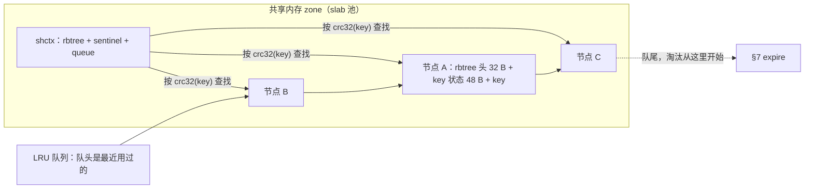
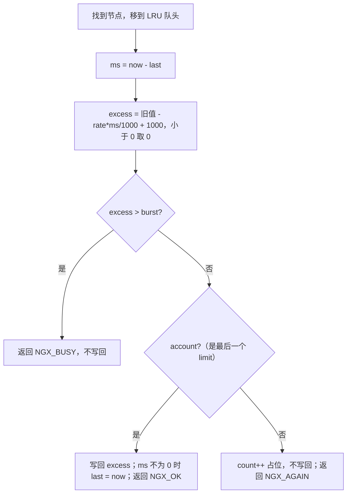
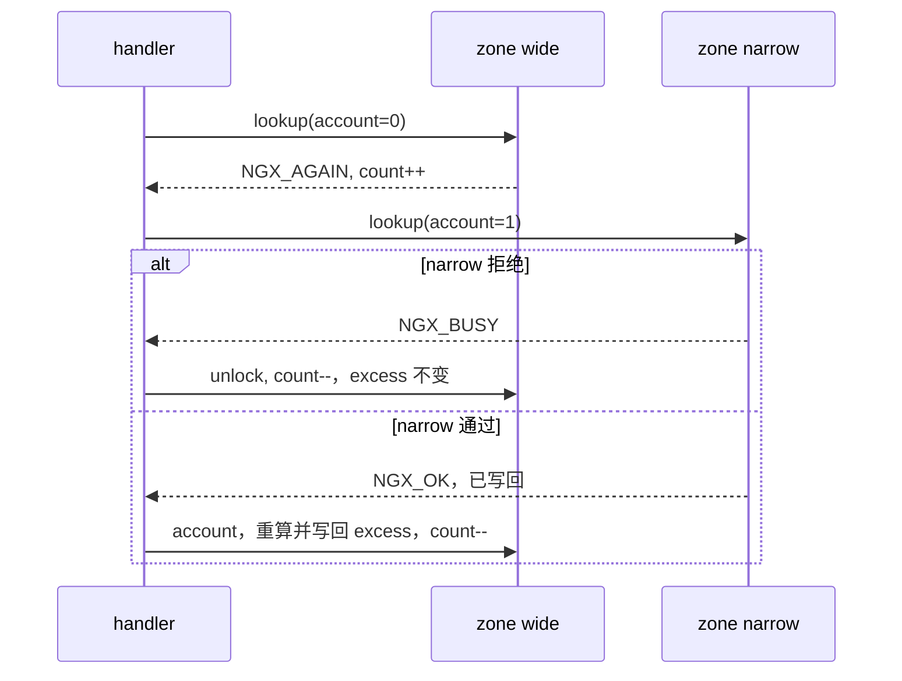
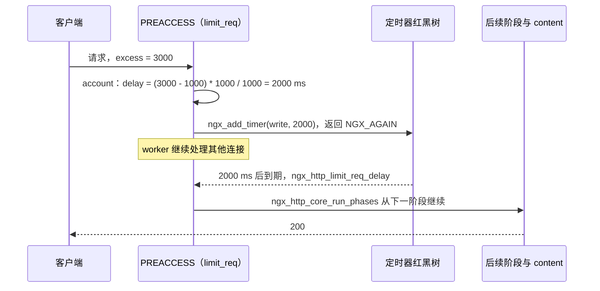
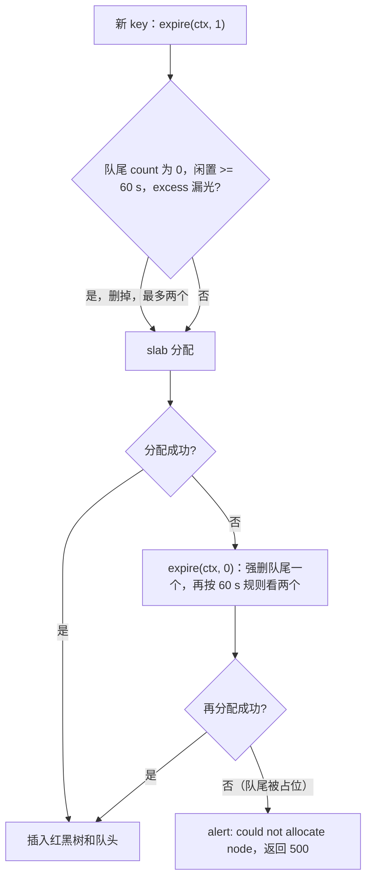

# 开发篇 08｜limit_req 源码：每个 key 只记一个 excess 和一个时间戳

> **一句话结论**：limit_req 在共享内存里给每个 key 存两个数：excess（以千分之一个请求为单位的“超出量”）和上次记账的时间。每个请求先按流逝的毫秒把 excess 漏掉 `rate × ms / 1000`，再加 1000；结果超过 `burst × 1000` 就拒绝，而且不写回；超过 `delay × 1000` 的部分按 rate 换算成毫秒，挂到写事件的定时器上。读懂 `ngx_http_limit_req_lookup` 里的二十几行，就能手算任何配置的放行、拒绝和延迟。
>
> 适用版本：nginx 1.31.9（mainline，2026-11-18）。`ngx_http_limit_req_module.c` 在 1.30.7 与 1.31.9 之间逐字节相同（`diff` 无输出），本篇没有「版本差异」条目。实验：[`labs/dev-08`](../labs/dev-08/)，每个数字都来自它的 debug 日志。运维视角的用法见[运维篇 09](../ops/09-rate-limiting.md)，本篇假定你已经知道 `burst`、`nodelay`、`delay=` 的效果，只回答“源码为什么这样算”。

## 导读

| 你想知道 | 看哪一节 |
|---|---|
| 一个 key 在共享内存里占多大，怎么查找 | §1 |
| `rate=1r/m` 在源码里是多少，burst、delay 的单位是什么 | §2 |
| excess 的公式，被拒绝的请求为什么不会把坑越挖越深 | §3 |
| 一个新 key 的第一个请求怎么处理 | §4 |
| 一个请求经过多个 limit_req、或者被内部跳转时怎么计数 | §5 |
| 延迟是怎么实现的，会不会阻塞 worker | §6 |
| zone 满了会发生什么 | §7 |
| reload 之后计数还在不在，改 key 会怎样 | §8 |

源码路径都相对于 `src/http/modules/ngx_http_limit_req_module.c`，除非另行注明。实验在 macOS arm64（页大小 16 KB）上运行，单 worker，`error_log logs/error.log debug;`。

## 1. 每个 key 在共享内存里占一个 128 字节的节点：红黑树负责查找，队列负责淘汰

limit_req 的全部状态都在 `limit_req_zone` 声明的共享内存里，所有 worker 共用。每个 key 一个节点，结构如下：

```c
// src/http/modules/ngx_http_limit_req_module.c:20-37
typedef struct {
    u_char                       color;
    u_char                       dummy;
    u_short                      len;
    ngx_queue_t                  queue;
    ngx_msec_t                   last;
    /* integer value, 1 corresponds to 0.001 r/s */
    ngx_uint_t                   excess;
    ngx_uint_t                   count;
    u_char                       data[1];
} ngx_http_limit_req_node_t;


typedef struct {
    ngx_rbtree_t                  rbtree;
    ngx_rbtree_node_t             sentinel;
    ngx_queue_t                   queue;
} ngx_http_limit_req_shctx_t;
```

几个字段的用途：

- `last`：上次记账时的 `ngx_current_msec`，单调时钟的毫秒数；
- `excess`：超出量，1000 代表一个请求；
- `count`：此刻有几个请求正持有这个节点，在多个 limit_req 的场景里用作“占位”，见 §5；
- `len` + `data`：key 的原始字节，用来解决 crc32 哈希冲突；
- `queue`：挂在 zone 的 LRU 队列上，最近用过的在队头。

这个结构不是单独分配的，而是“叠”在红黑树节点后面：`ngx_rbtree_node_t` 的最后一个字段 `color` 正好是 `ngx_http_limit_req_node_t` 的第一个字段。分配大小的计算写得很直白：

```c
// src/http/modules/ngx_http_limit_req_module.c:486-490
    *ep = 0;

    size = offsetof(ngx_rbtree_node_t, color)
           + offsetof(ngx_http_limit_req_node_t, data)
           + key->len;
```

在 64 位系统上，两个 `offsetof` 分别是 32 和 48（用同样的结构定义编译一个小程序打印得到），所以 `$binary_remote_addr` 做 key 时（IPv4 4 字节）一个节点要 84 字节。slab 分配器按 2 的幂取整，实际占一个 128 字节的槽。红黑树的键是 key 的 crc32（[`ngx_crc32_short`](https://github.com/nginx/nginx/blob/release-1.31.9/src/http/modules/ngx_http_limit_req_module.c#L244)），哈希相同再比 `data`。



**小结**：一个 key 的全部状态是 `last`、`excess`、`count` 三个整数加 key 本身，84 字节，落在 128 字节的 slab 槽里；红黑树按哈希查找，LRU 队列决定谁先被淘汰。要知道 `excess` 里那个“1000 代表一个请求”是怎么来的，得先看配置解析把 rate、burst、delay 换成了什么单位。

## 2. 配置解析把 rate、burst、delay 都换成千分之一：1r/m 存成 16

`limit_req_zone` 的 `rate=` 参数在 [`ngx_http_limit_req_zone`](https://github.com/nginx/nginx/blob/release-1.31.9/src/http/modules/ngx_http_limit_req_module.c#L833) 里解析，只认 `r/s` 和 `r/m` 两种后缀：

```c
// src/http/modules/ngx_http_limit_req_module.c:903-924
        if (ngx_strncmp(value[i].data, "rate=", 5) == 0) {

            len = value[i].len;
            p = value[i].data + len - 3;

            if (ngx_strncmp(p, "r/s", 3) == 0) {
                scale = 1;
                len -= 3;

            } else if (ngx_strncmp(p, "r/m", 3) == 0) {
                scale = 60;
                len -= 3;
            }

            rate = ngx_atoi(value[i].data + 5, len - 5);
            if (rate <= 0) {
                ngx_conf_log_error(NGX_LOG_EMERG, cf, 0,
                                   "invalid rate \"%V\"", &value[i]);
                return NGX_CONF_ERROR;
            }

            continue;
```

最后换算成千分之一请求每秒，整数除法：

```c
// src/http/modules/ngx_http_limit_req_module.c:939-939
    ctx->rate = rate * 1000 / scale;
```

`limit_req` 的 `burst=`、`delay=` 是整数个请求，`nodelay` 只是把 delay 设成一个大到不可能达到的值：

```c
// src/http/modules/ngx_http_limit_req_module.c:996-1023
        if (ngx_strncmp(value[i].data, "burst=", 6) == 0) {

            burst = ngx_atoi(value[i].data + 6, value[i].len - 6);
            if (burst <= 0) {
                ngx_conf_log_error(NGX_LOG_EMERG, cf, 0,
                                   "invalid burst value \"%V\"", &value[i]);
                return NGX_CONF_ERROR;
            }

            continue;
        }

        if (ngx_strncmp(value[i].data, "delay=", 6) == 0) {

            delay = ngx_atoi(value[i].data + 6, value[i].len - 6);
            if (delay <= 0) {
                ngx_conf_log_error(NGX_LOG_EMERG, cf, 0,
                                   "invalid delay value \"%V\"", &value[i]);
                return NGX_CONF_ERROR;
            }

            continue;
        }

        if (ngx_strcmp(value[i].data, "nodelay") == 0) {
            delay = NGX_MAX_INT_T_VALUE / 1000;
            continue;
        }
```

存进 `ngx_http_limit_req_limit_t` 时再乘 1000，和 excess 用同一个单位比较：

```c
// src/http/modules/ngx_http_limit_req_module.c:1059-1061
    limit->shm_zone = shm_zone;
    limit->burst = burst * 1000;
    limit->delay = delay * 1000;
```

把常见写法换算一遍：

| 配置 | 源码里的值 | 含义 |
|---|---|---|
| `rate=1r/s` | `rate = 1000` | 每毫秒漏 1 |
| `rate=10r/s` | `rate = 10000` | 每毫秒漏 10 |
| `rate=30r/m` | `rate = 500` | 每秒漏半个请求，正好整除 |
| `rate=1r/m` | `rate = 16` | 1000/60 截断，每秒漏 0.016 个请求，攒满一个要 62.5 秒 |
| 不写 `burst` | `burst = 0` | excess 只要大于 0 就拒绝 |
| `burst=5` | `burst = 5000` | |
| `delay=2` | `delay = 2000` | |
| `nodelay` | `delay = NGX_MAX_INT_T_VALUE / 1000 * 1000` | excess 永远到不了，等于不延迟 |

`1r/m` 被截成 16 是能测出来的。实验先让 excess 停在 5，等 6 秒以上再发一个请求，用 access log 里的 `$msec - $request_time` 算出两次请求的间隔毫秒数，分别按 16 和 16.667 预测 debug 日志里的 excess，看哪个对得上（误差 0.002 以内）：

```text
# labs/dev-08 ## 1r/m drains 16 thousandths per second
503
within 0.002 of rate 16: yes; within 0.002 of rate 16.667: no
ok - drained = 16 * ms / 1000: 1r/m is stored as 16, not 16.667
```

间隔 6 秒多时，两种 rate 预测的漏出量相差 4 个千分之一以上，日志里的值只和 16 对得上。对运维的含义是：`r/m` 写法的实际速率最多比字面值低 1/1000 r/s，`1r/m` 低了 4%；需要精确时改写成能整除的形式（`30r/m`）或直接用 `r/s`。

同一节还要提一句继承：`limit_req` 是数组型指令，[merge](https://github.com/nginx/nginx/blob/release-1.31.9/src/http/modules/ngx_http_limit_req_module.c#L808) 时子级只要写了一条，父级的就全部不要：

```c
// src/http/modules/ngx_http_limit_req_module.c:813-826
    if (conf->limits.elts == NULL) {
        conf->limits = prev->limits;
    }

    ngx_conf_merge_uint_value(conf->limit_log_level, prev->limit_log_level,
                              NGX_LOG_ERR);

    conf->delay_log_level = (conf->limit_log_level == NGX_LOG_INFO) ?
                                NGX_LOG_INFO : conf->limit_log_level + 1;

    ngx_conf_merge_uint_value(conf->status_code, prev->status_code,
                              NGX_HTTP_SERVICE_UNAVAILABLE);

    ngx_conf_merge_value(conf->dry_run, prev->dry_run, 0);
```

这里也能看到另外三个默认值：拒绝日志 `error` 级，延迟日志比它低一级（`NGX_LOG_ERR + 1` 即 `warn`），状态码 503。

**小结**：配置解析之后，rate 是“千分之一请求每秒”，burst 和 delay 是“请求数 × 1000”，三者和 excess 同一个单位；`1r/m` 实际是 0.016 r/s，实验按间隔毫秒数验证了这一点。单位对齐之后，下一节的公式就只是加减法。

## 3. lookup 先漏后加：excess = 旧 excess − rate × ms / 1000 + 1000，超过 burst 就拒绝且不写回

[`ngx_http_limit_req_lookup`](https://github.com/nginx/nginx/blob/release-1.31.9/src/http/modules/ngx_http_limit_req_module.c#L405) 在持有 zone 互斥锁的情况下被调用。找到已有节点之后的逻辑是本模块的核心：

```c
// src/http/modules/ngx_http_limit_req_module.c:441-484
        if (rc == 0) {
            ngx_queue_remove(&lr->queue);
            ngx_queue_insert_head(&ctx->sh->queue, &lr->queue);

            ms = (ngx_msec_int_t) (now - lr->last);

            if (ms < -60000) {
                ms = 1;

            } else if (ms < 0) {
                ms = 0;
            }

            excess = lr->excess - ctx->rate * ms / 1000 + 1000;

            if (excess < 0) {
                excess = 0;
            }

            *ep = excess;

            if ((ngx_uint_t) excess > limit->burst) {
                return NGX_BUSY;
            }

            if (account) {
                lr->excess = excess;

                if (ms) {
                    lr->last = now;
                }

                return NGX_OK;
            }

            lr->count++;

            ctx->node = lr;

            return NGX_AGAIN;
        }

        node = (rc < 0) ? node->left : node->right;
    }
```

逐行读出四个结论：

1. **先漏后加**：第 454 行一次算完。`rate × ms / 1000` 是这段时间漏掉的量，`+ 1000` 是本次请求，低于 0 按 0 算。这是漏桶：桶里的水是 excess，桶容量是 burst。
2. **比较用的是严格大于**：`excess > burst` 才拒绝，所以 `burst=5` 允许 excess 到 5000，也就是除第一个外还能再进 5 个。
3. **拒绝时直接返回**：第 463 行在第 467 行写回之前，被拒绝的请求既不改 `excess` 也不改 `last`。持续超限的客户端不会把自己的坑越挖越深，停手之后从上一次被接受时的 excess 开始恢复。
4. **队列先调整**：第 442–443 行在一切判断之前把节点移到 LRU 队头，被拒绝的请求也算“最近用过”。§7 的淘汰顺序依赖这一点。

另外两处细节处理时钟倒退：`now` 比 `last` 小 60 秒以上时按 1 毫秒算，小于 60 秒时按 0 算；`ms` 为 0 时不更新 `last`，这样时间短暂倒退时 `last` 不会跟着往回走。还要注意第 454 行是整数除法：在 `1r/m` 下，两次被接受的请求相隔不到 63 毫秒时漏出量算出来是 0，而 `last` 照样更新，这段时间的漏出就丢了；被拒绝的请求不更新 `last`，不受影响。

实验用 `rate=1r/m burst=5 nodelay`，连发 8 个请求，打印 debug 日志里每个请求的 `limit_req[n]: rc excess`（[第 253 行](https://github.com/nginx/nginx/blob/release-1.31.9/src/http/modules/ngx_http_limit_req_module.c#L253)的 `ngx_log_debug4`；excess 四舍五入到整数，因为请求之间的几十毫秒在 1r/m 下最多漏掉千分之一）：

```text
# labs/dev-08 ## each passed request adds 1000, a rejected one adds nothing
200 200 200 200 200 200 503 503
limit_req[0]: 0 ~0
limit_req[0]: 0 ~1
limit_req[0]: 0 ~2
limit_req[0]: 0 ~3
limit_req[0]: 0 ~4
limit_req[0]: 0 ~5
limit_req[0]: -3 ~6
limit_req[0]: -3 ~6
```

rc 是 `src/core/ngx_core.h` 里的常量：0 是 `NGX_OK`，-3 是 `NGX_BUSY`。第 7、8 个请求看到的 excess 都是 6：第 7 个被拒绝后没有写回，第 8 个仍然从 5 算起。把这 8 个请求按公式手算一遍（假设请求间隔可以忽略）：

| 第几个 | 旧 excess | 漏掉 | 本次 excess | 和 burst=5000 比 | 写回 |
|---|---|---|---|---|---|
| 1 | （新节点） | — | 0 | 通过 | 0 |
| 2 | 0 | ≈0 | 1000 | 通过 | 1000 |
| 3–6 | 1000…4000 | ≈0 | 2000…5000 | 通过（5000 不大于 5000） | 2000…5000 |
| 7 | 5000 | ≈0 | 6000 | 拒绝 | 不写回 |
| 8 | 5000 | ≈0 | 6000 | 拒绝 | 不写回 |



**小结**：已有 key 的判决只看一个式子和一次比较；通过才写回，拒绝不写回，所以 503 不会累积。表的第一行有个例外：新节点的 excess 是 0 而不是 1000，它走的是 lookup 后半段的另一条路径。

## 4. 新 key 的第一个请求不走公式：excess 直接记 0，分配前先顺手清理闲置节点

红黑树里找不到 key 时，lookup 分配一个新节点：

```c
// src/http/modules/ngx_http_limit_req_module.c:507-532
    node->key = hash;

    lr = (ngx_http_limit_req_node_t *) &node->color;

    lr->len = (u_short) key->len;
    lr->excess = 0;

    ngx_memcpy(lr->data, key->data, key->len);

    ngx_rbtree_insert(&ctx->sh->rbtree, node);

    ngx_queue_insert_head(&ctx->sh->queue, &lr->queue);

    if (account) {
        lr->last = now;
        lr->count = 0;
        return NGX_OK;
    }

    lr->last = 0;
    lr->count = 1;

    ctx->node = lr;

    return NGX_AGAIN;
}
```

新节点的 excess 是 0，`*ep` 也在第 486 行被置 0，所以第一个请求永远通过，也永远不被延迟，哪怕 `burst` 没写。这就是上一节表格第一行的 0，也是运维篇 09 里“不写 burst 时只有第一个请求能过”的源码依据：第二个请求算出 1000，大于 0。

不是最后一个 limit 时（`account` 为 0），节点的 `last` 被设成 0。这是个小技巧：§5 里的 `ngx_http_limit_req_account` 会对它重新套一遍公式，`now - 0` 就是单调时钟当前的毫秒数（系统启动以来的时间量级），按任何 rate 算漏掉的量都远超 1000，excess 被截成 0，`last` 被更新为当前时间，效果和“第一个请求记 0”一致。

分配之前，第 492 行调用 `ngx_http_limit_req_expire(ctx, 1)`：每新建一个 key，顺带检查 LRU 队尾的一到两个节点能否删掉。规则在 §7 讲。

**小结**：新 key 的第一个请求记 excess 0，不经过公式、不受 burst 约束；新建节点之前会先尝试清理队尾。前四节都只涉及一个 limit_req，一个 location 写多条、或者请求在 location 之间跳转时，handler 还有一层逻辑。

## 5. 多个 limit_req 时只有最后一个记账：前面的 zone 只占位，被拒绝就回滚

先看 handler 的入口。`r->main->limit_req_status` 一旦被设置，同一个主请求再进入任何 limit_req 都直接放行：

```c
// src/http/modules/ngx_http_limit_req_module.c:206-208
    if (r->main->limit_req_status) {
        return NGX_DECLINED;
    }
```

所以内部跳转（`error_page`、`try_files` 的最后一项、`rewrite ... last`）后进入另一个也有 limit_req 的 location，不会再算一次。实验让 `/missing` 404 后经 `error_page 404 = /fallback;` 跳到另一个 location，两个 location 用同一个 zone：

```text
# labs/dev-08 ## an internal redirect does not count twice
fallback
200 PASSED -
ok - only one limit_req lookup for the whole request
```

整个请求的 debug 日志里只有一行 `limit_req[0]`。

一个 location 里写多条 limit_req 时，handler 按配置顺序逐个 lookup，只有最后一个传 `account = 1`：

```c
// src/http/modules/ngx_http_limit_req_module.c:221-260
    for (n = 0; n < lrcf->limits.nelts; n++) {

        limit = &limits[n];

        ctx = limit->shm_zone->data;

        if (ngx_http_complex_value(r, &ctx->key, &key) != NGX_OK) {
            ngx_http_limit_req_unlock(limits, n);
            return NGX_HTTP_INTERNAL_SERVER_ERROR;
        }

        if (key.len == 0) {
            continue;
        }

        if (key.len > 65535) {
            ngx_log_error(NGX_LOG_ERR, r->connection->log, 0,
                          "the value of the \"%V\" key "
                          "is more than 65535 bytes: \"%V\"",
                          &ctx->key.value, &key);
            continue;
        }

        hash = ngx_crc32_short(key.data, key.len);

        ngx_shmtx_lock(&ctx->shpool->mutex);

        rc = ngx_http_limit_req_lookup(limit, hash, &key, &excess,
                                       (n == lrcf->limits.nelts - 1));

        ngx_shmtx_unlock(&ctx->shpool->mutex);

        ngx_log_debug4(NGX_LOG_DEBUG_HTTP, r->connection->log, 0,
                       "limit_req[%ui]: %i %ui.%03ui",
                       n, rc, excess / 1000, excess % 1000);

        if (rc != NGX_AGAIN) {
            break;
        }
    }
```

key 为空串时第 232 行直接跳过这个 limit，这是用 `map` 给白名单返回空值、让它们不受限的源码依据。前面的 limit 在 §3 的流程图里走右下分支：通过时只 `count++` 占位、返回 `NGX_AGAIN`，不写回 excess。循环在第一个非 `NGX_AGAIN` 的结果处停下。如果是拒绝，handler 调用 unlock，把前面占的位逐个退掉：

```c
// src/http/modules/ngx_http_limit_req_module.c:609-629
static void
ngx_http_limit_req_unlock(ngx_http_limit_req_limit_t *limits, ngx_uint_t n)
{
    ngx_http_limit_req_ctx_t  *ctx;

    while (n--) {
        ctx = limits[n].shm_zone->data;

        if (ctx->node == NULL) {
            continue;
        }

        ngx_shmtx_lock(&ctx->shpool->mutex);

        ctx->node->count--;

        ngx_shmtx_unlock(&ctx->shpool->mutex);

        ctx->node = NULL;
    }
}
```

如果全部通过，`ngx_http_limit_req_account` 对前面每个占位的节点重新套一遍公式并写回（第 555–603 行，见下一节的摘录），这时才真正记账。于是多个 zone 的效果是“要么都记、要么都不记”：被后面的 zone 拒绝的请求，不会消耗前面 zone 的额度。

实验的 `/both` 先过 `wide`（burst=10 nodelay），再过 `narrow`（不写 burst），连发 4 个；之后访问只用 `wide` 的 `/wide`，看 `wide` 里存的 excess 是 1 还是 4：

```nginx
# lab: labs/dev-08/conf/two-zones.conf
        location /both {
            limit_req zone=wide burst=10 nodelay;
            limit_req zone=narrow;
            root html;
        }
```

```text
# labs/dev-08 ## two zones: only the last one is charged, a rejection rolls the others back
200 503 503 503
limit_req[0]: -2 ~0
limit_req[1]: 0 ~0
limit_req[0]: -2 ~1
limit_req[1]: -3 ~1
limit_req[0]: -2 ~1
limit_req[1]: -3 ~1
limit_req[0]: -2 ~1
limit_req[1]: -3 ~1
/wide: 200
limit_req[0]: 0 ~1
```

`wide` 每次返回 -2（`NGX_AGAIN`），看到的 excess 一直是 1 而不是 1、2、3；之后 `/wide` 算出的也是 1，说明三个被 `narrow` 拒绝的请求没有记进 `wide`。



**小结**：limit_req 每个主请求只判一次；多条 limit_req 里只有最后一条在 lookup 时记账，前面的先占位，拒绝时回滚、通过时由 account 补记。account 除了补记，还负责算出要延迟多久。

## 6. 延迟不是 sleep：超出 delay 的 excess 换算成毫秒，挂在写事件定时器上

`ngx_http_limit_req_account` 的开头用最后一个 limit 的 excess 算出延迟：

```c
// src/http/modules/ngx_http_limit_req_module.c:545-553
    excess = *ep;

    if ((ngx_uint_t) excess <= (*limit)->delay) {
        max_delay = 0;

    } else {
        ctx = (*limit)->shm_zone->data;
        max_delay = (excess - (*limit)->delay) * 1000 / ctx->rate;
    }
```

然后对前面占位的每个节点补记，并取所有 limit 中最长的延迟：

```c
// src/http/modules/ngx_http_limit_req_module.c:555-603
    while (n--) {
        ctx = limits[n].shm_zone->data;
        lr = ctx->node;

        if (lr == NULL) {
            continue;
        }

        ngx_shmtx_lock(&ctx->shpool->mutex);

        now = ngx_current_msec;
        ms = (ngx_msec_int_t) (now - lr->last);

        if (ms < -60000) {
            ms = 1;

        } else if (ms < 0) {
            ms = 0;
        }

        excess = lr->excess - ctx->rate * ms / 1000 + 1000;

        if (excess < 0) {
            excess = 0;
        }

        if (ms) {
            lr->last = now;
        }

        lr->excess = excess;
        lr->count--;

        ngx_shmtx_unlock(&ctx->shpool->mutex);

        ctx->node = NULL;

        if ((ngx_uint_t) excess <= limits[n].delay) {
            continue;
        }

        delay = (excess - limits[n].delay) * 1000 / ctx->rate;

        if (delay > max_delay) {
            max_delay = delay;
            *ep = excess;
            *limit = &limits[n];
        }
    }
```

延迟的公式是 `(excess − delay) × 1000 / rate` 毫秒：超出 delay 的部分，按漏出速度要多少毫秒才能漏完。拿到非零延迟后，handler 不睡眠，而是把请求挂起：

```c
// src/http/modules/ngx_http_limit_req_module.c:301-329
    ngx_log_error(lrcf->delay_log_level, r->connection->log, 0,
                  "delaying request%s, excess: %ui.%03ui, by zone \"%V\"",
                  lrcf->dry_run ? ", dry run" : "",
                  excess / 1000, excess % 1000, &limit->shm_zone->shm.name);

    if (lrcf->dry_run) {
        r->main->limit_req_status = NGX_HTTP_LIMIT_REQ_DELAYED_DRY_RUN;
        return NGX_DECLINED;
    }

    r->main->limit_req_status = NGX_HTTP_LIMIT_REQ_DELAYED;

    if (r->connection->read->ready) {
        ngx_post_event(r->connection->read, &ngx_posted_events);

    } else {
        if (ngx_handle_read_event(r->connection->read, 0) != NGX_OK) {
            return NGX_HTTP_INTERNAL_SERVER_ERROR;
        }
    }

    r->read_event_handler = ngx_http_test_reading;
    r->write_event_handler = ngx_http_limit_req_delay;

    r->connection->write->delayed = 1;
    ngx_add_timer(r->connection->write, delay);

    return NGX_AGAIN;
}
```

返回 `NGX_AGAIN` 让 phase engine 停在 PREACCESS；写事件被标成 `delayed` 并加一个 `delay` 毫秒的定时器。定时器到期后进入 `ngx_http_limit_req_delay`，把写事件处理函数换回 `ngx_http_core_run_phases`，从下一个阶段继续：

```c
// src/http/modules/ngx_http_limit_req_module.c:332-360
static void
ngx_http_limit_req_delay(ngx_http_request_t *r)
{
    ngx_event_t  *wev;

    ngx_log_debug0(NGX_LOG_DEBUG_HTTP, r->connection->log, 0,
                   "limit_req delay");

    wev = r->connection->write;

    if (wev->delayed) {

        if (ngx_handle_write_event(wev, 0) != NGX_OK) {
            ngx_http_finalize_request(r, NGX_HTTP_INTERNAL_SERVER_ERROR);
        }

        return;
    }

    if (ngx_handle_read_event(r->connection->read, 0) != NGX_OK) {
        ngx_http_finalize_request(r, NGX_HTTP_INTERNAL_SERVER_ERROR);
        return;
    }

    r->read_event_handler = ngx_http_block_reading;
    r->write_event_handler = ngx_http_core_run_phases;

    ngx_http_core_run_phases(r);
}
```

等待期间读事件处理函数是 `ngx_http_test_reading`，客户端断开能被发现（1.19.9 修过一个“等待 limit_req delay 时发现不了连接已关闭”的 bug）。worker 在这段时间照常处理别的连接，代价是这个连接和它占的内存一直被持有，占一个 `worker_connections` 名额。同在 PREACCESS 的 limit_conn 排在 limit_req 之后执行（运维篇 09 §1），所以等待中的请求还没有被 limit_conn 计数。dry run 在第 306 行提前返回，只记日志和 `$limit_req_status`，不挂定时器。

实验用 `rate=1r/s burst=4 delay=1`，同时发 5 个请求。按公式预测：excess 依次约为 0、1000、2000、3000、4000；前两个不超过 delay=1000，直接通过；后三个延迟 (2000−1000)×1000/1000 = 1000 毫秒、2000 毫秒、3000 毫秒。脚本从 debug 日志里取出每条 `delaying request` 之后紧跟的 `event timer add` 行（`src/event/ngx_event_timer.h` 第 81 行打印的定时器毫秒数），换算成整秒：

```text
# labs/dev-08 ## delay=1: excess above 1 becomes a timer of (excess - 1) / rate
3x 200 DELAYED
2x 200 PASSED
slowest response >= 2 s: yes
delaying request, excess: 2 3 4
delay timers (s): 1 2 3
```



**小结**：延迟时间在 account 里一次算定，等于把超出 delay 的 excess 按 rate 漏完所需的毫秒数；实现是写事件定时器加 `NGX_AGAIN`，不阻塞 worker，但占着连接。到这里，判决和计时都讲完了，剩下的问题是节点本身：zone 写满时新 key 怎么办。

## 7. zone 满了不会报错：新 key 先清理闲置 60 秒以上的节点，再不够就强删最久未用的

§4 提到，新建节点前先调用一次 `expire(ctx, 1)`；如果 slab 仍然分配失败，再调用 `expire(ctx, 0)` 后重试，只有第二次也失败才报错：

```c
// src/http/modules/ngx_http_limit_req_module.c:494-505
    node = ngx_slab_alloc_locked(ctx->shpool, size);

    if (node == NULL) {
        ngx_http_limit_req_expire(ctx, 0);

        node = ngx_slab_alloc_locked(ctx->shpool, size);
        if (node == NULL) {
            ngx_log_error(NGX_LOG_ALERT, ngx_cycle->log, 0,
                          "could not allocate node%s", ctx->shpool->log_ctx);
            return NGX_ERROR;
        }
    }
```

淘汰函数从 LRU 队尾往前看，参数 n 决定是否强删：

```c
// src/http/modules/ngx_http_limit_req_module.c:650-694
    while (n < 3) {

        if (ngx_queue_empty(&ctx->sh->queue)) {
            return;
        }

        q = ngx_queue_last(&ctx->sh->queue);

        lr = ngx_queue_data(q, ngx_http_limit_req_node_t, queue);

        if (lr->count) {

            /*
             * There is not much sense in looking further,
             * because we bump nodes on the lookup stage.
             */

            return;
        }

        if (n++ != 0) {

            ms = (ngx_msec_int_t) (now - lr->last);
            ms = ngx_abs(ms);

            if (ms < 60000) {
                return;
            }

            excess = lr->excess - ctx->rate * ms / 1000;

            if (excess > 0) {
                return;
            }
        }

        ngx_queue_remove(q);

        node = (ngx_rbtree_node_t *)
                   ((u_char *) lr - offsetof(ngx_rbtree_node_t, color));

        ngx_rbtree_delete(&ctx->sh->rbtree, node);

        ngx_slab_free_locked(ctx->shpool, node);
    }
```

- `n = 1`：最多看两个队尾节点，只删“闲置至少 60 秒且 excess 已经漏光”的；遇到不满足的立即停。
- `n = 0`：第一轮跳过检查，**无条件删除队尾**，然后按 `n = 1` 的规则再看最多两个。
- 队尾节点 `count` 不为 0（正被 §5 的占位持有）时直接返回，什么都不删。

所以只要队尾节点没被占位，分配就不会失败，代价是最久没被访问的那个 key 丢掉状态。zone 初始化时还把 `log_nomem` 置 0（[第 758 行](https://github.com/nginx/nginx/blob/release-1.31.9/src/http/modules/ngx_http_limit_req_module.c#L758)），slab 分配失败时不打 “no memory” 日志，这是 1.5.13 的改动。结果是：zone 太小时 error.log 里什么也看不到。

实验用 `$arg_k` 做 key、128k 的 zone（16 KB 页上允许的最小值，第 894 行要求至少 8 页），且不写 burst。先让 `victim` 被限住，再用 3000 个不同的 key 各请求一次，然后回头看 `victim`：

```text
# labs/dev-08 ## a full zone evicts the least recently used key
victim: 200 503
3000 new keys: 3000x 200
"could not allocate node" lines: 0
k=3000 again: 503
victim again: 200
limit_req[0]: 0 ~0
```

`victim` 从“被拒绝”变回“新 key”，excess 从 0 开始；最近的 `k=3000` 还在。再从 `k=3000` 往下逐个探测，还在 zone 里的 key 返回 503（且只是被移到队头），遇到第一个 200 就说明更早的已经被淘汰：

```text
# labs/dev-08 ## how many keys a 128k zone holds
keys left besides victim: 760
```

加上 `victim`，这个 zone 同时装下 761 个节点。推算：16 KB 的页切成 128 个 128 字节的槽，第一个槽放占用位图，每页 127 个；761 + 1（`shctx` 本身 88 字节，也落在 128 字节槽里）= 762 = 6 × 127，即 8 页里有 6 页用于节点。Linux 上页是 4 KB，同样 128k 的 zone 槽位数不同，这个数字只适用于本机。



**小结**：zone 写满后，新 key 照样通过，代价是 LRU 队尾的 key 被强制删除、状态清零，而且日志里没有任何提示；128k 的 zone 在本机装 761 个 key。key 的种类可能超过 zone 容量时（例如用 `$http_x_forwarded_for` 或带参数的 URI 做 key），限流会悄悄失效。节点的生命周期还剩最后一个场景：reload。

## 8. reload 复用同名、同大小的 zone：状态保留；只改 key 会被拒绝，改大小则从零开始

reload 时 `ngx_init_cycle` 按名字在旧 cycle 里找同名共享内存，tag（模块）和大小都相同才复用：

```c
// src/core/ngx_cycle.c:473-491
            if (shm_zone[i].tag == oshm_zone[n].tag
                && shm_zone[i].shm.size == oshm_zone[n].shm.size)
            {
                shm_zone[i].shm.addr = oshm_zone[n].shm.addr;
#if (NGX_WIN32)
                shm_zone[i].shm.handle = oshm_zone[n].shm.handle;
#endif

                if (shm_zone[i].init(&shm_zone[i], oshm_zone[n].data)
                    != NGX_OK)
                {
                    goto failed;
                }

                goto shm_zone_found;
            }

            break;
        }
```

复用时调用的 init 是 `ngx_http_limit_req_init_zone`，旧数据非空就比较 key 的表达式：

```c
// src/http/modules/ngx_http_limit_req_module.c:706-726
    ctx = shm_zone->data;

    if (octx) {
        if (ctx->key.value.len != octx->key.value.len
            || ngx_strncmp(ctx->key.value.data, octx->key.value.data,
                           ctx->key.value.len)
               != 0)
        {
            ngx_log_error(NGX_LOG_EMERG, shm_zone->shm.log, 0,
                          "limit_req \"%V\" uses the \"%V\" key "
                          "while previously it used the \"%V\" key",
                          &shm_zone->shm.name, &ctx->key.value,
                          &octx->key.value);
            return NGX_ERROR;
        }

        ctx->sh = octx->sh;
        ctx->shpool = octx->shpool;

        return NGX_OK;
    }
```

由此得到三种情况，实验各做一次（`keep` zone，1r/m，不写 burst）：

```text
# labs/dev-08 ## reload keeps a zone with the same name, size and key
before reload: 200 503
after reload: 503
```

```text
# labs/dev-08 ## a different key with the same size is refused
[emerg] limit_req "keep" uses the "$remote_addr" key while previously it used the "$binary_remote_addr" key
after refused reload: 503
ok - old workers keep serving with the old state
```

```text
# labs/dev-08 ## a different size gets a new, empty zone
after resize: 200
ok - resizing drops the old state, no key check
```

| reload 时改了什么 | 结果 | 源码依据 |
|---|---|---|
| 什么都没改（或只改 rate、burst） | 复用，计数保留 | `ctx->sh = octx->sh` |
| 只改 key | `[emerg]`，整个 reload 失败，老 worker 继续用旧配置 | init_zone 第 708–720 行 |
| 改了大小（不论 key 改没改） | 新建空 zone，计数清零，不检查 key | ngx_cycle.c 第 490 行 `break` 后重新分配 |

rate 存在进程内的 `ctx` 里而不是共享内存里，所以改 rate 后旧节点的 excess 按新 rate 继续漏。要换 key，就同时改 zone 名或大小，并接受计数清零。

**小结**：zone 的状态能跨 reload 保留，前提是名字、大小、key 都不变；只改 key 会让整个 reload 失败，这是本模块唯一会阻止 reload 的检查。至此，一个 key 从创建、记账、延迟、淘汰到跨 reload 的完整生命周期都能在源码里逐行对上。

## 已知局限与待核实

- 实验只在 macOS arm64（16 KB 页、kqueue）上跑过。§7 的 761 是本机实测，Linux 4 KB 页上的容量没有测；淘汰和计数逻辑与页大小无关。
- §3 中“整数除法吞掉短间隔的漏出量”来自源码（第 454、469–471 行），实验只在 1r/m 的 6 秒间隔上验证了漏出量与 16 一致，没有专门测量多次短间隔请求累积的截断误差。
- 多 worker 并发下互斥锁 `ngx_shmtx` 的争用没有压测；实验全部是单 worker。
- “只改 rate、burst 时复用并保留计数”来自源码推断（rate 不参与 init_zone 的比较），实验没有单独测。
- `limit_req_dry_run` 的路径（第 278、306 行）只读了源码，本篇实验没有覆盖，运维篇 09 有对应实验。

## 修订记录

- 2026-11-21：基于 nginx 1.31.9 源码重写，替代 2018 年的 `dev/04.md`。新增 excess 单位与 1r/m 截断、多 zone 记账与回滚、延迟定时器、LRU 强制淘汰与 zone 容量、reload 复用规则，均附 `labs/dev-08` 实验。
