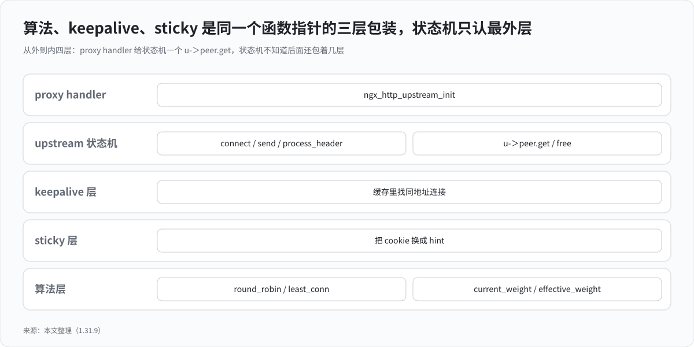
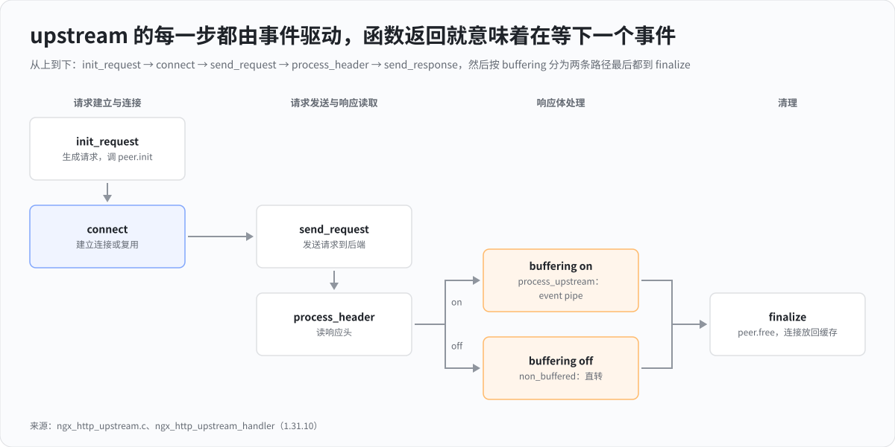
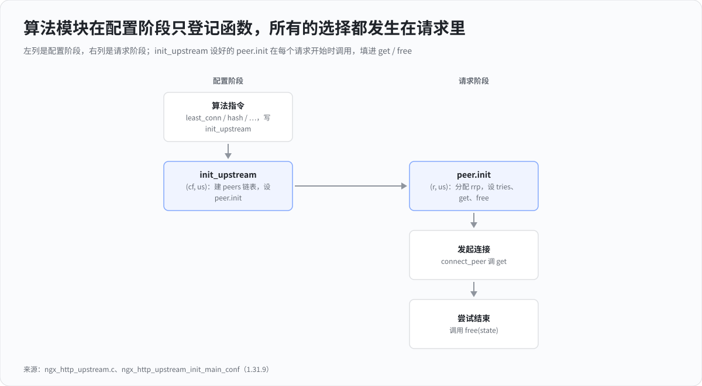
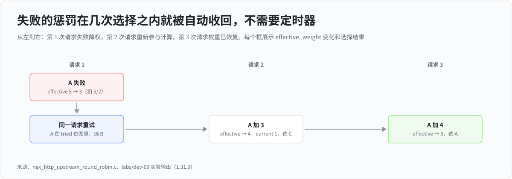
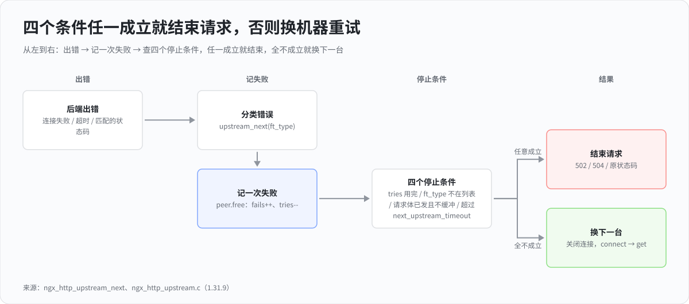
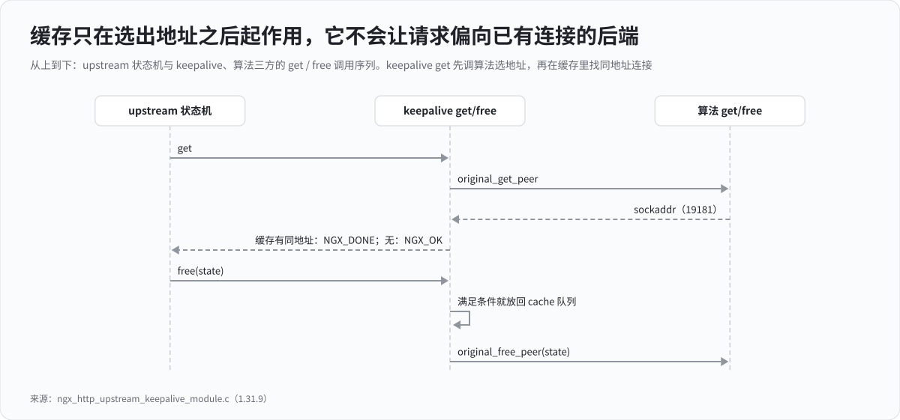
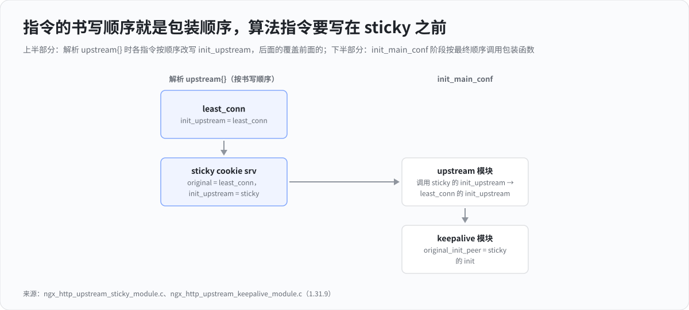
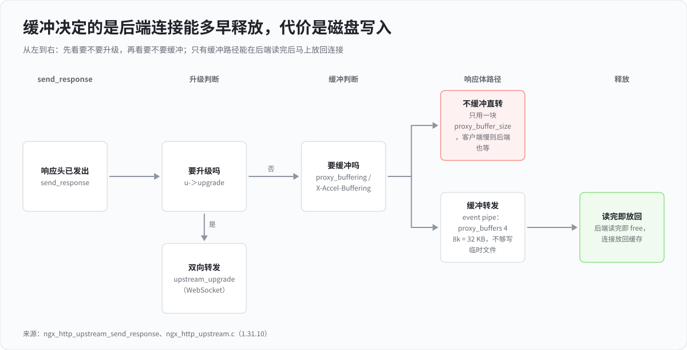

# 开发篇 09｜upstream 机制与负载均衡：算法只负责选地址，连接缓存、粘性和重试是包在外面的几层函数指针

> **一句话结论**：upstream 是挂在请求上的一个状态机，每走一步就把 `u->read_event_handler`、`u->write_event_handler` 换成下一步的函数，事件来了由 `ngx_http_upstream_handler` 分派。选后端只经过 `u->peer` 上的 `get` 和 `free` 两个函数指针：负载均衡算法在配置阶段登记 `init_upstream`，请求开始时由它填好 `get`/`free`，sticky 和 keepalive 再各包一层。平滑加权轮询的全部状态是每台后端的 `current_weight` 和 `effective_weight` 两个整数，实验直接调用本仓库构建里的 `ngx_http_upstream_get_round_robin_peer`：权重 5/1/1 时 7 次选择之后三个 `current_weight` 回到 0；一次失败让 `effective_weight` 减去 `weight / max_fails`，之后每参与一次计算加回 1。一次请求里每台后端最多试一次（`tried` 位图），`tries` 用完、错误类型不在 `proxy_next_upstream` 里、或者超过 `proxy_next_upstream_timeout`，就不再换机器。1.29.7 起 upstream 块默认带 32 条连接的缓存，而且是 `local` 的：同一个 upstream 被两个 location 使用时，连接不共用；`proxy_pass` 直接写地址时没有这份缓存。
>
> 适用版本：nginx 1.31.9（mainline，2026-11-18）。「版本差异」：`ngx_http_upstream_keepalive_module.c`、`ngx_http_upstream_sticky_module.c`、`ngx_http_upstream_least_conn_module.c` 与 1.30.7 逐字相同；`least_time` 的 `ngx_http_upstream_least_time_module.c` 只在 1.31.x 里。1.31.x 把 `ngx_http_upstream_free_round_robin_peer` 拆出一个不加锁的 `_locked` 版本，供 `least_time` 在自己持锁时调用；`proxy_socket_sndbuf`/`proxy_socket_rcvbuf` 是 1.31.3 新增的（`changes.xml`）。upstream 块默认开启 keepalive 是 1.29.7 的改动，1.30.7 也有。实验：[`labs/dev-09`](../labs/dev-09/)，单 worker；19181、19182 是同一个 nginx 里只回答自己端口号的后端，19198 没有进程监听；只有前端 server（19180）的日志是 debug 级，写在 `logs/front.log`；后端日志里的 `c=` 是 `$connection_requests`，即这条后端连接上的第几个请求。

## 导读

| 你想知道 | 看哪一节 |
|---|---|
| 一个被代理的请求在 upstream 里经过哪些函数 | §1 |
| 负载均衡算法怎么接进 upstream，`get` 和 `free` 各在什么时候调用 | §2 |
| 平滑加权轮询每一步的权重，失败后权重怎么恢复 | §3 |
| 一次请求最多换几台后端，什么时候停止重试 | §4 |
| 连接缓存放在哪一层，为什么直接写地址的 `proxy_pass` 不复用连接 | §5 |
| 什么样的连接会被放回缓存 | §6 |
| sticky、least_conn、least_time 在源码里各改了哪一步 | §7 |
| `proxy_buffering` 开和关，响应体各走哪条路 | §8 |

[运维篇 07](../ops/07-load-balancing.md) 从配置和现象讲了各种算法与被动健康检查，[开发篇 06](06-http-request.md) §3 讲了 content handler 怎样接管请求。这一篇看 proxy 模块把请求交给 upstream 之后的源码。下图是本篇的主线，判断是：算法、连接缓存和粘性是同一组函数指针的三层包装，状态机只认最外层：



## 1. upstream 是挂在请求上的状态机：每一步只是换掉下一次事件的处理函数

proxy 模块的 content handler 调用 `ngx_http_read_client_request_body`，把 `ngx_http_upstream_init` 作为请求体读完后的回调（[`ngx_http_proxy_module.c` 第 970 行](https://github.com/nginx/nginx/blob/release-1.31.9/src/http/modules/ngx_http_proxy_module.c#L970)）。`ngx_http_upstream_init_request` 生成发给后端的请求（`u->create_request`），调用 upstream 块的 `peer.init`，然后进入 `ngx_http_upstream_connect`。从这里开始，后端连接上的读写事件都交给同一个函数：

```c
// src/http/ngx_http_upstream.c:1323-1354
static void
ngx_http_upstream_handler(ngx_event_t *ev)
{
    ngx_connection_t     *c;
    ngx_http_request_t   *r;
    ngx_http_upstream_t  *u;

    c = ev->data;
    r = c->data;

    u = r->upstream;
    c = r->connection;

    ngx_http_set_log_request(c->log, r);

    ngx_log_debug2(NGX_LOG_DEBUG_HTTP, c->log, 0,
                   "http upstream request: \"%V?%V\"", &r->uri, &r->args);

    if (ev->delayed && ev->timedout) {
        ev->delayed = 0;
        ev->timedout = 0;
    }

    if (ev->write) {
        u->write_event_handler(r, u);

    } else {
        u->read_event_handler(r, u);
    }

    ngx_http_run_posted_requests(c);
}
```

它只做分派：写事件调 `u->write_event_handler`，读事件调 `u->read_event_handler`。状态机的“状态”就是这两个指针当前指向谁。`ngx_http_upstream_connect` 拿到连接后把它们设成发送请求和读响应头：

```c
// src/http/ngx_http_upstream.c:1652-1662
    c = u->peer.connection;

    c->requests++;

    c->data = r;

    c->write->handler = ngx_http_upstream_handler;
    c->read->handler = ngx_http_upstream_handler;

    u->write_event_handler = ngx_http_upstream_send_request_handler;
    u->read_event_handler = ngx_http_upstream_process_header;
```

实验发一个请求到 `upstream one`（单台后端、默认的连接缓存），按顺序摘出 upstream 相关的 debug 行：

```text
# labs/dev-09 ## one proxied request, step by step
http init upstream, client timer: 0
init keepalive peer
get keepalive peer
get rr peer, try: 1
connect to 127.0.0.1:19181
http upstream connect: -2
http upstream send request handler
http upstream send request
http upstream send request body
http upstream dummy handler
http upstream process header
http proxy status 200 "200 OK"
http upstream process upstream
finalize http upstream request: 0
finalize http proxy request
free keepalive peer
free keepalive peer: saving connection
free rr peer 1 0
ok - a new connection: connect returns NGX_AGAIN (-2), the request waits for the write event
```

逐行对照源码：

- `http upstream connect: -2` 是 `ngx_event_connect_peer` 返回的 `NGX_AGAIN`：非阻塞 `connect()` 还没完成，`ngx_http_upstream_connect` 给写事件加上 `proxy_connect_timeout` 的定时器后返回。
- 连接建立后写事件到来，`send request handler` → `send request` 把请求写出去。写完后 `u->write_event_handler` 换成 `ngx_http_upstream_dummy_handler`，读事件加上 `proxy_read_timeout`（[第 2256 行、第 2277 行](https://github.com/nginx/nginx/blob/release-1.31.9/src/http/ngx_http_upstream.c#L2256)）。后面那行 `dummy handler` 就是一次没事可做的写事件。
- 读事件到来，`process header` 调用 proxy 模块的 `process_header` 解析状态行和头（`http proxy status 200`），头齐了进入 `ngx_http_upstream_send_response`，把头交给 [开发篇 06](06-http-request.md) §6 的 header filter 链。
- `process upstream` 是缓冲模式下读响应体的函数（§8）。响应体读完，`finalize http upstream request: 0` 先调用 proxy 的 `finalize_request`，再调用 `u->peer.free`，最后关闭或保留连接。

下图是这个请求里两个指针的变化，判断是：upstream 的每一步都由事件驱动，函数返回就意味着在等下一个事件：



**小结**：在 debug 日志里看 upstream，先找 `http upstream connect` 的返回值，再看 `send request`、`process header` 和 `finalize` 之间隔了多少行，就知道时间花在连接、等响应头还是传响应体上。写一个 upstream 类模块（fastcgi、grpc、自定义协议），要提供的是 `create_request`、`process_header`、`finalize_request` 这几个回调，状态机由 `ngx_http_upstream.c` 负责。

## 2. 选后端只经过 get 和 free：算法在配置阶段登记 init_upstream，请求开始时由 init 填进函数指针

请求里和后端选择有关的状态在 `u->peer`，一个 `ngx_peer_connection_t`：

```c
// src/event/ngx_event_connect.h:36-50
struct ngx_peer_connection_s {
    ngx_connection_t                *connection;

    struct sockaddr                 *sockaddr;
    socklen_t                        socklen;
    ngx_str_t                       *name;

    ngx_uint_t                       tries;
    ngx_msec_t                       start_time;

    ngx_event_get_peer_pt            get;
    ngx_event_free_peer_pt           free;
    ngx_event_notify_peer_pt         notify;
    void                            *data;

```

`get` 选出地址并填进 `sockaddr`/`name`，`free` 在这次尝试结束时报告结果，`data` 是算法自己的每请求状态，`tries` 是还能试几次。负载均衡模块和 upstream 之间只有两个回调，都在 `ngx_http_upstream_peer_t` 里：

```c
// src/http/ngx_http_upstream.h:94-98
typedef struct {
    ngx_http_upstream_init_pt        init_upstream;
    ngx_http_upstream_init_peer_pt   init;
    void                            *data;
} ngx_http_upstream_peer_t;
```

配置阶段，`least_conn`、`hash` 这类指令只把自己的初始化函数写进 `init_upstream`；`http{}` 解析完后，upstream 模块对每个 upstream 块调用它，没写算法指令的用轮询：

```c
// src/http/ngx_http_upstream.c:7362-7370
    for (i = 0; i < umcf->upstreams.nelts; i++) {

        init = uscfp[i]->peer.init_upstream ? uscfp[i]->peer.init_upstream:
                                            ngx_http_upstream_init_round_robin;

        if (init(cf, uscfp[i]) != NGX_OK) {
            return NGX_CONF_ERROR;
        }
    }
```

`ngx_http_upstream_init_round_robin` 把 `server` 指令展开成 `ngx_http_upstream_rr_peers_t` 链表，同时把 `us->peer.init` 设为 `ngx_http_upstream_init_round_robin_peer`。请求开始时 §1 里的 `init_request` 调用这个 `init`，它在请求池里分配 `rrp`，设置 `tries`，把 `get`/`free` 指向轮询的实现。`ngx_event_connect_peer` 的第一件事就是调用 `get`：

```c
// src/event/ngx_event_connect.c:34-37
    rc = pc->get(pc, pc->data);
    if (rc != NGX_OK) {
        return rc;
    }
```

`get` 的返回值决定 `ngx_http_upstream_connect` 怎么走：`NGX_OK` 表示选好了地址、接着新建 socket；`NGX_DONE` 表示 `get` 直接给了一条现成的连接（§5）；`NGX_BUSY` 表示没有可用的后端：

```c
// src/http/ngx_http_upstream.c:1639-1648
    if (rc == NGX_BUSY) {
        ngx_log_error(NGX_LOG_ERR, r->connection->log, 0, "no live upstreams");
        ngx_http_upstream_next(r, u, NGX_HTTP_UPSTREAM_FT_NOLIVE);
        return;
    }

    if (rc == NGX_DECLINED) {
        ngx_http_upstream_next(r, u, NGX_HTTP_UPSTREAM_FT_ERROR);
        return;
    }
```

实验紧接着再发一次同样的请求，这次连接来自缓存：

```text
# labs/dev-09 ## the second request takes the cached connection
http init upstream, client timer: 0
init keepalive peer
get keepalive peer
get rr peer, try: 1
get keepalive peer: using connection
http upstream connect: -4
http upstream send request
http upstream send request body
http upstream dummy handler
http upstream process header
http proxy status 200 "200 OK"
http upstream process upstream
finalize http upstream request: 0
finalize http proxy request
free keepalive peer
free keepalive peer: saving connection
free rr peer 1 0
ok - no connect, NGX_DONE (-4), the request is sent at once
```

没有 `connect to` 行，`http upstream connect: -4` 是 `NGX_DONE`。连接已经可写，`ngx_http_upstream_connect` 跳过等待写事件，直接调用 `send request`（[第 1750 行](https://github.com/nginx/nginx/blob/release-1.31.9/src/http/ngx_http_upstream.c#L1750)）。下图是两个阶段各自做的事，判断是：算法模块在配置阶段只登记函数，所有的选择都发生在请求里：



**小结**：写一个负载均衡模块，要实现的是 `init_upstream`（配置阶段建数据）、`init`（每个请求一次）、`get` 和 `free`；它看不到请求怎么发、响应怎么读。`free` 的 `state` 参数是它唯一能知道这次尝试成败的地方。

## 3. 平滑加权轮询的全部状态在每台后端的两个整数上

`ngx_http_upstream_get_peer` 的选择循环：

```c
// src/http/ngx_http_upstream_round_robin.c:884-910
        peer->current_weight += peer->effective_weight;
        total += peer->effective_weight;

        if (peer->effective_weight < peer->weight) {
            peer->effective_weight++;
        }

        if (best == NULL || peer->current_weight > best->current_weight) {
            best = peer;
            p = i;
        }
    }

#if (NGX_HTTP_UPSTREAM_SID)
    /* prefer peer chosen by sticky to best from RR */

    if (st_peer) {
        best = st_peer;
        p = st_p;
    }
#endif

    if (best == NULL) {
        return NULL;
    }

    best->current_weight -= total;
```

每次选择，所有可用后端的 `current_weight` 加上各自的 `effective_weight`，选最大的（并列取先出现的），被选中的减去这一轮加进去的总和 `total`。实验 `rr.c` 不经过网络，手工建一组 `peers`（`ngx_http_upstream_init_round_robin` 从 `server` 指令建出来的就是这个结构），直接调用本仓库构建里的 `ngx_http_upstream_get_round_robin_peer` 和 `ngx_http_upstream_free_round_robin_peer`，打印每次选择后的 `current_weight`：

```text
# labs/dev-09 ## smooth weighted round robin, called directly
weights 5 1 1, total 7; current_weight A B C after each pick
 1: A   -2   1   1
 2: A   -4   2   2
 3: B    1  -4   3
 4: A   -1  -3   4
 5: C    4  -2  -2
 6: A    2  -1  -1
 7: A    0   0   0
ok - weights 5 1 1 pick A A B A C A A and end at 0 0 0
```

这和 [运维篇 07](../ops/07-load-balancing.md) §1 用真实请求得到的顺序 A A B A C A A 一致。每次选择加进去 7、从选中者身上减去 7，三个数的和始终是 0；第 7 次之后三个 `current_weight` 都回到 0，下一轮从头重复。

`effective_weight` 是失败时被调低的那个数。`free` 收到 `NGX_PEER_FAILED` 时：

```c
// src/http/ngx_http_upstream_round_robin.c:1056-1078
    if (state & NGX_PEER_FAILED) {
        now = ngx_time();

        peer->fails++;
        peer->accessed = now;
        peer->checked = now;

        if (peer->max_fails) {
            peer->effective_weight -= peer->weight / peer->max_fails;

            if (peer->fails >= peer->max_fails) {
                ngx_log_error(NGX_LOG_WARN, pc->log, 0,
                              "upstream server temporarily disabled");
            }
        }

        ngx_log_debug2(NGX_LOG_DEBUG_HTTP, pc->log, 0,
                       "free rr peer failed: %p %i",
                       peer, peer->effective_weight);

        if (peer->effective_weight < 0) {
            peer->effective_weight = 0;
        }
```

实验把权重设为 5/1/1、`max_fails=2`，让第一个请求在 A 上失败，再在同一个请求里重新 `get`：

```text
# labs/dev-09 ## a failure lowers effective_weight, every pass adds one back
weights 5 1 1, max_fails=2; effective_weight A B C, then current_weight A B C
1: A    5   1   1  | -2   1   1  failed: fails=1 effective=3
   retry: B    3   1   1  | -2   0   2
2: C    4   1   1  |  1   1  -2
3: A    5   1   1  | -1   2  -1
4: A    5   1   1  | -3   3   0
5: B    5   1   1  |  2  -3   1
6: A    5   1   1  |  0  -2   2
7: A    5   1   1  | -2  -1   3
8: C    5   1   1  |  3   0  -3
ok - effective_weight 5 - 5/2 = 3, the retry picks B, then A recovers 4, 5
```

A 的 `effective_weight` 从 5 减去 5 / 2（整数除法得 2）变成 3，`fails` 是 1，还没到 `max_fails`，A 仍然可选。同一个请求里的重试选了 B：A 已经在 `tried` 位图里（§4）。之后每次计算 A 都先按当前的 `effective_weight` 加权、再加 1：第 2 个请求时 A 只加了 3，`current_weight` 是 1，输给了 C；第 3 个请求时 `effective_weight` 回到 5。下图是这三个请求里 A 的两个数，判断是：失败的惩罚在几次选择之内就被自动收回，不需要定时器：



`fails` 的清零条件是 `accessed < checked`：失败时两者都记成当前秒，`checked` 只在距上次超过 `fail_timeout` 后被选中时才更新（[第 924–926 行](https://github.com/nginx/nginx/blob/release-1.31.9/src/http/ngx_http_upstream_round_robin.c#L924)），所以失败之后 `fail_timeout` 之内的成功不会清掉 `fails`，这段时间里再失败一次就达到 `max_fails=2`。

**小结**：轮询的选择是确定的，给定权重和失败序列可以逐步算出结果，`rr.c` 就是这样核对的。`max_fails` 同时控制两件事：失败几次摘除，以及每次失败扣多少权重（`weight / max_fails`）；`max_fails=1`（默认）时一次失败就把 `effective_weight` 扣到 0。

## 4. 一次请求里每台后端最多试一次：tried 位图、tries 和 proxy_next_upstream 是三道闸

`rrp->tried` 是一个位图，每台后端一位，`get` 跳过已置位的，选中后置位：

```c
// src/http/ngx_http_upstream_round_robin.c:862-867
        n = i / (8 * sizeof(uintptr_t));
        m = (uintptr_t) 1 << i % (8 * sizeof(uintptr_t));

        if (rrp->tried[n] & m) {
            continue;
        }
```

`tries` 的初值是 `ngx_http_upstream_tries(peers)`，即主组和 backup 组里没有标 `down` 的后端数之和（[第 14–15 行](https://github.com/nginx/nginx/blob/release-1.31.9/src/http/ngx_http_upstream_round_robin.c#L14)），`proxy_next_upstream_tries` 可以把它调小。`free` 每次把它减 1。实验让三台权重相同的后端在同一个请求里依次失败：

```text
# labs/dev-09 ## one request tries each server once
start: tries=3 tried=0
get: A tried=0x1 -> free(NGX_PEER_FAILED): tries=2 fails=1
get: B tried=0x3 -> free(NGX_PEER_FAILED): tries=1 fails=1
get: C tried=0x7 -> free(NGX_PEER_FAILED): tries=0 fails=1
get: NGX_BUSY (rc=-3)
next request: NGX_BUSY
ok - tried 0x1 0x3 0x7, tries 2 1 0, then NGX_BUSY for this and the next request
```

位图依次是 0x1、0x3、0x7，`tries` 从 3 减到 0；第四次 `get` 找不到没试过的后端，返回 `NGX_BUSY`（-3）。下一个请求的位图是新的，但三台的 `fails` 都已达到 `max_fails=1` 并在 `fail_timeout` 之内，仍然是 `NGX_BUSY`，这就是 [运维篇 07](../ops/07-load-balancing.md) §3 的 `no live upstreams`。

真实请求里，换机器的入口是 `ngx_http_upstream_next`。它先用 `NGX_PEER_FAILED`（403、404 用 `NGX_PEER_NEXT`）调用 `free`，再检查能不能继续：

```c
// src/http/ngx_http_upstream.c:4701-4711
    if (u->request_sent
        && (r->method & (NGX_HTTP_POST|NGX_HTTP_LOCK|NGX_HTTP_PATCH)))
    {
        ft_type |= NGX_HTTP_UPSTREAM_FT_NON_IDEMPOTENT;
    }

    if (u->peer.tries == 0
        || ((u->conf->next_upstream & ft_type) != ft_type)
        || (u->request_sent && r->request_body_no_buffering)
        || (timeout && ngx_current_msec - u->peer.start_time >= timeout))
    {
```

四个条件任一成立就结束请求，状态码按错误类型给：超时是 504，匹配了 `http_500`、`http_503` 这类状态码的用原状态码，连接失败等其余情况是 502（同一函数前面的 `switch`）。四个条件是：`tries` 用完；这类错误不在 `proxy_next_upstream` 里；请求体不缓冲而且已经发出；从第一次尝试算起超过 `proxy_next_upstream_timeout`。POST、LOCK、PATCH 在请求发出后会被加上 `NGX_HTTP_UPSTREAM_FT_NON_IDEMPOTENT` 位，配置里没写 `non_idempotent` 时第二个条件就成立。实验的 `upstream dead` 第一台是没有进程监听的 19198：

```text
# labs/dev-09 ## next upstream: free the failed peer, get another one
get rr peer, try: 2
connect to 127.0.0.1:19198
[error] kevent() reported that connect() failed (61: Connection refused)
http next upstream, 2
free rr peer 2 4
[warn] upstream server temporarily disabled
free rr peer failed: 0
get rr peer, try: 1
connect to 127.0.0.1:19181
free rr peer 1 0
get rr peer, try: 2
free rr peer 2 0
/dead/a 200 ups=127.0.0.1:19198, 127.0.0.1:19181 st=502, 200
/dead/a 200 ups=127.0.0.1:19181 st=200
ok - free rr peer 2 4 after the refused connect, the second request goes straight to 19181
```

`http next upstream, 2` 的 2 是 `NGX_HTTP_UPSTREAM_FT_ERROR`；`free rr peer 2 4` 是 `tries` 为 2 时以 `NGX_PEER_FAILED`（4）释放；`free rr peer failed: 0` 是扣完之后的 `effective_weight`（权重 1、`max_fails=1`）。随后 `get rr peer, try: 1` 选了 19181。第二个请求的 `get` 跳过了 19198（`fails` 已达 `max_fails`），而且没有 `connect to` 行：它用的是第一个请求留在缓存里的连接。下图是 `ngx_http_upstream_next` 的判断顺序，判断是：重试与否只看计数和配置，不看后端是否“看起来恢复了”：



有一个例外：从缓存里取出的连接如果报 `NGX_HTTP_UPSTREAM_FT_ERROR`，`ngx_http_upstream_next` 会把 `tries` 加回 1（[第 4650–4653 行](https://github.com/nginx/nginx/blob/release-1.31.9/src/http/ngx_http_upstream.c#L4650)），因为后端可能只是关掉了空闲连接，这次失败不该算在后端头上。

**小结**：一个请求最多尝试的次数是“非 down 后端数”和 `proxy_next_upstream_tries` 的较小值，每台最多一次；排查“为什么没有重试”时，先在 debug 日志里找 `http next upstream` 的 ft_type，再对照 `proxy_next_upstream` 的配置和 `get rr peer, try:` 的计数。

## 5. keepalive 模块包在算法外面：先让算法选地址，再在缓存里找同一地址的空闲连接

`ngx_http_upstream_keepalive_module` 在模块顺序上排在 upstream 模块之后，它的 `init_main_conf` 在 upstream 模块调用完各个 `init_upstream`（§2）之后执行，把每个 upstream 块的 `peer.init` 换成自己的，原来的存进 `original_init_peer`：

```c
// src/http/modules/ngx_http_upstream_keepalive_module.c:534-559
    for (i = 0; i < umcf->upstreams.nelts; i++) {

        /* skip implicit upstreams */
        if (uscfp[i]->srv_conf == NULL) {
            continue;
        }

        kcf = ngx_http_conf_upstream_srv_conf(uscfp[i],
                                            ngx_http_upstream_keepalive_module);

        if (kcf->max_cached == 0) {
            continue;
        }

        ngx_conf_init_msec_value(kcf->time, 3600000);
        ngx_conf_init_msec_value(kcf->timeout, 60000);
        ngx_conf_init_uint_value(kcf->requests, 1000);

        if (kcf->max_cached == NGX_CONF_UNSET_UINT) {
            kcf->local = 1;
            kcf->max_cached = 32;
        }

        kcf->original_init_peer = uscfp[i]->peer.init;

        uscfp[i]->peer.init = ngx_http_upstream_init_keepalive_peer;
```

这一段有两处决定了默认行为。没写 `keepalive` 指令时 `max_cached` 是 `NGX_CONF_UNSET_UINT`，于是缓存 32 条连接并置上 `local`；写了 `keepalive 0` 就跳过。第 537 行跳过 `srv_conf == NULL` 的 upstream：`proxy_pass http://127.0.0.1:19181/` 这样直接写地址时，`ngx_http_upstream_add` 建的是一个隐式 upstream，没有 `upstream{}` 块的配置，也就没有缓存。请求里，keepalive 的 `get` 先调用原来的 `get` 选出地址，再按地址在缓存里找：

```c
// src/http/modules/ngx_http_upstream_keepalive_module.c:219-251
    rc = kp->original_get_peer(pc, kp->data);

    if (rc != NGX_OK) {
        return rc;
    }

    /* search cache for suitable connection */

    cache = &kp->conf->cache;

    for (q = ngx_queue_head(cache);
         q != ngx_queue_sentinel(cache);
         q = ngx_queue_next(q))
    {
        item = ngx_queue_data(q, ngx_http_upstream_keepalive_cache_t, queue);
        c = item->connection;

        if (kp->conf->local && item->tag != kp->upstream->conf) {
            continue;
        }

        if (ngx_memn2cmp((u_char *) &item->sockaddr, (u_char *) pc->sockaddr,
                         item->socklen, pc->socklen)
            == 0)
        {
            ngx_queue_remove(q);
            ngx_queue_insert_head(&kp->conf->free, q);

            goto found;
        }
    }

    return NGX_OK;
```

找到就从 `cache` 队列移到 `free` 队列，返回 `NGX_DONE`，§2 的第二个请求走的就是这里。实验对三种 upstream 各发 3 个请求，看后端连接上的请求序号：

```text
# labs/dev-09 ## which upstreams have a connection cache
proxy_pass http://127.0.0.1:19181/: 1 1 1 
keepalive 0:                     1 1 1 
keepalive 16:                    1 2 3 
ok - an implicit upstream and keepalive 0 open a connection per request
```

直接写地址和 `keepalive 0` 每次都是新连接（`c=1`），`keepalive 16` 的三个请求走同一条连接。`local` 的含义在第 236 行：缓存项记着放入它的 `u->conf`，也就是放入它的那个 location 的 proxy 配置，置了 `local` 时只有同一个 location 能取走。实验让两个 location 交替访问同一个 upstream：

```text
# labs/dev-09 ## the default cache is local to the location
default (local), /loc1/ /loc2/ /loc1/ /loc2/:     1 1 2 2 
keepalive 16, /shared/ /shared2/ /shared/ /shared2/: 4 5 6 7 
ok - two locations, one upstream: separate connections unless keepalive N is written
```

默认配置下 `/loc1/` 和 `/loc2/` 各用各的连接（1 1 2 2）；写了 `keepalive 16` 的 upstream，`/shared/` 和 `/shared2/` 共用一条连接，序号接着上一步的 3 往下数（4 5 6 7）。下图是包装后 `get` 和 `free` 的调用顺序，判断是：缓存只在“选出地址之后”起作用，它不会让请求偏向已有连接的后端：



**小结**：想复用后端连接，`proxy_pass` 要指向一个 `upstream{}` 块，不要直接写地址。多个 location 代理到同一组后端、又希望共用连接时，显式写 `keepalive N;`（不带 `local`）；默认的 `local` 适合不同 location 用不同的认证头或 TLS 参数、连接不能混用的场合。

## 6. 连接放回缓存要满足一串条件：后端没说 close、请求数和时长没超、请求体发完

keepalive 的 `free` 在交还给算法之前决定这条连接的去留：

```c
// src/http/modules/ngx_http_upstream_keepalive_module.c:296-329
    if (state & NGX_PEER_FAILED
        || c == NULL
        || c->read->eof
        || c->read->error
        || c->read->timedout
        || c->write->error
        || c->write->timedout)
    {
        goto invalid;
    }

    if (c->requests >= kp->conf->requests) {
        goto invalid;
    }

    if (ngx_current_msec - c->start_time > kp->conf->time) {
        goto invalid;
    }

    if (!u->keepalive) {
        goto invalid;
    }

    if (!u->request_body_sent) {
        goto invalid;
    }

    if (ngx_terminate || ngx_exiting) {
        goto invalid;
    }

    if (ngx_handle_read_event(c->read, 0) != NGX_OK) {
        goto invalid;
    }
```

任一条件不满足就跳到 `invalid`，连接在 `ngx_http_upstream_finalize_request` 里被关闭。`kp->conf->requests` 是 `keepalive_requests`（默认 1000），`kp->conf->time` 是 `keepalive_time`（默认 1 小时，第 548–550 行）；`u->keepalive` 由 proxy 模块在响应完整读完、且后端没有发 `Connection: close` 时置 1。实验：

```text
# labs/dev-09 ## when a connection is not kept
keepalive_requests 2:      1 2 1 2 1 
backend Connection: close: 1 1 1 
ok - keepalive_requests ends a connection after 2; Connection: close is never saved
```

`keepalive_requests 2` 让每条连接用两次就关闭（1 2 1 2 1）；后端发 `Connection: close`（后端 location 里 `keepalive_timeout 0`）时三个请求都是新连接，debug 日志里没有一行 `saving connection`。

放进缓存的连接换上 `ngx_http_upstream_keepalive_close_handler` 当读事件处理函数，加上 `keepalive_timeout`（默认 60 秒）的定时器。空闲连接上出现读事件，只可能是后端关闭了连接或发来了不该有的数据，处理函数用 `MSG_PEEK` 看一个字节：

```c
// src/http/modules/ngx_http_upstream_keepalive_module.c:414-424
    n = recv(c->fd, buf, 1, MSG_PEEK);

    if (n == -1 && ngx_socket_errno == NGX_EAGAIN) {
        ev->ready = 0;

        if (ngx_handle_read_event(c->read, 0) != NGX_OK) {
            goto close;
        }

        return;
    }
```

返回 `EAGAIN` 说明只是虚惊，继续等；其他情况（读到 0 字节或数据）都关闭连接，把缓存项还给 `free` 队列。缓存满了（`free` 队列为空）时，`free` 关闭 `cache` 队列尾部、最久没用的那条（第 334–341 行）。

**小结**：后端连接复用率低时，按这串条件逐个排查：后端是否发了 `Connection: close`，`keepalive_requests`、`keepalive_time` 是否太小，请求是否经过了隐式 upstream（§5）。后端的空闲超时应长于 nginx 的 `keepalive_timeout`，否则后端先关、nginx 下一次取出连接时撞上的就是 §4 末尾那种 `FT_ERROR`。

## 7. sticky 包在算法外面，必须写在算法指令之后；least_conn 和 least_time 只换了比较的量

`sticky` 指令执行时把当时的 `init_upstream` 存为 `original_init_upstream`，再换成自己的：

```c
// src/http/modules/ngx_http_upstream_sticky_module.c:1063-1067
    stcf->original_init_upstream = us->peer.init_upstream
                                   ? us->peer.init_upstream
                                   : ngx_http_upstream_init_round_robin;

    us->peer.init_upstream = ngx_http_upstream_sticky_init_upstream;
```

所以 `sticky` 写在 `least_conn` 之后，存下来的是 least_conn；写在之前，存下来的是轮询，随后 `least_conn` 指令又把 `init_upstream` 改成自己的，只留下一条警告：

```c
// src/http/modules/ngx_http_upstream_least_conn_module.c:325-330
    if (uscf->peer.init_upstream) {
        ngx_conf_log_error(NGX_LOG_WARN, cf, 0,
                           "load balancing method redefined");
    }

    uscf->peer.init_upstream = ngx_http_upstream_init_least_conn;
```

实验的 `stk` 是 `least_conn; sticky cookie srv;`，`stk_bad` 是 `sticky cookie srv; least_conn;`：

```text
# labs/dev-09 ## sticky must come after the balancing method
[warn] load balancing method redefined in $LAB/conf/nginx.conf:35
least_conn; sticky: 1
sticky; least_conn: 0
ok - least_conn after sticky replaces it: no cookie
```

`stk_bad` 的配置能通过检查，启动后 sticky 的 `init_upstream` 从未被调用，响应里没有 `Set-Cookie`。sticky 的 `get` 把 cookie 里的服务器 ID 放进 `pc->hint`，真正按 ID 找后端的是轮询的 `get`：

```c
// src/http/ngx_http_upstream_round_robin.c:838-853
    if (st_peer) {

        low_limit = -((ngx_int_t)(rrp->peers->total_weight - st_peer->weight));

        /*
         * note: current code accounts only one sticky request in a row, if it
         *       is required to account more, multiply low_limit by N below
         */
        if (st_peer->current_weight <= low_limit) {

            /* do not update weights if the limit exceeded */
            best = st_peer;
            goto best_chosen;
        }
        /* else: proceed to reweight with existing st_peer */
    }
```

`low_limit` 是 `-(总权重 - 该后端权重)`。按 hint 选中的后端照常参与一次加权计算；如果它的 `current_weight` 已经不高于 `low_limit`，后面的粘性请求就不再改动任何权重。`rr.c` 用权重 1/1/1、连续三个带 A 的 hint 的请求验证：

```text
# labs/dev-09 ## a sticky hint skips the reweighting after the first time
weights 1 1 1; hint = SID of A (md5 of its name) for requests 1-3
1: hint=A A   -2   1   1
2: hint=A A   -2   1   1
3: hint=A A   -2   1   1
4: -      B   -1  -1   2
5: -      C    0   0   0
ok - three sticky picks of A leave -2 1 1, then B and C
```

第一个粘性请求让 A 变成 1 - 3 = -2，正好等于 `low_limit`；第 2、3 个请求直接选 A，三个数保持 -2 1 1；之后的普通请求从这个状态继续轮询，选 B 和 C。源码注释说明了这个设计：连续的粘性请求只计入一次。效果是粘性流量再多，也不会把这台后端的 `current_weight` 无限压低，普通请求的分配不会因此长期偏离权重比例。

`least_conn` 的循环比较的是 `conns / weight`，写成交叉相乘避免除法：

```c
// src/http/modules/ngx_http_upstream_least_conn_module.c:181-190
        if (best == NULL
            || peer->conns * best->weight < best->conns * peer->weight)
        {
            best = peer;
            many = 0;
            p = i;

        } else if (peer->conns * best->weight == best->conns * peer->weight) {
            many = 1;
        }
```

并列（`many`）时再在并列者之间做一次平滑加权轮询。`least_time` 把 `conns` 换成预计完成时间：

```c
// src/http/modules/ngx_http_upstream_least_time_module.c:410-464
static ngx_uint_t
ngx_http_upstream_least_time_eta(ngx_http_upstream_lt_peer_data_t *ltp,
    ngx_http_upstream_rr_peer_t *peer)
{
    time_t      now;
    ngx_msec_t  rt;

    switch (ltp->conf->mode) {

    case NGX_HTTP_UPSTREAM_LT_HEADER:
        rt = peer->header_time;
        break;

    default: /* NGX_HTTP_UPSTREAM_LT_LAST_BYTE */
        rt = peer->response_time;
    }

    now = ngx_time();

    if (now - peer->checked > peer->fail_timeout) {
        /*
         * once in fail_timeout make response time of a peer 2 times
         * lower to give chances to slow peers
         */
        rt >>= (now - peer->checked) / (peer->fail_timeout + 1);
    }

    if (peer->inflight_reqs > 0) {
        /*
         * average inflight time exceeding average response time indicates
         * bad (low priority) peer
         */
        rt = ngx_max(rt, peer->inflight_time);
    }

    if (rt > 5000) {
        /*
         * consider peers with response time greater than max equally bad
         * and thus fallback to least_conns
         */
        rt = 5000;

    } else {
        /*
         * divide response times into clusters to allow round-robin for peers
         * with close response times
         */
        rt += 20 - rt % 20;
    }

    /*
     * estimated time peer has to spend to finish processing current requests
     */
    return rt * (1 + peer->conns);
}
```

`rt` 是 `header_time` 或 `response_time` 的指数移动平均（新样本占 0.05，`ngx_http_upstream_response_time_avg`），只在成功的尝试后更新；超过 5000 毫秒的一律按 5000 算，否则加到下一个 20 的倍数（`rt += 20 - rt % 20`；算例：平均 37 毫秒按 40 算，45 毫秒和 40 毫秒都按 60 算），再乘以 `1 + conns`。距上次 `checked` 每过 `fail_timeout + 1` 秒，`rt` 右移一位减半，让变慢过的后端有机会重新被选中。下图是三个模块包装的先后，判断是：指令的书写顺序就是包装顺序，算法指令要写在 `sticky` 之前：



**小结**：在一个 upstream 块里同时用算法和 `sticky`，先写算法、后写 `sticky`；`nginx -t` 输出 `load balancing method redefined` 时，说明有一个算法或 sticky 被后面的指令覆盖了，要当错误处理。`least_time` 对落在同一个 20 毫秒区间里的后端一视同仁，适合后端响应时间差别明显的场合。

## 8. 响应体走哪条路在 send_response 里决定：缓冲走 event pipe，可能落到临时文件；不缓冲直接转发

`ngx_http_upstream_send_response` 发完响应头后，按 `u->buffering` 分路。不缓冲时换上 non-buffered 的处理函数，后端读到多少就往客户端写多少，读缓冲只有 `proxy_buffer_size` 一块：

```c
// src/http/ngx_http_upstream.c:3347-3364
    if (!u->buffering) {

#if (NGX_HTTP_CACHE)

        if (r->cache) {
            ngx_http_file_cache_free(r->cache, u->pipe->temp_file);
        }

#endif

        if (u->input_filter == NULL) {
            u->input_filter_init = ngx_http_upstream_non_buffered_filter_init;
            u->input_filter = ngx_http_upstream_non_buffered_filter;
            u->input_filter_ctx = r;
        }

        u->read_event_handler = ngx_http_upstream_process_non_buffered_upstream;
        r->write_event_handler =
```

缓冲时建一个 `ngx_event_pipe_t`，用 `proxy_buffers` 接收后端数据，客户端来不及收时把多出来的部分写进临时文件，超过 `proxy_max_temp_file_size` 才停止读后端：

```c
// src/http/ngx_http_upstream.c:3536-3546
            p->temp_file->file.name = r->cache->file.name;
        }
#endif

    } else {
        p->temp_file->log_level = NGX_LOG_WARN;
        p->temp_file->warn = "an upstream response is buffered "
                             "to a temporary file";
    }

    p->max_temp_file_size = u->conf->max_temp_file_size;
```

`u->buffering` 的初值来自 `proxy_buffering`，后端可以用响应头 `X-Accel-Buffering` 改写它（proxy 模块总是打开 `change_buffering`）：

```c
// src/http/ngx_http_upstream.c:5420-5437
    if (u->conf->change_buffering) {

        if (h->value.len == 2) {
            c0 = ngx_tolower(h->value.data[0]);
            c1 = ngx_tolower(h->value.data[1]);

            if (c0 == 'n' && c1 == 'o') {
                u->buffering = 0;
            }

        } else if (h->value.len == 3) {
            c0 = ngx_tolower(h->value.data[0]);
            c1 = ngx_tolower(h->value.data[1]);
            c2 = ngx_tolower(h->value.data[2]);

            if (c0 == 'y' && c1 == 'e' && c2 == 's') {
                u->buffering = 1;
            }
```

实验用一个把接收缓冲固定为 16 KB、发出请求后先等 0.5 秒再读的客户端，取一个 4 MB 的文件，`proxy_buffers 4 8k`：

```text
# labs/dev-09 ## buffered, unbuffered, and X-Accel-Buffering: no
/buf/big.bin: 200 body 4194304 bytes
  temp file warning: 1, non buffered reads: no
/nobuf/big.bin: 200 body 4194304 bytes
  temp file warning: 0, non buffered reads: yes
/xab/xab.bin: 200 body 4194304 bytes
  temp file warning: 0, non buffered reads: yes
ok - only the buffered request spills to a temp file; all three get 4194304 bytes
```

缓冲模式下 32 KB 的缓冲放不下，nginx 把后端的数据写进 `proxy_temp`，error log 里有一条 `an upstream response is buffered to a temporary file` 警告；`proxy_buffering off` 和后端发 `X-Accel-Buffering: no` 都走 non-buffered 路径，没有临时文件。三个客户端都收到了完整的 4194304 字节。下图是这个分支，判断是：缓冲决定的是“后端连接能多早释放”，代价是磁盘写入：



**小结**：缓冲模式让 nginx 尽快读完后端响应、尽早把后端连接放回缓存，慢客户端的代价落在 nginx 的内存和磁盘上；看到临时文件警告频繁出现，要么调大 `proxy_buffers`，要么对大文件下载关闭缓冲或设 `proxy_max_temp_file_size`。流式接口（SSE、长轮询）应关闭缓冲，或者由后端发 `X-Accel-Buffering: no`。

## 已知局限与待核实

- `rr.c` 手工构造的 `peers` 没有 `zone`（`shpool` 为空），锁相关的宏不起作用；多 worker 共享 `zone` 时的加锁顺序本篇没有验证。
- §4 末尾“缓存连接报错时 `tries` 加回 1”只读了源码。这种情况需要后端恰好在 nginx 取出空闲连接的同时关闭它，实验无法稳定复现。
- §7 的 `least_time` 只读了源码并手算了取整规则，没有构造响应时间不同的后端去验证选择结果；[运维篇 07](../ops/07-load-balancing.md) §6 有一个实际请求的例子。
- §8 的临时文件依赖客户端接收缓冲和内核发送缓冲的大小，实验把客户端接收缓冲固定为 16 KB；在别的系统上，4 MB 是否一定溢出到临时文件没有验证。
- `hash`、`ip_hash`、`random` 的 `get` 没有展开，它们在找不到合适的后端时回落到轮询的 `get`（见 [运维篇 07](../ops/07-load-balancing.md) §5）。

## 修订记录

- 2026-11-21：基于 nginx 1.31.9 源码新写。覆盖 upstream 状态机与事件分派、peer 接口（`init_upstream`/`init`/`get`/`free`）、平滑加权轮询与 `effective_weight` 的恢复、`tried`/`tries`/`proxy_next_upstream` 的重试路径、keepalive 模块的包装与默认 `local` 缓存、放回缓存的条件、sticky 的包装顺序与 hint 计权、least_conn 与 least_time 的比较量、缓冲与非缓冲的响应体路径；实验 `labs/dev-09` 用 `rr.c` 直接调用轮询的 `get`/`free`。
