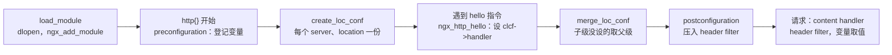
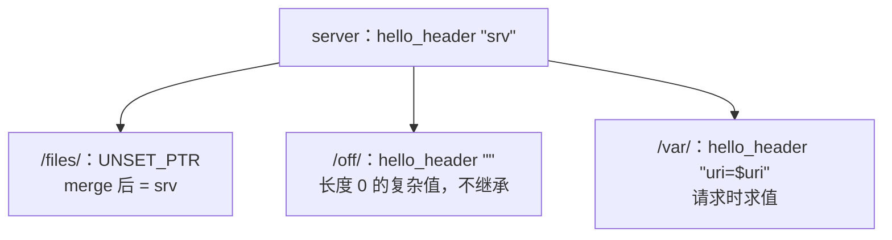
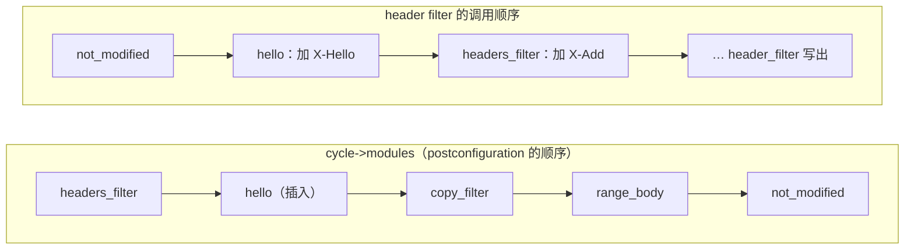
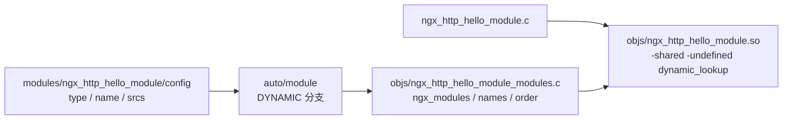
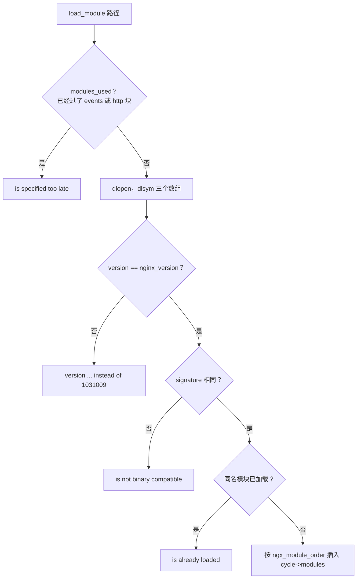
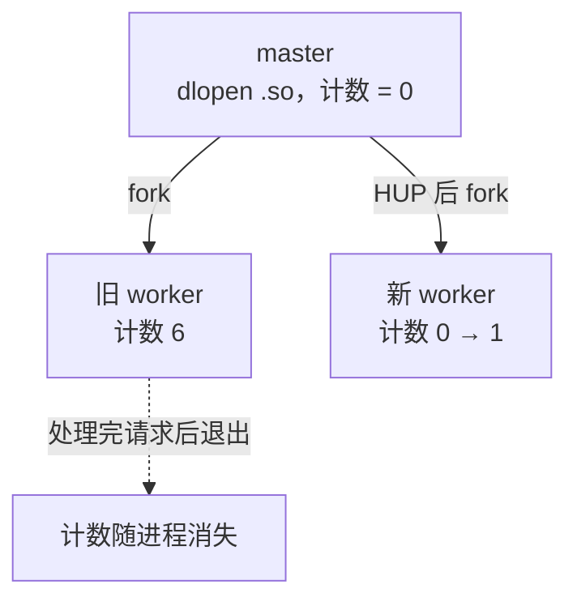

# 开发篇 10｜动手写模块：一个 HTTP 模块就是几张交给框架的表，框架在固定的时机回调它

> **一句话结论**：本仓库的 `modules/ngx_http_hello_module` 不到 300 行，带一个 content handler、一个 header filter 和一个变量。一个 HTTP 模块就是一个 `ngx_module_t`，里面放着两张表：`ngx_http_module_t` 给 http 框架在解析前后、建配置和合并配置时回调，`ngx_command_t` 给配置解析器按指令名回调。`hello` 指令的处理函数在解析配置时把 content handler 写进 location 的 `clcf->handler`；header filter 在 postconfiguration 里把自己压到过滤器链表头，作为动态模块，它在 `cycle->modules` 里排在 `ngx_http_copy_filter_module` 前面，所以它比 `add_header` 先执行，`X-Hello` 出现在 `X-Add` 之前。变量在 preconfiguration 里登记，标了 `NOCACHEABLE`，access log 写日志前会把它作废重取，所以 rewrite 阶段读到 4、日志里是 5。`load_module` 在解析 main 时 `dlopen`，`ngx_add_module` 先比对版本号和二进制签名：给 1.30.7 编的模块和签名不同的模块都会被拒绝；它还必须写在 `events{}`、`http{}` 之前。模块里的静态变量属于进程，每个 worker 一份，reload 换了 worker 就从零开始。
>
> 适用版本：nginx 1.31.9（mainline，2026-11-18）。「版本差异」：`ngx_module.h`、`ngx_module.c`、`auto/module` 与 1.30.7 相同，模块的写法在两个版本之间没有区别；动态模块必须用编译它的那个版本的源码树来编（§7）。实验：[`labs/dev-10`](../labs/dev-10/)，单 worker；模块由 `tools/build.sh` 以 `--add-dynamic-module` 编进 `.nginx/modules/`，`run.sh` 在实验目录建一个指向它的 `modules` 链接；`fake.c` 是一个什么也不做、可以在编译时改掉版本号和签名的模块。

## 导读

| 你想知道 | 看哪一节 |
|---|---|
| 一个模块由哪几部分组成，框架什么时候调用它们 | §1 |
| 怎么让一个指令接管 location 的响应 | §2 |
| location 配置怎么从 server 继承，怎么关掉继承来的值 | §3 |
| 自己的 header filter 排在链里的什么位置 | §4 |
| 怎么提供一个变量，`NOCACHEABLE` 起什么作用 | §5 |
| `config` 文件写什么，configure 拿它生成了什么 | §6 |
| `load_module` 为什么会拒绝一个模块 | §7 |
| 模块里的计数器为什么 reload 后归零 | §8 |

[运维篇 01](../ops/01-install.md) §4 讲了动态模块怎么编、`load_module` 的路径相对于什么。这一篇从源码看模块本身。前面几篇讲的机制在这里都有对应：指令解析和合并（[开发篇 04](04-startup-config.md) §2、§7），content handler 和过滤器链（[开发篇 06](06-http-request.md) §4、§6），变量下标和缓存（[开发篇 07](07-rewrite-script.md) §1、§2）。下图是模块的每个回调在 nginx 生命周期里被调用的时机，判断是：模块不主动做任何事，所有代码都在框架回调它的时候运行：



## 1. 一个模块就是一个 ngx_module_t：type 决定谁来调用它，ctx 和 commands 是交给框架的两张表

`ngx_module_t` 的前半部分：

```c
// src/core/ngx_module.h:223-237
struct ngx_module_s {
    ngx_uint_t            ctx_index;
    ngx_uint_t            index;

    char                 *name;

    ngx_uint_t            spare0;
    ngx_uint_t            spare1;

    ngx_uint_t            version;
    const char           *signature;

    void                 *ctx;
    ngx_command_t        *commands;
    ngx_uint_t            type;
```

`index` 是模块在 `cycle->modules` 里的全局编号，`ctx_index` 是在同类模块（这里是 `NGX_HTTP_MODULE`）里的编号，http 框架用它在每一级配置数组里找到这个模块的配置结构（[开发篇 04](04-startup-config.md) §5）。两个编号都由 nginx 分配，模块只写 `NGX_MODULE_V1`。`version` 和 `signature` 是 §7 加载时检查的两项。`ctx` 的类型由 `type` 决定，HTTP 模块的 ctx 是八个回调：

```c
// modules/ngx_http_hello_module/ngx_http_hello_module.c:55-84
static ngx_http_module_t  ngx_http_hello_module_ctx = {
    ngx_http_hello_add_variables,          /* preconfiguration */
    ngx_http_hello_init,                   /* postconfiguration */

    NULL,                                  /* create main configuration */
    NULL,                                  /* init main configuration */

    NULL,                                  /* create server configuration */
    NULL,                                  /* merge server configuration */

    ngx_http_hello_create_loc_conf,        /* create location configuration */
    ngx_http_hello_merge_loc_conf          /* merge location configuration */
};


ngx_module_t  ngx_http_hello_module = {
    NGX_MODULE_V1,
    &ngx_http_hello_module_ctx,            /* module context */
    ngx_http_hello_commands,               /* module directives */
    NGX_HTTP_MODULE,                       /* module type */
    NULL,                                  /* init master */
    NULL,                                  /* init module */
    NULL,                                  /* init process */
    NULL,                                  /* init thread */
    NULL,                                  /* exit thread */
    NULL,                                  /* exit process */
    NULL,                                  /* exit master */
    NGX_MODULE_V1_PADDING
};

```

hello 模块用了其中四个：preconfiguration 登记变量（§5），postconfiguration 安装过滤器（§4），create 和 merge 管 location 级配置（§3）。main 级和 server 级没有自己的配置，对应的回调留空。`init_process` 这一组进程级钩子它也没用：它没有需要在 worker 启动时打开的文件或连接。

**小结**：写模块先决定 `type`，再决定配置放在哪一级、要哪几个回调；用不到的回调写 `NULL`，框架会跳过。模块的名字（`ngx_module_names`）和编号都不在源文件里，由 configure 和 nginx 生成（§6）。

## 2. 指令处理函数在解析配置时运行：hello 把 content handler 挂到 location 上

`hello` 指令只能写在 location 里，带一个参数：

```c
// modules/ngx_http_hello_module/ngx_http_hello_module.c:35-53
static ngx_command_t  ngx_http_hello_commands[] = {

    { ngx_string("hello"),
      NGX_HTTP_LOC_CONF|NGX_CONF_TAKE1,
      ngx_http_hello,
      NGX_HTTP_LOC_CONF_OFFSET,
      offsetof(ngx_http_hello_loc_conf_t, text),
      NULL },

    { ngx_string("hello_header"),
      NGX_HTTP_MAIN_CONF|NGX_HTTP_SRV_CONF|NGX_HTTP_LOC_CONF|NGX_CONF_TAKE1,
      ngx_http_set_complex_value_slot,
      NGX_HTTP_LOC_CONF_OFFSET,
      offsetof(ngx_http_hello_loc_conf_t, header),
      NULL },

      ngx_null_command
};

```

`offsetof(..., text)` 告诉通用的 `ngx_conf_set_str_slot` 把参数存到哪个字段。`ngx_http_hello` 先调用它，再做这个指令真正要做的事：

```c
// modules/ngx_http_hello_module/ngx_http_hello_module.c:215-230
static char *
ngx_http_hello(ngx_conf_t *cf, ngx_command_t *cmd, void *conf)
{
    ngx_http_core_loc_conf_t  *clcf;
    char                      *rv;

    rv = ngx_conf_set_str_slot(cf, cmd, conf);
    if (rv != NGX_CONF_OK) {
        return rv;
    }

    clcf = ngx_http_conf_get_module_loc_conf(cf, ngx_http_core_module);
    clcf->handler = ngx_http_hello_handler;

    return NGX_CONF_OK;
}
```

`clcf->handler` 是 core 模块的 location 配置。请求选定 location 时，`ngx_http_update_location_config` 把它复制到请求上：

```c
// src/http/ngx_http_core_module.c:1431-1433
    if (clcf->handler) {
        r->content_handler = clcf->handler;
    }
```

CONTENT 阶段的 checker 看到 `r->content_handler` 就直接调用它，不再走阶段数组里的 content 处理函数（[开发篇 06](06-http-request.md) §4）。`proxy_pass`、`fastcgi_pass`、`grpc_pass`、`empty_gif`、`mp4` 这些“这个 location 由我来回答”的指令都是这样实现的（各模块里的 `clcf->handler = ...`）。处理函数本身：

```c
// modules/ngx_http_hello_module/ngx_http_hello_module.c:101-156
static ngx_int_t
ngx_http_hello_handler(ngx_http_request_t *r)
{
    ngx_int_t                   rc;
    ngx_buf_t                  *b;
    ngx_chain_t                 out;
    ngx_http_hello_loc_conf_t  *hlcf;

    if (!(r->method & (NGX_HTTP_GET|NGX_HTTP_HEAD))) {
        return NGX_HTTP_NOT_ALLOWED;
    }

    rc = ngx_http_discard_request_body(r);

    if (rc != NGX_OK) {
        return rc;
    }

    hlcf = ngx_http_get_module_loc_conf(r, ngx_http_hello_module);

    ngx_http_hello_requests++;

    ngx_log_debug1(NGX_LOG_DEBUG_HTTP, r->connection->log, 0,
                   "hello handler, request #%uA in this worker",
                   ngx_http_hello_requests);

    r->headers_out.status = NGX_HTTP_OK;
    r->headers_out.content_length_n = hlcf->text.len + 1;
    ngx_str_set(&r->headers_out.content_type, "text/plain");
    r->headers_out.content_type_len = r->headers_out.content_type.len;

    if (r->method == NGX_HTTP_HEAD) {
        return ngx_http_send_header(r);
    }

    b = ngx_create_temp_buf(r->pool, hlcf->text.len + 1);
    if (b == NULL) {
        return NGX_HTTP_INTERNAL_SERVER_ERROR;
    }

    b->last = ngx_cpymem(b->last, hlcf->text.data, hlcf->text.len);
    *b->last++ = LF;
    b->last_buf = (r == r->main) ? 1 : 0;
    b->last_in_chain = 1;

    out.buf = b;
    out.next = NULL;

    rc = ngx_http_send_header(r);

    if (rc == NGX_ERROR || rc > NGX_OK || r->header_only) {
        return rc;
    }

    return ngx_http_output_filter(r, &out);
}
```

它的顺序是一个 content handler 的标准写法：先拒绝不支持的方法，丢弃请求体，填 `headers_out`，HEAD 请求只发头，否则建一个缓冲，`ngx_http_send_header` 之后 `ngx_http_output_filter`。返回值交给 `ngx_http_finalize_request`。实验：

```text
# labs/dev-10 ## the content handler
hi from the module

HTTP/1.1 200 OK
Content-Length: 19
POST: 405
ok - GET 19 bytes, HEAD the same length without a body, POST 405
```

GET 返回 18 字节的文本加一个换行，共 19 字节；HEAD 的 `Content-Length` 也是 19，没有响应体；POST 是 405。计数器在 HEAD 判断之前加 1，所以 HEAD 请求也被计入（§5 的数字由此而来）。

**小结**：让一个指令接管 location 的响应，在指令处理函数里设 `clcf->handler`；不需要注册阶段处理函数。处理函数里不要自己写 socket，所有输出都经过 `ngx_http_send_header` 和 `ngx_http_output_filter`，后面的过滤器（gzip、chunked、限速）才能起作用。

## 3. 配置结构每个 location 一份，UNSET 和 merge 决定继承

`hello_header` 可以写在 http、server、location 三级，值是一个可以带变量的复杂值。create 回调给每一级分配一个结构：

```c
// modules/ngx_http_hello_module/ngx_http_hello_module.c:252-271
static void *
ngx_http_hello_create_loc_conf(ngx_conf_t *cf)
{
    ngx_http_hello_loc_conf_t  *conf;

    conf = ngx_pcalloc(cf->pool, sizeof(ngx_http_hello_loc_conf_t));
    if (conf == NULL) {
        return NULL;
    }

    /*
     * set by ngx_pcalloc():
     *
     *     conf->text = { 0, NULL };
     */

    conf->header = NGX_CONF_UNSET_PTR;

    return conf;
}
```

`ngx_pcalloc` 清零的字段不用再写，`header` 设成 `NGX_CONF_UNSET_PTR`，表示“这一级没写”。merge 回调在解析完后自上而下地调用，每对父子调用一次（[开发篇 04](04-startup-config.md) §7）：

```c
// modules/ngx_http_hello_module/ngx_http_hello_module.c:274-284
static char *
ngx_http_hello_merge_loc_conf(ngx_conf_t *cf, void *parent, void *child)
{
    ngx_http_hello_loc_conf_t  *prev = parent;
    ngx_http_hello_loc_conf_t  *conf = child;

    ngx_conf_merge_str_value(conf->text, prev->text, "");
    ngx_conf_merge_ptr_value(conf->header, prev->header, NULL);

    return NGX_CONF_OK;
}
```

`ngx_conf_merge_ptr_value` 的定义：

```c
// src/core/ngx_conf_file.h:214-217
#define ngx_conf_merge_ptr_value(conf, prev, default)                        \
    if (conf == NGX_CONF_UNSET_PTR) {                                        \
        conf = (prev == NGX_CONF_UNSET_PTR) ? default : prev;                \
    }
```

子级是 UNSET 就取父级，父级也是 UNSET 就取默认值 `NULL`。实验的 server 级写了 `hello_header "srv"`，`/files/` 没写，`/off/` 写了空串，`/var/` 写了带变量的值：

```text
# labs/dev-10 ## the location configuration is merged from the server
/files/a.txt: X-Hello: srv 
/off/a.txt: 
/var/a.txt: X-Hello: uri=/var/a.txt 
ok - inherited, switched off by an empty value, evaluated per request
```

`/files/` 继承了 `srv`。`/off/` 的空串编译成一个长度为 0 的复杂值，它不是 UNSET，所以不继承；过滤器在求值得到空串时跳过（§4 的代码）。`/var/` 的 `$uri` 在每个请求里求值。下图是这三个 location 的合并结果，判断是：“没写”和“写了空值”是两种状态，模块要用 UNSET 把前者区分出来：



**小结**：每个配置字段都要有一个“没设”的值（`NGX_CONF_UNSET`、`NGX_CONF_UNSET_PTR` 等），create 里设好，merge 里用对应的 `ngx_conf_merge_*_value` 合并；想让用户在子级关掉继承来的设置，给指令一个显式的“关”值（空串、`off`），不要靠省略。

## 4. 过滤器在 postconfiguration 里把自己压到链表头；动态模块的位置由 ngx_module_order 决定

http 框架解析完 `http{}` 后，按 `cycle->modules` 的顺序调用每个 HTTP 模块的 postconfiguration：

```c
// src/http/ngx_http.c:303-315
    for (m = 0; cf->cycle->modules[m]; m++) {
        if (cf->cycle->modules[m]->type != NGX_HTTP_MODULE) {
            continue;
        }

        module = cf->cycle->modules[m]->ctx;

        if (module->postconfiguration) {
            if (module->postconfiguration(cf) != NGX_OK) {
                return NGX_CONF_ERROR;
            }
        }
    }
```

hello 的 postconfiguration 只有两行，记下当前的链表头，再把自己设成链表头：

```c
// modules/ngx_http_hello_module/ngx_http_hello_module.c:287-294
static ngx_int_t
ngx_http_hello_init(ngx_conf_t *cf)
{
    ngx_http_next_header_filter = ngx_http_top_header_filter;
    ngx_http_top_header_filter = ngx_http_hello_header_filter;

    return NGX_OK;
}
```

后执行 postconfiguration 的过滤器排在链表前面，先被调用。静态编译的过滤器顺序由 `auto/modules` 固定，动态模块则由 `ngx_add_module` 按 `ngx_module_order` 插进 `cycle->modules`：

```c
// src/core/ngx_module.c:211-252
    before = cf->cycle->modules_n;

    if (order) {
        for (i = 0; order[i]; i++) {
            if (ngx_strcmp(order[i], module->name) == 0) {
                i++;
                break;
            }
        }

        for ( /* void */ ; order[i]; i++) {

#if 0
            ngx_log_debug2(NGX_LOG_DEBUG_CORE, cf->log, 0,
                           "module: %s before %s",
                           module->name, order[i]);
#endif

            for (m = 0; m < before; m++) {
                if (ngx_strcmp(cf->cycle->modules[m]->name, order[i]) == 0) {

                    ngx_log_debug3(NGX_LOG_DEBUG_CORE, cf->log, 0,
                                   "module: %s before %s:%i",
                                   module->name, order[i], m);

                    before = m;
                    break;
                }
            }
        }
    }

    /* put the module before modules[before] */

    if (before != cf->cycle->modules_n) {
        ngx_memmove(&cf->cycle->modules[before + 1],
                    &cf->cycle->modules[before],
                    (cf->cycle->modules_n - before) * sizeof(ngx_module_t *));
    }

    cf->cycle->modules[before] = module;
    cf->cycle->modules_n++;
```

hello 的 order 是 `ngx_http_hello_module`、`ngx_http_copy_filter_module`（§6），于是它被插在 copy_filter 前面，也就是 headers_filter（`add_header` 所在的模块）和 copy_filter 之间。它的 postconfiguration 在 headers_filter 之后执行，在链表里排在 headers_filter 前面。实验在同一个 location 里同时用 `hello_header` 和 `add_header X-Add 1`：

```text
# labs/dev-10 ## the header filter runs before add_header's
HTTP/1.1 200 OK
X-Hello: srv
X-Add: 1
ok - X-Hello is pushed before X-Add
```

两个过滤器都往 `r->headers_out.headers` 链表尾部追加，先执行的先追加，header filter 模块按链表顺序写出响应头，所以 `X-Hello` 在前。下图是这一段模块顺序和过滤器调用顺序的关系，判断是：两者正好相反，数组里越靠后的过滤器越先执行：



hello 的过滤器对每个请求都会被调用，没配置 `hello_header` 的 location 里它只做一次判断就交给下一个；子请求（`r != r->main`）也直接跳过，响应头只属于主请求。

**小结**：过滤器的位置决定它看到的是什么：按调用顺序排在 headers_filter 之前，它看不到 `add_header` 加的头；一个在 gzip 之后才被调用的 body filter，看到的是压缩后的数据。动态过滤器模块想换位置，在 `config` 里写 `ngx_module_order`，列出自己和要排在其前面的模块。

## 5. 变量在 preconfiguration 里登记；NOCACHEABLE 让每次“刷新读”都重新取值

变量定义表和登记函数：

```c
// modules/ngx_http_hello_module/ngx_http_hello_module.c:86-92
static ngx_http_variable_t  ngx_http_hello_vars[] = {

    { ngx_string("hello_requests"), NULL, ngx_http_hello_requests_variable,
      0, NGX_HTTP_VAR_NOCACHEABLE, 0 },

      ngx_http_null_variable
};
```

```c
// modules/ngx_http_hello_module/ngx_http_hello_module.c:233-249
static ngx_int_t
ngx_http_hello_add_variables(ngx_conf_t *cf)
{
    ngx_http_variable_t  *var, *v;

    for (v = ngx_http_hello_vars; v->name.len; v++) {
        var = ngx_http_add_variable(cf, &v->name, v->flags);
        if (var == NULL) {
            return NGX_ERROR;
        }

        var->get_handler = v->get_handler;
        var->data = v->data;
    }

    return NGX_OK;
}
```

登记必须在 preconfiguration 里做：http 框架在解析 `http{}` 里的任何指令之前调用它（[`ngx_http.c` 第 222–234 行](https://github.com/nginx/nginx/blob/release-1.31.9/src/http/ngx_http.c#L222)），之后 `set`、`log_format` 里出现的 `$hello_requests` 才能在 `ngx_http_variables_init_vars` 里配上取值函数（[开发篇 07](07-rewrite-script.md) §1）。取值函数从请求池分配空间，把每个 worker 的计数写进去：

```c
// modules/ngx_http_hello_module/ngx_http_hello_module.c:194-212
static ngx_int_t
ngx_http_hello_requests_variable(ngx_http_request_t *r,
    ngx_http_variable_value_t *v, uintptr_t data)
{
    u_char  *p;

    p = ngx_pnalloc(r->pool, NGX_ATOMIC_T_LEN);
    if (p == NULL) {
        return NGX_ERROR;
    }

    v->len = ngx_sprintf(p, "%uA", ngx_http_hello_requests) - p;
    v->valid = 1;
    v->no_cacheable = 1;
    v->not_found = 0;
    v->data = p;

    return NGX_OK;
}
```

`NGX_HTTP_VAR_NOCACHEABLE` 让值带上 `no_cacheable`。脚本引擎读变量时总是重新取值；access log 每写一行之前，先把日志格式里所有 `no_cacheable` 的变量作废（[`ngx_http_log_module.c` 第 302 行](https://github.com/nginx/nginx/blob/release-1.31.9/src/http/modules/ngx_http_log_module.c#L302)）。实验的 `/count` 在 rewrite 阶段 `set $before $hello_requests`，日志格式里同时有 `$before` 和 `$hello_requests`：

```text
# labs/dev-10 ## the variable is read again by the access log
/count 200 before=4 now=5
/count 200 before=5 now=6
ok - set reads the count before the handler, the log after it
```

`set` 在 rewrite 阶段读到 4（前面两步共有 4 个请求经过 hello 的处理函数：§2 的 GET、HEAD 各两次），content handler 把计数加到 5，access log 重新取值得到 5；`$before` 是 `set` 写入的变量，`set_var` 会清掉 `no_cacheable`（[`ngx_http_script.c` 第 1930 行](https://github.com/nginx/nginx/blob/release-1.31.9/src/http/ngx_http_script.c#L1930)），日志里保持 4。可缓存的变量在同样的位置会沿用早先的值，[开发篇 07](07-rewrite-script.md) §2 的 `$sent_http_content_type` 就是这样变成 `-` 的。

**小结**：值在一个请求里会变的变量（计数、时间、状态）定义时标 `NGX_HTTP_VAR_NOCACHEABLE`；值在一个请求里不变、计算又贵的不要标，让框架缓存。取值函数从 `r->pool` 分配内存，不要返回指向静态缓冲区的指针，同一行日志里可能有多个变量。

## 6. config 文件交给 auto/module：动态模块多生成一个三数组的 C 文件

`config` 是一段由 configure 执行的 shell 脚本，只设几个变量，再调用 `auto/module`：

```text
# labs/dev-10 ## what configure makes of the config file
ngx_addon_name=ngx_http_hello_module

ngx_module_type=HTTP_FILTER
ngx_module_name=ngx_http_hello_module
ngx_module_srcs="$ngx_addon_dir/ngx_http_hello_module.c"

. auto/module
--- auto/module, lines 23-31 (the order of a dynamic module)
    if [ -z "$ngx_module_order" -a \
         \( "$ngx_module_type" = "HTTP_FILTER" \
         -o "$ngx_module_type" = "HTTP_AUX_FILTER" \) ]
    then
        eval ${ngx_module}_ORDER=\"$ngx_module_name \
                                   ngx_http_copy_filter_module\"
    else
        eval ${ngx_module}_ORDER=\"$ngx_module_order\"
    fi
--- objs/ngx_http_hello_module_modules.c
#include <ngx_config.h>
#include <ngx_core.h>
extern ngx_module_t  ngx_http_hello_module;
ngx_module_t *ngx_modules[] = {
    &ngx_http_hello_module,
    NULL
};
char *ngx_module_names[] = {
    "ngx_http_hello_module",
    NULL
};
char *ngx_module_order[] = {
    "ngx_http_hello_module",
    "ngx_http_copy_filter_module",
    NULL
};
signature in the .so:   8,4,8,1011001111010111011101111111111111
signature in the nginx: 8,4,8,1011001111010111011101111111111111
ok - an HTTP_FILTER module is ordered before copy_filter; the signatures match
```

`ngx_module_type=HTTP_FILTER` 决定了 order：实验输出里 `auto/module` 那一段是它处理动态模块时的判断，类型是 `HTTP_FILTER` 或 `HTTP_AUX_FILTER`、又没写 `ngx_module_order` 时，order 默认是“自己，然后 copy_filter”。configure 为每个动态模块生成一个 `objs/<模块名>_modules.c`，里面是三个数组：`ngx_modules`（模块结构的地址）、`ngx_module_names`（名字）、`ngx_module_order`（插入位置），它和模块源文件一起链接成 `.so`。静态编译时这三项分别进 `objs/ngx_modules.c` 的总表，模块源文件本身一个字也不用改，这就是同一份源码既能 `--add-module` 也能 `--add-dynamic-module` 的原因。实验最后两行是 `.so` 和 nginx 可执行文件里的签名串，两者相同（§7）。下图是从 `config` 到 `.so` 的过程，判断是：模块的元数据由构建系统生成，源文件里只有代码：



**小结**：`config` 里至少写 `ngx_addon_name`、`ngx_module_type`、`ngx_module_name`、`ngx_module_srcs`；一个 `.so` 里放多个模块时，`ngx_module_name` 写多个名字。改了模块源文件只需要 `make modules`，不必重编 nginx，前提是用同一份源码树和同样的 configure 参数。

## 7. load_module 在解析 main 时 dlopen，ngx_add_module 先查版本和签名

`ngx_load_module` 先检查是否太晚：

```c
// src/core/nginx.c:1663-1665
    if (cf->cycle->modules_used) {
        return "is specified too late";
    }
```

`modules_used` 在 `events{}` 或 `http{}` 第一次统计模块数时被置 1（[`ngx_module.c` 第 150 行](https://github.com/nginx/nginx/blob/release-1.31.9/src/core/ngx_module.c#L150)），之后再加模块，各类模块的配置数组就对不上了。然后它 `dlopen`，取出 §6 的三个数组，逐个调用 `ngx_add_module`：

```c
// src/core/nginx.c:1707-1719
    order = ngx_dlsym(handle, "ngx_module_order");

    for (i = 0; modules[i]; i++) {
        module = modules[i];
        module->name = names[i];

        if (ngx_add_module(cf, &file, module, order) != NGX_OK) {
            return NGX_CONF_ERROR;
        }

        ngx_log_debug2(NGX_LOG_DEBUG_CORE, cf->log, 0, "module: %s i:%ui",
                       module->name, module->index);
    }
```

`ngx_add_module` 在插入之前做三项检查：

```c
// src/core/ngx_module.c:170-191
    if (module->version != nginx_version) {
        ngx_conf_log_error(NGX_LOG_EMERG, cf, 0,
                           "module \"%V\" version %ui instead of %ui",
                           file, module->version, (ngx_uint_t) nginx_version);
        return NGX_ERROR;
    }

    if (ngx_strcmp(module->signature, NGX_MODULE_SIGNATURE) != 0) {
        ngx_conf_log_error(NGX_LOG_EMERG, cf, 0,
                           "module \"%V\" is not binary compatible",
                           file);
        return NGX_ERROR;
    }

    for (m = 0; cf->cycle->modules[m]; m++) {
        if (ngx_strcmp(cf->cycle->modules[m]->name, module->name) == 0) {
            ngx_conf_log_error(NGX_LOG_EMERG, cf, 0,
                               "module \"%s\" is already loaded",
                               module->name);
            return NGX_ERROR;
        }
    }
```

`version` 是编译模块时的 `nginx_version`，签名是一串由编译选项拼成的字符串：前三段是指针、`sig_atomic_t`、`time_t` 的字节数，后面每一位表示一个影响结构体布局的特性是否打开（kqueue、epoll、线程、QUIC 等，[`ngx_module.h` 第 21–24 行](https://github.com/nginx/nginx/blob/release-1.31.9/src/core/ngx_module.h#L21)起）。`--with-compat` 把其中几位固定为 1，并在结构体里留出占位字段，使模块不依赖这些特性是否真的编进了 nginx。实验用 `fake.c` 编两个 `.so`，一个把版本改成 1030007，一个把签名改成 `8,4,8,0`，再加两份写法错误的配置：

```text
# labs/dev-10 ## what ngx_add_module refuses
[emerg] module "$LAB/out/run/oldver.so" version 1030007 instead of 1031009 in $LAB/conf/oldver.conf:2
[emerg] module "$LAB/out/run/badsig.so" is not binary compatible in $LAB/conf/badsig.conf:2
[emerg] "load_module" directive is specified too late in $LAB/conf/late.conf:3
[emerg] module "ngx_http_hello_module" is already loaded in $LAB/conf/twice.conf:3
ok - wrong version, wrong signature, too late, twice
```

四条都是 `[emerg]`，`nginx -t` 就能发现，不会等到 reload 才失败。下图是 `load_module` 的检查顺序，判断是：每一道检查都在配置解析阶段完成，模块代码一行都还没执行：



版本号精确到补丁号：1.31.9 只认 1031009，给 1.31.8 编的模块也会被拒绝。

**小结**：分发动态模块，要和 nginx 用同一个版本的源码、同样影响签名的 configure 参数（至少都带 `--with-compat`）来编；升级 nginx 补丁版本时，动态模块要一起重编。`load_module` 一律写在配置文件最前面。

## 8. 模块里的静态变量属于进程：每个 worker 一份，reload 换了 worker 就从零开始

`ngx_http_hello_requests` 是 `.so` 里的一个静态变量。master 解析配置时 `dlopen` 了这个 `.so`，worker 由 master `fork` 出来，各自得到一份写时复制的副本；master 自己不处理请求，它的副本一直是 0。实验先读一次计数，reload 之后发一个 `/hello` 再读：

```text
# labs/dev-10 ## each worker has its own counter, a reload starts from zero
before reload: 6
after reload and one request: 1
ok - the new worker counts from 1
```

reload 前是 6（§2 到 §5 的 6 个请求）；reload 时 master 按新配置建新 cycle、`fork` 新的 worker，旧 worker 处理完手上的请求后退出（[开发篇 04](04-startup-config.md) §8），新 worker 从 master 的 0 开始，一个请求之后是 1。下图是这个过程里计数器的副本，判断是：worker 之间、reload 前后都不共享静态变量，要共享就得用共享内存：



旧 cycle 的内存池上挂着一个 cleanup，cycle 释放时调用 `ngx_unload_module` 做 `dlclose`（[`nginx.c` 第 1737 行](https://github.com/nginx/nginx/blob/release-1.31.9/src/core/nginx.c#L1737)）；新 cycle 在此之前已经 `dlopen` 过同一个文件，动态链接器按引用计数保留映射，模块代码在 reload 期间不会被卸掉。

**小结**：模块里需要跨 worker、跨 reload 保留的状态（计数、限流表、会话），放进共享内存 zone（[开发篇 03](03-memory.md) §7，[开发篇 08](08-limit-req.md) 的 limit_req 就是例子）；静态变量只适合放每个进程自己的东西，比如缓存的配置指针或统计的局部计数。

## 已知局限与待核实

- §7 只在 macOS（kqueue）的构建上检查了签名；Linux 上签名的第 6 位（epoll）等不同，同一份模块源码要在目标平台上重编，本篇没有在 Linux 上运行。
- §8 末尾“reload 期间模块代码不会被卸掉”是按 `dlopen`/`dlclose` 的引用计数语义推断的。替换磁盘上的 `.so` 再 reload 时新代码是否生效，与平台的动态链接器有关，本篇没有验证；可靠的做法是重启或做二进制热升级（[运维篇 03](../ops/03-processes-signals.md)）。
- hello 模块只演示了 content handler、header filter 和变量；body filter、阶段处理函数（`cmcf->phases[...].handlers`）、upstream 类模块的回调没有写成例子，前两者的接口见 [开发篇 06](06-http-request.md) §4、§6，后者见 [开发篇 09](09-upstream.md) §1。
- 模块没有写单元测试框架里的测试（nginx 官方用 Perl 写的 nginx-tests），本仓库用 `labs/dev-10/run.sh` 的实验代替。

## 修订记录

- 2026-11-21：基于 nginx 1.31.9 源码新写。覆盖 `ngx_module_t` 与 HTTP 模块的回调、指令处理函数与 `clcf->handler`、location 配置的 create/merge 与 UNSET、header filter 的安装与动态模块的插入位置、变量登记与 `NOCACHEABLE`、`config` 文件与 `auto/module` 生成的数组、`load_module` 的版本与签名检查、模块静态变量的进程归属；实验 `labs/dev-10` 加载本仓库的 hello 模块并用 `fake.c` 复现加载失败。
