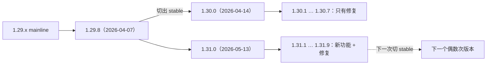
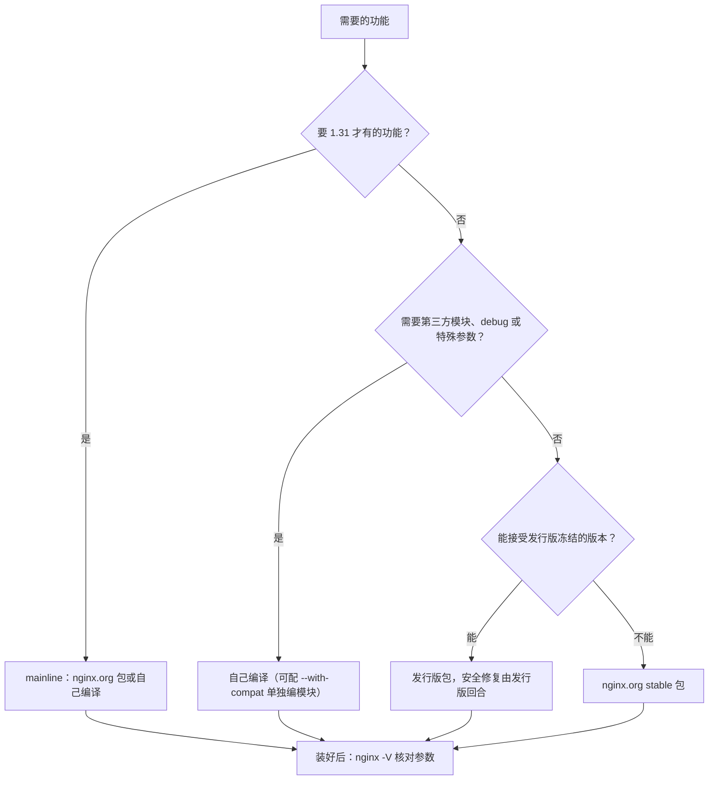
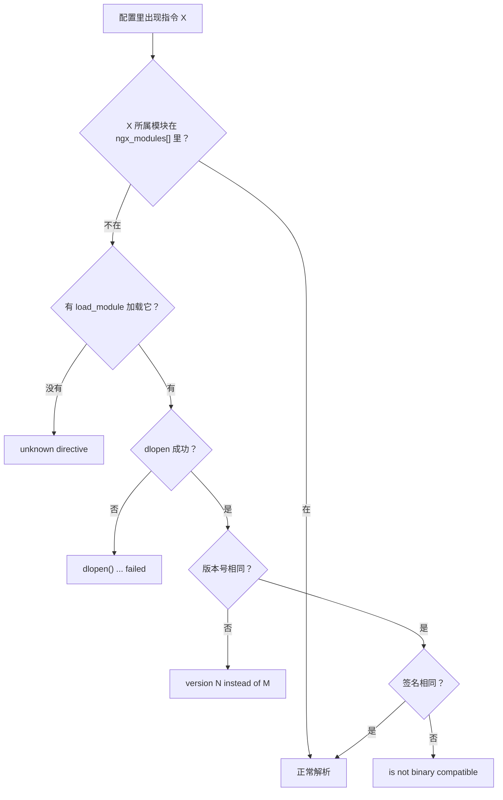
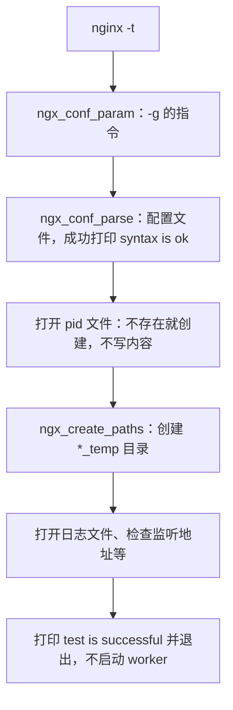
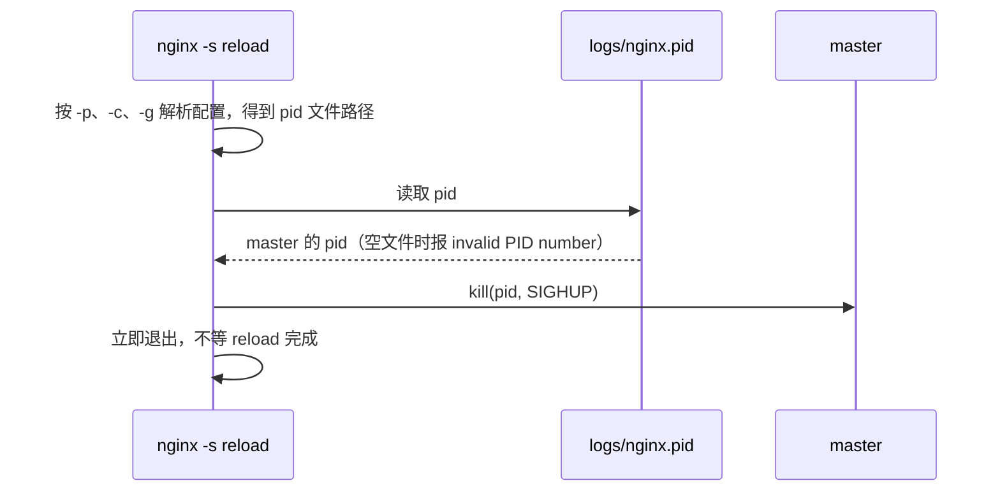

# 运维篇 01｜版本、安装与实验环境：先用 nginx -V 认清手里的二进制，再决定配置能写什么

> **一句话结论**：stable 分支（现在是 1.30.x）从切出那天起只收修复，1.30.1 到 1.30.7 的 changes.xml 里没有一条 feature；新功能只进 mainline（1.31.x）。不管用哪种方式安装，`nginx -V` 都能告诉你版本、TLS 库和编译参数，后面每一篇用到的指令能不能写，取决于对应模块是否编进了这个二进制。`nginx -t` 也不是只读检查：它会创建 `*_temp` 目录和一个空的 pid 文件。
>
> 适用版本：nginx 1.31.9（mainline，2026-11-18）与 1.30.7（stable，同日发布）。「版本差异」：本篇列出的 1.31.0–1.31.7 新功能在 1.30.7 都没有；`--with-control-api`（control API，1.31.5）和 `--with-http_json_module`（1.31.5）只在 1.31.x 的 configure 里存在。实验：[`labs/ops-01`](../labs/ops-01/)，检查本仓库编译出的二进制，并在一个空目录里演示 `-p`、`-t`、`-s` 的副作用。

## 导读

| 你想知道 | 看哪一节 |
|---|---|
| 生产环境该装 mainline 还是 stable | §1 |
| 官方包、发行版包、源码编译怎么选 | §2 |
| `nginx -V` 每一行说明什么 | §3 |
| 某条指令报 `unknown directive`，是写错了还是没编进去 | §4 |
| `-p`、`-c`、`-e`、`-g`、`-q` 分别改变什么 | §5 |
| 为什么只跑了一次 `nginx -t`，`-s reload` 就报 `invalid PID number` | §6 |
| 本仓库的实验怎么跑、有哪些约定 | §7 |

## 1. stable 只收修复，mainline 每月带新功能：要不要 1.31 的功能决定选哪个

nginx 同时维护两条线。偶数次版本号是 stable：1.30.0 在 2026-04-14 从当时的 mainline 1.29.8 切出，之后的 1.30.x 只回合安全修复和少量 bugfix。奇数次版本号是 mainline：1.31.x 接着开发，每个版本都可能带新功能、行为变化和修复。两条线的安全修复通常同日发布：2026-11-18 的 1.30.7 修复了 9 个 CVE，它们全部也出现在同日的 1.31.9 里，1.31.9 另外多一个（CVE-2026-120993）。

这个区别可以直接从两个分支各自的 changes.xml 数出来，实验脚本统计每条线发布以来各类条目的数量：

```text
# labs/ops-01 ## what each branch received since it was cut
1.30.x: feature 0 change 2 bugfix 14 security 27
1.31.x: feature 15 change 13 bugfix 39 security 29
```

1.30.x 的 2 条 change 都和日志或 QUIC 的兼容性有关（1.30.5 忽略 SSL 连接里收到的 QUIC 传输参数扩展，1.30.6 把几类 SSL 告警的日志级别从 crit 降到 info），没有新指令。1.31.x 的 15 条 feature 里，本系列会用到的有：

| 版本 | 新功能 | 在哪篇 |
|---|---|---|
| 1.31.0 | `ngx_http_tunnel_module`（CONNECT 隧道）、upstream `least_time` | 运维篇 06、07 |
| 1.31.5 | predicate location、control API、`ngx_http_json_module`、`client_body_early_read` | 运维篇 04、03、11 |
| 1.31.7 | geoip 模块支持 MMDB 格式、后端证书可按 IP 校验 | — |

选择的标准因此很简单：配置里要用上表的功能，就只能上 mainline；否则 stable 的变化更少，升级时要读的 changes 也更短。mainline 并不意味着不稳定，nginx 的开发者一直建议普通用户也用 mainline，但 stable 的价值在于“没有行为变化”：1.29.7 把到后端的连接默认改成 keepalive（运维篇 06），这类变化只会在你从 1.28 跳到 1.30 时一次性到来，而不会在某个小版本里悄悄发生。



**小结**：先列出配置要用的指令，查它们是哪个版本加的（`python3 tools/since.py <关键词>`），全部早于 1.29.8 就可以用 1.30.x；用到 1.31 的功能就跟 mainline，并把每个版本的 changes 当作升级检查单。

## 2. 三种安装方式的差别在于谁替你选了编译参数

无论是 nginx.org 的官方包、发行版自带的包，还是自己编译，最后得到的都是一个由 `auto/configure` 参数决定的二进制。三种方式的区别是谁来选这些参数、版本跟得多紧：

- **nginx.org 官方包**：mainline 和 stable 各有一个软件源，版本和源码发布同步。编译参数由打包者选定，装好后用 `nginx -V` 查看。
- **发行版的包**：版本由发行版冻结，通常落后于 nginx.org，安全修复由发行版回合；一些发行版把可选模块拆成单独的软件包，以动态模块的形式安装。同样以 `nginx -V` 和配置里的 `load_module` 为准。
- **自己编译**：参数完全自己定，需要的 `--with-*` 模块、调试符号（`--with-debug`）、第三方模块都可以加，代价是升级和安全修复要自己跟。

本仓库选了第三种，理由是教程要读源码、开 debug 日志、编译自己的模块（开发篇 10），而且所有实验都要在同一个确定的二进制上复现。`tools/build.sh` 的 configure 部分是这样的：

```text
./auto/configure \
    --prefix="$PREFIX" \
    --with-debug \
    --with-compat \
    --with-threads \
    --with-control-api \
    --with-http_ssl_module \
    --with-http_v2_module \
    --with-http_v3_module \
    --with-http_stub_status_module \
    --with-http_json_module \
    --with-http_realip_module \
    --with-http_auth_request_module \
    --with-http_gunzip_module \
    --with-http_gzip_static_module \
    --with-stream \
    --with-stream_ssl_module \
    --with-stream_ssl_preread_module \
    ${extra[@]+"${extra[@]}"} \
    --with-cc-opt="$cc_opt" \
    --with-ld-opt="$ld_opt" >/dev/null
```

`--prefix` 指向仓库里的 `.nginx`，不需要 root；`--with-debug` 让 `error_log ... debug` 生效（开发篇用它看阶段轨迹）；`--with-compat` 让后面单独编译的动态模块能装进这个二进制（§4）；`--with-cc-opt` 里的 `-O0 -g` 关掉优化、保留调试符号，方便用 lldb 或 gdb 挂上 worker，生产编译不要这样设。`extra` 是 `modules/` 目录下本仓库自己的模块，以 `--add-dynamic-module` 加入。



**小结**：三种方式都可以用于生产，选的是“谁负责编译参数和安全更新”。无论哪种，装好后的第一件事都是 `nginx -V`，把输出存进运维记录。

## 3. nginx -V 的四行信息：版本、编译器、TLS 库、configure 参数

`-v` 和 `-V` 都由 `ngx_show_version_info` 打印。`-v` 只有第一行；`-V` 多出编译器、OpenSSL 版本、SNI 支持和完整的 configure 参数：

```c
// src/core/nginx.c:410-413
static void
ngx_show_version_info(void)
{
    ngx_write_stderr("nginx version: " NGINX_VER_BUILD NGX_LINEFEED);
```

```c
// src/core/nginx.c:453-477
    if (ngx_show_configure) {

#ifdef NGX_COMPILER
        ngx_write_stderr("built by " NGX_COMPILER NGX_LINEFEED);
#endif

#if (NGX_SSL)
        if (ngx_strcmp(ngx_ssl_version(), OPENSSL_VERSION_TEXT) == 0) {
            ngx_write_stderr("built with " OPENSSL_VERSION_TEXT NGX_LINEFEED);
        } else {
            ngx_write_stderr("built with " OPENSSL_VERSION_TEXT
                             " (running with ");
            ngx_write_stderr((char *) (uintptr_t) ngx_ssl_version());
            ngx_write_stderr(")" NGX_LINEFEED);
        }
#ifdef SSL_CTRL_SET_TLSEXT_HOSTNAME
        ngx_write_stderr("TLS SNI support enabled" NGX_LINEFEED);
#else
        ngx_write_stderr("TLS SNI support disabled" NGX_LINEFEED);
#endif
#endif

        ngx_write_stderr("configure arguments:" NGX_CONFIGURE NGX_LINEFEED);
    }
```

实验的输出（编译器一行和 OpenSSL 的小版本由脚本替换掉，仓库路径换成 `$ROOT`，因为这两样随机器变化）：

```text
# labs/ops-01 ## version and configure arguments
nginx version: nginx/1.31.9
built by <compiler>
built with OpenSSL 3.x
TLS SNI support enabled
```

几处读法：

- 版本号来自 `src/core/nginx.h` 的 `NGINX_VERSION`；用 `--build=` 编译时，第一行括号里会带上构建标识（`NGINX_VER_BUILD`）。实验用 `nginx.h` 里的值核对了 `-v` 的输出。
- OpenSSL 一行出现 `(running with ...)`，说明运行时加载的库和编译时的头文件版本不同。动态链接时这很常见，但如果运行时库更旧，某些编译时检测到的功能可能用不了，排查 TLS 问题时先看这一行。
- `configure arguments` 原样保存了编译参数。实验逐个检查 `tools/build.sh` 里的 `--with-*` 是否都出现在这里，确认手里的二进制确实由这份脚本编出：

```text
# labs/ops-01 ## version and configure arguments
ok - -v prints NGINX_VERSION from src/core/nginx.h
ok - every --with option of tools/build.sh is in the configure arguments
```

**小结**：`nginx -V` 是二进制的身份证。版本决定能写哪些指令，configure 参数决定哪些模块在，OpenSSL 一行决定 TLS 能力；三者都和配置文件无关，换机器、换包之后都要重新看一遍。

## 4. unknown directive 多半是模块没编进去：默认模块、--with 模块和动态模块各有来路

`auto/options` 里每个模块有一个开关变量，`YES` 的默认编译，`NO` 的要 `--with-*` 打开；反过来，默认 `YES` 的可以用 `--without-*` 去掉。截取 HTTP 模块的一段：

```text
HTTP_REALIP=NO
HTTP_XSLT=NO
HTTP_IMAGE_FILTER=NO
HTTP_SUB=NO
HTTP_ADDITION=NO
HTTP_DAV=NO
HTTP_ACCESS=YES
...
HTTP_JSON=NO
...
HTTP_PROXY=YES
...
HTTP_TUNNEL=YES
```

configure 结束时把所有编进二进制的模块写进 `objs/ngx_modules.c` 的 `ngx_modules[]` 数组，本仓库这次编译一共 92 个。实验在这个文件里查几个模块：

```text
# labs/ops-01 ## modules compiled in
ngx_http_tunnel_module   built-in
ngx_http_proxy_module    built-in
ngx_http_realip_module   built-in
ngx_http_json_module     built-in
ngx_http_dav_module      no
ngx_http_hello_module    no
```

tunnel 和 proxy 默认开启，realip 和 json 是 `build.sh` 用 `--with-*` 打开的，dav 默认关闭也没有打开。模块不在，它的指令就不存在，`nginx -t` 报的是 `unknown directive`，和拼错指令名是同一句话：

```text
# labs/ops-01 ## modules compiled in
[emerg] unknown directive "dav_methods" in $LAB/conf/dav.conf:8
```

所以看到 `unknown directive`，先确认拼写，再查 `nginx -V` 里有没有对应的 `--with-*`（或者有没有 `--without-*` 把它去掉了），最后才是版本太旧。

最后一行的 `ngx_http_hello_module` 是本仓库自己的模块，以动态模块编译成 `.nginx/modules/ngx_http_hello_module.so`，不在 `ngx_modules[]` 里，要用 `load_module` 在 main 上下文加载。`load_module` 的路径和其他相对路径一样相对于 prefix（`ngx_conf_full_name` 的第三个参数为 0 表示用 prefix 而不是配置目录），然后交给 `dlopen`：

```c
// src/core/nginx.c:1667-1686
    value = cf->args->elts;

    file = value[1];

    if (ngx_conf_full_name(cf->cycle, &file, 0) != NGX_OK) {
        return NGX_CONF_ERROR;
    }

    cln = ngx_pool_cleanup_add(cf->cycle->pool, 0);
    if (cln == NULL) {
        return NGX_CONF_ERROR;
    }

    handle = ngx_dlopen(file.data);
    if (handle == NULL) {
        ngx_conf_log_error(NGX_LOG_EMERG, cf, 0,
                           ngx_dlopen_n " \"%s\" failed (%s)",
                           file.data, ngx_dlerror());
        return NGX_CONF_ERROR;
    }
```

实验的三份配置分别是不写 `load_module`、路径写错、写对（括号里 `dlerror` 的长文本随系统变化，脚本替换成了 `...`）：

```text
# labs/ops-01 ## dynamic modules
[emerg] unknown directive "hello" in $LAB/conf/hello-noload.conf:9
[emerg] dlopen() "$LAB/modules/no_such_module.so" failed (...) in $LAB/conf/hello-badpath.conf:2
configuration file $LAB/conf/hello.conf test is successful
GET / -> hello from a dynamic module
```

`.so` 能被加载之后还有两道检查，版本号必须完全一致，“签名”字符串也必须一致：

```c
// src/core/ngx_module.c:170-182
    if (module->version != nginx_version) {
        ngx_conf_log_error(NGX_LOG_EMERG, cf, 0,
                           "module \"%V\" version %ui instead of %ui",
                           file, module->version, (ngx_uint_t) nginx_version);
        return NGX_ERROR;
    }

    if (ngx_strcmp(module->signature, NGX_MODULE_SIGNATURE) != 0) {
        ngx_conf_log_error(NGX_LOG_EMERG, cf, 0,
                           "module \"%V\" is not binary compatible",
                           file);
        return NGX_ERROR;
    }
```

签名由几十个 0/1 拼成，每一位对应一个影响结构体布局的编译开关，例如是否有线程、是否有 SSL。`--with-compat` 的作用是把这些位统一置 1，让结构体里预留出所有可选字段：

```c
// src/core/ngx_module.h:131-147
#if (NGX_THREADS || NGX_COMPAT)
#define NGX_MODULE_SIGNATURE_22  "1"
#else
#define NGX_MODULE_SIGNATURE_22  "0"
#endif

#if (NGX_PCRE)
#define NGX_MODULE_SIGNATURE_23  "1"
#else
#define NGX_MODULE_SIGNATURE_23  "0"
#endif

#if (NGX_HTTP_SSL || NGX_COMPAT)
#define NGX_MODULE_SIGNATURE_24  "1"
#else
#define NGX_MODULE_SIGNATURE_24  "0"
#endif
```

因此，给一个已经装好的、带 `--with-compat` 的 nginx 加第三方模块时，只需要拿同版本的源码、用 `--with-compat --add-dynamic-module=...` 编出 `.so`，不必和原二进制的其他参数一致；`tools/build_modules.sh` 在本仓库里做的就是这件事。原二进制没有 `--with-compat` 时，只能用和它完全相同的 configure 参数编译模块。



**小结**：`unknown directive` 的排查顺序是拼写、`nginx -V` 里的模块参数、`load_module`、版本。动态模块必须和 nginx 同版本编译，原二进制带 `--with-compat` 时其他参数可以不同。

## 5. 命令行参数改变的是“从哪里读、往哪里写”：-p 定根目录，-g 先于配置文件解析

`nginx -h` 列出了全部参数和编进二进制的默认值：

```text
# labs/ops-01 ## defaults compiled into the binary
  -p prefix     : set prefix path (default: $ROOT/.nginx/)
  -e filename   : set error log file (default: logs/error.log)
  -c filename   : set configuration file (default: conf/nginx.conf)
```

默认值来自 configure 的 `--prefix`、`--error-log-path`、`--conf-path`；后两个是相对路径，相对于 prefix。各参数的作用：

| 参数 | 作用 |
|---|---|
| `-p dir/` | 设定 prefix：配置里所有相对路径（`logs/`、`html/`、`*_temp`、`load_module`）都相对它解析 |
| `-c file` | 指定配置文件，相对路径相对于 prefix |
| `-e file` | 指定读配置之前就要用的错误日志；`-e stderr` 写到标准错误。配置里的 `error_log` 生效后以配置为准 |
| `-g '...;'` | 在配置文件之外追加 main 级指令 |
| `-t` / `-T` | 检查配置后退出；`-T` 还把所有文件内容打印出来（运维篇 02） |
| `-q` | 和 `-t` 一起用时不打印成功信息 |
| `-s signal` | 给正在运行的 master 发信号：`stop`、`quit`、`reopen`、`reload` |
| `-l addr` | 打开 control API 的 socket，只在用 `--with-control-api` 编译时存在（运维篇 03） |

本仓库的每个实验都用 `-p <实验目录>/` 启动，所以实验目录下的 `logs/`、`html/` 就是这个 nginx 的日志和网页目录，互不干扰。

`-g` 的指令在 `ngx_init_cycle` 里先于配置文件解析：

```c
// src/core/ngx_cycle.c:280-290
    if (ngx_conf_param(&conf) != NGX_CONF_OK) {
        environ = senv;
        ngx_destroy_cycle_pools(&conf);
        return NULL;
    }

    if (ngx_conf_parse(&conf, &cycle->conf_file) != NGX_CONF_OK) {
        environ = senv;
        ngx_destroy_cycle_pools(&conf);
        return NULL;
    }
```

所以 `-g` 和配置文件写了同一条只能出现一次的指令时，报错位置落在配置文件里。实验的 `lib.sh` 总是用 `-g "pid logs/nginx.pid;"` 启动，配置文件里再写 `pid` 就冲突：

```text
# labs/ops-01 ## -g is parsed before the config file
nginx: [emerg] "pid" directive is duplicate in $LAB/conf/with-pid.conf:2
```

`-q` 去掉的是两行成功提示，退出码不变，出错时错误照常打印，适合放在部署脚本里：

```text
# labs/ops-01 ## -t -q prints errors only
good config: [rc=0]
nginx: [emerg] unknown directive "dav_methods" in $LAB/conf/dav.conf:8
```

**小结**：`-p` 决定一切相对路径的根，排查“文件找不到”时先确认 prefix；`-g` 适合在不改配置文件的前提下注入 `pid`、`daemon off;` 这类 main 级指令，但不能和文件里的同名指令重复。

## 6. nginx -t 会走一遍初始化：它创建 *_temp 目录，并留下一个空的 pid 文件

`nginx -t` 调用的是和启动相同的 `ngx_init_cycle`，只是在打开监听端口、启动 worker 之前停下。因此它会真的打开错误日志、pid 文件，并创建 `client_body_temp`、`proxy_temp` 这些目录。实验在一个只有 `conf/` 的空目录里运行：

```text
# labs/ops-01 ## a fresh prefix
before: conf
nginx: [alert] could not open error log file: open() "$LAB/out/run/p/logs/error.log" failed (2: No such file or directory)
nginx: the configuration file $LAB/out/run/p/conf/nginx.conf syntax is ok
[emerg] open() "$LAB/out/run/p/logs/nginx.pid" failed (2: No such file or directory)
nginx: configuration file $LAB/out/run/p/conf/nginx.conf test failed
```

语法本身是对的（`syntax is ok`），失败是因为 `logs/` 目录不存在，nginx 不会替你创建它。建好 `logs/` 后再跑一次，测试通过，同时目录里多出了五个 `*_temp`：

```text
# labs/ops-01 ## a fresh prefix
nginx: configuration file $LAB/out/run/p/conf/nginx.conf test is successful
after -t: client_body_temp conf fastcgi_temp logs proxy_temp scgi_temp uwsgi_temp
```

在部署流水线里，这意味着 `nginx -t` 要用和正式运行相同的用户、在相同的目录权限下执行，否则它可能以 root 身份创建出 worker 用户写不了的目录，或者在只读的构建环境里失败。

pid 文件的处理更隐蔽。测试模式下，`ngx_init_cycle` 会调用 `ngx_create_pidfile`：

```c
// src/core/ngx_cycle.c:322-326
    if (ngx_test_config) {

        if (ngx_create_pidfile(&ccf->pid, log) != NGX_OK) {
            goto failed;
        }
```

而 `ngx_create_pidfile` 在测试模式下用“不存在就创建、存在就打开”的方式打开文件，并且不写入任何内容：

```c
// src/core/ngx_cycle.c:1049-1068
    create = ngx_test_config ? NGX_FILE_CREATE_OR_OPEN : NGX_FILE_TRUNCATE;

    file.fd = ngx_open_file(file.name.data, NGX_FILE_RDWR,
                            create, NGX_FILE_DEFAULT_ACCESS);

    if (file.fd == NGX_INVALID_FILE) {
        ngx_log_error(NGX_LOG_EMERG, log, ngx_errno,
                      ngx_open_file_n " \"%s\" failed", file.name.data);
        return NGX_ERROR;
    }

    rc = NGX_OK;

    if (!ngx_test_config) {
        len = ngx_snprintf(pid, NGX_INT64_LEN + 2, "%P%N", ngx_pid) - pid;

        if (ngx_write_file(&file, pid, len, 0) == NGX_ERROR) {
            rc = NGX_ERROR;
        }
    }
```

nginx 正在运行时，这样做不会破坏已有的 pid（不截断）；nginx 没有运行时，`-t` 会留下一个 0 字节的 pid 文件，之后的 `-s reload` 读到空内容就报错：

```text
# labs/ops-01 ## nginx -t leaves an empty pid file
pid file size after -t: 0
nginx: [error] invalid PID number "" in "$LAB/out/run/p/logs/nginx.pid"
```

看到 `invalid PID number ""`，说明 master 根本没在运行（或者 pid 文件路径和运行中的实例不一致），应该启动它，而不是 reload。



**小结**：把 `nginx -t` 当作“以运行用户的身份走一遍启动”，而不是纯语法检查。它会创建目录和空 pid 文件；`invalid PID number ""` 指向的是“没有在运行的 master”。

## 7. -s 只是读 pid 文件再发信号：master 是否存在要看 pid 文件指向谁

`-s` 让 nginx 以“信号发送者”的身份运行：解析配置找到 pid 文件路径，读出 master 的 pid，发一个信号就退出。四个值对应的信号是 `stop`→TERM、`quit`→QUIT、`reopen`→USR1、`reload`→HUP，其他值在解析参数时就被拒绝。实验启动一个实例后依次发送：

```text
# labs/ops-01 ## -s finds the master through the pid file
master running: yes
-s reopen: exit 0
nginx: invalid option: "-s restart"
master gone after -s stop: yes, pid file left: no
```

`-s stop` 之后 master 退出并删除了自己的 pid 文件。由于 `-s` 依赖 pid 文件，它有两个前提：执行 `-s` 时用的 `-p`、`-c`、`-g` 要和启动时一致，否则会找到另一个 pid 文件；pid 文件所在目录不能被清理工具删掉。用 systemd 管理时，通常把 `reload` 写成 `nginx -s reload` 或直接 `kill -HUP $MAINPID`，后者不经过 pid 文件。各个信号在 master 和 worker 里具体做什么，reload 失败时老 worker 怎么办，是运维篇 03 的内容。



**小结**：`nginx -s` 不会“找到正在运行的 nginx”，它只读 pid 文件。多实例部署时，每个实例的 `-p`/`-c` 和 pid 路径要固定写进启动脚本，`-s` 用同一组参数。

## 已知局限与待核实

- 实验只在 macOS（darwin）上运行；`dlopen` 的错误文本随系统变化，脚本做了替换。
- §2 对 nginx.org 官方包、发行版包的描述（同步发布、模块拆包）是一般性的说明，本篇没有逐个核对具体发行版的打包参数，以实际 `nginx -V` 为准。
- §1 “nginx 的开发者建议普通用户也用 mainline”是对官方长期表述的转述，本仓库的源码和 changes.xml 里没有这句话的出处。
- §1 图中虚线的“下一个偶数次版本”是按“偶数为 stable”的惯例推断的，不是已发布的事实。
- 签名不一致（`is not binary compatible`）和版本不一致两种报错只引用了源码，实验没有构造不兼容的 `.so`。

## 修订记录

- 2026-11-21：基于 nginx 1.31.9 源码新写，替换掉一版自动生成、含有恒真断言的草稿。覆盖两条发布线的条目统计、三种安装方式、`nginx -V` 各行来源、模块开关与 `ngx_modules[]`、`load_module` 与 `--with-compat` 签名、命令行参数、`nginx -t` 创建目录和空 pid 文件、`-s` 依赖 pid 文件，均附 `labs/ops-01` 实验。本仓库的 `tools/build.sh` 同日加入 `--with-control-api` 和 `--with-http_json_module`。
