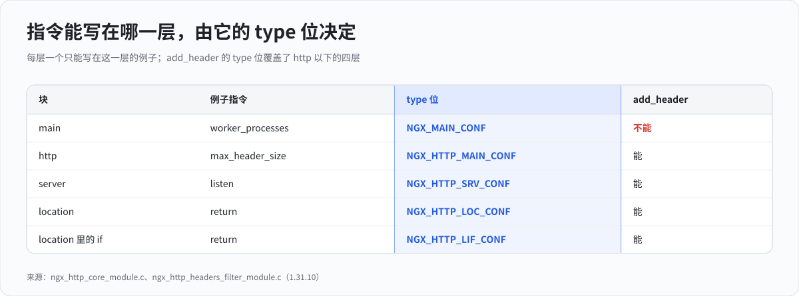
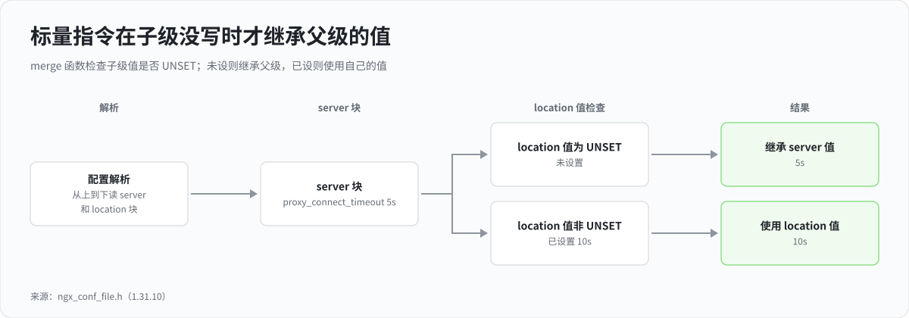
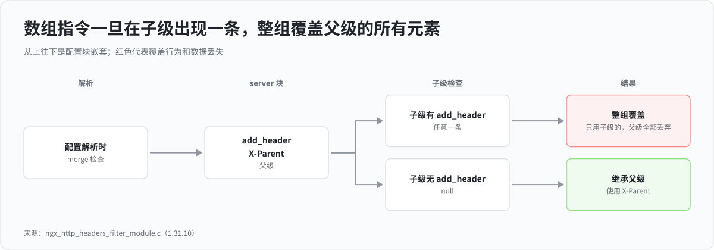
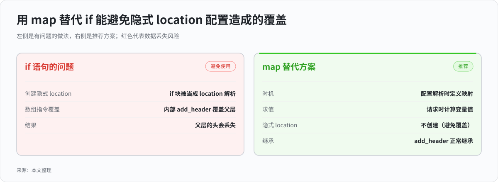

# 运维篇 02｜配置文件：指令上下文由类型标志位决定，数组指令在子级出现就整组覆盖

> **一句话结论**：nginx 配置由"指令 + 块"组成，每个指令声明允许出现的上下文；标量指令子级没设就继承父级，数组指令（如 `add_header`）在子级出现一条就覆盖整组；用 `nginx -t` 检查语法，`-T` 看合并后的完整配置；变量在请求时求值；`if` 语句因为创建隐式 location 配置会有意外。
>
> 适用版本：nginx 1.31.10（mainline，2026-11-23）。`add_header_inherit` 从 1.29.3 起支持，1.30.x stable 已包含。实验：[`labs/ops-02`](../labs/ops-02/)。

## 导读

| 你想知道 | 看哪一节 |
|---|---|
| 指令为什么"不允许在这里" | §1 |
| 标量 vs 数组指令的继承规则 | §2、§3 |
| include 和 nginx -T、-t 的用途 | §4 |
| 在配置里使用变量 | §5 |
| if 语句的问题和替代方案 | §6 |
| add_header 对响应状态码的默认限制 | §7 |

## 1. 指令上下文由 type 位标志决定

每个指令在源码里由 `ngx_command_t` 结构体定义，其中 `type` 字段是位集合，编码了参数个数和允许的上下文。HTTP 核心模块的 `server` 指令：

```c
// src/http/ngx_http_core_module.c:213-219
    { ngx_string("server"),
      NGX_HTTP_MAIN_CONF|NGX_CONF_BLOCK|NGX_CONF_NOARGS,
      ngx_http_core_server,
      0,
      0,
      NULL },
```

type 中的位含义：
- `NGX_HTTP_MAIN_CONF`（0x02000000）：只在 http 块
- `NGX_CONF_BLOCK`（0x00000100）：指令后跟 `{}`
- `NGX_CONF_NOARGS`（0x00000001）：0 个参数

另一个例子是 `add_header`，可以在多个上下文出现：

```c
// src/http/modules/ngx_http_headers_filter_module.c:125-131
    { ngx_string("add_header"),
      NGX_HTTP_MAIN_CONF|NGX_HTTP_SRV_CONF|NGX_HTTP_LOC_CONF|NGX_HTTP_LIF_CONF
                        |NGX_CONF_TAKE23,
      ngx_http_headers_add,
      NGX_HTTP_LOC_CONF_OFFSET,
      offsetof(ngx_http_headers_conf_t, headers),
      NULL },
```

type 位表示可在 http/server/location/if 块中，接受 2 或 3 个参数。

解析时，代码检查当前上下文是否与指令 type 匹配。不匹配就返回"is not allowed here"：

```c
// src/core/ngx_conf_file.c:486-491
    if (found) {
        ngx_conf_log_error(NGX_LOG_EMERG, cf, 0,
                           "\"%s\" directive is not allowed here", name->data);

        return NGX_ERROR;
    }
```



实验：在 server 块里写 `worker_processes auto;`：

```nginx
# lab: labs/ops-02/conf/bad-context.conf
events {
    worker_connections 1024;
}

http {
    server {
        listen 127.0.0.1:18040;
        server_name _;

        worker_processes auto;
    }
}
```

`nginx -t` 的输出：

```text
# labs/ops-02 ## Bad context: worker_processes in server block
ok - is not allowed here
```

**小结**：nginx 编译时把指令的允许上下文编码在 type 位里，解析时检查上下文是否匹配；"不允许在这里"的本质是位不匹配；关键的位位置是 MAIN_CONF（全局）→ HTTP 块 → SERVER_CONF → LOC_CONF → LIF_CONF（if 块）。

## 2. 标量指令：子级未设则继承父级值

像 `proxy_connect_timeout` 这样的超时参数是数字。子块（如 location）没有设置时，就继承父块（如 server）的值。merge 函数中用 `ngx_conf_merge_*_value` 宏实现：

```c
// src/core/ngx_conf_file.h:209-212
#define ngx_conf_merge_value(conf, prev, default)                            \
    if (conf == NGX_CONF_UNSET) {                                            \
        conf = (prev == NGX_CONF_UNSET) ? default : prev;                    \
    }
```

如果 child 值是 `NGX_CONF_UNSET`（未设置标记），就用 parent 值；parent 也是 UNSET 就用第三个参数的默认值。

这种继承规则对 `keepalive_timeout`、`client_max_body_size`、`proxy_connect_timeout` 等可以写在 http/server/location 多级的标量参数都适用；`worker_processes` 这类只能写在 main 的指令只有一级，谈不上继承。例如，如果 http 块里写 `proxy_connect_timeout 5s;` 而某个 location 没有设置，该 location 会继承 5 秒的超时；但如果这个 location 明确写了 `proxy_connect_timeout 10s;`，就会使用 10 秒。



这让配置可以在 http 块设全局超时，只在需要特殊值的地方覆盖。如果忘记在某个 location 设置，会自动使用父级的值，这避免了配置遗漏导致的问题。

**小结**：标量指令遵循"明确优先，缺省继承"的原则，即子级不设时自动用父级值；这通过 merge 函数的 UNSET 检查实现；不同指令的默认值定义在 create_conf 函数里。

## 3. 数组指令：一旦在子级出现就整组覆盖

`add_header` 是数组型指令——可以写多条，每条加一个响应头。与标量不同，`add_header` 在子块出现一条就会整组覆盖父块的所有头。

headers_filter 模块的 merge 函数中可看到这个逻辑：

```c
// src/http/modules/ngx_http_headers_filter_module.c:721-736
    if (conf->headers_inherit != NGX_HTTP_HEADERS_INHERIT_OFF
        && prev->headers)
    {
        if (conf->headers == NULL) {
            conf->headers = prev->headers;

        } else if (conf->headers_inherit == NGX_HTTP_HEADERS_INHERIT_MERGE) {
            hv = ngx_array_push_n(conf->headers, prev->headers->nelts);
            /* ... */
        }
    }
```

关键是第 724-725 行：如果子级的 headers 为 NULL（无 add_header），直接用父级的；但只要子级有至少一条 add_header（conf->headers != NULL），就停止继承，使用子级的全部内容。

实验：server 块设 add_header X-Parent，location 块设 add_header X-Child：

```nginx
# lab: labs/ops-02/conf/inherit-array-override.conf
server {
    listen 127.0.0.1:18045;
    server_name _;

    add_header X-Parent "from-server";

    location / {
        add_header X-Child "from-location";
        return 200 "test\n";
    }

    location /inherited {
        return 200 "inherited\n";
    }
}
```

用 curl 检查响应头：

```text
# labs/ops-02 ## Array override: add_header in location vs inherited
ok - location override: X-Child present
ok - location override: X-Parent absent
ok - inherited location: X-Parent present
```

`/` 路径只有 `X-Child`，没有 `X-Parent`；`/inherited` 才有 `X-Parent`。这个覆盖行为对 `proxy_set_header`、`limit_req`（多个 zone）也适用。



**小结**：数组指令的覆盖是全组的，不能只改其中一条；merge 时不知道你想补充还是替换，默认解读为替换；从 1.29.3 起可以用 `add_header_inherit` 改变这个行为。

## 4. add_header_inherit：控制数组指令的继承策略（1.29.3+）

从 1.29.3 开始，可以用 `add_header_inherit` 改变 add_header 的继承行为。合并逻辑在 `ngx_http_headers_merge_conf` 里：

```c
// src/http/modules/ngx_http_headers_filter_module.c:716-736
    ngx_conf_merge_uint_value(conf->headers_inherit, prev->headers_inherit,
                              NGX_HTTP_HEADERS_INHERIT_ON);
    ngx_conf_merge_uint_value(conf->trailers_inherit, prev->trailers_inherit,
                              NGX_HTTP_HEADERS_INHERIT_ON);

    if (conf->headers_inherit != NGX_HTTP_HEADERS_INHERIT_OFF
        && prev->headers)
    {
        if (conf->headers == NULL) {
            conf->headers = prev->headers;

        } else if (conf->headers_inherit == NGX_HTTP_HEADERS_INHERIT_MERGE) {
            hv = ngx_array_push_n(conf->headers, prev->headers->nelts);
            if (hv == NULL) {
                return NGX_CONF_ERROR;
            }

            ngx_memcpy(hv, prev->headers->elts,
                       sizeof(ngx_http_header_val_t) * prev->headers->nelts);
        }
    }
```

读这段代码能得出三点：

- `off`：跳过整个 if，子级只用自己的 add_header，子级一条都没写时也不从父级拿。
- `on`（默认值，第 717 行）：子级没有 add_header 就直接用父级的数组（第 725 行）；子级有就只用自己的，这就是 1.29.3 之前唯一的行为。
- `merge`：子级有 add_header 时，把父级的整组追加到子级数组后面（第 728–734 行），所以响应里子级的头排在前面。

还有一点容易漏：`add_header_inherit` 本身也按普通标量继承（第 716 行），在 http 级写一次 `merge`，下面所有 server 和 location 都按 merge 处理。

实验：三个 location 分别演示这三种模式：

```nginx
# lab: labs/ops-02/conf/inherit-array-with-inherit.conf
server {
    listen 127.0.0.1:18046;
    server_name _;

    add_header X-Parent "from-server";

    location / {
        add_header_inherit merge;
        add_header X-Child "from-location";
        return 200 "test\n";
    }

    location /on {
        add_header_inherit on;
        add_header X-Child "from-location";
        return 200 "test\n";
    }

    location /off {
        add_header_inherit off;
        add_header X-Child "from-location";
        return 200 "test\n";
    }
}
```

三个 location 的响应头：

```text
# labs/ops-02 ## Array with add_header_inherit merge
ok - merge mode: X-Parent present
ok - merge mode: X-Child present
ok - on mode: X-Child present
ok - on mode: X-Parent absent
ok - off mode: X-Child present
ok - off mode: X-Parent absent
```

merge 模式同时有两个头，on 和 off 都只有子级的头。在 /off-no-header 位置（没有任何 add_header 只有 `add_header_inherit off;`），也看不到父级的 X-Parent：

```text
# labs/ops-02 ## Array with add_header_inherit merge
ok - off-no-header mode: X-Parent absent
ok - off-no-header mode: X-Child absent
```

这说明 off 确实完全禁用了继承，即使子级没有任何 add_header 指令。

**小结**：`add_header_inherit` 从 1.29.3 起可用；默认值 on 维持向后兼容（有子级 add_header 就覆盖），merge 模式让子级和父级的头并存；off 则完全禁用继承，连"子级无 add_header 时继承父级"这个规则也被破坏。生产环境如果怕头丢失，建议用 merge；如果想彻底隔离父子，用 off。

## 5. include 支持通配，nginx -T 显示合并后的完整配置

### include 指令支持 glob 模式

`include` 可以加载一个文件或一组文件。常见的写法是在 http 块里加载一个目录下的所有 server 配置：

```nginx
# context: main
http {
    include conf.d/*.conf;
    include /etc/nginx/sites-enabled/*;
}
```

实验：include 一个目录，该目录下有多个文件：

```nginx
# lab: labs/ops-02/conf/with-include.conf
events {
    worker_connections 1024;
}

http {
    include conf.d/*.conf;

    server {
        listen 127.0.0.1:18040;
        server_name main;

        location / {
            return 200 "main\n";
        }
    }
}
```

其中 `conf.d/server1.conf` 和 `conf.d/server2.conf` 各定义一个 server。启动后三个 server 都能响应：

```text
# labs/ops-02 ## Include with glob pattern
ok - main server responds
ok - included server 1 responds
ok - included server 2 responds
```

### nginx -t 和 -T 的区别

- `nginx -t`：检查配置语法并报告是否成功
- `nginx -T`：同样检查语法，输出合并后的完整配置文本

`-T` 能帮你看到所有 include 展开后的结果：

```text
# labs/ops-02 ## nginx -T: show merged configuration
nginx: configuration file $LAB/conf/for-T-output.conf test is successful
# configuration file $LAB/conf/for-T-output.conf:
http {
    include conf.d/*.conf;
# configuration file $LAB/conf/conf.d/server1.conf:
server {
    listen 127.0.0.1:18041;
# configuration file $LAB/conf/conf.d/server2.conf:
```

`-T` 在每个文件的内容前打印一行 `# configuration file <路径>:`，主文件在前，`include` 进来的文件按展开顺序跟在后面（上面只摘了每个文件的开头几行），据此可以定位某个指令来自哪个文件。对包含多个 conf.d/*.conf 的大型配置特别有用。

**小结**：include 支持 glob 模式让 nginx 灵活地组织配置；-t 快速检查错误，-T 看完整的合并配置和每个文件的位置标记；大型配置复杂时容易搞不清某个指令的出处或覆盖关系，-T 的输出可以澄清这一切。

## 6. 变量在请求时求值，不是配置时求值

nginx 的变量不是常规的配置值。像 `$http_user_agent`、`$request_method` 这些变量，每个请求都会重新计算。指令在配置解析时不能直接用变量；必须用支持变量的指令或者用 `map` 块。

`map` 是把变量映射到另一个变量的方式：

```nginx
# context: http
map $http_user_agent $is_bot {
    default 0;
    "~*bot|crawler" 1;
}
```

每个请求进来时，`$http_user_agent` 的值被正则匹配，结果存到 `$is_bot` 中。后面的指令可以引用 `$is_bot`。

实验：map 根据请求参数选择不同的值：

```nginx
# lab: labs/ops-02/conf/map-vars.conf
events {
    worker_connections 1024;
}

http {
    access_log logs/access.log combined;

    map $arg_device $device_type {
        default   "unknown";
        mobile    "phone";
        tablet    "pad";
        desktop   "computer";
    }

    server {
        listen 127.0.0.1:18047;
        server_name _;

        location / {
            return 200 "device=$device_type\n";
        }
    }
}
```

```text
# labs/ops-02 ## Variables: map directive
ok - map unknown case
ok - map mobile case
ok - map tablet case
```

curl 访问不同的 URL，map 按参数值选择对应的响应。map 块的参数可以是正则（`~*` 表示不区分大小写）、通配或精确字符串。nginx 在请求时按顺序匹配，返回第一个命中的结果。

**小结**：变量是请求时的概念，不能在解析阶段用；map 块是配置阶段定义变量映射的方式，每个请求独立求值；多数变量的值在第一次求值后缓存在请求对象里，但标了 `NGX_HTTP_VAR_NOCACHEABLE` 的变量（如 `$uri`、`$document_root`，见 `src/http/ngx_http_variables.c`）每次引用都重新计算，所以 rewrite 改了 URI 之后再读 `$uri` 拿到的是新值。

## 7. if 的坑：隐式创建 location 配置，导致数组指令覆盖

`if` 语句常被误用。nginx 的 if 在配置解析时有特殊行为：创建一个隐式的 location 配置。这导致 if 块内的 add_header 等数组指令会覆盖父层的指令，就像子 location 覆盖父 server 的指令一样。

反例——这个 if 块中的 add_header 会导致父层的 add_header 丢失：

```nginx
# lab: labs/ops-02/conf/if-problem.conf
        location / {
            root html;
            add_header X-Parent "parent-value";
            if ($arg_test = "yes") {
                add_header X-IfTest "if-value";
            }
        }
```

这个配置看起来应该让两个头都出现，但实际上当 if 条件为真时，只有 X-IfTest 出现，X-Parent 消失了。这是因为 if 块在解析时创建了一个隐式的 location 配置，其中的 add_header 整组覆盖了父层的 add_header。

实验验证：

```text
# labs/ops-02 ## if statement with add_header (may not work)
With test=yes (if condition true):
HTTP/1.1 200 OK
X-IfTest: if-value
With test=no (if condition false):
HTTP/1.1 200 OK
X-Parent: parent-value
ok - if-true: X-IfTest present
ok - if-false: X-Parent present
ok - if-false: X-IfTest absent
```

当 if 条件为假时，if 块不执行，父层的 X-Parent 正常出现；条件为真时，只有 if 块内的 X-IfTest 出现。这就是所谓的隐式覆盖。

建议用 map + 变量替代——这样避免隐式 location 的覆盖问题：

```nginx
# context: http
map $arg_test $x_test_header {
    default "";
    "yes"   "if-value";
}

server {
    location / {
        add_header X-Parent "parent-value";
        add_header X-IfTest $x_test_header always;
    }
}
```

用 map 实现条件逻辑时，if 块不再创建隐式 location，所以父层的所有 add_header 都会保留。



**小结**：if 块内部是隐式的 location 配置，其中的数组指令会覆盖父层（如 add_header、proxy_set_header）；只有 rewrite、return、set 这类在 rewrite 阶段的指令才能在 if 里可靠使用；条件判断最好用 map 实现，避免 if 造成的隐式覆盖和不确定行为。

## 8. add_header 默认只对 10 个成功和重定向状态码生效，always 参数可以覆盖此限制

在 nginx 中，add_header 默认只会对以下状态码应用：200、201、204、206、301、302、303、304、307、308。对于 404、500 这样的错误状态码，add_header 默认不生效。这是因为 `ngx_http_headers_filter_module.c` 的headers_filter函数中有一个 switch 语句来判断状态码是否"安全"：

```c
// src/http/modules/ngx_http_headers_filter_module.c:217-235
    switch (r->headers_out.status) {

    case NGX_HTTP_OK:
    case NGX_HTTP_CREATED:
    case NGX_HTTP_NO_CONTENT:
    case NGX_HTTP_PARTIAL_CONTENT:
    case NGX_HTTP_MOVED_PERMANENTLY:
    case NGX_HTTP_MOVED_TEMPORARILY:
    case NGX_HTTP_SEE_OTHER:
    case NGX_HTTP_NOT_MODIFIED:
    case NGX_HTTP_TEMPORARY_REDIRECT:
    case NGX_HTTP_PERMANENT_REDIRECT:
        safe_status = 1;
        break;

    default:
        safe_status = 0;
        break;
    }
```

在判决后，如果不是安全状态码且没有 always 参数，就跳过该头。即：当 `safe_status` 为假且该头没有 `always` 参数时，整个头被跳过，不会被加到响应里。

实验验证：

```text
# labs/ops-02 ## add_header with safe vs unsafe status codes
Status 200 headers:
HTTP/1.1 200 OK
X-Regular: regular
X-Always: always
Status 404 headers:
HTTP/1.1 404 Not Found
X-Always: always
ok - 200: X-Regular present
ok - 200: X-Always present
ok - 404: X-Regular absent
ok - 404: X-Always present
```

在 404 响应中，没有 always 参数的 X-Regular 头消失了，但带 always 的 X-Always 头保留。

如果需要在错误响应上也加头（例如自定义错误页面的标记、跟踪 ID 等），就要用 `always` 参数：

```nginx
# context: http
add_header X-Request-ID $request_id always;
```

**小结**：add_header 默认只对源码列出的 10 个状态码（200、201、204、206、301、302、303、304、307、308）生效，404、5xx 上的头会静默消失；要在错误页上带追踪 ID 这类头，必须写 `always`。

## 已知局限与待核实

- if 块中 add_header 的具体行为可能因 nginx 版本和编译选项有细微差异，本实验在 macOS 上运行。
- add_header always 参数对性能的影响未测试；生产环境使用时建议按需要设置。

## 修订记录

- 2026-11-21：基于 nginx 1.31.9 源码重写，新增。补充 add_header_inherit off 的完整测试场景、if 块的隐式覆盖问题演示、add_header 的状态码限制、nginx -T 的输出示例。
- 2026-11-26：基线升到 nginx 1.31.10 / 1.30.8（2026-11-23 发布），重跑实验并更新输出，源码摘录与行号链接复核无漂移。
