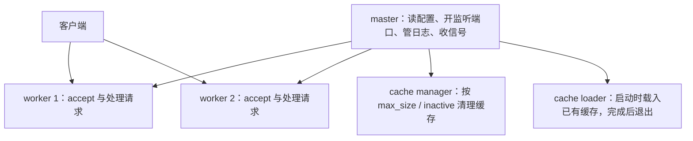
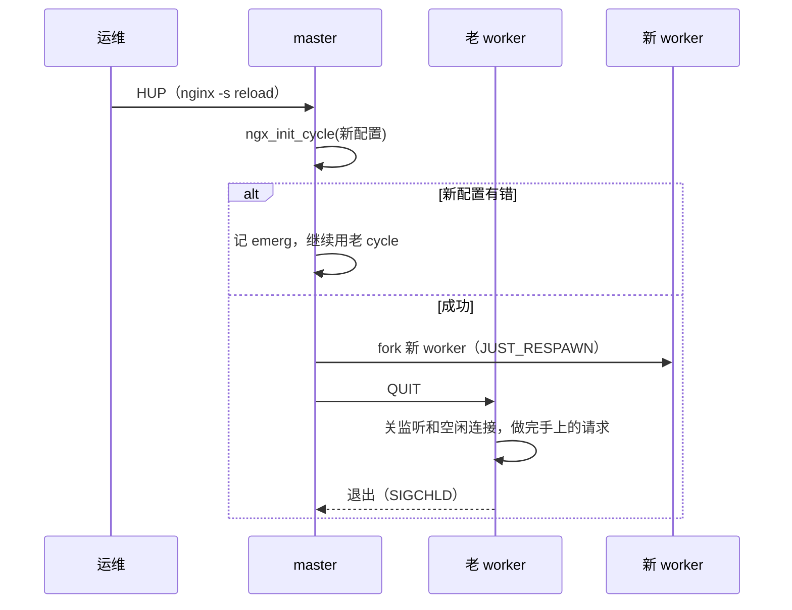
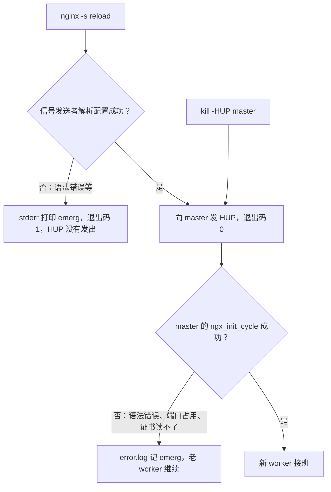
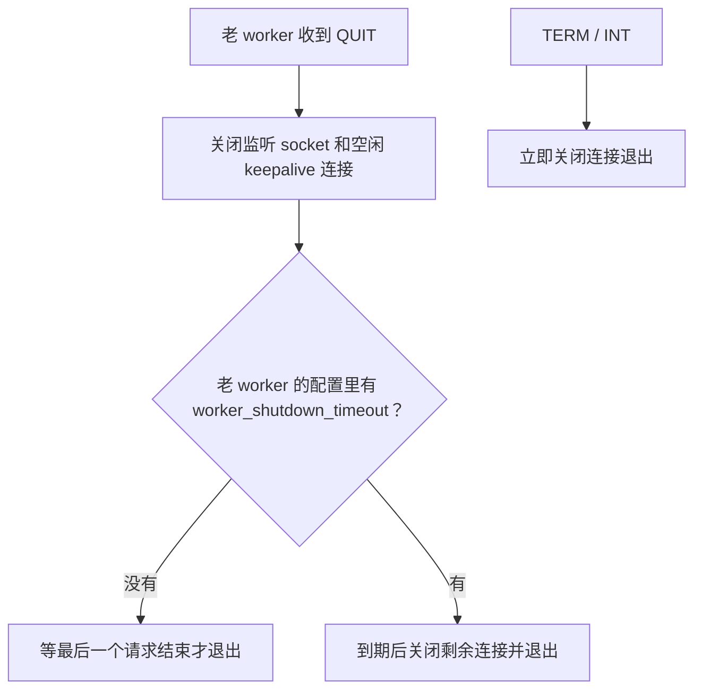
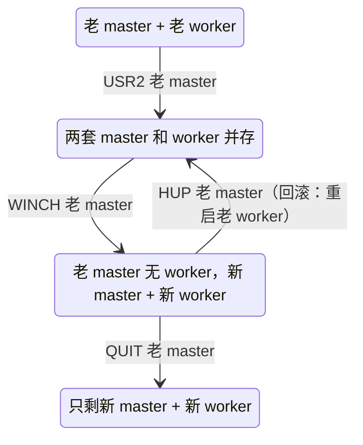
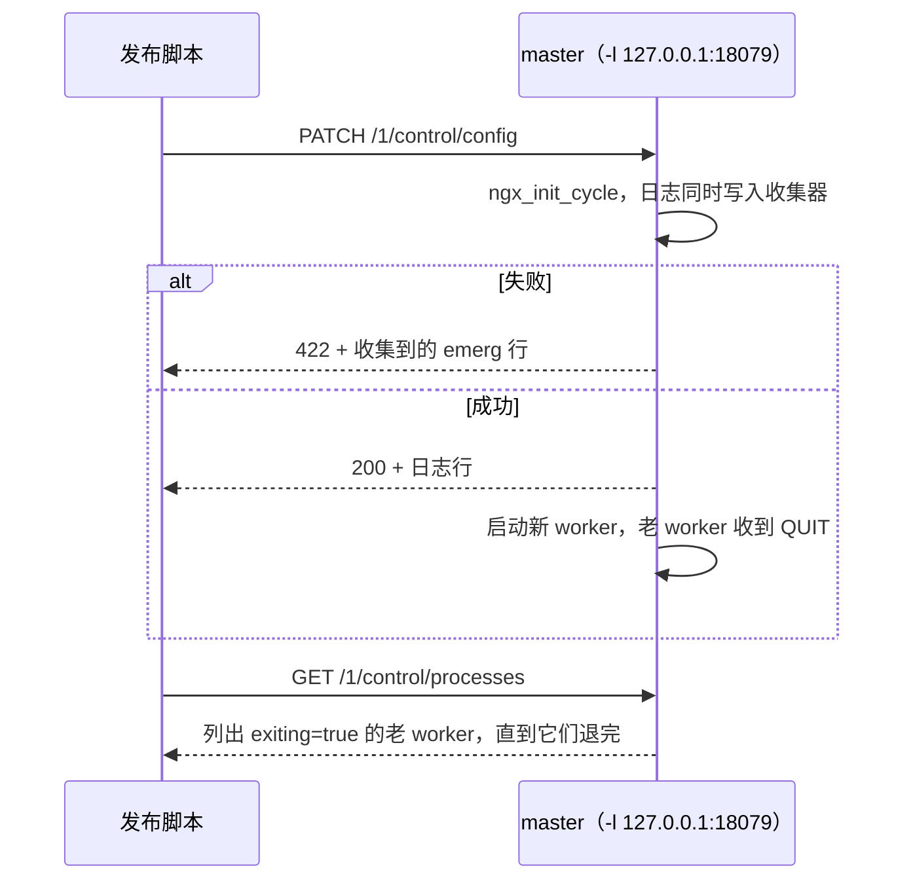

# 运维篇 03｜进程模型、信号与平滑升级：reload 是“新 worker 接班、老 worker 做完再走”

> **一句话结论**：nginx 的 master 只管理进程，不处理请求。reload 时 master 用新配置重新初始化，成功才启动一批新 worker，再让老 worker 关掉监听、做完手上的请求后退出；新配置有错时 master 记一条 emerg，老 worker 和老配置原样继续服务。`worker_shutdown_timeout` 要写在老 worker 正在用的配置里才对它们生效。1.31.5 新增的 control API 能同步执行 reload，并把失败原因直接返回给调用方。
>
> 适用版本：nginx 1.31.9（mainline，2026-11-18）。「版本差异」：control API（`--with-control-api` 编译、`-l` 参数）是 1.31.5 新增的，1.30.7 没有；其余信号和 reload 行为两个版本相同。实验：[`labs/ops-03`](../labs/ops-03/)，两个 worker 的 nginx，`/big/` 以 200 KB/s 限速发送 1 MB 文件，用来制造 reload 时“正在进行的请求”。

## 导读

| 你想知道 | 看哪一节 |
|---|---|
| master、worker、cache manager 各是什么，`worker_processes auto` 是几个 | §1 |
| reload 的真实步骤，正在下载的请求会不会断 | §2 |
| 新配置有错时 reload 会怎样，为什么 `nginx -s reload` 有时根本没发信号 | §3 |
| `worker_shutdown_timeout` 写在哪里才生效，TERM 和 QUIT 的区别 | §4 |
| 日志切割为什么要发 USR1，worker 崩溃后会怎样 | §5 |
| 不停服务替换二进制的步骤 | §6 |
| control API 能做什么 | §7 |

## 1. master 只管进程，请求全在 worker 里处理；auto 等于在线 CPU 数

nginx 以 root 或普通用户启动后，留下一个 master 和若干子进程。master 读配置、打开监听端口、管理日志文件，然后 fork 出 worker；所有连接的 accept 和请求处理都发生在 worker 里。实验的配置写了 `worker_processes 2;`：

```text
# labs/ops-03 ## one master, worker_processes workers
parent=1 nginx: master process $NGINX -p $LAB/ -e logs/error.log -g pid logs/nginx.pid; -c conf/.active.conf
parent=master nginx: worker process
parent=master nginx: worker process
```

master 已经脱离终端成为守护进程（父进程是 1），进程标题里保留了完整的启动参数，排查“这个 nginx 用的是哪份配置”时直接看 `ps` 即可。两个 worker 的父进程都是 master。

`worker_processes auto` 取的是 `ngx_ncpu`，即启动时在线的 CPU 数：

```c
// src/core/nginx.c:1634-1640

    value = cf->args->elts;

    if (ngx_strcmp(value[1].data, "auto") == 0) {
        ccf->worker_processes = ngx_ncpu;
        return NGX_CONF_OK;
    }
```

配置了 `proxy_cache_path`（或其他缓存路径）时，master 还会多启动两个进程：cache manager 按 `max_size`、`inactive` 清理缓存，cache loader 在启动后把磁盘上已有的缓存条目载入共享内存，载完退出（运维篇 10）。实验的 `auto.conf` 在一台机器上启动后的子进程（worker 数量由脚本换成 `NCPU`，因为它随机器变化）：

```text
# labs/ops-03 ## worker_processes auto and the cache processes
  1 nginx: cache loader process
  1 nginx: cache manager process
  NCPU nginx: worker process
```

容器里要注意：`ngx_ncpu` 来自系统报告的在线 CPU 数，不一定等于容器的 CPU 配额，配额小于宿主机核数时，`auto` 会启动过多 worker，此时应写明数字。每个 worker 能同时持有的连接数由 `events { worker_connections N; }` 决定，代理场景下一个客户端请求要占两个连接（客户端一侧和后端一侧）；连接数接近上限时，还要用 `worker_rlimit_nofile` 抬高每个 worker 的文件描述符上限。

下面这张图说明各进程的分工：只有 worker 和客户端打交道，master 和缓存进程都不碰请求。



**小结**：worker 数量通常设成 CPU 数（或容器配额），连接上限看 `worker_connections` 和文件描述符上限。master 不处理请求，它的稳定性决定了 reload、升级、崩溃恢复能不能做。

## 2. reload 先用新配置初始化，成功后启动新 worker，再让老 worker 做完手上的请求

运维人员发给 master 的信号和 `nginx -s` 的参数一一对应，定义在 `ngx_config.h`：

```c
// src/core/ngx_config.h:58-72

/* TODO: #ifndef */
#define NGX_SHUTDOWN_SIGNAL      QUIT
#define NGX_TERMINATE_SIGNAL     TERM
#define NGX_NOACCEPT_SIGNAL      WINCH
#define NGX_RECONFIGURE_SIGNAL   HUP

#if (NGX_LINUXTHREADS)
#define NGX_REOPEN_SIGNAL        INFO
#define NGX_CHANGEBIN_SIGNAL     XCPU
#else
#define NGX_REOPEN_SIGNAL        USR1
#define NGX_CHANGEBIN_SIGNAL     USR2
#endif

```

| 信号 | `-s` | master 做什么 | 见 |
|---|---|---|---|
| HUP | `reload` | 重读配置，换一批 worker | §2、§3 |
| QUIT | `quit` | 优雅退出：停止接受新连接，等请求做完 | §4 |
| TERM、INT | `stop` | 快速退出：立即关闭连接 | §4 |
| USR1 | `reopen` | 重新打开日志文件 | §5 |
| USR2 | — | 执行新的二进制，和老 master 并存 | §6 |
| WINCH | — | 让 worker 优雅退出，master 保留 | §6 |

master 收到 HUP 后的处理在 `ngx_master_process_cycle` 里：

```c
// src/os/unix/ngx_process_cycle.c:233-264
        if (ngx_reconfigure) {
            ngx_reconfigure = 0;

            if (ngx_new_binary) {
                ngx_start_worker_processes(cycle, ccf->worker_processes,
                                           NGX_PROCESS_RESPAWN);
                ngx_start_cache_manager_processes(cycle, 0);
                ngx_noaccepting = 0;

                continue;
            }

            ngx_log_error(NGX_LOG_NOTICE, cycle->log, 0, "reconfiguring");

            cycle = ngx_init_cycle(cycle);
            if (cycle == NULL) {
                cycle = (ngx_cycle_t *) ngx_cycle;
                continue;
            }

            ngx_cycle = cycle;
            ccf = (ngx_core_conf_t *) ngx_get_conf(cycle->conf_ctx,
                                                   ngx_core_module);
            ngx_start_worker_processes(cycle, ccf->worker_processes,
                                       NGX_PROCESS_JUST_RESPAWN);
            ngx_start_cache_manager_processes(cycle, 1);

            /* allow new processes to start */
            ngx_msleep(100);

            live = 1;
            ngx_signal_worker_processes(cycle,
```

`ngx_init_cycle` 解析新配置、打开新增的监听端口和日志文件，所有工作在 master 里完成；成功后才 fork 新 worker，并标记为 `JUST_RESPAWN`。随后发出的 QUIT 会跳过这些刚启动的进程，只发给老 worker：

```c
// src/os/unix/ngx_process_cycle.c:507-510
        if (ngx_processes[i].just_spawn) {
            ngx_processes[i].just_spawn = 0;
            continue;
        }
```

老 worker 收到 QUIT 后关掉监听 socket 和空闲的 keepalive 连接，不再接新请求，但正在处理的请求照常进行：

```c
// src/os/unix/ngx_process_cycle.c:758-771
        if (ngx_quit) {
            ngx_quit = 0;
            ngx_log_error(NGX_LOG_NOTICE, cycle->log, 0,
                          "gracefully shutting down");
            ngx_setproctitle("worker process is shutting down");

            if (!ngx_exiting) {
                ngx_exiting = 1;
                ngx_set_shutdown_timer(cycle);
                ngx_close_listening_sockets(cycle);
                ngx_close_idle_connections(cycle);
                ngx_event_process_posted(cycle, &ngx_posted_events);
            }
        }
```

实验先发起一个 5 秒的下载，0.5 秒后 reload 到 `v2.conf`（只把响应内容从 `v1` 改成 `v2`）：

```text
# labs/ops-03 ## reload: new workers start, old ones finish their requests
master unchanged: yes
old workers still alive during the download: 1 of 2
answers now: v2
download: 200 complete
old workers alive after it: 0
```

reload 后 master 不变，新请求立即由新 worker 用新配置回答；两个老 worker 里，空闲的那个马上退出，正在发送文件的那个一直活到下载完成，客户端拿到了完整的 1 MB。error.log 里的顺序（时间戳、pid 已去掉）：

```text
# labs/ops-03 ## reload: new workers start, old ones finish their requests
[notice] signal 1 (SIGHUP) received from N, reconfiguring
[notice] reconfiguring
[notice] start worker process N
[notice] start worker process N
[notice] gracefully shutting down
[notice] gracefully shutting down
[notice] exiting
[notice] exit
[notice] signal 20 (SIGCHLD) received from N
[notice] worker process N exited with code 0
```



这个机制有两个推论。第一，reload 期间新老 worker 同时存在，内存和连接数会短暂翻倍；长连接（WebSocket、大文件下载、gRPC 流）多的服务，老 worker 可能存活很久，频繁 reload 会让多代老 worker 叠在一起。第二，共享内存区（`limit_req_zone`、`proxy_cache_path` 的 `keys_zone`）在名字、大小不变时被新 cycle 复用，状态不丢；改了大小就是一块新区域，开发篇 08 的实验演示过这一点。

**小结**：reload 不会中断正在进行的请求，代价是老 worker 要等最后一个请求结束才退出。看 error.log 时，`reconfiguring` 后面紧跟 `start worker process` 才表示 reload 成功。

## 3. 新配置有错时老 worker 照常服务，但 nginx -s reload 往往在发信号之前就失败了

`ngx_init_cycle` 返回 NULL 时，master 沿用老 cycle，什么进程都不动（上一节摘录里的 `continue`）。实验用 `kill -HUP` 直接给 master 发信号，此时 `.active.conf` 指向一份有未知指令的配置：

```text
# labs/ops-03 ## HUP with a broken config
[notice] signal 1 (SIGHUP) received from N, reconfiguring
[notice] reconfiguring
[emerg] unknown directive "no_such_directive" in $LAB/conf/.active.conf:14
workers unchanged: yes, answers: v1
```

错误只写进 error.log，`kill` 本身没有任何反馈。改用 `nginx -s reload` 时情况不同：运维篇 01 讲过，`-s` 要先解析配置才能找到 pid 文件，配置有错时它在这一步就退出了，HUP 根本没有发出去：

```text
# labs/ops-03 ## nginx -s reload with a broken config
nginx: [emerg] unknown directive "no_such_directive" in $LAB/conf/.active.conf:14
workers unchanged: yes
ok - the signaller parses the config itself and does not send HUP
```

这个行为对语法错误有效，但它只覆盖信号发送者能发现的问题。端口已被占用、证书文件读不了、共享内存区大小冲突这类错误，要等 master 在 `ngx_init_cycle` 里真正打开资源时才出现，`nginx -s reload` 返回 0，失败只记在 error.log。因此发布脚本的稳妥做法是三步：`nginx -t` 检查；`nginx -s reload`；再确认 error.log 里出现了这次的 `reconfiguring` 和 `start worker process`，或者 worker 的 pid 已经变化。§7 的 control API 把第三步变成了同步返回值。

两条路径的差别在于错误在哪个进程里被发现：



**小结**：reload 失败不会让服务中断，但也不会大声报错。`nginx -s reload` 的退出码只能说明信号发出去了，判断是否生效要看 error.log 或 worker pid。

## 4. worker_shutdown_timeout 来自老 worker 的配置；TERM 立即断开，QUIT 等请求做完

老 worker 可能因为一个长连接一直不退出。`worker_shutdown_timeout` 给它设一个期限，到期后强制关闭剩下的连接。定时器在 worker 收到 QUIT 时设置（上一节的 `ngx_set_shutdown_timer(cycle)`），读的是这个 worker 自己的 cycle：

```c
// src/core/ngx_cycle.c:1436-1451
void
ngx_set_shutdown_timer(ngx_cycle_t *cycle)
{
    ngx_core_conf_t  *ccf;

    ccf = (ngx_core_conf_t *) ngx_get_conf(cycle->conf_ctx, ngx_core_module);

    if (ccf->shutdown_timeout) {
        ngx_shutdown_event.handler = ngx_shutdown_timer_handler;
        ngx_shutdown_event.data = cycle;
        ngx_shutdown_event.log = cycle->log;
        ngx_shutdown_event.cancelable = 1;

        ngx_add_timer(&ngx_shutdown_event, ccf->shutdown_timeout);
    }
}
```

所以第一次加上 `worker_shutdown_timeout` 并 reload 时，正在退出的老 worker 用的还是没有这条指令的老配置，不受限制；要到下一次 reload，它才对“这一代”老 worker 生效。实验对比了两种顺序，都在 5 秒的下载进行中 reload：

```text
# labs/ops-03 ## worker_shutdown_timeout comes from the old config
started with timeout 1s, download: 200 cut
reloaded into timeout 1s, download: 200 complete
```

第一行的进程从一开始就带着 `worker_shutdown_timeout 1s`，reload 后 1 秒下载被截断（状态码 200 已经发出，客户端收到的字节数不足）；第二行是 reload 进带超时的配置，老 worker 没有这个设置，下载完整结束。到期时的处理很直接，所有还开着的连接被标记为错误并关闭：

```c
// src/core/ngx_cycle.c:1479-1484
        c[i].close = 1;
        c[i].error = 1;

        c[i].read->handler(c[i].read);
    }
}
```

停止 nginx 的两个信号也是同样的区别。TERM（`nginx -s stop`）让 worker 立即退出，正在进行的下载被截断；QUIT（`nginx -s quit`）先关掉监听端口，新连接被拒绝，已有的请求做完再退出：

```text
# labs/ops-03 ## TERM and QUIT
TERM during a download: 200 cut
QUIT: new connections refused: 000, master alive: 1
QUIT during a download: 200 complete
```

`000` 是 curl 连接被拒绝时的状态码。从负载均衡后面摘下一台 nginx 时，先让负载均衡停止转发，再发 QUIT，才能做到客户端无感。



**小结**：`worker_shutdown_timeout` 要提前上线一次，下次 reload 才对老 worker 生效。日常停机用 QUIT，紧急情况才用 TERM。

## 5. USR1 让进程重新打开日志文件；被杀掉的 worker 由 master 立即补上

nginx 持有的是日志文件的文件描述符，不是文件名。日志切割工具把 `access.log` 改名之后，worker 继续往改名后的文件里写，直到收到 USR1 才按原路径重新打开：

```text
# labs/ops-03 ## USR1 reopens the log files
after mv: access.log exists: no, lines in access.log.1: 2
after USR1: lines in access.log: 1, in access.log.1: 2
```

改名后的第二个请求仍然写进了 `access.log.1`；USR1 之后，nginx 创建了新的 `access.log`，第三个请求写进新文件。logrotate 一类工具的配置里，`postrotate` 应该执行 `nginx -s reopen` 或 `kill -USR1`；用 `copytruncate` 也能工作，但复制和截断之间写入的日志会丢失。

master 还负责监视 worker。worker 因为段错误、被 OOM killer 杀掉或者被误杀退出时，master 收到 SIGCHLD，记录退出原因，立即启动一个新 worker：

```text
# labs/ops-03 ## a killed worker is replaced
[alert] worker process N exited on signal 9
[notice] start worker process N
```

error.log 里出现 `exited on signal 11`（段错误）或 `exited on signal 9` 时，服务看起来没有中断，但那个 worker 上正在处理的请求全部失败了，这类 alert 值得单独告警。

**小结**：日志切割的最后一步永远是 USR1；error.log 里的 `exited on signal` 是 worker 异常退出的唯一痕迹，要纳入监控。

## 6. 平滑升级二进制：USR2 启动新 master，WINCH 停掉老 worker，QUIT 让老 master 退出

替换 nginx 二进制（升级版本、加编译模块）时，监听端口不能关。nginx 的做法是让老 master 执行新的二进制，把监听 socket 通过环境变量 `NGINX` 传给新 master。新进程启动之前，老 master 先把 pid 文件改名为 `nginx.pid.oldbin`，新 master 写入自己的 `nginx.pid`：

```c
// src/core/nginx.c:797-800
    ccf = (ngx_core_conf_t *) ngx_get_conf(cycle->conf_ctx, ngx_core_module);

    if (ngx_rename_file(ccf->pid.data, ccf->oldpid.data) == NGX_FILE_ERROR) {
        ngx_log_error(NGX_LOG_ALERT, cycle->log, ngx_errno,
```

实验用同一个二进制演示完整流程（真实升级时先把新二进制放到原路径，因为老 master 执行的是启动时的 `argv[0]`）：

```text
# labs/ops-03 ## binary upgrade: USR2, WINCH, QUIT
after USR2: nginx.pid.oldbin holds the old master: yes
new master is a child of the old one: yes
masters alive: 2, old workers alive: 2, new workers: 2
after WINCH: old workers alive: 0, old master alive: 1
after QUIT: old master alive: 0, oldbin file left: no, answers: v1
```

USR2 之后两套 master 和 worker 同时在线，共享同一组监听 socket，新连接可能被任意一边接走。WINCH 让老 worker 优雅退出，但老 master 保留：此时如果发现新版本有问题，给老 master 发 HUP，它会用老二进制重新启动 worker（§2 摘录里 `ngx_new_binary` 的分支），再对新 master 发 QUIT，就回到了升级前的状态。确认新版本没问题后，对老 master 发 QUIT，它退出并删除 `nginx.pid.oldbin`。



**小结**：二进制升级的回滚窗口在 WINCH 之后、QUIT 之前，这段时间老 master 还在。用 systemd 管理时，要确认服务单元允许主进程 pid 变化，否则 systemd 可能在老 master 退出时认为服务停止了。

## 7. control API 让 reload 变成同步调用，失败原因直接返回（1.31.5 起）

1.31.5 新增的 control API 是 master 自己监听的一个管理接口，需要用 `--with-control-api` 编译，启动时用 `-l` 指定地址（TCP 地址或 `unix:` 路径）。它只有四个路径，由 `ngx_control_content` 分派：

| 方法与路径 | 作用 |
|---|---|
| `GET /1/nginx` | 版本和构建标识 |
| `GET /1/control/processes` | master 管理的子进程，含是否正在退出 |
| `GET /1/control/config` | 当前配置 |
| `PATCH /1/control/config` | 在 master 里重新加载配置 |

PATCH 的实现和 HUP 走同一个 `ngx_init_cycle`，区别是它临时把 master 的日志接到一个收集器上，把加载过程中的日志行作为响应体返回，失败时状态码是 422：

```c
// src/os/unix/ngx_control.c:997-1023
    ngx_memzero(&log, sizeof(ngx_log_t));
    log.wdata = &log_store;
    log.writer = ngx_control_log_capture;
    log.log_level = NGX_LOG_DEBUG;

    tmp = ngx_cycle->log;
    log.next = tmp;
    ngx_cycle->log = &log;
    cycle = ngx_init_cycle((ngx_cycle_t *) ngx_cycle);

    if (cycle == NULL) {
        status = NGX_CTRL_UNPROCESSABLE;
        ngx_cycle->log = tmp;

    } else {
        ngx_cycle = cycle;
        r->reloaded = 1;
        r->pool->log = ngx_cycle->log;
    }

    obj = ngx_control_json_logs(&log_store);
    if (obj == NULL) {
        return NGX_ERROR;
    }

    return ngx_control_send_json(r, status, obj);
```

实验用 `-l 127.0.0.1:18079` 启动，依次查询版本和进程，然后在 `.active.conf` 指向错误配置和正确配置时各发一次 PATCH；第二次 PATCH 时有一个下载正在进行：

```text
# labs/ops-03 ## control API
GET /1/nginx: {"version":"1.31.9","build":""}
GET /1/control/processes:
  worker process exiting=false
  worker process exiting=false
PATCH with bad.conf: 422 {"logs":["[emerg] unknown directive \"no_such_directive\" in $LAB/conf/.active.conf:14\n"]}
PATCH with v2.conf during a download: 200, answers: v2
GET /1/control/processes:
  2   worker process exiting=false
  1   worker process exiting=true
```

错误配置得到 422，响应体就是 error.log 里那一行 emerg（时间戳和 pid 由脚本去掉），发布脚本不必再去翻日志。正确配置返回 200，之后的进程列表能看到 reload 的中间状态：两个新 worker，加一个因为下载还没结束、标记为 `exiting=true` 的老 worker。

control API 没有认证，拿到它就能替换配置，所以只能监听在 `127.0.0.1` 或权限受控的 unix socket 上，不能对外暴露。



**小结**：有 1.31.5 以上版本时，发布脚本可以用 `PATCH /1/control/config` 替代“`-s reload` 再翻 error.log”，用状态码判断成败，用 `/1/control/processes` 观察老 worker 是否已经退完。

## 已知局限与待核实

- 实验只在 macOS 上运行；Linux 上 `ngx_ncpu`、进程标题的显示方式可能不同，结论来自源码。
- 容器配额与 `worker_processes auto` 的关系是按 `ngx_ncpu` 的来源推断的，本篇没有在容器里实测。
- “端口占用、证书读不了时 `nginx -s reload` 返回 0、只在 error.log 报错”是根据信号发送者不打开监听端口、不加载证书推断的，实验只验证了语法错误一种情况。
- systemd 与二进制升级的配合只给出注意点，没有提供经过验证的服务单元文件。
- control API 的 `GET /1/control/config` 返回格式本篇没有展示。

## 修订记录

- 2026-11-21：基于 nginx 1.31.9 源码新写，替换掉一版自动生成、输出与实验不符的草稿。覆盖进程结构与 `auto`、reload 的源码步骤与 in-flight 请求、错误配置的两种 reload 路径、`worker_shutdown_timeout` 取自老配置、TERM/QUIT、USR1、worker 重生、USR2/WINCH/QUIT 升级与回滚、1.31.5 control API，均附 `labs/ops-03` 实验。
