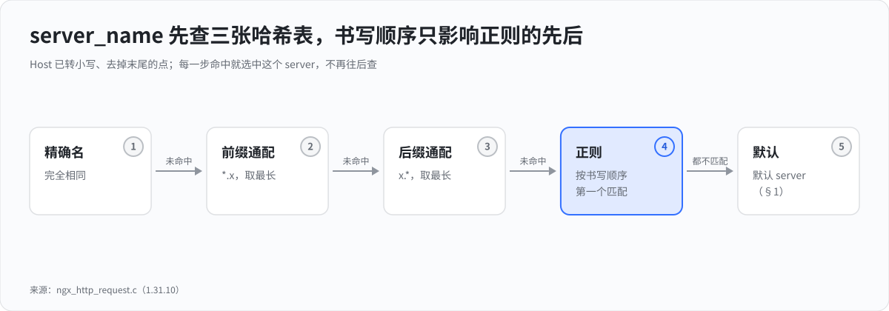
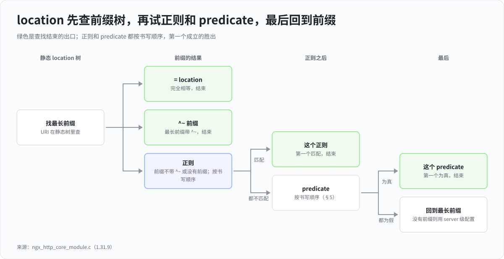
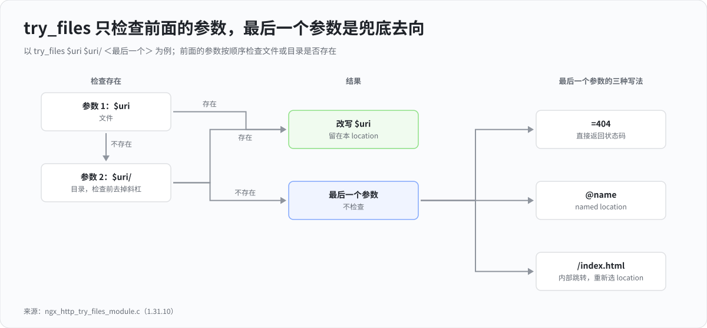
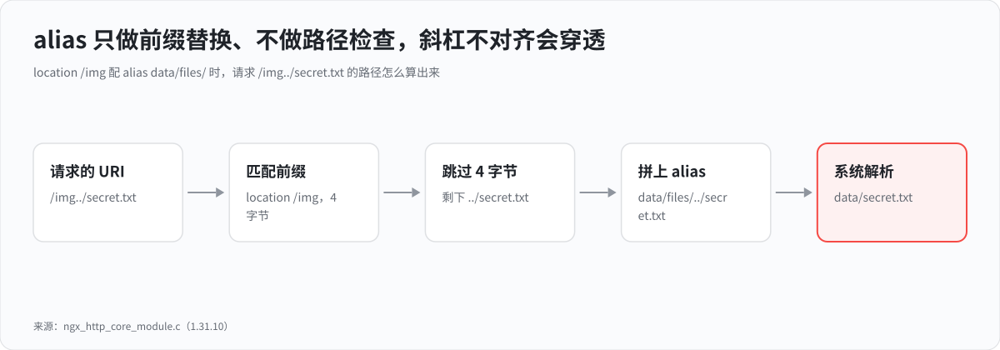
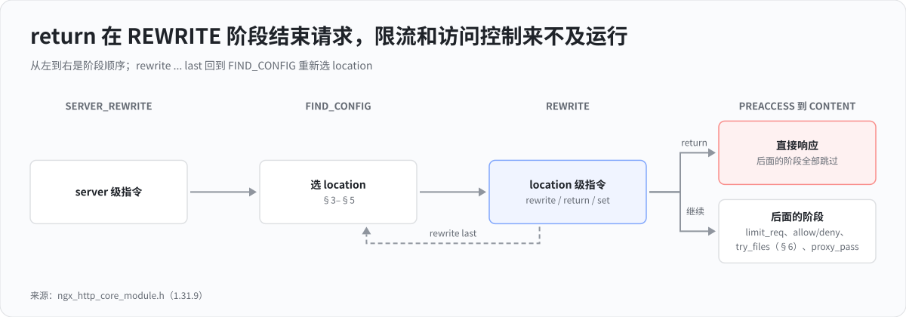

# 运维篇 04｜请求路由：先选 server，再选 location，书写顺序只对正则有意义

> **一句话结论**：nginx 先按连接的地址和端口找到一组 server，再用 Host 在组内选一个：精确名字 > 最长的 `*.` 前缀通配 > 最长的 `.*` 后缀通配 > 第一个匹配的正则 > 默认 server。选定 server 后选 location：`=` 精确命中立即结束；否则找最长的普通前缀，它带 `^~` 就结束，不带就依次试正则、再试 predicate（1.31.5 新增），都不中才回到这个最长前缀。除了正则和 predicate 按书写顺序比较，其余规则都与配置里的先后无关。
>
> 适用版本：nginx 1.31.10（mainline，2026-11-23）。「版本差异」两处：predicate location 只在 1.31.x 有（§5）；`try_files` 与 `alias` 组合的缓冲区溢出 CVE-2026-125283 在 1.31.9 和 1.30.7 同时修复，本篇的两个版本都已包含（§7）。实验：[`labs/ops-04`](../labs/ops-04/)，一份配置里每个端口演示一类规则，本篇所有“请求 → 结果”都来自它的输出。实验在 macOS 上运行，§4 有一处只在 macOS 上成立的行为。

## 导读

| 你想知道 | 看哪一节 |
|---|---|
| 一个端口上有多个 server，没匹配上的请求去哪 | §1 |
| `server_name` 精确、通配、正则谁优先 | §2 |
| location 的前缀、`=`、`^~` 怎么比 | §3 |
| 正则 location 什么时候盖过前缀 | §4 |
| predicate location 是什么，排在哪 | §5 |
| `try_files` 的每个参数分别做什么 | §6 |
| `root` 和 `alias` 的区别，末尾斜杠为什么要对齐 | §7 |
| 为什么 `deny all` 挡不住 `return` | §8 |

## 1. 先按地址和端口分组，组内没有匹配的 Host 就交给默认 server：标了 default_server 的那个，否则是第一个

nginx 不是拿 Host 去所有 server 里找。连接建立时，它已经知道连接落在哪个 `listen` 地址和端口上，只在监听这个地址的 server 里选。每组都有一个默认 server，在 `ngx_http_add_address` 里先被设成该地址的第一个 server：

```c
// src/http/ngx_http.c:1499-1499
    addr->default_server = cscf;
```

之后遇到带 `default_server` 参数的 `listen`，就改成那个 server；同一地址写两个会在启动时报错：

```c
// src/http/ngx_http.c:1365-1376
        if (lsopt->default_server) {

            if (default_server) {
                ngx_conf_log_error(NGX_LOG_EMERG, cf, 0,
                                   "a duplicate default server for %V",
                                   &addr[i].opt.addr_text);
                return NGX_ERROR;
            }

            default_server = 1;
            addr[i].default_server = cscf;
        }
```

实验的 18080 端口没有写 `default_server`，第一个 server 是 `first.test`；18081 端口的第二个 server 标了 `default_server`。未知的 Host、HTTP/1.0 不带 Host 的请求都落到默认 server：

```text
# labs/ops-04 ## server_name: exact, wildcards, regex, default
unknown.test       /                                -> first.test
a.test             /                                -> a.test
unknown.test       /                                -> b.test (default_server)
```

在拿 Host 查找之前，nginx 先用 `ngx_http_validate_host` 校验并规范化：转成小写、去掉末尾的点；含空格、连续两个点等非法字符时直接返回 400，不会进入任何 server。1.29.4 起这套校验按 RFC 3986 重写过（`tools/since.py Host` 的 1.29.4 change 条目）。

```text
# labs/ops-04 ## requests without a usable Host
HTTP/1.0 without Host -> first.test
Host: a b -> 400
Host: a..b -> 400
client sent invalid host header while reading client request headers
```

运维上的含义：默认 server 会接住所有“名字对不上”的请求，包括扫描器直接用 IP 访问的流量。不想让它们落进某个业务 server，就单独写一个 `listen ... default_server;` 的 server 返回 444 或 404，而不是依赖“第一个 server 恰好是谁”。

**小结**：选 server 的第一步按连接地址分组，组内找不到 Host 就交给默认 server：显式 `default_server` 优先，否则是配置里该地址的第一个 server；非法 Host 在这之前就被 400 拒绝。剩下的问题是：Host 能匹配多个 `server_name` 时谁赢。

## 2. server_name 的优先级与书写顺序无关：精确 > 最长前缀通配 > 最长后缀通配 > 第一个匹配的正则

[`ngx_http_find_virtual_server`](https://github.com/nginx/nginx/blob/release-1.31.10/src/http/ngx_http_request.c#L2558) 先查一个组合哈希表，查不到才按顺序跑正则：

```c
// src/http/ngx_http_request.c:2568-2575
    cscf = ngx_hash_find_combined(&virtual_names->names,
                                  ngx_hash_key(host->data, host->len),
                                  host->data, host->len);

    if (cscf) {
        *cscfp = cscf;
        return NGX_OK;
    }
```

组合哈希表内部又分三张表，按固定顺序查：

```c
// src/core/ngx_hash.c:210-245
void *
ngx_hash_find_combined(ngx_hash_combined_t *hash, ngx_uint_t key, u_char *name,
    size_t len)
{
    void  *value;

    if (hash->hash.buckets) {
        value = ngx_hash_find(&hash->hash, key, name, len);

        if (value) {
            return value;
        }
    }

    if (len == 0) {
        return NULL;
    }

    if (hash->wc_head && hash->wc_head->hash.buckets) {
        value = ngx_hash_find_wc_head(hash->wc_head, name, len);

        if (value) {
            return value;
        }
    }

    if (hash->wc_tail && hash->wc_tail->hash.buckets) {
        value = ngx_hash_find_wc_tail(hash->wc_tail, name, len);

        if (value) {
            return value;
        }
    }

    return NULL;
}
```

精确名字、`*.example.com` 这类前缀通配（`wc_head`）、`www.*` 这类后缀通配（`wc_tail`）各一张表。通配表按域名的点分段逐级查找，天然返回最长的那个通配。三张表都没有，才进入正则循环，第一个匹配的胜出：

```c
// src/http/ngx_http_request.c:2620-2633
        for (i = 0; i < virtual_names->nregex; i++) {

            n = ngx_http_regex_exec(r, sn[i].regex, host);

            if (n == NGX_DECLINED) {
                continue;
            }

            if (n == NGX_OK) {
                *cscfp = sn[i].server;
                return NGX_OK;
            }

            return NGX_ERROR;
```

实验在 18080 上放了 8 个 server，故意把两个正则写在最前面、精确名字和通配写在后面：

```nginx
# lab: labs/ops-04/conf/nginx.conf
    server {
        listen 127.0.0.1:18080;
        server_name ~^www\..+\.org$;
        return 200 "regex ~^www\..+\.org\n";
    }
# ...
    server {
        listen 127.0.0.1:18080;
        server_name *.api.example.com;
        return 200 "*.api.example.com\n";
    }

    server {
        listen 127.0.0.1:18080;
        server_name www.*;
        return 200 "www.*\n";
    }

    server {
        listen 127.0.0.1:18080;
        server_name .dot.test;
        return 200 ".dot.test\n";
    }
```

```text
# labs/ops-04 ## server_name: exact, wildcards, regex, default
first.test         /                                -> first.test
example.com        /                                -> example.com
EXAMPLE.com.       /                                -> example.com
a.example.com      /                                -> *.example.com
x.y.example.com    /                                -> *.example.com
a.api.example.com  /                                -> *.api.example.com
www.foo.org        /                                -> www.*
www.foo.net        /                                -> www.*
42.num.test        /                                -> regex num, n=42
dot.test           /                                -> .dot.test
a.dot.test         /                                -> .dot.test
unknown.test       /                                -> first.test
a.test             /                                -> a.test
unknown.test       /                                -> b.test (default_server)
```

逐行能读出：

- `www.foo.org` 同时匹配排在最前的正则和后面的 `www.*`，后缀通配赢了，书写顺序不起作用；
- `*.example.com` 匹配任意层级的子域（`x.y.example.com`），`a.api.example.com` 被更长的 `*.api.example.com` 拿走；
- `.dot.test` 是简写，等于 `dot.test` 加 `*.dot.test`；
- `EXAMPLE.com.` 规范化后命中精确名字；
- 正则里的命名捕获 `(?<n>...)` 变成变量 `$n`，可以在这个 server 里使用。



**小结**：server_name 先查三张哈希表（精确、前缀通配、后缀通配），书写顺序只影响正则之间的先后；实验里排在最前的正则输给了排在后面的 `www.*`。选定 server 之后，location 的匹配规则更复杂，但思路相同：先查前缀结构，再按顺序跑正则。

## 3. location 先在前缀树里找最长前缀：`=` 精确命中立即结束，最长前缀带 `^~` 也立即结束

配置解析时，server 里的普通前缀和 `=` location 被编进一棵按字符串排序的二叉树（静态 location 树），正则和 predicate 各自另存一个按书写顺序排列的数组。请求到达 FIND_CONFIG 阶段时，[`ngx_http_core_find_location`](https://github.com/nginx/nginx/blob/release-1.31.10/src/http/ngx_http_core_module.c#L1446) 先查树：

```c
// src/http/ngx_http_core_module.c:1459-1478

    rc = ngx_http_core_find_static_location(r, pclcf->static_locations);

    if (rc == NGX_AGAIN) {

        clcf = ngx_http_get_module_loc_conf(r, ngx_http_core_module);

        noregex = clcf->noregex;

        /* look up nested locations */

        rc = ngx_http_core_find_location(r);
    }

    if (rc == NGX_OK || rc == NGX_DONE || rc == NGX_ERROR) {
        return rc;
    }

    /* rc == NGX_DECLINED or rc == NGX_AGAIN in nested location */

```

[`ngx_http_core_find_static_location`](https://github.com/nginx/nginx/blob/release-1.31.10/src/http/ngx_http_core_module.c#L1545) 的返回值决定后续：

| 返回值 | 含义 | 之后 |
|---|---|---|
| `NGX_OK` | URI 与某个 `=` location 完全相等 | 立即结束，不看正则 |
| `NGX_AGAIN` | 找到最长的普通前缀（可能带 `^~`） | 先在它内部找嵌套 location，再看是否试正则 |
| `NGX_DONE` | 需要自动补斜杠的 301（`proxy_pass` 等 location 的特性） | 立即结束 |
| `NGX_DECLINED` | 没有任何前缀匹配 | 直接试正则 |

关键在第 1467 行：`noregex` 取自**最长的那个前缀** location。`^~` 是在解析时给这个 location 设上 `noregex = 1`（第 3223 行，`location ^~/x` 连写形式在第 3257 行）。这带来一个容易踩的坑：`^~ /static/` 和不带修饰的 `/static/img/` 同时存在时，`/static/img/a.png` 的最长前缀是后者，它没有 `^~`，于是正则照样参与。

另一个细节：普通前缀 `location /exact` 即使和 URI 完全相等也只算 `NGX_AGAIN`，后面的正则仍然可以抢走它；只有 `=` 才是真正的“精确匹配就结束”。

**小结**：前缀树只回答两件事：有没有 `=` 精确命中，以及最长的普通前缀是谁、它带不带 `^~`。两者都没有让查找结束时，正则登场；它们按书写顺序比较，第一个匹配的直接胜出。

## 4. 正则 location 按书写顺序检查，第一个匹配的胜出，能盖过任何普通前缀

正则循环在第 1481–1507 行：最长前缀不带 `^~` 时，依次对 URI 执行每个正则，第一个匹配的成为结果（并继续在它内部找嵌套 location）。一个都不匹配，才回到前缀树找到的最长前缀。

实验的 18082 端口集中了这些规则：

```nginx
# lab: labs/ops-04/conf/nginx.conf
        location ^~ /static/ {
            return 200 "^~ /static/\n";
        }

        location /static/img/ {
            return 200 "/static/img/\n";
        }
# ...
        location /api {
            return 200 "/api\n";
        }

        location ~ ^/api/v[0-9]+/ {
            return 200 "~ ^/api/v[0-9]+/\n";
        }

        location ~ ^/api {
            return 200 "~ ^/api\n";
        }

        location ~ \.(png|jpg)$ {
            return 200 "~ \.(png|jpg)\n";
        }
```

```text
# labs/ops-04 ## location: prefix, exact, ^~ and regex
l.test             /                                -> = /
l.test             /index.html                      -> /
l.test             /docs/a.txt                      -> /docs/
l.test             /docs/a.png                      -> ~ \.(png|jpg)
l.test             /static/a.png                    -> ^~ /static/
l.test             /static/img/a.png                -> ~ \.(png|jpg)
l.test             /exact                           -> = /exact
l.test             /exact/more                      -> /exact
l.test             /api                             -> ~ ^/api
l.test             /api/v2/users                    -> ~ ^/api/v[0-9]+/
l.test             /report.PDF                      -> ~* \.pdf
```

对照前两节的规则：

- `/docs/a.png`：最长前缀 `/docs/` 不带 `^~`，正则 `\.(png|jpg)$` 抢走了它。
- `/static/a.png`：最长前缀是 `^~ /static/`，正则不参与。
- `/static/img/a.png`：最长前缀是更长的 `/static/img/`，没有 `^~`，正则再次参与。想让整个 `/static/` 都不受正则影响，`/static/img/` 也要写 `^~`。
- `/api`：普通前缀与 URI 完全相等，仍被正则 `~ ^/api` 拿走。
- `/api/v2/users`：两个正则都匹配，写在前面的 `~ ^/api/v[0-9]+/` 赢。
- `/report.PDF`：`~*` 不区分大小写。

还有一处平台差异。macOS 的 `src/os/unix/ngx_darwin_config.h` 打开了“文件系统不区分大小写”的开关：

```c
// src/os/unix/ngx_darwin_config.h:88-90
#ifndef NGX_HAVE_CASELESS_FILESYSTEM
#define NGX_HAVE_CASELESS_FILESYSTEM  1
#endif
```

打开后，前缀比较用的 `ngx_filename_cmp`（`src/core/ngx_string.c`）先 `tolower` 再比较，正则 location 也一律按不区分大小写编译（`ngx_http_core_regex_location` 里的 `#if (NGX_HAVE_CASELESS_FILESYSTEM)`）。所以在 macOS 上 `/DOCS/a.txt` 会进 `location /docs/`；Linux 上没有这个开关，它会落到 `location /`。本实验只在 macOS 上跑过，Linux 一侧是读源码得出的：

```text
# labs/ops-04 ## location: case on macOS
Darwin
l.test             /DOCS/a.txt                      -> /docs/
```



**小结**：正则能盖过任何不带 `^~` 的前缀，包括与 URI 等长的前缀；`^~` 只看最长的那个前缀。macOS 上前缀和正则都不分大小写，生产在 Linux 上时要注意差异。正则之后、回到前缀之前，1.31.5 新加了一层：predicate location。

## 5. predicate location 排在正则之后：变量非空且不等于 "0" 就命中（1.31.5 起）

`python3 tools/since.py predicate` 给出 `1.31.5 (2026-09-02) feature: predicate locations.`，1.31.6 又修了两个相关 bug（嵌套查找的错误被忽略、predicate 求值出错被当成假）。写法是 `location $变量名 { ... }`，解析时只记下变量的索引：

```c
// src/http/ngx_http_core_module.c:3279-3292
        } else if (name->data[0] == '$') {

            clcf->name = *name;

            name->len--;
            name->data++;

            index = ngx_http_get_variable_index(cf, name);
            if (index == NGX_ERROR) {
                return NGX_CONF_ERROR;
            }

            clcf->predicate = index + 1;

```

匹配时，正则循环之后才轮到它们，条件同样是 `noregex == 0`：

```c
// src/http/ngx_http_core_module.c:1509-1529
    if (noregex == 0 && pclcf->predicate_locations) {

        for (clcfp = pclcf->predicate_locations; *clcfp; clcfp++) {

            ngx_log_debug1(NGX_LOG_DEBUG_HTTP, r->connection->log, 0,
                           "test location: \"%V\"", &(*clcfp)->name);

            vv = ngx_http_get_flushed_variable(r, (*clcfp)->predicate - 1);
            if (vv == NULL) {
                return NGX_ERROR;
            }

            if (vv->len && (vv->len != 1 || vv->data[0] != '0')) {
                r->loc_conf = (*clcfp)->loc_conf;

                /* look up nested locations */

                rc = ngx_http_core_find_location(r);

                return (rc == NGX_ERROR || rc == NGX_DONE) ? rc : NGX_OK;
            }
```

真值规则只有一行：长度不为 0，并且不是单个字符 `0`。所以 `00`、`no`、`false` 都是“真”。变量用 `ngx_http_get_flushed_variable` 每次重新求值。

实验的 18083 端口直接用请求头 `$http_x_beta` 做 predicate，并在 `/admin/` 里嵌了一个 `$http_x_admin`：

```nginx
# lab: labs/ops-04/conf/nginx.conf
        location ^~ /stable/ {
            return 200 "^~ /stable/\n";
        }

        location ~ \.json$ {
            return 200 "~ \.json\n";
        }

        location $http_x_beta {
            return 200 "$http_x_beta (predicate)\n";
        }

        location /admin/ {
            location $http_x_admin {
                return 200 "/admin/ > $http_x_admin (nested predicate)\n";
            }

            return 200 "/admin/\n";
        }
```

```text
# labs/ops-04 ## predicate locations
p.test             /                                -> /
p.test             /                  X-Beta: 1     -> 1 (predicate)
p.test             /                  X-Beta: 0     -> /
p.test             /                  X-Beta: 00    -> 00 (predicate)
p.test             /                  X-Beta: no    -> no (predicate)
p.test             /a.json            X-Beta: 1     -> ~ \.json
p.test             /stable/x          X-Beta: 1     -> ^~ /stable/
p.test             /admin/x                         -> /admin/
p.test             /admin/x           X-Admin: yes  -> /admin/ > yes (nested predicate)
p.test             /admin/x           X-Beta: 1     -> 1 (predicate)
```

最后一行值得多看一眼：`/admin/x` 的最长前缀是 `/admin/`，其中嵌套的 predicate 为假；回到 server 级后，`$http_x_beta` 为真，于是 predicate 盖过了前缀 `/admin/`。也就是说，predicate 在优先级上和正则同类，都能抢走普通前缀。它适合替代“在 location 里写 `if` 再 `return`”的灰度写法：用 `map` 算出一个变量，再交给 predicate location 分流。

**版本差异**：1.30.8 没有这个功能。实验对两份源码计数：

```text
# labs/ops-04 ## predicate locations
lines with predicate_locations in ngx_http_core_module.c: 1.30.8 0, 1.31.10 2
```

在 1.30.x 上写 `location $x` 不会报错，而是被当成名字为 `$x` 的普通前缀（解析代码没有 `$` 分支），永远匹配不到以 `/` 开头的 URI；这一点是读 1.30.8 源码推断的，没有用 1.30.8 的二进制验证。

**小结**：predicate location 在正则之后按书写顺序检查，变量非空且不为 `"0"` 即命中，命中后同样能盖过普通前缀，`^~` 同样能跳过它；只有 1.31.x 有。到这里，location 选定了；接下来的 `try_files` 运行在更靠后的 PRECONTENT 阶段，它决定的是“在选中的 location 里，用哪个文件或去哪”。

## 6. try_files 前面的参数只检查文件是否存在，最后一个参数才是去向

`try_files` 属于独立的 `ngx_http_try_files_module`，注册在 PRECONTENT 阶段，晚于 limit_req 和 allow/deny。每个参数在解析时分好类：以 `/` 结尾的表示“检查目录”，检查之前会把这个斜杠去掉：

```c
// src/http/modules/ngx_http_try_files_module.c:334-340
        if (tf[i].name.len > 0
            && tf[i].name.data[tf[i].name.len - 1] == '/'
            && i + 2 < cf->args->nelts)
        {
            tf[i].test_dir = 1;
            tf[i].name.len--;
            tf[i].name.data[tf[i].name.len] = '\0';
```

运行时逐个检查；轮到最后一个参数时不再检查文件，而是按它的形式决定去向：`=code` 直接返回状态码，`@name` 进 named location，其他当作 URI 做内部跳转：

```c
// src/http/modules/ngx_http_try_files_module.c:210-230
        if (tf->lengths == NULL && tf->name.len == 0) {

            if (tf->code) {
                return tf->code;
            }

            path.len -= root;
            path.data += root;

            if (path.data[0] == '@') {
                (void) ngx_http_named_location(r, &path);

            } else {
                ngx_http_split_args(r, &path, &args);

                (void) ngx_http_internal_redirect(r, &path, &args);
            }

            ngx_http_finalize_request(r, NGX_DONE);
            return NGX_DONE;
        }
```

前面的参数命中时，nginx 把 `$uri` 改成命中的文件名，留在当前 location 继续，不做跳转。实验的 18084 端口：

```nginx
# lab: labs/ops-04/conf/nginx.conf
        location / {
            try_files $uri $uri/ /index.html;
        }

        location /api/ {
            try_files $uri @backend;
        }
# ...
        location /strict/ {
            try_files $uri =404;
        }

        location /loop/ {
            try_files $uri /loop/again;
        }
```

```text
# labs/ops-04 ## try_files
t.test             /app.js                          -> app
t.test             /no/such/page                    -> index
t.test             /api/x                           -> named location, uri=/api/x
HTTP/1.1 301 Moved Permanently
Location: http://127.0.0.1:18084/docs/
/strict/none status: 404
```

`/docs` 的结果和我动笔前的假设不同。我原以为 `$uri/` 命中目录后会直接返回目录首页；实际上上面那段解析代码已经把斜杠去掉，命中后 `$uri` 仍是 `/docs`，静态模块看到“没有斜杠的目录”就回 301 到 `/docs/`。浏览器跟随一次跳转，结果没问题，但接口客户端可能不跟随 301。

debug 日志能看到 `/no/such/page` 被检查了哪些路径（第 206 行的 `trying to use`）：

```text
# labs/ops-04 ## try_files: what is tested for /no/such/page
trying to use file: "/no/such/page"
trying to use dir: "/no/such/page"
trying to use file: "/index.html"
trying to use file: "/index.html"
```

前两行是两个检查项，第三行是最后一个参数（只打印，不检查），第四行是内部跳转到 `/index.html` 之后，`location /` 的 `try_files` 再次检查 `$uri`。最后一个参数如果又跳回同一个 location，就会循环到第 10 次被截停（`NGX_HTTP_MAX_URI_CHANGES` 为 10，见 `src/http/ngx_http_request.h`）：

```text
# labs/ops-04 ## try_files: a fallback that matches the same location loops
/loop/x -> 500
rewrite or internal redirection cycle while internally redirecting to "/loop/again"
```



**小结**：`try_files` 的前 N−1 个参数只是存在性检查，命中就改写 `$uri` 留在原地；最后一个参数才是兜底去向，URI 形式会重新走一遍 location 匹配，写错了会循环到 500。`$uri/` 命中目录后 URI 不带斜杠，会再经历一次 301。`$uri` 最终要落到磁盘路径上，这一步由 `root` 或 `alias` 决定。

## 7. root 把整个 URI 拼在后面，alias 用自己替换匹配到的前缀：两者的末尾斜杠必须对齐

两者都在 [`ngx_http_map_uri_to_path`](https://github.com/nginx/nginx/blob/release-1.31.10/src/http/ngx_http_core_module.c#L1979) 里变成路径。`root` 时 `alias` 为 0；`alias` 时它等于 location 名字的长度（第 4711 行 `clcf->alias = alias ? clcf->name.len : 0;`）。最后一步把 URI 跳过这么多字节后接到目录后面：

```c
// src/http/ngx_http_core_module.c:2051-2054
    last = ngx_copy(last, r->uri.data + alias, r->uri.len - alias);
    *last = '\0';

    return last;
```

这里没有任何路径检查：URI 去掉前缀后剩下什么，就原样接在 alias 目录后面。实验的 18085 端口：

```nginx
# lab: labs/ops-04/conf/nginx.conf
        location /files/ {
            alias data/files/;
        }

        # the location has no trailing slash, the alias has one
        location /img {
            alias data/files/;
        }
```

```text
# labs/ops-04 ## root and alias
r.test             /root-demo/x.txt                 -> root x
r.test             /files/a.txt                     -> alias a
r.test             /img/a.txt                       -> alias a
r.test             /img../secret.txt                -> secret
r.test             /cap/a.txt                       -> alias a
/files/../secret.txt status: 404
```

`/img../secret.txt` 匹配前缀 `/img`，去掉 4 个字节剩下 `../secret.txt`，拼成 `data/files/../secret.txt`，读到了 alias 目录之外的 `data/secret.txt`。URI 规范化只处理完整的 `/../` 段，`/img..` 是一个普通的路径段，不会被处理；真正的 `/files/../secret.txt` 在匹配前就被规范成 `/secret.txt`，所以返回 404。规则只有一条：location 以 `/` 结尾，alias 也以 `/` 结尾；或者两者都不带。

| 写法 | 请求 | 读取的文件 |
|---|---|---|
| `location /root-demo/ { root html; }` | `/root-demo/x.txt` | `html/root-demo/x.txt`（整个 URI 接在后面） |
| `location /files/ { alias data/files/; }` | `/files/a.txt` | `data/files/a.txt`（`/files/` 被替换） |
| `location /img { alias data/files/; }` | `/img../secret.txt` | `data/files/../secret.txt`，即 `data/secret.txt` |
| `location ~ ^/cap/(.+)$ { alias data/files/$1; }` | `/cap/a.txt` | `data/files/a.txt`（正则里 alias 要自己拼捕获组） |



**版本差异**：alias 相关的安全修复在 2026 年有三次，都在 `tools/since.py alias` 里：1.29.7 修了 DAV 模块 COPY/MOVE 配合 alias 的缓冲区溢出（CVE-2026-27654）；1.31.7 修了 rewrite 改过 URI 后再用 alias 映射时的缓冲区溢出（CVE-2026-15176）；1.31.9 修了 `try_files` 与 `alias` 在特定配置下的缓冲区溢出（CVE-2026-125283）。最后这个在 stable 的 1.30.7 也同时修复（见 release-1.30.7 的 `docs/xml/nginx/changes.xml` 中 1.30.7 条目）。同一个 location 里同时用 `alias` 和 `try_files` 的，至少升级到 1.31.9 或 1.30.7。

**小结**：`root` 拼接整个 URI，`alias` 用自己替换掉 location 匹配到的前缀，替换时不做路径检查，所以两者末尾的斜杠必须一致；alias 在 2026 年三次出现在安全公告里，能用 `root` 表达的就用 `root`。路径映射发生在 CONTENT 阶段；在它之前的 REWRITE 阶段，`return` 和 `rewrite` 已经可能改变请求的去向。

## 8. return 和 rewrite 在选定 location 之后、访问控制之前执行，`deny all` 挡不住 return

请求阶段的顺序定义在 `ngx_http_phases` 里：

```c
// src/http/ngx_http_core_module.h:110-129
typedef enum {
    NGX_HTTP_POST_READ_PHASE = 0,

    NGX_HTTP_SERVER_REWRITE_PHASE,

    NGX_HTTP_FIND_CONFIG_PHASE,
    NGX_HTTP_REWRITE_PHASE,
    NGX_HTTP_POST_REWRITE_PHASE,

    NGX_HTTP_PREACCESS_PHASE,

    NGX_HTTP_ACCESS_PHASE,
    NGX_HTTP_POST_ACCESS_PHASE,

    NGX_HTTP_PRECONTENT_PHASE,

    NGX_HTTP_CONTENT_PHASE,

    NGX_HTTP_LOG_PHASE
} ngx_http_phases;
```

本篇前五节讲的 location 匹配就是 FIND_CONFIG。紧接着的 REWRITE 阶段执行 location 里的 `rewrite`、`return`、`set`、`if`；`return` 在这里直接生成响应，后面的 PREACCESS（limit_req、limit_conn）、ACCESS（allow/deny、auth_basic）、PRECONTENT（try_files）都不会运行。`rewrite ... last` 改写 URI 后回到 FIND_CONFIG 重新选 location；`rewrite ... break` 改写后留在当前 location，继续往后走。

```nginx
# lab: labs/ops-04/conf/nginx.conf
        location /deny-return/ {
            deny all;
            return 200 "return ran, deny did not\n";
        }

        location /deny-static/ {
            deny all;
        }

        location /rewrite-last/ {
            rewrite ^/rewrite-last/(.*)$ /target/$1 last;
        }

        location /rewrite-break/ {
            rewrite ^/rewrite-break/(.*)$ /target/$1 break;
        }
```

```text
# labs/ops-04 ## return and rewrite run before access control
ph.test            /deny-return/                    -> return ran, deny did not
ph.test            /rewrite-last/abc                -> location /target/, uri=/target/abc
/deny-static/x status: 403
/rewrite-break/abc status: 404
open() "$LAB/html/target/abc" failed (2: No such file or directory)
```

`/deny-return/` 写了 `deny all` 仍然返回 200；同样的 `deny all` 配上静态文件就是 403。`break` 之后请求留在 `/rewrite-break/`，用 server 级的 `root html` 去找 `html/target/abc`，所以是 404，而 `last` 进入了 `/target/`。运维篇 09 的限流实验第一个坑也是这个原因：用 `return` 出内容的 location，`limit_req` 根本不会运行。



**小结**：location 选定之后，`return` 在 REWRITE 阶段就结束请求，`deny all`、限流、认证、`try_files` 都来不及运行；需要这些模块生效的 location，内容要来自静态文件或代理。`rewrite last` 会回到 location 匹配，`break` 不会。把本篇的规则按阶段排好，“这个请求为什么进了那个块、为什么那条指令没生效”基本都能对上。

## 已知局限与待核实

- 实验只在 macOS（darwin）上运行。§4 中 Linux 上 `/DOCS/a.txt` 落到 `location /` 的结论来自 `ngx_darwin_config.h` 与 `ngx_filename_cmp` 的源码，没有在 Linux 上跑。
- §5 中“1.30.x 把 `location $x` 当作普通前缀”是读 1.30.8 源码推断的，没有用 1.30.8 二进制验证。
- 通配 server_name 的“取最长”来自 `ngx_hash_find_wc_head` 逐段查找的结构和实验结果，本篇没有摘录该函数。
- CVE-2026-125283 的触发配置没有公开细节，本篇只引用 changes.xml 的原文，没有复现。
- `server_name` 与 HTTPS 的 SNI 选择（`r == NULL` 分支）留给运维篇 08。

## 修订记录

- 2026-11-21：基于 nginx 1.31.9 源码新写。覆盖默认 server、server_name 三张哈希表加正则、location 前缀树与 `^~` 的“最长前缀”规则、正则与 predicate 的顺序、macOS 大小写差异、`try_files` 参数语义与 301、alias 前缀替换与斜杠对齐、三个 alias CVE、`return` 先于访问控制，均附 `labs/ops-04` 实验。
- 2026-11-26：基线升到 nginx 1.31.10 / 1.30.8（2026-11-23 发布），重跑实验并更新输出，源码摘录与行号链接复核无漂移。
