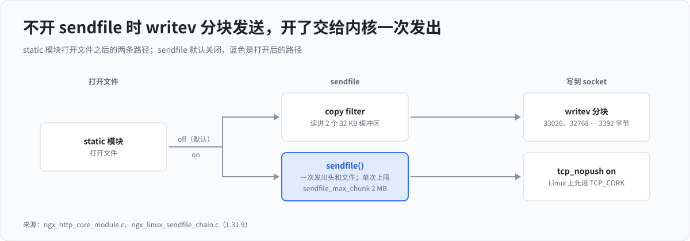
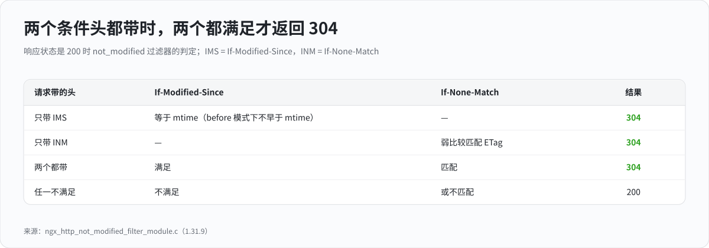
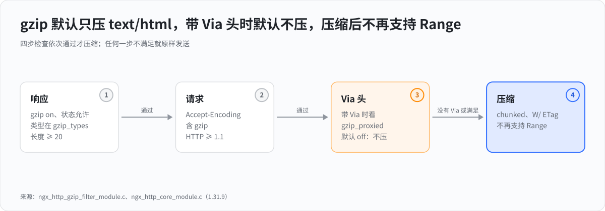
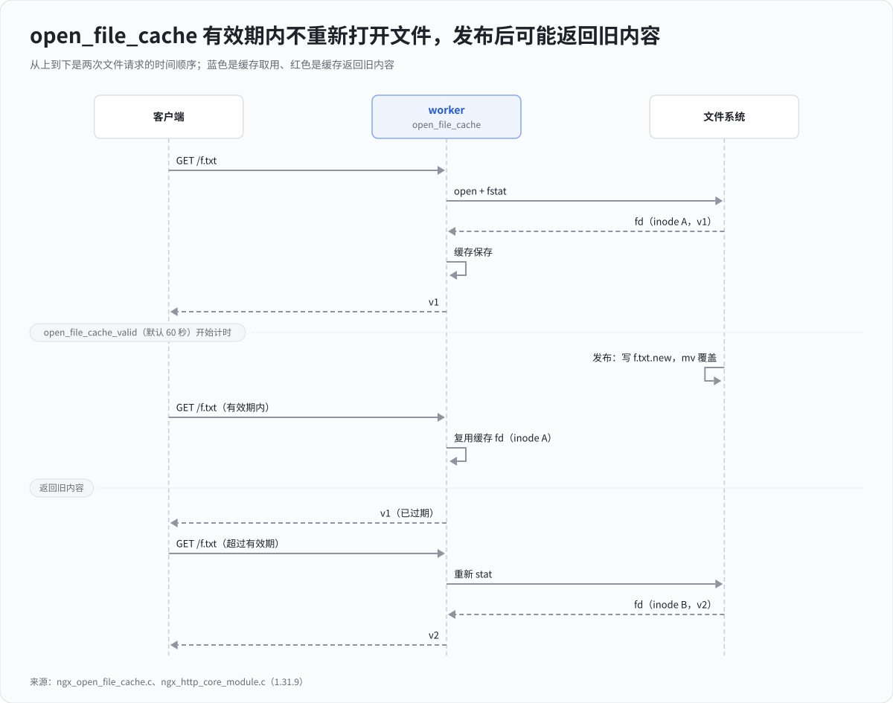
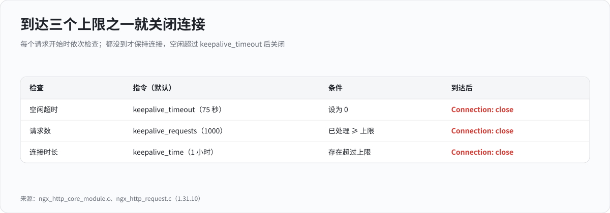
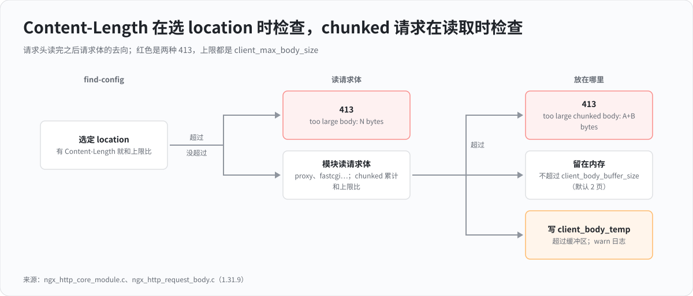

# 运维篇 05｜静态资源与传输：304、206、gzip 和缓存头都由过滤器决定，默认值比想象中保守

> **一句话结论**：静态文件由 static 模块打开、由一串过滤器决定最终响应。默认配置下 `sendfile` 是关的；ETag 由文件的修改时间和大小拼成；请求同时带 `If-None-Match` 和 `If-Modified-Since` 时，两个都满足才返回 304；gzip 默认只压缩 `text/html`，请求里有 `Via` 头或者用 HTTP/1.0 发来时都不压缩，压缩后的响应不再支持 Range。`open_file_cache` 缓存的是打开的文件描述符，文件被原子替换后，在 `open_file_cache_valid`（默认 60 秒）内仍然发出旧内容。`client_max_body_size` 在选定 location 时按 Content-Length 检查，chunked 请求体在读取过程中检查。
>
> 适用版本：nginx 1.31.10（mainline，2026-11-23）。「版本差异」：static、not_modified、Range、gzip、gzip_static、headers 过滤器和 `ngx_open_file_cache.c` 在 1.30.8 与 1.31.10 之间逐字节相同；`ngx_http_request_body.c` 在 1.31.9 新增了 chunked 请求体分帧开销的检查（变更日志 1.31.9：“a request is rejected if the chunked request body contains too much framing overhead”），1.30.8 没有。`keepalive_min_timeout` 是 1.27.4 加的，两个版本都有。实验：[`labs/ops-05`](../labs/ops-05/)，18100 端口是各个测试 location，18101 是回显请求体长度的后端，18102 用来测 keepalive。

## 导读

| 你想知道 | 看哪一节 |
|---|---|
| `sendfile`、`tcp_nopush`、`tcp_nodelay` 的默认值，它们改变了什么 | §1 |
| ETag 怎么算出来，什么条件下返回 304 | §2 |
| Range 请求什么时候返回 206、200、416 | §3 |
| gzip 为什么没生效，压缩后响应头少了什么 | §4 |
| `expires` 写了但浏览器不缓存 | §5 |
| 发布了新文件，nginx 还在发旧的 | §6 |
| 长连接什么时候被关闭 | §7 |
| 413 是在什么时候判定的，请求体大了会写到哪里 | §8 |

实验里的文件修改时间由 `run.sh` 用 `touch` 固定成 2026-01-02 03:04:05 UTC，所以 Last-Modified 和 ETag 每次运行都一样。

## 1. sendfile 默认是关的：不开时文件被读进 32 KB 的缓冲区再 writev

`ngx_http_core_merge_loc_conf` 里，传输相关的几个默认值是：

```c
// src/http/ngx_http_core_module.c:3956-3976
    ngx_conf_merge_value(conf->sendfile, prev->sendfile, 0);
    ngx_conf_merge_size_value(conf->sendfile_max_chunk,
                              prev->sendfile_max_chunk, 2 * 1024 * 1024);
/* ... */
    ngx_conf_merge_value(conf->tcp_nopush, prev->tcp_nopush, 0);
    ngx_conf_merge_value(conf->tcp_nodelay, prev->tcp_nodelay, 1);
```

`sendfile` 的默认值是 0。nginx 源码自带的 `conf/nginx.conf` 示例写了 `sendfile on;`，所以容易以为它默认开启；自己从空配置写起时，不写就是关的。实验用两个 location 下载同一个 200000 字节的文件，各自把 debug 日志写到单独的文件：

```nginx
# lab: labs/ops-05/conf/nginx.conf
        location /sf-default/ { alias out/run/sf/; error_log logs/sf-default.log debug; }
        location /sf-on/      { alias out/run/sf/; error_log logs/sf-on.log debug; sendfile on; }
```

```text
# labs/ops-05 ## sendfile is off by default
sf-default: sendfile lines 0, writev lines 7
sf-on: sendfile lines 1, writev lines 0
sendfile: @0 200259 h:259
writev sizes without sendfile: 33027 32768 32768 32768 32768 32768 3392
ok - without sendfile on the file is read and written with writev; with it, sendfile() sends it
```

不开 sendfile 时，copy filter 按 `output_buffers` 的默认值（`ngx_http_copy_filter_merge_conf` 里的 `2, 32768`）把文件读进 32 KB 的缓冲区，再用 writev 发出去。第一次是 33027 字节，即 259 字节的响应头加 32768 字节，之后每次 32768，最后剩 3392，合计正好 259 + 200000。开了 sendfile，一次 `sendfile()` 就带着 259 字节的头把整个文件交给内核（macOS 的 sendfile 支持附带头部，`h:259` 就是这部分）。`sendfile_max_chunk` 默认 2 MB，限制的是单次调用发送的上限，防止一个大文件长时间占着 worker。

`tcp_nopush` 只在 sendfile 生效时有用。Linux 的实现是：响应头后面跟着文件时，先设 `TCP_CORK`，让头和文件的第一段拼进同一个 TCP 报文：

```c
// src/os/unix/ngx_linux_sendfile_chain.c:95-101
        /* set TCP_CORK if there is a header before a file */

        if (c->tcp_nopush == NGX_TCP_NOPUSH_UNSET
            && header.count != 0
            && cl
            && cl->buf->in_file)
        {
```

`tcp_nodelay` 默认开启，但不是在连接建立时就设置，而是在几个需要立即发出小包的时刻才设置：连接进入 keepalive 状态时（`ngx_http_set_keepalive`）、检测到 SSL 握手时（`ngx_http_request.c` 第 773 行）、以及与后端的 upstream 连接上。进入 keepalive 时如果之前设置过 `TCP_CORK`，nginx 先取消它，把残留的数据推出去。



**小结**：静态文件多的站点，显式写上 `sendfile on;`；在 Linux 上配合 `tcp_nopush on;` 减少小包。`tcp_nodelay` 保持默认即可。gzip 等需要读取内容的过滤器开启时，响应体仍然要读进内存，sendfile 只对原样发送的文件生效。

## 2. ETag 是修改时间和大小的十六进制；两个条件头都在时，两个都满足才 304

static 模块打开文件后，把文件的 mtime 设成 Last-Modified，再调用 `ngx_http_set_etag`：

```c
// src/http/ngx_http_core_module.c:1773-1776
    etag->value.len = ngx_sprintf(etag->value.data, "\"%xT-%xO\"",
                                  r->headers_out.last_modified_time,
                                  r->headers_out.content_length_n)
                      - etag->value.data;
```

实验按这个格式从文件本身算出 ETag，和响应头比对：

```text
# labs/ops-05 ## Last-Modified and ETag
HTTP/1.1 200 OK
Content-Length: 5
Last-Modified: Fri, 02 Jan 2026 03:04:05 GMT
ETag: "695735a5-5"
ETag computed from the file: "695735a5-5"
ok - the ETag is the mtime and the size in hex
```

`0x695735a5` 是 1767323045，即 2026-01-02 03:04:05 UTC；`5` 是文件长度。这意味着两台机器上内容相同、但 mtime 不同的文件会有不同的 ETag；部署时如果各台机器的 mtime 不一致，经过负载均衡的浏览器会在两台之间反复拿到 200。

304 由 not_modified 过滤器决定，它在响应头链里最先执行（开发篇 01 §4），判断逻辑如下：

```c
// src/http/modules/ngx_http_not_modified_filter_module.c:78-97
    if (r->headers_in.if_modified_since || r->headers_in.if_none_match) {

        if (r->headers_in.if_modified_since
            && ngx_http_test_if_modified(r))
        {
            return ngx_http_next_header_filter(r);
        }

        if (r->headers_in.if_none_match
            && !ngx_http_test_if_match(r, r->headers_in.if_none_match, 1))
        {
            return ngx_http_next_header_filter(r);
        }

        /* not modified */

        r->headers_out.status = NGX_HTTP_NOT_MODIFIED;
```

两个条件头只要有一个表示“已修改”，就照常返回 200。RFC 9110 的规定是 `If-None-Match` 存在时忽略 `If-Modified-Since`，nginx 的做法更严格。`If-Modified-Since` 的比较方式由 `if_modified_since` 指令决定，默认 `exact`：

```c
// src/http/modules/ngx_http_not_modified_filter_module.c:157-165
    if (ims == r->headers_out.last_modified_time) {
        return 0;
    }

    if (clcf->if_modified_since == NGX_HTTP_IMS_EXACT
        || ims < r->headers_out.last_modified_time)
    {
        return 1;
    }
```

实验把六种组合各发一次：

```text
# labs/ops-05 ## conditional requests
If-None-Match = ETag:                         304
If-Modified-Since = Last-Modified:            304
If-Modified-Since one hour later (exact):     200
If-Modified-Since one hour later (before):    304
matching ETag + If-Modified-Since one hour earlier: 200
If-None-Match = W/ETag:                       304
ok - both validators must agree; exact needs the same second; INM compares weakly
```

- `exact` 要求时间完全相同，客户端发来一个比 mtime 晚一小时的时间也算“已修改”；`before` 下只要不早于 mtime 就算未修改。
- ETag 对上了、但 `If-Modified-Since` 早一小时，结果是 200，这就是两个都要满足。
- `If-None-Match` 用弱比较（第三个参数 `weak = 1`），`W/` 前缀会被去掉再比，所以 gzip 产生的弱 ETag（§4）也能拿到 304。

304 响应会去掉 Content-Length、Accept-Ranges 和 Content-Encoding，保留 ETag 和 Last-Modified：

```text
# labs/ops-05 ## what a 304 keeps
HTTP/1.1 304 Not Modified
Last-Modified: Fri, 02 Jan 2026 03:04:05 GMT
ETag: "695735a5-5"
ok - a 304 has no Content-Length and no Accept-Ranges
```



**小结**：多台机器发同一批静态文件时，要保证各台的 mtime 一致（例如打包时固定），否则 ETag 和 Last-Modified 都会因机器而异。排查“浏览器总拿不到 304”时，把请求里的两个条件头分别去掉试一次，就能确定是哪一个不满足。

## 3. Range 请求返回 206；超过 max_ranges 或 If-Range 不匹配时退回 200

Range 过滤器只处理状态 200、长度已知、并且由允许 Range 的模块（static 模块会设 `r->allow_ranges = 1`）产生的响应。解析成功就改成 206：

```c
// src/http/modules/ngx_http_range_filter_module.c:229-245
    switch (ngx_http_range_parse(r, ctx, ranges)) {

    case NGX_OK:
        ngx_http_set_ctx(r, ctx, ngx_http_range_body_filter_module);

        r->headers_out.status = NGX_HTTP_PARTIAL_CONTENT;
        r->headers_out.status_line.len = 0;

        if (ctx->ranges.nelts == 1) {
            return ngx_http_range_singlepart_header(r, ctx);
        }

        return ngx_http_range_multipart_header(r, ctx);

    case NGX_HTTP_RANGE_NOT_SATISFIABLE:
        return ngx_http_range_not_satisfiable(r);
```

实验对一个 26 字节的文件（a 到 z）发各种 Range：

```text
# labs/ops-05 ## Range
bytes=0-4      206 bytes 0-4/26 [abcde]
bytes=-3       206 bytes 23-25/26 [xyz]
bytes=24-100   206 bytes 24-25/26 [yz]
bytes=0-1,4-5  206 multipart/byteranges; boundary=...
max_ranges 1   200 (two ranges)
bytes=30-40    416 bytes */26
stale If-Range 200
ok - 206 per range, 200 above max_ranges or with a stale If-Range, 416 past the end
```

- `bytes=-3` 是最后 3 个字节；结束位置超过文件长度时（`24-100`）截到文件末尾，仍然是 206。
- 两段以上返回 `multipart/byteranges`，每段带自己的 Content-Range。
- `max_ranges` 默认没有上限（`NGX_MAX_INT32_VALUE`）。设成 1 后，请求两段时 `ngx_http_range_parse` 返回 `NGX_DECLINED`，nginx 不报错，直接返回整个文件和 200。设成 0 则完全关闭 Range。
- 起始位置超过文件长度返回 416，Content-Range 是 `bytes */26`。
- `If-Range` 带的 ETag 与当前不一致（文件已变）时，按 RFC 返回整个文件。注意这里是强比较，gzip 产生的 `W/` ETag 永远对不上。

**小结**：下载站、视频点播依赖 Range 续传和拖动。`max_ranges` 适合用来限制恶意的多段请求，设成 1 不会让正常的单段续传失效。

## 4. gzip 默认只压 text/html，带 Via 头的请求不压；压缩后的响应没有长度，也不支持 Range

gzip 过滤器的响应头检查有五个条件，任何一个不满足就原样放行：

```c
// src/http/modules/ngx_http_gzip_filter_module.c:229-240
    if (!conf->enable
        || (r->headers_out.status != NGX_HTTP_OK
            && r->headers_out.status != NGX_HTTP_FORBIDDEN
            && r->headers_out.status != NGX_HTTP_NOT_FOUND)
        || (r->headers_out.content_encoding
            && r->headers_out.content_encoding->value.len)
        || (r->headers_out.content_length_n != -1
            && r->headers_out.content_length_n < conf->min_length)
        || ngx_http_test_content_type(r, &conf->types) == NULL
        || r->header_only)
    {
```

`gzip_types` 的默认值是 `ngx_http_html_default_types`，只有 `text/html`；`gzip_min_length` 默认 20 字节。之后的 `ngx_http_gzip_ok` 再检查请求：`Accept-Encoding` 里要有 gzip，HTTP 版本不低于 `gzip_http_version`（默认 1.1），并且，请求带 `Via` 头时看 `gzip_proxied`，它的默认值是 off：

```c
// src/http/ngx_http_core_module.c:2180-2192
    if (r->http_version < clcf->gzip_http_version) {
        return NGX_DECLINED;
    }

    if (r->headers_in.via == NULL) {
        goto ok;
    }

    p = clcf->gzip_proxied;

    if (p & NGX_HTTP_GZIP_PROXIED_OFF) {
        return NGX_DECLINED;
    }
```

实验的 `/gzip/` location 只写了 `gzip on; gzip_vary on;`：

```text
# labs/ops-05 ## gzip with the default settings
index.html (text/html, 307 bytes)  1
style.css (text/css)               0
tiny.html (11 bytes)               0
index.html with Via: 1.1 cdn       0
index.html over HTTP/1.0           0
ok - only text/html of at least 20 bytes, over HTTP/1.1, without a Via header (1 = gzipped)
```

五行里只有第一行被压缩。CSS 没压，因为 `gzip_types` 没有列它；11 字节的文件小于 20 字节；带 `Via` 的请求和 HTTP/1.0 请求都不压。后两种在生产里常见：CDN 回源时通常带 `Via`，部分老代理用 HTTP/1.0 回源，于是“浏览器直连能压缩，经过 CDN 就不压缩”。CDN 回源的场景要显式写 `gzip_proxied any;`（或者按需选 `expired`、`no-cache` 等条件）。

压缩后，响应头也变了：

```text
# labs/ops-05 ## what gzip changes in the response
HTTP/1.1 200 OK
Transfer-Encoding: chunked
Vary: Accept-Encoding
ETag: W/"695735a5-133"
Content-Encoding: gzip
with Range: bytes=0-9 -> 200
ok - the gzipped response is chunked, has a weak ETag and ignores Range
```

gzip 的头过滤器调用了 `ngx_http_clear_content_length`、`ngx_http_clear_accept_ranges` 和 `ngx_http_weak_etag`，因为压缩后的长度事先不知道，内容的字节也和原文件不同。它在响应头链里排在 Range 过滤器之前执行，Range 过滤器看到长度是 -1，就不处理 Range，所以带 Range 的请求拿到的是 200 和整个压缩后的内容。

`gzip_static on` 走另一条路：客户端接受 gzip 时，直接发送事先压好的 `文件名.gz`，它是普通文件，有长度，也能 sendfile：

```text
# labs/ops-05 ## gzip_static
HTTP/1.1 200 OK
Content-Length: 52
Content-Encoding: gzip
HTTP/1.1 200 OK
Content-Length: 307
app.js 307 bytes, app.js.gz 52 bytes
ok - a client that accepts gzip gets app.js.gz as is, others get app.js
```



**小结**：开 gzip 时至少同时写上 `gzip_types`（`text/html` 总是包含在内，不用写）和 `gzip_vary on`；有 CDN 回源时再看 `gzip_proxied`。对 JS、CSS 这类发布后不变的文件，用 `gzip_static` 预先压缩，可以省掉每次请求的 CPU，也保留了 Content-Length 和 Range。

## 5. expires 生成 Cache-Control；expires modified 可能直接得到 no-cache

`expires` 由 headers 过滤器处理，并且只对一组“安全”的状态码生效：

```c
// src/http/modules/ngx_http_headers_filter_module.c:217-241
    switch (r->headers_out.status) {

    case NGX_HTTP_OK:
    case NGX_HTTP_CREATED:
    case NGX_HTTP_NO_CONTENT:
    case NGX_HTTP_PARTIAL_CONTENT:
    case NGX_HTTP_MOVED_PERMANENTLY:
    case NGX_HTTP_MOVED_TEMPORARILY:
    case NGX_HTTP_SEE_OTHER:
    case NGX_HTTP_NOT_MODIFIED:
    case NGX_HTTP_TEMPORARY_REDIRECT:
    case NGX_HTTP_PERMANENT_REDIRECT:
        safe_status = 1;
        break;
/* ... */
    if (conf->expires != NGX_HTTP_EXPIRES_OFF && safe_status) {
        if (ngx_http_set_expires(r, conf) != NGX_OK) {
            return NGX_ERROR;
        }
    }
```

`max-age` 的算法分三种：普通的 `expires 1h` 从现在算起；`expires modified 1h` 从文件的 Last-Modified 算起；`expires @15h` 按每天的固定时刻。算出来的 `max_age` 为负数时，nginx 写的是 `no-cache`：

```c
// src/http/modules/ngx_http_headers_filter_module.c:463-479
    } else if (expires == NGX_HTTP_EXPIRES_ACCESS
               || r->headers_out.last_modified_time == -1)
    {
        max_age = expires_time;
        expires_time += now;

    } else {
        expires_time += r->headers_out.last_modified_time;
        max_age = expires_time - now;
    }

    ngx_http_time(e->value.data, expires_time);

    if (conf->expires_time < 0 || max_age < 0) {
        ngx_str_set(&cc->value, "no-cache");
        return NGX_OK;
    }
```

实验对一个 mtime 是 2020-01-01 的文件分别用两种写法：

```text
# labs/ops-05 ## expires
HTTP/1.1 200 OK
Last-Modified: Wed, 01 Jan 2020 00:00:00 GMT
Cache-Control: max-age=3600
HTTP/1.1 200 OK
Last-Modified: Wed, 01 Jan 2020 00:00:00 GMT
Cache-Control: no-cache
HTTP/1.1 404 Not Found
ok - 1h from now is max-age=3600; 1h after a 2020 mtime is in the past; a 404 gets nothing
```

`expires modified 1h` 的意思是“文件修改后一小时内可缓存”，对一个几年前修改的文件，这个时刻早就过了，所以得到 `no-cache`。最后一行是 404，`expires` 没有生效，也就不会出现 Cache-Control。

**小结**：带版本号或哈希的静态资源用 `expires max` 或一个较长的时间；HTML 入口页用 `expires -1`（生成 `no-cache`）或者干脆不写。`expires modified` 只适合内容按固定周期更新的文件。

## 6. open_file_cache 缓存的是文件描述符，原子替换后有效期内仍然发旧内容

`open_file_cache` 默认关闭。打开以后，nginx 把打开的文件描述符和 stat 结果放在 worker 自己的缓存里。再次访问同一路径时，只要没超过 `open_file_cache_valid`，就直接复用：

```c
// src/core/ngx_open_file_cache.c:230-238
        if (file->use_event
            || (file->event == NULL
                && (of->uniq == 0 || of->uniq == file->uniq)
                && now - file->created < of->valid
#if (NGX_HAVE_OPENAT)
                && of->disable_symlinks == file->disable_symlinks
                && of->disable_symlinks_from == file->disable_symlinks_from
#endif
            ))
```

`open_file_cache_valid` 的默认值是 60 秒（`ngx_http_core_merge_loc_conf` 里 `open_file_cache_valid, 60`）。常见的发布方式是先写临时文件再 `mv` 覆盖，这样原来的 inode 不会被修改，缓存里的描述符仍然指向旧文件：

```nginx
# lab: labs/ops-05/conf/nginx.conf
        location /ofc/   { alias out/run/ofc/; open_file_cache max=10; open_file_cache_valid 30s; }
        location /noofc/ { alias out/run/ofc/; }
```

```text
# labs/ops-05 ## open_file_cache keeps the old file
before: ofc=v1 noofc=v1
after mv: ofc=v1 noofc=v2
ok - within open_file_cache_valid the cached descriptor still points to the old file
```

同一个文件，经过缓存的 location 在 `mv` 之后仍然返回 v1，没有缓存的返回 v2。缓存是每个 worker 各一份，多 worker 时不同请求可能分别看到新旧内容，直到各自的条目过期。



**小结**：开了 `open_file_cache` 的站点，发布后要么等过 `open_file_cache_valid`，要么 reload（新 worker 的缓存是空的）。对小文件多、发布频繁的目录，收益不一定抵得过这个延迟。

## 7. keepalive_requests 默认 1000、keepalive_timeout 75 秒、keepalive_time 1 小时，到达任一上限就关连接

每个请求处理开始时，nginx 判断这是不是这个连接的最后一个请求：

```c
// src/http/ngx_http_core_module.c:1390-1400
    if (r->keepalive) {
        if (clcf->keepalive_timeout == 0) {
            r->keepalive = 0;

        } else if (r->connection->requests >= clcf->keepalive_requests) {
            r->keepalive = 0;

        } else if (ngx_current_msec - r->connection->start_time
                   > clcf->keepalive_time)
        {
            r->keepalive = 0;
```

三个默认值都在 `ngx_http_core_merge_loc_conf` 里：`keepalive_time` 3600000 毫秒、`keepalive_timeout` 75000 毫秒、`keepalive_requests` 1000。`r->keepalive` 为 0 的请求，响应头里会写 `Connection: close`，发完就关连接。实验把 18102 端口的 `keepalive_requests` 设成 3，用一条 curl 命令在同一个连接上连发 4 个请求：

```text
# labs/ops-05 ## keepalive_requests and the Keep-Alive header
num_connects per request: 1 0 0 1
access.log $connection_requests: 1 2 3 1
Connection: keep-alive
Keep-Alive: timeout=60
Connection: keep-alive
Keep-Alive: timeout=60
Connection: close
ok - the third request on a connection gets Connection: close, the fourth opens a new one
```

curl 的 `num_connects` 是 1 0 0 1：第 4 个请求新建了连接。access log 的 `$connection_requests` 从 1 数到 3 后又回到 1。`keepalive_timeout 75s 60s` 的第二个参数只用来生成 `Keep-Alive: timeout=60` 响应头，服务端实际的空闲超时仍是 75 秒。

`keepalive_min_timeout`（1.27.4 新增，默认 0）解决的是另一个问题：连接刚进入空闲状态就被关掉，而客户端恰好在这时发出了下一个请求。设置了它以后，连接在这段时间内不标记为可回收，nginx 退出（QUIT、reload 后的老 worker）时也会先等完这段时间再关：

```c
// src/http/ngx_http_request.c:3047-3052
    if (r->keepalive
        && clcf->keepalive_min_timeout > 0)
    {
        ngx_http_set_keepalive(r);
        return;
    }
```

这一段后面紧跟的普通分支带着 `!ngx_terminate && !ngx_exiting` 条件，而上面这个分支没有，这是“退出时也保留连接”的依据。本篇没有在实验里验证这一行为。



**小结**：`keepalive_requests` 的默认值是 1.19.10 才改成 1000 的（变更日志 1.19.10），老配置里照抄的更小的值可以重新评估。放在四层负载均衡后面的 nginx，`keepalive_timeout` 要比负载均衡器的空闲超时长，让负载均衡器先关连接，否则它可能往一个 nginx 刚关闭的连接上发请求。

## 8. client_max_body_size 在选定 location 时按 Content-Length 判断；超过缓冲区的请求体写进临时文件

请求体大小的检查发生在 find-config 阶段，location 选定之后、任何模块读请求体之前：

```c
// src/http/ngx_http_core_module.c:1016-1030
    if (r->headers_in.content_length_n != -1
        && !r->discard_body
        && clcf->client_max_body_size
        && clcf->client_max_body_size < r->headers_in.content_length_n)
    {
        ngx_log_error(NGX_LOG_ERR, r->connection->log, 0,
                      "client intended to send too large body: %O bytes",
                      r->headers_in.content_length_n);

        r->expect_tested = 1;
        (void) ngx_http_discard_request_body(r);
        ngx_http_finalize_request(r, NGX_HTTP_REQUEST_ENTITY_TOO_LARGE);
        return NGX_OK;
    }
```

所以 `client_max_body_size` 写在哪个 location 就按哪个 location 生效，请求体还没传就能拒绝；`expect_tested = 1` 表示对带 `Expect: 100-continue` 的请求不再回 100，直接回 413。chunked 请求没有 Content-Length，只能在读取时边读边累计：

```c
// src/http/ngx_http_request_body.c:1146-1159
                if (clcf->client_max_body_size
                    && clcf->client_max_body_size
                       - r->headers_in.content_length_n < rb->chunked->size)
                {
                    ngx_log_error(NGX_LOG_ERR, r->connection->log, 0,
                                  "client intended to send too large chunked "
                                  "body: %O+%O bytes",
                                  r->headers_in.content_length_n,
                                  rb->chunked->size);

                    r->lingering_close = 1;

                    return NGX_HTTP_REQUEST_ENTITY_TOO_LARGE;
```

实验的 `/upload/` 设 `client_max_body_size 1k`，代理到一个回显请求体长度的后端：

```text
# labs/ops-05 ## client_max_body_size
500 bytes:           200 got 500
2000 bytes:          413
2000 bytes, chunked: 413
[error] client intended to send too large body: 2000 bytes
[error] client intended to send too large chunked body: 0+2000 bytes
ok - Content-Length is checked when the location is chosen, a chunked body while it is read
```

两种 413 在 error.log 里的措辞不同，排查时可以据此判断客户端用的是哪种方式上传。`0+2000` 的意思是此前已累计 0 字节、当前这个 chunk 有 2000 字节。1.31.9 还增加了一项检查：chunked 请求体里分帧的字节（chunk 长度行、扩展字段）如果超过实际数据的 8 倍再加 1 MB，返回 400，并在 info 级别记录 `client sent too large chunked body overhead`。本篇没有构造这种请求。

没有超限的请求体，先放进 `client_body_buffer_size` 大小的内存缓冲区，放不下就写进 `client_body_temp/` 下的临时文件，并在 warn 级别留一条日志：

```text
# labs/ops-05 ## client_body_buffer_size
page size 16384, default client_body_buffer_size = 2 pages = 32768
100000 bytes to a location with client_body_buffer_size 8k: got 100000
[warn] a client request body is buffered to a temporary file $LAB/client_body_temp/NNNNNNNNNN
ok - a body larger than the buffer is written to client_body_temp
```

`client_body_buffer_size` 的默认值是两个内存页（`(size_t) 2 * ngx_pagesize`）。实验机器是 macOS arm64，页大小 16384，默认值是 32768；常见的 x86-64 Linux 页大小 4096，默认值是 8192。同一份配置在两种机器上，请求体落盘的阈值相差 4 倍。



**小结**：上传接口按 location 单独放宽 `client_max_body_size`，其余保持 1 MB 默认值。error.log 里频繁出现 “buffered to a temporary file” 时，按请求体的常见大小调大 `client_body_buffer_size`，或者确认临时目录所在磁盘够快；并且要按实际机器的页大小理解默认值。

## 已知局限与待核实

- 实验只在 macOS 上运行。`tcp_nopush` 设置 `TCP_CORK` 的行为来自 Linux 的 `ngx_linux_sendfile_chain.c`，没有在 Linux 上抓包验证；macOS 的 sendfile 用 `sf_hdtr` 携带响应头，不经过这段代码。
- §1 的 writev 分块大小是 macOS 上默认 `output_buffers` 的结果，Linux 上没有核对。
- §7 中 `keepalive_min_timeout` 在 QUIT/reload 期间保留连接的行为，是从源码条件推断的，没有在实验里验证。
- §8 中 1.31.9 新增的 chunked 分帧开销检查只读了源码，没有构造请求触发。
- `open_file_cache_events`（用 kqueue/epoll 监听文件变化来及时失效缓存）本篇没有测试。
- 本篇不涉及 HTTP/2、HTTP/3 下的传输细节，见运维篇 08。

## 修订记录

- 2026-11-21：基于 nginx 1.31.9 源码新写。覆盖 sendfile 默认值与 writev 分块、ETag 格式与 304 判定、Range 的 206/200/416、gzip 默认条件与 `gzip_proxied`、`gzip_static`、`expires` 与安全状态码、`open_file_cache` 的旧描述符问题、keepalive 三个上限与 `keepalive_min_timeout`、请求体大小检查与临时文件，均附 `labs/ops-05` 实验。
- 2026-11-26：基线升到 nginx 1.31.10 / 1.30.8（2026-11-23 发布），重跑实验并更新输出，源码摘录与行号链接复核无漂移。`Server: nginx/1.31.10` 比原来长 1 字节，正文和图里依赖响应长度的数字随之更新。
