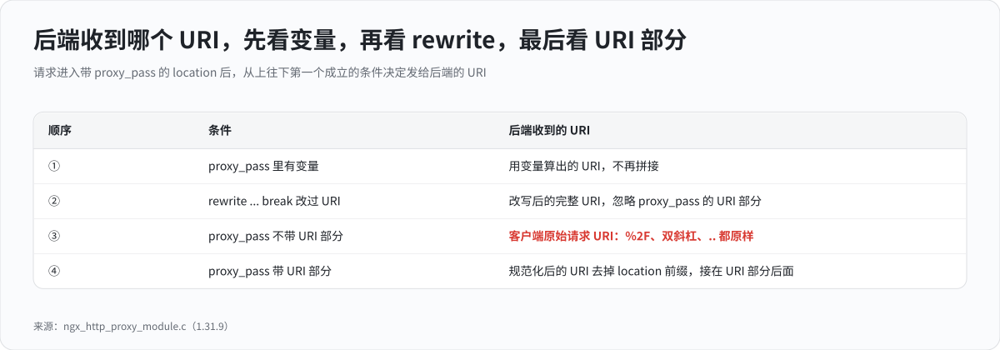
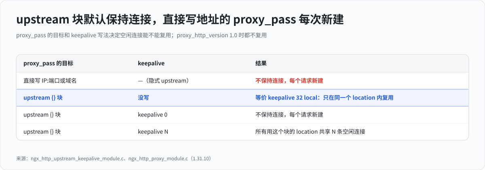
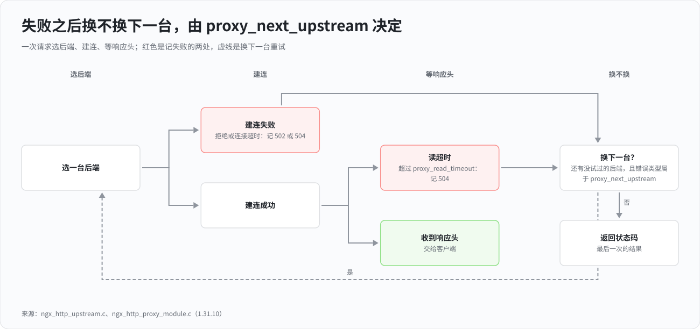
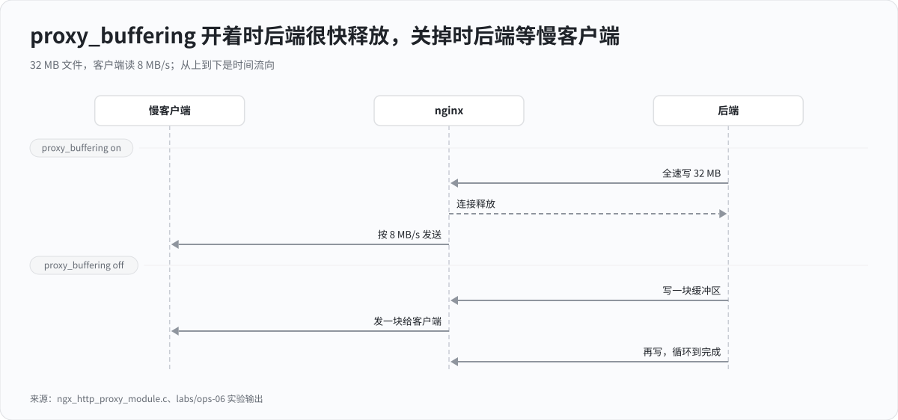
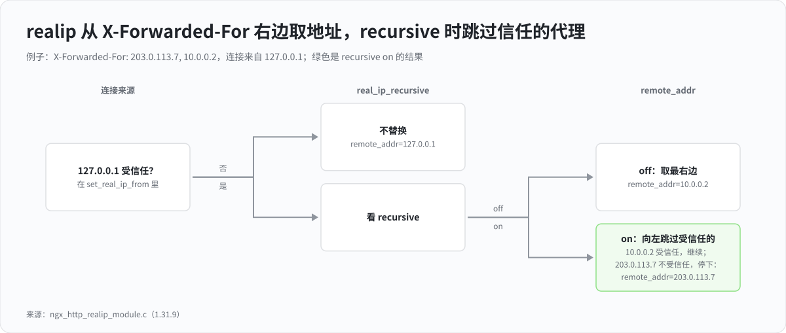
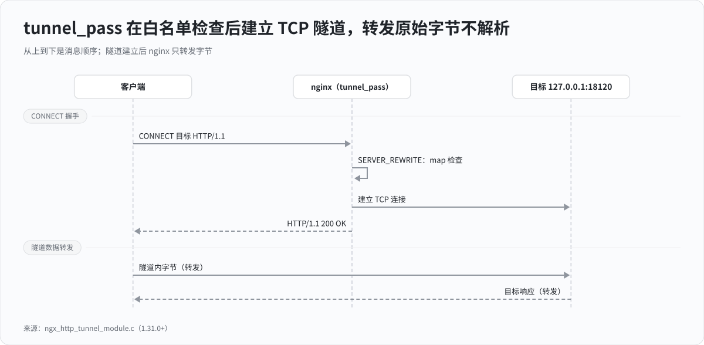

# 运维篇 06｜反向代理：后端收到的请求行、请求头和连接，都由 proxy 模块按规则重写

> **一句话结论**：`proxy_pass` 不带 URI 时，后端收到客户端原始的请求 URI；带 URI 时，nginx 用它替换规范化之后 URI 里的 location 前缀。请求头默认只改两处：Host 换成 `$proxy_host`，Connection、Upgrade、TE、Keep-Alive 这类逐跳头不转发。1.29.7 起，`upstream {}` 块默认对后端保持连接（`keepalive 32 local`），但 `proxy_pass http://IP:端口` 这种直接写地址的隐式 upstream 不在其列，每个请求仍然新建连接。
>
> 适用版本：nginx 1.31.9（mainline，2026-11-18）。「版本差异」：后端 HTTP/2（`proxy_http_version 2`）从 1.29.4 起、默认 keepalive 从 1.29.7 起，1.30.7 都有；`tunnel_pass`（CONNECT 隧道）只在 1.31.x 有；`proxy_set_header Host ""` 回落到 `$proxy_host` 的行为在 1.30.7 源码里没有。实验：[`labs/ops-06`](../labs/ops-06/)，同一个 nginx 里 18120 端口当后端，把收到的请求行、请求头、连接号原样回显，18121 端口当代理，本篇所有“请求 → 后端看到什么”都来自它的输出。

## 导读

| 你想知道 | 看哪一节 |
|---|---|
| `proxy_pass` 末尾带不带 `/`，后端收到的路径有什么区别 | §1 |
| 后端看到的 Host 是什么，哪些头被丢掉，`proxy_set_header` 为什么“失效” | §2 |
| 升级到 1.29.7 之后，到后端的连接是否已经复用 | §3 |
| 502 和 504 在 error.log 里分别长什么样，什么时候换下一台 | §4 |
| `proxy_buffering` 开和关，后端被占用多久 | §5 |
| `X-Forwarded-For` 里取哪个地址作为客户端地址 | §6 |
| 1.31.0 的 tunnel 模块能做什么 | §7 |

## 1. proxy_pass 不带 URI 就原样转发，带 URI 就替换 location 前缀，替换发生在规范化之后

后端收到什么路径，只看 `proxy_pass` 的地址后面有没有 URI 部分（哪怕只是一个 `/`）。构造请求行的 `ngx_http_proxy_create_request` 分三条路：`proxy_pass` 里有变量时用变量算出的 URI；没有 URI 部分时用 `r->unparsed_uri`，也就是客户端请求行里的原始字节；有 URI 部分时，从 `r->uri`（已经解码、合并斜杠、处理过 `..` 的 URI）里去掉 location 前缀的长度，接在 `proxy_pass` 的 URI 后面，必要时重新转义：

```c
// src/http/modules/ngx_http_proxy_module.c:1261-1277
        uri_len = ctx->vars.uri.len;

    } else if (ctx->vars.uri.len == 0 && r->valid_unparsed_uri) {
        unparsed_uri = 1;
        uri_len = r->unparsed_uri.len;

    } else {
        loc_len = (r->valid_location && ctx->vars.uri.len)
                  ? ngx_min(plcf->location.len, r->uri.len) : 0;

        if (r->quoted_uri || r->internal) {
            escape = 2 * ngx_escape_uri(NULL, r->uri.data + loc_len,
                                        r->uri.len - loc_len, NGX_ESCAPE_URI);
        }

        uri_len = ctx->vars.uri.len + r->uri.len - loc_len + escape
                  + sizeof("?") - 1 + r->args.len;
```

实验里 `/a/` 不带 URI，`/b/` 带 `/new/`，`location /c0` 配 `proxy_pass .../new`（两边都没有末尾斜杠），`/d/` 带 `/`：

```text
# labs/ops-06 ## proxy_pass with and without a URI part
/a/x?q=1     -> /a/x?q=1
/a/x%2Fy     -> /a/x%2Fy
/a//x        -> /a//x
/b/x?q=1     -> /new/x?q=1
/b/x%2Fy     -> /new/x/y
/b/a%20b     -> /new/a%20b
/b//x        -> /new/x
/b/../b/x    -> /new/x
/c0x         -> /newx
/c0/x        -> /new/x
/d/x         -> /x
```

三行对比最能说明“规范化之后”的含义。`%2F` 在 `/a/` 下原样到达后端，在 `/b/` 下先被解码成 `/`，替换前缀后不再转义回去（`NGX_ESCAPE_URI` 不转义斜杠），于是后端看到的是两级路径 `/new/x/y`。双斜杠和 `..` 也一样：`/a//x` 原样保留，`/b//x` 和 `/b/../b/x` 都变成 `/new/x`。后端如果靠 `%2F` 区分“路径里的斜杠”和“路径分隔符”（对象存储的 key、某些 REST 路由），`proxy_pass` 就不能带 URI。`/c0x -> /newx` 则是前缀替换按字节做的直接结果：location 前缀和 `proxy_pass` 的 URI 末尾斜杠不对齐，就会拼出 `/newx` 这种路径，和运维篇 04 里 `alias` 的斜杠对齐是同一类问题。

正则 location 没有“前缀”可替换，所以带 URI 部分直接被 `nginx -t` 拒绝；predicate location、named location、`if` 和 `limit_except` 里也一样：

```text
# labs/ops-06 ## a URI part in a regex location
[emerg] "proxy_pass" cannot have URI part in location given by regular expression, or inside predicate location, or inside named location, or inside "if" statement, or inside "limit_except" block in $LAB/conf/bad-regex.conf:8
```

`rewrite ... break` 是第三种情况。`break` 在改写 URI 时清掉 `r->valid_location`：

```c
// src/http/ngx_http_script.c:1179-1189
    if (code->uri) {
        r->internal = 1;
        r->valid_unparsed_uri = 0;

        if (code->break_cycle) {
            r->valid_location = 0;
            r->uri_changed = 0;

        } else {
            r->uri_changed = 1;
        }
```

`valid_location` 为 0 时，上面的 `loc_len` 是 0，拼请求行时也不再复制 `proxy_pass` 的 URI 部分，后端收到的是改写后的完整 URI。实验里 `location /rw/` 先 `rewrite ^/rw/(.*)$ /new/$1 break;`，再 `proxy_pass http://127.0.0.1:18120/ignored/;`，`/ignored/` 没有出现：

```text
# labs/ops-06 ## proxy_pass with and without a URI part
/re/x        -> /re/x
/rw/x?q=1    -> /new/x?q=1
```

这张图把三种情况放在一起，判断依据只有两个：有没有经过 `rewrite`，`proxy_pass` 有没有 URI 部分。



**小结**：要让后端看到客户端发来的原样路径，`proxy_pass` 只写到端口；要改前缀，就带 URI，并且让 location 和 URI 的末尾斜杠成对出现。带 URI 时后端拿到的是解码、合并斜杠之后的路径，`%2F` 会变成真正的 `/`。

## 2. 默认只改 Host 并丢掉逐跳头，proxy_set_header 一旦在 location 里出现，上层的就全部不算数

proxy 模块有一张默认请求头表，值为空字符串的头不发送，`Content-Length` 和 `Transfer-Encoding` 由请求体重新计算：

```c
// src/http/modules/ngx_http_proxy_module.c:761-772
static ngx_keyval_t  ngx_http_proxy_headers[] = {
    { ngx_string("Host"), ngx_string("") },
    { ngx_string("Connection"), ngx_string("") },
    { ngx_string("Proxy-Connection"), ngx_string("") },
    { ngx_string("Content-Length"), ngx_string("$proxy_internal_body_length") },
    { ngx_string("Transfer-Encoding"), ngx_string("$proxy_internal_chunked") },
    { ngx_string("TE"), ngx_string("") },
    { ngx_string("Keep-Alive"), ngx_string("") },
    { ngx_string("Expect"), ngx_string("") },
    { ngx_string("Upgrade"), ngx_string("") },
    { ngx_null_string, ngx_null_string }
};
```

Host 一项写成空，是因为它在构造请求时单独处理：没有配置 `proxy_set_header Host` 时，用 `ctx->vars.host_header`，也就是 `proxy_pass` 里写的主机加端口（端口是协议默认的 80 或 443 时省略，`ngx_http_proxy_module.c:5446-5460`），即变量 `$proxy_host`。1.31.x 还多了一个回落：HTTP/1.1 下把 Host 设成空字符串，也回到 `$proxy_host`，保证请求总带 Host（changes.xml 1.31.4：“HTTP/1.1 requests - with the "Host" header”）：

```c
// src/http/modules/ngx_http_proxy_module.c:1234-1243
        && ngx_http_complex_value(r, plcf->host_value, &host) != NGX_OK)
    {
        return NGX_ERROR;
    }

    if (plcf->host_value == NULL
        || (host.len == 0 && plcf->http_version == NGX_HTTP_VERSION_11))
    {
        host = ctx->vars.host_header;
    }
```

实验的客户端带上 `Connection: keep-alive, Upgrade`、`Upgrade: websocket`、`TE: trailers` 和一个自定义的 `X-A`；代理 server 级写了 `proxy_set_header X-B from-server`：

```text
# labs/ops-06 ## request headers the backend receives
host=[127.0.0.1:18120] connection=[] upgrade=[] te=[] x-a=[from-client] x-b=[from-server] xff=[]
```

逐跳头全部没有到后端，自定义头原样到达，server 级的 `X-B` 被继承到这个没有自己 `proxy_set_header` 的 location。接下来几个 location 各写了一条 `proxy_set_header`，客户端统一带 `Host: front.test`、`X-Forwarded-For: 203.0.113.7`：

```text
# labs/ops-06 ## request headers the backend receives
/h-up/    host=[be] connection=[] upgrade=[] te=[] x-a=[c] x-b=[from-server] xff=[203.0.113.7]
/h-loc/   host=[127.0.0.1:18120] connection=[] upgrade=[] te=[] x-a=[from-location] x-b=[] xff=[203.0.113.7]
/h-host/  host=[front.test] connection=[] upgrade=[] te=[] x-a=[c] x-b=[] xff=[203.0.113.7]
/h-empty/ host=[127.0.0.1:18120] connection=[] upgrade=[] te=[] x-a=[c] x-b=[] xff=[203.0.113.7]
/h-xff/   host=[127.0.0.1:18120] connection=[] upgrade=[] te=[] x-a=[c] x-b=[] xff=[203.0.113.7, 127.0.0.1]
```

逐行读：

- `/h-up/` 用 `proxy_pass http://be/h/`，Host 是 upstream 的名字 `be`。后端按虚拟主机分流时，这几乎总是错的，要么 `proxy_set_header Host $host`（`/h-host/`），要么把 upstream 名字起成后端认识的域名。
- `/h-loc/` 只设了 `X-A`，`X-B` 就没了。`proxy_set_header` 是数组型指令，location 里出现一条，就整组替换上层的设置，这和运维篇 02 讲的 `add_header` 是同一条继承规则。常见事故是在 server 级配好 `X-Forwarded-For`、`X-Real-IP`，某个 location 为了加一个头写了一行 `proxy_set_header`，后端从此拿不到客户端地址。
- `/h-empty/` 把 Host 设成空，1.31.9 回落到 `$proxy_host`；按 1.30.7 源码没有这个回落分支，空值的头不发送，HTTP/1.1 请求就没有 Host。
- `/h-xff/` 用 `$proxy_add_x_forwarded_for`，在客户端带来的值后面追加 `$remote_addr`。不写这一行时，客户端的 `X-Forwarded-For` 也会原样透传（前几行的 `xff=[203.0.113.7]`），后端看到的是客户端自己声称的地址，§6 会回到这一点。

WebSocket 握手依赖 `Upgrade` 和 `Connection: upgrade`，而这两个头正好在默认表里被丢掉，所以必须显式设置。实验用的是官方文档的 map 写法，但空值一侧写成 `''` 而不是常见的 `close`：1.29.7 以后到后端的连接默认要复用（§3），对普通请求发 `Connection: close` 会让每个请求都关掉连接：

```nginx
# lab: labs/ops-06/conf/nginx.conf
map $http_upgrade $connection_upgrade {
    default upgrade;
    ''      '';
}
location /h-ws/ {
    proxy_pass http://127.0.0.1:18120/h/;
    proxy_set_header Upgrade    $http_upgrade;
    proxy_set_header Connection $connection_upgrade;
}
```

```text
# labs/ops-06 ## request headers the backend receives
/h-ws/    host=[127.0.0.1:18120] connection=[upgrade] upgrade=[websocket] te=[] x-a=[c] x-b=[] xff=[203.0.113.7]
/h-ws/ without Upgrade: host=[127.0.0.1:18120] connection=[] upgrade=[] te=[] x-a=[] x-b=[] xff=[]
```

带 `Upgrade` 的请求两个头都到了后端，不带的请求一个都没有。后端回 101 之后，upstream 模块进入双向转发，读写超时仍按 `proxy_read_timeout`、`proxy_send_timeout` 计算，长连接空闲超过 60 秒（默认值，`ngx_http_proxy_module.c:3737-3738`）会被断开，需要后端发心跳或调大超时。

**小结**：后端默认看到的 Host 是 `proxy_pass` 里写的地址，按域名分流的后端要显式传 `$host`。`proxy_set_header`、`add_header` 这类数组指令在子级出现一次就整组覆盖，公共头要么全写在一个层级，要么每个 location 都写全。WebSocket 的两个头要自己转，空值一侧不要写 `close`。

## 3. upstream 块默认保持连接，直接写地址的 proxy_pass 每次新建连接

1.29.7 的 changes.xml 有三条相关改动：proxy 模块默认支持 keepalive、`proxy_http_version` 默认改为 1.1、默认不再发送 `Connection` 头；upstream 块里的 `keepalive` 默认开启；`keepalive` 新增 `local` 参数。“默认开启”具体是什么，在 keepalive 模块的 `init_main_conf` 里：

```c
// src/http/modules/ngx_http_upstream_keepalive_module.c:533-555

    for (i = 0; i < umcf->upstreams.nelts; i++) {

        /* skip implicit upstreams */
        if (uscfp[i]->srv_conf == NULL) {
            continue;
        }

        kcf = ngx_http_conf_upstream_srv_conf(uscfp[i],
                                            ngx_http_upstream_keepalive_module);

        if (kcf->max_cached == 0) {
            continue;
        }

        ngx_conf_init_msec_value(kcf->time, 3600000);
        ngx_conf_init_msec_value(kcf->timeout, 60000);
        ngx_conf_init_uint_value(kcf->requests, 1000);

        if (kcf->max_cached == NGX_CONF_UNSET_UINT) {
            kcf->local = 1;
            kcf->max_cached = 32;
        }
```

源码能读出三件事。第一，`proxy_pass http://127.0.0.1:18120` 这种直接写地址的 proxy_pass 会生成一个没有 `srv_conf` 的隐式 upstream，循环第一步就跳过它，不挂 keepalive。第二，没写 `keepalive` 的 upstream 块等价于 `keepalive 32 local;`，连接最长保留 1 小时（`keepalive_time`）、空闲 60 秒（`keepalive_timeout`）、最多 1000 个请求（`keepalive_requests`）。第三，写 `keepalive 0;` 可以关掉。

`local` 的含义在取缓存连接的循环里：缓存的连接带着把它放进去的那份 proxy 配置作为标记，`local` 时只复用标记相同的连接：

```c
// src/http/modules/ngx_http_upstream_keepalive_module.c:236-238
        if (kp->conf->local && item->tag != kp->upstream->conf) {
            continue;
        }
```

“同一份 proxy 配置”就是同一个 location 的 `proxy_*` 设置。两个 location 都 `proxy_pass http://be`，默认的 `local` 下它们不共享连接；显式写 `keepalive N;`（不带 `local`）才共享。实验的后端回显 `$connection`（连接号）和 `$connection_requests`（这条连接上的第几个请求），脚本把连接号和上一行比较，相同就打印 `reused`：

```text
# labs/ops-06 ## connections to the backend
/k-implicit/ HTTP/1.1 req=1 new
/k-implicit/ HTTP/1.1 req=1 new
/k-implicit/ HTTP/1.1 req=1 new
/k-up/       HTTP/1.1 req=1 new
/k-up/       HTTP/1.1 req=2 reused
/k-up/       HTTP/1.1 req=3 reused
/k-up2/      HTTP/1.1 req=1 new
/k-sh1/      HTTP/1.1 req=1 new
/k-sh2/      HTTP/1.1 req=2 reused
```

`/k-implicit/` 三次都是新连接，虽然请求行已经是 HTTP/1.1；`/k-up/` 走 upstream 块，三个请求共用一条连接；`/k-up2/` 和 `/k-up/` 指向同一个 upstream，但因为默认的 `local`，没有拿到 `/k-up/` 留下的连接；`be_shared` 写了 `keepalive 8;`，`/k-sh1/` 留下的连接被 `/k-sh2/` 用上。

```text
# labs/ops-06 ## connections to the backend
/k-10/       HTTP/1.0 req=1 new
/k-10/       HTTP/1.0 req=1 new
/k-off/      HTTP/1.1 req=1 new
/k-off/      HTTP/1.1 req=1 new
/k-h2/       HTTP/2.0 req=1 new
/k-h2/       HTTP/2.0 req=2 reused
/k-h2/       HTTP/2.0 req=3 reused
```

`proxy_http_version 1.0` 和 `keepalive 0` 都不复用。最后三行是 1.29.4 起支持的后端 HTTP/2：`proxy_http_version 2;` 让 proxy 模块在入口直接转给 `ngx_http_proxy_v2_module`，后端只需要在监听上开 `http2 on;`（明文时用的是 HTTP/2 prior knowledge，不需要 TLS 和 ALPN），后端的 `$server_protocol` 是 `HTTP/2.0`，三个请求是同一条连接上的三个流：

```c
// src/http/modules/ngx_http_proxy_module.c:888-892
#if (NGX_HTTP_V2)
    if (plcf->http_version == NGX_HTTP_VERSION_20) {
        return ngx_http_proxy_v2_handler(r);
    }
#endif
```

升级到 1.29.7 以后要不要改配置，可以按这张图判断：



**小结**：1.29.7 之后，想要到后端的长连接，最少的改动是把直接写地址的 `proxy_pass` 改成 upstream 块，不必再手写 `proxy_http_version 1.1` 和 `proxy_set_header Connection ""`。多个 location 共用一个后端时，默认的 `local` 会让每个 location 各自维护连接池，后端的并发连接数随 location 数量增加；需要共享就显式写 `keepalive N;`。

## 4. 连接失败是 502，读超时是 504，两者默认都会换下一台后端

代理出错时，客户端只看到状态码，原因写在 error.log 里，每类失败都有固定的原文。实验的 18139 端口上没有任何进程监听：

```text
# labs/ops-06 ## 502: nothing listens on the backend port
/dead/ status: 502
[error] connect() failed (errno) while connecting to upstream
```

`(errno)` 是实验脚本替换掉的系统错误码：macOS 上是 `(61: Connection refused)`，并且前面多一句 `kevent() reported that`；Linux 上是 `(111: Connection refused)`。排障时看 `while connecting to upstream` 就知道卡在建连。

504 的实验让后端变慢：后端的 `/slow.txt` 是一个挂了 `limit_req zone=slow burst=5`（6r/m）的静态文件，第一个请求立即返回，第二个请求要在后端排队约 10 秒；代理这边把 `proxy_read_timeout` 设成 300ms：

```text
# labs/ops-06 ## 504: the backend is slower than proxy_read_timeout
/slow.txt: 200 then 504
[error] upstream timed out (errno) while reading response header from upstream
```

`while reading response header` 说明后端已经接受了连接和请求，只是迟迟不回响应头。三个超时各管一段：`proxy_connect_timeout` 管建连，`proxy_send_timeout` 管两次写之间的间隔，`proxy_read_timeout` 管两次读之间的间隔，默认都是 60 秒（`ngx_http_proxy_module.c:3731-3738`）。`proxy_read_timeout` 不是整个响应的总时长，后端每隔 59 秒吐一个字节就永远不会超时。

后端不止一台时，失败会触发换下一台。`proxy_next_upstream` 的默认值是 `error timeout`：

```c
// src/http/modules/ngx_http_proxy_module.c:3848-3854

    ngx_conf_merge_bitmask_value(conf->upstream.next_upstream,
                              prev->upstream.next_upstream,
                              (NGX_CONF_BITMASK_SET
                               |NGX_HTTP_UPSTREAM_FT_ERROR
                               |NGX_HTTP_UPSTREAM_FT_TIMEOUT));

```

实验的 `upstream retry` 里第一台是没人监听的 18139，第二台是 18120，访问日志打印 `$upstream_addr` 和 `$upstream_status`，连续请求两次：

```text
# labs/ops-06 ## the next server after a failure
/retry/ 200 [127.0.0.1:18139, 127.0.0.1:18120] [502, 200]
/retry/ 200 [127.0.0.1:18120] [200]
```

第一次请求先连 18139 失败，记一个 502，再连 18120 成功，客户端拿到 200；两个变量用逗号列出每一次尝试。第二次请求直接去了 18120：`server` 的默认参数是 `max_fails=1 fail_timeout=10`（`ngx_http_upstream.c:6548-6549`），失败一次就在 10 秒内不再选它。加权轮询怎么选下一台、`max_fails` 怎么计数，是运维篇 07 的内容。

换下一台有一条限制：请求已经发给后端之后，POST、LOCK、PATCH 默认不重试（`ngx_http_upstream.c:4700-4704` 给它们加上 `non_idempotent` 标记，配置里要显式写 `proxy_next_upstream ... non_idempotent` 才放行），避免同一笔写操作在两台后端各执行一次。连接被拒绝时请求还没发出，所以不受这条限制。



**小结**：502 看 `connect() failed`，504 看 `upstream timed out` 后面的 `while ...` 判断卡在哪个阶段；多台后端时先查 `$upstream_addr` 和 `$upstream_status`，客户端拿到 200 并不代表没有后端失败过。

## 5. proxy_buffering 开着时，后端很快就被释放，慢客户端只占用 nginx 自己

`proxy_buffering` 默认是 `on`（`ngx_http_proxy_module.c:3707-3708`）。开着时，nginx 以后端能给的最快速度把响应读进内存缓冲区（`proxy_buffers` 默认 8 个、每个一个内存页，`proxy_buffer_size` 默认也是一个内存页，实验机 macOS arm64 的页大小是 16 KB），放不下的写进 `proxy_temp` 下的临时文件，单个响应最多 1024 MB（`proxy_max_temp_file_size` 的默认值，`:3823-3824`），然后按客户端的速度慢慢发。关掉时，nginx 只用一块 `proxy_buffer_size` 大小的缓冲区，客户端读多快，后端就只能写多快。

实验让后端返回一个 32 MB 的文件，客户端用 `curl --limit-rate 8M` 限速读取，访问日志记下 `$request_time`（客户端视角的总时长）和 `$upstream_response_time`（和后端交互的时长）：

```text
# labs/ops-06 ## buffering: a 32 MB response to a client reading 8 MB/s
/big/f.bin       request_time >= 2: yes, upstream done before half of it: yes
/big-off/f.bin   request_time >= 2: yes, upstream done before half of it: no
[warn] an upstream response is buffered to a temporary file $LAB/proxy_temp/1/00/0000000001 while reading upstream
```

两次请求客户端都花了约 4 秒。开 buffering 时，和后端的交互在总时长的一半之前就结束了（写作时一次运行的原始日志：`/big/f.bin 200 3.739 0.051`、`/big-off/f.bin 200 3.629 3.629`，秒数随负载变化，脚本只打印分档）；关掉后两者几乎相等。这对后端是连接数和 worker 占用的差别：后端是每个连接占一个进程或线程的应用服务器时，关掉 buffering 等于让最慢的客户端决定后端的并发容量。那条 `[warn]` 说明响应超过了内存缓冲区，落了临时文件，流量大时这条日志频繁出现，就该调大 `proxy_buffers` 或者检查 `proxy_temp` 所在的磁盘。

关掉 buffering 的正当理由是流式响应：Server-Sent Events、逐 token 输出的推理接口、长轮询。这类 location 写 `proxy_buffering off;`，或者让后端在响应里带 `X-Accel-Buffering: no`，nginx 按响应逐个关闭缓冲。



**小结**：普通接口保持默认的 `proxy_buffering on`，让 nginx 替后端扛住慢客户端；流式接口逐个关掉。`$upstream_response_time` 和 `$request_time` 的差，就是 buffering 替后端省下来的时间。

## 6. realip 从 X-Forwarded-For 的右边取地址，只信任 set_real_ip_from 列出的代理

nginx 在负载均衡器或 CDN 后面时，`$remote_addr` 是上一跳代理的地址。realip 模块用请求头里的地址替换它，替换前的地址留在 `$realip_remote_addr`。规则有三条：只有来自 `set_real_ip_from` 地址的连接才替换；`real_ip_header X-Forwarded-For` 时默认取头里最右边的地址，也就是离 nginx 最近的那一跳写进去的；`real_ip_recursive on` 时从右往左跳过所有受信任的地址，取第一个不受信任的。

实验的 18122 端口信任 `127.0.0.1` 和 `10.0.0.0/8`，没开 recursive；18125 端口相同但开了 recursive：

```text
# labs/ops-06 ## realip
18122 /     203.0.113.7               -> remote_addr=203.0.113.7 realip_remote_addr=127.0.0.1
18122 /     203.0.113.7, 10.0.0.2     -> remote_addr=10.0.0.2 realip_remote_addr=127.0.0.1
18125 /     203.0.113.7, 10.0.0.2     -> remote_addr=203.0.113.7 realip_remote_addr=127.0.0.1
18125 /     203.0.113.7, 198.51.100.9 -> remote_addr=198.51.100.9 realip_remote_addr=127.0.0.1
```

链路上有两层代理（例如 CDN 加内网负载均衡）时，不开 recursive 取到的是内网负载均衡的地址 `10.0.0.2`，开了才拿到 `203.0.113.7`。最后一行说明 recursive 为什么安全：`198.51.100.9` 不在信任列表里，nginx 在它这里停下，它左边的 `203.0.113.7` 无论是谁写的都不会被采用。客户端自己伪造的 `X-Forwarded-For` 总在最左边，只要信任列表只包含自己的代理，伪造的地址就到不了 `$remote_addr`。

一个容易踩的坑：在 server 级配了 realip，再在某个 location 里改 `real_ip_recursive`，不会生效。realip 的处理函数挂在两个阶段：

```c
// src/http/modules/ngx_http_realip_module.c:524-537
    cmcf = ngx_http_conf_get_module_main_conf(cf, ngx_http_core_module);

    h = ngx_array_push(&cmcf->phases[NGX_HTTP_POST_READ_PHASE].handlers);
    if (h == NULL) {
        return NGX_ERROR;
    }

    *h = ngx_http_realip_handler;

    h = ngx_array_push(&cmcf->phases[NGX_HTTP_PREACCESS_PHASE].handlers);
    if (h == NULL) {
        return NGX_ERROR;
    }

```

POST_READ 阶段还没选 location，用的是 server 级配置；PREACCESS 阶段用 location 级配置，但处理函数开头发现请求已经被替换过就直接返回：

```c
// src/http/modules/ngx_http_realip_module.c:149-153
    ctx = ngx_http_realip_get_module_ctx(r);

    if (ctx) {
        return NGX_DECLINED;
    }
```

实验 18122 的 `location /rec/` 写了 `real_ip_recursive on;`，结果和没写一样：

```text
# labs/ops-06 ## realip
18122 /rec/ 203.0.113.7, 10.0.0.2     -> remote_addr=10.0.0.2 realip_remote_addr=127.0.0.1
```

location 级的 realip 配置只在 server 级没有配置（POST_READ 阶段什么都没做）时才起作用。



**小结**：`set_real_ip_from` 只列自己掌控的代理网段，链路超过一层就开 `real_ip_recursive on`，并且和其他 realip 指令写在同一个层级（通常是 http 或 server）。日志里同时记 `$remote_addr` 和 `$realip_remote_addr`，排查时能看出替换前后各是什么。

## 7. tunnel_pass 让 nginx 接受 CONNECT 并转发原始字节（1.31.0 起）

1.31.0 新增的 `ngx_http_tunnel_module` 让 nginx 充当 HTTP CONNECT 代理：客户端发 `CONNECT host:port HTTP/1.1`，nginx 连上目标，回 200，之后两边的字节原样对拷，nginx 不解析里面的内容（通常是 TLS）。默认编译进来（`--without-http_tunnel_module` 可以去掉），1.30.x 没有这个模块。

没有 `tunnel_pass` 的 server 不接受 CONNECT。请求头读完时有一道检查，只有 HTTP/1.1 并且 server 里配置了 `tunnel_pass`（它把 `allow_connect` 置 1）才放行，否则 405：

```c
// src/http/ngx_http_request.c:2098-2104
    if (r->method == NGX_HTTP_CONNECT) {
        if (r->http_version != NGX_HTTP_VERSION_11 || !cscf->allow_connect) {
            ngx_log_error(NGX_LOG_INFO, r->connection->log, 0,
                          "client sent CONNECT method");
            ngx_http_finalize_request(r, NGX_HTTP_NOT_ALLOWED);
            return NGX_ERROR;
        }
```

`tunnel_pass` 不带参数时，目标是 `$host:$request_port`，也就是 CONNECT 请求行里写的地址（`$request_port` 是 1.29.3 新增的变量）：

```c
// src/http/modules/ngx_http_tunnel_module.c:466-472

    value = cf->args->elts;

    if (cf->args->nelts == 1) {
        ngx_str_set(&url, "$host:$request_port");

    } else {
```

这等于一个开放代理，客户端想连哪里就连哪里，所以实验用 map 白名单限制目标，只允许 `127.0.0.1:18120`：

```nginx
# lab: labs/ops-06/conf/nginx.conf
map $host:$request_port $tunnel_ok {
    127.0.0.1:18120 1;
    default         0;
}
server {
    listen 127.0.0.1:18123;
    if ($tunnel_ok = 0) {
        return 403;
    }
    location / {
        tunnel_pass;
    }
}
```

和后端建立连接后，模块不读任何响应头，直接把状态设成 200，并把连接切成 upgrade 模式，这和 WebSocket 握手成功后走的是同一套双向转发代码：

```c
// src/http/modules/ngx_http_tunnel_module.c:287-306
static ngx_int_t
ngx_http_tunnel_process_header(ngx_http_request_t *r)
{
    ngx_http_upstream_t  *u;

    u = r->upstream;

    u->headers_in.status_n = NGX_HTTP_OK;
    ngx_str_set(&u->headers_in.status_line, "200 OK");

    ngx_log_debug2(NGX_LOG_DEBUG_HTTP, r->connection->log, 0,
                   "http tunnel status %ui \"%V\"",
                   u->headers_in.status_n, &u->headers_in.status_line);

    r->keepalive = 0;
    u->keepalive = 0;
    u->upgrade = 1;

    return NGX_OK;
}
```

实验用 `curl -p -x` 让 curl 先发 CONNECT 再在隧道里发普通请求，`%{http_connect}` 是 CONNECT 的响应码：

```text
# labs/ops-06 ## CONNECT tunnel
via 18123 to 18120: proto=HTTP/1.1 req=1[CONNECT 200]
via 18123 to 18121: [CONNECT 403]
via 18121 to 18120: [CONNECT 405]
CONNECT 127.0.0.1:18120 HTTP/1.1 200
CONNECT 127.0.0.1:18121 HTTP/1.1 403
[info] client sent CONNECT method while reading client request headers
```

第一行的 `proto=HTTP/1.1 req=1` 是后端 18120 直接回给 curl 的内容，隧道里的请求 nginx 没有经手解析。目标不在白名单时 403；对没有 `tunnel_pass` 的 18121 发 CONNECT 得到 405，error.log 里是 info 级别的 `client sent CONNECT method`。访问日志里每条隧道只有一行，在隧道关闭时写入。CONNECT 请求的 URI 是 `/`，所以它按 `location /` 匹配；changes.xml 1.31.0 同一条还写了 `auth_basic`、`satisfy`、`auth_delay` 支持代理认证，需要给隧道加认证时从这些指令入手，本篇没有做这个实验。



**小结**：`tunnel_pass` 适合做受控的出口代理，例如让内网机器只能经 nginx 访问一组白名单地址。不带参数的 `tunnel_pass` 允许连接任意目标，上线前必须用 map、`allow`/`deny` 或认证限制住。

## 已知局限与待核实

- 实验只在 macOS（darwin）上运行，Linux 上的 errno 文本来自常识对照，没有实测；脚本已把错误码归一成 `(errno)`。
- “1.30.7 中 `proxy_set_header Host ""` 不回落、请求不带 Host”是读 1.30.7 源码推断的（没有 `host.len == 0` 分支），没有用 1.30.7 二进制验证。
- §5 的耗时只按分档打印，具体秒数随机器负载变化；“后端是每连接一个进程的应用服务器时并发容量被拖住”是推断，实验后端是 nginx 自己。
- 实验没有做真正的 WebSocket 握手（后端是 nginx，不会回 101），只验证了两个头被转发；101 之后的双向转发与 §7 的 tunnel 是同一套 upgrade 代码，这一点来自读源码。
- `proxy_next_upstream` 对非幂等请求的限制、`X-Accel-Buffering` 只引用了行为说明，本篇实验没有覆盖。
- 后端 HTTP/2 只验证了明文 prior knowledge 一种方式；`proxy_ssl` 加 ALPN 的组合留给运维篇 08。

## 修订记录

- 2026-11-21：基于 nginx 1.31.9 源码新写，替换掉一版自动生成、步骤与输出对不上的草稿。覆盖 `proxy_pass` URI 的三条构造路径与 `%2F`、`rewrite break` 的效果，默认请求头表与数组指令继承，1.29.7 默认 keepalive 只作用于 upstream 块与 `local` 的含义，后端 HTTP/2，502/504 与换下一台，buffering 对后端占用时长的影响，realip 的 recursive 与阶段坑，1.31.0 的 tunnel 模块，均附 `labs/ops-06` 实验。
