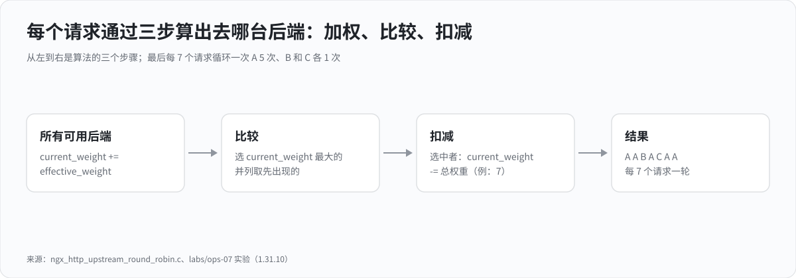
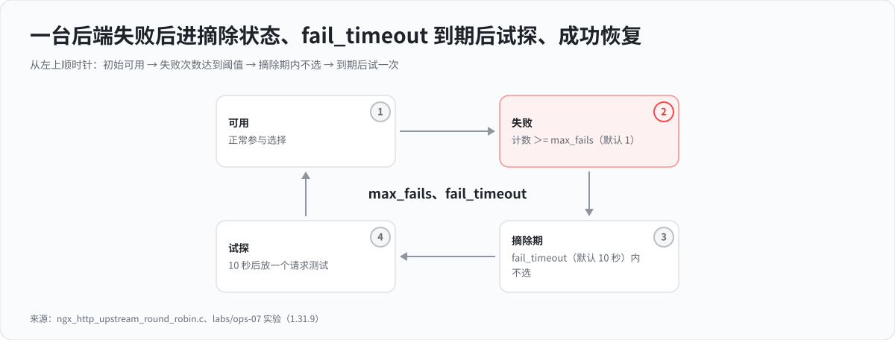
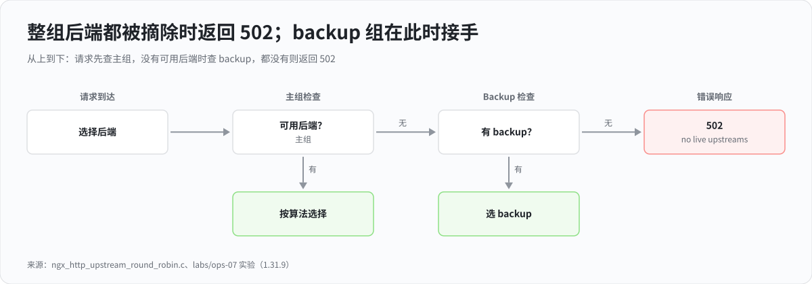
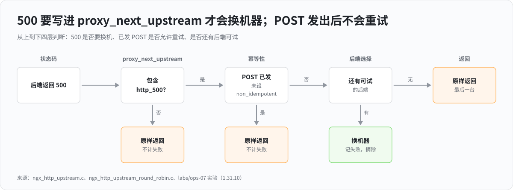
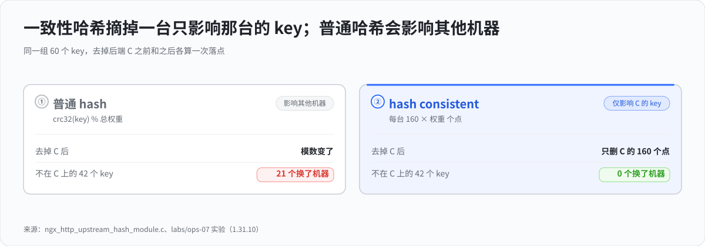
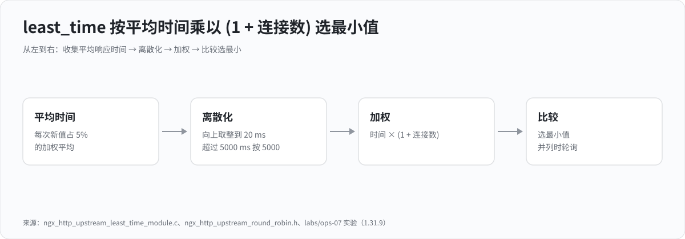
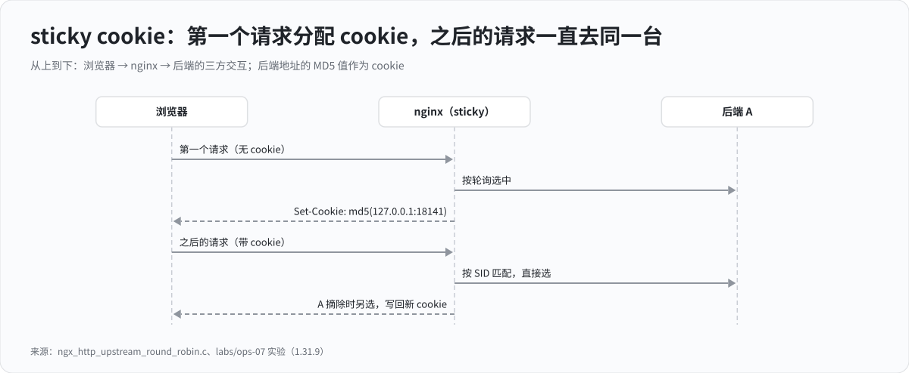
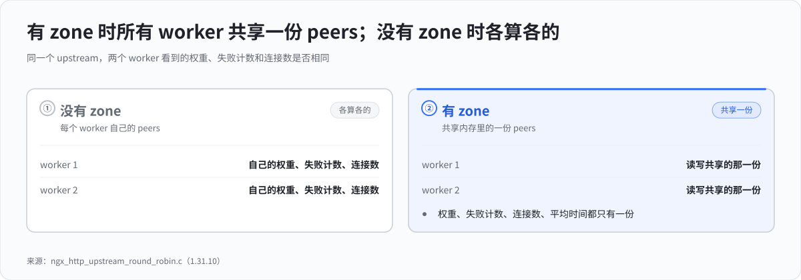

# 运维篇 07｜负载均衡与上游容错：每种算法都只是 peer.get 的一种实现，失败判定靠的是被动计数

> **一句话结论**：upstream 默认用平滑加权轮询，权重 5/1/1 时每 7 个请求的顺序是 A A B A C A A，可以按源码逐步算出来。nginx 的健康检查是被动的：一次连接失败（`max_fails=1` 的默认值）就把这台后端在 `fail_timeout`（默认 10 秒）内摘掉，到期后放一个请求去试；只有一台后端的 upstream 永远不会被摘掉；整组都被摘掉时，下一个请求不再连接，直接 502 并记 `no live upstreams`。后端返回 500 默认原样交给客户端，也不算失败，要写进 `proxy_next_upstream` 才会换机器并计数，而且已经发出去的 POST 不会重试。`hash ... consistent` 摘掉一台只影响这台的 key；`least_time`（1.31.0）按平均响应时间挑后端；`sticky cookie`（1.29.6）的 cookie 值是后端地址的 MD5。
>
> 适用版本：nginx 1.31.9（mainline，2026-11-18）。「版本差异」：`least_time` 是 1.31.0 新增的，`ngx_http_upstream_least_time_module.c` 只在 1.31.x 的源码树里，1.30.7 没有；`sticky`（1.29.6）、`server ... resolve`（1.27.3）两个版本都有。`ngx_http_upstream_round_robin.c` 在两个版本之间只有加锁方式和 SSL 会话缓存的改动，选择算法相同。实验：[`labs/ops-07`](../labs/ops-07/)，单 worker；18141、18142、18143、18144、18146 是只回答自己端口号的后端（下文记作 A、B、C、E、D），18144 以 50 KB/s 发文件，18158、18159 没有进程监听。

## 导读

| 你想知道 | 看哪一节 |
|---|---|
| 加权轮询的实际顺序是什么 | §1 |
| 一台后端挂了，nginx 多久不再找它，什么时候再试 | §2 |
| 整组后端都挂了、backup 和 down 怎么生效 | §3 |
| 后端返回 500 为什么没有换机器，POST 会不会被重放 | §4 |
| `hash`、`hash consistent`、`ip_hash` 选机器的公式 | §5 |
| `least_conn` 和 1.31.0 的 `least_time` 看的是什么 | §6 |
| 1.29.6 的 `sticky` cookie 里装的是什么 | §7 |
| `zone` 和 `resolve` 什么时候必须写 | §8 |

每种算法在源码里都实现为一对函数：`init_peer` 在请求开始时准备状态，`get` 选出下一台。轮询是所有算法的基础，`ip_hash`、`hash`、`least_conn`、`least_time` 在找不到合适的机器时都会回落到它。

## 1. 平滑加权轮询：每次给所有后端加上权重、选最大的、再减去总权重

`ngx_http_upstream_get_peer` 的核心只有三步：遍历可用的后端，给每台的 `current_weight` 加上它的 `effective_weight`，记下最大的那台；最后从选中者身上减去所有可用后端的权重之和：

```c
// src/http/ngx_http_upstream_round_robin.c:884-912
        peer->current_weight += peer->effective_weight;
        total += peer->effective_weight;

        if (peer->effective_weight < peer->weight) {
            peer->effective_weight++;
        }

        if (best == NULL || peer->current_weight > best->current_weight) {
            best = peer;
            p = i;
        }
    }
/* ... */
    if (best == NULL) {
        return NULL;
    }

    best->current_weight -= total;
```

权重 A=5、B=1、C=1，总和 7，手算前三步：

| 请求 | 加权后 A/B/C | 选中 | 减 7 之后 A/B/C |
|---|---|---|---|
| 1 | 5 / 1 / 1 | A | -2 / 1 / 1 |
| 2 | 3 / 2 / 2 | A | -4 / 2 / 2 |
| 3 | 1 / 3 / 3 | B（并列取先出现的） | 1 / -4 / 3 |

实验用同样的规则在 Python 里模拟 14 个请求，再和真实请求的结果对比：

```text
# labs/ops-07 ## smooth weighted round robin
weights A=5 B=1 C=1, 14 requests: A A B A C A A A A B A C A A
ok - the sequence of the smooth weighted algorithm in ngx_http_upstream_get_peer
```

每 7 个请求一轮，A 5 次、B 和 C 各 1 次，而且 B、C 被插在 A 中间，不会出现 “A A A A A B C” 那样的连续 5 次。`effective_weight` 平时等于配置的权重，后端失败时会被调低（§2），之后每被参与一次计算就加 1，慢慢恢复。



**小结**：轮询的顺序是确定的，排查“流量不均”时可以按这个算法预期每台的比例。单 worker 时顺序完全可复现；多 worker 而没有 `zone` 时，每个 worker 各算各的（§8），整体比例不变，但单看一个客户端的连续请求就不一定是这个顺序。

## 2. 被动健康检查：失败一次就摘掉 fail_timeout 秒，到期后放一个请求去试

`server` 指令的默认参数在解析函数一开头就定好了：

```c
// src/http/ngx_http_upstream.c:6546-6549
    weight = 1;
    max_conns = 0;
    max_fails = 1;
    fail_timeout = 10;
```

一次尝试失败时，`ngx_http_upstream_free_round_robin_peer_locked` 给这台后端的 `fails` 加 1、记下时间，并把 `effective_weight` 扣掉 `weight / max_fails`；`fails` 达到 `max_fails` 时打一条 warn：

```c
// src/http/ngx_http_upstream_round_robin.c:1056-1070
    if (state & NGX_PEER_FAILED) {
        now = ngx_time();

        peer->fails++;
        peer->accessed = now;
        peer->checked = now;

        if (peer->max_fails) {
            peer->effective_weight -= peer->weight / peer->max_fails;

            if (peer->fails >= peer->max_fails) {
                ngx_log_error(NGX_LOG_WARN, pc->log, 0,
                              "upstream server temporarily disabled");
            }
        }
```

`get_peer` 的遍历里，`fails >= max_fails` 并且距离 `checked` 不到 `fail_timeout` 的后端直接跳过。实验的 `onedead` 组是 A 加一个没人监听的端口（`fail_timeout=2s`）：

```text
# labs/ops-07 ## max_fails and fail_timeout
4 requests right away:  A A A A
connect() failed lines: 1
[warn] upstream server temporarily disabled while connecting to upstream
after fail_timeout=2s, 4 more requests: A A A A, connect() failed lines: 2
ok - every request is answered by A; the dead server is tried once, then once more after fail_timeout
```

前 4 个请求里，只有第一个尝试连接坏掉的后端，失败后同一个请求换到 A，客户端仍然拿到 200；之后 3 个请求根本不碰它。等过 2 秒，又有一个请求去试，失败，再摘 2 秒。这就是 nginx 开源版的“健康检查”：没有探测请求，用真实流量去试。代价是每个 `fail_timeout` 周期都有一个请求要多等一次连接失败（连接被拒绝时是毫秒级，连接超时时是 `proxy_connect_timeout`，默认 60 秒）。

只有一台后端时，这套计数不起作用：

```c
// src/http/ngx_http_upstream_round_robin.c:1038-1044
    if (rrp->peers->single) {

        if (peer->fails) {
            peer->fails = 0;
        }

        peer->conns--;
```

```text
# labs/ops-07 ## a single server is never marked failed
3 requests: 502 502 502
connect() failed lines: 3, no live upstreams: 0
ok - with one server every request connects again
```

一台后端被摘掉，也没有别的机器可用，所以 nginx 干脆每次都去连。`proxy_pass http://IP:端口` 这种隐式 upstream 也属于这种情况。



**小结**：`max_fails` 和 `fail_timeout` 决定了一台坏机器每个周期还会拖慢几个请求。后端连接超时长的环境，`proxy_connect_timeout` 要调小，否则每次试探都让一个客户端等很久。

## 3. 整组都被摘掉时直接 502；backup 只在主组没有可用后端时接手

所有后端都处于摘除状态时，`ngx_http_upstream_get_peer` 返回 NULL，`get_round_robin_peer` 先看有没有 backup 组，没有就返回 `NGX_BUSY`，upstream 模块记一条 `no live upstreams`，返回 502。这条路径上不会清零失败计数，所以在摘除期到之前，这组后端对所有请求都是 502：

```text
# labs/ops-07 ## all servers failed, backup, down
alldead, 2 requests: 502 502
[error] kevent() reported that connect() failed while connecting to upstream, upstream: http://127.0.0.1:18158/
[error] kevent() reported that connect() failed while connecting to upstream, upstream: http://127.0.0.1:18159/
[error] no live upstreams while connecting to upstream, upstream: http://alldead/
withbak:  D D D
withdown: A A A
ok - the second request finds no live peer; backup answers when the group is dead; down is skipped
```

- 第一个请求依次连两台都失败，502；第二个请求不再连接，`no live upstreams` 后面的 upstream 是组名 `alldead`，而不是某个地址。在 error.log 里看到这条，就说明整组都在摘除期内。
- `withbak` 组的两台主后端都连不上，请求全部落到 `backup` 的 D。backup 是另一组 peers（`peers->next`），主组选不出来时才会轮到它。
- `withdown` 里标了 `down` 的 B 永远不会被选中，适合临时下线一台机器做维护。



**小结**：监控 error.log 里的 `no live upstreams`，它比单条 `connect() failed` 更值得告警：前者意味着这组后端此刻对所有请求都不可用。

## 4. 500 默认原样返回且不算失败；POST 一旦发出就不会被换机器重放

`proxy_next_upstream` 的默认值是 `error timeout`（`ngx_http_proxy_merge_loc_conf` 里 `NGX_HTTP_UPSTREAM_FT_ERROR|NGX_HTTP_UPSTREAM_FT_TIMEOUT`）。后端返回 500、502、503 这类状态码时，由 `ngx_http_upstream_test_next` 决定要不要换机器：

```c
// src/http/ngx_http_upstream.c:2821-2835
        if (u->request_sent
            && (r->method & (NGX_HTTP_POST|NGX_HTTP_LOCK|NGX_HTTP_PATCH)))
        {
            mask = un->mask | NGX_HTTP_UPSTREAM_FT_NON_IDEMPOTENT;

        } else {
            mask = un->mask;
        }

        if (u->peer.tries > 1
            && ((u->conf->next_upstream & mask) == mask)
            && !(u->request_sent && r->request_body_no_buffering)
            && !(timeout && ngx_current_msec - u->peer.start_time >= timeout))
        {
            ngx_http_upstream_next(r, u, un->mask);
```

状态码要写在 `proxy_next_upstream` 里；请求已经发到后端、方法又是 POST、LOCK 或 PATCH 时，掩码上会多一个 `NON_IDEMPOTENT` 位，没写 `non_idempotent` 就不满足 `(next_upstream & mask) == mask`。条件不满足时不调用 `ngx_http_upstream_next`，响应原样交给客户端，这台后端也不记失败；只有真的换机器时，`ngx_http_upstream_next` 才以 `NGX_PEER_FAILED` 记一次失败。实验的 B 对 `/flaky` 返回 500，A 返回 200：

```text
# labs/ops-07 ## what proxy_next_upstream counts
default (error timeout), 4 GETs:   200 500 200 500
error timeout http_500, 4 GETs:    200 200 200 200
error timeout http_500, 2 POSTs:   200 500
/flaky2/ 200 A 200
/flaky2/ 200 B, A 500, 200
/flaky2/ 200 A 200
/flaky2/ 200 A 200
/flaky3/ 200 A 200
/flaky3/ 500 B 500
[warn] upstream server temporarily disabled while reading response header from upstream
ok - 500 is passed on by default; with http_500 GETs move on, a POST that was sent does not
```

- 默认配置下，轮到 B 的请求就拿到 500，B 也不会被摘掉，所以一直是一半的请求失败。
- 加上 `http_500` 后，第二个 GET 先到 B 拿到 500，换到 A 拿到 200；access log 的 `$upstream_addr` 和 `$upstream_status` 记下了两次尝试（`B, A` 和 `500, 200`）。B 同时被记为失败并摘除，后两个请求直接去 A。
- POST 轮到 B 时，请求已经发出，客户端拿到的就是 B 的 500。error.log 里只有一条 `temporarily disabled`，来自 GET 的那组，POST 那组的 B 没有被记失败。

403 和 404 写进 `proxy_next_upstream` 时会换机器，但不算失败（`ngx_http_upstream_next` 里这两种传给 `peer.free` 的是 `NGX_PEER_NEXT`，不是 `NGX_PEER_FAILED`）。重试次数默认等于组里的后端数，`proxy_next_upstream_tries` 和 `proxy_next_upstream_timeout` 可以再加限制。



**小结**：要让 nginx 替一台返回 5xx 的机器兜底，就把对应状态写进 `proxy_next_upstream`；同时要接受它也会摘掉这台机器。下单、扣款这类 POST 接口不要加 `non_idempotent`，否则一次超时可能变成两次下单。

## 5. hash 按 key 取模，hash consistent 用每台 160 个点的环；ip_hash 只看 IPv4 的前三段

普通 `hash` 对 key 做 CRC32，取高位后对总权重取模：

```c
// src/http/modules/ngx_http_upstream_hash_module.c:222-237
        ngx_crc32_init(hash);

        if (hp->rehash > 0) {
            size = ngx_sprintf(buf, "%ui", hp->rehash) - buf;
            ngx_crc32_update(&hash, buf, size);
        }

        ngx_crc32_update(&hash, hp->key.data, hp->key.len);
        ngx_crc32_final(hash);

        hash = (hash >> 16) & 0x7fff;

        hp->hash += hash;
        hp->rehash++;

        w = hp->hash % hp->rrp.peers->total_weight;
```

后端数一变，模数就变，大部分 key 都会换机器。`hash ... consistent` 则在初始化时给每台后端按 `权重 × 160` 生成环上的点，点的值由后端的 host 和 port 算出，与其他后端无关：

```c
// src/http/modules/ngx_http_upstream_hash_module.c:421-433
        ngx_crc32_init(base_hash);
        ngx_crc32_update(&base_hash, host, host_len);
        ngx_crc32_update(&base_hash, (u_char *) "", 1);
        ngx_crc32_update(&base_hash, port, port_len);

        prev_hash.value = 0;
        npoints = peer->weight * 160;

        for (j = 0; j < npoints; j++) {
            hash = base_hash;

            ngx_crc32_update(&hash, prev_hash.byte, 4);
            ngx_crc32_final(hash);
```

实验对 60 个 key 分别问三台的组和去掉 C 的两台组，统计原来不在 C 上的 key 有多少换了机器：

```text
# labs/ops-07 ## hash and hash consistent when a server is removed
keys not on C that moved, consistent: 0 of 42
keys not on C that moved, plain hash: 21 of 42
ok - consistent hashing moves only the removed server's keys; plain hash moves others too
```

60 个 key 里有 42 个原本不在 C 上。一致性哈希下它们一个都没动；普通哈希下有 21 个换了机器。后端是缓存（memcached、按 URL 分片的缓存节点）时，这个差别决定了扩缩容时缓存命中率掉多少。

`ip_hash` 是另一套公式：IPv4 只取地址的前 3 个字节，初值 89，逐字节 `hash = (hash × 113 + byte) % 6271`，再对总权重取模：

```c
// src/http/modules/ngx_http_upstream_ip_hash_module.c:199-203
        for (i = 0; i < (ngx_uint_t) iphp->addrlen; i++) {
            hash = (hash * 113 + iphp->addr[i]) % 6271;
        }

        w = hash % iphp->rrp.peers->total_weight;
```

```text
# labs/ops-07 ## ip_hash
hash for 127.0.0.x: 4040, peer index 4040 % 3 = 2
5 requests from 127.0.0.1: C C C C C
ok - every request goes to the peer the formula picks
```

按公式算出 4040，对 3 取模得 2，也就是第三台 C，5 个请求都去了 C。只看前 3 个字节意味着同一个 /24 网段的客户端都落在同一台；在 NAT 或公司出口后面的大量用户会集中到一台后端。IPv6 用全部 16 个字节。



**小结**：需要“同一个 key 总去同一台”时用 `hash $key consistent`，key 可以是 `$request_uri`、`$cookie_xxx` 或 `$arg_xxx`。`ip_hash` 的粒度是 /24，并且经过 realip 之后才算准客户端地址。

## 6. least_conn 比较的是当前连接数，least_time 比较的是平均响应时间乘以连接数

`least_conn` 选当前连接数（按权重折算）最少的后端，并列时退回轮询。实验先发一个慢下载，再立即发 4 个快请求，分别对普通轮询和 `least_conn` 各做一次：

```text
# labs/ops-07 ## least_conn
rr2: slow download on A, 4 quick requests: E A E A
lc: slow download on A, 4 quick requests: E E E E
ok - least_conn sends every quick request to the server without the slow one
```

普通轮询不管 A 正忙，照样一人一个；`least_conn` 把 4 个快请求都给了没有连接的 E。

`least_time`（1.31.0）记录每台后端的平均响应时间：参数 `header` 用收到响应头的时间，`last_byte` 用收完整个响应的时间。平均值是指数加权的，每次新值占 5%：

```c
// src/http/ngx_http_upstream_round_robin.h:251-253
#define ngx_http_upstream_response_time_avg(avg, v)                            \
    *(avg) = (*(avg) ? (0.5 + ((double) (v) * 0.05 + (double) (*(avg)) * 0.95))\
                     : (v))
```

选机器时，把平均时间向上取整到 20 毫秒的倍数（超过 5000 毫秒一律按 5000 算），再乘以 `1 + 当前连接数`，取最小的：

```c
// src/http/modules/ngx_http_upstream_least_time_module.c:445-463
    if (rt > 5000) {
        /*
         * consider peers with response time greater than max equally bad
         * and thus fallback to least_conns
         */
        rt = 5000;

    } else {
        /*
         * divide response times into clusters to allow round-robin for peers
         * with close response times
         */
        rt += 20 - rt % 20;
    }

    /*
     * estimated time peer has to spend to finish processing current requests
     */
    return rt * (1 + peer->conns);
```

实验里 A 立即发完一个 100 KB 的文件，E 以 50 KB/s 发，大约 1 秒（`limit_rate` 允许第一秒的量直接发出，所以 100 KB 要 1 秒左右）。各发 10 个请求：

```text
# labs/ops-07 ## least_time last_byte
rr3: 10 requests for a 100 KB file, E (50 KB/s) answered 5
lt: 10 requests for a 100 KB file, E (50 KB/s) answered 1
ok - after E took about 1 s once, least_time keeps sending to A
```

前两个请求时两台都还没有记录（或者都在 20 毫秒以内），并列，轮询给了 A 和 E；E 花了约 1 秒之后，它的估计值是 1000 多，A 是 20，剩下 8 个都给了 A。源码里还有一条“每过一个 `fail_timeout` 把慢后端的时间减半”的规则（`rt >>= (now - checked) / (fail_timeout + 1)`），让变慢的后端过一段时间还有机会被选中。



**小结**：后端性能不均（混部、不同机型）时，`least_time` 比 `least_conn` 更直接；但 20 毫秒的分档意味着差别小于 20 毫秒的后端会被当成一样快。只有一台后端时它直接退回轮询。

## 7. sticky cookie 的值是后端地址的 MD5，带着它的请求一直去同一台

1.29.6 加入的 `sticky` 有三种模式：`cookie`（nginx 发 cookie）、`route`（从变量里取路由）、`learn`（从后端的响应里学会话 ID）。cookie 模式下，每台后端都有一个 SID：配置了 `route=` 就用它，否则是地址字符串的 MD5：

```c
// src/http/ngx_http_upstream_round_robin.c:487-508
    if (route && route->len) {
        peer->route = 1;
        peer->sid.len = route->len;
        ngx_memcpy(peer->sid.data, route->data, route->len);
        return;
    }

    peer->route = 0;

    /* SID is the MD5 hash of a printable socket address */

    if (peer->name.len == 0) {
        peer->sid.len = 0;
        return;
    }

    ngx_md5_init(&md5);
    ngx_md5_update(&md5, peer->name.data, peer->name.len);
    ngx_md5_final(hash, &md5);

    ngx_hex_dump(peer->sid.data, hash, 16);
    peer->sid.len = NGX_HTTP_UPSTREAM_SID_LEN;
```

```text
# labs/ops-07 ## sticky cookie
first response: Set-Cookie: srv=0e57371d9e83b31f08308d72755712b1
  md5("127.0.0.1:18141") = 0e57371d9e83b31f08308d72755712b1
  md5("127.0.0.1:18142") = f1315a3b08240fdf68ff135b324b8393
  md5("127.0.0.1:18143") = 291939ce34f3802e2bda36686ce54a02
5 requests with that cookie: A A A A A
route=: srv=a, srv=b
ok - the cookie is the MD5 of the server address, and requests carrying it stay there
```

第一个响应的 cookie 等于 `md5("127.0.0.1:18141")`，带上它的 5 个请求都去了 A。用 `route=a`、`route=b` 时 cookie 就是这两个字面值，可读，但也意味着客户端能随意改成别的路由。

cookie 指向的后端被摘除、标了 `down` 或者连接数满了时，`ngx_http_upstream_get_rr_peer_by_sid` 返回空，请求按正常算法选机器，响应里写回新后端的 cookie。`server` 的 `drain` 参数让一台后端只接收带着自己 cookie 的请求，不接新会话，用于平滑下线。实验没有覆盖 `route` 模式的变量用法、`learn` 模式和 `drain`。



**小结**：需要会话保持而后端没有共享会话时，`sticky cookie` 比 `ip_hash` 精确，粒度是单个浏览器而不是 /24 网段。后端地址改变（换 IP 或端口）后，老 cookie 全部失效，用户会被重新分配。

## 8. zone 让所有 worker 共享后端状态；server ... resolve 必须有 zone

以上实验都只开了一个 worker。没有 `zone` 时，每个 worker 在自己的内存里有一份 peers：轮询的 `current_weight`、失败计数、连接数、`least_time` 的平均时间都是各算各的。4 个 worker 时，一台坏后端最多会被 4 个 worker 各试一次才全部摘掉，`least_conn` 也只知道本 worker 的连接数。`zone name size;` 把 peers 放进共享内存，所有 worker 读写同一份。

`server ... resolve`（1.27.3）让 nginx 在运行时按 DNS 的 TTL 重新解析后端域名，它要求 upstream 在共享内存里：

```c
// src/http/ngx_http_upstream_round_robin.c:127-134
        } else if (resolve) {

            ngx_log_error(NGX_LOG_EMERG, cf->log, 0,
                          "resolving names at run time requires"
                          " upstream \"%V\" in %s:%ui"
                          " to be in shared memory",
                          &us->host, us->file_name, us->line);
            return NGX_ERROR;
```

```text
# labs/ops-07 ## resolve needs a zone
[emerg] resolving names at run time requires upstream "app" in $LAB/conf/resolve-nozone.conf:7 to be in shared memory
ok - server ... resolve is rejected unless the upstream has a zone
```

同一段代码前面还有两项检查：负载均衡方法要支持运行时修改（带 `NGX_HTTP_UPSTREAM_MODIFY` 标志，`least_time` 带了），并且要配置 `resolver`。不写 `resolve` 时，域名只在启动和 reload 时解析一次，后端换了 IP 要 reload 才生效。



**小结**：生产配置里 upstream 一律写 `zone`，多 worker 下的失败计数和 `least_conn` / `least_time` 才有意义。后端在容器平台上、IP 会变时，加 `resolver` 和 `server ... resolve`。

## 已知局限与待核实

- 所有实验都是单 worker；§8 中多 worker 无 `zone` 时“各算各的”是根据 peers 的分配位置推断的，没有用多 worker 实测。
- 实验里的连接失败都是“连接被拒绝”。连接超时（后端机器宕机、丢包）的场景下每次试探要等 `proxy_connect_timeout`，本篇没有构造。
- `least_time` 的 `inflight` 参数、`header` 模式、“每个 `fail_timeout` 减半”的规则只读了源码，实验只覆盖了 `last_byte`。
- `sticky` 的 `route` 变量模式、`learn` 模式、`drain` 参数和 cookie 指向不可用后端时的重新分配，本篇只描述了源码路径，没有实验。
- 主动健康检查（定时探测）不在开源版 nginx 里，本篇不涉及。

## 修订记录

- 2026-11-21：基于 nginx 1.31.9 源码新写。覆盖平滑加权轮询的手算与实测、`max_fails`/`fail_timeout` 的摘除与试探、单台 upstream 不摘除、`no live upstreams`、backup 与 down、`proxy_next_upstream` 对 500 与 POST 的处理、`hash`/`hash consistent`/`ip_hash` 的公式、`least_conn`、1.31.0 的 `least_time`、1.29.6 的 `sticky cookie`、`zone` 与 `resolve`，均附 `labs/ops-07` 实验。
