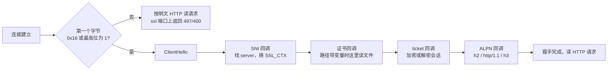
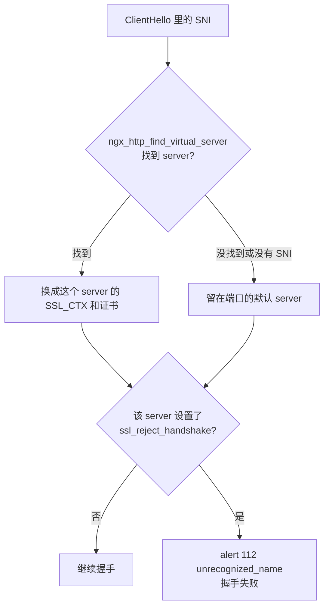
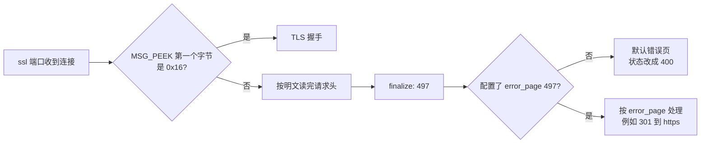
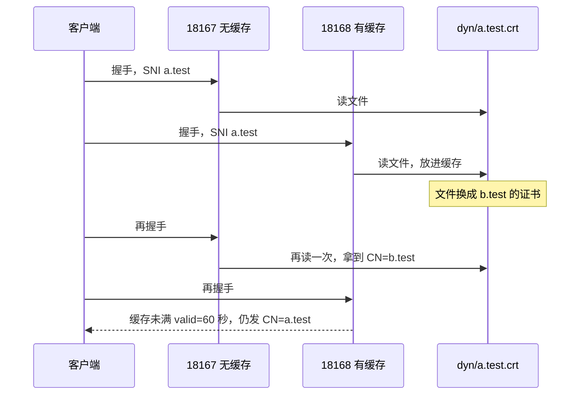
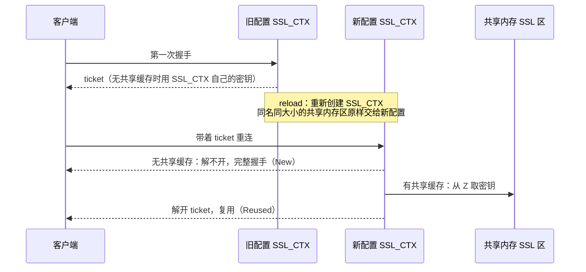
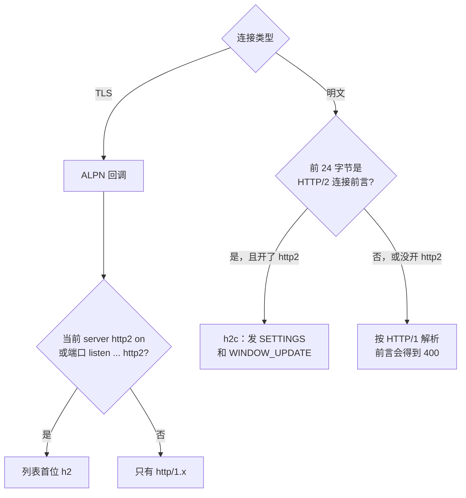
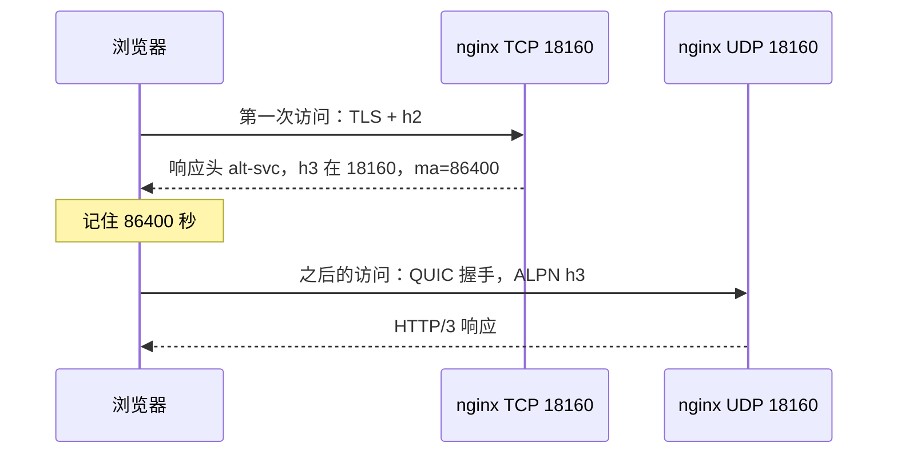

# 运维篇 08｜HTTPS、HTTP/2 与 HTTP/3：证书在握手的哪一步选定，决定了大部分配置的行为

> **一句话结论**：nginx 1.31.9 默认只开 TLSv1.2 和 TLSv1.3（1.27.3 起关掉了 TLSv1 和 TLSv1.1），套件默认 `HIGH:!aNULL:!MD5`。用哪张证书在握手中途决定：先按 SNI 找 `server`，找不到就用这个端口的默认 `server`，`ssl_reject_handshake on` 可以让不认识的名字直接握手失败；同一个 `server` 挂 RSA 和 ECDSA 两张证书时，由 OpenSSL 按客户端支持的签名算法挑。证书路径里写了变量，就改成每次握手时读文件，`ssl_certificate_cache`（1.27.4）把读到的证书留 60 秒。不配 `ssl_session_cache shared:` 时，session ticket 的密钥属于这一轮配置的 `SSL_CTX`，reload 之后旧 ticket 全部失效；配了之后密钥放在共享内存里，reload 后还能用。明文请求打到 HTTPS 端口，内部状态码是 497，对外是 400，`error_page 497` 可以把它变成跳转。HTTP/2 用 `http2 on`（1.25.1）打开，`listen ... http2` 仍然能用但会告警；1.31.7 起 nginx 在 SETTINGS 帧里声明不再使用 RFC 7540 的优先级。HTTP/3 要 `listen ... quic` 加 `http3 on`，浏览器靠 `Alt-Svc` 头才知道有它，这个头要自己加。
>
> 适用版本：nginx 1.31.9（mainline，2026-11-18）。「版本差异」：本篇用到的握手、SNI、证书加载、证书缓存、session ticket 密钥轮换和 ALPN 选择函数，在 1.30.7 和 1.31.9 里逐字相同；不同的是 HTTP/2 的 SETTINGS 帧：1.30.7 发 3 个参数，1.31.9 多一个 `NO_RFC7540_PRIORITIES=1`（1.31.7 改用 RFC 9218 的优先级方案）。ticket 密钥轮换里一个密钥未初始化的漏洞（CVE-2026-97629）在 1.31.7 和 1.30.6 同时修复。实验：[`labs/ops-08`](../labs/ops-08/)，用 OpenSSL 3 的 `s_client` 做握手（macOS 自带的 curl 不支持 TLSv1.3 和 QUIC），证书由 `run.sh` 现签。

## 导读

| 你想知道 | 看哪一节 |
|---|---|
| 默认开了哪些协议，老客户端握手失败时日志里是什么 | §1 |
| 一个域名同时挂 RSA 和 ECDSA 证书，谁来选 | §2 |
| 多个 HTTPS 站点共用一个端口，证书怎么选，不认识的域名怎么处理 | §3 |
| 用 `http://` 访问 HTTPS 端口为什么是 400，怎么改成跳转 | §4 |
| 证书路径里写 `$ssl_server_name` 会怎样，换了证书文件多久生效 | §5 |
| reload 之后会话复用率为什么掉了 | §6 |
| `http2 on` 和 `listen ... http2` 的区别，h2c 怎么工作，SETTINGS 帧里有什么 | §7 |
| HTTP/3 要配哪几样，证书压缩和 ECH 是什么状态 | §8 |

整篇按一次 TLS 连接的时间顺序展开：nginx 先看第一个字节判断是不是 TLS，握手开始后按 SNI 换配置、挑证书、处理 ticket，握手末尾用 ALPN 决定 HTTP 版本。每个配置项在哪一步生效，基本决定了它的行为和限制。



## 1. 默认协议是 TLSv1.2 和 TLSv1.3，更老的客户端在握手阶段就被拒绝

`ssl_protocols` 不写时取 `NGX_SSL_DEFAULT_PROTOCOLS`。只要 OpenSSL 认识 TLSv1.2 或 TLSv1.3 的开关，默认值就是这两个：

```c
// src/event/ngx_event_openssl.h:206-213
#define NGX_SSL_TLSv1_3  0x0040


#if (defined SSL_OP_NO_TLSv1_2 || defined SSL_OP_NO_TLSv1_3)
#define NGX_SSL_DEFAULT_PROTOCOLS  (NGX_SSL_TLSv1_2|NGX_SSL_TLSv1_3)
#else
#define NGX_SSL_DEFAULT_PROTOCOLS  (NGX_SSL_TLSv1|NGX_SSL_TLSv1_1)
#endif
```

`#else` 分支只给极老的 OpenSSL 用。changes.xml 里 1.27.3 的条目是 “now TLSv1 and TLSv1.1 protocols are disabled by default”，在那之前默认值里还带着这两个版本。套件的默认值同样写死在模块里：

```c
// src/http/modules/ngx_http_ssl_module.c:20-21

#define NGX_DEFAULT_CIPHERS     "HIGH:!aNULL:!MD5"
```

这个字符串只影响 TLSv1.2 及以下。TLSv1.3 的套件由 OpenSSL 单独管理，`ssl_ciphers` 改不到它们。实验用 `s_client` 分别只开一个协议版本去连：

```text
# labs/ops-08 ## default protocols
tls1_3   New, TLSv1.3 
tls1_2   New, TLSv1.2 
tls1_1   New, (NONE) (handshake failed)
[info] SSL_do_handshake() failed (SSL: unsupported protocol) while SSL handshaking
ok - TLSv1.2 and TLSv1.3 are accepted; TLSv1.1 is refused by the server
```

TLSv1.1 的客户端拿不到证书，服务端在 info 级别记一条 `unsupported protocol`。默认的 `error_log` 级别是 error，这类握手失败平时看不到；排查“某个老设备连不上”时，要先把级别临时调到 info。

还有一个和多站点相关的细节：1.29.2 的修复条目写着 “now the "ssl_protocols" directive works in a virtual server different from the default server when using OpenSSL 1.1.1 or newer”。也就是说，在那之前，同一个端口上非默认 `server` 里写的 `ssl_protocols` 实际不生效，协议范围由默认 `server` 决定。还在用 1.29.2 之前版本的环境，按站点区分协议版本的配置要打个问号。

**小结**：不写 `ssl_protocols` 就是 TLSv1.2 加 TLSv1.3。要放行 TLSv1.1 只能显式写出来，并且要确认链接的 OpenSSL 本身还允许它；本篇没有测这种放行配置。

## 2. 一个 server 可以挂 RSA 和 ECDSA 两张证书，由 OpenSSL 按客户端的签名算法挑

`ssl_certificate` 可以写多次。实验里 `a.test` 同时有一张 2048 位 RSA 证书和一张 P-256 的 ECDSA 证书：

```nginx
# lab: labs/ops-08/conf/nginx.conf
    server {
        listen 127.0.0.1:18160 ssl default_server;
        listen 127.0.0.1:18160 quic reuseport;
        server_name a.test;

        ssl_certificate     ../out/run/a-rsa.crt;
        ssl_certificate_key ../out/run/a-rsa.key;
        ssl_certificate     ../out/run/a-ec.crt;
        ssl_certificate_key ../out/run/a-ec.key;
```

nginx 只是把两对证书和私钥都装进同一个 `SSL_CTX`，挑选在 OpenSSL 内部完成。客户端在 ClientHello 里只声明支持 RSA-PSS 时拿到 RSA 证书，只声明 ECDSA 时拿到 ECDSA 证书：

```text
# labs/ops-08 ## RSA and ECDSA certificates on one server
client accepts RSA-PSS only: Server public key is 2048 bit / Peer signature type: rsa_pss_rsae_sha256
client accepts ECDSA only:   Server public key is 256 bit / Peer signature type: ecdsa_secp256r1_sha256
ok - OpenSSL picks the certificate that matches the client's signature algorithms
```

双证书的用处是让新客户端用更小、握手更快的 ECDSA 证书，同时不丢掉只支持 RSA 的老客户端。两张证书必须覆盖同样的域名，否则同一个域名在不同客户端上会出现证书校验结果不一致的情况。

**小结**：证书选择这一步 nginx 不参与；能观察的只有握手结果。1.29.3 新增的 `$ssl_sigalg` 变量可以写进 access log，用来统计实际用了哪种签名算法（本篇没有测这个变量）。

## 3. SNI 决定用哪个 server 的证书；名字不认识就落到默认 server，或者直接拒绝

同一个 IP 和端口上有多个 HTTPS 站点时，证书要在握手里选定，这时候还没有 HTTP 请求，`Host` 头也还没到，唯一的线索是 ClientHello 里的 SNI。nginx 在 SNI 回调里用和 `Host` 一样的查找函数找 `server`，找到后把连接的配置换过去：

```c
// src/http/ngx_http_request.c:953-972

    rc = ngx_http_find_virtual_server(c, hc->addr_conf->virtual_names, &host,
                                      NULL, &cscf);

    if (rc == NGX_ERROR) {
        goto error;
    }

    if (rc == NGX_DECLINED) {
        goto done;
    }

    hc->ssl_servername = ngx_palloc(c->pool, sizeof(ngx_str_t));
    if (hc->ssl_servername == NULL) {
        goto error;
    }

    *hc->ssl_servername = host;

    hc->conf_ctx = cscf->ctx;
```

找到之后，回调接着调用 `SSL_set_SSL_CTX` 换成那个 `server` 的 `SSL_CTX`，证书也随之换掉。找不到（`NGX_DECLINED`）就跳到 `done`，连接留在默认 `server` 上，用默认 `server` 的证书继续握手。到了 `done`，还要看默认 `server` 有没有设置 `ssl_reject_handshake`：

```c
// src/http/ngx_http_request.c:1020-1028
    sscf = ngx_http_get_module_srv_conf(hc->conf_ctx, ngx_http_ssl_module);

    if (sscf->reject_handshake) {
        c->ssl->handshake_rejected = 1;
        *ad = SSL_AD_UNRECOGNIZED_NAME;
        return SSL_TLSEXT_ERR_ALERT_FATAL;
    }

    c->ssl->sni_accepted = 1;
```

实验里 18160 端口的默认 `server` 是 `a.test`；18161 端口的默认 `server` 只写了 `ssl_reject_handshake on`，没有证书：

```text
# labs/ops-08 ## SNI and the default server
18160 SNI a.test     -> subject=CN=a.test, Verify return code: 0 (ok)
18160 SNI b.test     -> subject=CN=b.test, Verify return code: 0 (ok)
18160 SNI other.test -> subject=CN=a.test, Verify return code: 0 (ok)
18161 SNI a.test     -> subject=CN=a.test
18161 SNI other.test -> tlsv1 unrecognized name, SSL alert number 112
ok - an unknown name gets the default server's certificate, or nothing with ssl_reject_handshake
[info] handshake rejected while SSL handshaking
```

`other.test` 在 18160 上拿到的是 `a.test` 的证书。实验客户端用 `-CAfile` 信任了自签 CA，但 `s_client` 默认不校验主机名，所以 `Verify return code` 还是 0；浏览器会报证书和域名不匹配。在 18161 上，同一个名字收到编号 112 的 alert（unrecognized_name），握手结束，服务端一张证书都没有发出去。这就是 `ssl_reject_handshake`（1.19.4）的用途：用 IP 直接扫描端口、或者带着随便什么名字来的连接，看不到这台机器上任何站点的证书。



**小结**：每个 HTTPS 端口都应该想清楚默认 `server` 是谁。放一个 `ssl_reject_handshake on` 的空 `server` 做默认，是不想暴露证书时最省事的写法。

## 4. 明文请求打到 HTTPS 端口：内部是 497，客户端看到 400，可以用 error_page 改成跳转

nginx 并不是在 TLS 库报错后才发现客户端说的是明文。`listen ... ssl` 的连接建立后，`ngx_http_ssl_handshake` 先 `recv(MSG_PEEK)` 偷看第一个字节：

```c
// src/http/ngx_http_request.c:764-768

    if (n == 1) {
        if (buf[0] & 0x80 /* SSLv2 */ || buf[0] == 0x16 /* SSLv3/TLSv1 */) {
            ngx_log_debug1(NGX_LOG_DEBUG_HTTP, rev->log, 0,
                           "https ssl handshake: 0x%02Xd", buf[0]);
```

0x16 是 TLS 记录层里 handshake 的类型号。第一个字节既不是 0x16、最高位也不是 1，nginx 就把这个连接当明文 HTTP 读：

```c
// src/http/ngx_http_request.c:809-814
        ngx_log_debug0(NGX_LOG_DEBUG_HTTP, rev->log, 0, "plain http");

        c->log->action = "waiting for request";

        rev->handler = ngx_http_wait_request_handler;
        ngx_http_wait_request_handler(rev);
```

请求头读完后，`ngx_http_process_request` 发现监听端口要求 SSL、连接上却没有 SSL，就以 `NGX_HTTP_TO_HTTPS`（497）结束请求：

```c
// src/http/ngx_http_request.c:2132-2146
#if (NGX_HTTP_SSL)

    if (r->http_connection->ssl) {
        long                      rc;
        X509                     *cert;
        const char               *s;
        ngx_http_ssl_srv_conf_t  *sscf;

        if (c->ssl == NULL) {
            ngx_log_error(NGX_LOG_INFO, c->log, 0,
                          "client sent plain HTTP request to HTTPS port");
            ngx_http_finalize_request(r, NGX_HTTP_TO_HTTPS);
            return;
        }

```

497 不是合法的 HTTP 状态码。`ngx_http_special_response_handler` 发送默认错误页时把它和 495、496 一起改成 400，所以客户端看到的是 400 加一段专门的说明。先读完请求头再报错有一个好处：这时 `$host` 和 `$request_uri` 都已经有了，`error_page 497` 能拼出跳转地址：

```nginx
# lab: labs/ops-08/conf/nginx.conf
    server {
        listen 127.0.0.1:18163 ssl;
        ssl_certificate     ../out/run/a-rsa.crt;
        ssl_certificate_key ../out/run/a-rsa.key;
        ssl_session_cache   shared:SSL:1m;
        error_page 497 =301 https://$host:18163$request_uri;
    }
```

```text
# labs/ops-08 ## plain HTTP to an HTTPS port
The plain HTTP request was sent to HTTPS port
status: 400
ok - nginx answers 400 with its own message (497 inside, for error_page)
with error_page 497 =301: 301 https://a.test:18163/x?y=1
ok - error_page 497 turns the same request into a redirect to https
```

查询串 `?y=1` 原样带过去了。生产上更常见的写法是在 80 端口单独放一个 `server` 做 `return 301 https://$host$request_uri;`；`error_page 497` 只用于 HTTP 和 HTTPS 共用一个端口、或者有人手误把 `http://` 打到 443 的情况。



**小结**：日志里的 “client sent plain HTTP request to HTTPS port” 是 info 级别，对应客户端看到的 400。想让这类请求自动纠正，就用 `error_page 497`，不用改端口布局。

## 5. 证书路径里写变量，证书就改成握手时读文件；ssl_certificate_cache 把读到的证书留 60 秒

`ssl_certificate` 从 1.15.9 起支持变量。路径里有变量时，nginx 启动时不加载证书，而是注册一个证书回调，在握手进行到需要证书时才求值、读文件。这时 SNI 已经处理完，所以 `$ssl_server_name` 可用：

```c
// src/http/ngx_http_request.c:1067-1093
    nelts = sscf->certificate_values->nelts;
    certs = sscf->certificate_values->elts;
    keys = sscf->certificate_key_values->elts;

    for (i = 0; i < nelts; i++) {

        if (ngx_http_complex_value(r, &certs[i], &cert) != NGX_OK) {
            goto failed;
        }

        ngx_log_debug1(NGX_LOG_DEBUG_HTTP, c->log, 0,
                       "ssl cert: \"%s\"", cert.data);

        if (ngx_http_complex_value(r, &keys[i], &key) != NGX_OK) {
            goto failed;
        }

        ngx_log_debug1(NGX_LOG_DEBUG_HTTP, c->log, 0,
                       "ssl key: \"%s\"", key.data);

        if (ngx_ssl_connection_certificate(c, r->pool, &cert, &key,
                                           sscf->certificate_cache,
                                           sscf->passwords)
            != NGX_OK)
        {
            goto failed;
        }
```

`sscf->certificate_cache` 为空时，每次握手都完整地读一遍证书和私钥文件。1.27.4 加的 `ssl_certificate_cache max=N` 给这一步加了缓存，`valid` 默认 60 秒、`inactive` 默认 10 秒（`ngx_http_ssl_certificate_cache` 解析函数开头的默认值）。缓存命中时只看条目的年龄：

```c
// src/event/ngx_event_openssl_cache.c:345-349
        }

        if (!invalidate && now - cn->created <= cache->valid) {
            goto found;
        }
```

超过 `valid` 之后，才去比较文件的 inode 和 mtime，有变化就重新加载。实验的 18167（不带缓存）和 18168（`ssl_certificate_cache max=10`）都从 `dyn/$ssl_server_name.crt` 读证书。第一次握手之后，把 `a.test.crt` 的内容换成 `b.test` 的证书：

```nginx
# lab: labs/ops-08/conf/nginx.conf
    server {
        listen 127.0.0.1:18167 ssl;
        ssl_certificate     ../out/run/dyn/$ssl_server_name.crt;
        ssl_certificate_key ../out/run/dyn/$ssl_server_name.key;
    }
    server {
        listen 127.0.0.1:18168 ssl;
        ssl_certificate     ../out/run/dyn/$ssl_server_name.crt;
        ssl_certificate_key ../out/run/dyn/$ssl_server_name.key;
        ssl_certificate_cache max=10;
    }
```

```text
# labs/ops-08 ## certificates loaded per handshake
18167 a.test, first:            subject=CN=a.test
18168 a.test, first:            subject=CN=a.test
18167 a.test, file replaced:    subject=CN=b.test
18168 a.test, file replaced:    subject=CN=a.test
18167 no SNI:                   no peer certificate available
[error] cannot load certificate "$LAB/conf/../out/run/dyn/.crt": BIO_new_file() failed
ok - without a cache every handshake reads the file; ssl_certificate_cache keeps the old one for valid=60s
```

不带缓存的端口下一次握手就用上了新文件，带缓存的端口在 60 秒内继续发旧证书。最后一行是这种写法的坑：客户端不发 SNI（例如直接用 IP 访问）时 `$ssl_server_name` 为空，路径变成 `dyn/.crt`，握手失败，日志是 error 级别，每个这样的连接记一条。动态证书的 `server` 后面最好再放一张静态的兜底证书，或者把它和 §3 的 `ssl_reject_handshake` 搭配使用。

和它相关的另一个改动是 1.27.2 的 “SSL certificates, secret keys, and CRLs are now cached on start or during reconfiguration”：静态写死路径的证书在启动和 reload 时也会走同一套缓存，多个 `server` 引用同一个文件只解析一次。这条只读了源码和 changes，没有单独实验。



**小结**：动态证书适合“证书多、按域名命名文件”的场景，代价是每次握手要读文件。证书多、握手频繁时加 `ssl_certificate_cache`，并接受换证书后最长有 `valid` 秒的延迟。

## 6. reload 后会话复用是否失效，取决于 ticket 密钥放在哪里

TLS 会话复用有两种：服务端存会话（session ID，要有 `ssl_session_cache`）和客户端存加密过的会话（session ticket）。ticket 用服务端的密钥加密，所以真正决定能否复用的是这把密钥的寿命。`ngx_ssl_session_ticket_keys` 一开头就分了两种情况：

```c
// src/event/ngx_event_openssl.c:4868-4872
    if (paths == NULL
        && SSL_CTX_get_ex_data(ssl->ctx, ngx_ssl_session_cache_index) == NULL)
    {
        return NGX_OK;
    }
```

既没有 `ssl_session_ticket_key` 文件，也没有共享内存的会话缓存时，nginx 什么都不做，ticket 由 OpenSSL 用自己的密钥加密。这把密钥是创建 `SSL_CTX` 时随机生成的，而每次 reload 都会为新配置重新创建 `SSL_CTX`。

配了 `ssl_session_cache shared:` 时，nginx 安装自己的 ticket 回调，密钥放在缓存的共享内存里（1.23.2 起自动轮换）。轮换函数每次先判断是否需要更新：

```c
// src/event/ngx_event_openssl.c:5182-5187
    now = ngx_time();
    expire = now + SSL_CTX_get_timeout(ssl_ctx);

    if (key[0].expire >= expire && key[1].expire >= now) {
        return NGX_OK;
    }
```

共享内存里存三把密钥：上一把、当前、下一把。当前这把的过期时间随着新会话往后推，保证用它加密的 ticket 在 `ssl_session_timeout`（默认 300 秒）内都能解开；上一把过期时三把依次前移，再生成一把新的“下一把”。reload 时，名字、大小、模块都没变的共享内存区会原样交给新配置，初始化函数拿到旧数据直接复用：

```c
// src/event/ngx_event_openssl.c:4364-4368

    if (data) {
        shm_zone->data = data;
        return NGX_OK;
    }
```

实验在两个端口各握手一次、保存会话，然后 reload 前后各用这份会话再连：

```text
# labs/ops-08 ## session tickets and reload
before reload: no cache: Reused, shared cache: Reused
after reload:  no cache: New, shared cache: Reused
ok - ticket keys of a shared session cache survive a reload, the SSL_CTX ones do not
```

没有共享缓存的 18162，reload 前能复用，reload 后变成完整握手（New）；18163 前后都能复用。经常 reload 的机器，如果没配 `ssl_session_cache shared:`，每次 reload 后的一段时间里所有回头客都要重新做完整握手，CPU 和首包延迟都会有一个台阶。



几个推论（来自源码，没有单独实验）：改了 `shared:SSL:` 的大小，共享内存区不能复用，密钥随之重新生成；多台机器之间要共享 ticket，只能用 `ssl_session_ticket_key` 指定同一份密钥文件，而这时轮换要自己做。

**小结**：只要用 TLS，就配上 `ssl_session_cache shared:SSL:10m` 这类共享缓存，它同时解决了 session ID 的跨 worker 共享和 ticket 密钥的跨 reload 保留。

## 7. HTTP/2 由 ALPN 或连接前言触发；1.31.7 起 SETTINGS 帧里声明不用 RFC 7540 优先级

TLS 上的 HTTP/2 是在握手末尾的 ALPN 里谈出来的。nginx 的 ALPN 回调按当前 `server`（SNI 已经选过）的配置给出自己支持的协议列表：

```c
// src/http/modules/ngx_http_ssl_module.c:509-523

    } else
#endif
    {
#if (NGX_HTTP_V2)
        h2scf = ngx_http_get_module_srv_conf(hc->conf_ctx, ngx_http_v2_module);

        if (h2scf->enable || hc->addr_conf->http2) {
            srv = (unsigned char *) NGX_HTTP_V2_ALPN_PROTO NGX_HTTP_ALPN_PROTOS;
            srvlen = sizeof(NGX_HTTP_V2_ALPN_PROTO NGX_HTTP_ALPN_PROTOS) - 1;

        } else
#endif
        {
            srv = (unsigned char *) NGX_HTTP_ALPN_PROTOS;
```

`h2scf->enable` 来自 `http2 on`（1.25.1 加入，可以按 `server` 开关），`hc->addr_conf->http2` 来自旧的 `listen ... http2`。两者任意一个为真，列表最前面就是 `h2`，后面是 `http/1.1`、`http/1.0`、`http/0.9`。旧写法还能用，但 `nginx -t` 会告警：

```text
# labs/ops-08 ## HTTP/2
TLS, http2 on:       HTTP/2.0 TLSv1.3
TLS, no http2:       HTTP/1.1
plain, http2 on:     HTTP/2.0
plain, no http2:     000
...
[warn] the "listen ... http2" directive is deprecated, use the "http2" directive instead in $LAB/conf/listen-http2.conf:6
ok - ALPN gives HTTP/2 only where http2 is on; listen ... http2 is deprecated
```

`listen ... http2` 是端口级的：同一个端口上只要有一个 `server` 写了它，整个端口都开 HTTP/2。`http2 on` 是 `server` 级的，配合 SNI 可以只给部分域名开。

明文端口没有 ALPN，客户端要直接发 HTTP/2 的连接前言（`PRI * HTTP/2.0` 开头的 24 字节）。nginx 在读第一个请求时比对这段前言：

```c
// src/http/ngx_http_request.c:499-516

#if (NGX_HTTP_V2)

    h2scf = ngx_http_get_module_srv_conf(hc->conf_ctx, ngx_http_v2_module);

    if (!hc->ssl && (h2scf->enable || hc->addr_conf->http2)) {

        size = ngx_min(sizeof(NGX_HTTP_V2_PREFACE) - 1,
                       (size_t) (b->last - b->pos));

        if (ngx_memcmp(b->pos, NGX_HTTP_V2_PREFACE, size) == 0) {

            if (size == sizeof(NGX_HTTP_V2_PREFACE) - 1) {
                ngx_http_v2_init(rev);
                return;
            }

            ngx_post_event(rev, &ngx_posted_events);
```

没开 HTTP/2 的端口把这段前言当成一行 HTTP/1 请求，`PRI` 不是认识的方法，回 400，curl 解析不了这个回复，所以上面是 000。开了的端口回的是二进制帧。实验直接发前言并解码 nginx 回的头两个帧：

```text
# labs/ops-08 ## HTTP/2
...
preface to 18165:    HTTP/1.1 400 Bad Request
preface to 18164:    SETTINGS 3=128 4=65536 5=16777215 9=1 | WINDOW_UPDATE 2147418112
ok - the SETTINGS frame carries the defaults from the source, and RFC 7540 priorities are switched off
```

SETTINGS 帧里的 4 个参数和 `ngx_http_v2_send_settings` 的写法一一对应：

```c
// src/http/v2/ngx_http_v2.c:2843-2858
                                         NGX_HTTP_V2_MAX_STREAMS_SETTING);
    buf->last = ngx_http_v2_write_uint32(buf->last,
                                         h2scf->concurrent_streams);

    buf->last = ngx_http_v2_write_uint16(buf->last,
                                         NGX_HTTP_V2_INIT_WINDOW_SIZE_SETTING);
    buf->last = ngx_http_v2_write_uint32(buf->last, h2scf->preread_size);

    buf->last = ngx_http_v2_write_uint16(buf->last,
                                         NGX_HTTP_V2_MAX_FRAME_SIZE_SETTING);
    buf->last = ngx_http_v2_write_uint32(buf->last,
                                         NGX_HTTP_V2_MAX_FRAME_SIZE);

    buf->last = ngx_http_v2_write_uint16(buf->last,
                                         NGX_HTTP_V2_NO_PRIORITIES_SETTING);
    buf->last = ngx_http_v2_write_uint32(buf->last, 1);
```

| 参数 | 值 | 来源 |
|---|---|---|
| 3 MAX_CONCURRENT_STREAMS | 128 | `http2_max_concurrent_streams` 默认值 |
| 4 INITIAL_WINDOW_SIZE | 65536 | `http2_body_preread_size` 默认值，每个流的请求体窗口 |
| 5 MAX_FRAME_SIZE | 16777215 | `(1 << 24) - 1`，协议允许的上限 |
| 9 NO_RFC7540_PRIORITIES | 1 | 1.31.7 新增；1.30.7 只发前 3 个参数 |

紧接着的 WINDOW_UPDATE 把整条连接的接收窗口从协议初始值 65535 加到 2^31-1，增量 2147418112 = 2147483647 − 65535。连接级窗口开到最大、流级窗口只给 64 KB，含义是：nginx 不限制整条连接的上传总量，但每个请求体在被读取之前最多预读 64 KB。

参数 9 是 1.31.7 那条 change 的落地：“the ngx_http_v2_module now uses the RFC 9218 prioritization scheme, and RFC 7540 priority signals are ignored”。客户端在 HEADERS 帧里带的旧式依赖树和权重不再起作用，改看 RFC 9218 的 `priority` 头（`u=` 紧急度和 `i` 增量标记）。本篇只验证了 nginx 发出了这个声明，没有构造多个流去测调度顺序。



**小结**：新配置统一写 `http2 on`，把 `listen` 上的 `http2` 删掉，`nginx -t` 的告警就会消失。升级到 1.31.7 之后，依赖 RFC 7540 优先级做资源调度的客户端行为会变；需要按资源分优先级时，看客户端是否发 RFC 9218 的 `priority` 头。

## 8. HTTP/3 需要 quic 监听、http3 on 和手工添加的 Alt-Svc；证书压缩和 ECH 默认都不开

HTTP/3（1.25.0 起，changes 里写的是 “experimental HTTP/3 support”）跑在 QUIC 上，也就是 UDP。同一个端口号要同时有 TCP 的 `ssl` 监听和 UDP 的 `quic` 监听，证书沿用同一个 `server` 的：

```nginx
# lab: labs/ops-08/conf/nginx.conf
        http2 on;
        http3 on;
        add_header Alt-Svc 'h3=":18160"; ma=86400';
```

QUIC 连接上的 ALPN 回调走另一个分支：`http3 on` 时只给 `h3`，`http3_hq on` 时给 `hq-interop`，都没开就让握手失败。浏览器第一次访问一定走 TCP，它要从响应头里的 `Alt-Svc` 得知这个站点还有 HTTP/3，下一次才会试 UDP。nginx 源码里只有 HTTP/3 的 QPACK 静态表收录了 `alt-svc` 这个头名，没有任何地方自动发这个头，所以要用 `add_header` 写：

```text
# labs/ops-08 ## HTTP/3
QUIC handshake: New, TLSv1.3, ALPN protocol: h3
alt-svc: h3=":18160"; ma=86400
ok - the QUIC listener negotiates h3; Alt-Svc comes from add_header
```

头名是小写的，因为 curl 这次走的是 HTTP/2，HTTP/2 的头名一律小写。`ma=86400` 是告诉浏览器这条信息可以记 86400 秒（一天）。实验里的 QUIC 只验证到握手和 ALPN：本机没有能发 HTTP/3 请求的客户端，`s_client -quic` 只能完成握手。`listen ... quic` 上的 `reuseport` 让每个 worker 有自己的 UDP socket；多 worker 时，同一条 QUIC 连接的包要回到同一个 worker，这部分依赖内核和 `quic_bpf`，本篇的单 worker 实验没有覆盖。

最后两个只读了源码的新指令：

- `ssl_certificate_compression`（1.29.1）。同一个版本把 TLSv1.3 证书压缩改成默认关闭，这个指令用来打开。开了之后，OpenSSL 在握手时发压缩过的证书链，链越长省得越多。源码里它和 `ssl_stapling` 互斥，同时配置时 `nginx -t` 报 “"ssl_stapling" is incompatible with "ssl_certificate_compression"”。
- `ssl_ech_file`（1.29.4），Encrypted ClientHello：把 ClientHello 里包括 SNI 在内的敏感字段加密。changes 里写明需要 “OpenSSL ECH feature branch”，源码里整段功能包在 `#ifdef SSL_OP_ECH_GREASE` 里，用正式发布版的 OpenSSL 3.6.3 构建时不可用。



**小结**：开 HTTP/3 是三件事一起做：UDP 端口在防火墙上放行、`listen ... quic` 加 `http3 on`、`add_header Alt-Svc`。少了 Alt-Svc，配置完全正确，浏览器也不会去用。

## 已知局限与待核实

- 所有握手用 OpenSSL 3.6.3 的 `s_client` 完成。浏览器的 ClientHello（支持的签名算法、扩展顺序、GREASE）和它不同，§2 的证书选择在真实浏览器上没有逐个验证。
- 放行 TLSv1.1 的配置（`ssl_protocols TLSv1.1 ...` 加降低 OpenSSL 安全等级）没有测；§1 里 1.29.2 之前非默认 `server` 的 `ssl_protocols` 不生效，只来自 changes 条目。
- OCSP stapling、客户端证书校验（`ssl_verify_client`）、`ssl_session_ticket_key` 文件、`ssl_early_data`（0-RTT）都没有实验。
- §6 关于修改共享缓存大小会丢掉 ticket 密钥的说法，来自 `ngx_cycle.c` 复用共享内存的条件（名字、大小、模块相同），没有单独实验。
- §7 只验证了 SETTINGS 帧里的声明，RFC 9218 优先级的实际调度效果没有测。
- §8 的 HTTP/3 只完成到 QUIC 握手和 ALPN，没有发出 HTTP/3 请求；多 worker 下的 QUIC 包分发、`quic_bpf`、`ssl_certificate_compression` 和 ECH 只读了源码。
- 1.27.2 起启动和 reload 时的证书缓存只读了 changes 条目，没有构造“多个 server 引用同一证书”的实验。

## 修订记录

- 2026-11-21：基于 nginx 1.31.9 源码新写。覆盖默认协议与套件、RSA/ECDSA 双证书、SNI 与默认 server、`ssl_reject_handshake`、明文请求打到 HTTPS 端口的 497/400 与 `error_page 497` 跳转、变量证书与 1.27.4 的 `ssl_certificate_cache`、session ticket 密钥跨 reload 的行为、`http2 on` 与 h2c、1.31.7 的 SETTINGS 变化、HTTP/3 与 `Alt-Svc`，均附 `labs/ops-08` 实验；证书压缩与 ECH 依据源码描述。
