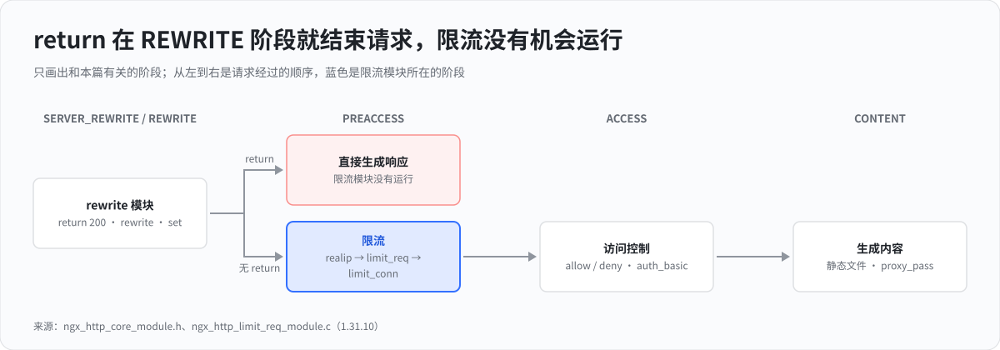
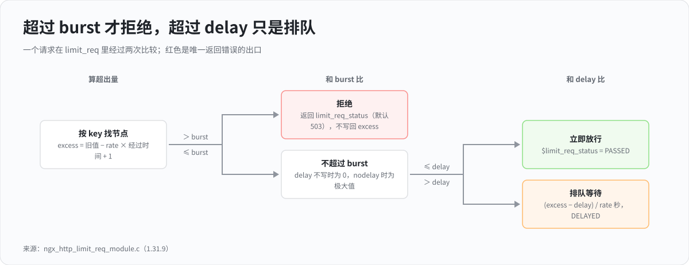
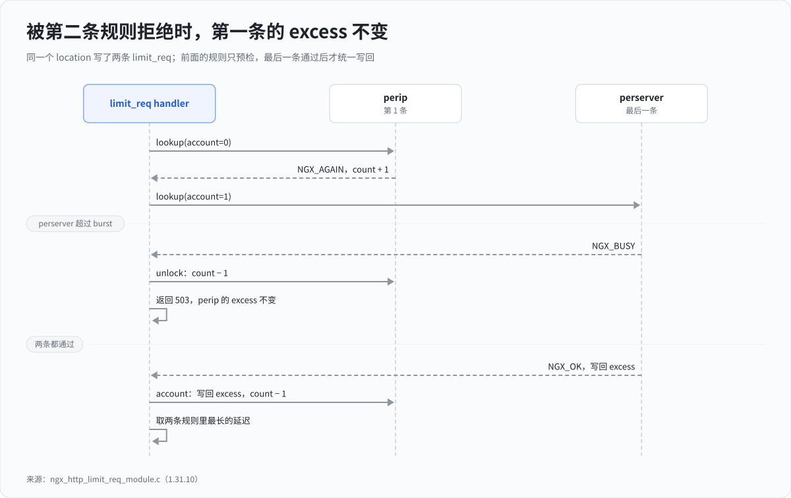
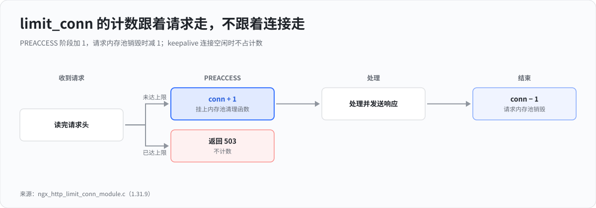

# 运维篇 09｜限流与限连：burst 是排队的容量，不是放宽的速率

> **一句话结论**：`limit_req` 为每个 key 记一个“超出量”（excess）：每来一个请求加 1，按 `rate` 匀速漏掉，超过 `burst` 就拒绝；`nodelay` 和 `delay=` 只决定没被拒绝的请求是马上放行还是排队等。`limit_conn` 数的是正在处理的请求，不是 TCP 连接。两者都在 PREACCESS 阶段运行，用 `return` 直接出内容的 location 不受它们约束。
>
> 适用版本：nginx 1.31.10（mainline，2026-11-23）。本篇涉及的指令在 1.30.x stable 中行为相同，没有「版本差异」条目。实验：[`labs/ops-09`](../labs/ops-09/)，本篇的每个计数都来自它的输出。

## 导读

| 你想知道 | 看哪一节 |
|---|---|
| 为什么配了 limit_req 却一个请求都没被拦 | §1 |
| rate、burst 到底在算什么，nginx 是漏桶还是令牌桶 | §2 |
| burst、nodelay、delay= 三种写法各放行几个、等多久 | §3 |
| 被拒绝时返回什么、日志怎么记、怎么先试运行 | §4 |
| 一个 location 写两条 limit_req 会怎样 | §5 |
| limit_conn 限的是连接还是请求，HTTP/2 下怎么算 | §6 |
| zone 开多大，key 怎么选 | §7 |

## 1. limit_req 在 preaccess 阶段运行，用 return 出内容的 location 不会被限流

先看一个最常见的“限流不生效”。下面这份配置限制每个客户端每分钟 1 个请求，location 里用 `return` 直接返回内容：

```nginx
# lab: labs/ops-09/conf/return.conf
    limit_req_zone $binary_remote_addr zone=perip:1m rate=1r/m;
# ...
        location / {
            limit_req zone=perip;
            return 200 "ok\n";
        }
```

连发 5 个请求，全部 200：

```text
# labs/ops-09 ## return answers before limit_req runs
200 200 200 200 200
```

原因在请求处理的阶段顺序。nginx 把一个请求的处理分成 11 个阶段，枚举从 [`NGX_HTTP_POST_READ_PHASE`](https://github.com/nginx/nginx/blob/release-1.31.10/src/http/ngx_http_core_module.h#L111) 开始，顺序是 POST_READ → SERVER_REWRITE → FIND_CONFIG → REWRITE → POST_REWRITE → PREACCESS → ACCESS → POST_ACCESS → PRECONTENT → CONTENT → LOG。`return` 属于 rewrite 模块，挂在 SERVER_REWRITE 和 REWRITE 两个阶段（[`ngx_http_rewrite_init`](https://github.com/nginx/nginx/blob/release-1.31.10/src/http/modules/ngx_http_rewrite_module.c#L272)）；`limit_req` 挂在 PREACCESS：

```c
// src/http/modules/ngx_http_limit_req_module.c:1087-1099
ngx_http_limit_req_init(ngx_conf_t *cf)
{
    ngx_http_handler_pt        *h;
    ngx_http_core_main_conf_t  *cmcf;

    cmcf = ngx_http_conf_get_module_main_conf(cf, ngx_http_core_module);

    h = ngx_array_push(&cmcf->phases[NGX_HTTP_PREACCESS_PHASE].handlers);
/* ... */
    *h = ngx_http_limit_req_handler;
```

`return` 在 REWRITE 阶段就结束了请求，PREACCESS 根本没有机会运行。下图只画出和本篇有关的几个阶段，`return` 的出口在限流之前：



`limit_conn`（[同样挂在 PREACCESS](https://github.com/nginx/nginx/blob/release-1.31.10/src/http/modules/ngx_http_limit_conn_module.c#L766)）、ACCESS 阶段的 `allow`/`deny`、`auth_basic`、`auth_request` 也一样。要限流的 location，内容应该来自静态文件、`proxy_pass`、`fastcgi_pass` 这类在 CONTENT 阶段工作的模块。本篇后面的实验都用 `root html;` 出一个静态文件。

**小结**：限流指令写在某个 location 里，不等于它会运行，要看请求能不能走到 PREACCESS 阶段；确认它确实在运行之后，下一个问题是它对每个请求算的是什么。

## 2. nginx 记的是超出量：每个请求加 1，按 rate 漏掉，超过 burst 就拒绝

`limit_req_zone` 在共享内存里为每个 key（例如客户端地址）保存一个节点，节点里最关键的两个字段是 `excess` 和 `last`（上次更新的毫秒时间）。每来一个请求，[`ngx_http_limit_req_lookup`](https://github.com/nginx/nginx/blob/release-1.31.10/src/http/modules/ngx_http_limit_req_module.c#L405) 先按经过的毫秒数把 excess 漏掉一部分，再加上这个请求：

```c
// src/http/modules/ngx_http_limit_req_module.c:445-464
            ms = (ngx_msec_int_t) (now - lr->last);
/* ... */
            excess = lr->excess - ctx->rate * ms / 1000 + 1000;

            if (excess < 0) {
                excess = 0;
            }

            *ep = excess;

            if ((ngx_uint_t) excess > limit->burst) {
                return NGX_BUSY;
            }
```

这里的数都乘了 1000。`rate=1r/s` 在 [`ngx_http_limit_req_zone`](https://github.com/nginx/nginx/blob/release-1.31.10/src/http/modules/ngx_http_limit_req_module.c#L833) 里换算成 `ctx->rate = 1 * 1000 / 1 = 1000`，`rate=1r/m` 换算成 `1 * 1000 / 60 = 16`（整数除法，第 939 行）；`burst=5` 在 [`ngx_http_limit_req`](https://github.com/nginx/nginx/blob/release-1.31.10/src/http/modules/ngx_http_limit_req_module.c#L964) 里存成 `5000`（第 1060 行）。所以 excess 里的 1000 代表“1 个请求”，结构体注释写的就是 `1 corresponds to 0.001 r/s`。

把公式翻译成人话：

- 第一个请求创建节点，excess 从 0 开始（lookup 末尾的 `lr->excess = 0`），一定放行；
- 之后每个请求先漏掉 `rate × 经过的秒数`，再加 1；
- 结果大于 `burst` 就拒绝。拒绝发生在写回之前（只有 `account` 为真时才执行 `lr->excess = excess`），所以被拒绝的请求不会让 excess 继续涨。

不写 `burst` 时它是 0，于是“上一个请求的超出量还没漏完”就会被拒。`rate=1r/m` 时连发 5 个请求：

```text
# labs/ops-09 ## no burst: 5 requests in a row
200 503 503 503 503
```

实验故意用了 `1r/m`：每分钟只漏 1 个，几十毫秒内漏掉的量可以忽略，结果不受机器快慢影响。换成 `1r/s` 时，第二个请求如果恰好晚到 1 秒以上，也会放行。

这个模型叫漏桶（leaky bucket）还是令牌桶（token bucket）都说得通：excess 是桶里的水位，按 rate 漏出；反过来看，`burst - excess` 就是剩下的令牌，按 rate 补充，上限是 `burst`。两种叫法只是视角不同，判决完全由上面这个公式决定，读配置时按公式算比按比喻猜可靠。

请求进入 limit_req 之后的判决路径如下，后面三节分别展开右边三个出口：



**小结**：nginx 只为每个 key 存一个随时间衰减的超出量，`burst` 是它的上限；在上限以内的请求不会被拒绝，但它们要不要等，取决于下一节的 `nodelay` 和 `delay=`。

## 3. burst 决定能排几个，nodelay 和 delay 决定排队的请求什么时候放行

同样是 `rate=1r/s burst=5`，同一时刻并发 8 个请求，三种写法放行的总数一样，差别只在等待时间：

| 写法 | 立即放行 | 排队后放行 | 拒绝 | 最慢的请求 |
|---|---|---|---|---|
| `burst=5` | 1 | 5 | 2 | 约 5 s |
| `burst=5 nodelay` | 6 | 0 | 2 | < 0.5 s |
| `burst=5 delay=2` | 3 | 3 | 2 | 约 3 s |

表里的数来自访问日志里的 `$limit_req_status`：

```text
# labs/ops-09 ## burst=5: 8 requests at once
6x 200
2x 503
5x 200 DELAYED
1x 200 PASSED
2x 503 REJECTED
slowest response >= 4 s: yes
```

```text
# labs/ops-09 ## burst=5 nodelay: 8 requests at once
6x 200
2x 503
6x 200 PASSED
2x 503 REJECTED
every response < 0.5 s: yes
```

```text
# labs/ops-09 ## burst=5 delay=2: 8 requests at once
6x 200
2x 503
3x 200 DELAYED
3x 200 PASSED
2x 503 REJECTED
slowest response >= 2 s: yes
```

放行总数为什么是 6：8 个请求几乎同时到达，excess 依次是 0、1000、2000、3000、4000、5000、6000、7000，大于 `burst=5000` 的后两个被拒绝。无论哪种写法，一次突发最多放行 `burst + 1` 个。

等多久由 [`ngx_http_limit_req_account`](https://github.com/nginx/nginx/blob/release-1.31.10/src/http/modules/ngx_http_limit_req_module.c#L536) 算：

```c
// src/http/modules/ngx_http_limit_req_module.c:547-553
    if ((ngx_uint_t) excess <= (*limit)->delay) {
        max_delay = 0;

    } else {
        ctx = (*limit)->shm_zone->data;
        max_delay = (excess - (*limit)->delay) * 1000 / ctx->rate;
    }
```

`max_delay` 的单位是毫秒，`delay` 和 `burst` 一样是“请求个数 × 1000”：

- 只写 `burst=5` 时 `delay` 为 0，excess 为 1000 的请求等 1000 × 1000 / 1000 = 1000 ms，excess 为 5000 的等 5 s。实验的 error.log 里，5 个排队请求的 excess 正好是 1 到 5：

  ```text
  # labs/ops-09 ## burst=5: 8 requests at once
  [warn] *N delaying request, excess: ~1, by zone "perip"
  ...
  [warn] *N delaying request, excess: ~5, by zone "perip"
  ```

- `delay=2` 存成 2000，excess 为 0、1000、2000 的三个请求立即放行，3000、4000、5000 的分别等 1、2、3 s。
- `nodelay` 把 delay 设成 `NGX_MAX_INT_T_VALUE / 1000`（解析函数第 1021 行），再乘 1000 存起来，任何 excess 都不会超过它，所以从不排队。

`nodelay` 并没有放宽速率。它让突发的 6 个请求马上全部到达后端，但 excess 照样记到了 5000，之后仍按 rate 慢慢漏。打满之后等 2.5 s 再并发 4 个：2.5 s 漏掉 2500，4 个里至少有 2 个放行（机器繁忙时实际间隔更长，可能多放行一两个）：

```text
# labs/ops-09 ## burst=5 nodelay: the queue drains at the rate
6x 200
2x 503
after 2.5 s, 4 more at once:
at least 2 passed: yes
```

怎么选：

- 后端能承受短时突发、客户端不愿意等（API、页面）：`burst=N nodelay`，N 取允许的突发请求数。
- 后端必须平滑（写库、调用按次计费的接口）：只写 `burst=N`，让 nginx 把突发拉平。代价是排队的请求占着连接，最长要等 `burst / rate` 秒，客户端超时要比这个长。
- 介于两者之间：`burst=N delay=M`，前 M+1 个请求立即走，后面的排队。

**小结**：三种写法拒绝的请求一样多，区别只在没被拒绝的请求等多久；被拒绝的那部分返回什么、记到哪里，可以单独调整，这是下一节的内容。

## 4. 拒绝时的状态码、日志级别和试运行都可以单独调

默认值都在 [`ngx_http_limit_req_merge_conf`](https://github.com/nginx/nginx/blob/release-1.31.10/src/http/modules/ngx_http_limit_req_module.c#L808) 里：

```c
// src/http/modules/ngx_http_limit_req_module.c:817-826
    ngx_conf_merge_uint_value(conf->limit_log_level, prev->limit_log_level,
                              NGX_LOG_ERR);

    conf->delay_log_level = (conf->limit_log_level == NGX_LOG_INFO) ?
                                NGX_LOG_INFO : conf->limit_log_level + 1;

    ngx_conf_merge_uint_value(conf->status_code, prev->status_code,
                              NGX_HTTP_SERVICE_UNAVAILABLE);

    ngx_conf_merge_value(conf->dry_run, prev->dry_run, 0);
```

由此可以读出四件事。

**状态码**：拒绝默认返回 503（`NGX_HTTP_SERVICE_UNAVAILABLE`）。503 容易被误读成后端故障，对外接口建议改成 429。`limit_req_status` 只接受 400 到 599（指令表里的 `ngx_http_limit_req_status_bounds`）：

```text
# labs/ops-09 ## limit_req_status 429
200 429 429
```

**日志级别**：拒绝记 `error` 级别，排队比拒绝低一级（nginx 的日志级别数值越大越不严重，`+ 1` 就是低一级），所以默认是 `warn`，§3 的 `delaying request` 就是 warn。`limit_req_log_level warn;` 会把拒绝记成 warn、排队记成 notice；设成 `info` 时两者都是 info。被拒绝时的日志原文：

```text
# labs/ops-09 ## no burst: 5 requests in a row
[error] *N limiting requests, excess: <n> by zone "perip", client: 127.0.0.1, server: , request: "GET / HTTP/1.1", host: "127.0.0.1:18180"
```

限流高峰时这一行会大量出现。确认规则正确后，常见做法是把级别调到 `warn` 或 `notice`，让 `error_log` 的级别把它过滤掉，改用访问日志统计。

**试运行**：`limit_req_dry_run on;` 照常计算和记日志，但不拒绝也不延迟（handler 里 dry_run 分支直接返回 `NGX_DECLINED`）。上线新规则前先开它，看会拦住多少：

```text
# labs/ops-09 ## limit_req_dry_run on
200 200 200
200 PASSED
200 REJECTED_DRY_RUN
200 REJECTED_DRY_RUN
[error] *N limiting requests, dry run, excess: <n> by zone "perip"
```

**判决变量**：每个请求的判决写在 `$limit_req_status` 里，取值是 `PASSED`、`DELAYED`、`REJECTED`、`DELAYED_DRY_RUN`、`REJECTED_DRY_RUN`（源码第 185 行的取值表）。没有经过 limit_req 的请求，这个变量为空，日志里显示 `-`。把它写进 `log_format` 就能按判决统计，本篇实验的计数都是这么来的：

```nginx
# lab: labs/ops-09/conf/dry-run.conf
    log_format lab '$status $limit_req_status';
    access_log logs/access.log lab;
```

版本：`delay=` 参数从 1.15.7 起提供，`limit_req_dry_run` 从 1.17.1 起，`$limit_req_status` 从 1.17.6 起（用 `python3 tools/since.py <名称>` 查 changes.xml 所得）。

**小结**：状态码、日志级别、试运行三者独立配置，先用 dry_run 加 `$limit_req_status` 量出规则会拦多少，再决定是否真正拒绝；规则不止一条时，判决会多一层组合。

## 5. 多条 limit_req 要全部通过，被拒绝的请求不消耗其他 zone 的额度

一个 location 可以写多条 `limit_req`，例如每个客户端一条、整个 server 一条：

```nginx
# lab: labs/ops-09/conf/two-zones.conf
    limit_req_zone $binary_remote_addr zone=perip:1m rate=1r/m;
    limit_req_zone $server_name        zone=perserver:1m rate=1r/m;
# ...
        location / {
            limit_req zone=perip burst=5 nodelay;
            limit_req zone=perserver burst=2 nodelay;
        }
```

并发 8 个请求，只放行 3 个，拒绝全部记在 `perserver` 上：

```text
# labs/ops-09 ## two zones: the stricter one decides
3x 200
5x 503
3x 200 PASSED
5x 503 REJECTED
5x by zone "perserver"
```

[`ngx_http_limit_req_handler`](https://github.com/nginx/nginx/blob/release-1.31.10/src/http/modules/ngx_http_limit_req_module.c#L195) 按配置顺序逐条检查。除最后一条外，前面各条只做判断、不写回 excess，只在节点上把“正在使用”计数加 1；最后一条也通过后，`account` 再把前面各条的 excess 一起写回。任何一条拒绝时，[`ngx_http_limit_req_unlock`](https://github.com/nginx/nginx/blob/release-1.31.10/src/http/modules/ngx_http_limit_req_module.c#L610) 只把前面各节点的计数减回去：

```c
// src/http/modules/ngx_http_limit_req_module.c:610-628
ngx_http_limit_req_unlock(ngx_http_limit_req_limit_t *limits, ngx_uint_t n)
{
/* ... */
    while (n--) {
        ctx = limits[n].shm_zone->data;

        if (ctx->node == NULL) {
            continue;
        }

        ngx_shmtx_lock(&ctx->shpool->mutex);

        ctx->node->count--;

        ngx_shmtx_unlock(&ctx->shpool->mutex);

        ctx->node = NULL;
    }
```

一个请求经过两条规则的过程如下，被第二条拒绝时，第一条只撤回“正在使用”计数，excess 没有被写过：



所以被 `perserver` 拒绝的 5 个请求没有让 `perip` 的 excess 增长。排队时间取各条规则里最长的那个（`account` 对每条规则都算一次，保留最大值）。同一个 zone 在同一个 location 里写两次，`nginx -t` 会报 `is duplicate`。

继承规则：`limit_req` 是数组型指令，子级只要写了一条 `limit_req`，就不再继承父级的任何一条（merge 函数开头的 `if (conf->limits.elts == NULL) conf->limits = prev->limits;`）。在 server 级写了全站限流、又在某个 location 里写了自己的 limit_req，这个 location 就只剩自己那条。

**小结**：多条规则的效果是“同时满足”，拒绝只记在拦住它的那条上；请求速率之外，另一类常见需求是限制同时在处理的数量，由 limit_conn 负责。

## 6. limit_conn 数的是正在处理的请求，HTTP/2 的每个流各算一个

`limit_conn` 名字里有 connection，计数的对象却是请求。[`ngx_http_limit_conn_handler`](https://github.com/nginx/nginx/blob/release-1.31.10/src/http/modules/ngx_http_limit_conn_module.c#L182) 在 PREACCESS 阶段给 key 的计数加 1，到达上限就拒绝；通过时在请求的内存池上挂一个清理函数，请求结束、内存池销毁时再减 1：

```c
// src/http/modules/ngx_http_limit_conn_module.c:266-303
            if ((ngx_uint_t) lc->conn >= limits[i].conn) {
/* ... */
                ngx_log_error(lccf->log_level, r->connection->log, 0,
                              "limiting connections%s by zone \"%V\"",
                              lccf->dry_run ? ", dry run," : "",
                              &limits[i].shm_zone->shm.name);
/* ... */
            lc->conn++;
/* ... */
        cln = ngx_pool_cleanup_add(r->pool,
                                   sizeof(ngx_http_limit_conn_cleanup_t));
/* ... */
        cln->handler = ngx_http_limit_conn_cleanup;
```

由此可以推出：一个 HTTP/1.1 keepalive 连接在两个请求之间空闲时不占计数；HTTP/2 的一个 TCP 连接上同时有 3 个流，就占 3 个计数。计数跟着请求的生命周期走：




实验用 `limit_rate 2k` 让一个 4 KB 的文件下载约 2 s，`limit_conn addr 1`：

```nginx
# lab: labs/ops-09/conf/conn.conf
    limit_conn_zone $binary_remote_addr zone=addr:1m;
# ...
        location / {
            limit_conn      addr 1;
            limit_rate      2k;
            limit_rate_after 0;
        }
```

HTTP/1.1 下 3 个连接同时下载，放行 1 个：

```text
# labs/ops-09 ## limit_conn 1: 3 HTTP/1.1 requests at once
1x 200
2x 503
1x 200 PASSED
2x 503 REJECTED
[error] *N limiting connections by zone "addr"
```

HTTP/2 下用一个 TCP 连接并发 3 个流（`curl --http2-prior-knowledge --parallel`），结果一样：

```text
# labs/ops-09 ## limit_conn 1: 3 HTTP/2 streams on one connection
1x 200 HTTP/2
2x 503 HTTP/2
1x 200 PASSED
2x 503 REJECTED
```

`limit_conn` 的状态码、日志级别、试运行与 limit_req 一一对应（`limit_conn_status`、`limit_conn_log_level`、`limit_conn_dry_run`，默认同样是 503 和 error），判决写在 `$limit_conn_status`，取值 `PASSED`、`REJECTED`、`REJECTED_DRY_RUN`。key 最长 255 字节，更长的 key 记一条错误日志后不参与计数（handler 第 214 行）。

同一阶段里两个模块谁先运行：PREACCESS 阶段的 handler 按注册的逆序执行（[`ngx_http_init_phase_handlers`](https://github.com/nginx/nginx/blob/release-1.31.10/src/http/ngx_http.c#L455) 里的 `for (j = cmcf->phases[i].handlers.nelts - 1; j >= 0; j--)`）。标准编译时 limit_conn 先注册、limit_req 后注册（`objs/ngx_modules.c` 里的顺序），所以 limit_req 先运行：被 limit_req 拒绝的请求不会进 limit_conn 的计数，被 limit_req 延迟的请求要等延迟结束才会走到 limit_conn。

**小结**：limit_conn 限住的是同时在处理的请求数，HTTP/2 的多路复用不会让它失效；两类限制都要为每个 key 在共享内存里存一个节点，最后要算的是这块内存该开多大。

## 7. 一个 IPv4 状态占 128 字节，1m 的 zone 大约存 8000 个 key

每个 key 一个节点，节点大小在 lookup 里算：

```c
// src/http/modules/ngx_http_limit_req_module.c:488-490
    size = offsetof(ngx_rbtree_node_t, color)
           + offsetof(ngx_http_limit_req_node_t, data)
           + key->len;
```

在 64 位系统上，`offsetof(ngx_rbtree_node_t, color)` 是 32 字节，`offsetof(ngx_http_limit_req_node_t, data)` 是 48 字节（在本机用 nginx 头文件编译一个小程序打印得到；结构体定义在源码第 18–28 行）。`$binary_remote_addr` 对 IPv4 是 4 字节、IPv6 是 16 字节，节点为 84 或 96 字节。共享内存用 slab 分配，小块按 2 的幂取整，两者都落在 128 字节一档。所以：

- 1 MB 的 zone 去掉 slab 自身的管理开销，大约能放 8000 个 IPv4 或 IPv6 key。这是按结构体大小推算的，没有逐个填满验证。
- 用 `$remote_addr`（文本形式，IPv4 最长 15 字节）做 key，IPv4 节点最大 95 字节，仍在 128 字节档；IPv6 文本最长 39 字节，节点最大 119 字节，也还在 128 档。按 URI、Cookie 这类长字符串限流时，按“80 + key 长度，再向上取 2 的幂”估算每个节点。
- zone 最小是 8 个内存页（解析函数第 894 行的 `8 * ngx_pagesize`）。Linux x86-64 的页是 4 KB，最小 32 KB；本实验所在的 macOS arm64 页是 16 KB，最小 128 KB。

内存满了不会直接拒绝请求。每次新建节点前，[`ngx_http_limit_req_expire`](https://github.com/nginx/nginx/blob/release-1.31.10/src/http/modules/ngx_http_limit_req_module.c#L633) 会从 LRU 队列尾部清理一到两个“60 秒以上没有访问、excess 也已漏光”的节点；分配仍然失败时，再强制删掉最久没用的那个。所以 zone 太小的后果是活跃的 key 被挤掉、excess 被清零，限流变松。只有强制回收后仍然分配不出来，才会记 `could not allocate node` 并返回 500。

key 的选择：

| key | 适用 | 注意 |
|---|---|---|
| `$binary_remote_addr` | 按客户端限 | nginx 前面还有负载均衡或 CDN 时，这里是上一跳的地址，要先用 realip 模块还原真实地址（realip 也挂在 PREACCESS，并且在 limit_req 之前运行） |
| `$server_name` 或固定字符串 | 全站总量 | 所有请求共用一个节点 |
| `$http_x_api_key` 之类的请求头 | 按租户、按密钥 | key 由客户端提供，换一个值就能绕过，只适合已鉴权的头 |
| 结果为空的变量 | 白名单 | key 为空的请求不参与这条限流（handler 里 `key.len == 0` 时 `continue`），可以用 `map` 把白名单地址映射成空串 |

最后一行的写法：

```nginx
# context: http
map $remote_addr $limit_key {
    127.0.0.1    "";
    default      $binary_remote_addr;
}

limit_req_zone $limit_key zone=api:10m rate=10r/s;

server {
    listen 127.0.0.1:18199;

    location /api/ {
        limit_req zone=api burst=20 nodelay;
        limit_req_status 429;
        proxy_pass http://127.0.0.1:18198;
    }
}
```

**小结**：zone 的容量按“每个 key 一个 2 的幂大小的节点”估算，IP 类 key 是 128 字节一档；容量不足只会让限流变松，不会让服务拒绝，所以 zone 宁可开大一些。

## 已知局限与待核实

- 实验在 macOS arm64（kqueue）上运行。excess 的计算、判决和阶段顺序与平台无关；页大小和最小 zone 大小与平台有关，正文已分别写出。
- 带延迟的实验只验证了“最慢的请求至少等了多久”。机器繁忙时排队请求的实际等待会偏长，所以没有打印精确时间。
- “1 MB 约 8000 个 key”是按结构体大小和 slab 分档推算的，没有填满 zone 实测。slab 管理开销与页大小有关，实际数字会有出入。
- PREACCESS 阶段里 limit_req 先于 limit_conn，依据是标准编译的模块顺序。动态加载或以第三方方式加入的模块，注册顺序可能不同。
- 本篇没有覆盖 stream 模块（四层）的 `limit_conn`，见运维篇 12（stream 四层代理）。

## 修订记录

- 2026-11-21：基于 nginx 1.31.9 源码重写，替代 2018 年版 `ops/03.md`「nginx限流配置」。新增 return 不触发限流、三种排队写法的实测对比、多 zone 组合、HTTP/2 下的 limit_conn、zone 容量推算。
- 2026-11-26：基线升到 nginx 1.31.10 / 1.30.8（2026-11-23 发布），重跑实验并更新输出，源码摘录与行号链接复核无漂移。
