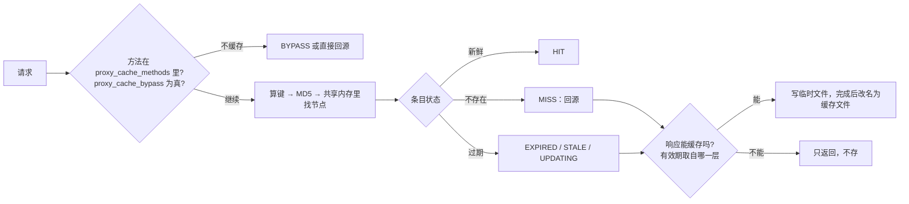
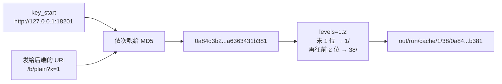
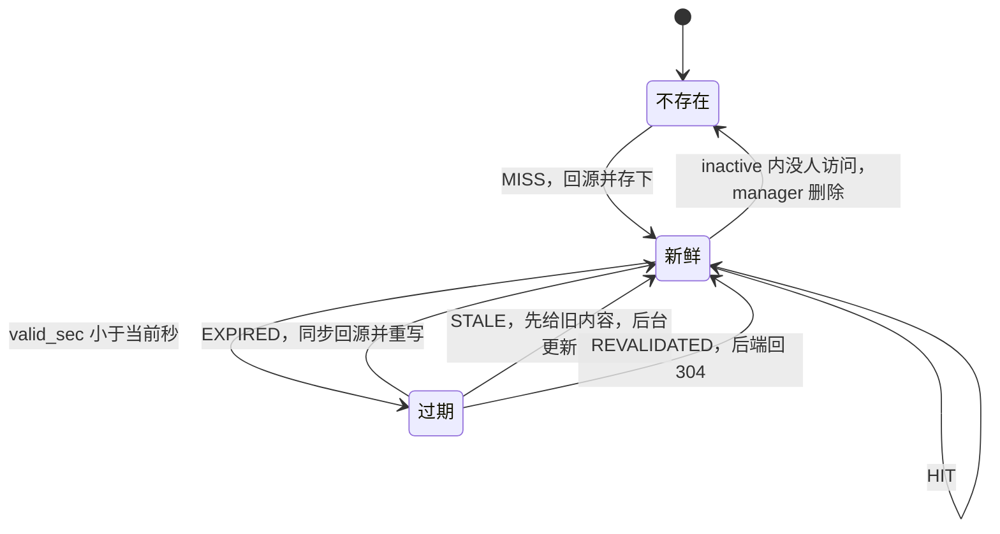
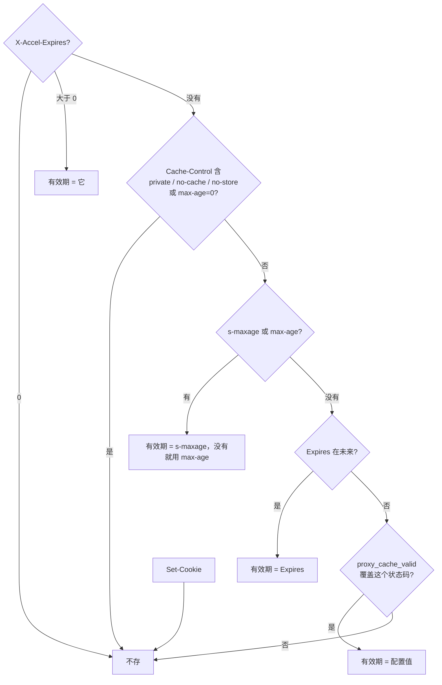
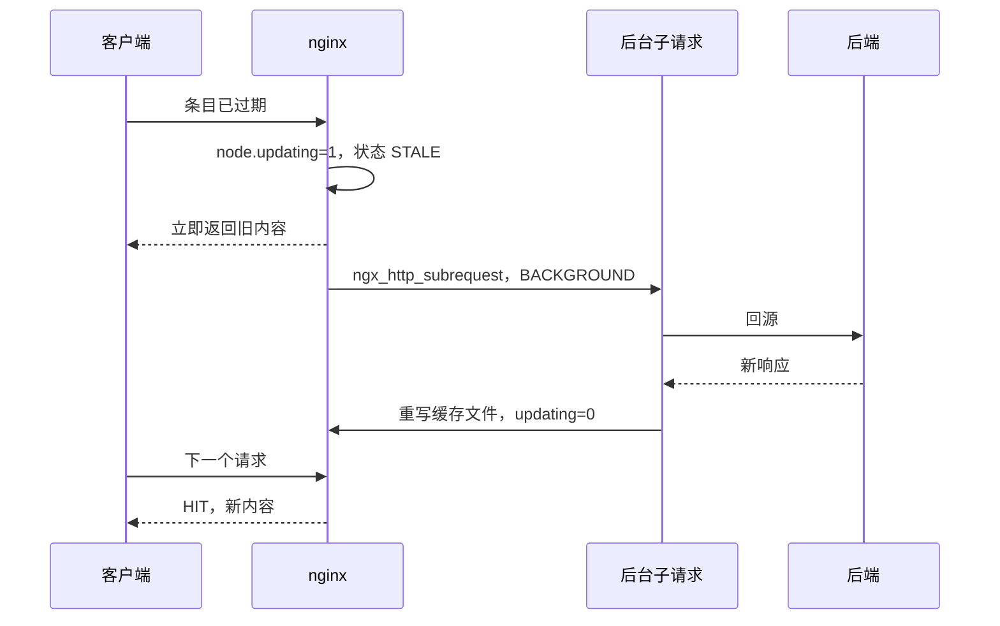
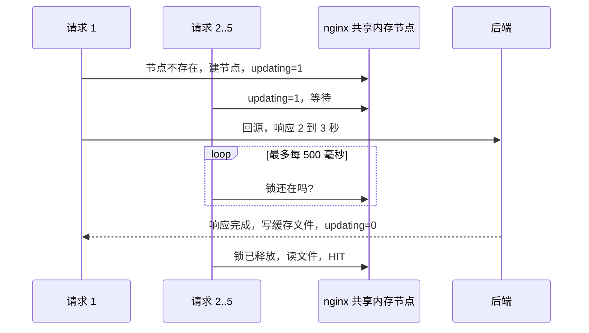
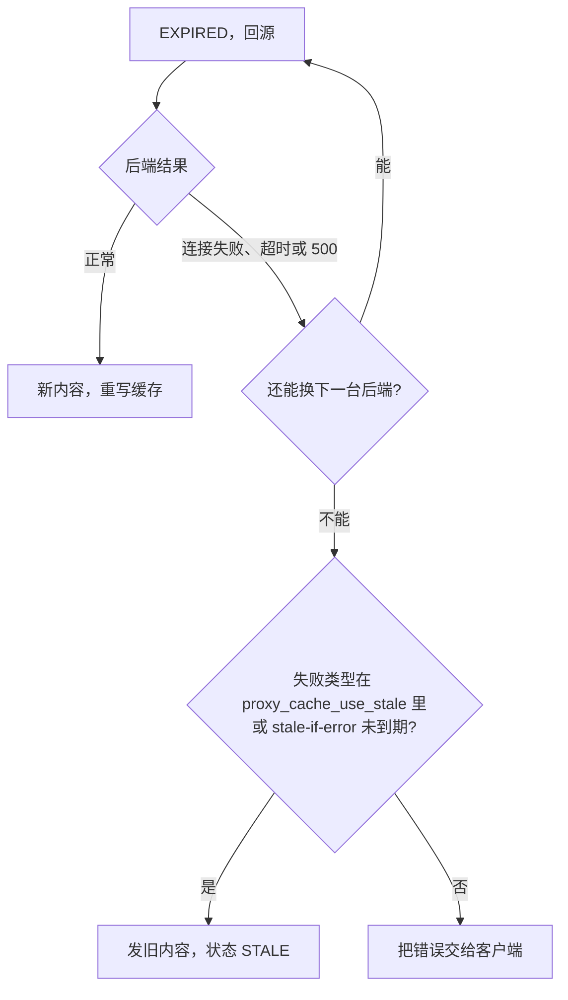
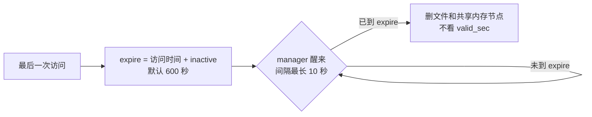

# 运维篇 10｜代理缓存：一条缓存的寿命由响应头决定，过期之后怎么办由配置决定

> **一句话结论**：不写 `proxy_cache_key` 时，缓存键是“发给后端的那个 URL”（`http://127.0.0.1:18201/b/plain?x=1` 这种带 `://` 的形式），不是文档里写的 `$scheme$proxy_host$request_uri`；两个 location 把请求转到同一个后端 URI，就共用同一条缓存。文件名是键的 MD5，`levels=1:2` 从文件名末尾取目录。一条缓存能活多久，按 `X-Accel-Expires`、`Cache-Control` 的 `s-maxage`、`max-age`、`Expires`、`proxy_cache_valid` 的顺序取第一个有效的；`private`、`no-cache`、`no-store`、`max-age=0`、`X-Accel-Expires: 0` 和 `Set-Cookie` 都会让响应不进缓存。过期以后默认是 EXPIRED，即同步回源；`proxy_cache_use_stale updating` 加 `proxy_cache_background_update` 让第一个请求立即拿到旧内容（STALE）并在后台刷新；`proxy_cache_lock` 让同一个新键的并发请求只放一个去后端；`use_stale error` 在后端出错时用旧内容兜底；`proxy_cache_revalidate` 用条件请求换 304。`inactive` 时间内没人访问的条目会被 cache manager 删掉，哪怕还没过期。
>
> 适用版本：nginx 1.31.9（mainline，2026-11-18）。「版本差异」：`ngx_http_file_cache.c` 在 1.30.7 和 1.31.9 之间没有差别，本篇引用的 `ngx_http_upstream_cache`、`ngx_http_proxy_create_key` 和各响应头的处理函数也逐字相同。和缓存有关的修复两边都有：后台更新的未初始化内存访问（CVE-2026-60005）在 1.31.3 和 1.30.4 修复，缓存了 `X-Accel-Redirect` 头之后可能崩溃的问题在 1.31.7 修复，1.30.7 的 changes 里也有这条。实验：[`labs/ops-10`](../labs/ops-10/)，单 worker；18200 是带缓存的代理，18201 是后端，后端的响应体里带 `$msec`，从响应体就能看出是不是缓存里的旧内容。

## 导读

| 你想知道 | 看哪一节 |
|---|---|
| 缓存键到底是什么，缓存文件放在哪里 | §1 |
| `$upstream_cache_status` 的几个值分别在什么时候出现 | §2 |
| 后端的 `Cache-Control`、`Expires` 和 `proxy_cache_valid` 谁说了算，哪些响应不会被缓存 | §3 |
| HEAD 请求、`proxy_cache_min_uses` 对缓存有什么影响 | §4 |
| 条目过期之后，怎样不让用户等回源 | §5 |
| 热点内容第一次被访问时，怎样不让后端被同时打几百次 | §6 |
| 后端挂了能不能用旧内容兜底，304 再验证怎么用 | §7 |
| 缓存什么时候被删，`proxy_cache_bypass` 和 `proxy_no_cache` 的区别 | §8 |

一次带缓存的请求，nginx 在两个时间点做决定：请求进来时，`ngx_http_upstream_cache` 根据键找到条目，决定是直接返回、等待还是回源；后端响应回来时，`ngx_http_upstream_send_response` 根据响应头和配置决定要不要存、存多久。本篇按这两个时间点组织：§1、§2、§5、§6 讲前一个，§3、§4 讲后一个，§7、§8 讲出错和清理。



## 1. 缓存键默认是发给后端的 URL；两个 location 转发到同一个 URI 就共用一条缓存

没写 `proxy_cache_key` 时，`ngx_http_proxy_create_key` 不去求值任何变量，而是直接拼两段：`key_start`（协议加 `proxy_pass` 里的主机和端口）和发给后端的 URI：

```c
// src/http/modules/ngx_http_proxy_module.c:1106-1134
    if (plcf->cache_key.value.data) {

        if (ngx_http_complex_value(r, &plcf->cache_key, key) != NGX_OK) {
            return NGX_ERROR;
        }

        return NGX_OK;
    }

    *key = ctx->vars.key_start;

    key = ngx_array_push(&r->cache->keys);
    if (key == NULL) {
        return NGX_ERROR;
    }

    if (plcf->proxy_lengths && ctx->vars.uri.len) {

        *key = ctx->vars.uri;
        u->uri = ctx->vars.uri;

        return NGX_OK;

    } else if (ctx->vars.uri.len == 0 && r->valid_unparsed_uri) {
        *key = r->unparsed_uri;
        u->uri = r->unparsed_uri;

        return NGX_OK;
    }
```

`proxy_pass` 不带 URI 时，第二段是客户端原样的 `unparsed_uri`；带 URI 时，函数后半段把 location 前缀替换掉，拼出真正发给后端的路径加参数。两段依次喂给 MD5，得到 16 字节的键。文件名是这 16 字节的十六进制，`ngx_create_hashed_filename` 再按 `levels` 从文件名的末尾往前截目录：

```c
// src/core/ngx_file.c:246-261
    i = path->name.len + 1;

    file[path->name.len + path->len]  = '/';

    for (n = 0; n < NGX_MAX_PATH_LEVEL; n++) {
        level = path->level[n];

        if (level == 0) {
            break;
        }

        len -= level;
        file[i - 1] = '/';
        ngx_memcpy(&file[i], &file[len], level);
        i += level + 1;
    }
```

`levels=1:2` 时，第一级目录是 MD5 的最后 1 个字符，第二级是倒数第 3、2 个字符。文件开头是二进制头（版本号 5、有效期、日期、ETag 等），后面跟一行 `KEY: ` 加原始键：

```c
// src/http/ngx_http_file_cache.c:1362-1370
    p = ngx_cpymem(p, ngx_http_file_cache_key, sizeof(ngx_http_file_cache_key));

    key = c->keys.elts;
    for (i = 0; i < c->keys.nelts; i++) {
        p = ngx_copy(p, key[i].data, key[i].len);
    }

    *p = LF;
```

实验用 Python 按同样的规则算出路径，再去看文件：

```text
# labs/ops-10 ## the cache key and the file
key:  http://127.0.0.1:18201/b/plain?x=1
md5:  0a84d3b2cd38b0302215a6363431b381
file: out/run/cache/1/38/0a84d3b2cd38b0302215a6363431b381
header: version=5 valid_sec-date=3, KEY: http://127.0.0.1:18201/b/plain?x=1
ok - the file is named by the MD5 of the key, directories taken from the end of the name
```

MD5 以 `...381` 结尾，所以目录是 `1/38/`。按键找缓存文件、或者手工删掉某个 URL 的缓存时，就用这个算法。

键用的是“发给后端的 URL”，带来一个容易忽略的结果。实验里 `/k1/` 和 `/k2/` 都 `proxy_pass http://127.0.0.1:18201/b/plain;`，`/k3/` 显式写了文档里的默认值 `$scheme$proxy_host$request_uri`：

```text
# labs/ops-10 ## the default key is the URI sent to the backend
/k1/k: MISS, /k2/k: HIT, /k3/k (proxy_cache_key $scheme$proxy_host$request_uri): MISS
KEY: http127.0.0.1:18201/k3/k
KEY: http://127.0.0.1:18201/b/plaink
ok - locations that proxy to the same URI share an entry; the documented key keeps them apart
```

`/k2/k` 第一次访问就是 HIT，用的是 `/k1/k` 存下的那条，因为两者都被转成了 `/b/plaink`。显式写成 `$scheme$proxy_host$request_uri` 后，键里是客户端的 URI，`/k3/k` 单独一条；而且这个字符串没有 `://`（`$scheme` 是 `http`，后面直接接主机），和默认键不是同一个字符串。所以把默认键改成“看起来一样”的显式写法，已有的缓存会全部失效。



**小结**：多个 location 共用后端、但希望分开缓存（例如按设备类型改写了 URI 前缀）时，要显式写 `proxy_cache_key`；改键之前要接受一次全量回源。

## 2. 状态值来自两个时间点：请求进来时查到了什么，过期后谁在更新

`$upstream_cache_status` 有 8 个取值，定义在 `ngx_http_cache.h`：MISS、BYPASS、EXPIRED、STALE、UPDATING、REVALIDATED、HIT，还有一个只在内部用的 SCARCE。最常见的是前三个。条目过期与否在读文件头时判断：

```c
// src/http/ngx_http_file_cache.c:646-667
            c->node->exists = 1;
            c->node->uniq = c->uniq;
            c->node->fs_size = c->fs_size;

            cache->sh->size += c->fs_size;
        }

        ngx_shmtx_unlock(&cache->shpool->mutex);
    }

    now = ngx_time();

    if (c->valid_sec < now) {
        c->stale_updating = c->valid_sec + c->updating_sec >= now;
        c->stale_error = c->valid_sec + c->error_sec >= now;

        ngx_shmtx_lock(&cache->shpool->mutex);

        if (c->node->updating) {
            rc = NGX_HTTP_CACHE_UPDATING;

        } else {
```

`valid_sec` 是秒级的绝对时间。过期后，第一个发现的请求把共享内存节点的 `updating` 置 1，拿到 STALE；同时到达的其他请求看到 `updating` 已经是 1，拿到 UPDATING。这两个值再交给 `ngx_http_upstream_cache` 按配置处理（§5）。没有任何 `use_stale` 配置时，两者都被改成 EXPIRED，各自回源。

```text
# labs/ops-10 ## MISS, HIT, EXPIRED
proxy_cache_valid 200 2s: MISS HIT, after 3.1 s: EXPIRED HIT; backend requests: 2
ok - an expired entry goes to the backend once and is stored again
```



**小结**：access log 里记 `$upstream_cache_status`，就能把“缓存命中率”拆成 HIT、MISS、EXPIRED 等几类。EXPIRED 多说明有效期太短，MISS 多说明键太分散或者条目被提前清掉了。

## 3. 有效期按 X-Accel-Expires、s-maxage、max-age、Expires、proxy_cache_valid 的顺序取，几种响应永远不存

后端响应头逐行进入各自的处理函数。`Cache-Control` 的处理函数先看前面是否已经有 `X-Accel-Expires` 定下了有效期，有就只处理扩展字段；没有就检查三个“不缓存”的指令：

```c
// src/http/ngx_http_upstream.c:5130-5146
    last = start + h->value.len;

    if (r->cache->valid_sec != 0 && u->headers_in.x_accel_expires != NULL) {
        goto extensions;
    }

    if (ngx_strlcasestrn(start, last, (u_char *) "no-cache", 8 - 1) != NULL
        || ngx_strlcasestrn(start, last, (u_char *) "no-store", 8 - 1) != NULL
        || ngx_strlcasestrn(start, last, (u_char *) "private", 7 - 1) != NULL)
    {
        u->headers_in.no_cache = 1;
        return NGX_OK;
    }

    p = ngx_strlcasestrn(start, last, (u_char *) "s-maxage=", 9 - 1);
    offset = 9;
```

找不到 `s-maxage=` 才看 `max-age=`；值为 0 也算不缓存。`Expires` 的处理函数在已有有效期时直接返回：

```c
// src/http/ngx_http_upstream.c:5274-5277

    if (r->cache->valid_sec != 0) {
        return NGX_OK;
    }
```

`X-Accel-Expires` 则不管前面是谁，直接覆盖有效期，并清掉 `Cache-Control` 留下的 `no_cache` 标记；值为 0 表示不缓存：

```c
// src/http/ngx_http_upstream.c:5327-5349
        return NGX_OK;
    }

    len = h->value.len;
    p = h->value.data;

    if (p[0] != '@') {
        n = ngx_atoi(p, len);

        switch (n) {
        case 0:
            u->cacheable = 0;
            /* fall through */

        case NGX_ERROR:
            return NGX_OK;

        default:
            r->cache->valid_sec = ngx_time() + n;
            u->headers_in.no_cache = 0;
            u->headers_in.expired = 0;
            return NGX_OK;
        }
```

这三个函数都没有设置有效期时，`ngx_http_upstream_send_response` 才按状态码查 `proxy_cache_valid`；那里也查不到，就不存。`Set-Cookie` 另有一个处理函数，出现即不缓存。实验让后端返回 9 种响应头组合，前端的 `proxy_cache_valid 200 3s`，再直接读缓存文件头里的 `valid_sec - date`：

```text
# labs/ops-10 ## which header decides the lifetime
backend   headers                2nd-request stored
plain     none                   HIT        valid_sec-date=3
cc60      max-age=60             HIT        valid_sec-date=60
smax      max-age=60,s-maxage=90 HIT        valid_sec-date=90
xae       X-Accel-Expires=30,max-age=60 HIT        valid_sec-date=30
exppast   Expires=past,max-age=60 HIT        valid_sec-date=60
private   private,max-age=60     MISS       not stored
age0      max-age=0              MISS       not stored
xae0      X-Accel-Expires=0,max-age=60 MISS       not stored
cookie    Set-Cookie             MISS       not stored
ok - X-Accel-Expires, then s-maxage, then max-age, then proxy_cache_valid; private, 0 and Set-Cookie are not stored
```

几行值得单独看：

- `smax` 存了 90 秒：`s-maxage` 是给共享缓存的，nginx 优先用它。
- `xae` 存了 30 秒：`X-Accel-Expires` 比 `max-age=60` 优先，适合后端单独告诉 nginx 缓存多久，同时给浏览器另一个 `Cache-Control`。
- `exppast` 的 `Expires` 是 1970 年，按理说已经过期，但后面的 `max-age=60` 把它覆盖了。1.23.0 之前这种组合不会被缓存，那一版的修复条目是 “nginx did not cache the response if the "Expires" response header line disabled caching, but following "Cache-Control" header line enabled caching”。
- `cookie` 只带了 `Set-Cookie`，没有任何缓存头，也不存。后端框架如果给每个响应都发会话 cookie，接入 nginx 缓存后命中率就是 0，排查时先看这个头。

这些规则都可以用 `proxy_ignore_headers` 关掉（例如忽略 `Set-Cookie` 或 `Cache-Control`），代价是可能把带用户身份的响应缓存给别人，本篇没有实验这个指令。



**小结**：排查“为什么没缓存”，先看后端响应头里有没有 `Set-Cookie`、`private`、`max-age=0`；排查“为什么缓存这么久”，先看有没有 `X-Accel-Expires` 和 `s-maxage`。`proxy_cache_valid` 只是兜底。

## 4. HEAD 被换成 GET 去回源；proxy_cache_min_uses 让冷门 URL 不占缓存

默认只有 GET 和 HEAD 参与缓存（`proxy_cache_methods` 的合并函数总是把这两个方法加进去）。HEAD 请求有一个特殊处理：`proxy_cache_convert_head` 默认为 on，`ngx_http_upstream_cache` 把发给后端的方法改成 GET，这样存下来的是完整响应：

```text
# labs/ops-10 ## HEAD is cached as GET
HEAD: MISS, then GET: HIT, body: 24 bytes
ok - the HEAD request went to the backend as a GET and stored the full response
```

后端日志里只有一条 GET、没有 HEAD，之后的 GET 直接命中，响应体 24 字节。代价是：监控系统频繁发 HEAD 探活时，每次 MISS 都会让后端生成完整的响应体。

`proxy_cache_min_uses` 控制一个键被请求几次之后才写缓存。计数放在共享内存节点的 `uses` 里：

```c
// src/http/ngx_http_file_cache.c:921-934
        if (fcn->exists || fcn->uses >= c->min_uses) {

            c->exists = fcn->exists;
            if (fcn->body_start && !c->update_variant) {
                c->body_start = fcn->body_start;
            }

            rc = NGX_OK;

            goto done;
        }

        rc = NGX_AGAIN;
```

```text
# labs/ops-10 ## proxy_cache_min_uses 2
3 requests: MISS MISS HIT; backend requests: 2
ok - the first use only counts, the second stores, the third hits
```

第一次请求只建节点、计数为 1，返回内部的 SCARCE（对外仍是 MISS），不写文件；第二次计数到 2，写文件；第三次命中。只被访问一次的 URL 占多数、磁盘又有限时，`min_uses 2` 能挡掉大量只访问一次的内容，代价是每个热点 URL 都要多回源一次。

**小结**：HEAD 和 GET 共用一条缓存，是默认行为；`min_uses` 用一次额外回源换磁盘空间。

## 5. 过期之后默认同步回源；use_stale updating 加 background_update 让用户不等

§2 里过期得到的 STALE 和 UPDATING，在 `ngx_http_upstream_cache` 里按配置处理：

```c
// src/http/ngx_http_upstream.c:955-990
    switch (rc) {

    case NGX_HTTP_CACHE_STALE:

        if (((u->conf->cache_use_stale & NGX_HTTP_UPSTREAM_FT_UPDATING)
             || c->stale_updating) && !r->background
            && u->conf->cache_background_update)
        {
            if (ngx_http_upstream_cache_background_update(r, u) == NGX_OK) {
                r->cache->background = 1;
                u->cache_status = rc;
                rc = NGX_OK;

            } else {
                rc = NGX_ERROR;
            }
        }

        break;

    case NGX_HTTP_CACHE_UPDATING:

        if (((u->conf->cache_use_stale & NGX_HTTP_UPSTREAM_FT_UPDATING)
             || c->stale_updating) && !r->background)
        {
            u->cache_status = rc;
            rc = NGX_OK;

        } else {
            rc = NGX_HTTP_CACHE_STALE;
        }

        break;

    case NGX_OK:
        u->cache_status = NGX_HTTP_CACHE_HIT;
```

有三种组合：

| 配置 | 第一个发现过期的请求 | 更新期间的其他请求 |
|---|---|---|
| 都不配 | EXPIRED，同步回源，用户等 | EXPIRED，也各自回源 |
| `use_stale updating` | EXPIRED，同步回源，用户等 | UPDATING，拿旧内容 |
| `use_stale updating` + `background_update on` | STALE，拿旧内容，另起一个后台子请求回源 | UPDATING，拿旧内容 |

`c->stale_updating` 来自后端的 `Cache-Control: stale-while-revalidate=N`（1.11.10 起支持），作用和 `use_stale updating` 相同，只是由后端按响应指定。实验的 `/bg/` 有效期 5 秒，等 6.1 秒后连发两个请求：

```text
# labs/ops-10 ## use_stale updating with background_update
HIT after the first request
after 6.1 s: STALE, same body as the first: yes
next request: HIT, body changed: yes
ok - the expired entry is sent at once and refreshed by a background subrequest
```

STALE 那次拿到的响应体和第一次一模一样，是旧内容；0.3 秒后的下一个请求已经是 HIT，响应体换了，说明后台子请求已经把新内容写进去。后台更新是 `ngx_http_upstream_cache_background_update` 用 `ngx_http_subrequest` 克隆出的一个子请求（带 `NGX_HTTP_SUBREQUEST_BACKGROUND` 标记，只要响应头，`header_only = 1`），它的响应不发给客户端，只用来重写缓存。



**小结**：对能容忍短时间旧内容的场景，`proxy_cache_use_stale updating` 加 `proxy_cache_background_update on` 是默认就该开的组合：过期那一刻没有用户在等回源，后端也只收到一个更新请求。

## 6. proxy_cache_lock 只管“还没有缓存”的键：同一时刻只放一个请求去后端

条目还不存在时，没有旧内容可给，`use_stale` 帮不上忙。这时 `proxy_cache_lock` 起作用：第一个请求在共享内存节点上标记 `updating`，其他请求等待；等待用的是定时器，最多每 500 毫秒醒一次查看锁是否释放：

```c
// src/http/ngx_http_file_cache.c:456-463
    timer = c->wait_time - now;

    ngx_add_timer(&c->wait_event, (timer > 500) ? 500 : timer);

    r->main->blocked++;

    return NGX_AGAIN;
```

`proxy_cache_lock_timeout` 和 `proxy_cache_lock_age` 默认都是 5 秒（proxy 模块合并函数里的 5000 毫秒）：等超过 `lock_timeout` 的请求不再等，自己回源但不写缓存；持锁超过 `lock_age` 的请求被认为卡住了，下一个请求可以接过锁。实验的后端以 1000 字节/秒发 3000 字节（`limit_rate` 按秒计算配额，响应头也计入已发送的字节），一次回源 2 到 3 秒，5 个请求同时到达：

```text
# labs/ops-10 ## proxy_cache_lock
/lock/a, 5 at once: 4x HIT 1x MISS backend requests: 1
/nolock/n, 5 at once: 5x MISS backend requests: 5
ok - with the lock one request goes to the backend and the others wait for the file
```

有锁时后端只收到 1 个请求，另外 4 个等文件写完后读到 HIT；没锁时 5 个请求全是 MISS，后端被打 5 次。

实验里有一个调参时踩到的现象：最初 `/lock/` 沿用了 3 秒的 `proxy_cache_valid`，等待的请求偶尔拿到 EXPIRED 并各自回源。原因是有效期从收到响应头的那一秒算起，响应体还要再传 2 到 3 秒，等待者每 500 毫秒才看一次，读到文件时这条缓存已经接近过期。慢响应要配比传输时间长得多的有效期，否则锁等来的是一条马上过期的缓存。



**小结**：热点内容上线、缓存刚清空时，`proxy_cache_lock on` 防止后端被同一个 URL 打穿。等待时间受 `lock_timeout`（默认 5 秒）限制，后端很慢时要相应调大。

## 7. 后端出错时 use_stale error 用旧内容兜底；revalidate 用 304 续期

回源失败的处理在 `ngx_http_upstream_next`：不能再换下一台后端时，如果这次是 EXPIRED，并且失败类型在 `proxy_cache_use_stale` 里（或者后端用 `stale-if-error` 指定过），就改成发送旧内容：

```c
// src/http/ngx_http_upstream.c:4708-4730
        || ((u->conf->next_upstream & ft_type) != ft_type)
        || (u->request_sent && r->request_body_no_buffering)
        || (timeout && ngx_current_msec - u->peer.start_time >= timeout))
    {
#if (NGX_HTTP_CACHE)

        if (u->cache_status == NGX_HTTP_CACHE_EXPIRED
            && ((u->conf->cache_use_stale & ft_type) || r->cache->stale_error))
        {
            ngx_int_t  rc;

            rc = u->reinit_request(r);

            if (rc != NGX_OK) {
                ngx_http_upstream_finalize_request(r, u, rc);
                return;
            }

            u->cache_status = NGX_HTTP_CACHE_STALE;
            rc = ngx_http_upstream_cache_send(r, u);

            if (rc == NGX_DONE) {
                return;
```

实验先让两个 location 各存一份，等过期后让后端改回 500：

```text
# labs/ops-10 ## use_stale error
backend now answers 500
use_stale error http_500: 200 STALE
no use_stale:             500 EXPIRED
ok - the old copy is sent as STALE when the backend fails; without use_stale the 500 goes through
```

配了 `error timeout http_500` 的 location 返回 200 加旧内容，状态是 STALE；没配的把 500 原样交给客户端。注意 `http_500` 这类状态码要写进 `proxy_cache_use_stale` 才算失败，和运维篇 07 里 `proxy_next_upstream` 的规则一样。



另一种续期方式是 `proxy_cache_revalidate on`：条目过期后，nginx 用缓存里存的 ETag 和 Last-Modified 发条件请求，后端回 304 就只更新文件头里的有效期，不重传响应体：

```text
# labs/ops-10 ## proxy_cache_revalidate
after expiry: REVALIDATED, then HIT
backend log: 200 304 
ok - the backend answers the conditional request with 304, the entry is renewed
```

后端日志里第二个请求是 304，这次的状态是 REVALIDATED，随后的请求又是 HIT。304 之后新的有效期仍按 §3 的顺序取：304 响应自己没有缓存头时，用的是 `proxy_cache_valid` 里原始状态码（这里是 200）的值。

**小结**：`proxy_cache_use_stale error timeout http_500 http_502 http_503 http_504` 是缓存层的熔断：后端整体故障时，已缓存的内容继续可用。大文件、后端带 ETag 时加 `proxy_cache_revalidate on`，续期只花一个 304。

## 8. inactive 到了就删，不看是否过期；bypass 是不读，no_cache 是不写

缓存的删除和过期是两回事。过期的条目留在磁盘上，用来做 STALE 和 304 再验证；删除由 cache manager 进程按 `inactive`（默认 600 秒，即 10 分钟）做：最后一次访问之后超过 `inactive` 没人用，就删。manager 每次处理完会算出下次醒来的时间，最长 10 秒：

```c
// src/http/ngx_http_file_cache.c:1896-1915
    for ( ;; ) {

        if (ngx_quit || ngx_terminate) {
            wait = 1;
            break;
        }

        if (ngx_queue_empty(&cache->sh->queue)) {
            wait = 10;
            break;
        }

        q = ngx_queue_last(&cache->sh->queue);

        fcn = ngx_queue_data(q, ngx_http_file_cache_node_t, queue);

        wait = fcn->expire - now;

        if (wait > 0) {
            wait = wait > 10 ? 10 : wait;
```

所以条目会在最后一次访问后的 `inactive` 到 `inactive` + 10 秒之间被删。实验的 `ci` 区 `inactive=2s`，条目的有效期是 3600 秒：

```text
# labs/ops-10 ## inactive=2s
stored: yes, valid for: 3600 s
deleted without a request: yes, within 2..12 s: yes
ok - the cache manager removes entries not used for inactive, even if they are still valid
```

还有 1 小时才过期的条目，2 秒没人访问就被删了，再请求是 MISS。默认的 10 分钟对访问稀疏的内容偏短：每小时访问一次的 URL，配 `proxy_cache_valid 1h` 也几乎总是 MISS，要把 `inactive` 调到不小于有效期。`max_size` 超限时 manager 按 LRU 删最久没访问的条目；这个过程本篇没有实验。

nginx 重启后，共享内存里的节点是空的，由 cache loader 进程扫描磁盘重建。loader 在启动 60 秒后才开始（`ngx_cache_loader_ctx` 里的 60000 毫秒），每批 100 个文件、批间休息 50 毫秒。重建完成前缓存处于 cold 状态，`ngx_http_file_cache_open` 会对每个不认识的键去磁盘上找一次文件。

最后是两个容易混淆的指令：

```text
# labs/ops-10 ## proxy_cache_bypass
first: MISS
with X-Refresh: 1: BYPASS, new body: yes
with X-Refresh: 0: HIT, same body as the bypassed one: yes
ok - a value other than empty or 0 skips the lookup, and the fresh response replaces the entry
```

`proxy_cache_bypass $http_x_refresh` 在值非空且不是 `0` 时跳过读缓存，状态是 BYPASS；回源拿到的响应仍会按 §3 的规则写进缓存，替换掉原来的条目，之后不带这个头的请求拿到的就是这次的新内容。所以它可以用来“强制刷新某个 URL”，前提是这个头不能让外部随意带进来。`proxy_no_cache` 正好相反，决定响应写不写。两者常一起写，表示这类请求既不读也不写。



**小结**：`inactive` 决定磁盘上留什么，有效期决定拿出来能不能直接用。按访问频率设 `inactive`，按内容变化频率设有效期。

## 已知局限与待核实

- 所有实验都是单 worker、单机。多 worker 下 `proxy_cache_lock` 和 `updating` 标记都在共享内存里，行为应当相同，但没有实测。
- `max_size`、`min_free` 触发的 LRU 淘汰、cache loader 重建（60 秒后启动）只读了源码，没有构造磁盘写满或重启后的实验。
- `Vary` 响应头会让同一个键存多个变体（`ngx_http_file_cache_vary`），本篇没有覆盖。
- `proxy_ignore_headers`、`proxy_cache_purge`（开源版没有这个指令）、`slice` 模块与缓存的配合不在本篇范围。
- §6 中“有效期从收到响应头时算起”的解释，依据是 `send_response` 在开始转发响应体之前计算 `valid_sec`，以及调参时观察到的 EXPIRED，没有用 debug 日志逐个请求核对时间戳。
- 实验里的时间都是秒级，`valid_sec` 也是秒级；sleep 的余量是为了避开秒边界和本机偶发的 0.5 秒左右请求卡顿，不代表 nginx 的精度。

## 修订记录

- 2026-11-21：基于 nginx 1.31.9 源码新写。覆盖默认缓存键的真实构成与文件布局、状态值、响应头对有效期的优先级、HEAD 转 GET、`min_uses`、`use_stale updating` 与 `background_update`、`proxy_cache_lock`、`use_stale error`、`proxy_cache_revalidate`、`inactive` 与 cache manager、`proxy_cache_bypass`，均附 `labs/ops-10` 实验。
