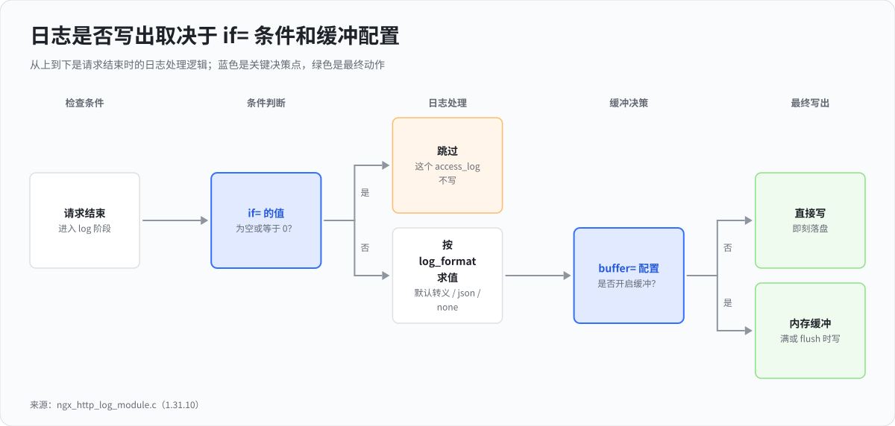
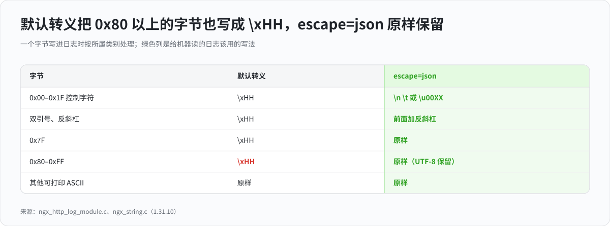
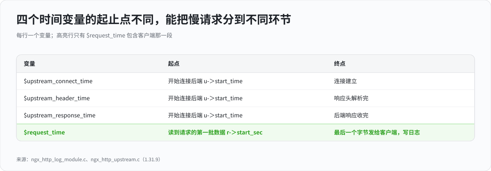
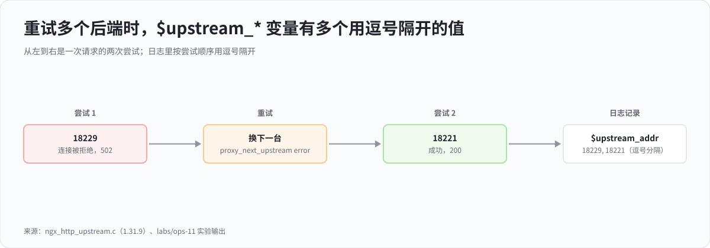
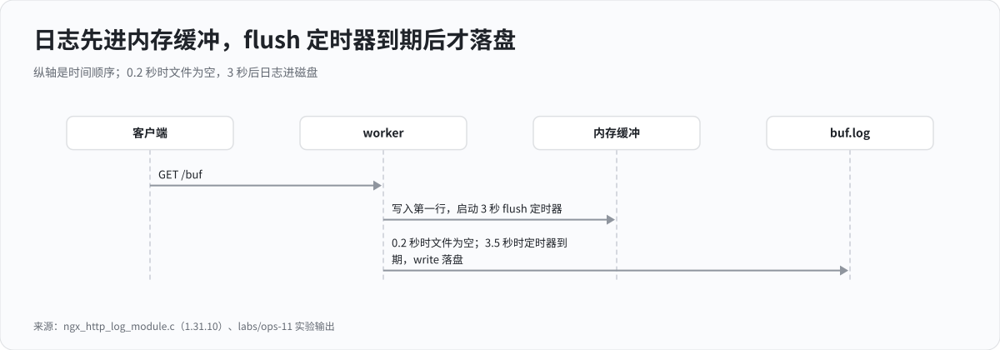
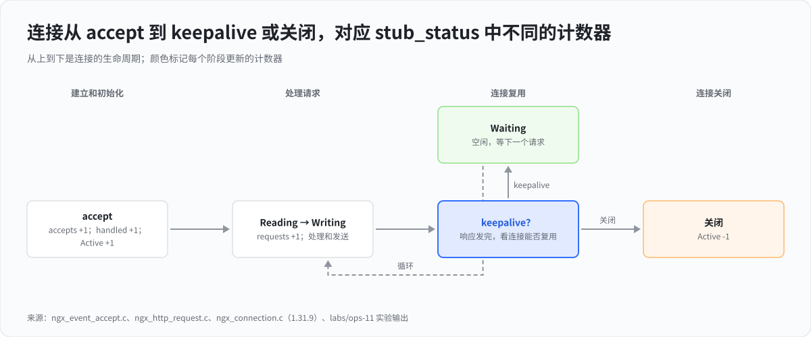
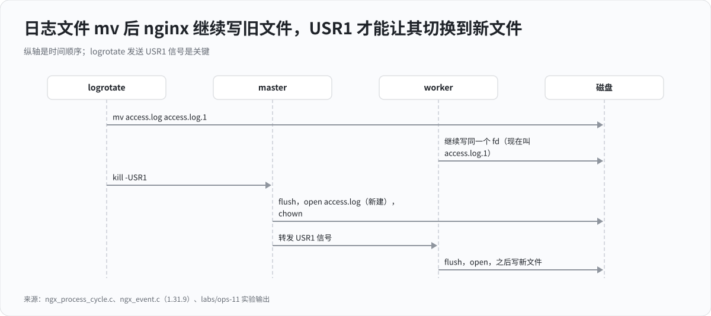
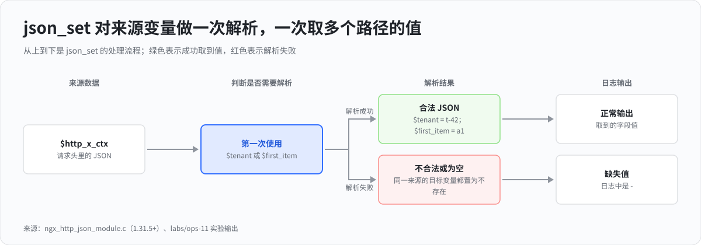

# 运维篇 11｜日志与监控：每个字段都要知道它在哪一刻取值、按什么规则写出

> **一句话结论**：access log 默认的转义把双引号、反斜杠、控制字符和所有 0x80 以上的字节写成 `\xHH`，中文 UA 会变成一串 `\xE4...`；要给下游当 JSON 解析，必须写 `escape=json`，它只转义 `"`、`\` 和控制字符，UTF-8 原样保留。`$request_time` 从收到请求的第一批数据算到写日志，`$upstream_header_time` 和 `$upstream_response_time` 从连上后端算到收到响应头、收到完整响应，所以“后端慢在响应头”和“后端慢在响应体”在日志里能分开；一次请求试了几台后端，这几个 `$upstream_*` 变量就有几个用 `, ` 隔开的值。`access_log ... if=` 的值为空或 `0` 时不写；`buffer=` 让日志先进内存，`flush=` 到时才落盘。`stub_status` 的 7 个数字是全局的原子计数器，`Waiting` 是空闲的 keepalive 连接，1.29.7 起 upstream 默认长连接，同一个 nginx 里的反向代理连接也会算进去。`mv` 日志文件之后 nginx 还会往旧文件里写，直到收到 USR1。1.31.5 新增的 `json_set` 是 JSON 解析器，用来从变量里取字段，不是状态输出接口。
>
> 适用版本：nginx 1.31.9（mainline，2026-11-18）。「版本差异」：`ngx_http_log_module.c` 和 `ngx_http_stub_status_module.c` 在 1.30.7 和 1.31.9 之间没有差别；`ngx_http_json_module`（`json_set`、`json_max_depth`）是 1.31.5 新增的，1.30.7 的源码树里没有这个模块。upstream 默认长连接（1.29.7）两个版本都有。实验：[`labs/ops-11`](../labs/ops-11/)，单 worker；18220 是前端，18221 是后端，18229 没有进程监听；本仓库的构建带了 `--with-http_stub_status_module` 和 `--with-http_json_module`，这两个模块默认不编译。

## 导读

| 你想知道 | 看哪一节 |
|---|---|
| 日志里的 `\x22`、`\xE4` 是什么，JSON 日志怎么配才不会被下游解析失败 | §1 |
| `$request_time` 和几个 `$upstream_*_time` 分别从哪一刻算到哪一刻 | §2 |
| 一个请求换了几台后端时日志长什么样 | §3 |
| 只记错误请求、日志写盘延迟、`log_not_found` | §4 |
| `stub_status` 的 7 个数字怎么读 | §5 |
| 日志轮转为什么要发 USR1 | §6 |
| 1.31.5 的 JSON 模块能做什么 | §7 |

每一行 access log 都在请求结束时的 log 阶段生成：`ngx_http_log_handler` 遍历这个 location 的所有 `access_log`，先求 `if=` 条件，再按 `log_format` 逐项求值、转义，最后写进缓冲区或文件。所以字段的含义取决于两件事：变量在这一刻取的是什么值，以及写出时用了哪种转义。



## 1. 默认转义把 0x80 以上的字节写成 \xHH；JSON 日志必须用 escape=json

变量值写进日志时，默认用 `ngx_http_log_escape`。它用一张 256 位的表决定哪些字节要转义：

```c
// src/http/modules/ngx_http_log_module.c:1081-1097
    static uint32_t   escape[] = {
        0xffffffff, /* 1111 1111 1111 1111  1111 1111 1111 1111 */

                    /* ?>=< ;:98 7654 3210  /.-, +*)( '&%$ #"!  */
        0x00000004, /* 0000 0000 0000 0000  0000 0000 0000 0100 */

                    /* _^]\ [ZYX WVUT SRQP  ONML KJIH GFED CBA@ */
        0x10000000, /* 0001 0000 0000 0000  0000 0000 0000 0000 */

                    /*  ~}| {zyx wvut srqp  onml kjih gfed cba` */
        0x80000000, /* 1000 0000 0000 0000  0000 0000 0000 0000 */

        0xffffffff, /* 1111 1111 1111 1111  1111 1111 1111 1111 */
        0xffffffff, /* 1111 1111 1111 1111  1111 1111 1111 1111 */
        0xffffffff, /* 1111 1111 1111 1111  1111 1111 1111 1111 */
        0xffffffff, /* 1111 1111 1111 1111  1111 1111 1111 1111 */
    };
```

每个 32 位字管 32 个字节值：第 1 个字全 1，即 0x00–0x1F 的控制字符全部转义；第 2 个字只有 `"`；第 3 个字只有 `\`；第 4 个字只有 0x7F；后 4 个字全 1，即 0x80–0xFF 全部转义。`log_format` 的 `escape=json`（1.11.8）改用 `ngx_escape_json`，只给 `"` 和 `\` 加反斜杠，控制字符写成 `\n`、`\t` 或 `\u00XX`，其余字节原样输出：

```c
// src/core/ngx_string.c:1941-1955
    while (size) {
        ch = *src++;

        if (ch > 0x1f) {

            if (ch == '\\' || ch == '"') {
                *dst++ = '\\';
            }

            *dst++ = ch;

        } else {
            *dst++ = '\\';

            switch (ch) {
```

实验发一个 User-Agent，里面依次是字母、双引号、反斜杠、0x01 控制字节和 UTF-8 的 é（0xC3 0xA9），三种转义各写一份：

```nginx
# lab: labs/ops-11/conf/nginx.conf
    log_format esc_default '$http_user_agent';
    log_format esc_json escape=json '{"ua":"$http_user_agent"}';
    log_format esc_none escape=none '$http_user_agent';
```

```text
# labs/ops-11 ## default escaping, escape=json, escape=none
default: a\x22b\x5Cc\x01d\xC3\xA9
json:    {"ua":"a\"b\\c\u0001dé"}
none:    61 22 62 5c 63 01 64 c3 a9 0a (hex bytes)
ok - default writes \xHH for " \ control bytes and bytes >= 0x80; json uses \" \\ \u0001 and keeps UTF-8
```

默认格式下 é 变成了 `\xC3\xA9`，中文路径、中文 UA 都会这样，要在日志平台里还原，需要一步 `\xHH` 解码。`escape=json` 输出的是合法的 JSON 字符串，é 保持 UTF-8。`escape=none`（1.13.10）完全不转义，0x01 原样进了文件，一个带换行的请求头就能伪造出一行新日志，不要在记录客户端可控字段的格式里用它。

注意 `escape=json` 只负责转义，不负责引号：`log_format` 里每个字符串变量外面要自己写 `"..."`，数字变量（如 `$status`、`$request_time`）可以不加。变量不存在时写出的是 `-`（默认转义）或空字符串（`escape=json`），下游的 schema 要能接受。



**小结**：给机器读的日志一律 `escape=json`，并且所有可能为空或来自客户端的变量都加引号；给人读的日志保留默认格式即可。

## 2. 几个时间变量的起点和终点不同；慢在响应头还是慢在响应体，日志里看得出来

`$request_time` 由 `ngx_http_log_request_time` 计算，起点是请求对象创建的时刻（`ngx_http_alloc_request` 里记下的 `r->start_sec` 和 `r->start_msec`，即读到请求的第一批数据时），终点是写日志的时刻：

```c
// src/http/modules/ngx_http_log_module.c:883-900
ngx_http_log_request_time(ngx_http_request_t *r, u_char *buf, u_char *end,
    ngx_http_log_op_t *op)
{
    ngx_time_t      *tp;
    ngx_msec_int_t   ms;

    if (ngx_http_log_check_length(r, buf, end, NGX_TIME_T_LEN + 4) != NGX_OK) {
        return NULL;
    }

    tp = ngx_timeofday();

    ms = (ngx_msec_int_t)
             ((tp->sec - r->start_sec) * 1000 + (tp->msec - r->start_msec));
    ms = ngx_max(ms, 0);

    return ngx_sprintf(buf, "%T.%03M", (time_t) ms / 1000, ms % 1000);
}
```

三个 `$upstream_*_time` 的起点都是这一次连接后端的开始时刻 `u->start_time`，终点分别是连接建立（`connect_time`）、响应头解析完（`header_time`）、整个响应收完（`response_time`）。所以 `$request_time` 还包含读请求头、读请求体、给客户端发完最后一个字节的时间，客户端网速慢时它会明显大于 `$upstream_response_time`。

实验构造了两种慢后端：`/slowbody` 用 `limit_rate 1000` 发 3000 字节，响应头立即发出，响应体要 2 到 3 秒（`limit_rate` 按整秒计算配额，响应头也算在已发送的字节里）；`/slowhead` 用 `limit_req rate=20r/m`，第二个请求要在 preaccess 阶段等最多 3 秒才进入 content 阶段，响应头被推迟。

```nginx
# lab: labs/ops-11/conf/nginx.conf
    log_format times '$uri rt=$request_time uct=$upstream_connect_time uht=$upstream_header_time urt=$upstream_response_time';
```

时间值每次运行都有抖动，实验只输出它们和 0.9 秒的比较结果：

```text
# labs/ops-11 ## request_time and upstream times
/slowbody uct < 0.9, uht < 0.9, urt >= 0.9, rt >= 0.9, rt >= urt - 0.002: yes
/slowhead uct < 0.9, uht < 0.9, urt < 0.9, rt < 0.9, rt >= urt - 0.002: yes
/slowhead uct < 0.9, uht >= 0.9, urt >= 0.9, rt >= 0.9, rt >= urt - 0.002: yes
ok - a slow body shows in urt and rt only; a delayed header shows in uht as well
```

慢响应体只让 `urt` 和 `rt` 变大，`uht` 仍然很小；被推迟的响应头让 `uht` 也变大。排障时先看 `uht`：它大，说明后端在处理请求（查库、排队）上慢；它小而 `urt` 大，说明后端在传输上慢或者响应体很大。

最后一列的 `- 0.002` 是故意留的余量。两类时间用的是不同的缓存时间源（`ngx_timeofday()` 的秒加毫秒，和 `ngx_current_msec`），都只在事件循环里更新，实验里见过 `rt` 比 `urt` 小 1 毫秒的情况。按毫秒做告警阈值时，不要假设 `rt >= urt` 严格成立。

同一组日志里也可以顺便核对字节数：`$bytes_sent` 是发给客户端的总字节，`$body_bytes_sent` 只算响应体：

```text
# labs/ops-11 ## bytes_sent and body_bytes_sent
log: status=200 bytes_sent=247 body_bytes_sent=11; curl saw a header of 236 bytes
ok - bytes_sent is the header plus the body
```

247 = 236 + 11，差值就是 curl 收到的响应头长度。



**小结**：access log 里同时记 `$request_time`、`$upstream_connect_time`、`$upstream_header_time`、`$upstream_response_time`，就能把一次慢请求分到“连不上”“后端处理慢”“传输慢”“客户端慢”四类中的一类。

## 3. 一个请求试了几台后端，$upstream_* 就有几个用逗号隔开的值

每次连接后端都会在 `r->upstream_states` 里追加一项。几个 `$upstream_*` 变量把这些项依次写出：同一个 upstream 组内的多次尝试用 `, ` 隔开；如果中间经过了内部跳转、换了 upstream 组，状态数组里会有一个没有 `peer` 的分隔项，写成 ` : `：

```c
// src/http/ngx_http_upstream.c:6163-6181
        }

        if (++i == r->upstream_states->nelts) {
            break;
        }

        if (state[i].peer) {
            *p++ = ',';
            *p++ = ' ';

        } else {
            *p++ = ' ';
            *p++ = ':';
            *p++ = ' ';

            if (++i == r->upstream_states->nelts) {
                break;
            }

```

实验的 `tries` 组第一台是没人监听的 18229，第二台是正常的后端：

```text
# labs/ops-11 ## one value per upstream attempt
addr=[127.0.0.1:18229, 127.0.0.1:18221] status=[502, 200] urt=[T, T]
ok - the dead server and the live one are both listed, separated by ", "
```

（`T` 是把 `0.000` 这类时间统一替换后的写法。）连接失败的那次尝试，`$upstream_status` 记成 502。这意味着统计“后端 5xx 比例”时，不能直接对 `$upstream_status` 字段做精确匹配，要先按 `, ` 拆开，或者只看最后一个值；同理，`$upstream_response_time` 不能直接当数字求和。



**小结**：日志解析规则要按“逗号分隔的列表”处理所有 `$upstream_*` 字段，否则一次重试就会让解析器报错或者把 502 算进错误率。

## 4. if= 的值为空或 0 就不写；buffer 和 flush 决定日志多久落盘；log_not_found 控制 404 的 error 日志

`access_log` 的 `if=` 参数（1.7.0）在每次写日志前求值，判断规则只有一行：

```c
// src/http/modules/ngx_http_log_module.c:281-289
        if (log[l].filter) {
            if (ngx_http_complex_value(r, log[l].filter, &val) != NGX_OK) {
                return NGX_ERROR;
            }

            if (val.len == 0 || (val.len == 1 && val.data[0] == '0')) {
                continue;
            }
        }
```

配合 `map` 可以只记录错误请求：

```nginx
# lab: labs/ops-11/conf/nginx.conf
    map $status $loggable {
        ~^[23]  0;
        default 1;
    }
```

```text
# labs/ops-11 ## conditional logging
404 /cond/missing
ok - only the 4xx line is written
```

三个请求里两个是 200，只有 404 那行写进了 `cond.log`。

`buffer=` 让日志先写进内存缓冲区，缓冲区满了才 `write`；同时给了 `flush=` 时，缓冲区里第一行写入的那一刻启动一个定时器：

```c
// src/http/modules/ngx_http_log_module.c:336-346
                buffer->pos = buffer->start;
            }

            if (len <= (size_t) (buffer->last - buffer->pos)) {

                p = buffer->pos;
                end = p + len - NGX_LINEFEED_SIZE;

                if (buffer->event && p == buffer->start) {
                    ngx_add_timer(buffer->event, buffer->flush);
                }
```

```text
# labs/ops-11 ## buffered log with flush=3s
0.2 s after the request: 0 lines
3.5 s after the request: 1 lines
ok - the line waits in memory until the flush timer fires
```

请求结束 0.2 秒后文件里还是空的，3 秒的 `flush` 到时才落盘，3.5 秒时已经有 1 行。用 `tail -f` 排障时如果看不到刚发的请求，先检查是不是开了 `buffer`。缓冲区是每个 worker 各一份，worker 异常退出时缓冲区里的日志会丢；正常退出和 USR1（§6）时会先写出。



404 还有另一面：静态文件不存在时，error log 里会有一条 error 级别的 `open() ... failed`。爬虫扫描大量不存在的路径时，这些行会淹没真正的错误，`log_not_found off` 可以关掉：

```text
# labs/ops-11 ## log_not_found
[error] open() "$LAB/html/nf/x" failed (2: No such file or directory)
ok - only the location without log_not_found off logs the missing file
```

`/nf2/` 设置了 `log_not_found off`，同样的 404 没有在 error log 里留下记录；两个请求都照常写 access log。

**小结**：错误日志单独一份时用 `if=` 加 `map`；高 QPS 下用 `buffer=` 减少写盘次数，同时一定配 `flush=`，否则低峰期的日志可能长时间停在内存里。

## 5. stub_status 的 7 个数字都是共享内存里的计数器；Waiting 是空闲的 keepalive 连接

`stub_status`（0.1.18 起就有）的处理函数只是把 7 个原子计数器读出来：

```c
// src/http/modules/ngx_http_stub_status_module.c:119-135
    ap = *ngx_stat_accepted;
    hn = *ngx_stat_handled;
    ac = *ngx_stat_active;
    rq = *ngx_stat_requests;
    rd = *ngx_stat_reading;
    wr = *ngx_stat_writing;
    wa = *ngx_stat_waiting;

    b->last = ngx_sprintf(b->last, "Active connections: %uA \n", ac);

    b->last = ngx_cpymem(b->last, "server accepts handled requests\n",
                         sizeof("server accepts handled requests\n") - 1);

    b->last = ngx_sprintf(b->last, " %uA %uA %uA \n", ap, hn, rq);

    b->last = ngx_sprintf(b->last, "Reading: %uA Writing: %uA Waiting: %uA \n",
                          rd, wr, wa);
```

这些计数器在 nginx 各处加减：

| 字段 | 什么时候变 | 源码位置 |
|---|---|---|
| accepts | `accept()` 成功就加 1 | `ngx_event_accept.c:136` |
| handled | 拿到了 `ngx_connection_t`、开始处理才加 1；`worker_connections` 用完时 accepts 会大于 handled | `ngx_event_accept.c:264` |
| requests | 每个 HTTP 请求加 1，keepalive 连接上的每个请求都算 | `ngx_http_request.c:563` |
| Reading | 请求头读取中 | `ngx_http_request.c:561`、`2203` |
| Writing | 请求头读完到请求结束 | `ngx_http_request.c:2205`、`4017` |
| Waiting | 连接被标记为可复用（空闲 keepalive） | `ngx_connection.c:1398` |

`Waiting` 的来源是 `ngx_reusable_connection`：

```c
// src/core/ngx_connection.c:1390-1399
    if (reusable) {
        /* need cast as ngx_cycle is volatile */

        ngx_queue_insert_head(
            (ngx_queue_t *) &ngx_cycle->reusable_connections_queue, &c->queue);
        ngx_cycle->reusable_connections_n++;

#if (NGX_STAT_STUB)
        (void) ngx_atomic_fetch_add(ngx_stat_waiting, 1);
#endif
```

实验用一个 curl 在同一条 keepalive 连接上读两次，再开一条新连接读第三次：

```text
# labs/ops-11 ## stub_status
Active connections: 2 
server accepts handled requests
 17 17 17 
Reading: 0 Writing: 1 Waiting: 1 
17 17 17
17 17 18
18 18 19
ok - a keepalive request adds a request but no connection; a new connection adds both
```

同一条连接上的第二次读取，requests 加 1，accepts 不变；新连接上的第三次，两者各加 1。`Writing: 1` 是这个 status 请求自己。`Active connections: 2` 和 `Waiting: 1` 里多出来的那条连接，是 §3 里前端连到 18221 后端、请求结束后留在 upstream keepalive 缓存里的连接：1.29.7 起 upstream 组默认开启 keepalive，而实验的前后端是同一个 nginx，这条连接在后端那一侧就是一个空闲的 keepalive 连接。前 17 次 accepts 里也包含了这类“前端连后端”的连接。



**小结**：监控里关注三个量：accepts 与 handled 的差（大于 0 说明 `worker_connections` 不够）、requests 的增速（QPS）、Waiting 占 Active 的比例（keepalive 连接太多时它会占满连接数）。同一台机器上既做前端又做后端时，这些数字包含了内部代理连接。

## 6. mv 之后 nginx 继续写旧文件；USR1 让 master 重新打开路径，再通知 worker

nginx 打开日志文件后一直持有文件描述符。`mv` 只改了目录项，描述符指向的还是同一个文件：

```text
# labs/ops-11 ## reopening logs with USR1
after mv:   access.log.1 has 2 lines, access.log exists: no
after USR1: access.log.1 has 2 lines, access.log has 1
[notice] signal 30 (SIGUSR1) received from <pid>, reopening logs
ok - the renamed file keeps receiving lines until USR1 reopens the path
```

`mv` 之后的第二个请求仍然写进了 `access.log.1`，`access.log` 根本不存在；发了 USR1 之后，新文件被创建，第三个请求写进新文件。master 收到 USR1 后先自己重新打开所有文件，再把信号转给 worker：

```c
// src/os/unix/ngx_process_cycle.c:276-282
        if (ngx_reopen) {
            ngx_reopen = 0;
            ngx_log_error(NGX_LOG_NOTICE, cycle->log, 0, "reopening logs");
            ngx_reopen_files(cycle, ccf->user);
            ngx_signal_worker_processes(cycle,
                                        ngx_signal_value(NGX_REOPEN_SIGNAL));
        }
```

`ngx_reopen_files` 对每个文件先调用 `flush`（把 §4 的缓冲区写出），再以追加方式打开同一个路径，传入的 `ccf->user` 用来把新文件的属主改成 worker 的用户，这样以普通用户运行的 worker 也能写。logrotate 的 `postrotate` 里执行 `kill -USR1 $(cat nginx.pid)` 就是这个用途；用 `copytruncate` 不需要信号，但复制和截断之间写入的日志会丢。



**小结**：日志轮转的标准做法是 `mv` 加 USR1。worker 处理到这个信号之前结束的请求仍会写进旧文件，压缩或上传旧文件要放在 USR1 之后，并留出 worker 处理信号的时间。

## 7. json_set 是 1.31.5 新增的 JSON 解析器：从变量里取一个字段，取不到就是“不存在”

`ngx_http_json_module` 只有两个指令，`json_set $目标变量 $来源变量 路径;` 和 `json_max_depth`，都只能写在 `http` 级别。目标变量第一次被用到时，模块对来源变量的值做一次完整解析，把配置里登记过的路径对应的值都填好，同一个来源的其他目标变量直接复用这次结果。路径的写法是 `a.b`、`items[0]`，以及带特殊字符时的 `["key"]`。

来源为空或者不存在时直接返回，目标变量为“不存在”：

```c
// src/http/modules/ngx_http_json_module.c:323-326
    if (vv->not_found || vv->len == 0) {
        *v = *cached;
        return NGX_OK;
    }
```

实验从请求头 `X-Ctx` 里取租户 ID 和数组第一项写进日志：

```nginx
# lab: labs/ops-11/conf/nginx.conf
    json_set $tenant     $http_x_ctx tenant.id;
    json_set $first_item $http_x_ctx items[0];
```

```text
# labs/ops-11 ## json_set
tenant=t-42 first_item=a1
tenant=- first_item=-
tenant=- first_item=-
ok - a path picks one value; broken or missing JSON gives "-"
```

第一行是合法 JSON，取到了 `t-42` 和 `a1`；第二行的 JSON 被截断，解析失败，模块把这个来源的所有目标变量重置为“不存在”，日志里是 `-`；第三行没有这个头。解析失败只在 debug 日志里留一条 `json_set: invalid JSON source`，不会让请求出错。



所以这个模块是“读 JSON”，不是“写 JSON”：它不能输出 nginx 的状态，也不能拼装 JSON 响应。要输出 JSON 格式的状态，开源版仍然只有 `stub_status` 的纯文本（或者用 `$connections_active` 等 4 个变量自己拼 `log_format escape=json` / `return`）。它适合的场景是从 JSON 格式的请求头、cookie 或 `$request_body` 里取一个字段，用于日志、`map` 或路由；解析深度默认上限 32 层（`NGX_HTTP_JSON_DEFAULT_MAX_DEPTH`），由 `json_max_depth` 调整，范围 1 到 256。

**小结**：需要按 JSON 请求里的某个字段打日志或分流时，`json_set` 比 njs 或 Lua 轻得多；它每个请求最多解析每个来源一次，但来源是大请求体时，这一次解析的开销要算进去。

## 已知局限与待核实

- 所有实验是单 worker。多 worker 下 `buffer=` 是每个 worker 各一份缓冲、`stub_status` 是所有 worker 共享的计数器，这两点来自源码，没有用多 worker 实测。
- §2 的时间只做了和 0.9 秒的比较。本机偶发的约 0.5 秒卡顿会影响 curl 和 nginx 的事件循环，绝对数值不可比，所以没有按毫秒核对每个阶段。
- `$upstream_*` 的 ` : ` 分隔（内部跳转到另一个 upstream 组）只读了源码，没有构造实验。
- `open_log_file_cache`（日志路径里带变量时的文件描述符缓存）、`access_log syslog:`、`error_log memory:`、`debug_connection` 没有实验。
- `json_set` 对 `$request_body` 的使用、对象和数组整体作为值时的输出格式、`json_max_depth` 超限的行为，本篇没有实验。
- §5 中 handled 小于 accepts 的条件（`worker_connections` 耗尽）来自 `ngx_event_accept.c`，没有构造连接耗尽的场景。

## 修订记录

- 2026-11-21：基于 nginx 1.31.9 源码新写。覆盖默认转义、`escape=json` 与 `escape=none`、`$request_time` 和三个 `$upstream_*_time` 的起止点、`$bytes_sent`、多次尝试的列表格式、`access_log if=`、`buffer`/`flush`、`log_not_found`、`stub_status` 各计数器、USR1 重新打开日志、1.31.5 的 `json_set`，均附 `labs/ops-11` 实验。
