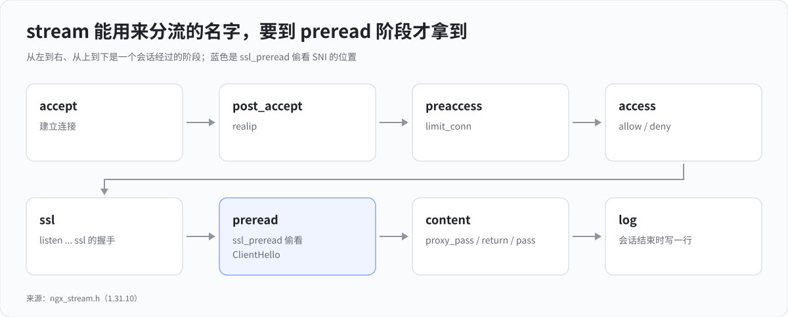
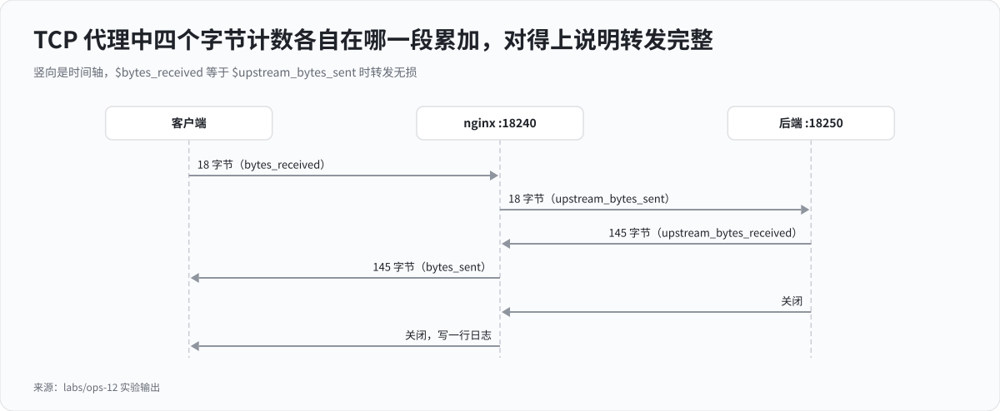
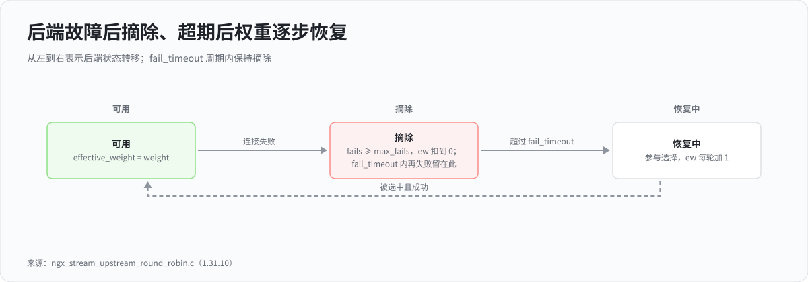
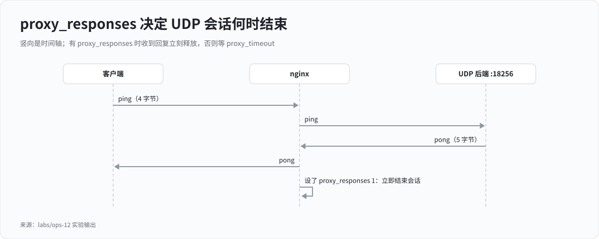
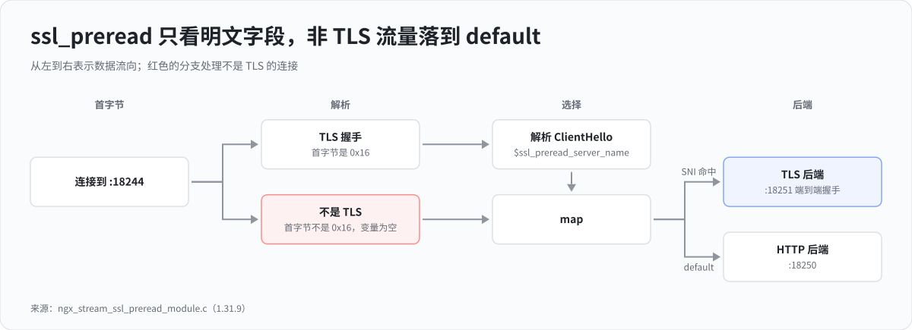
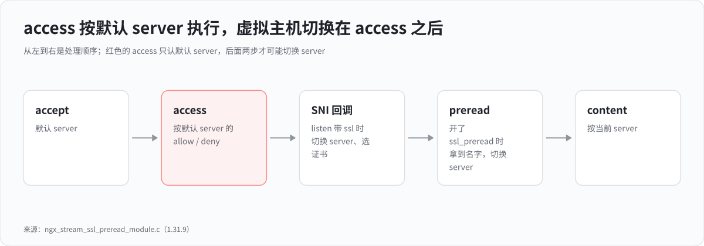
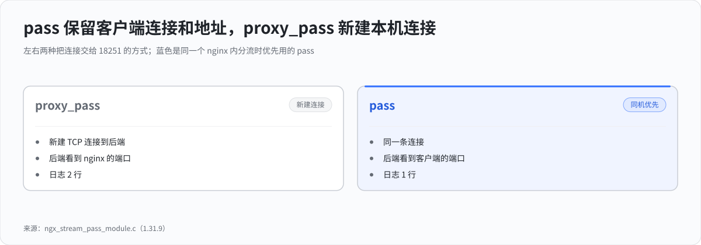
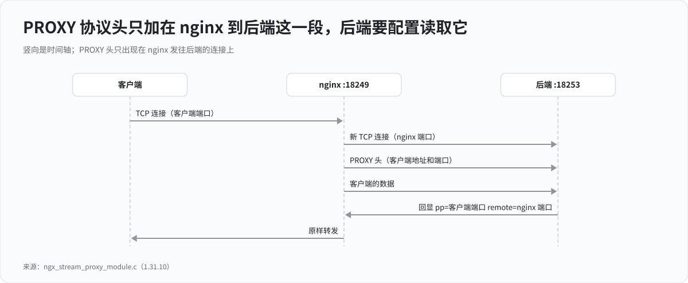
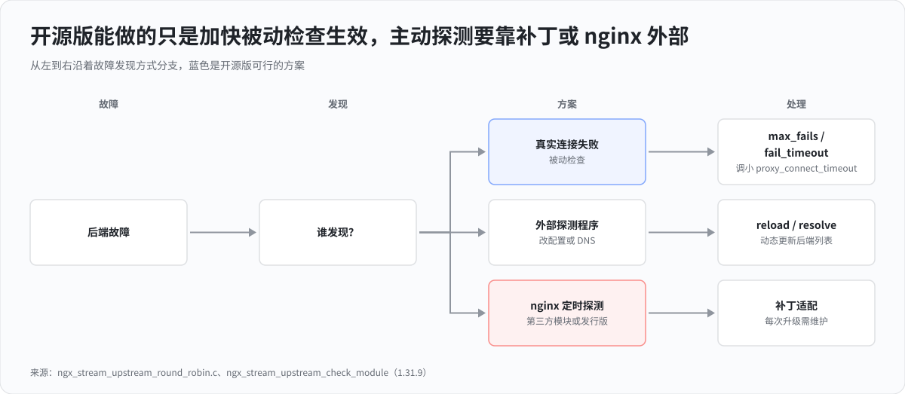

# 运维篇 12｜四层代理：stream 模块只看字节和连接，路由信息全靠 ClientHello 和 PROXY 协议头

> **一句话结论**：stream 模块转发的是字节流，一个会话从 accept 开始、到任意一端关闭或超时结束，日志在结束时才写一行；它不解析上层协议，所以能用来分流的只有监听地址、客户端地址，以及 `ssl_preread` 从 TLS ClientHello 里偷看到的 SNI 和 ALPN。被动健康检查和 HTTP 一样：连接失败一次就把后端摘掉 `fail_timeout`，到期后它的权重从 0 慢慢涨回来，所以不一定是到期后的第一个连接去试。UDP 会话默认不会因为收到回复就结束，要么设 `proxy_responses`，要么等 `proxy_timeout`（默认 10 分钟）。1.25.5 起 stream 也有了 `server_name` 虚拟主机和 `pass` 指令：前者让 preread 到的名字直接选 `server{}`，后者把连接原样交给本机另一个监听端口，不新建 TCP 连接。两者各有一个不报错的陷阱：access 阶段排在切换之前，被选中的 server 里写 `deny all` 不生效；`pass` 找不到目标端口时以状态 200 结束会话。`proxy_protocol` 把客户端地址带给后端，`v2` 是 1.31.4 新增的。
>
> 适用版本：nginx 1.31.9（mainline，2026-11-18）。「版本差异」：1.30.7 stable 的 stream 目录比 1.31.9 少一个 `ngx_stream_upstream_least_time_module.c`（`least_time`，1.31.0）；`proxy_ssl_alpn`（1.31.0）和 `proxy_protocol v2`（1.31.4）也只有 mainline 有，1.30.7 的 `proxy_protocol` 仍是 `on`/`off` 开关。虚拟主机和 `pass`（1.25.5）两个版本都有。两个版本 2026-11-18 同时修了两个 stream 漏洞：`ssl_preread` 对畸形 ClientHello 的解析与其他 TLS 实现不一致（CVE-2026-123640），以及 SNI 选中的虚拟主机却用默认 server 的配置校验客户端证书（CVE-2026-120967），用 stream 的都应升级。实验：[`labs/ops-12`](../labs/ops-12/)，单 worker，在 macOS（kqueue）上运行；18240–18254 是各个前端，18250 是一个 HTTP 后端，18251 是带两个证书的 TLS 后端，18253 是读 PROXY 协议的后端，18256 是 UDP 后端，18259 和 18258 没有进程监听。客户端是实验目录里的 `client.py`，它会打印自己用的本地端口。

## 导读

| 你想知道 | 看哪一节 |
|---|---|
| stream 会话怎么走，日志里的字节数怎么对 | §1 |
| 后端连不上时怎么换机器，摘掉的后端什么时候回来 | §2 |
| UDP 会话为什么迟迟不写日志 | §3 |
| 一个端口上按 SNI 把 TLS 分给不同后端，普通 TCP 走另一处 | §4 |
| 1.25.5 的 stream 虚拟主机 | §5 |
| `pass` 和 `proxy_pass` 有什么不同 | §6 |
| 让后端拿到真实的客户端地址 | §7 |
| 开源版没有主动健康检查，作者 2017 年的模块今天还能不能用 | §8 |

stream 和 HTTP 一样按阶段处理，但阶段只有 7 个，而且没有“请求”：一个连接（UDP 是一组同源的数据报）就是一个会话。下图的判断是：所有路由决策都发生在 content 阶段之前，能用的信息只有连接本身和 preread 阶段读到的头几个字节。



阶段的顺序来自 [`ngx_stream.h`](https://github.com/nginx/nginx/blob/release-1.31.9/src/stream/ngx_stream.h#L85) 里的枚举；`$status` 的取值也定义在这个头文件里：200 正常结束、400 客户端数据不对、403 被 access 拒绝、500 内部错误、502 后端连不上、503 被限连。

## 1. stream 代理只搬字节：两边的字节数在一行日志里对得上

最简单的配置是一个监听端口加一个 `proxy_pass`。实验在 stream 级别定义了一个日志格式，记下监听端口、协议、状态和四个字节计数：

```nginx
# lab: labs/ops-12/conf/nginx.conf
stream {
    log_format s '$server_port $protocol $status sent=$bytes_sent recv=$bytes_received '
                 'up=[$upstream_addr] upsent=$upstream_bytes_sent uprecv=$upstream_bytes_received';
    access_log logs/stream.log s;

    upstream one {
        server 127.0.0.1:18250;
    }
# ...
    # TCP proxy
    server {
        listen 127.0.0.1:18240;
        proxy_pass one;
    }
```

18250 是同一个 nginx 里的 HTTP server。客户端往 18240 发一个 18 字节的 `GET / HTTP/1.0\r\n\r\n`，读到对端关闭：

```text
# labs/ops-12 ## a TCP proxy and its log line
bytes=145 first=HTTP/1.1 200 OK
18240 TCP 200 sent=145 recv=18 up=[127.0.0.1:18250] upsent=18 uprecv=145
ok - bytes_received = upstream_bytes_sent = the 18-byte request; bytes_sent = upstream_bytes_received = what the client got
```

stream 不知道这是 HTTP：它从客户端收了 18 字节，原样发给后端；从后端收了 145 字节，原样发给客户端。`$bytes_received` 等于 `$upstream_bytes_sent`、`$bytes_sent` 等于 `$upstream_bytes_received`，是一个纯转发会话的特征；两边对不上，说明会话中途断了，或者前面有 preread、PROXY 协议头这类 nginx 自己加减的字节。

会话什么时候结束，由几个超时和计数决定，默认值都在 `ngx_stream_proxy_merge_srv_conf` 里：`proxy_connect_timeout` 60 秒，`proxy_timeout`（两次读写之间的最长空闲）10 分钟，`proxy_buffer_size` 16k，`proxy_next_upstream` 默认开，`proxy_next_upstream_tries` 和 `proxy_next_upstream_timeout` 默认 0（不限）。日志只在会话结束时写，所以一条长连接（数据库连接池、MQTT）可能几个小时都不出现在日志里；排查“现在有哪些连接”要看 `ss`/`netstat`，不能看 access log。

下图是一次 TCP 会话里字节的流向，四个计数各自在哪一段累加：



**小结**：stream 的日志是“会话结束记录”，四个字节计数能直接核对转发是否完整；长连接要靠连接数监控，不能等日志。

## 2. 被动健康检查：失败一次摘掉 fail_timeout，到期后权重从 0 涨回来

`fo` 组的第一台 18259 没有进程监听，连接会被拒绝；`fail_timeout` 设成 2 秒以便实验：

```nginx
# lab: labs/ops-12/conf/nginx.conf
    # 18259 has no listener: connect() is refused
    upstream fo {
        server 127.0.0.1:18259 max_fails=1 fail_timeout=2s;
        server 127.0.0.1:18250;
    }
```

实验先连 2 次，等 3.2 秒，再连 3 次，每次看日志里的 `$upstream_addr`：

```text
# labs/ops-12 ## failover and the passive check
session 1: 127.0.0.1:18259, 127.0.0.1:18250
session 2: 127.0.0.1:18250
session 3: 127.0.0.1:18250
session 4: 127.0.0.1:18250
session 5: 127.0.0.1:18259, 127.0.0.1:18250
[error] kevent() reported that connect() failed (61: Connection refused)
[warn] upstream server temporarily disabled
[error] kevent() reported that connect() failed (61: Connection refused)
[warn] upstream server temporarily disabled
ok - the dead server is skipped for fail_timeout, then the smooth round robin brings it back after two picks of the live one
ok - two refused connects, each one disables the server
```

第 1 个会话先选到 18259，连接被拒绝，换到 18250，客户端没有感觉；`$upstream_addr` 里两个地址用 `, ` 隔开。错误行的写法和平台有关：macOS 的 kqueue 直接带回错误，写成 `kevent() reported that connect() failed`；Linux 上走 `getsockopt(SO_ERROR)`，写成 `connect() failed (111: Connection refused)`：

```c
// src/stream/ngx_stream_proxy_module.c:1884-1914
#if (NGX_HAVE_KQUEUE)

    if (ngx_event_flags & NGX_USE_KQUEUE_EVENT)  {
        err = c->write->kq_errno ? c->write->kq_errno : c->read->kq_errno;

        if (err) {
            (void) ngx_connection_error(c, err,
                                    "kevent() reported that connect() failed");
            return NGX_ERROR;
        }

    } else
#endif
    {
        err = 0;
        len = sizeof(int);

        /*
         * BSDs and Linux return 0 and set a pending error in err
         * Solaris returns -1 and sets errno
         */

        if (getsockopt(c->fd, SOL_SOCKET, SO_ERROR, (void *) &err, &len)
            == -1)
        {
            err = ngx_socket_errno;
        }

        if (err) {
            (void) ngx_connection_error(c, err, "connect() failed");
            return NGX_ERROR;
```

失败后，[`ngx_stream_upstream_free_round_robin_peer_locked`](https://github.com/nginx/nginx/blob/release-1.31.9/src/stream/ngx_stream_upstream_round_robin.c#L807) 做三件事：`fails` 加 1、`checked` 记成现在、`effective_weight` 扣掉 `weight / max_fails`，扣到负数按 0 算：

```c
// src/stream/ngx_stream_upstream_round_robin.c:841-860
        peer->fails++;
        peer->accessed = now;
        peer->checked = now;

        if (peer->max_fails) {
            peer->effective_weight -= peer->weight / peer->max_fails;

            if (peer->fails >= peer->max_fails) {
                ngx_log_error(NGX_LOG_WARN, pc->log, 0,
                              "upstream server temporarily disabled");
            }
        }

        ngx_log_debug2(NGX_LOG_DEBUG_STREAM, pc->log, 0,
                       "free rr peer failed: %p %i",
                       peer, peer->effective_weight);

        if (peer->effective_weight < 0) {
            peer->effective_weight = 0;
        }
```

选后端时，`fails >= max_fails` 并且 `now - checked <= fail_timeout` 的直接跳过；没被跳过的，`current_weight` 加上 `effective_weight`，`effective_weight` 小于 `weight` 时每次加 1：

```c
// src/stream/ngx_stream_upstream_round_robin.c:741-800
        if (peer->down) {
            continue;
        }

        if (peer->max_fails
            && peer->fails >= peer->max_fails
            && now - peer->checked <= peer->fail_timeout)
        {
            continue;
        }

        if (peer->max_conns && peer->conns >= peer->max_conns) {
            continue;
        }

        peer->current_weight += peer->effective_weight;
        total += peer->effective_weight;

        if (peer->effective_weight < peer->weight) {
            peer->effective_weight++;
        }

        if (best == NULL || peer->current_weight > best->current_weight) {
            best = peer;
            p = i;
        }
    }
/* ... */
    best->current_weight -= total;
```

这里有两个容易忽略的细节。第一，`now` 和 `checked` 都是整秒（`ngx_time()`），`fail_timeout=2s` 意味着差值为 0、1、2 秒时都跳过，实际摘除时长在 2 到 3 秒之间，所以实验等了 3.2 秒。第二，到期后 18259 重新参与选择，但它的 `effective_weight` 已经是 0。按上面的代码逐步算（两台权重都是 1，`cw` 是 `current_weight`，`ew` 是 `effective_weight`，第 3 个会话开始时 18259 是 `cw=-1, ew=0`，18250 是 `cw=1, ew=1`）：

| 会话 | 18259 加权后 cw（ew） | 18250 加权后 cw | total | 选中 | 选后 cw（18259 / 18250） |
|---|---|---|---|---|---|
| 3 | -1（ew 涨到 1） | 2 | 1 | 18250 | -1 / 1 |
| 4 | 0 | 2 | 2 | 18250 | 0 / 0 |
| 5 | 1 | 1 | 2 | 18259（平局取先列出的） | -1 / 1 |

算出来到期后先是 18250、18250，第 3 个才轮到 18259，和实验的 session 3–5 一致。HTTP upstream 用的是同一套算法，[运维篇 07](07-load-balancing.md) 的实验“到期后 4 个请求里只试一次”也是这个原因。权重越高、后端越多，坏掉的那台回来得越慢；这是平滑加权轮询的设计（刚恢复的后端逐步加流量），不是 bug。



和 HTTP 一样，只有一台后端的 upstream（包括 `proxy_pass 地址:端口` 生成的隐式 upstream）走 `peers->single` 分支，失败计数不起作用，每个会话都会再去连。

**小结**：stream 的被动检查和 HTTP 同源，只能发现“连不上”；连上了但服务不可用（端口在、进程卡死）它看不出来，这正是 §8 主动检查要补的缺口。

## 3. UDP 会话默认等 proxy_timeout 才结束；proxy_responses 让它收到回复就结束

UDP 没有连接，nginx 把同一个源地址和端口来的数据报归成一个会话。会话什么时候算完，取决于 `proxy_responses`，它的默认值是 `NGX_MAX_INT32_VALUE`，等于不限：

```c
// src/stream/ngx_stream_proxy_module.c:2478-2482
    ngx_conf_merge_uint_value(conf->requests,
                              prev->requests, 0);

    ngx_conf_merge_uint_value(conf->responses,
                              prev->responses, NGX_MAX_INT32_VALUE);
```

实验的两个 UDP 前端都转给同一个回 `pong\n` 的后端，一个设 `proxy_responses 1`，一个只把 `proxy_timeout` 缩到 2 秒：

```nginx
# lab: labs/ops-12/conf/nginx.conf
    # UDP: one reply ends the session
    server {
        listen 127.0.0.1:18242 udp;
        proxy_responses 1;
        proxy_pass 127.0.0.1:18256;
    }

    # UDP: proxy_responses not set, the session waits for proxy_timeout
    server {
        listen 127.0.0.1:18243 udp;
        proxy_timeout 2s;
        proxy_pass 127.0.0.1:18256;
    }

    # UDP backend
    server {
        listen 127.0.0.1:18256 udp;
        return "pong\n";
    }
```

```text
# labs/ops-12 ## UDP sessions
bytes=5 first=pong
proxy_responses 1: 1 log line right after the reply: 18242 UDP 200 sent=5 recv=4 up=[127.0.0.1:18256] upsent=4 uprecv=5
bytes=5 first=pong
no proxy_responses: 0 log lines after 0.5 s, 1 after proxy_timeout 2s: 18243 UDP 200 sent=5 recv=4 up=[127.0.0.1:18256] upsent=4 uprecv=5
ok - with proxy_responses the session ends on the reply; without it, at proxy_timeout
```

两边客户端都立刻拿到了回复，区别在 nginx 一侧：没设 `proxy_responses` 的会话在回复之后还挂着，等 2 秒没有新数据报才结束、写日志。默认的 `proxy_timeout` 是 10 分钟，DNS 这类“一问一答”的 UDP 服务如果不设 `proxy_responses 1`，每个客户端端口都会占住一个会话（一个 worker 连接、一个到后端的 socket）10 分钟，QPS 一高就会耗尽 `worker_connections`。

下图对比两种配置下会话的生命周期，判断是：回复到达客户端的时间相同，差别只在 nginx 什么时候释放会话：



**小结**：一问一答的 UDP 服务按每个请求的回复数设 `proxy_responses`（DNS 是 1），有来有回的长会话（游戏、QUIC 透传）才依赖 `proxy_timeout`。

## 4. ssl_preread 只偷看 ClientHello：按 SNI 分流，不是 TLS 的流量照样往下走

`ssl_preread on` 在 preread 阶段读 TLS 的第一条记录，解析出 SNI、协议版本和 ALPN，放进 `$ssl_preread_server_name`、`$ssl_preread_protocol`、`$ssl_preread_alpn_protocols`，nginx 自己不做握手。实验用一个 `map` 把 a.test 和 b.test 送到 18251，其余的（包括取不到 SNI 的）送到 HTTP 后端 18250：

```nginx
# lab: labs/ops-12/conf/nginx.conf
    # SNI routing with ssl_preread and a map; anything that is not TLS goes to HTTP
    map $ssl_preread_server_name $sni_up {
        a.test   127.0.0.1:18251;
        b.test   127.0.0.1:18251;
        default  127.0.0.1:18250;
    }

    server {
        listen 127.0.0.1:18244;
        ssl_preread on;
        proxy_pass $sni_up;
    }
```

```text
# labs/ops-12 ## SNI routing with ssl_preread
bytes=49 first=A sni=a.test server_port=18251 remote_port=<port> cert=a.test 
bytes=49 first=B sni=b.test server_port=18251 remote_port=<port> cert=b.test 
bytes=145 first=HTTP/1.1 200 OK
ok - a.test and b.test reach the TLS server with their own certificate; plain HTTP goes to the default
```

TLS 客户端和后端 18251 之间是端到端的握手，证书由后端出示，nginx 只看到了明文的 ClientHello。第三行是往同一个端口发的明文 HTTP 请求，它也被正确送到了 HTTP 后端。原因在 [`ngx_stream_ssl_preread_handler`](https://github.com/nginx/nginx/blob/release-1.31.9/src/stream/ngx_stream_ssl_preread_module.c#L108) 里：第一个字节不是 0x16（TLS 握手记录），就清掉上下文、返回 `NGX_DECLINED`，会话继续往下走，变量都是空：

```c
// src/stream/ngx_stream_ssl_preread_module.c:152-167
    while (last - p >= 5) {

        if ((p[0] & 0x80) && p[2] == 1 && (p[3] == 0 || p[3] == 3)) {
            ngx_log_debug0(NGX_LOG_DEBUG_STREAM, ctx->log, 0,
                           "ssl preread: version 2 ClientHello");
            ctx->version[0] = p[3];
            ctx->version[1] = p[4];
            return NGX_OK;
        }

        if (p[0] != 0x16) {
            ngx_log_debug0(NGX_LOG_DEBUG_STREAM, ctx->log, 0,
                           "ssl preread: not a handshake");
            ngx_stream_set_ctx(s, NULL, ngx_stream_ssl_preread_module);
            return NGX_DECLINED;
        }
```

所以“一个端口同时接 TLS 和明文协议”可以靠 `map` 的 `default` 实现。要注意 preread 要等到数据：客户端连上后一个字节都不发（SMTP、MySQL 这类由服务端先发数据的协议），preread 会一直等到 `preread_timeout`（默认 30 秒），超时后按“读完了”处理继续往下走，这些协议的首包延迟就多了 30 秒。这类端口不要开 `ssl_preread`。

偷看是怎么做到“不吃掉”数据的：在 kqueue 和支持 `EPOLLRDHUP` 的 epoll 上，[`ngx_stream_preread_peek`](https://github.com/nginx/nginx/blob/release-1.31.9/src/stream/ngx_stream_core_module.c#L347) 用 `recv(..., MSG_PEEK)` 读，处理完把缓冲区指针拨回去，字节还留在内核里：

```c
// src/stream/ngx_stream_core_module.c:374-382
        return NGX_STREAM_OK;
    }

    c->buffer->last += n;

    rc = ph->handler(s);

    if (rc != NGX_AGAIN) {
        c->buffer->last = c->buffer->pos;
```

其他事件模型走普通的 `recv`，读出来的字节留在 `c->buffer` 里，由 `proxy_pass` 先发给后端。两种方式对 `proxy_pass` 没有区别，对 §6 的 `pass` 有区别。

下图把 18244 上三种连接的走向画在一起，判断是：分流只依赖 ClientHello 里的明文字段，非 TLS 流量落到 `default`：



**小结**：`ssl_preread` 适合“TLS 透传 + 按域名分流”，证书和私钥都留在后端；它只看明文字段，后端仍要自己校验 SNI 与证书匹配，安全策略不能只靠 nginx 这一层的 SNI 判断（1.31.9 修的 CVE-2026-123640 正是 preread 与 TLS 库解析不一致的问题）。

## 5. 1.25.5 起 stream 有虚拟主机：preread 的名字或 TLS 握手的 SNI 直接选 server{}

§4 的 `map` 写法在 1.25.5 之前是唯一的办法。现在同一个监听地址上可以放多个 `server{}`，用 `server_name` 区分：

```nginx
# lab: labs/ops-12/conf/nginx.conf
    # virtual servers (1.25.5): the preread name picks the server{}
    server {
        listen 127.0.0.1:18245;
        ssl_preread on;
        proxy_pass 127.0.0.1:18250;
    }

    server {
        listen 127.0.0.1:18245;
        server_name a.test;
        ssl_preread on;
        proxy_pass 127.0.0.1:18251;
    }
```

```text
# labs/ops-12 ## virtual servers selected by the preread name
bytes=49 first=A sni=a.test server_port=18251 remote_port=<port> cert=a.test 
bytes=145 first=HTTP/1.1 200 OK
ok - a.test is served by its server{}, anything else by the default one
```

会话一开始总是落在这个地址的默认 server（第一个，或带 `default_server` 的那个）。preread 解析出名字后，[`ngx_stream_ssl_preread_servername`](https://github.com/nginx/nginx/blob/release-1.31.9/src/stream/ngx_stream_ssl_preread_module.c#L547) 先校验主机名，再查虚拟主机表，查到了就把整个会话的 `srv_conf` 换成那个 server 的：

```c
// src/stream/ngx_stream_ssl_preread_module.c:566-586
    rc = ngx_stream_validate_host(&host, c->pool, 0);

    if (rc == NGX_ERROR) {
        return NGX_ERROR;
    }

    if (rc == NGX_DECLINED) {
        return NGX_OK;
    }

    rc = ngx_stream_find_virtual_server(s, &host, &cscf);

    if (rc == NGX_ERROR) {
        return NGX_ERROR;
    }

    if (rc == NGX_DECLINED) {
        return NGX_OK;
    }

    s->srv_conf = cscf->ctx->srv_conf;
```

[`ngx_stream_find_virtual_server`](https://github.com/nginx/nginx/blob/release-1.31.9/src/stream/ngx_stream_core_module.c#L668) 和 HTTP 的查找一样，先查精确名和通配名的组合哈希，再按顺序试正则：

```c
// src/stream/ngx_stream_core_module.c:668-686
ngx_stream_find_virtual_server(ngx_stream_session_t *s,
    ngx_str_t *host, ngx_stream_core_srv_conf_t **cscfp)
{
    ngx_stream_core_srv_conf_t  *cscf;

    if (s->virtual_names == NULL) {
        return NGX_DECLINED;
    }

    cscf = ngx_hash_find_combined(&s->virtual_names->names,
                                  ngx_hash_key(host->data, host->len),
                                  host->data, host->len);

    if (cscf) {
        *cscfp = cscf;
        return NGX_OK;
    }

#if (NGX_PCRE)
```

有两点由此而来。第一，`ssl_preread on` 必须在默认 server 里打开（或者写在 `stream{}` 级别让所有 server 继承），因为 preread 阶段运行时会话还在默认 server，只在 a.test 里开是不会生效的。第二，切换发生在 preread 阶段，而 access 阶段（`allow`/`deny`）排在它前面，执行的是默认 server 的规则。实验在 18246 上把这一点做成了反例：a.test 的 `server{}` 里写了 `deny all`，a.test 的连接照样通过：

```nginx
# lab: labs/ops-12/conf/nginx.conf
    # access rules in a server{} that preread selects
    server {
        listen 127.0.0.1:18246;
        ssl_preread on;
        proxy_pass 127.0.0.1:18250;
    }

    server {
        listen 127.0.0.1:18246;
        server_name a.test;
        ssl_preread on;
        deny all;
        proxy_pass 127.0.0.1:18251;
    }
```

```text
# labs/ops-12 ## access rules run before the preread name switches the server
bytes=49 first=A sni=a.test server_port=18251 remote_port=<port> cert=a.test 
18246 TCP 200 up=[127.0.0.1:18251]
ok - deny all in the a.test server{} does not stop a.test: the access phase ran in the default server
```

日志状态是 200，error.log 里没有 `access forbidden by rule`。按来源地址限制某个域名，在 stream 里写在被选中的 server 里是无效的；要么写进默认 server（对所有名字生效），要么在后端（这里的 18251）做。`nginx -t` 不会对这种写法给出任何提示。

另一处会切换虚拟主机的是 `listen ... ssl` 的 TLS 握手：SNI 回调里同样调用 `ngx_stream_find_virtual_server`，选中的 server 决定用哪张证书。18251 就是这样配的，§4 的输出里 a.test 和 b.test 各自拿到了自己的证书：

```nginx
# lab: labs/ops-12/conf/nginx.conf
    # TLS termination: two virtual servers, two certificates
    server {
        listen 127.0.0.1:18251 ssl;
        server_name a.test;
        ssl_certificate     ../out/run/a.crt;
        ssl_certificate_key ../out/run/a.key;
        return "A sni=$ssl_server_name server_port=$server_port remote_port=$remote_port\n";
    }

    server {
        listen 127.0.0.1:18251 ssl;
        server_name b.test;
        ssl_certificate     ../out/run/b.crt;
        ssl_certificate_key ../out/run/b.key;
        return "B sni=$ssl_server_name server_port=$server_port remote_port=$remote_port\n";
    }
```

1.31.9 修的 CVE-2026-120967 就在这里：握手同步完成时，客户端证书曾按默认 server 的配置校验，而不是 SNI 选中的那个。不同虚拟主机配了不同 `ssl_client_certificate`/`ssl_verify_client` 的部署，升级前不能假定校验用的是本 server 的 CA。

下图是一个会话在虚拟主机之间切换的两个时机，判断是：切换之前的阶段一律按默认 server 执行：



**小结**：stream 虚拟主机让“按域名分流”可以写成和 HTTP 一样的 `server_name` 结构，但切换点在 access 之后：被选中的 server 里写 `allow`/`deny` 不生效，访问控制和 preread 开关都要放在默认 server 或 `stream{}` 级别。

## 6. pass 把连接交给本机另一个监听端口：不新建连接，后端看到的是客户端自己

`pass`（1.25.5，`ngx_stream_pass_module`）的典型用法是“前面用 `ssl_preread` 分流，一部分连接交给本机终结 TLS 的 server”。用 `proxy_pass 127.0.0.1:端口` 也能做到，区别在于 `proxy_pass` 会新建一条到本机的 TCP 连接，`pass` 直接把已经 accept 的连接挂到目标监听端口上：

```nginx
# lab: labs/ops-12/conf/nginx.conf
    # pass (1.25.5): hand the connection to the TLS listener above
    server {
        listen 127.0.0.1:18247;
        ssl_preread on;
        pass 127.0.0.1:18251;
    }

    # pass to an address no listen socket has
    server {
        listen 127.0.0.1:18248;
        pass 127.0.0.1:18258;
    }
```

18251 的 `return` 会回显它看到的 `$remote_port`，客户端拿它和自己的本地端口比：

```text
# labs/ops-12 ## pass keeps the client's connection, proxy_pass opens a new one
via 18247: backend sees the client's own port: yes
via 18244: backend sees the client's own port: no
1x port 18244 TCP 200
2x port 18251 TCP 200
ok - pass: same port, no log line for 18247; proxy_pass: nginx's port
[error] port not found for "127.0.0.1:18258" while passing connection to port
ok - a pass to an unknown address ends with status 200
```

经过 18247 的 `pass`，18251 看到的远端端口就是客户端的端口，`$remote_addr` 也是客户端的地址，后端的 `allow`/`deny`、`limit_conn`、日志都按真实客户端算，不需要 PROXY 协议。日志也有区别：经 `proxy_pass` 的会话写了两行（18244 一行、18251 一行），经 `pass` 的只有 18251 一行。原因在 [`ngx_stream_pass_handler`](https://github.com/nginx/nginx/blob/release-1.31.9/src/stream/ngx_stream_pass_module.c#L72)：找到匹配的监听 socket 后，它重置连接的缓冲区和日志，把本地地址改成目标地址，直接调用那个监听 socket 的 handler，原来的会话没有走到 finalize：

```c
// src/stream/ngx_stream_pass_module.c:144-170
    for (i = 0; i < ngx_cycle->listening.nelts; i++) {

        if (ngx_stream_pass_match(&ls[i], addr) != NGX_OK) {
            continue;
        }

        c->listening = &ls[i];

        c->data = NULL;
        c->buffer = NULL;

        *c->log = c->listening->log;
        c->log->handler = NULL;
        c->log->data = NULL;

        c->local_sockaddr = addr->sockaddr;
        c->local_socklen = addr->socklen;

        c->listening->handler(c);

        return;
    }

    ngx_log_error(NGX_LOG_ERR, c->log, 0,
                  "port not found for \"%V\"", &addr->name);

    ngx_stream_finalize_session(s, NGX_STREAM_OK);
```

最后两行是一个排障陷阱：`pass` 的目标地址在本机找不到监听 socket 时，只打一条 error，然后以状态 **200** 结束会话。按 `$status` 统计错误率的监控看不到这种失败，要盯 error.log 里的 `port not found`。目标地址必须是本 nginx 的某个 `listen`，`pass` 不会去连别的进程。

`pass` 还有两个前提，都在函数开头：UDP 会话不能 pass；连接的缓冲区里还有 preread 读出来没发走的数据也不能 pass，会报 `cannot pass connection with preread data`：

```c
// src/stream/ngx_stream_pass_module.c:82-95
    c = s->connection;

    c->log->action = "passing connection to port";

    if (c->type == SOCK_DGRAM) {
        ngx_log_error(NGX_LOG_ERR, c->log, 0, "cannot pass udp connection");
        goto failed;
    }

    if (c->buffer && c->buffer->pos != c->buffer->last) {
        ngx_log_error(NGX_LOG_ERR, c->log, 0,
                      "cannot pass connection with preread data");
        goto failed;
    }
```

这就是 §4 讲 `MSG_PEEK` 的意义：在 kqueue 和带 `EPOLLRDHUP` 的 epoll 上，preread 只是偷看，缓冲区被拨回空，`ssl_preread` 加 `pass` 能用；在不能 peek 的事件模型上（例如老内核的 epoll、`select`/`poll`），preread 真的把数据读走了，`pass` 会以 500 失败。本实验在 macOS 的 kqueue 上运行，Linux 上的行为来自源码里 `ngx_stream_preread_can_peek` 的条件。

下图对比两种转交方式的连接数，判断是：`pass` 少一条本机 TCP 连接，也少一次地址丢失：



**小结**：同一个 nginx 里“分流之后再终结 TLS”优先用 `pass`，它省一条连接并保留客户端地址；但它返回 200 的失败模式要单独告警。

## 7. proxy_protocol 把客户端地址带给后端；v2 是 1.31.4 新增的二进制格式

后端是另一台机器或另一个进程时，`pass` 用不上，客户端地址要靠 PROXY 协议传：前端在转发数据之前先发一行（v1，文本）或一段（v2，二进制）头，后端的 `listen ... proxy_protocol` 把它读掉，填进 `$proxy_protocol_addr` 和 `$proxy_protocol_port`。1.31.4 起，`proxy_protocol` 指令从开关变成了枚举：

```c
// src/stream/ngx_stream_proxy_module.c:148-153
static ngx_conf_enum_t  ngx_stream_proxy_protocol_versions[] = {
    { ngx_string("off"), 0 },
    { ngx_string("on"), 1 },
    { ngx_string("v2"), 2 },
    { ngx_null_string, 0 }
};
```

「版本差异」：1.30.7 的这条指令用 `ngx_conf_set_flag_slot`，只接受 `on`/`off`，写 `v2` 会在 `nginx -t` 时报错。实验的两个前端分别发 v1 和 v2，后端回显它读到的地址和 TCP 层面的远端地址：

```nginx
# lab: labs/ops-12/conf/nginx.conf
    # PROXY protocol v1 and v2 to a backend that reads it
    server {
        listen 127.0.0.1:18249;
        proxy_protocol on;
        proxy_pass 127.0.0.1:18253;
    }

    server {
        listen 127.0.0.1:18254;
        proxy_protocol v2;
        proxy_pass 127.0.0.1:18253;
    }

    server {
        listen 127.0.0.1:18253 proxy_protocol;
        return "pp=$proxy_protocol_addr:$proxy_protocol_port remote=$remote_addr:$remote_port\n";
    }
```

```text
# labs/ops-12 ## PROXY protocol v1 and v2
via 18249: pp=127.0.0.1:<client port> remote=127.0.0.1:<port>
via 18254: pp=127.0.0.1:<client port> remote=127.0.0.1:<port>
[error] broken header: "GET / HTTP/1.0" while reading PROXY protocol
ok - both versions carry the client port; a connection without the header gets 400
```

18249（v1）和 18254（v2）两种格式都把客户端的端口带到了后端，`$remote_port` 仍是 nginx 连后端用的端口。要让 `$remote_addr` 本身变成客户端地址，后端再加 `set_real_ip_from`（stream 的 realip 模块，在 post_accept 阶段改写）。最后一行是直接连 18253、不带头的结果：`listen ... proxy_protocol` 的端口只认带头的连接，其他一律 `broken header` 并以 400 结束。这也意味着一个端口不能同时服务“经过代理”和“直连”两类客户端，要么分端口，要么所有流量都经过会加头的那一层。

下图是 PROXY 协议头在两段连接里的位置，判断是：头只存在于 nginx 到后端这一段，客户端感知不到：



**小结**：跨进程、跨机器传客户端地址用 PROXY 协议，两端必须同时配置；v2 是二进制格式、能带 TLV 扩展，需要 1.31.4 以上的 mainline，stable 1.30.x 只能发 v1。

## 8. 开源版只有被动检查；作者 2017 年的主动检查模块在 1.31.9 上不能直接打补丁

§2 的被动检查只能在真实流量连接失败时发现问题。开源 nginx 的 stream 模块到 1.31.9 仍然没有主动探测（定时向后端发请求、根据结果上下线）的指令。本系列作者 2017 年写过一个第三方模块 [zyaochen/ngx_stream_upstream_check_module](https://github.com/zyaochen/ngx_stream_upstream_check_module)，以下只陈述可以核对的事实：

- 仓库创建于 2017-12-13，最后一次推送是 2017-12-25，不是 fork；文件是 `README.md`、`build.sh`、`config`、`nginx-stable-1.12+.patch`、`ngx_stream_upstream_check_module.c`、`.h`。
- README 说明它为 stream upstream 提供主动健康检查，检查类型支持 TCP、UDP、HTTP，配置写在 `upstream` 块里，例如 `check interval=3000 rise=2 fall=5 timeout=5000 default_down=true type=tcp;`，HTTP 类型另有 `check_http_send` 和 `check_http_expect_alive`。
- 它需要给 nginx 源码打补丁 `nginx-stable-1.12+.patch`，补丁改 4 个文件：stream 的 hash、least_conn、round_robin 三个 `.c` 和 `ngx_stream_upstream_round_robin.h`，在 peer 结构体里加一个 `check_index` 字段，并在选后端时跳过被检查判为下线的 peer。

2026-11-21 在 1.31.9 源码的副本上做了两种 dry-run：`git apply --check` 对 hash、round_robin 的 `.c` 和 `.h` 三个文件报 `patch does not apply`；`patch -p1 --dry-run` 能把三个 `.c` 文件的所有 hunk 带偏移和 fuzz 套上，但 `ngx_stream_upstream_round_robin.h` 的唯一 hunk 失败。失败的原因可以从结构体看出来：补丁假定 `next` 字段后面紧跟 `NGX_COMPAT_BEGIN(25)`，而 1.31.9 在两者之间加了 `least_time`（1.31.0）用的 7 个统计字段，兼容占位也从 25 变成了 7：

```c
// src/stream/ngx_stream_upstream_round_robin.h:73-88
    ngx_stream_upstream_rr_peer_t   *next;

#if (NGX_STREAM_UPSTREAM_LEAST_TIME || NGX_COMPAT)
    ngx_msec_t                       connect_time;
    ngx_msec_t                       first_byte_time;
    ngx_msec_t                       response_time;
    ngx_msec_t                       inflight_time;
    ngx_msec_t                       inflight_last;
    ngx_msec_t                       inflight_reqs_changed;
    ngx_uint_t                       inflight_reqs;
#endif

    NGX_COMPAT_BEGIN(7)
    NGX_COMPAT_END
};
```

也就是说，要在 1.31.9 上用这个模块，至少要手工改 `.h` 的补丁；1.31.0 新增的 `least_time` 均衡器也没有被补丁覆盖，用它的 upstream 不会跳过被检查判为下线的后端。改完能否编译、运行是否正确，本篇没有验证。

在没有主动检查的前提下，可行的做法有三类：接受被动检查，把 `proxy_connect_timeout` 从默认 60 秒调到秒级，让“连接超时”这种最慢的失败尽快换机器；由外部的检查程序根据探测结果改配置并 reload（或者用 `upstream` 的 `zone` 加 `resolve`，让 DNS 决定后端列表）；或者用带主动检查的发行版、第三方模块，并为每次 nginx 升级预留补丁适配的工作量。

下图把三种做法放在“发现故障靠什么”这一条轴上比较，判断是：开源版能做的只是让被动检查更快生效，主动探测都要在 nginx 之外或补丁里实现：



**小结**：stream 的健康检查要按“连不上、连上但不可用”两类故障分别设计；后一类开源版看不见，选第三方模块时先在目标版本上 dry-run 补丁，作者 2017 年的模块在 1.31.9 上就过不了这一步。

## 已知局限与待核实

- 实验只在 macOS（kqueue）上运行。Linux 上 connect 失败的日志写法、`MSG_PEEK` 是否可用（取决于 `EPOLLRDHUP`）来自源码，没有在 Linux 上实测；不能 peek 时 `ssl_preread` 加 `pass` 失败的路径也没有构造。
- 实验客户端用的是系统自带的 Python（LibreSSL），握手是 TLS 1.2；TLS 1.3 的 ClientHello 在 preread 下的表现只读了源码。`$ssl_preread_alpn_protocols` 和 `$ssl_preread_protocol` 没有打印。
- `preread_timeout` 到期后继续往下走（不是断开）来自 `ngx_stream_core_preread_phase` 的源码，没有构造一个不说话的客户端去等 30 秒。
- 正则 `server_name`、通配名、`default_server` 显式标记在 stream 里的行为只读了源码。§5 的 `deny all` 反例只做了 `ssl_preread` 切换的情形；`listen ... ssl` 由握手 SNI 切换时，access 阶段同样排在 ssl 阶段之前，由此推断结论相同，没有实验。
- `proxy_protocol v2` 的头只看了后端读出的地址，没有抓包核对二进制格式和 TLV；1.30.7 拒绝 `v2` 是从它的指令表推出的，没有用 1.30.7 跑 `nginx -t`。
- 作者的模块只做了补丁 dry-run，没有编译，也没有在旧版本上验证它本身的功能。
- `limit_conn`、`proxy_upload_rate`/`proxy_download_rate`、`proxy_half_close`、`least_time`、stream 的 `zone` 和 `resolve` 本篇没有实验。

## 修订记录

- 2026-11-21：基于 nginx 1.31.9 源码新写。覆盖 stream 的阶段与 `$status`、TCP 代理的字节计数、被动健康检查与到期后的权重恢复、UDP 会话与 `proxy_responses`、`ssl_preread` 按 SNI 分流、1.25.5 的虚拟主机和 `pass`、`proxy_protocol` v1/v2（1.31.4），以及作者 2017 年 stream 主动检查模块在 1.31.9 上的补丁 dry-run 结果，均附 `labs/ops-12` 实验。
