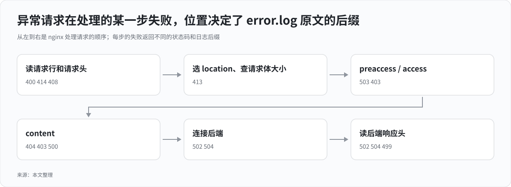
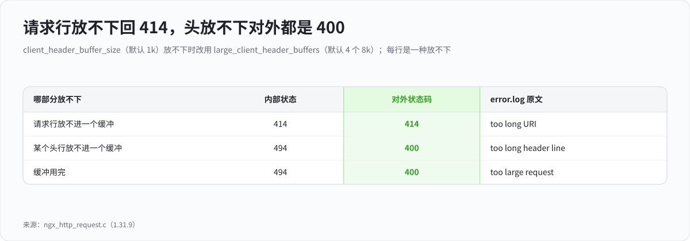
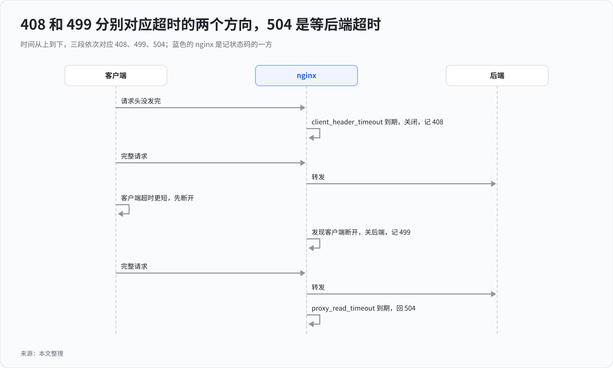
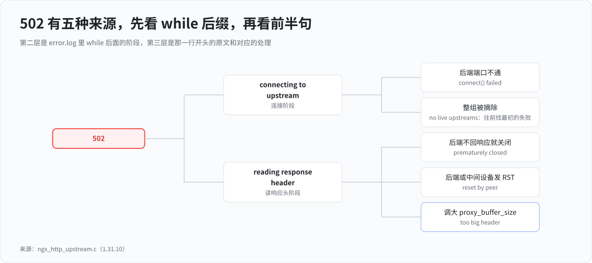
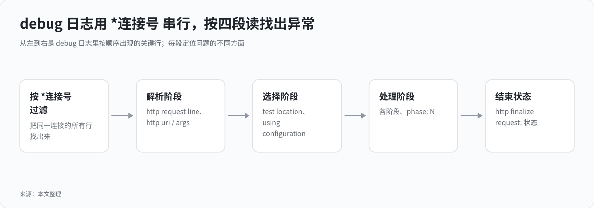
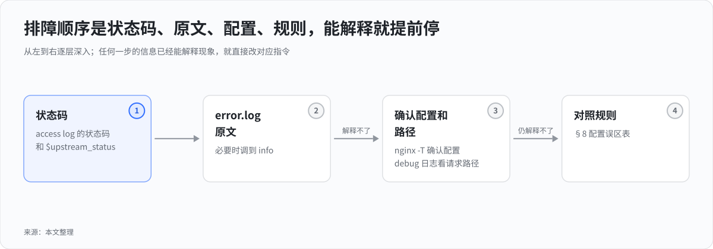

# 运维篇 13｜排障手册：先看状态码，再到 error.log 找原文，客户端造成的错误默认看不到

> **一句话结论**：每个异常状态码在 error.log 里都有一句固定的原文，排障就是“access log 的状态码 → error.log 的原文 → 对应的配置项”。但客户端请求本身出错（400、414、408、499）的原文都是 info 级，`error_log` 不写级别时默认是 error，这些行一条都不会出现；排查“用户说 400，日志里什么都没有”之前，先把级别调到 info。几个状态码的对外表现和日志记录也不一致：请求头行太长内部是 494，对外和日志里都是 400；408 不给客户端发任何响应；499 是 nginx 自己的代码，表示客户端在后端回应之前断开。502 至少有五种原因（连接被拒、后端不回响应就关闭、后端发 RST、响应头超过 `proxy_buffer_size`、整组后端被摘除），504 是等后端超时（读超时和连接超时都算）。`nginx -T` 能打印本次实际读到的所有配置文件，debug 日志能看到一个请求经过的每个阶段和最终选中的 location。
>
> 适用版本：nginx 1.31.10（mainline，2026-11-23）。「版本差异」：本篇涉及的错误原文和状态码映射在 1.30.8 和 1.31.10 中相同；`max_headers`（请求头行数上限，默认 1000，超过时报 `client sent too many header lines`）是 1.29.8 新增的，1.30.8 也有。实验：[`labs/ops-13`](../labs/ops-13/)，单 worker，在 macOS（kqueue）上运行；18260 是前端，18261 是后端，18262 写 debug 日志，18275 是一个接受连接后立即关闭的 stream server，18278 和 18279 没有进程监听。实验同时配了两份 error_log：`logs/error.log info` 和不写级别的 `logs/error-default.log`。

## 导读

| 你想知道 | 看哪一节 |
|---|---|
| 用户报 400，error.log 里却什么都没有 | §1 |
| 414、431 之类“太大”的错误在 nginx 里是什么状态码 | §2 |
| 408 和 499 分别是谁先放弃 | §3 |
| 403、404、500 在配置里对应什么 | §4 |
| 502 的几种原因怎么区分 | §5 |
| 504 和 503 | §6 |
| `nginx -T` 和 debug 日志怎么用 | §7 |
| 前面各篇提到的配置陷阱汇总 | §8 |

一个异常请求在 nginx 里只会在一个地方被判定失败。下图把本篇复现的状态码按“在请求处理的哪一步失败”排开，判断是：失败的位置决定了 error.log 原文里的 `while ...` 后缀，也决定了该改哪类配置：



本篇的实验日志格式是 `$status $request_method $uri up=$upstream_status`，error.log 的引用去掉了时间、pid、连接号 `*N` 和 `client:`、`server:`、`host:` 这几个固定字段。真实的 error.log 一行通常是这样的结构：`时间 [级别] pid#tid: *连接号 原文 while 正在做的事, client: ..., server: ..., request: "...", upstream: "...", host: "..."`。用 `*连接号` 可以把同一个连接上的多行（包括 debug 行）串起来。

## 1. 客户端请求出错的原文是 info 级，error_log 不写级别就看不到

`error_log` 只写文件名时，级别是 `NGX_LOG_ERR`：

```c
// src/core/ngx_log.c:478-486
static char *
ngx_log_set_levels(ngx_conf_t *cf, ngx_log_t *log)
{
    ngx_uint_t   i, n, d, found;
    ngx_str_t   *value;

    if (cf->args->nelts == 2) {
        log->log_level = NGX_LOG_ERR;
        return NGX_CONF_OK;
```

而解析请求行和请求头时发现的问题，几乎都按 `NGX_LOG_INFO` 记录，例如 HTTP/1.1 请求没有 Host：

```c
// src/http/ngx_http_request.c:2033-2041
    }

    if (r->headers_in.host == NULL && r->http_version > NGX_HTTP_VERSION_10) {
        ngx_log_error(NGX_LOG_INFO, r->connection->log, 0,
                   "client sent HTTP/1.1 request without \"Host\" header");
        ngx_http_finalize_request(r, NGX_HTTP_BAD_REQUEST);
        return NGX_ERROR;
    }

```

这是有意的：客户端发错请求不是服务器的问题，按 error 级记录会被扫描器和坏客户端刷满。代价是排障时要知道去哪里找。实验同时开了 info 级和默认级别两份 error_log：

```nginx
# lab: labs/ops-13/conf/nginx.conf
worker_processes 1;
# the same messages at two levels: client errors are logged at "info"
error_log logs/error.log info;
error_log logs/error-default.log;
```

然后发了三种有问题的请求：不带 Host 的 HTTP/1.1、请求头名字里有空格、请求头名字里有下划线：

```text
# labs/ops-13 ## 400: a request nginx cannot accept
HTTP/1.1 without Host: 400
400 GET / up=-
[info] client sent HTTP/1.1 request without "Host" header while reading client request headers, request: "GET / HTTP/1.1"
a space in a header name: 400
an underscore in a header name: 200 x_token=[]
[info] client sent invalid header line: "Bad\x20..." while reading client request headers, request: "GET / HTTP/1.1"
[info] client sent invalid header line: "X_Token: 1" while reading client request headers, request: "GET /hdr HTTP/1.1"
...
ok - the space is fatal, the underscore header is dropped; the default error log has none of the three
```

三种情况在默认级别的日志里都是 0 行。后两种的结果不同，原因在 [`ngx_http_parse_header_line`](https://github.com/nginx/nginx/blob/release-1.31.10/src/http/ngx_http_parse.c#L871) 解析头名字的状态里：字母数字和 `-` 正常累加；下划线在 `underscores_in_headers off`（默认）时只打一个 `invalid_header` 标记；空格、控制字符直接返回解析错误：

```c
// src/http/ngx_http_parse.c:960-1010
            break;

        /* header name */
        case sw_name:
            c = lowcase[ch];

            if (c) {
                hash = ngx_hash(hash, c);
                r->lowcase_header[i++] = c;
                i &= (NGX_HTTP_LC_HEADER_LEN - 1);
                break;
            }

            if (ch == '_') {
                if (allow_underscores) {
                    hash = ngx_hash(hash, ch);
                    r->lowcase_header[i++] = ch;
                    i &= (NGX_HTTP_LC_HEADER_LEN - 1);

                } else {
                    r->invalid_header = 1;
                }

                break;
            }

            if (ch == ':') {
                r->header_name_end = p;
                state = sw_space_before_value;
                break;
            }

            /* IIS may send the duplicate "HTTP/1.1 ..." lines */
            if (ch == '/'
                && r->upstream
                && p - r->header_name_start == 4
                && ngx_strncmp(r->header_name_start, "HTTP", 4) == 0)
            {
                state = sw_ignore_line;
                break;
            }

            if (ch <= 0x20 || ch == 0x7f) {
                r->header_end = p;
                return NGX_HTTP_PARSE_INVALID_HEADER;
            }

            r->invalid_header = 1;

            break;

```

带标记的头在 `ignore_invalid_headers on`（默认）时被丢弃，请求照常处理，`$http_x_token` 是空的，后端也收不到这个头。“客户端明明带了 `X_Token` 头，后端说没收到”就是这个原因：要么让客户端改用 `-`，要么在 server 里写 `underscores_in_headers on`。这类问题不会有 4xx，只有 info 级的一行日志。

**小结**：生产环境可以长期保留 error 级，但要准备一个能临时切到 info 的手段（单独的 server 或 `debug_connection`），否则客户端侧的 400 类问题无从查起。

## 2. 请求行和请求头放不下时：URI 是 414，头行是 494，对外和日志都写 400

请求行和请求头先读进 `client_header_buffer_size`（默认 1k），放不下再用 `large_client_header_buffers`（默认 4 个 8k）。实验把后者缩成 4 个 1k，再把请求体上限设成 1k、请求头超时设成 1 秒：

```nginx
# lab: labs/ops-13/conf/nginx.conf
    server {
        listen 127.0.0.1:18260;
        large_client_header_buffers 4 1k;
        client_max_body_size 1k;
        client_header_timeout 1s;
```

然后分别发一个 1100 字节的 URI 和一个 1100 字节的头行：

```text
# labs/ops-13 ## 414 and 400 for header buffers that are too small
1100-byte URI: 414
[info] client sent too long URI while reading client request line, request: "GET /aaaaaaaa..."
1100-byte header line: 400
400 GET / up=-
[info] client sent too long header line: "X-Long: aaaaaaaa..." while reading client request headers, request: "GET / HTTP/1.1"
ok - a long URI gets 414; a long header line gets 494, sent and logged as 400
```

URI 太长是标准的 414。头行太长时，代码里 finalize 的是 nginx 自定义的 494（`NGX_HTTP_REQUEST_HEADER_TOO_LARGE`），但发给客户端之前，[`ngx_http_special_response_handler`](https://github.com/nginx/nginx/blob/release-1.31.10/src/http/ngx_http_special_response.c#L424) 把 494、495、496、497 这几个内部码的对外状态都改成 400，只保留各自的错误页文案（494 是 “Request Header Or Cookie Too Large”）：

```c
// src/http/ngx_http_special_response.c:510-528
        /* 4XX */
        err = error - NGX_HTTP_BAD_REQUEST + NGX_HTTP_OFF_4XX;

    } else if (error >= NGX_HTTP_NGINX_CODES
               && error < NGX_HTTP_LAST_5XX)
    {
        /* 49X, 5XX */
        err = error - NGX_HTTP_NGINX_CODES + NGX_HTTP_OFF_5XX;
        switch (error) {
            case NGX_HTTP_TO_HTTPS:
            case NGX_HTTPS_CERT_ERROR:
            case NGX_HTTPS_NO_CERT:
            case NGX_HTTP_REQUEST_HEADER_TOO_LARGE:
                r->err_status = NGX_HTTP_BAD_REQUEST;
        }
```

这几个内部码的定义和注释在 `ngx_http_request.h` 里，499 也在这一组：

```c
// src/http/ngx_http_request.h:115-140
#define NGX_HTTP_CLOSE                     444

#define NGX_HTTP_NGINX_CODES               494

#define NGX_HTTP_REQUEST_HEADER_TOO_LARGE  494

#define NGX_HTTPS_CERT_ERROR               495
#define NGX_HTTPS_NO_CERT                  496

/*
 * We use the special code for the plain HTTP requests that are sent to
 * HTTPS port to distinguish it from 4XX in an error page redirection
 */
#define NGX_HTTP_TO_HTTPS                  497

/* 498 is the canceled code for the requests with invalid host name */

/*
 * HTTP does not define the code for the case when a client closed
 * the connection while we are processing its request so we introduce
 * own code to log such situation when a client has closed the connection
 * before we even try to send the HTTP header to it
 */
#define NGX_HTTP_CLIENT_CLOSED_REQUEST     499
```

所以 access log 里的 400 至少有五个来源：请求本身格式错误（§1）、头行太长（494）、证书错误（495）、没带要求的客户端证书（496）、明文请求打到 HTTPS 端口（497，见[运维篇 08](08-tls-http2-http3.md)）。区分它们只能靠 error.log 的原文，或者用 `error_page 494 =400 /xxx` 这类配置把它们导到不同的错误页。最常见的 494 来自过大的 Cookie，处理方法是调大 `large_client_header_buffers` 的单个缓冲（一行头必须放进一个缓冲），而不是缓冲个数。

下图是请求行和请求头的缓冲顺序，判断是：一行（请求行或任意一个头）必须整体放进一个缓冲，放不下时按“是不是请求行”分成 414 和 494：



请求体的上限在选定 location 时按 Content-Length 检查（chunked 请求体在读取过程中检查，见[运维篇 05](05-static-transfer.md)），这条原文是 error 级的：

```text
# labs/ops-13 ## 413: the body is larger than client_max_body_size
2000-byte body: 413
413 POST / up=-
[error] client intended to send too large body: 2000 bytes, request: "POST / HTTP/1.1"
ok - Content-Length is checked before the body is read; the line is at error level
```

**小结**：“太大”类错误先看是哪一部分太大：URI（414）、单行头（400，原文 `too long header line`）、头的总量（400，原文 `too large request`）还是请求体（413），四者对应四个不同的指令。

## 3. 408 是 nginx 等客户端超时，499 是客户端等 nginx 不耐烦

两个码都表示“没有完成的请求”，方向相反。408 是客户端在 `client_header_timeout` 内没把请求头发完：

```text
# labs/ops-13 ## 408: the request header did not arrive within client_header_timeout
closed without a reply
408 GET / up=-
[info] client timed out (60: Operation timed out) while reading client request headers, request: "GET / HTTP/1.1"
ok - nginx closes without a reply and logs 408
```

实验的客户端只发了请求行和一个头，没有发结束的空行。1 秒后 nginx 直接关闭连接，客户端什么都收不到，状态码 408 只出现在 access log 里。代码里是 `ngx_http_close_request`，不是 finalize，所以不会生成响应：

```c
// src/http/ngx_http_request.c:1415-1424
    r = c->data;

    ngx_log_debug0(NGX_LOG_DEBUG_HTTP, rev->log, 0,
                   "http process request header line");

    if (rev->timedout) {
        ngx_log_error(NGX_LOG_INFO, c->log, NGX_ETIMEDOUT, "client timed out");
        c->timedout = 1;
        ngx_http_close_request(r, NGX_HTTP_REQUEST_TIME_OUT);
        return;
```

大量 408 通常是慢速攻击或者网络很差的客户端，也可能是负载均衡器建了连接却不发请求（预连接）。后一种情况没有危害，但会刷 access log。

499 反过来：nginx 在等后端，客户端先断开了。实验的后端 `/slow2` 被 `limit_req` 延迟约 60 秒，客户端只等 0.5 秒：

```text
# labs/ops-13 ## 499: the client gave up first
499 GET /t499 up=-
[info] kevent() reported that client prematurely closed connection, so upstream connection is closed too
ok - the status is 499 and the upstream status is empty
```

nginx 在等后端响应时也在监视客户端连接（`proxy_ignore_client_abort off`，默认），发现客户端关闭就主动断开后端连接，以 499 结束请求，原文同样是 info 级。Linux 的 epoll 上原文开头是 `epoll_wait() reported that`。这段逻辑在 [`ngx_http_upstream_check_broken_connection`](https://github.com/nginx/nginx/blob/release-1.31.10/src/http/ngx_http_upstream.c#L1372) 里：

```c
// src/http/ngx_http_upstream.c:1428-1450
#if (NGX_HAVE_KQUEUE)

    if (ngx_event_flags & NGX_USE_KQUEUE_EVENT) {

        if (!ev->pending_eof) {
            return;
        }

        ev->eof = 1;
        c->error = 1;

        if (ev->kq_errno) {
            ev->error = 1;
        }

        if (!u->cacheable && u->peer.connection) {
            ngx_log_error(NGX_LOG_INFO, ev->log, ev->kq_errno,
                          "kevent() reported that client prematurely closed "
                          "connection, so upstream connection is closed too");
            ngx_http_upstream_finalize_request(r, u,
                                               NGX_HTTP_CLIENT_CLOSED_REQUEST);
            return;
        }
```

`$upstream_status` 是 `-`，因为后端还没回任何东西。499 的根因几乎总在后端慢：客户端（浏览器、App、上游网关）的超时比 nginx 的 `proxy_read_timeout`（默认 60 秒）短，于是用户看到的是客户端自己的超时，nginx 记 499。拿 499 的 `$request_time` 和客户端的超时设置对一下，就能确认这一点。

下图把 408、499、504 放在同一条时间线上比较，判断是：三个码分别对应“客户端慢”“后端慢、客户端先放弃”“后端慢、nginx 先放弃”：



**小结**：408 看客户端和网络，499 和 504 都看后端；二者的区别只是谁的超时更短，调大 nginx 的超时不能消除 499。

## 4. 403、404、500 来自配置和文件系统，error.log 会写出具体路径

这三个码不涉及后端，原文里带着 nginx 实际去找的文件路径，是确认 `root`/`alias` 拼接结果的最快方法：

```nginx
# lab: labs/ops-13/conf/nginx.conf
        location /hdr { return 200 "x_token=[$http_x_token]\n"; }
        location /loop { rewrite ^ /loop last; }
```

```text
# labs/ops-13 ## 403, 404 and 500 from the configuration and the file system
/dir/     403
/nothing  404
/loop     500
[error] directory index of "$LAB/html/dir/" is forbidden, request: "GET /dir/ HTTP/1.1"
[error] open() "$LAB/html/nothing" failed (2: No such file or directory), request: "GET /nothing HTTP/1.1"
[error] rewrite or internal redirection cycle while processing "/loop", request: "GET /loop HTTP/1.1"
ok - a directory without an index, a missing file, a rewrite loop
```

`html/dir/` 存在，但里面没有 `index.html`，又没开 `autoindex`，于是 403。这是“403 但权限明明没问题”最常见的原因；真正的权限问题原文是 `open() ... failed (13: Permission denied)`，也是 403。404 的原文直接给出了拼出来的路径，`root` 写错一层目录、`alias` 少一个斜杠，在这里一眼可见。不想让 404 刷 error.log，可以在对应 location 写 `log_not_found off`（见[运维篇 11](11-logging-monitoring.md)）。

500 的 `rewrite or internal redirection cycle` 表示一个请求的 URI 改写或内部跳转超过了 10 次（`NGX_HTTP_MAX_URI_CHANGES`）。实验是最直接的写法：`/loop` 改写成 `/loop` 再 `last` 重新选 location。生产里更常见的是 `try_files ... /index.php` 和 `error_page 404 /404.html` 互相指向一个不存在或者又会 404 的地方。原文里的 `while processing "/loop"` 是最后一次的 URI，顺着它往回找跳转链。

**小结**：403、404 的原文先看路径对不对，再看文件和目录权限；500 的循环先看 `try_files`、`error_page` 和 `rewrite ... last` 是否互相指向。

## 5. 502 至少有五种原因，error.log 的原文各不相同

502 只说明“nginx 没从后端拿到可用的响应”。实验用五个 location 各复现一种：

```nginx
# lab: labs/ops-13/conf/nginx.conf
        location /refused { proxy_pass http://127.0.0.1:18279; }
        location /closed  { proxy_pass http://127.0.0.1:18261/close; }
        location /reset   { proxy_pass http://127.0.0.1:18275; }
        location /big {
            proxy_buffer_size 1k;
            proxy_pass http://127.0.0.1:18261/echo;
        }
        location /nolive  { proxy_pass http://dead2; }
```

18279 没有进程监听；后端的 `/close` 是 `return 444`，读完请求后不回任何东西就关闭连接；18275 是一个 stream server，不读请求就关闭，内核因为还有未读数据而回 RST；`/echo` 返回一个 1200 字节的响应头，超过前端的 `proxy_buffer_size 1k`；`dead2` 组里两台都没有进程监听。`/nolive` 连发两次：

```text
# labs/ops-13 ## 502: five different upstream failures
502 GET /refused up=502
502 GET /closed up=502
502 GET /reset up=502
502 GET /big up=502
502 GET /nolive up=502, 502
502 GET /nolive up=502
[error] kevent() reported that connect() failed (61: Connection refused) while connecting to upstream
[error] upstream prematurely closed connection while reading response header from upstream
[error] kevent() reported about an closed connection (54: Connection reset by peer) while reading response header from upstream
[error] upstream sent too big header while reading response header from upstream
[error] kevent() reported that connect() failed (61: Connection refused) while connecting to upstream
[error] kevent() reported that connect() failed (61: Connection refused) while connecting to upstream
[error] no live upstreams while connecting to upstream
ok - six requests, six 502
```

| 原文 | 说明 | 先查什么 |
|---|---|---|
| `connect() failed (... Connection refused) while connecting to upstream` | 后端端口没有进程监听（Linux 上是 111，macOS 上是 61） | 后端进程是否在、端口是否写对、是否在发布中重启 |
| `upstream prematurely closed connection while reading response header` | 连上了，后端没回响应头就关了 | 后端是否崩溃、是否主动关掉了它认为空闲的长连接（1.29.7 起 upstream 默认长连接，见[运维篇 06](06-reverse-proxy.md)） |
| `... (Connection reset by peer) while reading response header`（Linux 上是 `recv() failed (104: ...)`） | 后端用 RST 断开 | 后端进程被杀、后端的连接数或 backlog 满了、中间的防火墙或负载均衡器重置了空闲连接 |
| `upstream sent too big header while reading response header` | 后端的响应头超过 `proxy_buffer_size`（默认一页，4k 或 8k） | 后端是否下发了很大的 Set-Cookie 或调试头；调大 `proxy_buffer_size` |
| `no live upstreams while connecting to upstream` | 组里所有后端都在 `fail_timeout` 的摘除期内 | 往前找这些后端最初的失败原因，这一行本身不是根因 |

第二次 `/nolive` 根本没有去连接：第一次两台都失败、都被摘除，第二次 nginx 直接以 502 结束，`$upstream_status` 只有一个值。这是 502 里最容易误判的一种：看到 `no live upstreams` 就去查后端，后端此时可能已经恢复了，真正要找的是摘除之前那几行 `connect() failed`。被动摘除的规则见[运维篇 07](07-load-balancing.md)。

下图是按原文给 502 分类的顺序，判断是：先看 `while` 后缀确定失败的阶段，再看前半句确定原因：



**小结**：502 不是一个原因而是一类，按 `while` 后缀和前半句两级分类；`no live upstreams` 是结果，根因在它之前的日志里。

## 6. 504 是等后端超时，503 多半是 nginx 自己的限流

后端连上了、请求也发了，但在 `proxy_read_timeout` 内没回响应头，就是 504。实验的 `/t504` 把读超时设成 1 秒，后端被 `limit_req` 延迟约 60 秒：

```nginx
# lab: labs/ops-13/conf/nginx.conf
        location /t504 {
            proxy_read_timeout 1s;
            proxy_pass http://127.0.0.1:18261/slow;
        }
```

```text
# labs/ops-13 ## 504: the upstream did not answer within proxy_read_timeout
front: 504
504 GET /t504 up=504
[error] upstream timed out (60: Operation timed out) while reading response header from upstream
ok - the backend holds the request, the proxy gives up after 1 s
```

超时在 [`ngx_http_upstream_next`](https://github.com/nginx/nginx/blob/release-1.31.10/src/http/ngx_http_upstream.c#L4613) 里被映射成 504；同一个 `NGX_HTTP_UPSTREAM_FT_TIMEOUT` 也用于连接超时，所以 504 的原文后缀可能是 `while connecting to upstream`（`proxy_connect_timeout`，默认 60 秒，常见于后端机器宕机、防火墙丢包）或者 `while reading response header from upstream`（后端处理慢）。除了几类明确的 HTTP 状态码，其余失败都落到 502：

```c
// src/http/ngx_http_upstream.c:4650-4690
    if (u->peer.cached && ft_type == NGX_HTTP_UPSTREAM_FT_ERROR) {
        /* TODO: inform balancer instead */
        u->peer.tries++;
    }

    switch (ft_type) {

    case NGX_HTTP_UPSTREAM_FT_TIMEOUT:
    case NGX_HTTP_UPSTREAM_FT_HTTP_504:
        status = NGX_HTTP_GATEWAY_TIME_OUT;
        break;

    case NGX_HTTP_UPSTREAM_FT_HTTP_500:
        status = NGX_HTTP_INTERNAL_SERVER_ERROR;
        break;

    case NGX_HTTP_UPSTREAM_FT_HTTP_503:
        status = NGX_HTTP_SERVICE_UNAVAILABLE;
        break;

    case NGX_HTTP_UPSTREAM_FT_HTTP_403:
        status = NGX_HTTP_FORBIDDEN;
        break;

    case NGX_HTTP_UPSTREAM_FT_HTTP_404:
        status = NGX_HTTP_NOT_FOUND;
        break;

    case NGX_HTTP_UPSTREAM_FT_HTTP_429:
        status = NGX_HTTP_TOO_MANY_REQUESTS;
        break;

    /*
     * NGX_HTTP_UPSTREAM_FT_BUSY_LOCK and NGX_HTTP_UPSTREAM_FT_MAX_WAITING
     * never reach here
     */

    default:
        status = NGX_HTTP_BAD_GATEWAY;
    }

```

503 在 nginx 里通常不是后端返回的（那种情况 `$upstream_status` 也是 503），而是 `limit_req`/`limit_conn` 拒绝的，`$upstream_status` 是 `-`：

```nginx
# lab: labs/ops-13/conf/nginx.conf
    limit_req_zone $server_port zone=lim:1m rate=1r/m;
```

```text
# labs/ops-13 ## 503: limit_req rejected the request
two requests: 200 503
503 GET /limited up=-
[error] limiting requests, excess: <n> by zone "lim"
ok - the second request within a minute is rejected
```

原文带着 zone 名，配了多个限流区时能直接看出是哪一个拒的；拒绝的状态码可以用 `limit_req_status 429` 改掉，免得和后端的 503 混在一起。`limit_req_dry_run on` 可以只记日志不拒绝，用来上线前评估阈值（见[运维篇 09](09-rate-limiting.md)）。

**小结**：504 先看 `while` 后缀分清是连不上还是等不到；503 先看 `$upstream_status` 是不是 `-`，是 `-` 就去查本机的限流配置。

## 7. nginx -T 打印实际读到的每个文件，debug 日志能看到一个请求走过的每一步

排障时第一件事是确认“正在运行的配置到底是什么”。`nginx -T` 先做 `-t` 的检查，再把读到的每个文件原样打印出来，每个文件前面有一行 `# configuration file 路径:`。实验的主配置 include 了一个 `upstreams.conf`：

```text
# labs/ops-13 ## nginx -T prints every file it read
the configuration file $LAB/conf/nginx.conf syntax is ok
# configuration file $LAB/conf/nginx.conf:
# configuration file $LAB/conf/upstreams.conf:
ok - the main file and the included one are both dumped
```

有两点要注意。第一，`-T` 读的是磁盘上的文件，不是正在运行的 master 内存里的配置；改了文件没 reload，或者 reload 失败（见[运维篇 03](03-processes-signals.md)），`-T` 的结果和线上行为就不一致。第二，`include` 的相对路径相对于主配置文件所在的目录，`-T` 打印出的绝对路径能确认 include 到的是哪一份。

想知道一个请求在 nginx 内部怎么走，用 debug 日志。它需要编译时带 `--with-debug`（`nginx -V` 可查，见[运维篇 01](01-install.md)），然后在某个 server 里写 `error_log ... debug`，或者在 events 块里用 `debug_connection` 只给指定客户端地址打开：

```nginx
# lab: labs/ops-13/conf/nginx.conf
    # one request traced with a debug log
    server {
        listen 127.0.0.1:18262;
        error_log logs/debug.log debug;
        location / { return 200 "traced\n"; }
    }
```

一个 `GET /a?b=1` 产生几十行 debug，挑出标记主要步骤的那些：

```text
# labs/ops-13 ## reading one request in the debug log
[debug] http request line: "GET /a?b=1 HTTP/1.1"
[debug] http uri: "/a"
[debug] http args: "b=1"
[debug] generic phase: 0
[debug] rewrite phase: 1
[debug] test location: "/"
[debug] using configuration "/"
[debug] rewrite phase: 3
[debug] http finalize request: 0, "/a?b=1" a:1, c:1
[debug] http close request
ok - the request line, the phases and the finalize call are all there
```

从上往下读：请求行解析出 URI 和参数；`generic phase`、`rewrite phase` 后面的数字是阶段处理器数组的下标；`test location` 是 location 查找时比较过的每一个前缀，`using configuration` 是最终选中的那个，“为什么没进我写的 location”看这两行就够了；`return` 在 rewrite 阶段直接结束请求，所以后面没有 content 阶段的行；`http finalize request: 0` 表示正常结束。阶段和处理器数组的结构在开发篇 06 展开。

下图是用 debug 日志定位问题时的读法，判断是：先用连接号把行串起来，再按“解析、选 location、阶段、结束”四段找异常：



**小结**：`-T` 回答“配置是什么”，debug 日志回答“这个请求实际怎么走的”；生产上 debug 日志只对单个 server 或单个客户端地址打开，用完就关。

## 8. 常见配置误区：都不报错，都要靠理解规则才能发现

下面这些误区在前面各篇里都有实验，`nginx -t` 都能通过，出问题时日志里也未必有 error 级的记录。按“症状”列出，方便对照：

| 症状 | 原因 | 详见 |
|---|---|---|
| 子级 location 加了一个 `add_header`，父级的几个头全没了 | 数组指令在子级出现一条就整组覆盖 | [运维篇 02](02-config.md) |
| 改了配置，线上行为没变 | reload 失败，老 worker 继续用老配置；只有一条 emerg | [运维篇 03](03-processes-signals.md) |
| 正则 location 抢走了前缀 location 的请求 | 最长前缀不带 `^~` 时还要再试正则 | [运维篇 04](04-routing.md) |
| 文件更新后还在返回旧内容 | `open_file_cache_valid`（默认 60 秒）内用的是缓存的描述符 | [运维篇 05](05-static-transfer.md) |
| `proxy_pass` 带不带结尾 `/`，后端收到的 URI 不一样 | 带 URI 时替换 location 前缀 | [运维篇 06](06-reverse-proxy.md) |
| 后端 500 没有换机器重试 | 500 默认原样返回，要写进 `proxy_next_upstream` | [运维篇 07](07-load-balancing.md) |
| reload 后 TLS 会话复用率掉到 0 | 没配 `ssl_session_cache shared:`，ticket 密钥随配置更换 | [运维篇 08](08-tls-http2-http3.md) |
| `limit_req` 对某个 location 不生效 | 这个 location 用 `return` 出内容，在限流阶段之前就结束了 | [运维篇 09](09-rate-limiting.md) |
| 两个 location 共用了同一条缓存 | 默认缓存键是发给后端的 URL | [运维篇 10](10-proxy-cache.md) |
| JSON 日志被下游解析失败 | 没写 `escape=json` | [运维篇 11](11-logging-monitoring.md) |
| stream 里按域名写的 `deny all` 不生效 | access 阶段在 preread 切换虚拟主机之前 | [运维篇 12](12-stream.md) |
| 后端收不到带下划线的请求头 | `underscores_in_headers` 默认关，头被丢弃，只有 info 日志 | 本篇 §1 |

这些误区的共同点是：配置语法正确，nginx 按自己的规则执行了，只是规则和直觉不同。下图把排障的顺序收成一条线，判断是：从状态码出发，日志原文能定位到大多数问题，剩下的靠 `-T` 和 debug 日志确认规则：



**小结**：排障的顺序是状态码、原文、配置、规则；上表里的每一条都是“规则和直觉不同”，排障到最后一步时逐条对照。

## 已知局限与待核实

- 实验只在 macOS（kqueue）上运行。Linux 上 errno 的数值和文字不同（拒绝连接是 111，超时是 110 `Connection timed out`），客户端断开的原文以 `epoll_wait() reported that` 开头，来自源码，没有在 Linux 上实测。
- 495、496、497 映射成 400 来自源码，本篇没有复现；497 的实验在运维篇 08。`too large request`（请求头总量超过全部缓冲）和 `too many header lines`（`max_headers`）没有复现。
- §5 的 RST 依赖时序：18275 在 nginx 写完请求之后才关闭时是 RST；如果关闭得更早，前端可能先读到 FIN（`prematurely closed`）或写失败（`Broken pipe`）。本机连跑 5 次结果一致，换机器可能不同。
- 504 只复现了读超时；连接超时（后端机器不可达）需要一个丢包的地址，本机环境没有构造。
- `upstream prematurely closed connection` 在“后端关闭了 nginx 认为可复用的长连接”时的表现只做了推断：1.29.7 起默认长连接，nginx 对复用连接上的这类失败会重试（`u->peer.cached` 分支），本篇没有实验。
- `debug_connection` 没有实验，只演示了 server 级的 `error_log ... debug`。§7 debug 输出里阶段下标的含义来自源码，数字随编进的模块变化。
- 实验的 `limit_req` 延迟约 60 秒，用来让后端“卡住”；前端放弃后，后端的那个请求要等延迟结束或连接关闭才结束，这部分行为没有核对。

## 修订记录

- 2026-11-21：基于 nginx 1.31.9 源码新写。覆盖 error_log 默认级别与 info 级的客户端错误、头名字中的空格和下划线、414/494/413、408 与 499、403/404/500、502 的五种原文、504 与 503、`nginx -T`、debug 日志的读法，以及前面各篇配置误区的汇总，均附 `labs/ops-13` 实验。
- 2026-11-26：基线升到 nginx 1.31.10 / 1.30.8（2026-11-23 发布），重跑实验并更新输出，源码摘录与行号链接复核无漂移。
